# 数学之美 · Math Visualizations

用可交互的图形直观展现数学的奥妙。每个样例是一个独立的网页，用浏览器直接打开即可，拖动滑块就能看到公式如何变成形状。

从总目录页 [index.html](index.html) 进入，按“贝壳”“分形”“图案”“运动与波”“几何与拓扑”“数论”“概率”七类导航到各个样例；每个样例页面左上角有“← 全部样例”返回目录。

## 样例

| 样例 | 数学主题 | 预览 |
|------|----------|------|
| [Raup 贝壳卷曲模型 · 3D](examples/raup-shell/README.md)（[打开页面](examples/raup-shell/index.html)） | 对数螺线、自相似、超椭圆；W/D/T 三个数字生成几乎所有螺旋贝壳，可调管口形状、壁厚、纹理、透明度并沿中轴剖切；头足类的气室隔板与体管，羊角、双壳预设 | 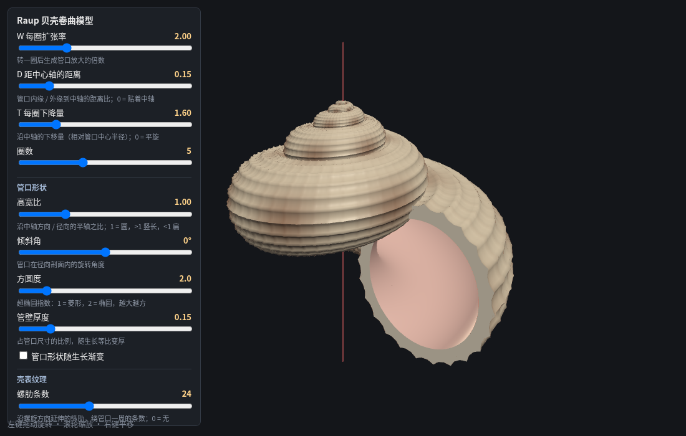 |
| [Mandelbrot 集与 Julia 集 · 分形](examples/mandelbrot-julia/README.md)（[打开页面](examples/mandelbrot-julia/index.html)） | 复数迭代 z → z^d + c、逃逸时间、连通性定理、自相似；左右联动，单击 Mandelbrot 集上任一点即得对应 Julia 集，可显示迭代轨道 | 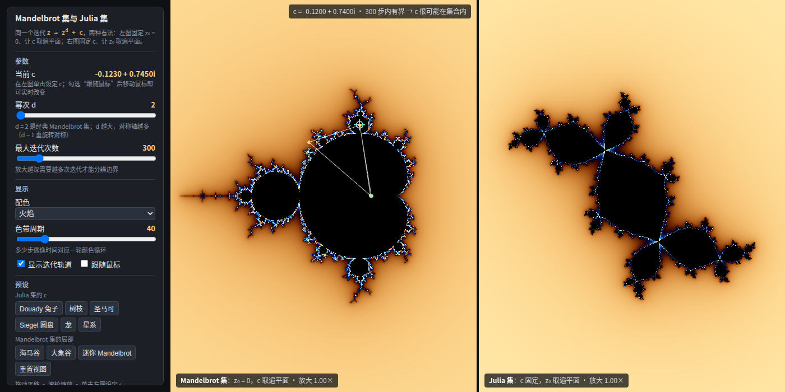 |
| [L-system 植物](examples/lsystem-plants/README.md)（[打开页面](examples/lsystem-plants/index.html)） | 并行字符串重写、海龟作图、栈与分枝、自相似、分形维数；可编辑规则，逐代或按画线顺序播放生长，含 Koch 雪花、龙曲线、Hilbert 曲线等预设 | 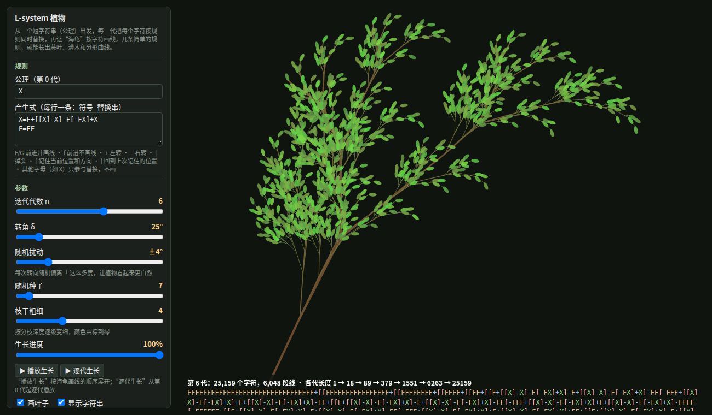 |
| [IFS 蕨叶 · 混沌游戏](examples/ifs-fern/README.md)（[打开页面](examples/ifs-fern/index.html)） | 仿射变换、压缩映射、Hutchinson 算子与不动点定理、随机迭代、自相似；可编辑变换表，按变换着色并画出包围盒的像，含 Barnsley 蕨叶、Sierpinski 三角、龙曲线等预设 |  |
| [向日葵叶序 · 黄金角](examples/phyllotaxis/README.md)（[打开页面](examples/phyllotaxis/index.html)） | Vogel 模型、有理角与直辐条、连分数与 Hurwitz 定理、黄金比例是“最无理”的数、斜列线条数为相邻 Fibonacci 数；可调发散角并画出均匀度曲线，标出顺/逆时针螺线族并数条数，含生长动画和菠萝、松果圆柱叶序 | 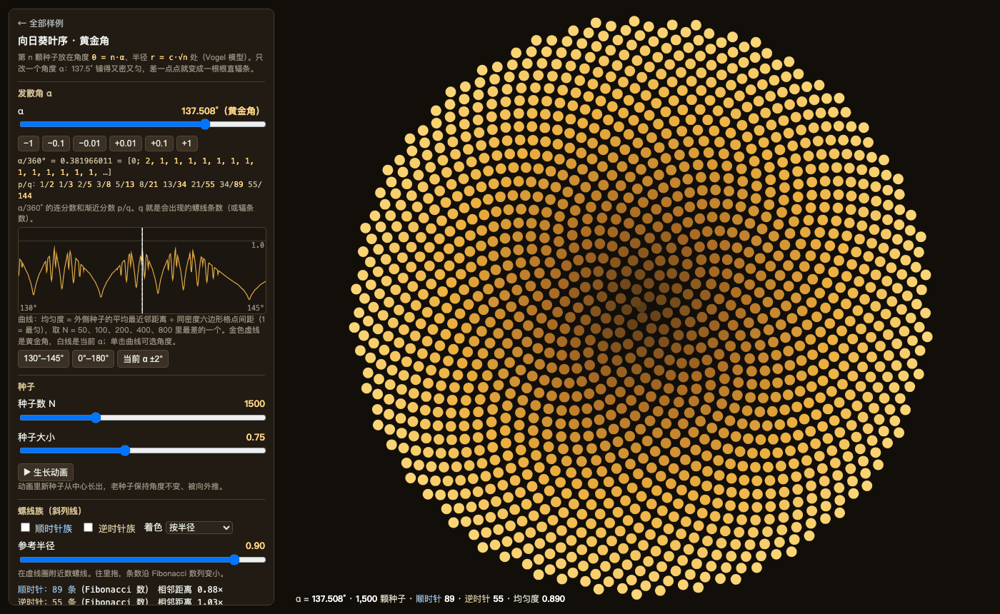 |
| [图灵斑图 · 反应扩散](examples/turing-patterns/README.md)（[打开页面](examples/turing-patterns/index.html)） | Gray-Scott 方程、图灵失稳与扩散速度之比、均匀态的线性稳定性与鞍结线、(F, k) 参数图；鼠标播种，含斑点（豹纹）、条纹 / 迷宫、珊瑚、细胞分裂、蠕虫、孔洞、混沌等预设 | 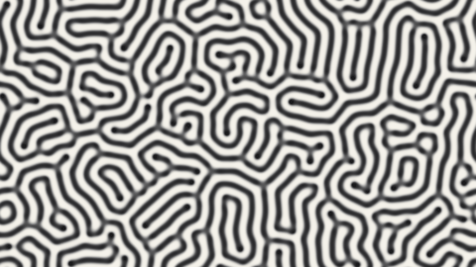 |
| [Lorenz 吸引子 · 蝴蝶效应](examples/lorenz-attractor/README.md)（[打开页面](examples/lorenz-attractor/index.html)） | 常微分方程与 RK4、不动点与 Jacobian 特征值、叉式分岔与 Hopf 分岔、体积收缩、Lyapunov 指数；2–1000 条起点只差 ε 的轨道同时积分，实时画出 ln d–t 曲线并拟合斜率，ρ 滑条从流向原点、两个稳定不动点一路到混沌和周期窗口，可拖动旋转 3D 视角 | 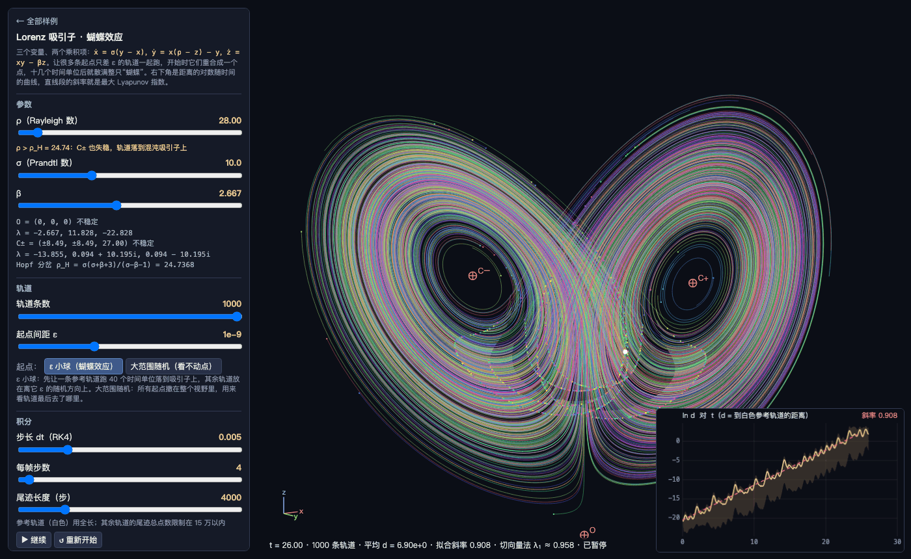 |
| [傅里叶本轮 · 圆叠圆画曲线](examples/fourier-epicycles/README.md)（[打开页面](examples/fourier-epicycles/index.html)） | 复数傅里叶级数、DFT、Parseval 等式、对称性与系数衰减、Gibbs 现象；按半径排序的 N 个圆首尾相接画出曲线，可用鼠标自己画，含正方形、五角星、心形、三叶线、手写 π/∑ 预设和奇次正弦叠方波 | 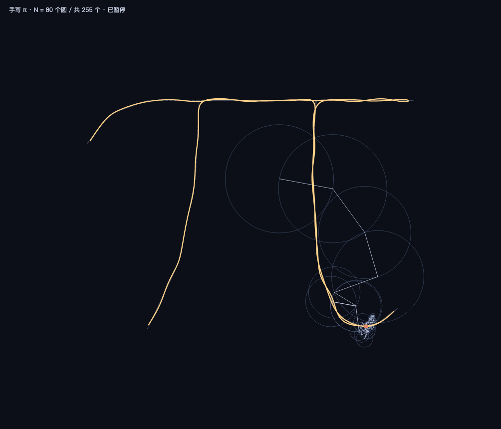 |
| [最速降线 · 摆线赛跑](examples/brachistochrone/README.md)（[打开页面](examples/brachistochrone/index.html)） | Bernoulli 1696 最速降线问题、Snell 折射定律与 Euler–Lagrange（Beltrami 恒等式）、摆线闭式用时 √(a/g)·θ、给定 B 求 a、为何先沉到 B 以下；直线/圆弧/抛物线/三次曲线/摆线/手画轨道实时赛跑（可拖动 B），等时降落与圆碗对照 | 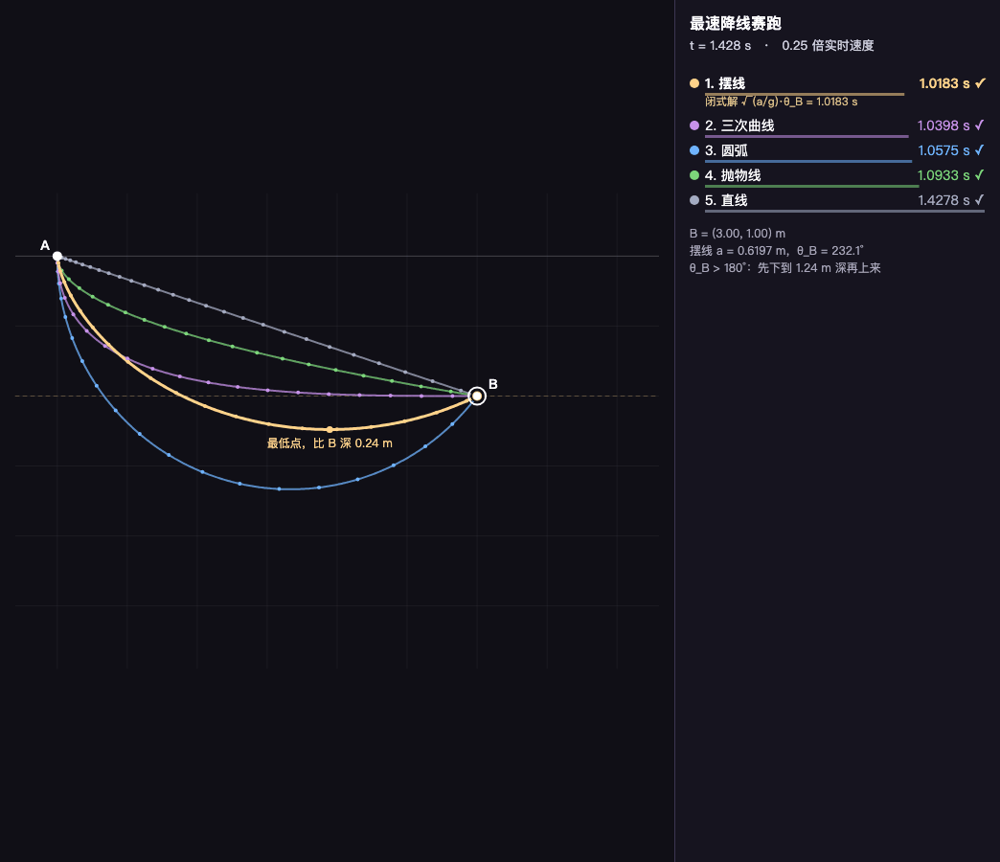 |
| [Logistic 映射 · 倍周期分岔](examples/logistic-map/README.md)（[打开页面](examples/logistic-map/index.html)） | 一维迭代 x → r·x(1 − x)、蛛网图与不动点稳定性、倍周期分岔与 Feigenbaum 常数 δ、Lyapunov 指数、周期 3 窗口与切分岔（Li–Yorke、Sharkovskii）、阵发混沌、与 Mandelbrot 集实轴的共轭 c = r/2 − r²/4；分岔图可单击设 r、拖框放大，数值求出 r₁…r₉ 和 δ | 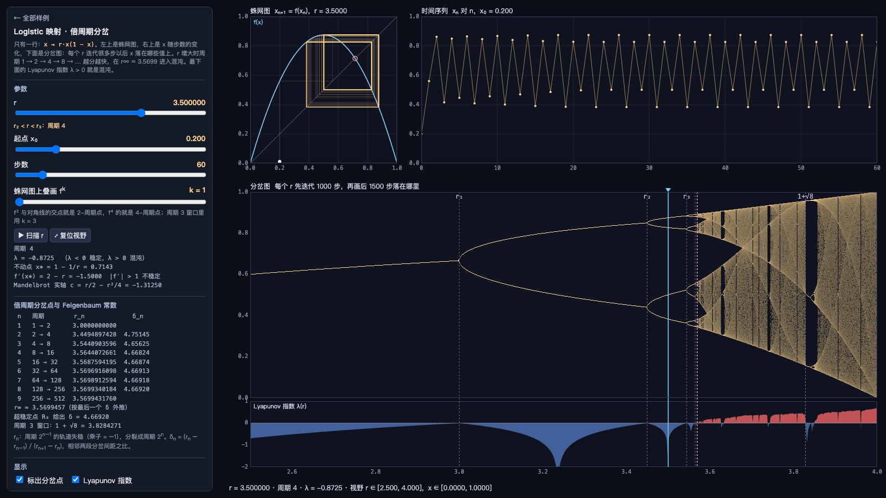 |
| [Galton 板 · 中心极限定理](examples/galton-board/README.md)（[打开页面](examples/galton-board/index.html)） | 伯努利试验与杨辉三角、二项分布的均值 np 与方差 np(1−p)、de Moivre–Laplace 定理、中心极限定理及其条件、Berry–Esseen 与 Edgeworth 收敛速度、柯西分布的反例、大数定律；动画小球落板，叠加精确二项分布与正态曲线，另有均匀、指数、双峰、骰子、柯西五种分布的 n 项和，实时画出 KS 距离随 n 的下降 | 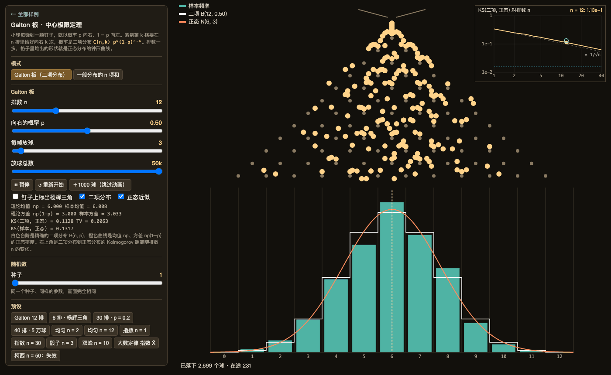 |
| [Penrose 镶嵌 · 永不重复的铺砖](examples/penrose-tiling/README.md)（[打开页面](examples/penrose-tiling/index.html)） | Robinson 三角形收缩替换、粗细菱形个数比沿 Fibonacci 数列收敛到 φ、膨胀与超级砖块、匹配弧线、P2 风筝与飞镖、de Bruijn 五重网格与相位子、晶体学限制（2cos 72° = 1/φ 不是整数）、准晶体与 Shechtman；可逐代收缩，并测量旋转 72°/36° 后的重合度 | 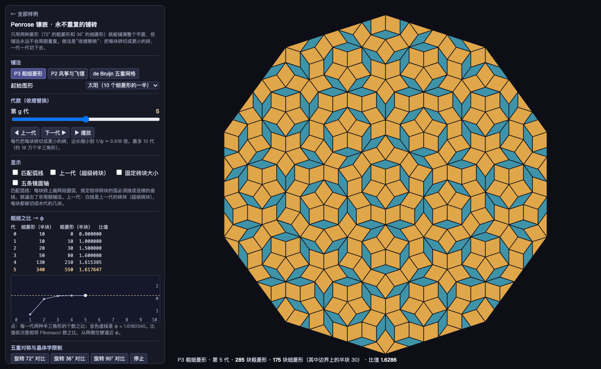 |
| [圆上的乘法表 · 心形线](examples/times-table-circle/README.md)（[打开页面](examples/times-table-circle/index.html)） | 弦族的包络与外摆线（杠杆支点推导、滚圆切线）、模 N 的乘法阶与环结构（置换与尾巴、1/97 的 96 位循环节）、Mandelbrot 与 z^k + c 主分量的边界、圆内反射焦散；k 可连续变化并动画，按环着色，单击点看轨道，含心形线、肾形线、混叠图案、咖啡杯点光源/平行光预设 | 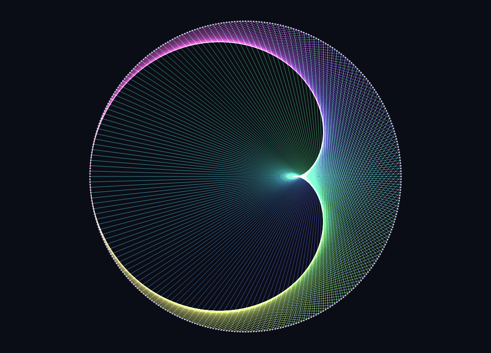 |
| [Collatz 3n+1 · 冰雹数与珊瑚树](examples/collatz-tree/README.md)（[打开页面](examples/collatz-tree/index.html)） | 冰雹轨迹与 BigInt 精确峰值、每个奇数步平均乘 3/4 的启发式、倒着画所有轨迹的珊瑚树、停止时间散点的条带与 σ(n) 只由 n mod 2ᵏ 决定、Terras 定理与 2-adic 视角；可调转角并切换共享路径只画一次，线性 / 对数纵轴，含 27、837799、2⁵³ − 1 等预设 | 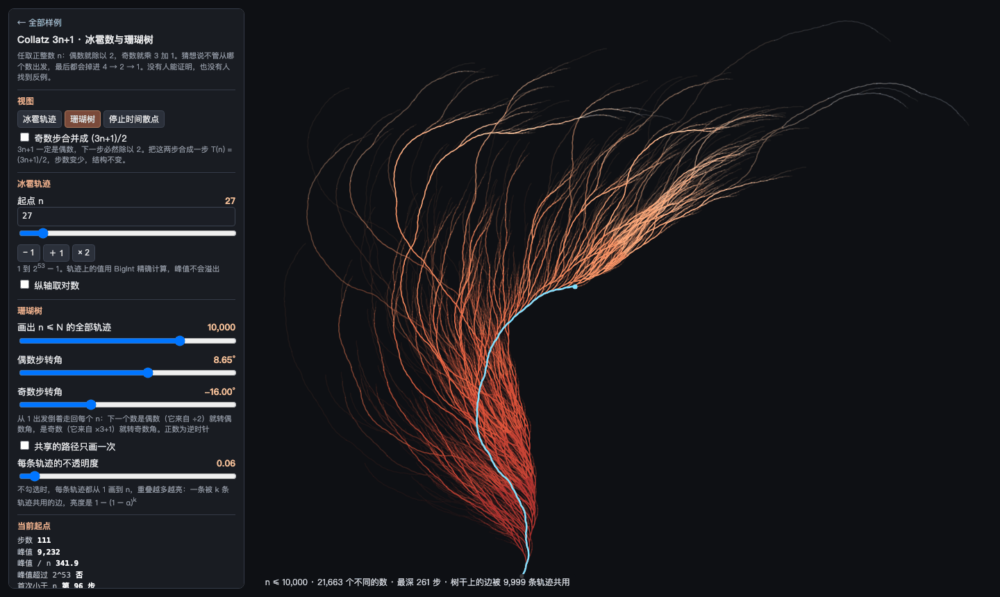 |
| [Ulam 素数螺旋 · 二次多项式的对角线](examples/ulam-spiral/README.md)（[打开页面](examples/ulam-spiral/index.html)） | 埃拉托斯特尼筛法、素数定理 π(x) ~ li(x)、斜线即二次多项式 4k² + bk + c、Euler 的 m² + m + 41 与 Heegner 数 163、Hardy–Littlewood 猜想 F 与 Bateman–Horn 常数、Bunyakovsky 猜想与 Landau 的 m² + 1 问题、Cramér 随机模型；单击斜线给出多项式、实测与预测素数密度，所有射线的实测 vs 预测散点图，Sacks 螺旋上多项式变成曲线 | 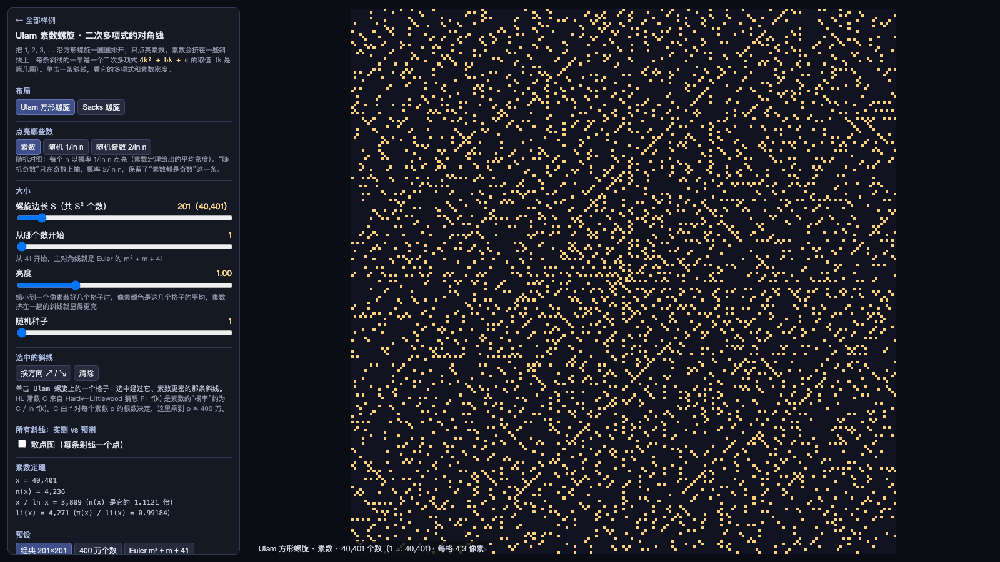 |
| [Ford 圆与 Farey 数列](examples/ford-circles/README.md)（[打开页面](examples/ford-circles/index.html)） | Ford 圆从不交叠的证明 d² − (r₁+r₂)² = (Δ²−1)/(q²s²)、中位分数是空隙里最大的圆、Farey 数列相邻项相切与 \|F_n\| ≈ 3n²/π²、Stern–Brocot 树与连分数路径、Legendre 与 Vahlen 定理（竖线穿过的圆就是渐近分数）、Hurwitz 常数 √5 与 φ；可点选圆看邻居与中位数，树与圆共用横轴联动，φ、π、√2、e 逐个渐近分数放大 | 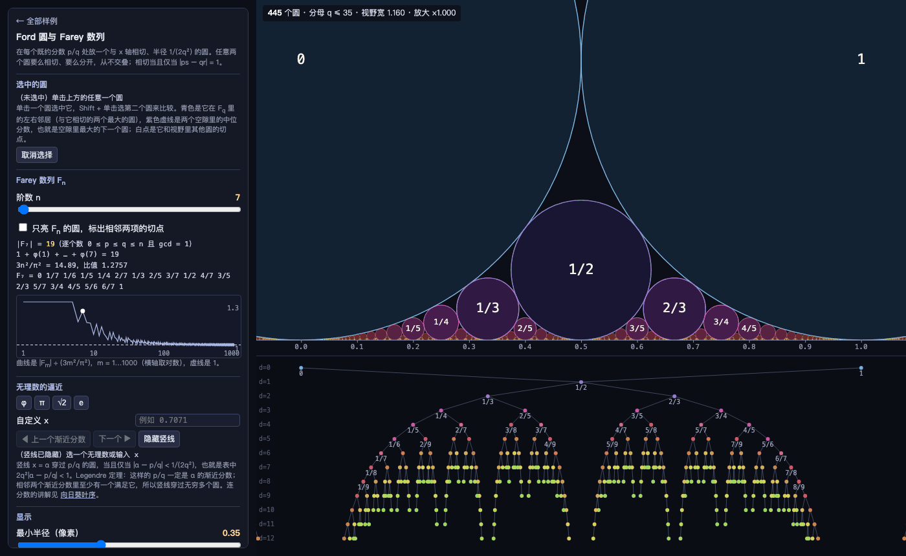 |

## 目录约定

```
examples/<样例名>/
  index.html   # 单文件页面，无需构建
  README.md    # 数学原理、参数说明、效果图
  images/      # README 用到的截图
```

新增样例时，在上表加一行，并链接到它的 README 和页面。
