# 黑洞 · Schwarzschild 时空中的光线与轨道

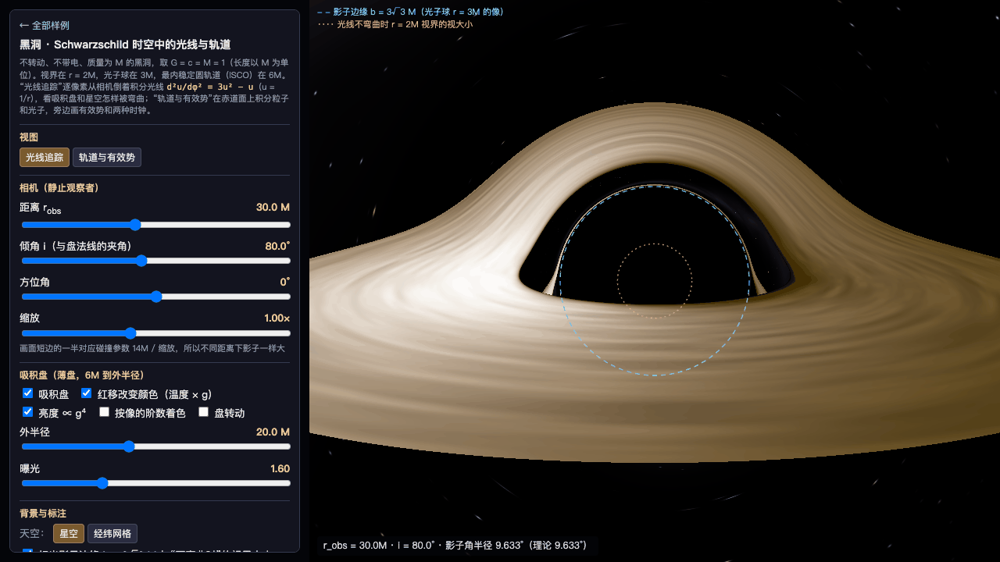

一个不转动、不带电的黑洞只有一个参数：质量 M。它周围的时空由 Schwarzschild 在 1916 年写下的度规描述。这个页面有两个视图：

- **光线追踪**：相机静止地悬在离黑洞 r_obs 处。页面对每个像素倒着积分一条光线（零测地线），看它落进视界、飞向远处的星空，还是打在吸积盘上。黑色的“影子”、盘的背面被抬到影子上方、贴着影子的一圈细环、左右两侧亮度相差 5 到 25 倍，都是这样算出来的。
- **轨道与有效势**：在赤道面上积分有质量粒子和光子的轨道，旁边画有效势，再画半径对固有时 τ 和对坐标时 t 的两条曲线。可以看到近点进动、绕着 4M 转圈的 zoom-whirl、6M 的最内稳定圆轨道（ISCO），以及落向视界时 τ 有限而 t 发散。

打开方式：用浏览器直接打开 [index.html](index.html)。光线追踪需要 WebGL2，轨道视图只用 Canvas 2D。不依赖外部库，离线也能用。

全文取 G = c = 1，长度和时间都以 M 为单位（M 也可以读成 GM/c² 或 GM/c³）。

## 数学原理

### 1. Schwarzschild 度规

```
ds² = −(1 − 2M/r) dt² + dr² / (1 − 2M/r) + r² (dθ² + sin²θ dφ²)
```

r 是“面积半径”：r = 常数的球面面积是 4πr²。t 是远处静止观察者的时钟。

- r = 2M 是**视界**。在那里 g_tt = 0，静止的钟走得无限慢。它只是坐标奇点，自由下落的观察者穿过时什么也不会发生（见第 9 节）。
- r = 0 是真正的曲率奇点，Kretschmann 标量 R_abcd R^abcd = 48M²/r⁶ 在这里发散。
- 在 r > 2M 处静止不动（用火箭顶住）的观察者叫**静止观察者**。他的钟相对远处慢 √(1 − 2M/r) 倍。页面的相机就是这样一个观察者。

### 2. 守恒量与有效势

度规不依赖 t 和 φ，所以沿测地线有两个守恒量（每单位质量）：

```
E = (1 − 2M/r) dt/dτ        能量
L = r² dφ/dτ                 角动量
```

球对称保证轨道留在一个平面里，取它为赤道面 θ = π/2。四速度的归一化 g_μν u^μ u^ν = −κ（有质量粒子 κ = 1，τ 是固有时；光子 κ = 0，τ 换成仿射参数 λ）给出

```
(dr/dτ)² + V(r) = E²,    V(r) = (1 − 2M/r)(κ + L²/r²)
```

这和一维粒子在势 V 里运动一模一样。把 V 展开，

```
V = κ − 2Mκ/r + L²/r² − 2ML²/r³
```

前三项就是 Newton 力学的引力势和离心势（差一个因子 2 和常数），**最后一项 −2ML²/r³ 是广义相对论多出来的**。它在小 r 处把离心势垒压下去，于是有了 Newton 力学里没有的东西：不稳定圆轨道、ISCO、角动量再大也能掉进去。

换成 u = 1/r、以 φ 为自变量，轨道方程是

```
(du/dφ)² = (E² − κ)/L² + 2Mκu/L² − u² + 2Mu³
d²u/dφ² + u = κM/L² + 3Mu²
```

Newton 力学的 Binet 方程只有 κM/L²，3Mu² 就是相对论修正。光子 κ = 0，只剩

```
d²u/dφ² = 3Mu² − u
```

光线追踪器积分的就是这个方程，只依赖 b = L/E 一个参数。

### 3. 特征半径：光子球 3M、临界束缚 4M、ISCO 6M

**有质量粒子**。圆轨道在 V′(r) = 0 处：

```
V′(r) = (2/r⁴) (M r² − L² r + 3M L²) = 0   ⇒   r± = [L² ± √(L⁴ − 12M²L²)] / (2M)
```

r₊ 是 V 的极小（稳定圆轨道），r₋ 是极大（不稳定圆轨道）。要有实根，必须 L ≥ 2√3 M。L = 2√3 M 时两根重合在 r = 6M，这是**最内稳定圆轨道（ISCO）**，再往里没有稳定的圆轨道。把 V′ = 0 反过来解出圆轨道的 L 和 E：

```
L² = M r² / (r − 3M),    E² = (r − 2M)² / [r (r − 3M)]
```

- L²(r) 在 r = 6M 取最小 12M²，对应 E = √(8/9) ≈ 0.94281：从无穷远慢慢螺旋进 ISCO 的物质放出 1 − √(8/9) ≈ 5.7% 的静质能，这是 Schwarzschild 黑洞薄盘的辐射效率。
- E = 1 的圆轨道叫**临界束缚**：(r − 2M)² = r(r − 3M) ⇒ r = 4M，L = 4M。从无穷远静止出发（E = 1）的粒子，L 比 4M 稍大就会被弹回，比 4M 稍小就会掉进去，正好 L = 4M 就无限地绕着 4M 转下去。
- r → 3M 时 L 和 E 都发散：有质量粒子要以光速才能在 3M 做圆周运动，那里只剩光子。

**光子**。V_ph = (1 − 2M/r)/r²（再乘 L²），它在 r = 3M 取极大 1/(27M²)。这就是**光子球**：光子可以在 r = 3M 上做（不稳定的）圆周运动。从无穷远来的光子，(dr/dλ)² = E² − L² V_ph ≥ 0，所以碰撞参数 b = L/E 满足

```
b > b_c = 3√3 M ≈ 5.196 M   光线越过势垒的顶端被弹回去
b < b_c                     光线掉进黑洞
```

页面不用上面的闭式解，而是只拿 V(r) 做数值计算（中心差分求 V′，再求根和极值），结果显示在“轨道与有效势”面板的最后一栏：

| 量 | 页面（只用 V 数值求出） | 理论 |
|---|---|---|
| 光子球（(1 − 2/r)/r² 的极大） | 3.00000 M | 3M |
| 临界束缚（圆轨道的 E = 1） | 4.00000 M，L = 4.0000 | 4M，L = 4M |
| ISCO（圆轨道 L² 的极小） | 6.0000 M，L = 3.46410，E = 0.94281 | 6M，L = 2√3 = 3.46410，E = √(8/9) = 0.94281 |

ISCO 处 L²(r) 的极小非常平（二阶导数很小），所以半径只求到 6.00002，L 和 E 却准到 10⁻⁹。

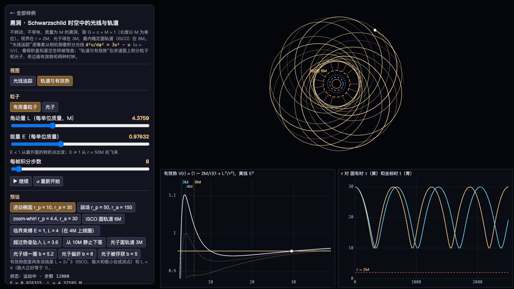

### 4. 光线弯曲：弱场 4M/b 与强场的对数发散

从无穷远来、碰撞参数为 b 的光线，最近点 u_t 是 1/b² − u² + 2Mu³ = 0 的最小正根。总偏折角

```
α̂(b) = 2 ∫₀^{u_t} du / √(1/b² − u² + 2Mu³) − π
```

- **弱场**（b ≫ M）：α̂ = 4M/b + (15π/4) M²/b² + …。第一项是 Einstein 1915 年的结果，正好是“牛顿光微粒”算法的两倍。太阳边缘 4GM☉/(c²R☉) ≈ 1.75″。
- **强场**（b → b_c⁺）：光线在光子球附近绕很多圈，α̂ 对数发散。Bozza（2002）给出的渐近式是 α̂ ≈ −ln(b/b_c − 1) + ln[216(7 − 4√3)] − π ≈ −ln(b/b_c − 1) − 0.4002。

页面在光子模式下用同一个 u(φ) 方程从 u = 0（无穷远）出发做 RK4（dφ = 0.001），积到 u 再回到 0。参考值用 mpmath 对上面的积分做高精度求积（换元 u = u_t(1 − t²) 去掉端点的平方根奇点），两边是互相独立的程序：

| b / M | 页面 | 精确（求积） | 4M/b | 强场近似 |
|---|---|---|---|---|
| 5.2 | 6.810371957 | 6.810371957 | 0.769 | 6.808 |
| 5.25 | 4.194799708 | 4.194799708 | 0.762 | 4.169 |
| 5.3 | 3.557938042 | 3.557938042 | 0.755 | 3.513 |
| 5.5 | 2.553020182 | 2.553020182 | 0.727 | 2.439 |
| 6 | 1.719388310 | 1.719388310 | 0.667 | 1.466 |
| 8 | 0.858730018 | 0.858730018 | 0.500 | 0.217 |
| 10 | 0.590395788 | 0.590395788 | 0.400 | |
| 20 | 0.236135995 | 0.236135995 | 0.200 | |
| 50 | 0.085083450 | 0.085083450 | 0.080 | |
| 100 | 0.041222540 | 0.041222540 | 0.040 | |
| 1000 | 0.004011824 | 0.004011824 | 0.004 | |

页面和求积在列出的 10 位上完全一致。b = 1000 时 4M/b 只差 0.3%（差的正是 15πM²/(4b²)），b = 10 时已经差 32%。b = 5.2 时偏折角 6.81 rad 比 2π 还大：光线绕黑洞整整一圈后才离开。强场近似在 b = 5.2 时误差 0.03%，到 b = 6 已经差 15%。

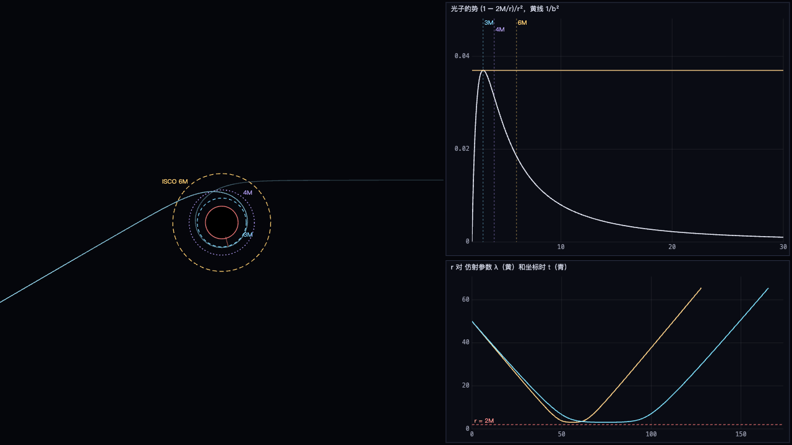

### 5. 影子

相机是 r_obs 处的静止观察者。在他的局部正交标架里，光子方向和指向黑洞中心方向的夹角 α 满足

```
sin α = (b / r_obs) √(1 − 2M/r_obs)
```

推导：局部标架下光子的能量是 E/√(1 − 2M/r)，切向动量是 L/r，二者之比就是 sin α。所有 b < b_c 的光线都来自视界，所以影子是一个**正圆**，角半径

```
sin α_c = 3√3 M √(1 − 2M/r_obs) / r_obs      （r_obs → ∞ 时 α_c ≈ 5.196 M / r_obs）
```

它是“光线不弯曲时 r = 2M 球的视大小”的 2.6 倍（页面上的红色点线），而且和倾角无关。影子边缘正是光子球 r = 3M 的像：从那里出发的光线在 3M 上绕了无限多圈。

页面用两种独立的方法量影子：

1. **追踪器二分**：页面里有一份和着色器完全相同的积分器（JS 版本），对 α 二分求“落进去 / 逃出去”的分界；
2. **像素**：关掉吸积盘、用经纬网格做天空（网格天空处处不黑），截图（1280 × 720，设备像素比 2），在着色器画出来的图上数中心那一行和那一列的黑色像素，换算成 α 再换成 b。这直接检验 GPU 上跑的着色器。

| r_obs | 理论 α_c | 追踪器二分 | 像素测得 α（b） |
|---|---|---|---|
| 4M | 66.71627° | 66.71627°（b = 5.19615） | 66.700°（5.1955） |
| 8M | 34.22887° | 34.22887°（b = 5.19615） | 34.280°（5.2029） |
| 15M | 18.81360° | 18.81360°（b = 5.19615） | 18.845°（5.2045） |
| 30M | 9.63273° | 9.63273°（b = 5.19615） | 9.635°（5.1974） |
| 60M | 4.88447° | 4.88448°（b = 5.19615） | 4.884°（5.1951） |
| 100M | 2.94856° | 2.94856°（b = 5.19615） | 2.949°（5.1961） |
| 500M | 0.59425° | 0.59425°（b = 5.19615） | 0.594°（5.1934） |

追踪器和理论一致到 10⁻⁵ 度。像素法的误差不到一个像素：r_obs ≥ 30M 时影子半径 242–267 个设备像素，b 的误差 ≤ 0.05%；r_obs = 8M、15M 时视场被限制在半角 76° 以内，影子半径只有 123–140 像素，误差 0.13–0.16%。

**光子环**。b 略大于 b_c 的光线先在光子球附近绕几圈再离开。每多绕半圈，b − b_c 要小 e^π ≈ 23 倍（e^π 来自光子圆轨道的 Lyapunov 指数，Schwarzschild 情形是 π）。所以贴着影子有一串越来越细的环，二阶以上的环已经细得在屏幕上看不清。着色器每条光线最多积 900 步（φ 走 18 rad，约 2.9 圈）。r_obs = 30M 时实测：|b/b_c − 1| = 10⁻⁶ 的光线 750–820 步就分出了落进 / 逃出，10⁻⁷ 才会积满。积满还没结束的光线离 b_c 不到 10⁻⁶ M，按影子处理。

**EHT 与 M87\***。M87* 的质量约 6.5 × 10⁹ M☉、距离约 16.8 Mpc，GM/(c²D) ≈ 3.8 μas，影子直径 2 × 3√3 × 3.8 ≈ 40 μas。EHT 2019 年给出的环直径是 42 ± 3 μas（数值凭记忆引用，未逐一核对原文）。M87* 在转动，严格说要用 Kerr 度规，但影子的大小对自转和倾角不敏感，和 Schwarzschild 只差几个百分点（凭记忆，EHT 论文给的是约 4%，未核对）。

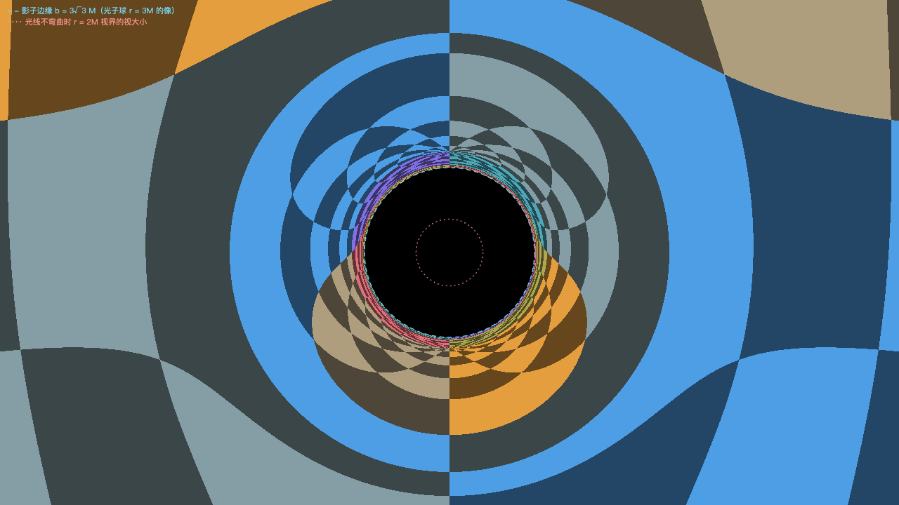

### 6. 光线追踪器怎样工作

每个像素：

1. 由像素位置得到相机标架里的方向，算出它和“指向黑洞”方向的夹角 α，以及光线所在平面（它一定过黑洞中心）。这个平面里取两个单位向量：e₁ 指向相机，e₂ 在初始方向那一侧。光线上的点是 r(cos φ e₁ + sin φ e₂)。
2. 由 sin α 得到 b，初值 u = 1/r_obs，du/dφ = u √(1 − 2Mu) cot α（把 sin α 的公式代进 (du/dφ)² = 1/b² − u²(1 − 2Mu) 得到；α > 90° 的光线 cot α < 0，一开始就往外走）。
3. 用 RK4 积 d²u/dφ² = 3Mu² − u，dφ = 0.02。u ≥ 1/(2M) 是落进视界，画黑色；u ≤ 0 是飞到了无穷远，线性插值出 φ∞，按方向 cos φ∞ e₁ + sin φ∞ e₂ 去查星空或经纬网格。
4. 每一步检查点的 z 坐标 r(e₁z cos φ + e₂z sin φ) 是否变号。变号就是穿过了赤道面，用三次 Hermite 插值求出那一点的 r；6M ≤ r ≤ 外半径就打在盘上，按第 8 节算颜色。

画面短边的一半对应碰撞参数 14M（除以缩放倍数），所以换相机距离时影子在屏幕上一样大，只有视场角在变。

### 7. 盘的背面为什么出现在影子上方和下方

勾选“按像的阶数着色”：光线在打到盘之前第几次穿过赤道面，就用第几种颜色（橙 = 第 1 次，青 = 第 2 次，品红 = 第 3 次及以上；穿过盘内侧 r < 6M 的空洞也算一次）。

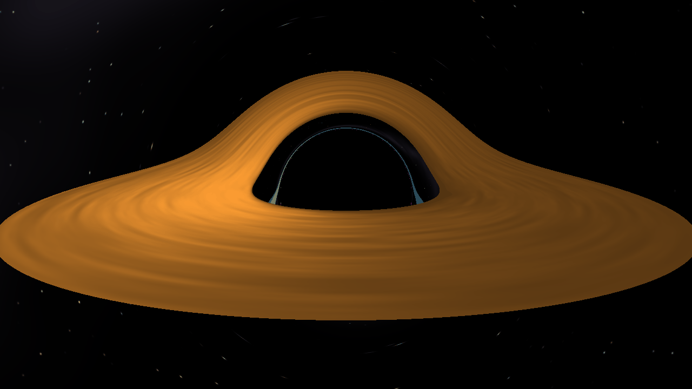

- **影子上方的“驼峰”是橙色的，是一阶像。** 从相机往影子上方射出的光线本来要从盘上面飞过去，经过黑洞时被向下弯，第一次碰到赤道面就是在黑洞**背后**的盘的上表面。所以盘的远侧被“抬”到了影子上方，好像竖了起来。
- **影子下方那条贴着影子的细弧是青色的，是二阶像。** 这些光线先从黑洞前方穿过盘内侧的空洞（r < 6M，第 1 次穿过赤道面，没有东西），从黑洞下面绕过去，再向上弯，打到远侧的盘的**下表面**（第 2 次）。所以影子下方看到的是盘远侧的底面。
- 影子下方宽的那条橙色带是盘的近侧（一阶像，没什么弯曲）。
- 二阶像其实是一整圈细环，在影子上方也有（贴在驼峰内侧）；三阶像更细，紧贴影子边缘。

这一节纠正一个常见的说法：“驼峰是盘背面的二级像”。不对，驼峰是一阶像，只是一阶像就已经被弯得很厉害了。

侧面看（i = 89°）这个效果最明显：盘本身成了一条线，远侧的上表面和下表面分别出现在影子正上方和正下方，像土星环套着一个圈。

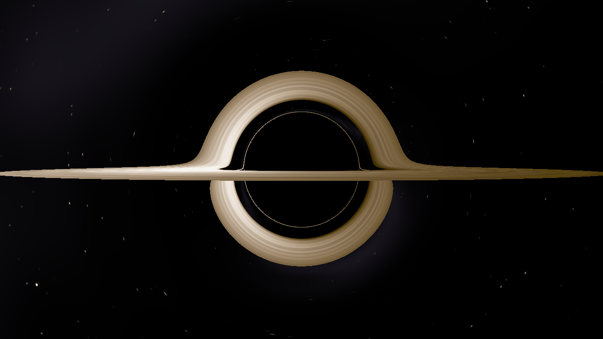

### 8. 红移因子 g 与集束

光子从盘上频率 ν_em 发出，相机收到 ν_obs，比值 g = ν_obs/ν_em = (p·u_obs)/(p·u_em)。

- 盘上的气体沿圆测地线运动：u_em = u^t (1, 0, 0, Ω)，Ω = √(M/r³)（和 Kepler 定律形式相同），u^t = 1/√(1 − 3M/r)。
- 相机静止：u_obs = ∂_t / √(1 − 2M/r_obs)。
- 光子的 p_t = −E，p_φ = L_z，两者沿光线守恒。

于是

```
g = √(1 − 3M/r) / [ √(1 − 2M/r_obs) · (1 − Ω λ) ],    λ = L_z / E
```

三个因子各有含义：√(1 − 3M/r) 是引力红移和横向 Doppler（时间膨胀）的合效果；(1 − Ωλ) 是视线方向的 Doppler，朝我们转来的一侧 λ < 0，g > 1；1/√(1 − 2M/r_obs) 是光子落到相机所在的较深位置时的蓝移。λ 在光线上守恒，所以在像素那一端就能算：λ = −b n_z，n 是光线平面的法向（倒着追踪的光线和真实光子方向相反，所以有负号）。

**亮度 ∝ g⁴**。Liouville 定理给出 I_ν / ν³ 沿光线不变，所以 I_ν,obs(ν) = g³ I_ν,em(ν/g)。对频率积分，**总（bolometric）亮度 I = ∫ I_ν dν ∝ g⁴**。页面画的是总亮度，所以用 g⁴。g³ 只适用于固定观测频率、平坦谱（I_ν 与 ν 无关）的窄带图像，一般谱 I_ν ∝ ν^−α 是 g^{3+α}。如果盘是黑体，观测到的仍是黑体谱，温度 gT，σ(gT)⁴ ∝ g⁴，两种说法一致。页面的颜色就是温度为 gT 的黑体颜色。

盘的辐射通量取 Newton 薄盘（Shakura–Sunyaev）在内边缘无力矩时的形式 F ∝ r⁻³(1 − √(6M/r))，峰值在 r = 49M/6，温度 T ∝ F^{1/4}。温度的绝对值是示意的：页面把峰值定在 3600 K，让颜色落在可见光里（真实的恒星级黑洞盘在 10⁷ K 左右，辐射在 X 射线）。考虑相对论修正的 Page–Thorne（1974）通量在 ISCO 附近和这个形式差一个量级为 1 的因子，不改变图像的样子。

关掉“红移改变颜色”和“亮度 ∝ g⁴”，左右就对称了：

| 两项都开（默认） | 两项都关 |
|---|---|
| 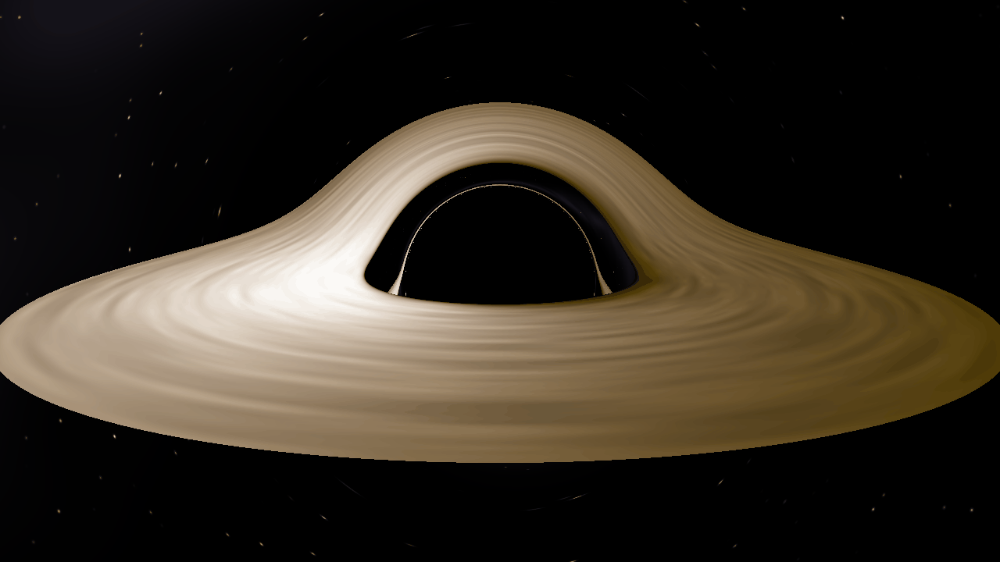 | 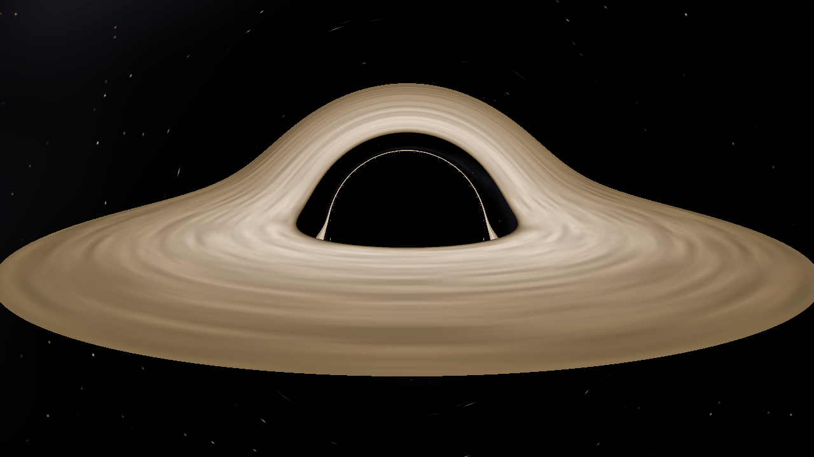 |

量一下：关掉“红移改变颜色”（颜色不再依赖 g）、曝光调到 0.2（色调映射接近线性），把截图的像素值还原成线性亮度，比较左右对称的两小段（各 20 行像素）。靠近影子的内侧左 / 右 = 25，盘中部 8.3，外缘 4.7；同样的位置关掉 g⁴，比值在 0.7–1.0 之间（只剩纹理的起伏）。屏幕显示前做了 γ = 2.2 的编码，所以眼睛看到的反差小得多。

正面看（i = 5°）几乎没有视线方向的速度，只剩 √(1 − 3M/r) 的红移，盘内侧整体偏暗偏红。贴着影子的细亮环是盘的二阶像（用“按像的阶数着色”看，它是青色的）。

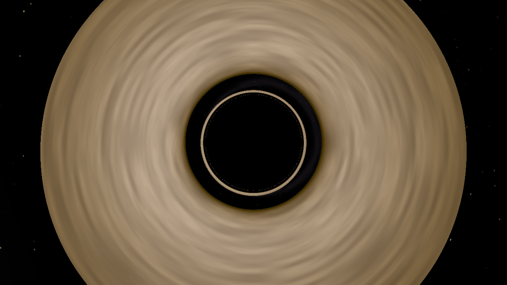

### 9. 落进视界：固有时有限，坐标时发散

从 r₀ 静止下落（L = 0，E = √(1 − 2M/r₀)），轨道是一条摆线：

```
r = (r₀/2)(1 + cos η),    τ = √(r₀³ / 8M) (η + sin η)
```

τ 是下落者自己的钟。它在有限的 τ 内穿过 r = 2M、到达 r = 0。但是坐标时 t（远处观察者的时钟）满足 dt/dτ = E/(1 − 2M/r)；靠近视界时 dr/dτ → −E，于是 dt/dr ≈ −r/(r − 2M)，t ≈ −2M ln(r − 2M) + 常数，在视界处对数发散。远处的人永远看不到它穿过视界，只看到它越来越红、越来越暗。

页面的右下图同时画 r 对 τ（黄）和 r 对 t（青）：黄线笔直穿过 r = 2M 的红色虚线，青线越来越平地贴向它。

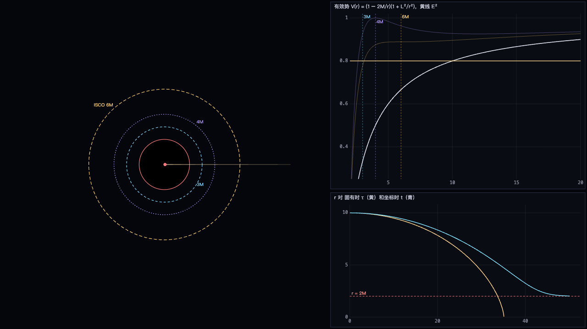

| 量 | 页面（RK4，dτ ∝ r^{3/2}） | 摆线公式 |
|---|---|---|
| 从 10M 落到视界的固有时 | 33.7009 M | 33.7009 M |
| 落到 r = 0 的固有时 | 页面停在 r = 0.0497M 时为 35.1189 M | 35.1241 M（r = 0.05M 时 35.1188 M） |

穿过视界后 r 仍然随 τ 平滑地减小。用 (r, τ) 写的径向方程在 r = 2M 处没有任何奇异，奇异的只是 t 这个坐标。

### 10. 近点进动

有界轨道的 u 在 u_a = 1/r_a 和 u_p = 1/r_p 之间振荡。三次式 2Mu³ − u² + … 的三个根之和是 1/(2M)，所以第三个根 u₃ = 1/(2M) − u_a − u_p。从近点到远点 φ 走过

```
Δφ_half = ∫ du / √(2M (u − u_a)(u_p − u)(u₃ − u))
```

令 u = (u_a + u_p)/2 + (u_p − u_a)/2 · sin θ，前两个因子正好约掉，变成光滑的积分 ∫_{−π/2}^{π/2} dθ / √(2M(u₃ − u))。每圈进动 Δφ = 2Δφ_half − 2π。弱场（r_p ≫ M）时展开得到

```
Δφ ≈ 6πM / [a(1 − e²)] = 6πM / p,    p = 2 r_p r_a / (r_p + r_a)
```

水星每世纪 43″ 的反常进动就是这个公式。

页面在 τ 上做 RK4，状态是 (r, ṙ, φ)，步长 dτ = 0.01 · min(r^{3/2}, r²/L)，在 ṙ 由负变正的一步里插值出近点的 φ，相邻两次近点的 φ 差减去 2π 就是一圈的进动。全程（视界以外）监测约束 |ṙ² + V − E²|/E²：有界轨道的预设在 10⁻¹¹ 以下，掠过和坠落的在 10⁻⁹ 以下。下表的 E、L 由 (r_p, r_a) 算出，通过网址参数 L、E 传给页面：

| r_p, r_a | 页面实测（圈数） | 精确（求积） | 弱场 6πM/p | 精确 / 弱场 |
|---|---|---|---|---|
| 4.4, 30 | 11.3516434（32） | 11.3516435 | 2.4562 | 4.62 |
| 6.5, 12 | 5.5510047（33） | 5.5510047 | 2.2354 | 2.48 |
| 8, 20 | 2.8766250（42） | 2.8766250 | 1.6493 | 1.74 |
| 10, 30 | 1.8472767（69） | 1.8472767 | 1.2566 | 1.47 |
| 20, 60 | 0.7439183（78） | 0.7439183 | 0.6283 | 1.18 |
| 50, 150 | 0.2677462（137） | 0.2677462 | 0.2513 | 1.065 |
| 100, 300 | 0.1296218（280） | 0.1296218 | 0.1257 | 1.032 |
| 1000, 3000 | | 0.0126047 | 0.0126 | 1.003 |

页面和求积一致到 10⁻⁷ rad，各圈之间的离散也在 10⁻⁷ 以内。弱场公式只在 r_p ≳ 100M 时准到几个百分点。（r_p = 100、r_a = 300 那一行用的是 `?v=orbit&L=12.3823251511949&E=0.99750967597447&n=200000`。r_p = 1000 需要 L = 38.8，超出了 L 滑条的范围 0–15，没有在页面上测。）

r_p = 4.4M 的轨道就是 **zoom-whirl**：粒子从 30M 俯冲下来，在 4M 附近的不稳定圆轨道旁“打转”，再飞出去。每个径向周期 φ 走过 2π + 11.35 ≈ 17.6 rad，约 2.8 圈，其中大半是在近点附近转的。r_p 再往 4M 靠近，打转的圈数对数地增加，和光线在光子球附近的行为一样。

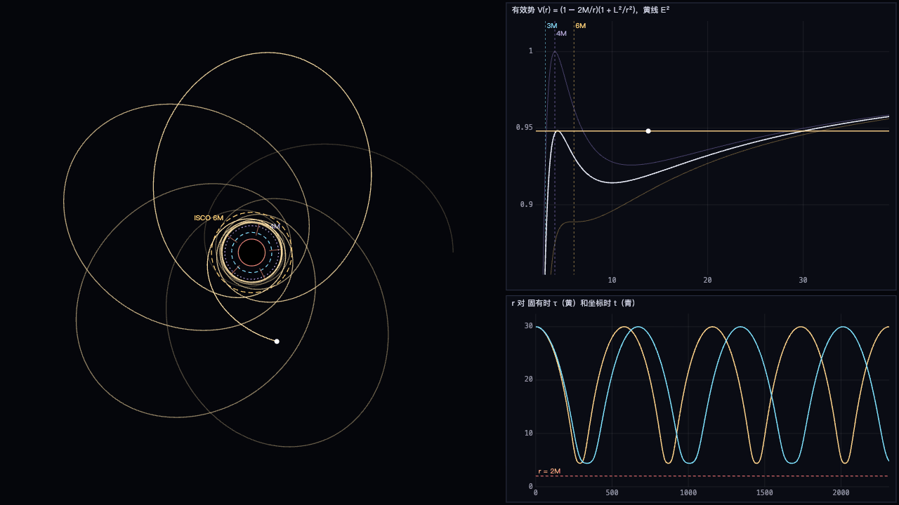

## 操作

- 视图：光线追踪 / 轨道与有效势；
- 光线追踪：相机距离 r_obs（4–500M，对数滑条）、倾角 i（相机和盘法线的夹角）、方位角、缩放；吸积盘开关、外半径（7–40M，内边缘固定在 ISCO 6M）、曝光；“红移改变颜色”“亮度 ∝ g⁴”“按像的阶数着色”“盘转动”（纹理按各半径的 Ω 转）；星空或经纬网格；标出影子边缘和“不弯曲时”的视界大小；画质（每个 CSS 像素的采样数 0.25–2）。拖动画面转动相机，滚轮缩放，双击复位。拖动时按一半分辨率画，松手后重画；
- 光线追踪预设：Luminet 视角 i = 80°、正面 i = 5°、侧面 i = 89°、按像的阶数着色、只看透镜（经纬网格）、近处 r = 10M（广角）、远处 r = 300M、不计红移和集束；
- 轨道：有质量粒子（L、E 滑条）或光子（碰撞参数 b 滑条）；E < 1 从最外面的转折点出发，E ≥ 1 和光子从 r = 50M 处平行飞来；每帧积分步数、暂停 / 继续、重新开始；滚轮缩放轨道图，双击复位；
- 轨道预设：进动椭圆 r_p = 10、r_a = 30，弱场 r_p = 50、r_a = 150，zoom-whirl，ISCO 圆轨道，临界束缚 E = 1、L = 4（在 4M 上绕圈，最后由数值误差决定掉进去还是逃走），越过势垒坠入，从 10M 静止下落，光子圆轨道 3M（不稳定，绕若干圈后由舍入误差带离），光子绕一圈 b = 5.2，光子偏折 b = 8，光子被俘获 b = 5；
- 面板实时显示 τ（光子是仿射参数 λ）、t、约束误差、实测 r_p 和 r_a、平均进动和弱场公式、光子偏折角和弱场 / 强场近似，以及从有效势数值求出的三个特征半径；
- 按 h 隐藏 / 显示面板。

## 网址参数

| 键 | 含义 |
|---|---|
| v | 视图：ray, orbit |
| rp | 光线追踪预设：luminet, face, edge, order, lens, near, far, plain |
| r | 相机距离 r_obs（4–500） |
| i | 倾角，度（1–179） |
| az | 方位角，度（−180–180） |
| z | 缩放（0.25–8） |
| ro | 盘的外半径（7–40） |
| ex | 曝光（0.2–5） |
| q | 画质（0.25–2） |
| disk, dop, beam, ord, anim, ov | 1 / 0：吸积盘、红移改变颜色、亮度 ∝ g⁴、按像的阶数着色、盘转动、标注 |
| bg | 天空：stars, grid |
| p | 轨道预设：prec, weak, whirl, isco, mb, plunge, fall, phc, phw, phb, phx |
| ty | 粒子：m（有质量）, ph（光子） |
| L, E | 角动量（0–15）和能量（0.8–1.3） |
| b | 光子碰撞参数（0–20） |
| sp | 每帧积分步数（1–200） |
| oz | 轨道图缩放（0.25–8） |
| n | 打开时先积分这么多步（0–200000） |
| run | 0 = 打开时暂停 |
| ui | 0 = 隐藏面板，只留画布 |

所有数值参数都先检查是不是有限数，再限制在上表的范围内；预设名和选项名只认上表里的几个（用 `Object.hasOwn` 查表），1 / 0 开关只认 "1" 和 "0"。例如侧面看并按阶数着色：`index.html?rp=edge&ord=1`；只看透镜、相机在 8M：`index.html?rp=lens&r=8`；跑 30 圈 zoom-whirl 再暂停：`index.html?v=orbit&p=whirl&n=20000&run=0`。

## 参考

- K. Schwarzschild, *Über das Gravitationsfeld eines Massenpunktes nach der Einsteinschen Theorie*, Sitzungsberichte der Königlich Preußischen Akademie der Wissenschaften zu Berlin (1916)。
- J.-P. Luminet, *Image of a spherical black hole with thin accretion disk*, Astronomy and Astrophysics 75 (1979)。第一张带薄吸积盘的黑洞“照片”（手工描点），本页的默认视角取 i = 80°，和 Luminet 的“从盘面上方约 10° 看”相当（卷号和视角凭记忆，未核对原文）。
- Event Horizon Telescope Collaboration, *First M87 Event Horizon Telescope Results. I. The Shadow of the Supermassive Black Hole*, The Astrophysical Journal Letters 875, L1 (2019)。
- C. W. Misner, K. S. Thorne, J. A. Wheeler, *Gravitation*, W. H. Freeman (1973)。Schwarzschild 几何中粒子与光子的轨道、有效势。
- S. Chandrasekhar, *The Mathematical Theory of Black Holes*, Oxford University Press (1983)。Schwarzschild 测地线的完整分类。
- V. Bozza, *Gravitational lensing in the strong field limit*, Physical Review D 66, 103001 (2002)。强场偏折角的对数渐近式。
- N. I. Shakura, R. A. Sunyaev, *Black holes in binary systems. Observational appearance*, Astronomy and Astrophysics 24 (1973)；D. N. Page, K. S. Thorne, *Disk-accretion onto a black hole. Time-averaged structure of accretion disk*, The Astrophysical Journal 191 (1974)。薄盘通量（标题和卷号凭记忆，未核对）。
- O. James, E. von Tunzelmann, P. Franklin, K. S. Thorne, *Gravitational lensing by spinning black holes in astrophysics, and in the movie Interstellar*, Classical and Quantum Gravity 32 (2015)。盘的远侧被抬到影子上方的解释（期刊卷号凭记忆）。
- 黑体颜色用 Tanner Helland 的经验拟合（色温 → sRGB，1000–40000 K）。
