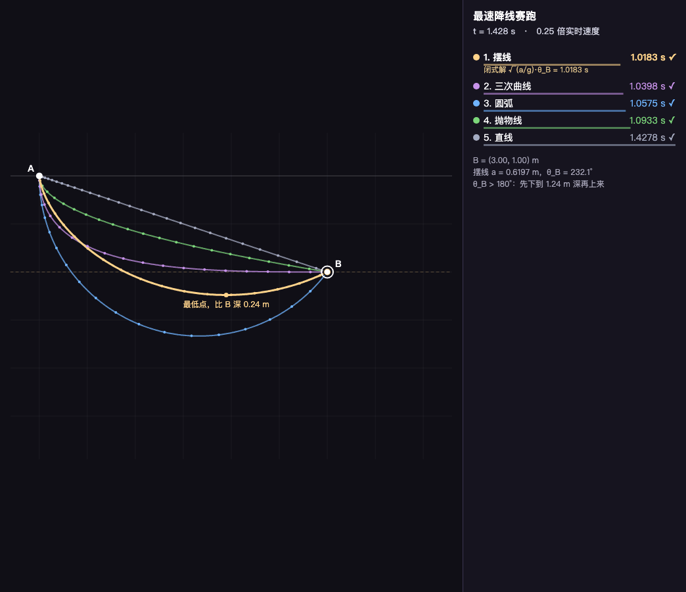
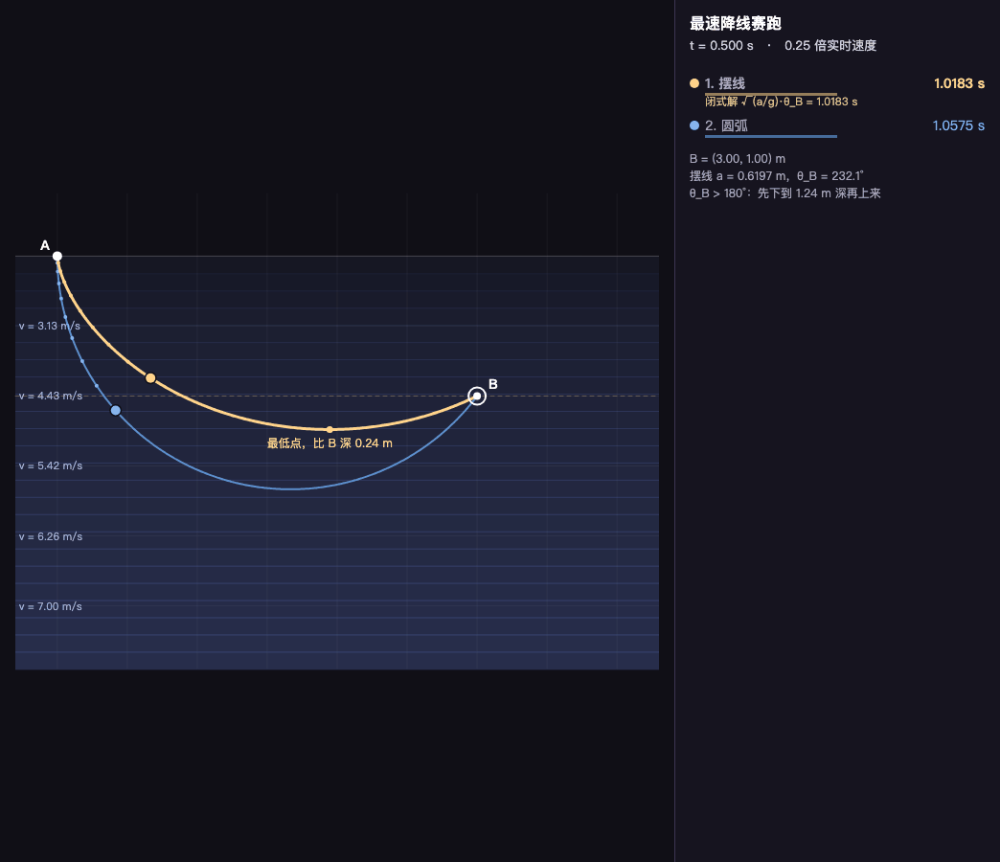
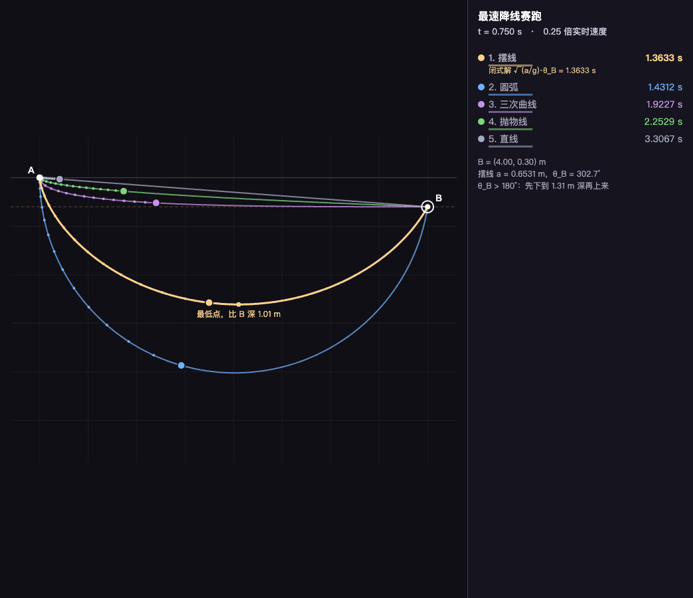
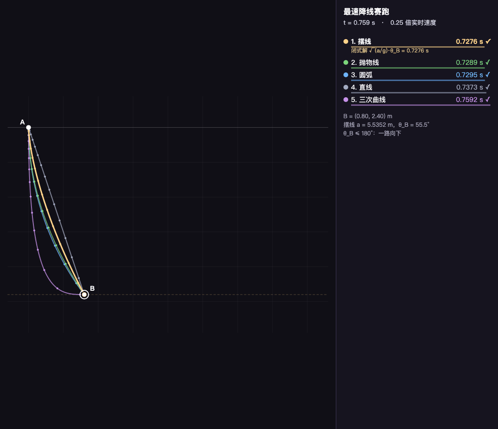
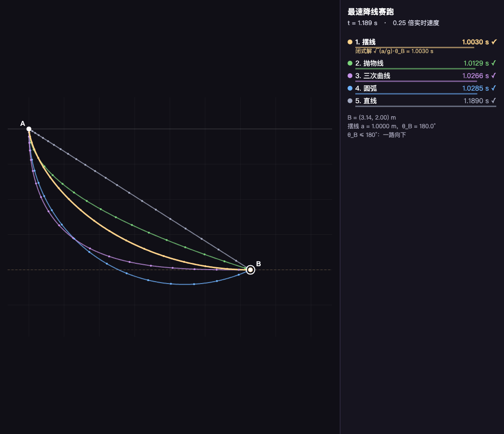
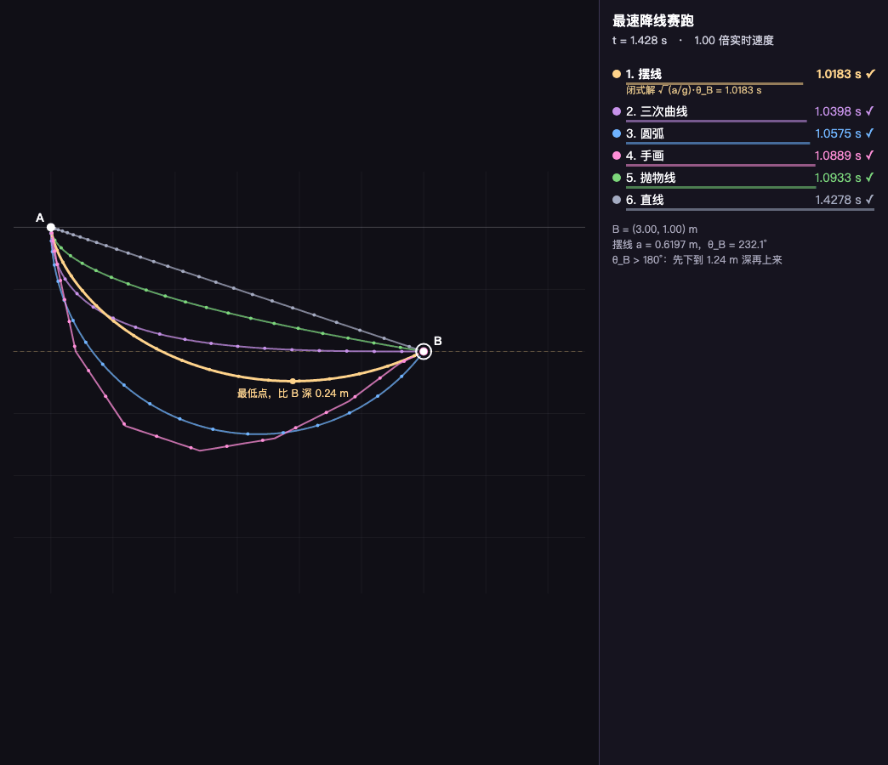
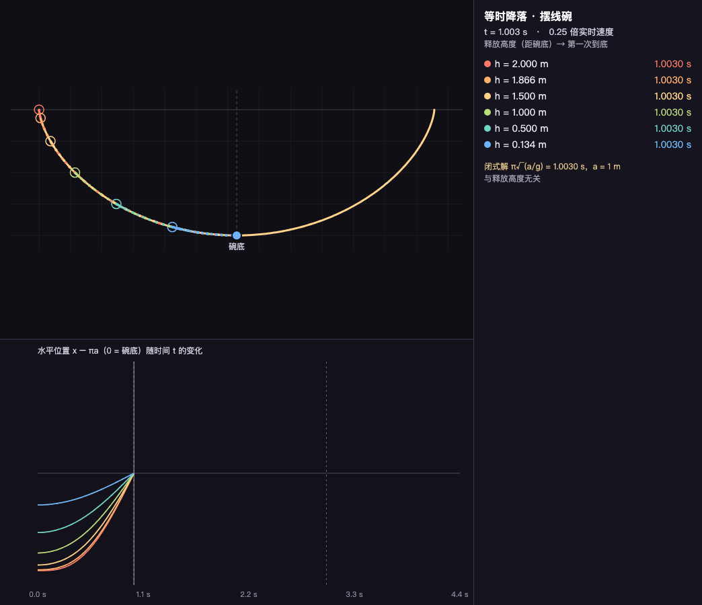
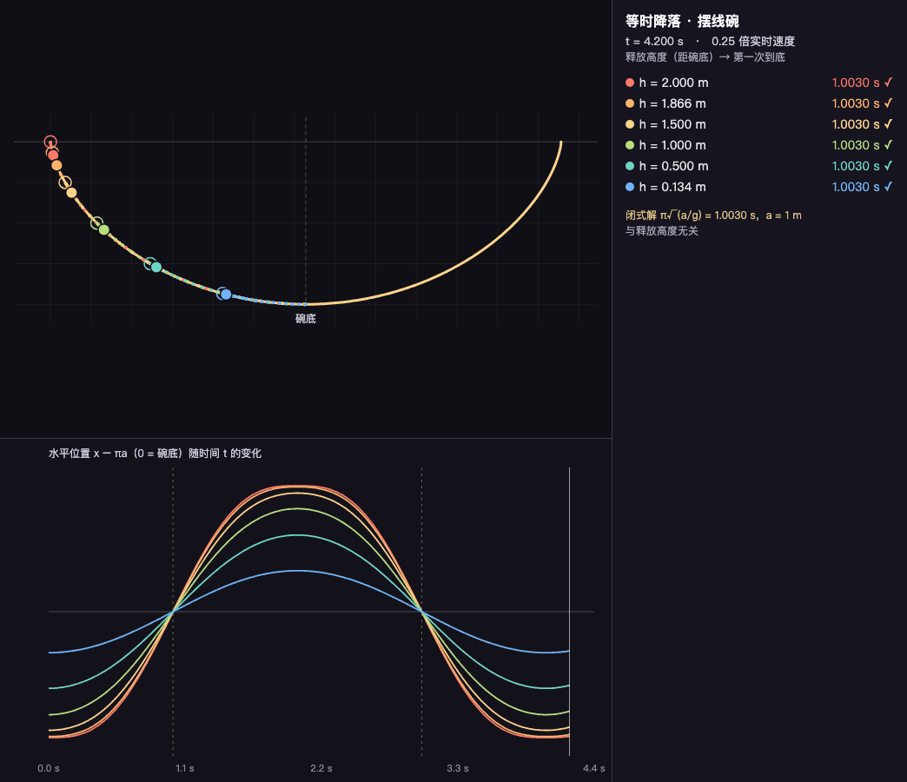
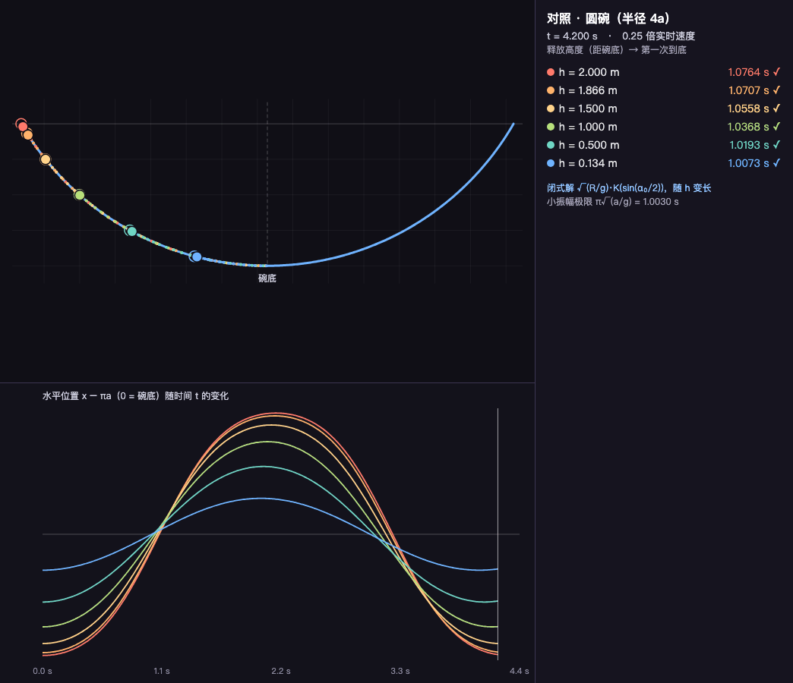
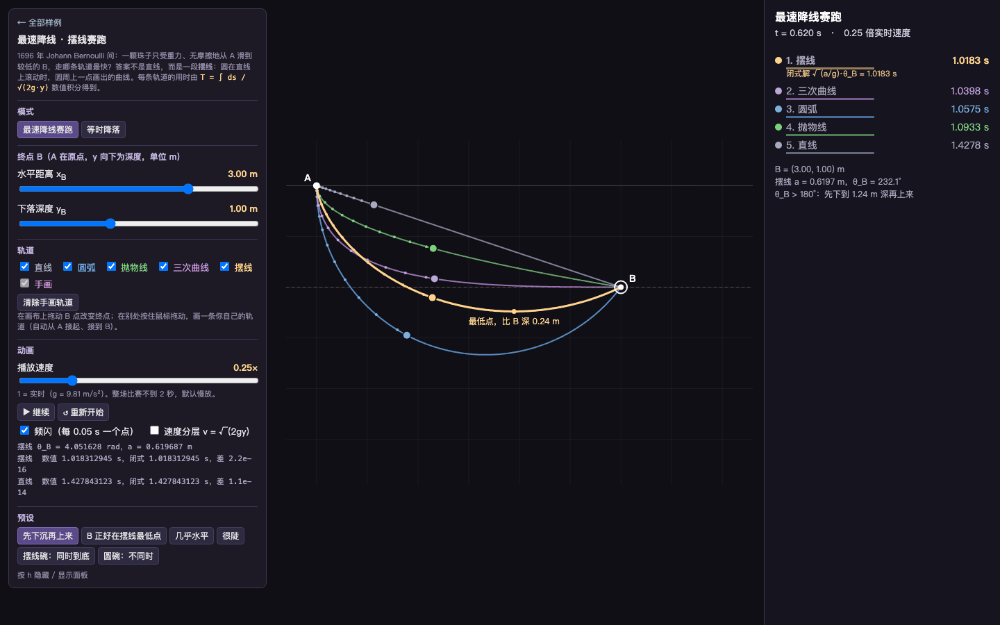

# 最速降线 · 摆线赛跑



1696 年 6 月，Johann Bernoulli 在《Acta Eruditorum》上向“全世界最敏锐的数学家”提了一个问题：竖直平面上有两点 A 和 B，B 比 A 低、但不在 A 的正下方。一颗珠子只受重力，沿一条无摩擦的轨道从 A 由静止滑到 B。轨道取什么形状，用时最短？

直线最短，但不是最快。珠子要先往下冲一段，攒够速度再横着走，才划算。可是冲多深、怎么弯才最好？1638 年伽利略算过，四分之一圆弧比弦快，他猜圆弧就是答案，但猜错了。正确答案是一段**摆线**：一个圆在水平直线下方滚动时，圆周上一点画出的曲线。第二年，Jakob Bernoulli、Leibniz、L'Hôpital 和匿名投稿的 Newton 都交出了解答。据说 Johann 一看 Newton 的那份就认出了作者：“从爪子认出狮子”。

页面让直线、圆弧、抛物线、三次曲线、摆线和你自己画的轨道同场赛跑。每条轨道的用时都是对 T = ∫ ds / √(2g·y) 数值积分算出来的，不是预先写好的答案。摆线每次都赢，它的数值用时和闭式解 √(a/g)·θ_B 一致到 10⁻¹⁵。第二个模式演示摆线的另一个性质：从碗壁任意高度放下的珠子，同时到达碗底。

打开方式：用浏览器直接打开 [index.html](index.html)。页面只用 Canvas 2D，不依赖外部库，离线也能用。

## 数学原理

### 1. 用时公式

取 A 为原点，x 向右，y **向下**为正（y 就是下落的深度）。轨道无摩擦，机械能守恒：珠子从静止开始，下落深度 y 时动能等于减少的势能，

```
½ v² = g·y   ⇒   v = √(2g·y)
```

速度只取决于此刻的深度，与走过的路无关。沿轨道走一小段 ds 用时 ds / v，所以总用时是

```
T = ∫_A^B ds / √(2g·y)
```

问题变成：在所有从 A 到 B 的曲线中，找让这个积分最小的那条。这是**变分法**的第一个经典问题：自变量不是一个数，而是一整条曲线。

直线可以直接算。它的长度 L = √(x_B² + y_B²)，沿线的加速度是常数 g·y_B / L，由 L = ½·(g y_B / L)·T² 得

```
T_直线 = L·√(2 / (g·y_B))
```

页面面板里的“直线 数值 / 闭式 / 差”就是拿数值积分和这个公式对照，默认 B = (3, 1) 时两者都是 1.427843123 s，差 1.1×10⁻¹⁴。

### 2. Bernoulli 的思路：把珠子当成光

Johann Bernoulli 的解法不是硬算，而是借用光学。光从一点到另一点，走的是**用时最短**的路（Fermat 原理）。光从速度 v₁ 的介质进入速度 v₂ 的介质时会折射，入射角 α₁、折射角 α₂（都从法线量起）满足 Snell 定律：

```
sin α₁ / v₁ = sin α₂ / v₂
```

珠子的情况正好是一种“介质”：速度 v = √(2gy) 随深度连续变大。把空间切成很多很薄的水平层，每层里速度近似不变，层与层之间的界面都是水平的，法线是竖直的。用时最短的路径在每个界面上都满足 Snell 定律，于是沿整条路径

```
sin α / v = 常数
```

这里 α 是轨道切线和竖直方向的夹角。勾选“速度分层”能看到这些层：越往下越亮，速度越快。



光从慢的层进入快的层会偏离法线，越往下越平。珠子的轨道也一样：在 A 点速度为 0，sin α = 0，轨道竖直向下；越往下越快，轨道越平；到最深处 α = 90°，变水平。

把 sin α 写成轨道 y(x) 的斜率。切线方向 (1, y′)，它和竖直方向夹角的正弦是 1/√(1 + y′²)。代入 v = √(2gy)：

```
1 / ( √(1 + y′²) · √(2g·y) ) = 常数   ⇒   y·(1 + y′²) = 2a
```

右边的常数写成 2a，原因马上就会看到。

### 3. 同一个方程，用 Euler–Lagrange 推一遍

Bernoulli 之后，Euler 和 Lagrange 把这类问题变成了一般的方法。要让 ∫ F(y, y′) dx 取极值，曲线必须满足 Euler–Lagrange 方程

```
d/dx (∂F/∂y′) − ∂F/∂y = 0
```

这里（略去常数因子 1/√(2g)）F = √(1 + y′²) / √y。F 不显含 x，这时 Euler–Lagrange 方程有一个首次积分（Beltrami 恒等式）：

```
F − y′·∂F/∂y′ = 常数
```

算一下：∂F/∂y′ = y′ / (√y·√(1 + y′²))，所以

```
F − y′·∂F/∂y′ = (1 + y′² − y′²) / (√y·√(1 + y′²)) = 1 / (√y·√(1 + y′²)) = 常数
```

平方后就是 y·(1 + y′²) = 2a，和光学的结果一模一样。Snell 定律里那个“沿路径不变的量”，就是这个首次积分。

### 4. 解出来是摆线

验证摆线

```
x = a·(θ − sin θ),   y = a·(1 − cos θ),   θ 从 0 开始
```

满足这个方程。这是半径 a 的圆在 y = 0 这条线下方滚动时圆周上一点的轨迹，θ 是圆转过的角度。求导：dx/dθ = a(1 − cos θ)，dy/dθ = a·sin θ，所以

```
y′ = sin θ / (1 − cos θ)
1 + y′² = [(1 − cos θ)² + sin² θ] / (1 − cos θ)² = 2 / (1 − cos θ)
y·(1 + y′²) = a(1 − cos θ) · 2 / (1 − cos θ) = 2a   ✓
```

常数 2a 正好是滚动圆的直径，也是摆线最低点的深度。

摆线的用时可以直接积出来。弧长元素 ds = √(dx² + dy²) = a·√(2 − 2cos θ) dθ = 2a·sin(θ/2) dθ，深度 y = 2a·sin²(θ/2)，所以

```
ds / √(2g·y) = 2a·sin(θ/2) dθ / (2·sin(θ/2)·√(g·a)) = √(a/g) dθ
```

被积函数是常数！走过的参数角 θ 和时间成正比，于是

```
T_摆线 = √(a/g) · θ_B
```

θ_B 是 B 点对应的参数。画布右侧金色的“闭式解”一行就是这个公式，排在它上面的是数值积分的结果。

### 5. 给定 B，怎么求 a

摆线有两个未知数：圆的半径 a，和 B 对应的角 θ_B。两个条件是 x(θ_B) = x_B，y(θ_B) = y_B。两式相除，a 消掉：

```
(θ_B − sin θ_B) / (1 − cos θ_B) = x_B / y_B
```

几何上，所有从 A 出发的摆线都是同一条曲线按不同比例缩放出来的；从 A 到 B 的方向（比值 x_B / y_B）决定了 B 落在摆线的哪个位置（θ_B），距离再决定缩放倍数（a）。

左边这个函数 f(θ) 在 (0, 2π) 上从 0 单调增加到 ∞。求导后分子是

```
(1 − cos θ)² − (θ − sin θ)·sin θ = 2 sin(θ/2) · [2 sin(θ/2) − θ cos(θ/2)]
```

θ < π 时 cos(θ/2) > 0，方括号等于 2cos(θ/2)·[tan(θ/2) − θ/2] > 0；θ ≥ π 时 cos(θ/2) ≤ 0，方括号显然为正。所以对任意比值，θ_B 恰有一个解。页面用二分法（100 次，区间缩小到机器精度）找到 θ_B，再由 a = y_B / (1 − cos θ_B) 得到 a。默认 B = (3, 1) 时：

| 量 | 值 |
|---|---|
| θ_B | 4.051628 rad = 232.1° |
| a | 0.619687 m |
| 闭式用时 √(a/g)·θ_B | 1.0183129452 s |
| 数值积分用时 | 1.0183129452 s，差 2.2×10⁻¹⁶ |

### 6. 为什么最快的路会先沉到 B 下面

θ_B > π 时，B 已经过了摆线的最低点（θ = π，深度 2a），珠子要先沉到比 B 更深的地方，再爬上来。条件是

```
x_B / y_B > f(π) = π / 2
```

也就是 B 离 A 的水平距离超过下落深度的 π/2 ≈ 1.571 倍。默认 B = (3, 1) 的比值是 3，摆线最低点深 1.24 m，比 B 深 0.24 m（第一张图里的虚线是 B 的深度）。

这听起来违反直觉：往下沉再爬上来，路程更长，而且最后一段在减速。但速度只看深度，多沉一点，接下来很长一段水平路程都走得更快。爬升只在最后一小段，损失的时间少于前面赚到的。用光来想更清楚：光在快的介质里愿意多走一段路。

B 越平，沉得越深。“几乎水平”预设 B = (4, 0.3)，θ_B = 302.7°，摆线最低点深 1.31 m，比 B 深 1.01 m。直线要 3.307 s，摆线只要 1.363 s：



反过来，B 在正下方附近时，θ_B 很小，摆线只用了开头一小段，看起来几乎是直线，各条轨道的差别也很小。“很陡”预设 B = (0.8, 2.4)，θ_B = 55.5°，前三名（摆线 0.7276 s、抛物线 0.7289 s、圆弧 0.7295 s）只差 0.002 s，但摆线依然最快：



B 正好在摆线最低点时（x_B / y_B = π/2，预设“B 正好在摆线最低点”，a = 1 m），θ_B = π，摆线在 B 点恰好水平，用时 π·√(1/9.81) = 1.0030 s：



### 7. 比赛结果

默认 B = (3, 1) m，g = 9.81 m/s²，页面测得：

| 名次 | 轨道 | 用时 | 比摆线慢 |
|---|---|---|---|
| 1 | 摆线 | 1.0183 s | — |
| 2 | 三次曲线 | 1.0398 s | 2.1% |
| 3 | 圆弧 | 1.0575 s | 3.9% |
| 4 | 抛物线 | 1.0933 s | 7.4% |
| 5 | 直线 | 1.4278 s | 40.2% |

几条对照轨道都从 A 出发、到 B 结束：

- **直线**：A 到 B 的弦；
- **圆弧**：过 A、B 两点、在 A 点竖直向下的圆，圆心在 y = 0 这条线上。这就是伽利略考虑的那类圆弧；
- **抛物线**：x = x_B·(y / y_B)²，在 A 点竖直；
- **三次曲线**：控制点为 A、(0, y_B)、(x_B/2, y_B)、B 的三次 Bézier 曲线，在 A 点竖直，在 B 点水平。

勾着“频闪”时，每条轨道上每隔 0.05 s 打一个点。点越稀，珠子越快。摆线一开始就几乎竖直下落，起步最快；圆弧下得更深，后半程更快，但前面绕了远路。

页面在 6 × 5 个 B 点（x_B 取 0.5、0.8、1.5、3、π、4，y_B 取 0.1、0.3、1、2、2.5）上逐个检查：摆线每次都是第一，数值用时和闭式解的最大相对误差是 8.8×10⁻¹⁶；直线和它的闭式解的最大相对误差是 1.4×10⁻¹⁴。

### 8. 数值积分怎么做

被积函数 1 / √(2g·y) 在起点 A 处是无穷大（y = 0），直接用等距的求积公式会很不准。页面的做法：

1. 每条轨道都写成参数形式 (x(u), y(u))，u 从 0（A）到 1（B），导数用解析式；
2. 换元 u = w²。在 A 附近 y 大约正比于 u（直线、圆弧、抛物线、三次曲线）或 u²（摆线），换元以后 du = 2w dw 的那个 w 正好抵消 1/√y 的奇异性，被积函数变成光滑的；
3. 把 w ∈ [0, 1] 分成 512 段，每段用 5 点 Gauss–Legendre 求积。Gauss 点不含端点，所以永远不会在 y = 0 处求值。

积分的同时记下每一段结束时的累计时间。动画在时刻 t 时，在这张表里二分查找 t 落在哪一段，再插值出位置，所以珠子的运动和算出的用时出自同一个积分。

有一个陷阱：靠近 A 时 θ 极小，1 − cos θ 在浮点运算里相减抵消成 0，被积函数就成了无穷大。B 很陡（θ_B 很小）时，直接这样算会把摆线的用时算成“无穷大”。页面改用等价的 2·sin²(θ/2) 计算深度，就没有这个问题。

**手画轨道**用另一种同样精确的算法。手画的线是折线；在一段直线上珠子做匀加速运动，平均速度等于首末速度的平均，所以这一段的用时正好是

```
Δt = 2ℓ / (v₀ + v₁),   v = √(2g·y)
```

不需要数值积分。（这里假设轨道是理想的：在折角处只改变方向，不损失速度。）用这个公式算摆线的内接折线，可以看到它随段数 n 收敛到闭式解，误差每次缩小约 64 倍，即 ∝ 1/n²：

| 折线段数 n | 用时 | 相对误差 |
|---|---|---|
| 8 | 1.0211919 s | 2.8×10⁻³ |
| 64 | 1.0183557 s | 4.2×10⁻⁵ |
| 512 | 1.0183136 s | 6.5×10⁻⁷ |
| 4096 | 1.01831296 s | 1.0×10⁻⁸ |
| 闭式解 | 1.01831295 s | |

### 9. 自己画一条

在画布上按住鼠标拖动，画一条轨道。松开后页面自动在前面接上 A、后面接上 B。下图手画了一条比圆弧还深的轨道，用时 1.0889 s，比摆线慢 6.93%：



无论怎么画，都赢不了摆线。如果画的轨道有一处不低于 A（y ≤ 0），珠子到不了那里，页面显示“到不了”。拖动 B 时，手画轨道跟着按比例拉伸。

## 等时降落：摆线的另一个性质

### 10. 摆线碗：从哪里放都同时到底

把摆线倒过来当成碗：x = a(θ − sin θ)，y = a(1 − cos θ)，θ ∈ [0, 2π]，碗底在 θ = π，深 2a。在左侧碗壁上不同高度同时静止放下几颗珠子，它们会同时到达碗底。这叫**等时降落**问题，1673 年 Huygens 在《摆钟论》里证明了摆线就是答案，并用它设计摆线摆钟。Johann Bernoulli 解完最速降线后特别指出：最速降线和 Huygens 的等时曲线是同一条曲线。

页面 a = 1 m，放 6 颗珠子，测得：

| 释放高度（距碗底） | 第一次到底 | 和闭式解 π√(a/g) 的差 |
|---|---|---|
| 2.000 m（碗沿的尖点） | 1.003033340 s | 0 |
| 1.866 m | 1.003033340 s | 2×10⁻¹³ |
| 1.500 m | 1.003033340 s | 4×10⁻¹³ |
| 1.000 m | 1.003033340 s | 1×10⁻¹³ |
| 0.500 m | 1.003033340 s | 1×10⁻¹² |
| 0.134 m | 1.003033340 s | 1×10⁻¹¹ |



证明：以碗底为起点量弧长 s。由第 4 节的 ds = 2a·sin(φ/2) dφ，从 π 积到 θ 得 s = −4a·cos(θ/2)。高出碗底的高度是

```
h = 2a − y = a(1 + cos θ) = 2a·cos²(θ/2) = s² / (8a)
```

沿碗方向的重力分量是 −g·dh/ds = −g·s / (4a)，所以

```
s″ = −(g / 4a)·s
```

这是简谐振动，角频率 ω = √(g / 4a) 和振幅无关。从任何 s₀ 静止释放，s(t) = s₀·cos(ωt)，都在 t = π/(2ω) = π√(a/g) 时到达 s = 0。a = 1 m 时这是 1.0030 s。珠子接着冲上右侧碗壁，再回来，周期 4π√(a/g) = 4.012 s，每 2.006 s 全体在碗底会合一次。画布下方画出每颗珠子的水平位置 x − πa 随时间的变化，所有曲线在同一时刻穿过 0（虚线）：



这里的数值用时用的是和赛跑模式同一个积分程序：从释放点（深度 y₀）出发，被积函数是 1/√(2g·(y − y₀))，同样换元 u = w² 消掉起点的奇异性。

### 11. 对照：圆碗不等时

普通单摆走的是圆弧。选一个和摆线碗在碗底弯曲程度相同的圆：摆线在最低点的曲率半径是 4a，所以取 R = 4a = 4 m。小振幅时两者一样，四分之一周期都是 (π/2)·√(R/g) = π√(a/g)。但圆弧的方程是 s″ = −(g/R)·sin(s/R)，不是线性的，振幅越大越慢。从偏角 α₀ 释放，到底的时间有闭式解

```
T = √(R/g) · K(sin(α₀/2))
```

K 是第一类完全椭圆积分，页面用算术–几何平均算：K(k) = π / (2·AGM(1, √(1 − k²)))。同样的 6 个释放高度：

| 释放高度 | 偏角 α₀ | 第一次到底 |
|---|---|---|
| 2.000 m | 60.0° | 1.0764 s |
| 1.866 m | 57.8° | 1.0707 s |
| 1.500 m | 51.3° | 1.0558 s |
| 1.000 m | 41.4° | 1.0368 s |
| 0.500 m | 29.0° | 1.0193 s |
| 0.134 m | 14.9° | 1.0073 s |

数值积分和椭圆积分闭式解的差都小于 7×10⁻¹²。放得最高的珠子比摆线碗晚 0.073 s，放得最低的只晚 0.004 s，越接近小振幅越接近 π√(a/g)。几个周期后，圆碗里的珠子已经明显散开：



这就是 Huygens 想用摆线摆钟的原因：单摆的周期随振幅变化，摆线摆的周期不变。

## 操作



- 模式：最速降线赛跑、等时降落；
- 赛跑：拖动画布上的 B 点，或用两个滑块调 B（x_B 0.5–4 m，y_B 0.1–2.5 m）；
- 在画布上 B 点以外的地方按住拖动，画自己的轨道（最多记录 2000 个鼠标点），“清除手画轨道”删除它；
- 轨道开关：直线、圆弧、抛物线、三次曲线、摆线、手画；
- 等时降落：珠子个数 2–8，摆线碗 / 圆碗（对照）；
- 播放速度 0.05–1（1 = 实时），暂停 / 继续、重新开始；
- 开关：频闪（每 0.05 s 一个点）、速度分层；
- 预设：先下沉再上来、B 正好在摆线最低点、几乎水平、很陡、摆线碗、圆碗；
- 按 h 隐藏 / 显示面板。

## 网址参数

每个数字参数都会被限制在对应滑块的范围内，非数字会被忽略；名字类参数只接受下表列出的值。

| 键 | 含义 |
|---|---|
| p | 预设名：dip, bottom, flat, steep, tauto, circ |
| mode | race（赛跑）, tauto（等时降落） |
| bx, by | B 点坐标，m（0.5–4，0.1–2.5） |
| bowl | cyc（摆线碗）, circ（圆碗） |
| n | 等时降落的珠子个数（2–8） |
| spd | 播放速度（0.05–1） |
| t | 起始时刻，s（0–60） |
| line, arc, par, cub, cyc, draw | 1 / 0 = 显示 / 隐藏这条轨道 |
| strobe, lay | 1 / 0 = 频闪、速度分层 |
| run | 0 = 打开时暂停 |
| ui | 0 = 隐藏面板 |

例如看 B 很平时摆线沉多深：`index.html?p=flat`；看圆碗不等时：`index.html?mode=tauto&bowl=circ&n=8`。

## 参考

- Johann Bernoulli, *Problema novum ad cujus solutionem Mathematici invitantur*, Acta Eruditorum, 1696 年 6 月；解答见 Acta Eruditorum 1697 年 5 月。
- C. Huygens, *Horologium Oscillatorium*, 1673. 等时曲线与摆线摆钟。
- G. Galilei, *Discorsi e dimostrazioni matematiche intorno a due nuove scienze*, 1638. 圆弧比弦快。
- H. Erlichson, *Johann Bernoulli's brachistochrone solution using Fermat's principle of least time*, European Journal of Physics 20, 1999.
- [Brachistochrone curve](https://en.wikipedia.org/wiki/Brachistochrone_curve)、[Tautochrone curve](https://en.wikipedia.org/wiki/Tautochrone_curve)、[Beltrami identity](https://en.wikipedia.org/wiki/Beltrami_identity)（Wikipedia）。
