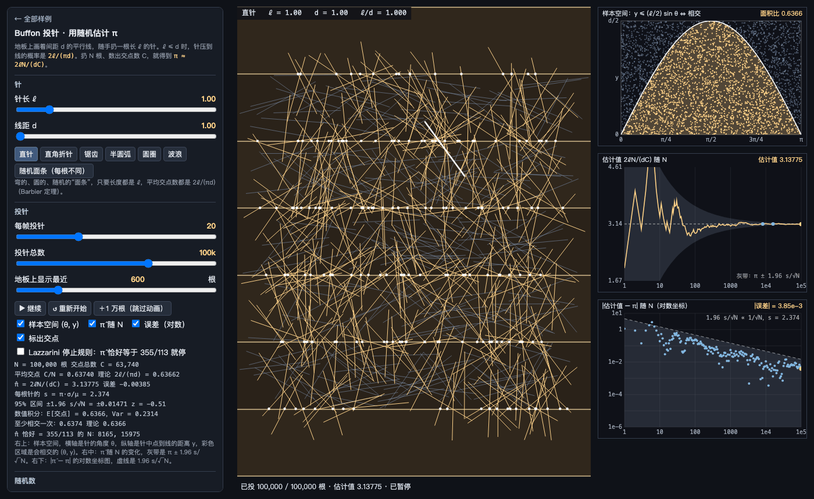
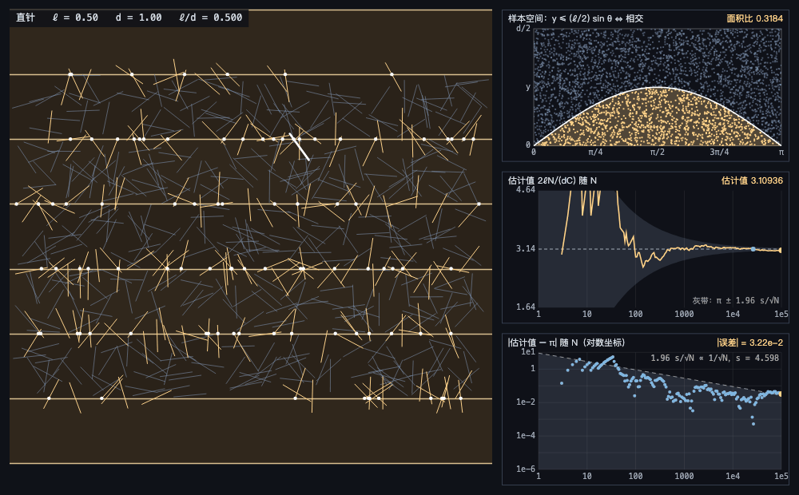
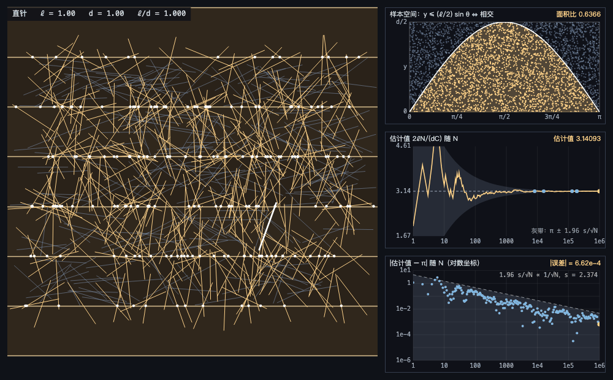
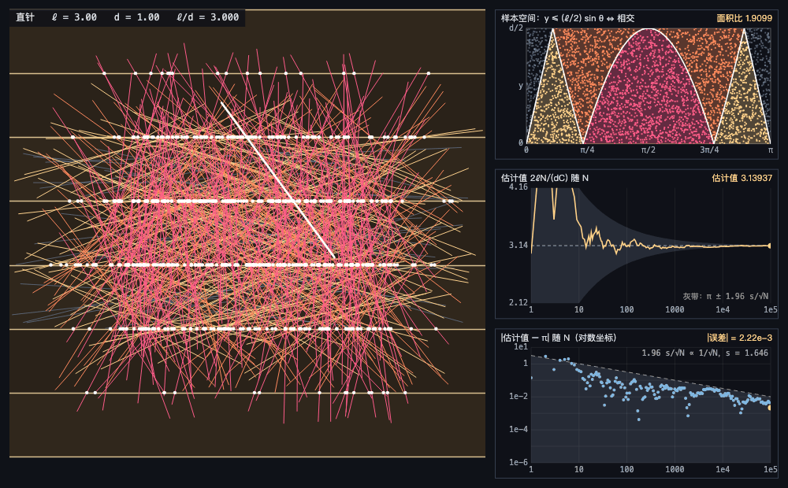
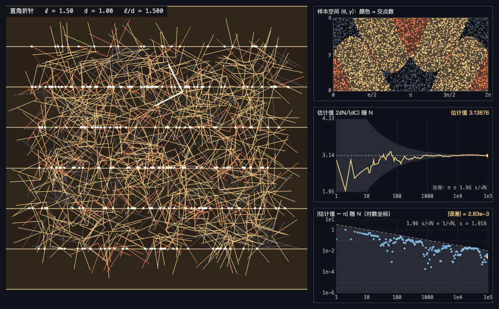
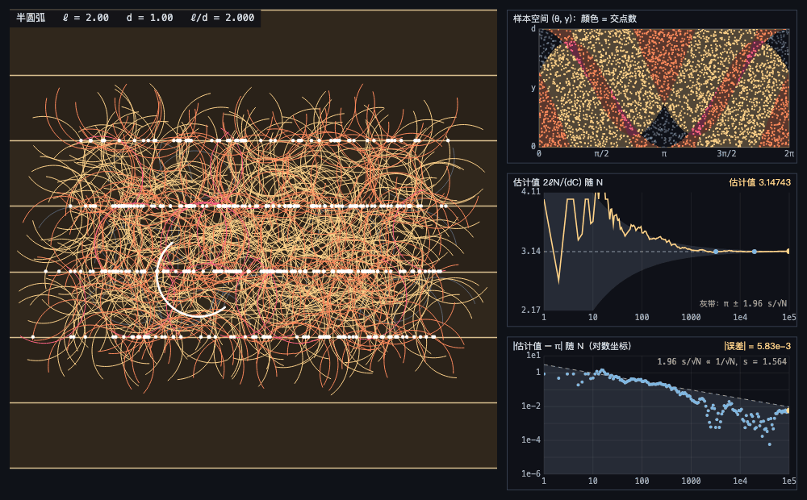
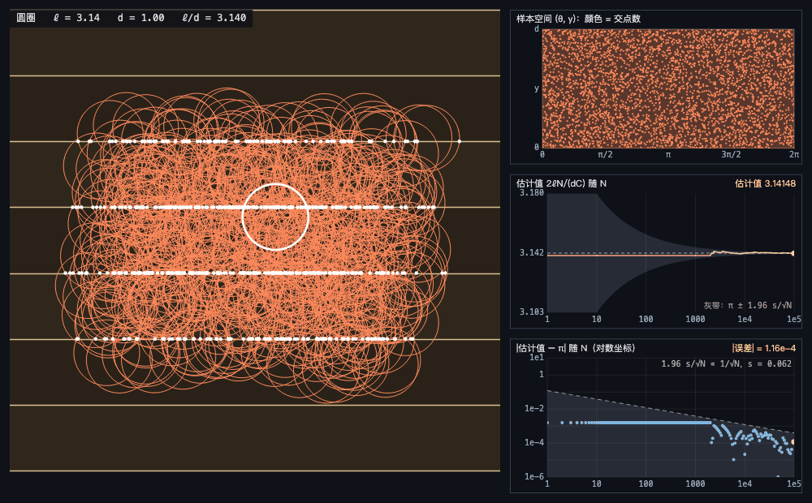
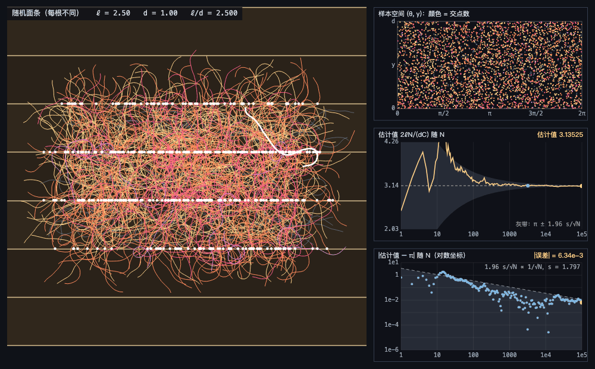
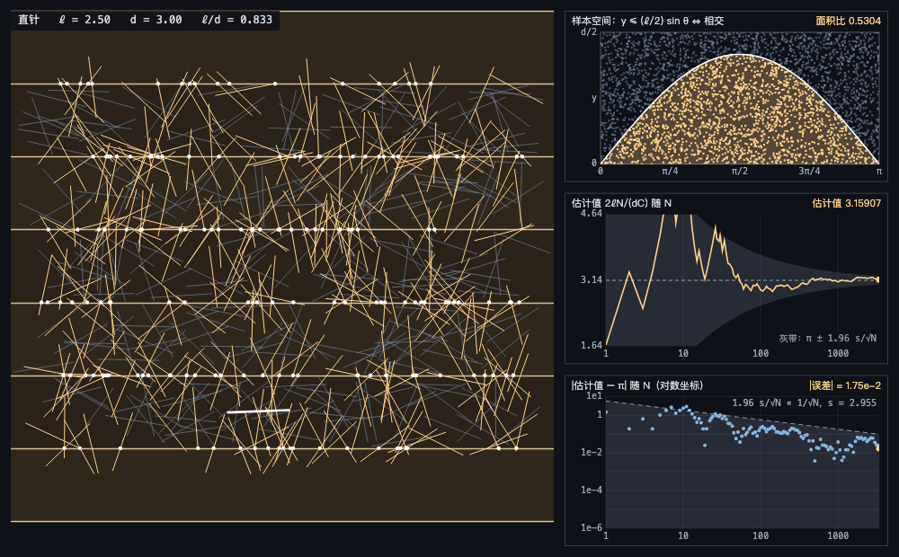
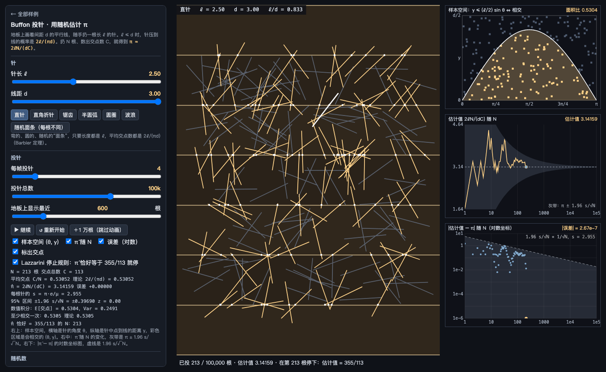

# Buffon 投针 · 用随机估计 π



1777 年，Buffon 伯爵在《道德算术试验》里算了这样一个问题：地板上画着一组间距为 d 的平行线，随手往地上扔一根长 ℓ 的针，针压到线的概率是多少？答案是 2ℓ/(πd)。一个和圆毫无关系的随机实验，答案里却出现了 π。反过来，扔很多根针、数一数压线的次数，就能估计 π。这是最早的“蒙特卡罗方法”之一：用随机抽样去算一个确定的数。

页面把这个实验做出来：左边是地板，金色的针压到了线，灰蓝色的没有，白点是交点。右边三张小图分别是 (θ, y) 样本空间、估计值随针数 N 的变化，以及误差的对数坐标图。针可以比线距长，也可以换成折针、圆弧、圆圈或随机弯曲的“面条”。

打开方式：用浏览器直接打开 [index.html](index.html)。页面只用 Canvas 2D，不依赖外部库，离线也能用。所有随机数来自一个带种子的伪随机数发生器（mulberry32），种子和参数相同，扔下的针就完全相同，下面每张图都可以用网址参数重现。

## 数学原理

### 1. 用两个数描述一根针

先看 ℓ ≤ d 的情形。一根落在地上的针，和“压不压线”有关的只有两个数：

- **y**：针的中点到最近那条线的距离，取值在 [0, d/2]；
- **θ**：针和线的夹角，取值在 [0, π)。

“随手扔”的意思是：y 在 [0, d/2] 上均匀分布，θ 在 [0, π) 上均匀分布，两者独立。针沿着垂直于线的方向，从中点往两边各伸出 (ℓ/2)·sin θ。所以

```
针压到线  ⇔  y ≤ (ℓ/2) · sin θ
```

ℓ ≤ d 时 (ℓ/2)·sin θ ≤ d/2，针最多够到最近的一条线，所以压线就是交点数为 1，不压线就是 0。

### 2. 概率就是一块面积

(θ, y) 均匀地落在宽 π、高 d/2 的矩形里，压线的点在曲线 y = (ℓ/2) sin θ 下方。概率就是曲线下的面积除以矩形面积：

```
P(压线) = ∫₀^π (ℓ/2) sin θ dθ / (π · d/2) = (ℓ/2) · 2 / (πd/2) = 2ℓ / (πd)
```

π 来自角度的取值范围，分子里的 2 来自 ∫₀^π sin θ dθ = 2。右上角小图就是这个矩形：白线是 y = (ℓ/2) sin θ，金色区域是压线的 (θ, y)，小点是最近 4000 根针各自的 (θ, y)，金色表示压线，灰蓝表示不压线。扔针就是往矩形里随机撒点，数落在曲线下的有几个。



小图右上角的“面积比”是在 360 × 200 的网格上用中点法算出的曲线下面积占比。ℓ = d 时它是 0.6366，精确值 2/π = 0.63662；ℓ = d/2 时是 0.3184，精确值 1/π = 0.31831。

### 3. 从交点数反推 π

扔 N 根针，压线 C 次，C/N 就是 2ℓ/(πd) 的估计。解出 π：

```
π̂ = 2ℓN / (dC)
```

页面首图是 ℓ = d、10 万根针（种子 1）：C = 63 740，C/N = 0.6374，π̂ = 3.13775，误差 −0.00385。

这个估计有多准？C 服从二项分布 B(N, p)，p = 2ℓ/(πd)，所以 C/N 的标准差是 √(p(1 − p)/N)。π̂ = (2ℓ/d)/(C/N) 是 C/N 的函数，在 p 附近线性化（delta 方法），导数是 −π/p，于是

```
sd(π̂) ≈ (π/p) · √(p(1 − p)/N) = s / √N,    s = π · √((1 − p)/p)
```

s 是“每根针的标准差”。95% 的情况下 π̂ 落在 π ± 1.96 s/√N 以内。页面的 s 由同一个网格上的数值积分给出：

| ℓ/d | p = 2ℓ/(πd) | s（公式） | s（页面） | 和 ℓ = d 相比要多扔几倍 |
|---|---|---|---|---|
| 1/4 | 0.1592 | 7.221 | 7.222 | 9.3 |
| 1/2 | 0.3183 | 4.597 | 4.598 | 3.8 |
| 1 | 0.6366 | 2.3735 | 2.3736 | 1 |

短针更差，因为压线的事件太稀少。ℓ ≤ d 时 ℓ = d 最好。

右中小图是 π̂ 随 N 的变化（横轴对数），灰带是 π ± 1.96 s/√N。右下小图把误差 |π̂ − π| 画在对数坐标上，虚线是 1.96 s/√N，斜率 −1/2。蓝点几乎都在虚线下方，偶尔贴近 0 的那些点是 π̂ 恰好从 π 的一侧跨到另一侧。



100 万根针（种子 1）：C = 636 754，π̂ = 3.14093，误差 −0.00066，95% 区间半宽 0.00465。只对了三位。误差按 1/√N 缩小，**每多要一位有效数字，针数就要乘以 100**。这是所有蒙特卡罗方法的共同命运：好处是误差和维数无关，坏处是收敛很慢。

这个误差公式可以直接验证。下面第 6 节用的参数（ℓ = 2.5、d = 3、N = 3408），公式给出 sd(π̂) = 2.9554/√3408 = 0.0506。用种子 1 到 200 各扔一遍，200 个 π̂ 的标准差实测 0.0504，有 97% 落在 ±1.96 × 0.0506 以内。

### 4. 长针：数交点而不是数针

ℓ > d 时一根针可以同时压好几条线。这时不再问“压没压线”，而是数**交点总数**。关键是期望的线性：

```
E[交点数] = 2ℓ / (πd)      对任何 ℓ 都成立
```

理由是把针切成 k 段，每段长 ℓ/k ≤ d。每一段单独看都是一根短针，它的期望交点数是 2(ℓ/k)/(πd)。整根针的交点数是各段交点数之和，而**和的期望等于期望的和**，不需要各段独立（它们显然不独立，方向都一样）。k 段加起来就是 2ℓ/(πd)。

所以估计公式 π̂ = 2ℓN/(dC) 不用改，只是 C 现在是交点总数。



样本空间里，针够到第 k 条线（距离中点 |kd − y|）的条件是 |kd − y| ≤ (ℓ/2) sin θ，所以边界是一族曲线 y = kd ± (ℓ/2) sin θ。上图 ℓ = 3d：金色是 1 个交点，橙色是 2 个，红色是 3 个。按面积加权的平均交点数是 1.9099（数值积分），精确值 6/π = 1.90986。10 万根针（种子 1）实测 C/N = 1.91121，π̂ = 3.13937。

至少压一条线的概率不再是线性的。记 r = ℓ/d > 1：

```
P(至少一个交点) = (2/π) · ( r − √(r² − 1) + arccos(1/r) )
```

r = 3 时是 0.89288，实测 0.89372。

长针的 s 更小。r → ∞ 时交点数约等于 r·|sin θ|，相对波动只剩 |sin θ| 本身的变异系数，s → π·√(π²/8 − 1) = 1.519：

| ℓ/d | 1 | 2 | 3 | 6 | ∞ |
|---|---|---|---|---|---|
| s（页面数值积分） | 2.374 | 1.787 | 1.646 | 1.553 | 1.519 |

### 5. Buffon 的面条：Barbier 定理

第 4 节的论证没有用到针是直的。把任何一条长 ℓ 的曲线切成很多小段，每一小段近似是一根短直针，期望交点数是 2·(段长)/(πd)，加起来还是 2ℓ/(πd)：

> **Barbier 定理（1860）**：一条长度为 ℓ 的曲线，随机扔在间距 d 的平行线上，期望交点数是 2ℓ/(πd)，与曲线的形状无关。

这个结论有个名字叫 “Buffon 的面条”。页面里每个形状都是总长 ℓ 的折线，中点放在弧长的一半处，θ 在 [0, 2π) 上均匀。“随机面条”每一根都随机生成一个新形状（转弯的速率本身也在随机游走）。

| 折针（ℓ = 1.5） | 半圆弧（ℓ = 2，种子 2） |
|---|---|
|  |  |
| **圆圈（ℓ = 3.14）** | **随机面条（ℓ = 2.5）** |
|  |  |

样本空间不再是一条正弦曲线下的面积，而是一块块形状奇怪的区域。可是按面积加权的平均交点数不变。所有形状取 ℓ = 2、d = 1、各扔 200 万根（种子 1），理论值 4/π = 1.27324：

| 形状 | C/N（实测） | E[交点]（数值积分） | 至少一个交点 | s |
|---|---|---|---|---|
| 直针 | 1.27358 | 1.2734 | 0.8376 | 1.787 |
| 直角折针 | 1.27318 | 1.2734 | 0.9502 | 1.347 |
| 锯齿 | 1.27388 | 1.2731 | 0.7957 | 2.725 |
| 半圆弧 | 1.27327 | 1.2742 | 0.9318 | 1.564 |
| 圆圈 | 1.27463 | 1.2731 | 0.6373 | 2.374 |
| 波浪 | 1.27390 | 1.2736 | 0.8236 | 2.413 |
| 随机面条 | 1.27363 | （每根不同） | 0.8081 | 2.200（样本） |

平均值一样，分布却很不一样：至少压一条线的比例从 0.64 到 0.95 都有，方差也不同。折针的 s 最小，因为两段方向不同，一段竖着时另一段多半横着，交点数更稳定。数值积分在 360 × 200 的网格上做，误差在 10⁻³ 量级（半圆弧的 1.2742 偏高 0.001，200 万根针的实测值反而更近）。

圆圈最有意思。周长 ℓ 的圆直径是 ℓ/π。直径小于 d 时它要么不碰线，要么恰好碰两次，所以 P(碰线) = (ℓ/π)/d，期望交点数 2ℓ/(πd)，和 Barbier 一致。顺带得到 Cauchy 公式：凸图形在随机方向上的平均宽度等于周长除以 π。如果直径恰好等于 d（ℓ = πd），**每次**都是 2 个交点，s = 0，扔一根针就得到准确的 π。这当然是作弊：做这个圆圈的时候已经用到了 π。页面的预设取 ℓ = 3.14（滑块精度 0.01），直径 0.99949d，漏掉的概率只有 1 − 3.14/π = 0.00051（实测 0.00047），s = 0.062，10 万根针给出 π̂ = 3.14148。这么高的精度来自放进去的 π，不是来自数据。

### 6. Lazzarini 1901：355/113 的教训

1901 年，意大利数学家 Mario Lazzarini 发表了一次投针实验：针长 2.5 cm，线距 3 cm，扔了 3408 次，压线 1808 次。代入公式：

```
π̂ = 2 × 2.5 × 3408 / (3 × 1808) = 17040 / 5424 = 355 / 113 = 3.14159292…
```

误差只有 2.7 × 10⁻⁷，小数点后六位全对。这个结果太好了，好得不可能。

**第一，方法给不出这个精度。** ℓ/d = 5/6 时 p = 0.5305，s = 2.955，3408 根针的标准差是 0.0506。2.7 × 10⁻⁷ 只是 5 × 10⁻⁶ 个标准差。要让 95% 区间缩到这么小，需要大约 4.7 × 10¹⁴ 根针。

**第二，数字凑得太巧。** ℓ/d = 5/6 使 π̂ = (5/3)·N/C，它等于 355/113 当且仅当 113N = 213C。所以 N 必须是 213 的倍数：3408 = 16 × 213，1808 = 16 × 113。一个随手定下的次数，偏偏是 213 的 16 倍。

**第三，即使 3408 是事先定好的，也几乎不可能。** C 服从 B(3408, 0.5305)，均值恰好是 1808.0，但 C 正好等于 1808 的概率只有 0.0137。差一次（1807 或 1809）误差就变成 0.0017，比 355/113 差了六千多倍。种子 1 到 200 各扔 3408 根，没有一次 C = 1808，误差的中位数是 0.0356。种子 1 的结果是 C = 1798、π̂ = 3.15907，误差 +0.0175，在 95% 区间 ±0.0992 以内，这才是诚实的样子：



Gridgeman（1960）和 Badger（1994）的分析是：最可能的做法是一批一批地扔，**一旦估计值等于 355/113 就停**（或者从记录里挑一个合适的 N）。355/113 是早就知道的好近似（祖冲之的“密率”），目标是现成的。

页面可以照做。勾选“Lazzarini 停止规则”，每扔一根针就检查 π̂ 是否恰好等于 355/113（ℓ、d 都是 0.01 的整数倍，用整数比较，没有舍入误差），等于就停。种子 18 只扔了 213 根就停了：C = 113，π̂ = 355/113。



种子 1 到 200 用停止规则各扔最多 10 万根：

| 在多少根以内命中 355/113 | 种子数（共 200） |
|---|---|
| 1000 | 25 |
| 3408 | 53 |
| 100 000 | 153 |

四分之一的种子在 3408 根以内就能“得到”六位精度的 π。命中的那 153 个种子里，停下时 N 的中位数是 7029。

问题出在**可选停止**（optional stopping）：什么时候停取决于结果好不好看。π̂ 在 π 附近来回游走，会反复经过 355/113，挑它经过的那一刻停下，报出来的就是 355/113。这时报告的精度来自停止规则，不是来自针。教训有两条：

1. **事先定好 N**，扔完再看结果；
2. **报告区间，不报告位数**：π̂ ± 1.96 s/√N。Lazzarini 诚实的报告应该是“3.14 ± 0.10”。

右中小图上的青色点标出 π̂ 恰好等于 355/113 的时刻。不开停止规则时也能看到它们，例如 ℓ = d、种子 1 的 100 万根针里，N = 8165、15 975、130 640 … 时都经过了 355/113。

## 操作

- 针长 ℓ（0.1–6）、线距 d（1–3）、针的形状（直针、直角折针、锯齿、半圆弧、圆圈、波浪、随机面条）；
- 每帧投针（1–2 万）、投针总数（10–1000 万）、地板上显示最近多少根（10–3000）；
- 暂停 / 继续、重新开始、“＋1 万根”跳过动画直接投下 1 万根；
- 开关：样本空间、估计值随 N、误差对数图、标出交点（最近 300 根针的交点画成白点）、Lazzarini 停止规则；
- 随机数种子（1–999）；
- 预设：Buffon ℓ = d、短针 ℓ = d/2、100 万根、Lazzarini 1901（3408 根）、Lazzarini 停止规则、长针 ℓ = 3d、直角折针、半圆弧、圆圈（周长 πd）、随机面条。

面板实时给出 N、交点总数 C、平均交点数和理论值 2ℓ/(πd)、π̂ 和误差、s、95% 区间、z = (π̂ − π)/(s/√N)、数值积分的均值和方差、至少一个交点的比例，以及 π̂ 恰好等于 355/113 的那些 N。每帧最多检查 300 万条线段与线的相交。

## 网址参数

| 键 | 含义 |
|---|---|
| p | 预设名：buffon, short, million, lazz, lazzStop, long, bent, arc, circle, noodle |
| shape | 形状：line, bent, zig, arc, circle, wave, noodle |
| l | 针长（0.1–6） |
| d | 线距（1–3） |
| v | 每帧投针（1–20000） |
| nb | 投针总数（10–10000000） |
| k | 打开时直接投下的针数（0–2000000，跳过动画，不超过 nb） |
| show | 地板上显示的针数（10–3000） |
| seed | 随机数种子（1–999） |
| lz | 1 = 打开 Lazzarini 停止规则，0 = 关闭 |
| ss, est, err, dots | 0 = 隐藏样本空间、估计值图、误差图、交点 |
| run | 0 = 打开时暂停 |
| ui | 0 = 隐藏控制面板，只留画布 |

数值参数必须是有限数，超出范围的会被夹到滑块范围内；字符串参数只接受上表列出的值。例如：长针一次投 10 万根 `index.html?p=long&k=100000`；Lazzarini 停止规则、种子 18 `index.html?p=lazzStop&seed=18&k=100000`；随机面条 200 万根 `index.html?shape=noodle&l=2&nb=2000000&k=2000000`。

## 参考

- G.-L. Leclerc, Comte de Buffon, *Essai d'arithmétique morale*, Histoire naturelle, Supplément IV, 1777.
- J.-É. Barbier, *Note sur le problème de l'aiguille et le jeu du joint couvert*, Journal de mathématiques pures et appliquées, 2e série, 5, 1860.
- M. Lazzarini, *Un'applicazione del calcolo della probabilità alla ricerca sperimentale di un valore approssimato di π*, Periodico di Matematica 4, 1901.
- N. T. Gridgeman, *Geometric probability and the number π*, Scripta Mathematica 25, 1960.
- L. Badger, *Lazzarini's lucky approximation of π*, Mathematics Magazine 67(2), 1994.
- J. F. Ramaley, *Buffon's noodle problem*, American Mathematical Monthly 76, 1969.
- M. Aigner, G. M. Ziegler, *Proofs from THE BOOK*, Springer, “Buffon's needle problem” 一章。
