# Chladni 图形 · 沙子画出的驻波

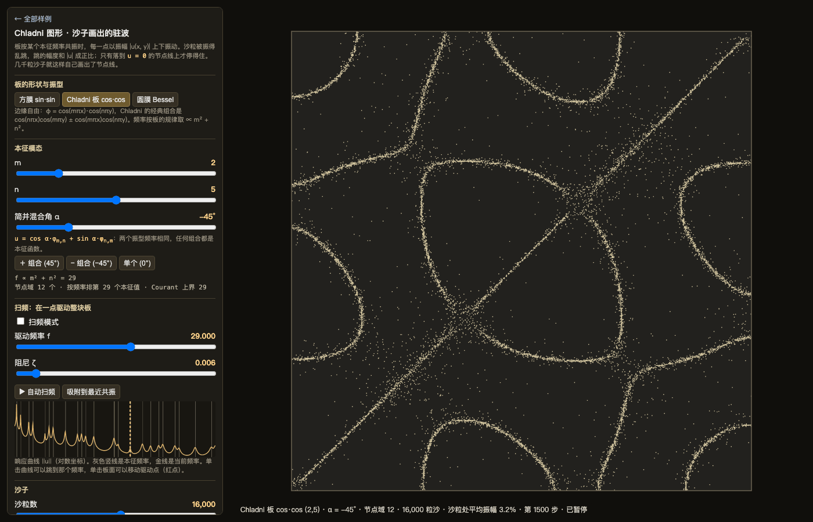

1787 年，Ernst Chladni 在莱比锡出版了《关于声音理论的发现》。他在一块金属板上撒一层细沙，用小提琴弓拉板的边缘。板发出一个音，沙子就跳起来，几秒后聚成一组对称的曲线；换一个音，就换一组曲线。沙子停下来的地方，是板上**完全不动**的点，叫**节点线**。上图每一粒沙都在随机乱跳，跳的幅度和它所在位置的振幅成正比，没有一粒是“画”上去的。

打开方式：用浏览器直接打开 [index.html](index.html)。页面只用 Canvas 2D，不依赖外部库，离线也能用。

## 数学原理

### 1. 驻波与 Helmholtz 方程

一张绷紧的鼓膜，位移 w(x, y, t) 满足波动方程

```
∂²w/∂t² = c² Δw,      Δ = ∂²/∂x² + ∂²/∂y²
```

**驻波**是形状不变、只在原地上下振动的解：w = u(x, y)·cos ωt。代进去，cos ωt 两边约掉，剩下只关于形状 u 的方程

```
Δu + k²u = 0,      k = ω / c
```

这就是 **Helmholtz 方程**。再加上边界条件（边缘固定：边上 u = 0），只有一串离散的 k 有非零解。这些 k² 是 −Δ 的**本征值**，对应的 u 是**本征函数**，也叫振型或模态。板以频率 ω 振动时，点 (x, y) 的振幅是 |u(x, y)|；u = 0 的地方一直不动。

### 2. 分离变量：方膜的 sin·sin

边长为 1、四边固定的方膜，猜 u = X(x)·Y(y)。代入 Helmholtz 方程再除以 XY：

```
X″/X + Y″/Y = −k²
```

左边第一项只和 x 有关，第二项只和 y 有关，两者相加是常数，所以各自是常数：X″ = −a²X，Y″ = −b²Y，a² + b² = k²。加上 X(0) = X(1) = 0，只能是 X = sin(mπx)，m = 1, 2, 3, …；Y 同理。于是

```
φ_{m,n}(x, y) = sin(mπx) · sin(nπy),      k² = π²(m² + n²)
```

频率 ω = ck，所以 **f_{m,n} ∝ √(m² + n²)**。页面以 (1,1) 为单位：f / f₁₁ = √((m² + n²)/2)。(2,1) 是 1.5811，(2,2) 是 2，(3,1) 是 2.2361。泛音不是基频的整数倍，所以鼓声不像琴弦那样有清楚的音高。

sin(mπx) 在 x = 1/m, 2/m, … 处为零，所以 φ_{m,n} 的节点线是 m − 1 条竖线和 n − 1 条横线，把方块切成 m·n 个小块：

| (2,1)：1 条竖线，2 块 | (3,2)：2 竖 1 横，6 块 |
|---|---|
| 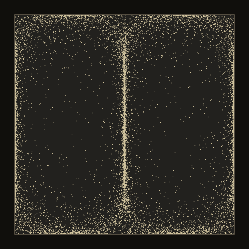 | 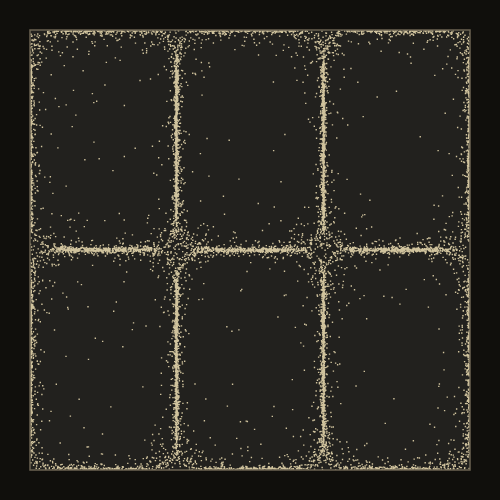 |

注意四条边上也聚了沙：边缘固定，边本身就是节点线。

### 3. 简并：m ≠ n 时两个振型的频率相同

f_{m,n} 只依赖 m² + n²，所以 φ_{m,n} 和 φ_{n,m} 频率相同。Helmholtz 方程是线性的，它们的任意组合

```
u = cos α · φ_{m,n} + sin α · φ_{n,m}
```

也是同一个频率的本征函数。这叫**简并**。组合后的节点线不再是直线网格。页面的“简并混合角 α”滑块就是这个 α。下面是 (1,3) 和 (3,1) 的四种组合，四张图的频率完全一样（都是 f / f₁₁ = 2.2361），页面数出的节点域个数却不同：

| α = 0°：3 块 | α = 30°：2 块 | α = 45°：2 块 | α = −45°：4 块 |
|---|---|---|---|
| 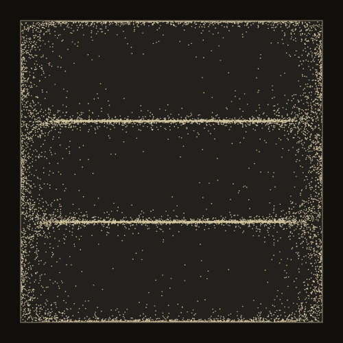 | 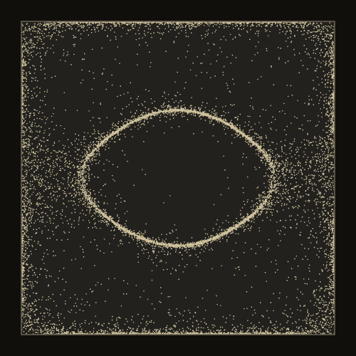 | 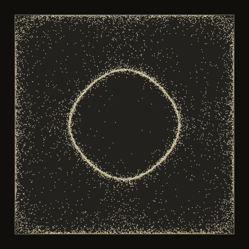 | 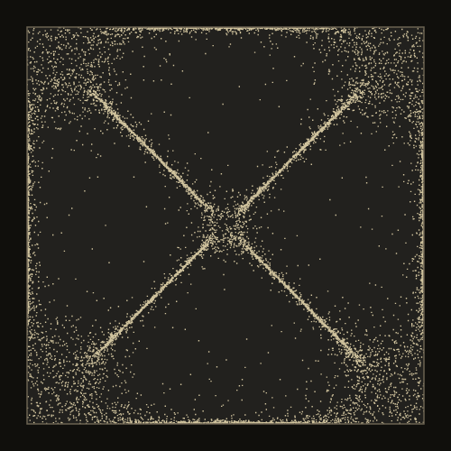 |

α = 45° 时 sin πx sin 3πy + sin 3πx sin πy 的节点线是一条闭合曲线，把中间一块和外圈分开；α = −45° 时节点线变成两条对角线。

还有一种“意外”的简并：m² + n² 能用两种方式写成平方和时，比如 50 = 5² + 5² = 1² + 7²，(5,5)、(1,7)、(7,1) 三个振型频率都是 5。这和数论里“一个数有几种平方和表示”是同一个问题。

### 4. Chladni 板：cos·cos 的 ± 组合

Chladni 的板边缘是**自由**的，不是固定的。对膜来说，自由边的条件是边上法向导数为零（∂u/∂n = 0），分离变量得到的是余弦：

```
φ_{m,n} = cos(mπx) · cos(nπy),      m, n = 0, 1, 2, …
```

边上不再是节点，而是振得最厉害的地方。Chladni 书里那些图案，很接近简并对的 ± 组合

```
u = cos(nπx) cos(mπy) ± cos(mπx) cos(nπy)
```

也就是 α = ±45°。m + n 是奇数时，+ 和 − 两张图只差一个镜像（把 x 换成 1 − x）；m + n 是偶数时，两张图完全不同。下面是 (2,4)：

| 单个 cos 2πx cos 4πy：15 块 | ＋ 组合：10 块 | − 组合：8 块 |
|---|---|---|
| 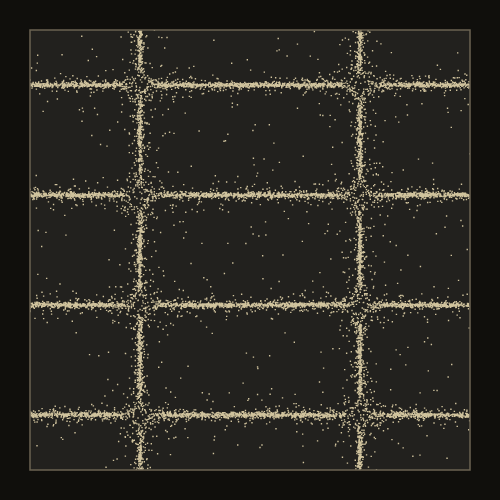 | 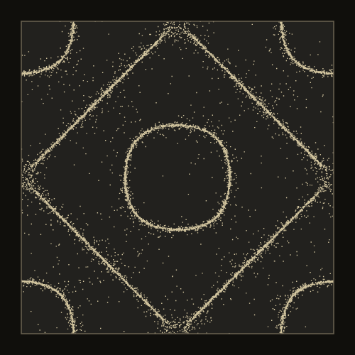 | 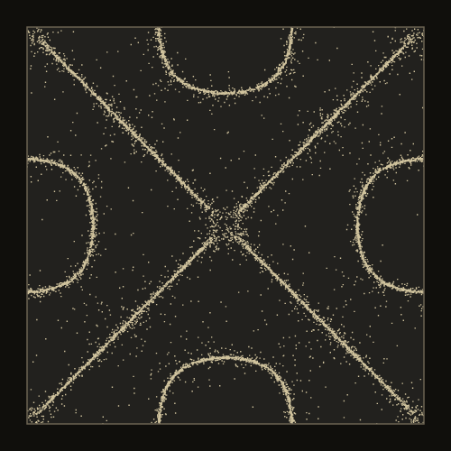 |

单个振型的节点线是 3 条竖线和 2 条横线，切成 (m + 1)(n + 1) = 15 块。+ 组合里出现一个菱形套一个圆，− 组合是两条对角线加四段弧。打开“精确节点线”和“位移场”，可以看到红（u > 0）蓝（u < 0）两色恰好以沙线为界：

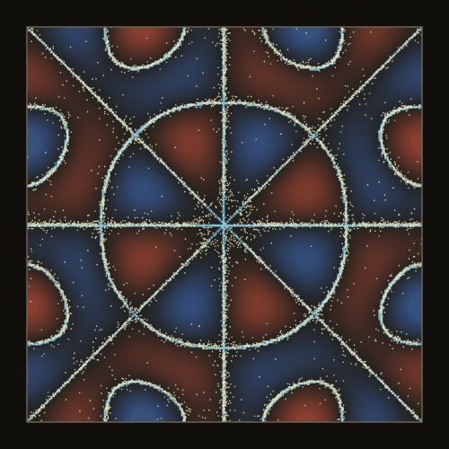

**这只是近似。** 真实的板不是膜。薄板的弯曲由 Kirchhoff 板方程描述：

```
D Δ²w + ρh ∂²w/∂t² = 0     ⇒     Δ²u = β⁴ u,   ω = β² √(D / ρh)
```

Δ² 是**双调和算子**（拉普拉斯算子作用两次），D 是弯曲刚度，ρh 是单位面积质量。两点不同于膜：

- 频率正比于 β²，不是 β。四边简支（铰接）的方板恰好仍有本征函数 sin mπx sin nπy，频率 ∝ m² + n²，是膜的平方。页面在 Chladni 板模式下也按 m² + n² 给频率。
- 自由边要求弯矩和 Kirchhoff 剪力都为零。这两个条件把 x、y 耦合在一起，方程不能分离变量，也没有闭式解。cos·cos 只满足膜的自由边条件，满足不了板的。

所以页面里的 cos·cos 是“自由边的膜 + 板的频率规律”，图案和 Chladni 的图**定性**吻合，细节不一样。还有一个真实的差别：真实的自由方板上，+ 和 − 两种组合**频率不同**（简并被板的耦合拆开了），所以 Chladni 能分别拉出这两个音、看到两张图。页面里两者简并，由 α 来选。1909 年 Walther Ritz 用变分法（后来叫 Ritz 法）算出了自由方板的前几十个振型，才第一次和 Chladni 的图逐一对上。

### 5. 圆膜：Bessel 函数

圆形鼓膜用极坐标 (r, θ) 分离变量，u = R(r)·Θ(θ)。Θ 必须绕一圈回到原值，所以 Θ = cos mθ 或 sin mθ，m = 0, 1, 2, …。R 满足 Bessel 方程

```
r²R″ + rR′ + (k²r² − m²)R = 0
```

在圆心有界的解是 **Bessel 函数** R = J_m(kr)。边缘 r = 1 固定，要求 J_m(k) = 0，所以 k 只能是 J_m 的正零点 j_{m,1} < j_{m,2} < …：

```
φ_{m,k} = J_m(j_{m,k} · r) · cos mθ,      f ∝ j_{m,k}
```

页面自己实现 J_m，不查表：

- x ≥ 4 时用积分表示 J_m(x) = (1/2π)∫₀^{2π} cos(mτ − x sin τ) dτ，按 160 个等距节点求和。被积函数是光滑的周期函数，这种情况下梯形法则按指数速度收敛。
- x < 4 时用幂级数 Σ (−1)ˢ (x/2)^{2s+m} / (s!(s+m)!)。梯形法则在 x 很小、J_m 本身极小时只剩舍入噪声（例如 J₇(0.02) ≈ 10⁻¹⁷），符号会乱跳，节点域就数错了。在 x = 3.9 处两种算法对 m = 0…40 的最大差为 9.9 × 10⁻¹⁶。

零点的求法是从 x = m 起按步长 0.1 扫描变号，再二分 50 次（j_{m,1} 一定大于 m）。阶数 0…40、50 以内一共 306 个零点。与标准表对比，页面算出的值：

| | k = 1 | k = 2 | k = 3 |
|---|---|---|---|
| j_{0,k} | 2.404825557695773 | 5.520078110286311 | 8.653727912911013 |
| j_{1,k} | 3.831705970207512 | 7.015586669815619 | 10.173468135062723 |
| j_{2,k} | 5.135622301840682 | 8.417244140399866 | 11.619841172149059 |

都与文献值一致到所示位数。另外 J₀(1) = 0.7651976866，J₅(3) = 0.0430284349。

J_m(j_{m,k} r) 在 0 < r < 1 内有 k − 1 个零点，就是 **k − 1 个节点圆**。cos mθ 有 2m 个零点，就是 **m 条节点直径**。泛音同样不是整数倍：f / f₀₁ = 1.5933 (1,1)、2.1355 (2,1)、2.2954 (0,2)、2.6531 (3,1)。

| (m=0, k=3)：2 个节点圆，3 块 | (m=2, k=3)：2 条直径 + 2 个圆，12 块 | (m=5, k=2)：5 条直径 + 1 个圆，20 块 |
|---|---|---|
| 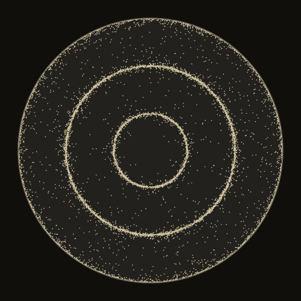 | 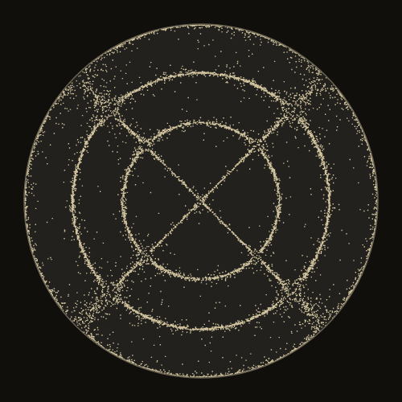 | 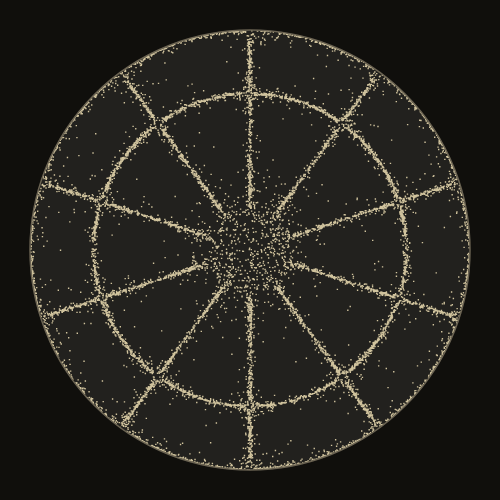 |

m 条直径都穿过圆心，所以圆心附近的振幅极小（J_m(x) ≈ (x/2)^m / m!），沙子在那里聚成一团，而不是细线。

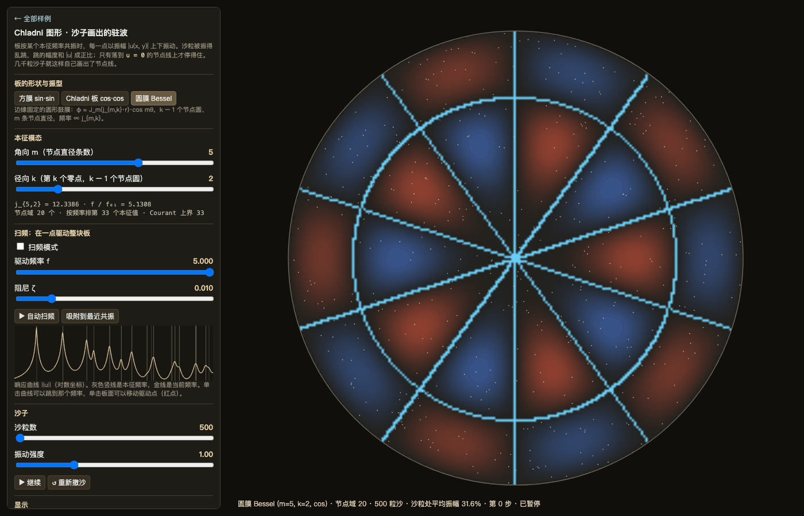

### 6. 沙子为什么停在节点线上

页面的沙子模型只有一条规则：每一步，每粒沙在 x、y 方向各随机移动一段距离，最大步长 = s₀ · |u(x, y)| / max|u|。没有吸引力，也没有朝节点线走的倾向。

沙子还是会聚到节点线上，原因是“越安静的地方，停留越久”。设步长 s(x) 随位置变化。一个区域里，沙子要走出去所需的步数与 1/s² 成正比（随机游走走出距离 L 大约需要 (L/s)² 步）。长时间以后，沙子在某处的密度大约 ∝ 1/s(x)²。离节点线距离为 d 时，|u| ≈ |∇u|·d，密度 ∝ 1/d²。这个函数在 d → 0 时积分发散，所以几乎所有沙子最后都落到节点线附近的细带里。

这和真实的沙子是一回事：板振动的加速度 ω²|u| 超过重力加速度 g 的地方，沙粒会被抛起来，落到别处；只有节点附近抛不起来。（Faraday 在 1831 年注意到，很轻的粉末反而聚到振幅最大的地方，那是被空气流带过去的，和这里的机制无关。）

下面是 Chladni (2,5) − 组合，12000 粒沙从均匀撒开开始。状态栏的“沙粒处平均振幅”是所有沙粒处 |u| / max|u| 的平均值，均匀撒开时等于整块板上的平均值：

| 第 0 步：28.7% | 第 100 步：17.3% | 第 400 步：7.7% | 第 1500 步：3.2% |
|---|---|---|---|
| 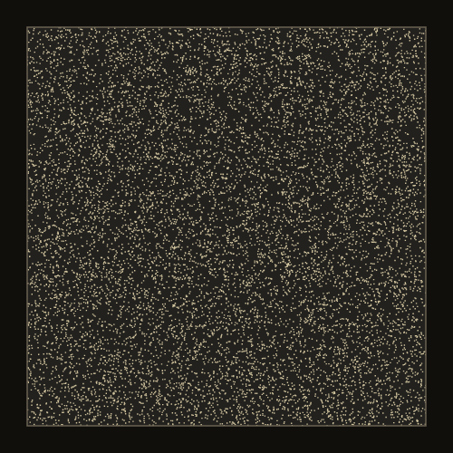 | 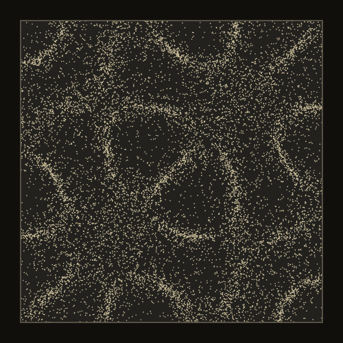 | 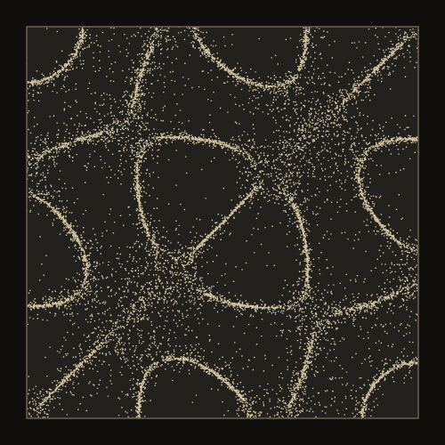 | 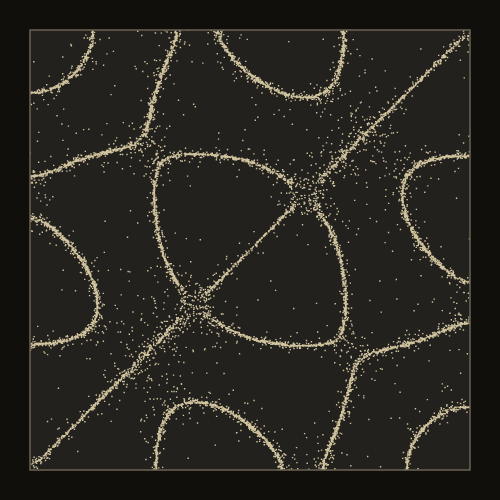 |

几条节点线相交的地方（比如上面图里的中心点）|u| 是二阶小量，周围一大片都很安静，沙子在那里散成一团，交叉点看起来是“糊”的。真实的 Chladni 图上也是这样。随机数用带种子的 mulberry32，同一个网址每次撒出的沙完全相同。

### 7. 扫频：在一点驱动整块板

Chladni 用弓拉板，实际上是在边上一点持续施加一个频率为 f 的力。勾选“扫频模式”，页面在驱动点 x₀（红点）加一个周期力，计算有阻尼的稳态响应。把响应按正交归一的本征函数 φ_i 展开，每个系数单独解一个受迫振子：

```
u(x) = Σ_i  φ_i(x₀) φ_i(x) / (f_i² − f² + 2iζ f_i f)
```

ζ 是阻尼比，分母是复数，表示响应和驱动之间有相位差。沙子的步长按 |u(x)| 算（复数的模就是那一点的振幅）。页面对方膜取 m, n ≤ 10（100 个振型），对 Chladni 板取 0 ≤ m, n ≤ 10（120 个），对圆膜取 m ≤ 9、k ≤ 5（95 个，m > 0 时 cos、sin 各一个）。

- f 正好等于某个 f_i 时，那一项的分母只剩 2iζ f_i²，比别的项大约 1/ζ 倍，图案**吸附**到这个振型上。
- f 在两个共振之间时，好几项大小相当，|u| 是它们的混合，没有清楚的节点线；整块板的振幅也小得多。页面把沙子的振动强度取为 3 × 当前响应 / 最近共振峰的响应（封顶 100%），所以离共振远时沙子几乎不动，保留着上一个图案。

面板里的响应曲线就是 ‖u‖ = √(Σ |系数|²) 随 f 的变化（对数坐标），每个尖峰是一个共振，灰线是本征频率。方膜，驱动点 (0.13, 0.21)，ζ = 0.01：

| f | 最近的共振 | 它占响应能量 | 振动强度 |
|---|---|---|---|
| 1.0000 | (1,1) | 99.8% | 100% |
| 1.29 | (2,1) 与 (1,2) | 55.7% | 24% |
| 1.5811 | (2,1) 与 (1,2) | 99.6% | 100% |
| 1.8 | (2,2) | 45.7% | 46% |
| 2.0000 | (2,2) | 98.8% | 100% |

| f = 1.29：在共振之间，振得弱，沙子散乱 | f = 1.8：两个共振的混合 | f = 2.0：吸附到 (2,2) |
|---|---|---|
| 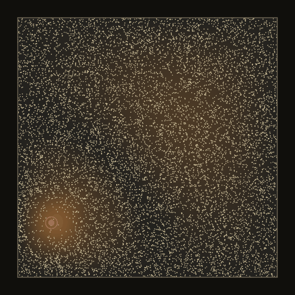 | 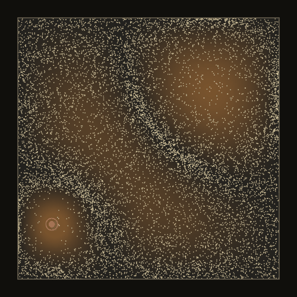 | 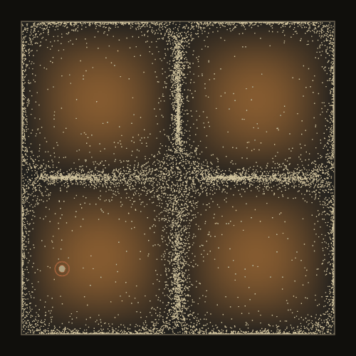 |

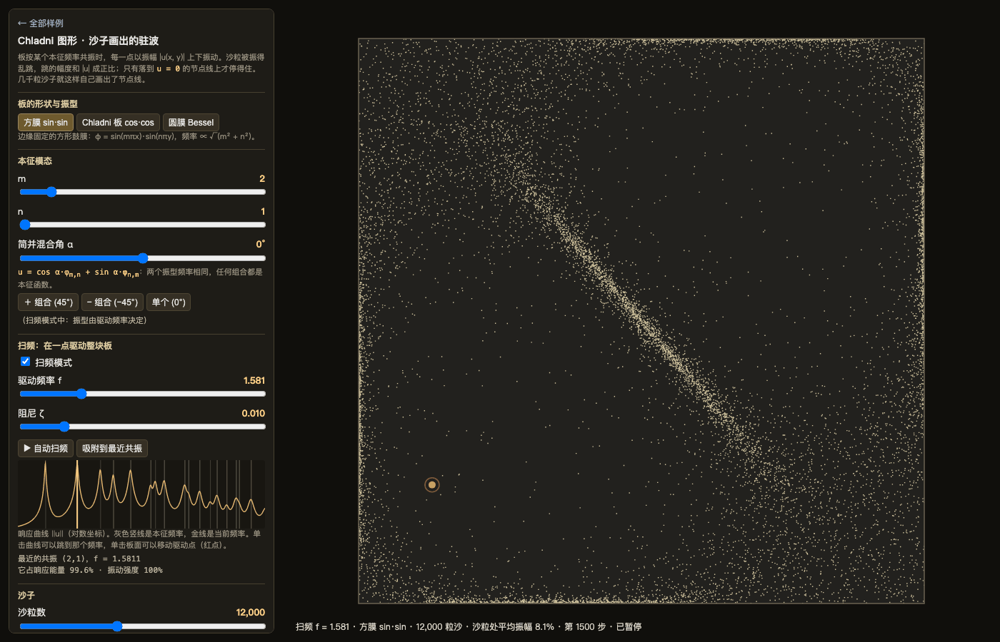

上图是简并对的情形，值得细看：在 f = 1.5811 处，(2,1) 和 (1,2) 的分母完全一样，响应正比于 φ₂₁(x₀)φ₂₁ + φ₁₂(x₀)φ₁₂。也就是说，**驱动点的位置决定了简并对怎么混合**。单击板面移动红点，节点线会跟着转。圆膜上更直观：(1,1) 的 cos θ 和 sin θ 简并，驱动后的振型是 cos(θ − θ₀)，节点直径总是垂直于驱动点所在的方向：

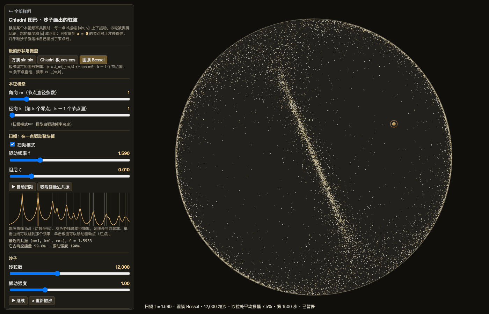

真实的板上，驱动点恰好落在某个振型的节点线上时，那个振型怎么拉也拉不出来（φ_i(x₀) = 0）。Chladni 用手指按住板上某一点，就是强制那一点为节点，挑出想要的图案。

### 8. 节点域与 Courant 定理

节点线把区域切成若干块，每块里 u 不变号，叫**节点域**。页面会数出当前振型有几个节点域：方板在 200 × 200 的网格上做四连通的洪水填充；圆盘改在 240 × 480 的极坐标网格上数，θ 方向首尾相接。这样圆心附近细到不足一个像素的扇形不会粘在一起。

**Courant 节点域定理（1923）**：把本征值从小到大排（重根按重数计）λ₁ < λ₂ ≤ λ₃ ≤ …，第 n 个本征函数的节点域不超过 n 个。面板显示“按频率排第 n 个本征值 · Courant 上界 n”，n 是比它小的本征值个数（按重数）加 1。

| 振型 | 节点域 | 排第几个（上界） |
|---|---|---|
| 方膜 (2,1) | 2 | 2 |
| 方膜 (2,2) | 4 | 4 |
| 方膜 (3,2) | 6 | 7 |
| 方膜 (1,3) α = −45° | 4 | 5 |
| Chladni (2,5) − | 12 | 29 |
| Chladni (3,7) − | 24 | 53 |
| 圆膜 (5,2) | 20 | 33 |
| 圆膜 (0,3) | 3 | 15 |

我用脚本把页面提供的每一个振型都数了一遍：方膜 m, n ∈ 1…10、Chladni 板 m, n ∈ 0…10，每对 m ≠ n 取 α = −90°…75°（步长 15°）的 12 个角度，加上圆膜 m ∈ 0…8、k ∈ 1…6，共 2475 种。单个振型的计数全部等于公式值：方膜 m·n，Chladni 板 (m + 1)(n + 1)，圆膜 m = 0 时为 k，m > 0 时为 2mk。2475 种里没有一种超过 Courant 上界。等号只在最低的几个振型上成立，例如 (1,1)、(2,1)、(2,2)。Pleijel 在 1956 年证明，等号只能成立有限多次，频率越高，节点域个数离上界越远。

### 9. 能听出鼓的形状吗

本征值 λ₁ ≤ λ₂ ≤ … 就是鼓能发出的全部音高。1966 年 Mark Kac 发表了一篇文章，题为《能听出鼓的形状吗？》：如果两面鼓的全部音高都相同，它们的形状是否一定相同？

- 能听出一部分。**Weyl 定律**说，频率低于 λ 的振型个数 N(λ) ≈ 面积 · λ / 4π，所以面积是听得出来的。更精细的展开还能听出周长，以及有没有洞。
- 但完整的答案是不能。1992 年 Gordon、Webb、Wolpert 构造出两个形状不同、本征值完全相同的平面区域（等谱鼓）。

页面里的简并现象和这个问题相通：同一个音（同一个本征值）可以对应很多种节点图案，光听音高，分不出板上是哪一种图案。

### 10. 历史

- **1787**：Chladni 出版《Entdeckungen über die Theorie des Klanges》，书中有上百张节点图案。他带着板在欧洲巡回演示。
- **1808–1809**：Chladni 在巴黎为拿破仑演示。随后法兰西科学院悬赏一枚 1 公斤重的金质奖章（价值 3000 法郎），征求板振动的数学理论。
- **1811–1816**：1811 年只有 Sophie Germain 一人应征。她的出发点是板的弯曲能量与曲率有关；Lagrange 审稿时据此写出了四阶方程。她的推导有漏洞，前两次都没有获奖。第三份论文在 1816 年 1 月获奖，她是第一位获得法兰西科学院奖的女性。论文的边界条件仍然不对。
- **1850**：Kirchhoff 给出自由边的正确边界条件。
- **1909**：Ritz 用变分法算出自由方板的振型和频率，与 Chladni 的图逐一对上。

## 操作

- 板的形状：方膜 sin·sin（边缘固定）、Chladni 板 cos·cos（边缘自由，板的频率规律）、圆膜 Bessel（边缘固定）；
- 本征模态：m、n 滑块（圆膜是角向 m 和径向 k）；简并混合角 α，以及“＋ 组合 / − 组合 / 单个”三个按钮；面板显示频率、节点域个数、Courant 上界；
- 扫频：勾选“扫频模式”后，用驱动频率 f 滑块和阻尼 ζ 滑块调节；“自动扫频”让 f 慢慢扫过整个范围，“吸附到最近共振”跳到最近的本征频率；单击响应曲线跳到对应频率，单击板面移动驱动点；
- 沙子：沙粒数（500–30000）、振动强度（步长倍数）、暂停 / 继续、重新撒沙；
- 显示：位移场（模态模式下红正蓝负，扫频模式下是振幅）、精确节点线（青色）；
- 预设：Chladni (2,5) −、(2,4) ＋、(2,4) −、(3,7) −，方膜 (2,1)、(1,3) 简并混合，圆膜 (2,3)、(5,2)，扫频（方膜、圆膜、Chladni 板）。

## 网址参数

| 键 | 含义 |
|---|---|
| p | 预设名：chl25m, chl24p, chl24m, chl37m, mem21, mem13, circ23, circ52, sweep, sweepc, sweepchl |
| k | 板的形状：mem, chl, circ |
| m, n | 模态编号（圆膜的 n 是径向 k），按形状夹到滑块范围 |
| a | 简并混合角 α（度，−90…90） |
| sw | 1 = 扫频模式 |
| f | 驱动频率（给了 f 就进入扫频模式） |
| z | 阻尼比 ζ（0.002–0.05） |
| dx, dy | 驱动点（0–1 的板面坐标，y 向上） |
| g | 沙粒数（500–30000） |
| sp | 振动强度（0.2–3） |
| seed | 撒沙的随机种子 |
| it | 打开时先空跑几步（0–3000），用来直接看到沉降后的图案 |
| fld, nl | 1 = 显示位移场 / 精确节点线 |
| auto | 1 = 打开时就自动扫频（需在扫频模式） |
| run | 0 = 打开时暂停 |
| ui | 0 = 隐藏面板，只留画布 |

所有数字参数都先检查是否为有限数，再夹到对应滑块的范围；p 和 k 必须是表里的键，否则用默认值。例如 `index.html?p=chl37m&g=24000&it=2000` 打开时沙子已经落好；`index.html?k=mem&m=1&n=3&a=-45&nl=1` 是两条对角线的简并组合；`index.html?p=sweep&f=1.5811&dx=0.5&dy=0.2` 把驱动点挪到下边中点再看 (2,1) 简并对。

## 参考

- E. F. F. Chladni, *Entdeckungen über die Theorie des Klanges*, Leipzig, 1787.
- S. Germain, *Recherches sur la théorie des surfaces élastiques*, Paris, 1821（获奖论文的修订版）。
- W. Ritz, *Theorie der Transversalschwingungen einer quadratischen Platte mit freien Rändern*, Annalen der Physik 28, 1909.
- R. Courant, D. Hilbert, *Methoden der mathematischen Physik*, Band I, 1924. 节点域定理。
- Å. Pleijel, *Remarks on Courant's nodal line theorem*, Communications on Pure and Applied Mathematics 9, 1956.
- M. Kac, *Can one hear the shape of a drum?*, American Mathematical Monthly 73, 1966.
- C. Gordon, D. Webb, S. Wolpert, *One cannot hear the shape of a drum*, Bulletin of the AMS 27, 1992.
- [NIST DLMF §10.21](https://dlmf.nist.gov/10.21)，Bessel 函数的零点。
