# Collatz 3n+1 · 冰雹数与珊瑚树

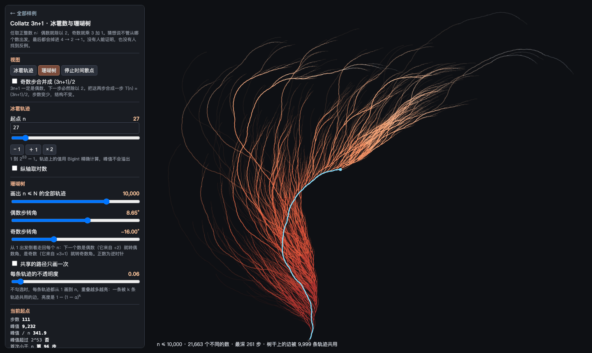

任取一个正整数 n：偶数就除以 2，奇数就乘 3 再加 1，然后对结果重复同样的操作。从 27 出发，数字一路涨到 9232，第 111 步才落到 1。**Collatz 猜想**说，不管从哪个正整数出发，最后都会掉进 4 → 2 → 1 这个循环。这条规则小学生都能算，Lothar Collatz 在 1937 年提出了这个问题，到今天还没有人能证明它。Erdős 的评价是：“数学还没有准备好解决这样的问题。”

上图把 n ≤ 10000 的每一条轨迹都倒过来画：从 1 出发，一步一步走回 n，下一个数是偶数就左转一点，是奇数就右转一点。一万条路径在靠近 1 的地方合成一根树干，越往外分得越细，长成一株珊瑚。

打开方式：用浏览器直接打开 [index.html](index.html)。页面只用 Canvas 2D，不依赖外部库，离线也能用。

## 数学原理

### 1. 规则与冰雹数

记

```
C(n) = n / 2       （n 是偶数）
C(n) = 3n + 1      （n 是奇数）
```

从 n 出发反复作用 C 得到的数列叫 n 的**轨迹**。轨迹上的数忽高忽低，像冰雹在云里被上下翻卷，所以也叫**冰雹数**。到达 1 所用的步数叫**总停止时间**。

27 是最有名的例子：111 步，第 77 步达到峰值 9232，是起点的 341.9 倍。红色线段是奇数步（×3+1，往上跳），蓝色是偶数步（÷2，往下落）：

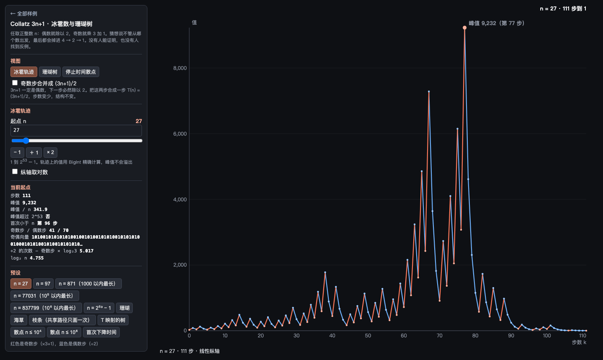

线性坐标下前面几十步几乎贴着横轴。换成对数纵轴，每次 ×3+1 都是同样高度的一跳，每次 ÷2 都是同样深度的一落，轨迹变成一段“锯齿形的随机游走”，整体先缓慢上升，过了峰值后一路下滑：

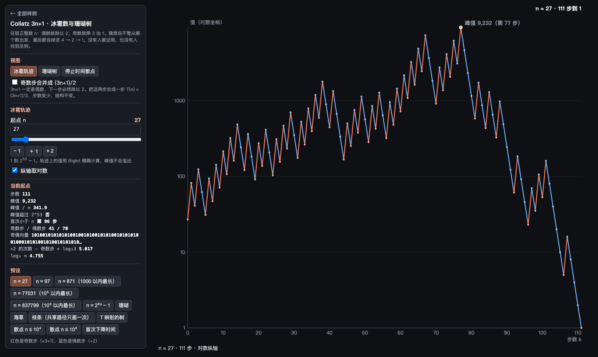

页面左侧“当前起点”一栏列出了 27 的全部统计：41 个奇数步，70 个偶数步，第 96 步才第一次比 27 小。各个范围内最长的轨迹（预设按钮里都有）：

| 起点 n | 步数 | 峰值 | 峰值 / n |
|---|---|---|---|
| 27 | 111 | 9,232 | 341.9 |
| 97（100 以内最长） | 118 | 9,232 | 95.18 |
| 871（1000 以内最长） | 178 | 190,996 | 219.3 |
| 77,031（10⁵ 以内最长） | 350 | 21,933,016 | 284.7 |
| 837,799（10⁶ 以内最长） | 524 | 2,974,984,576 | 3551 |

峰值会远远超过起点。JavaScript 的普通数字是双精度浮点数，超过 2⁵³ ≈ 9.007 × 10¹⁵ 就没法表示所有整数，这时 3n + 1 会被悄悄舍入，奇偶性也会算错。所以页面里的轨迹全部用 **BigInt** 精确计算，每条轨迹最多算 20000 步。起点的上限就是 2⁵³ − 1 = 9,007,199,254,740,991：它需要 852 步，第 123 步的峰值是

```
41,397,615,503,140,823,744,428,168 ≈ 4.14 × 10²⁵
```

是起点的 4.596 × 10⁹ 倍，比 2⁵³ 大了十个数量级。用浮点数算，这个峰值和后面所有的步数都会是错的：

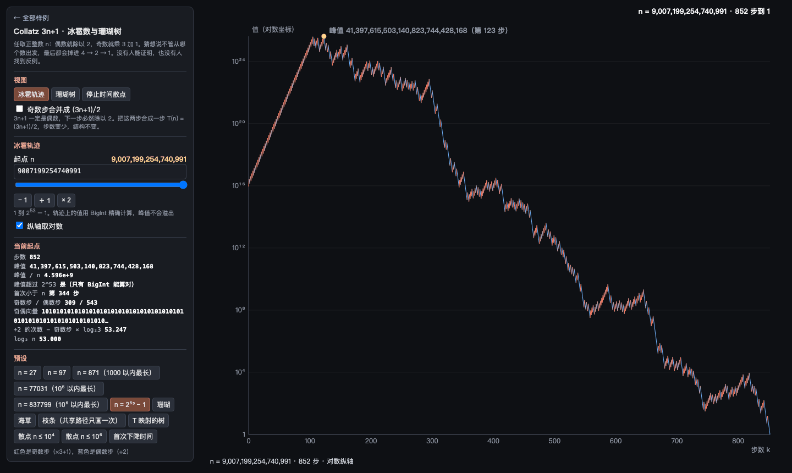

开头那段笔直的斜坡是有原因的：2⁵³ − 1 的二进制是 53 个 1。末位是 1 的奇数 n，做一次 3n + 1 再除以 2，相当于把末尾连续的 1 去掉一个，同时数大约乘 3/2。所以它会连续 53 次“奇数 → ×3+1 → ÷2”，一共 106 步只升不降，涨到原来的 (3/2)⁵³ ≈ 2.15 × 10⁹ 倍。第 5 节会从 2-adic 的角度再看这个现象。

### 2. 为什么它应该是对的：每个奇数步平均乘 3/4

3n + 1 一定是偶数，所以一个奇数步后面至少跟一次 ÷2。把这两步合起来看，就是 T(n) = (3n + 1)/2。页面上勾选“奇数步合并成 (3n+1)/2”就改用 T。

启发式论证是这样的。假设 3n + 1 之后能连续除以 2 的次数 k 像随机变量：k = 1 的概率是 1/2，k = 2 的概率是 1/4，k = 3 的概率是 1/8，以此类推，所以平均每个奇数步后面跟 2 次 ÷2。那么每轮“×3 再 ÷2 若干次”，数的对数平均变化

```
E[log 因子] = log 3 − E[k] · log 2 = log 3 − 2 log 2 = log(3/4) < 0
```

也就是说，每个奇数步平均让数缩小到原来的 3/4。对数是一个有负漂移的随机游走，迟早会掉下来。按这个估计，从 n 掉到 1 大约需要 log n / log(4/3) 个奇数步，每个奇数步配 2 个偶数步，总共约 3 ln n / ln(4/3) ≈ 10.4 ln n 步。

这个估计相当准。用页面里同样的规则对 1 ≤ n ≤ 10⁶ 全部算一遍（页面外的检查脚本），总停止时间的平均值是 131.43，公式给出的平均值是 133.64；n ≤ 10⁵ 的全部轨迹里，每个奇数步平均跟 2.0166 次 ÷2，非常接近 2。

那些特别长的轨迹，正是 ÷2 偏少的轨迹。27 是 70 / 41 ≈ 1.71，77031 是 221 / 129 ≈ 1.71，2⁵³ − 1 是 543 / 309 ≈ 1.76，都明显少于 2。

页面最后两行是一个精确的等式。设轨迹有 o 个奇数步、e 次 ÷2（用 T 时每个奇数步也算一次 ÷2）。从 n 到 1，每个奇数步把 m 变成 3m + 1 = 3m(1 + 1/(3m))，所以

```
1 = n · 3^o · ∏(1 + 1/(3mᵢ)) / 2^e
e − o · log₂3 = log₂ n + Σ log₂(1 + 1/(3mᵢ))
```

右边第二项是正的，而且奇数 mᵢ 越大就越小。27 的左边是 5.017，log₂ 27 = 4.755；2⁵³ − 1 的左边是 53.247，log₂ n = 53.000。÷2 的次数几乎完全由起点的大小和奇数步的个数决定，“3/4”说的就是这个关系平均下来的样子。

启发式不是证明。它把一个完全确定的过程当成随机的，而反例如果存在，恰恰就是“运气一直不好”的那一条轨迹。

### 3. 珊瑚树：把所有轨迹倒过来画

每个 n 只有一个后继 C(n)，所以把所有轨迹并在一起，就得到一张“每个点只指向一个父亲”的图。如果猜想成立，所有正整数最后都通向 1，这张图就是一棵以 1 为根的树（4 → 2 → 1 → 4 的循环在 1 处剪开）。反过来走，1 的孩子是 2，2 的孩子是 4，4 的孩子是 8 和 1……一般地，m 总有孩子 2m；如果 m ≡ 4 (mod 6)，还有第二个孩子 (m − 1)/3，这时树就分叉。

页面用海龟作图画这棵树，和 [L-system 植物](../lsystem-plants/README.md) 里的海龟是同一个想法：

1. 海龟站在 1，面朝上；
2. 沿着某个 n 的轨迹从 1 往回走，每走到下一个数 c 就先转向，再前进一个单位：c 是偶数（说明它是 ÷2 到达父亲的）就转“偶数步转角”，c 是奇数（×3+1 到达父亲的）就转“奇数步转角”；
3. 对 n = 2, 3, …, N 都这样走一遍。

所有轨迹从 1 出发的那一段完全相同，所以它们先重合成树干，然后在不同的地方分开。实现时每个数只算一次位置：从 n 往前走，碰到已经放好的数就停，再把新的数从那里往外依次放好。N = 10⁴ 时一共有 21,663 个不同的数，最深的一枝 261 步，就是 10⁴ 以内最长的轨迹 6171。

**为什么是 8.65° 和 −16°？** 标准映射下，约 2/3 的步是偶数步、1/3 是奇数步（每个奇数步平均配 2 个偶数步）。平均每步方向变化约 (2/3)·8.65° − (1/3)·16° ≈ +0.43°，几乎抵消，所以每根枝条只缓缓弯曲，同时偶数、奇数的不同转法又让分叉向两边张开。换成 T 映射，奇偶各约一半，同样的角度每步平均偏 −3.7°，走一百多步就转好几圈，画面会缠成一团。“T 映射的树”预设因此用了 ±8°。

**共享路径只画一次，还是全部叠加？** 页面默认把每条轨迹都从 1 画到 n，每条的不透明度是 α，重叠越多越亮。被 k 条轨迹共用的边，叠出来的不透明度是 1 − (1 − α)ᵏ。页面没有真的画一万条折线，而是先数每条边被多少个起点 n ≤ N 经过（就是这条边下面子树里起点的个数），再用这个公式一次画出来，效果相同。树干上的边 2 → 1 被 9,999 条轨迹共用，所以最亮；末梢只被一条轨迹经过，α = 0.06 时几乎看不见，所以叠加模式下珊瑚的轮廓是“主干清晰、外缘渐隐”的。勾选“共享的路径只画一次”后每条边都画成实线，外层那些很长、很孤立的轨迹就显出来了：

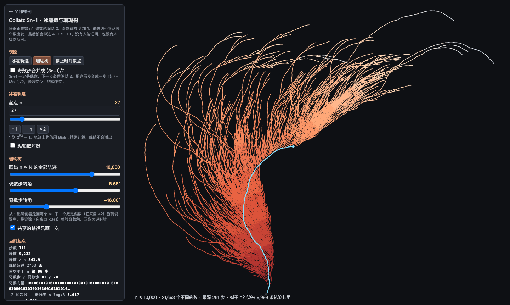

N 小一些时能看清每一次分叉。下面是 N = 2000，青色线是当前起点 27 的轨迹，在树里从根一直走到它的枝梢：

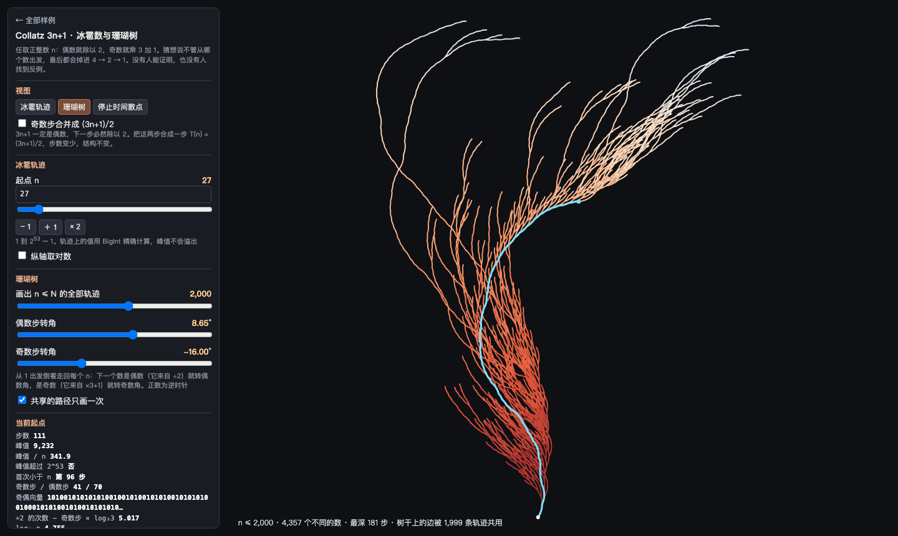

其他预设：

| 海草：N = 30000，转角 5° / −9.5° | T 映射的树：转角 ±8° |
|---|---|
| 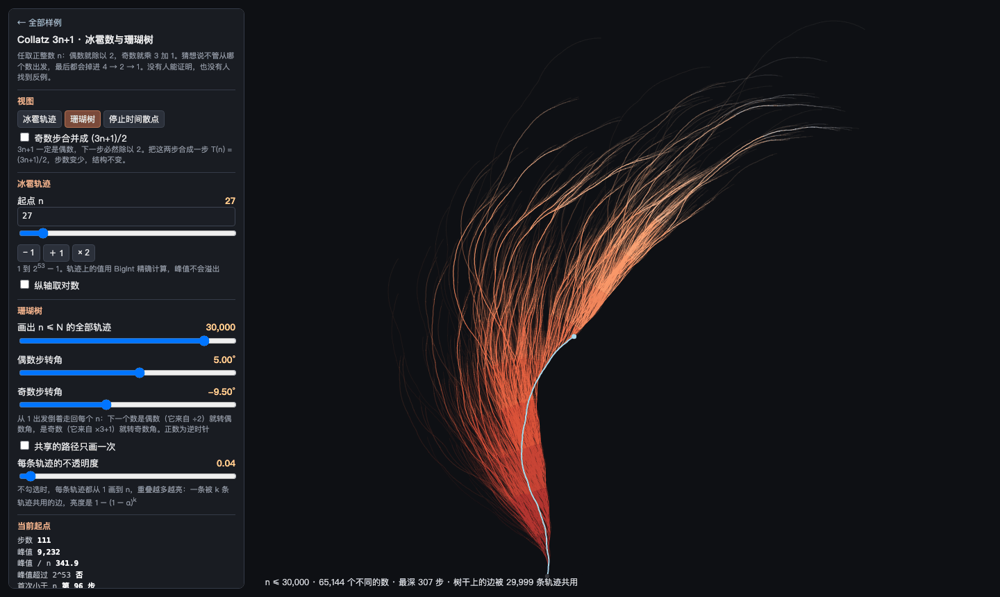 | 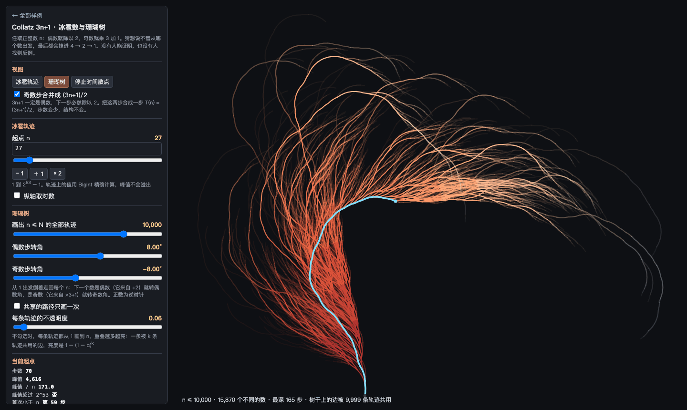 |

N 的上限是 10⁵：这时树里有 217,211 个不同的数，最深 350 步。在本机的无头 Chromium 里，从打开页面到画完第一帧用了 0.52 秒。

### 4. 停止时间散点：条带从哪里来

把 n 放在横轴，n 的总停止时间放在纵轴。n ≤ 10⁴ 的散点不是一片随机的云，而是排成一条条短横线和向上散开的弧形条带：

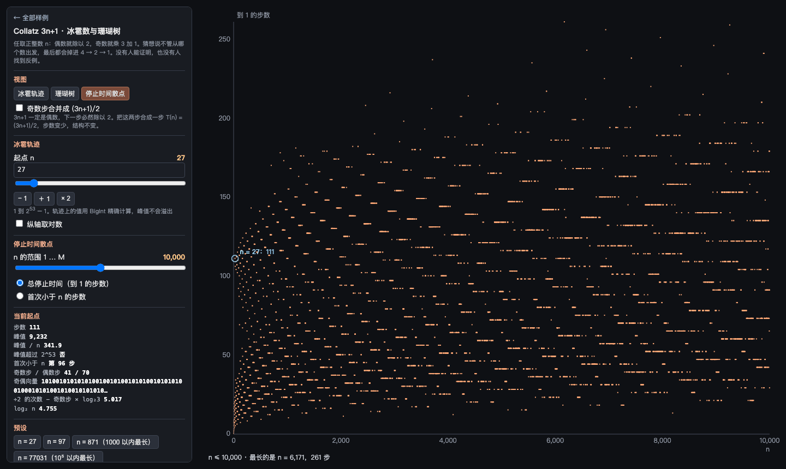

两种结构各有简单的来源。

- **短横线**：相邻的数常常很快汇合。比如 8k + 4 → 4k + 2 → 2k + 1 → 6k + 4，而 8k + 5 → 24k + 16 → 12k + 8 → 6k + 4，两者都在第 3 步到达同一个数，此后完全一样，所以停止时间相等，在图上并排成一段水平线。类似的汇合在各种同余类之间反复发生，就连成了一段段横线。
- **弧形条带**：2n 的停止时间正好比 n 多 1。整张图因此包含一份“横向拉长 2 倍、向上平移 1”的自身副本，副本再生副本，在原点附近叠成扇形的弧线。

n ≤ 10⁶ 时同样的结构变得更细密，最高点是 837,799 的 524 步：

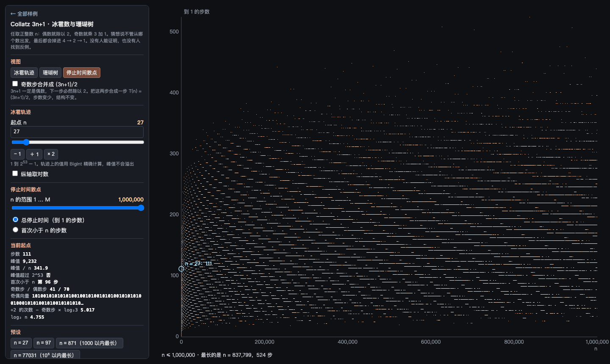

纵轴换成“首次小于 n 的步数”（称为**停止时间** σ(n)），条带变成了严格分开的水平层。n ≤ 10⁵ 里最大的 σ 是 220，n ≤ 10⁶ 里是 287：

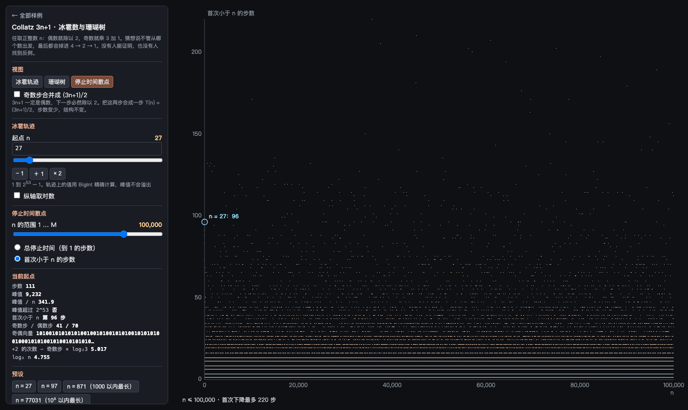

只有某些高度会出现：1, 3, 6, 8, 11, 13, 16, 19, …。原因是要比 n 小，j 个奇数步至少要配 e 次 ÷2，使 2^e > 3^j，所以 σ = j + ⌈j · log₂3⌉。j = 0, 1, 2, 3, 4 分别给出 1, 3, 6, 8, 11。而且 σ(n) 只由 n 的最后几位二进制决定（用页面外的检查脚本对 n < 20000 逐一核对）：

| σ(n) | 条件 | 所占比例 |
|---|---|---|
| 1 | n ≡ 0 (mod 2)，即偶数 | 1/2 |
| 3 | n ≡ 1 (mod 4) | 1/4 |
| 6 | n ≡ 3 (mod 16) | 1/16 |
| 8 | n ≡ 11, 23 (mod 32) | 2/32 |
| 11 | n ≡ 7, 15, 59 (mod 128) | 3/128 |

第 5 节解释为什么最后几位就够了。

### 5. 奇偶向量与 2-adic 视角

把轨迹每一步的奇偶记成 0（偶）和 1（奇），就得到 n 的**奇偶向量**。页面在“当前起点”里显示前 64 位，27 的是 `10100101010101001001…`。

**Terras 定理（1976）**：用 T 映射时，前 k 步的奇偶向量只取决于 n mod 2ᵏ；而且 0 … 2ᵏ − 1 这 2ᵏ 个余数，恰好给出全部 2ᵏ 种长度为 k 的 0/1 串，每种一次。检查脚本对 k = 4, 10, 16 逐一验证过：16、1024、65536 个余数给出的奇偶向量互不相同。

原因可以一步一步看。n 的奇偶只看最后 1 位；T(n) 的奇偶只看 n 的最后 2 位（偶数 n/2 去掉了最低位，奇数 (3n+1)/2 的最低位由 n 的最后两位决定）；依此类推，前 k 步的奇偶只看最后 k 位。反过来，固定最后 k − 1 位，第 k 位取 0 或 1 正好把第 k 步的奇偶翻转一次，所以这个对应是一一的。

这就是第 2 节那个“抛硬币”假设的精确版本：随机取一个 n，它在 T 映射下的前 k 个奇偶位就是 k 次独立的公平硬币。第 4 节的比例表也是这样数出来的。比如 σ(n) = 6：标准映射下的 6 步里有 2 个奇数步，各自带着一次必然的 ÷2，合起来是 T 映射的 4 步，奇偶必须依次是 1、1、0、0（3 → 10 → 5 → 16 → 8 → 4 → 2 就是这样）。所以只看最后 4 位，16 个余数里恰好有一个（3），占 1/16。Terras 由此证明了**几乎所有** n（自然密度为 1）的停止时间有限，也就是轨迹迟早会降到 n 以下。

**2-adic 整数**把这件事推到极限。把整数写成二进制，允许左边有无穷多位，比如 …111111。两个数“接近”的意思是末尾有很多位相同。在这个意义下，−1 = …1111：给它加 1，每一位都进位，结果是 …0000 = 0。T 在 2-adic 整数上照样有定义：

```
T(−1) = (3 · (−1) + 1) / 2 = −1
```

−1 是 T 的不动点，奇偶向量是 111111…。2⁵³ − 1 的末尾有 53 个 1，在 2-adic 意义下离 −1 很近，所以它的前 53 步跟着 −1 走，一直是奇数步。这就是第 1 节那段 106 步的笔直斜坡。Lagarias（1985）证明，把每个 2-adic 整数映到它的奇偶向量，是 2-adic 整数到自身的一个保测度的双射。在 2-adic 整数上，T 的行为和“随机抛硬币”完全一样。猜想难就难在正整数在 2-adic 整数里只占测度为 0 的一小部分，“几乎处处”的结论管不到它们。

### 6. 猜想的现状

- **数值验证**：所有 n < 2⁶⁸ ≈ 2.95 × 10²⁰ 都已验证会到达 1（Barina，2021）。
- **几乎所有**：Terras（1976）与 Everett（1977）证明，密度为 1 的 n 的轨迹会降到 n 以下。Tao（2019）证明了强得多的结论：对任何趋于无穷的函数 f，几乎所有 n（按对数密度）的轨迹最低点都小于 f(n)。比如 f(n) = log log log n，几乎所有轨迹都会降到这么小。但“几乎所有”不排除个别例外，离“全部到达 1”还差一步。
- **两种可能的反例**：要么存在一个不含 1 的循环，要么存在一条无限上升的轨迹。在负整数上前一种真的存在，比如 −5 → −14 → −7 → −20 → −10 → −5。
- **一般化不可判定**：Conway（1972）证明，形如“按 n mod m 分段做线性变换”的一般 Collatz 类问题，在算法上不可判定。

## 操作

- 视图：冰雹轨迹、珊瑚树、停止时间散点三个按钮切换；“奇数步合并成 (3n+1)/2”对三个视图都起作用；
- 起点 n：直接输入（1 到 2⁵³ − 1），或拖动对数滑条、点 −1 / +1 / ×2；在珊瑚树里，n 的轨迹画成青色；在散点图里，n 用青色圆圈标出；
- 冰雹轨迹：线性 / 对数纵轴；
- 珊瑚树：N（10–10⁵）、偶数步转角、奇数步转角（−45° 到 45°）、共享路径只画一次、每条轨迹的不透明度；拖动平移，滚轮以鼠标位置为中心缩放，双击复位；
- 停止时间散点：M（100–10⁶），总停止时间 / 首次小于 n 的步数；
- 预设：n = 27、97、871、77031、837799、2⁵³ − 1；珊瑚、海草、枝条、T 映射的树；散点 n ≤ 10⁴、n ≤ 10⁶、首次下降时间。

## 网址参数

| 键 | 含义 |
|---|---|
| p | 预设名：n27, n97, n871, n77031, n837799, big, coral, weed, twig, tmap, sc1e4, sc1e6, drop |
| v | 视图：traj, tree, scatter |
| n | 起点（1 到 2⁵³ − 1） |
| log | 1 = 对数纵轴 |
| T | 1 = 奇数步用 (3n+1)/2 |
| N | 珊瑚树画出 n ≤ N 的轨迹（10–100000） |
| e, o | 偶数步、奇数步转角（−45 到 45，单位度） |
| once | 1 = 共享路径只画一次 |
| a | 每条轨迹的不透明度（0.01–1） |
| M | 散点的范围 1 … M（100–1000000） |
| y | 散点纵轴：total（总停止时间）, drop（首次小于 n） |
| z, px, py | 珊瑚树的缩放倍数和平移（像素） |
| ui | 0 = 隐藏面板，只显示画布 |

所有数值参数都必须是有限数，并夹到滑条的范围里；字符串参数只接受上表列出的值，其他值一律回到默认。例如 `index.html?p=big` 看 2⁵³ − 1 的轨迹，`index.html?v=tree&N=50000&e=6&o=-12` 画一棵更大的珊瑚。

## 参考

- J. C. Lagarias, *The 3x + 1 problem and its generalizations*, American Mathematical Monthly 92, 1985. 2-adic 共轭与奇偶向量的经典综述。
- J. C. Lagarias (ed.), *The Ultimate Challenge: The 3x + 1 Problem*, American Mathematical Society, 2010.
- R. Terras, *A stopping time problem on the positive integers*, Acta Arithmetica 30, 1976.
- T. Tao, *Almost all orbits of the Collatz map attain almost bounded values*, Forum of Mathematics, Pi 10, 2022（arXiv 2019）.
- D. Barina, *Convergence verification of the Collatz problem*, The Journal of Supercomputing 77, 2021.
- J. H. Conway, *Unpredictable iterations*, Proceedings of the Number Theory Conference, Boulder, 1972.
- 珊瑚状的画法因 Edmund Harriss 等人的 Collatz 可视化而流传开。页面默认的 8.65° / −16° 让平均转向几乎抵消（见第 3 节）。
