# DLA 扩散限制凝聚 · 闪电、珊瑚与雪花

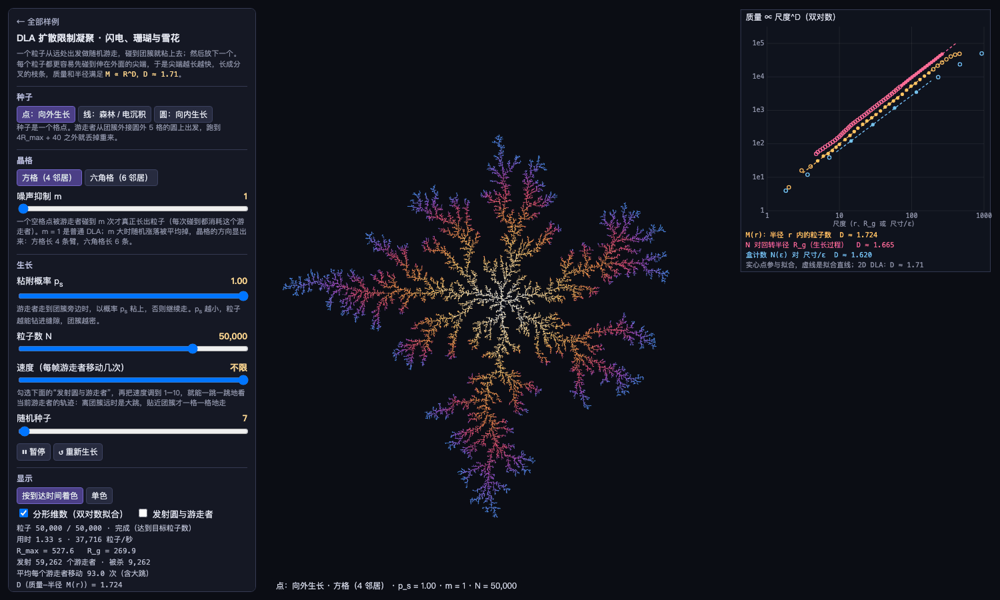

1981 年，Thomas Witten 和 Leonard Sander 提出了一个规则极简的生长模型：平面中央放一个粒子当种子，再从远处放出一个粒子，让它做随机游走，一碰到种子就粘住不动；接着放下一个，碰到团簇上任何一个粒子就粘住；如此反复。这叫**扩散限制凝聚**（Diffusion-Limited Aggregation，DLA）。规则里没有任何关于形状的指令，长出来的却是一棵不断分叉的枝状团簇，像闪电、珊瑚、冻在玻璃上的冰花，也像岩石裂缝里的黑色“树枝”。它是一个分形：半径 R 以内的粒子数 M 按 R^D 增长，D ≈ 1.71，比一条线（D = 1）密，比一块实心的面（D = 2）稀。

页面在 1408×1408 的格子上生长，5 万个粒子大约 1 秒长完。可以换种子的形状（点、线、圆）、换晶格（方格、六角格）、调粘附概率，并实时测量分形维数。

打开方式：用浏览器直接打开 [index.html](index.html)。页面只用 Canvas 2D，不依赖外部库，离线也能用。所有随机数都来自带种子的伪随机数发生器（sfc32），种子和参数相同，团簇就完全相同。下面的数字都是从页面上读出来的；写“5 个种子”的是种子 1–5 的平均值 ± 标准差，没写的是默认种子 7。时间是在一台 Mac 上用无头 Chromium 测的。

## 数学原理

### 1. 规则

格子上的每个格点要么空，要么被占。一开始只有种子被占。之后重复：

1. 在团簇外面放一个游走者；
2. 游走者每一步等概率走向相邻的一个格点（方格 4 个方向，六角格 6 个方向），也就是 [随机游走 · 布朗运动](../random-walk/README.md) 里的格点游走；
3. 走到一个和团簇相邻的空格点时，以概率 p_s 粘在这里，这个格点变成团簇的一部分。没粘上就继续走（往被占格点走的那一步作废）；
4. 回到第 1 步，放下一个游走者。

默认 p_s = 1，碰到就粘。一次只有一个游走者在走，它不知道别的粒子，只知道已经长成的团簇。页面用颜色记录到达顺序：第 1 个粒子是暖白色，最后一个是蓝色。首图里白色都在中心，蓝色都在最外面的枝梢上：团簇是从尖端往外长的，里面长好的部分后来几乎再没有粒子进去。

### 2. 为什么尖端长得快：Laplace 方程与屏蔽

把很多个游走者合起来看。设 u(x) 是“一个游走者此刻在 x 的概率密度”。随机游走的密度满足扩散方程，游走者一个一个地慢慢放、团簇长得很慢的时候，密度来得及达到稳态，于是

```
∇²u = 0          （团簇外面）
u = 0            （团簇上：游走者一碰到就被吸收）
u → 常数         （远处：游走者源源不断地从那里来）
```

团簇某一点长出新粒子的概率，正比于游走者流进这一点的通量 ∂u/∂n。这个分布叫团簇边界上的**调和测度**。

关键在于边界的形状怎样影响通量。u 在团簇上为 0，在远处为常数，就像一个接地的导体放在均匀的电场里，u 是电势，∂u/∂n 是导体表面的电场强度。导体的尖端电场最强，这正是避雷针的原理。凹进去的缝隙里电场很弱：一个游走者想走进深缝，几乎一定会先碰到缝口两侧伸出来的枝条。这叫**屏蔽**。

于是出现了一个正反馈：某处稍微凸出一点 → 它接到更多的游走者 → 长得更快 → 更凸出。平直的边界因此不稳定，任何小凸起都会被放大成枝条，枝条又会再分叉。晶体生长里这种不稳定叫 Mullins–Sekerka 不稳定性。DLA 里没有表面张力去抹平小凸起，所以每一个尺度上都在分叉，最后得到分形。

勾选“发射圆与游走者”，把速度调到 1–10，可以一步一步地看一个游走者。下图绿色的折线是它的路径：在外面时一次跳很远（第 3 节讲为什么可以这样跳），靠近团簇时步子越来越小，最后粘在一根枝条的梢上：

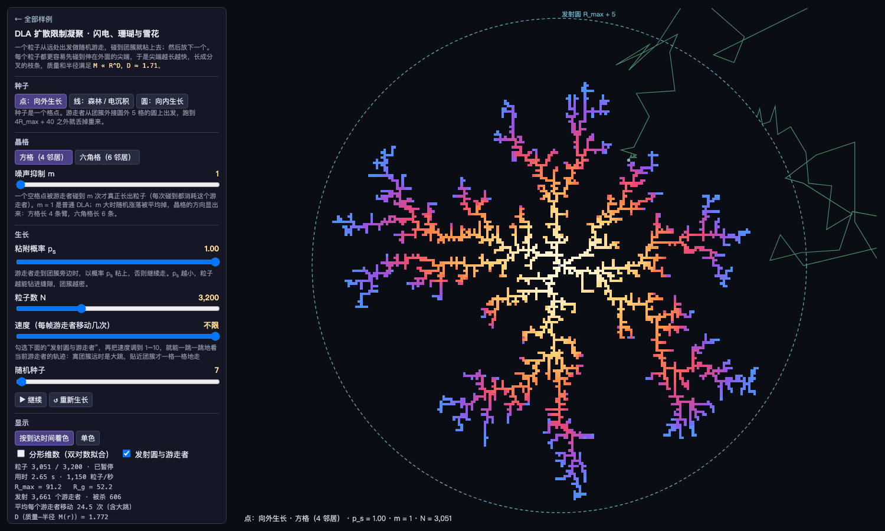

这组方程不只描述 DLA，同一个 Laplace 方程配同样的边界条件，出现在好几种看起来毫不相干的现象里：

| 现象 | 满足 ∇² = 0 的量 | 边界上的“生长速度” |
|---|---|---|
| DLA | 游走者密度 u | 通量 ∂u/∂n |
| 闪电、Lichtenberg 图形（绝缘体被击穿留下的树状烧痕） | 电势 φ | 电场 ∂φ/∂n（介电击穿模型，Niemeyer–Pietronero–Wiesmann 1984） |
| 粘性指进（Hele-Shaw 盒里用水推开甘油） | 压强 p | 界面速度 ∝ ∂p/∂n（Darcy 定律） |
| 电沉积（锌树、银树） | 金属离子浓度 | 离子流 |
| 岩石上的锰氧化物“树枝”（假化石） | 溶液里的矿物浓度 | 析出速度 |

只要生长由一个满足 Laplace 方程的场的梯度驱动、生长的部分又会屏蔽后面的部分，就会长出这种分枝。粘性指进和 DLA 有一处不同：流体界面有表面张力，会把太细的指头抹平，所以指头有最小宽度，要在很大的尺度上才看得出分形。

### 3. 怎样算得快

直接按第 1 节的规则模拟非常慢。二维随机游走走到距离 r 平均要 r² 步，而且它是**常返**的：迟早回来，但可能先走到极远的地方。页面用四个办法：

1. **在团簇外接圆附近发射**。团簇外面的游走者来自四面八方，没有偏向，所以第一次到达半径 R_max + 5 的圆时，位置在圆上均匀分布。直接从这个圆上均匀发射，效果和从无穷远放出来一样。R_max 是团簇离种子最远的粒子的距离。
2. **走远了就杀掉**。游走者跑到 4R_max + 40 以外就丢掉，重新发射一个。在团簇外面它可以随便走，丢掉它只是放弃了一个将来大概率从均匀方向回来的游走者，再发射一个均匀的替代它，偏差很小。5 万个粒子时约 15% 的游走者被杀（5 个种子：发射 59 158 ± 1 211 个，被杀 9 158 ± 1 211 个）。
3. **在圆上跳**（walk on circles）。如果游走者周围半径 r 的圆盘里一个粒子都没有，它在圆盘里怎么走都碰不到团簇，第一次走出圆盘时，出口在圆周上均匀分布（布朗运动是旋转对称的）。所以可以一步跳到圆周上一个随机点，省掉中间约 r² 步。团簇外面 r 取到外接圆的距离 rr − R_max − 2；跳完取整到最近的格点，取整最多偏 0.71 格，所以半径要比空圆盘少 1。
4. **距离图**。在团簇里面的缝隙中，要知道周围多大的圆盘是空的。每粘上一个粒子，就把它周围 16 格以内每个格点的“到团簇的距离”更新成较小的那个值。游走者查一下所在格点的距离 d：d ≥ 3 就跳半径 d − 1 的圆；d ≥ 16 时再看周围 3×3 个 16×16 或 64×64 的格块是否全空，全空就跳 15 或 63 格（六角格要先乘 √3/2）；只有 d ≤ 2 时才一格一格地走，并检查有没有贴着团簇。

这是一种近似：大跳把格点游走换成了连续的布朗运动，这两者只在很小的尺度上有差别，而贴近团簇的那几格仍然是真正的格点游走。效果如下（10 000 个粒子，5 个种子）：

| | 用时 | 游走者总移动次数 |
|---|---|---|
| 完整算法 | 109 ± 12 ms | 51.6 万 |
| 去掉距离图（只保留 1–3） | 1 761 ± 237 ms（2 个种子） | 2 397 万 |

5 万个粒子平均 0.92 ± 0.09 s 长完（5 个种子，只算生长，不算画图），加上画图，页面上显示约 1.3–1.4 s。每个游走者从发射到粘住（或被杀）平均只移动 91 次。

### 4. 测分形维数：三条直线

如果一个集合的质量 M 和尺度 R 满足 M ∝ R^D，在双对数坐标里 log M 对 log R 就是一条斜率为 D 的直线。右侧的图用三种方法画这条线，实心点参与拟合，虚线是最小二乘直线：

- **质量–半径 M(r)**（金色）：数一数离种子不到 r 的粒子有多少个。只在 5 ≤ r ≤ R_max/3 上拟合：r 太小时只有几个格点，r 接近 R_max 时外圈还在生长、没有长满。
- **N 对回转半径 R_g**（粉色）：生长过程中每当粒子数涨 12% 就记一次 R_g = √(⟨r²⟩)，在最近十倍粒子数（N/10 到 N）上拟合 N ∝ R_g^D。
- **盒计数**（蓝色）：把平面分成边长 ε 的方格，数一数有多少个格子里有粒子，N(ε) ∝ ε^(−D)。图里横轴取“团簇尺寸 / ε”，这样它也是一条往上走的线。

默认种子 7、5 万个粒子：R_max = 527.6，R_g = 269.9，三种方法得到 1.724、1.665、1.620。5 个种子的平均：

| 方法 | D（5 个种子） |
|---|---|
| 质量–半径 M(r) | 1.690 ± 0.015 |
| N ∝ R_g^D | 1.681 ± 0.040 |
| 盒计数 | 1.636 ± 0.016 |

文献值是 1.71（Tolman 和 Meakin 1989 年用几百万个粒子的离格模拟得到 1.715）。5 万个粒子还太少：团簇半径只有 500 来格，能用来拟合的尺度只有两个数量级左右。盒计数偏低得最多，原因看它相邻两点之间的斜率就清楚了（种子 7）：

| ε | 1→2 | 2→4 | 4→8 | 8→16 | 16→32 | 32→64 | 64→128 |
|---|---|---|---|---|---|---|---|
| 局部斜率 | 1.08 | 1.28 | 1.48 | 1.58 | 1.66 | 1.62 | 1.65 |

ε 很小时，一个盒子里只装着一两段一格宽的枝条，看到的是“线”，斜率接近 1；ε 到 16 以上才接近 1.7。页面只在 8 ≤ ε ≤ 尺寸/8 上拟合，仍然把 8→16 这段偏低的斜率算了进去。

### 5. 粘附概率：越不粘，越密

p_s < 1 时，游走者碰到团簇不一定粘住，可以沿着表面再走几步、钻进缝里。屏蔽变弱了，缝隙被填上，团簇变密：

| p_s = 1 | p_s = 0.2 | p_s = 0.05 | p_s = 0.02 |
|---|---|---|---|
| 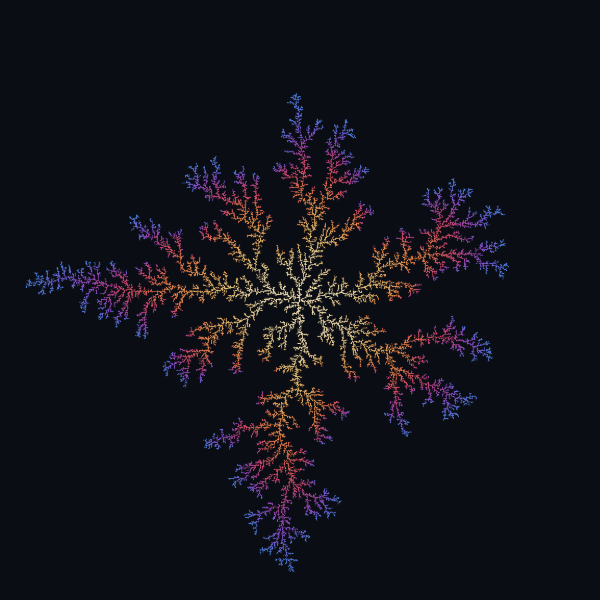 | 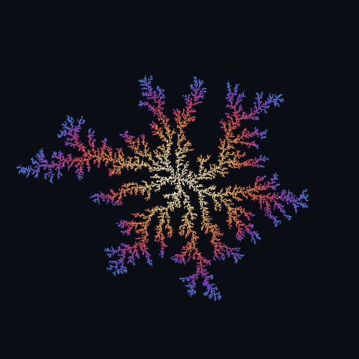 | 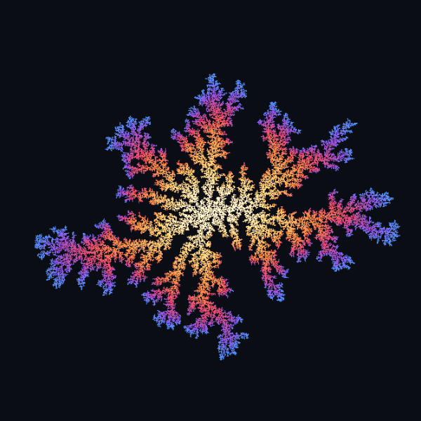 | 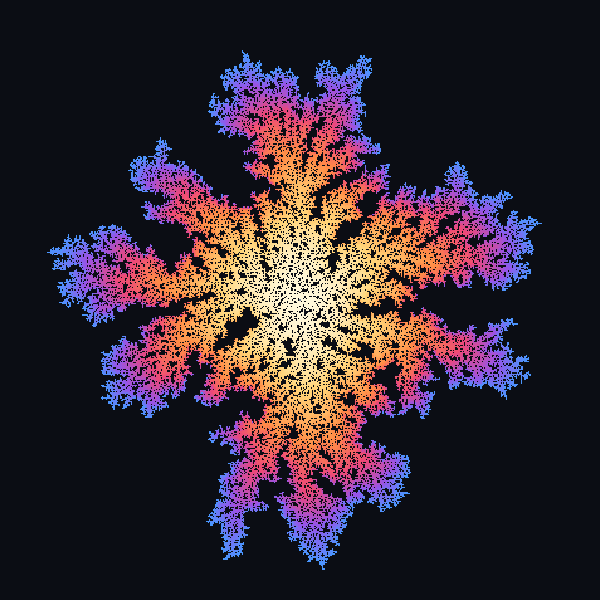 |

同样 5 万个粒子（5 个种子）：

| p_s | R_max | D（M(r)） | D（R_g） | D（盒计数） |
|---|---|---|---|---|
| 1 | 515 ± 24 | 1.690 ± 0.015 | 1.681 ± 0.040 | 1.636 ± 0.016 |
| 0.5 | 472 ± 40 | 1.668 ± 0.032 | 1.730 ± 0.067 | 1.642 ± 0.012 |
| 0.2 | 388 ± 19 | 1.731 ± 0.023 | 1.712 ± 0.047 | 1.678 ± 0.012 |
| 0.1 | 335 ± 21 | 1.764 ± 0.024 | 1.738 ± 0.023 | 1.697 ± 0.020 |
| 0.05 | 294 ± 6 | 1.810 ± 0.019 | 1.742 ± 0.042 | 1.721 ± 0.019 |
| 0.02 | 248 ± 18 | 1.928 ± 0.005 | 1.795 ± 0.031 | 1.795 ± 0.015 |

p_s 从 1 降到 0.02，同样多的粒子挤进了一半的半径，测出来的 D 从 1.6–1.7 升到 1.8–1.9。

要说清楚的是，这里的 D 是在这个尺寸上**测到的**有效维数。一个游走者在粘住之前平均要贴着表面试 1/p_s 次，在大约 1/p_s 格的尺度以内，它能把缝隙填实，团簇在这个尺度以下接近实心（D 接近 2）。在大得多的尺度上，屏蔽依然起作用，团簇重新长出枝条，一般认为最终的维数仍然是 1.71。p_s = 0.05 的那张图就是这样：中心是一团实心的核，外面依然分成了七八条粗枝。

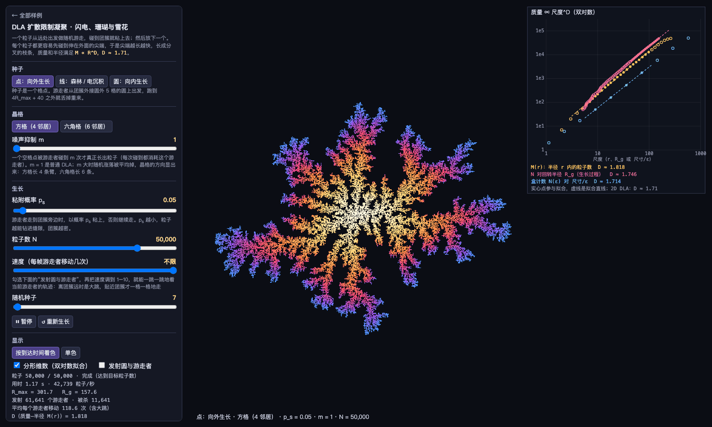

### 6. 种子的形状：森林与向内生长

**线种子**：底边一整行都是种子，左右周期（宽 1024）。游走者从团簇最高点上方 5 格的水平线上均匀地放下来，太高（超过两倍宽度）就杀掉。一开始底边长出一片矮树丛，长高一点的树挡住了邻居头顶的游走者，邻居就停止生长。越往上树越少、越高，最后只剩几棵大树在竞争。电解时金属在平板电极上长出的枝晶就是这个样子。

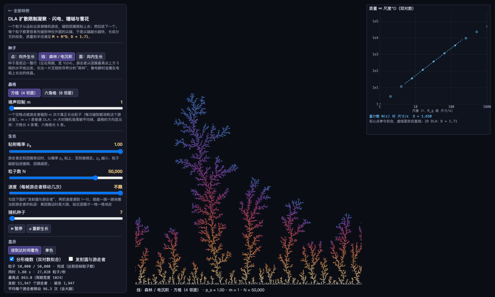

5 个种子：最高的树长到 839 ± 42 格，盒计数 D = 1.632 ± 0.017，和点种子的 1.636 一样。

**圆边界**：种子是半径 400 的一圈格点，游走者从圆心放出。从圆心出发的布朗运动走出一个空圆盘时，出口在圆周上均匀分布，所以游走者可以直接从“离圆心最近的粒子”以内的圆上出发。枝条从边界往圆心长，越往里空间越小、竞争越激烈，最先长到圆心的那一根就结束了这次生长：

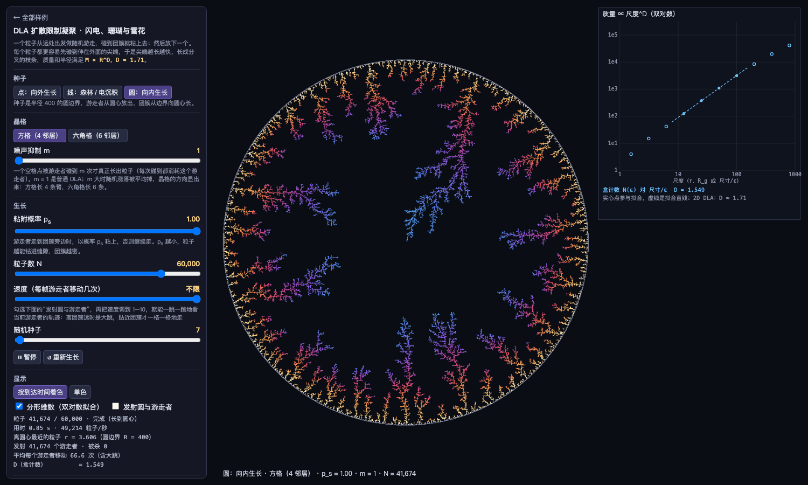

5 个种子里，平均长到第 37 493 ± 3 917 个粒子时有枝条到达圆心（离圆心不到 4 格）。盒计数 D = 1.540 ± 0.014，比前两种低。我的猜测是：很多粒子在边界附近那一圈短枝里，这些短枝只有几格到几十格长，还没有长成分形。

### 7. 晶格的方向：四条臂与“雪花”

格点 DLA 只能沿晶格方向走一步，团簇因此带着一点点晶格的方向性。粒子数少时这点偏向被随机涨落淹没；粒子数极大时（上百万），方格 DLA 会慢慢长成四条主臂的十字形。页面的点种子最多长到约 7 万个粒子就碰到网格边界（种子 7：71 622 个），看不到这个现象。

**噪声抑制**可以提前把它放大：一个空格点要被游走者碰到 m 次才真正长出粒子，每次碰到都消耗掉那个游走者。m 次碰撞的平均让偶然的涨落不再决定生长方向，晶格的方向就显出来了。同样 2 万个粒子：

| | m = 1 | m = 3 | m = 10 |
|---|---|---|---|
| 方格 | 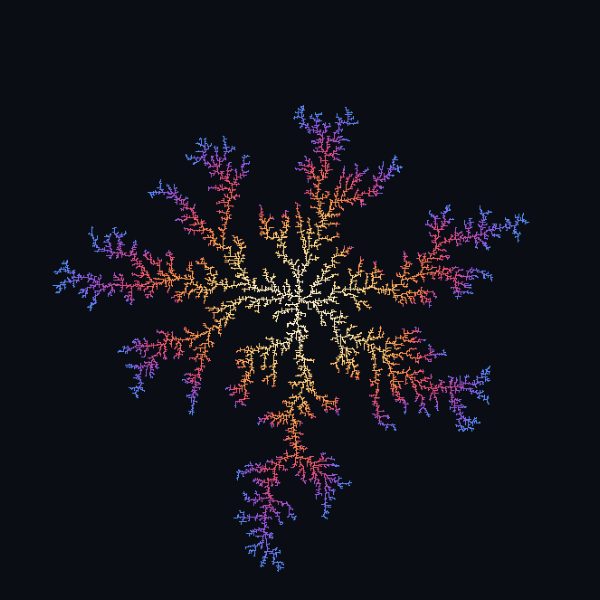 | 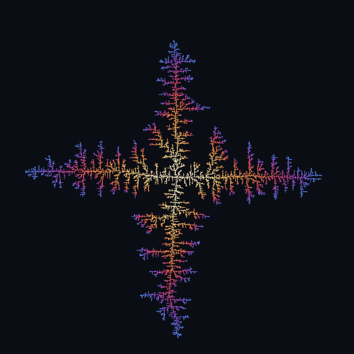 | 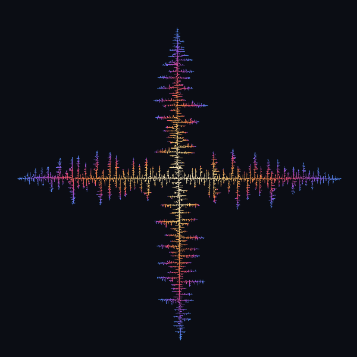 |
| 六角格 | 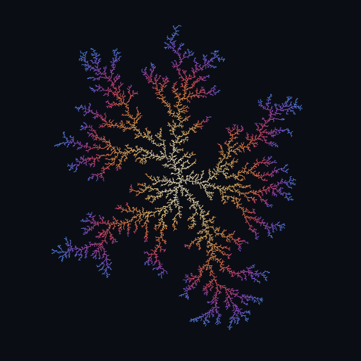 | 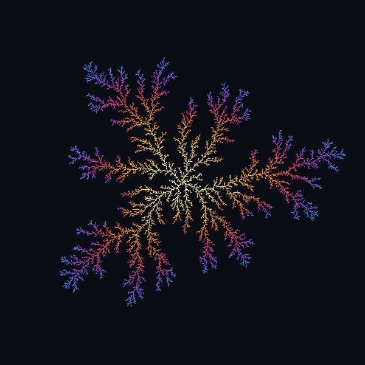 | 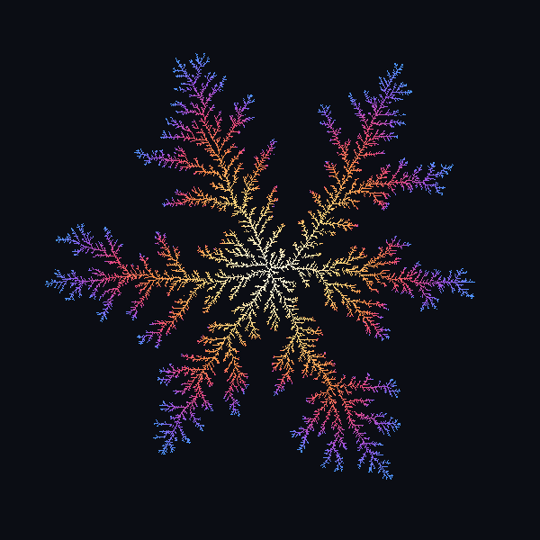 |

m = 3 时方格已经是四条臂，m = 10 时四条臂几乎是笔直的针，两侧长出整齐的短刺。六角格的 6 个邻居使团簇长出六条臂，m = 10 时看起来像一片雪花：

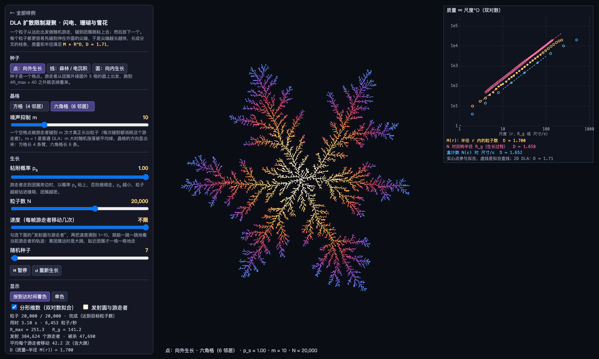

m = 10 时每长一个粒子要发射 19–20 个游走者（2 个种子，2 万个粒子：方格发射 374 441 个，六角格 396 170 个）。同样 2 万个粒子，m = 1 在页面上约 0.3 s 长完，m = 10 要 3.5 s（方格）和 3.2 s（六角格），慢了约 10 倍。

**但真正的雪花不是这样长的。** 相似的地方是：雪花的枝条也是扩散驱动的不稳定性，水汽分子扩散到冰晶上，尖端接到的水汽多，长得快，这和第 2 节是同一个道理。不同的地方是：

- 冰晶的六重对称来自冰本身的六方晶体结构。水分子在不同晶面上附着的难易不同，平的晶面（棱柱面、基面）长得慢，这种**附着动力学的各向异性**加上表面张力，决定了雪花是长成六角片、柱，还是长出枝。DLA 里的格子只是计算用的网格，没有这些物理；
- 雪花在空中下落时温度和湿度一直在变，六条臂经历的环境几乎相同，所以长得几乎一样；这里六条臂长得像，靠的是 m 次碰撞的平均；
- DLA 的粒子碰到就永远不动，也没有表面张力；冰晶表面的分子会脱附、扩散、重新排布。

所以这里的“雪花”只是外形像。它说明的是：一点点方向偏好，加上扩散不稳定性，就能长出带对称性的枝晶。

## 操作

- 种子：点（向外生长）、线（森林 / 电沉积）、圆（向内生长）；
- 晶格：方格（4 邻居）、六角格（6 邻居）；噪声抑制 m（1–40）；
- 粘附概率 p_s（0.01–1）、粒子数 N（500–200 000，点种子在约 7 万时碰到网格边界就停）、随机种子（1–999）；
- 速度：每帧游走者最多移动几次，1 到“不限”。调到 1–10 并勾选“发射圆与游走者”，可以看到发射圆、杀死圆和当前游走者的轨迹；
- 暂停 / 继续、重新生长。把 N 调大后，已经长完的团簇会接着长；
- 着色：按到达时间、单色；
- 预设：经典 DLA、小团簇（3000 个粒子，看得清每个格点）、低粘附 p_s = 0.05、线种子森林、圆边界向内生长、方格 m = 10、六角格 m = 10、六角格 m = 1。

## 网址参数

| 键 | 含义 |
|---|---|
| p | 预设：classic, small, dense, forest, inward, cross, snow, hexdla |
| g | 种子：point, line, circle |
| lat | 晶格：sq, hex |
| ps | 粘附概率（0.01–1） |
| m | 噪声抑制（1–40） |
| n | 粒子数（500–200000） |
| seed | 随机种子（1–999） |
| v | 每帧游走者移动次数（1–10000000） |
| col | time 或 mono |
| plots | 0 = 不画分形维数图 |
| guides | 1 = 画发射圆与游走者 |
| run | 0 = 打开时暂停 |
| ui | 0 = 隐藏面板，只留画面 |

数值参数必须是有限数，并夹到上面的范围里；字符串参数只接受表里列出的值，其他值一律回到默认。例如雪花：`index.html?p=snow`；更不粘、换个种子：`index.html?ps=0.1&seed=3`；慢慢看一个游走者：`index.html?p=small&v=3&guides=1`。

## 参考

- T. A. Witten, L. M. Sander, *Diffusion-limited aggregation, a kinetic critical phenomenon*, Physical Review Letters 47, 1981.
- P. Meakin, *Diffusion-controlled cluster formation in 2–6-dimensional space*, Physical Review A 27, 1983. 发射圆、杀死圆和大跳的做法。
- L. Niemeyer, L. Pietronero, H. J. Wiesmann, *Fractal dimension of dielectric breakdown*, Physical Review Letters 52, 1984.
- M. Matsushita, M. Sano, Y. Hayakawa, H. Honjo, Y. Sawada, *Fractal structures of zinc metal leaves grown by electrodeposition*, Physical Review Letters 53, 1984.
- J. Nittmann, G. Daccord, H. E. Stanley, *Fractal growth of viscous fingers*, Nature 314, 1985.
- J.-P. Eckmann, P. Meakin, I. Procaccia, R. Zeitak, *Growth and form of noise-reduced diffusion-limited aggregation*, Physical Review A 39, 1989. 噪声抑制与晶格各向异性。
- S. Tolman, P. Meakin, *Off-lattice and hypercubic-lattice models for diffusion-limited aggregation in dimensionalities 2–8*, Physical Review A 40, 1989. D = 1.715。
- K. G. Libbrecht, *The physics of snow crystals*, Reports on Progress in Physics 68, 2005.
