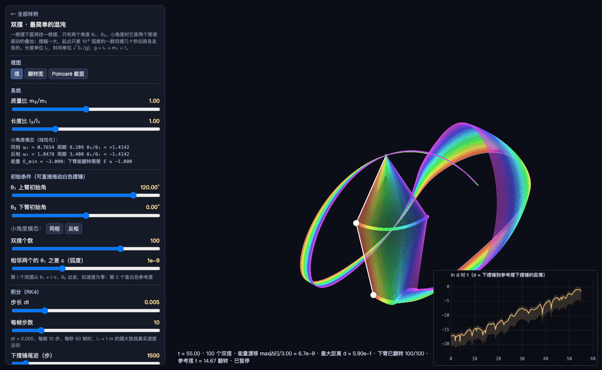
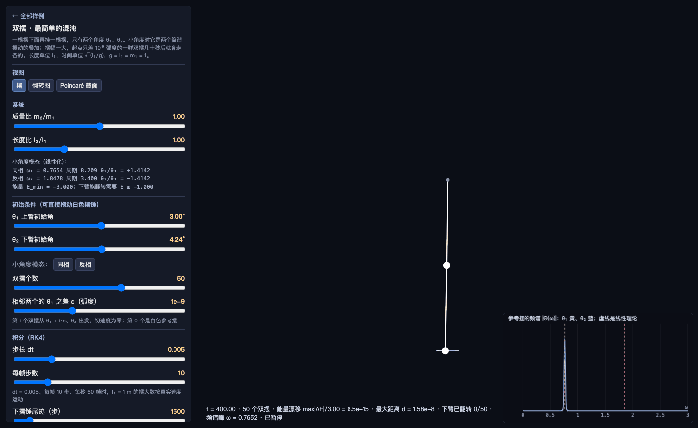
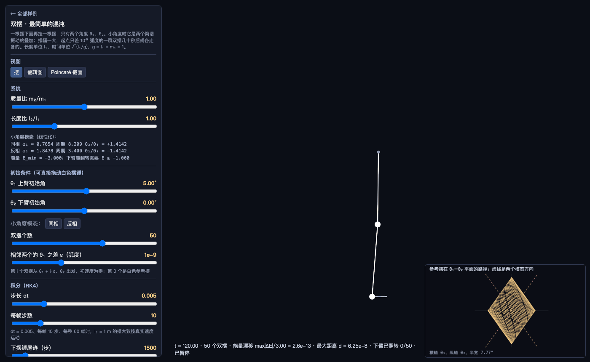
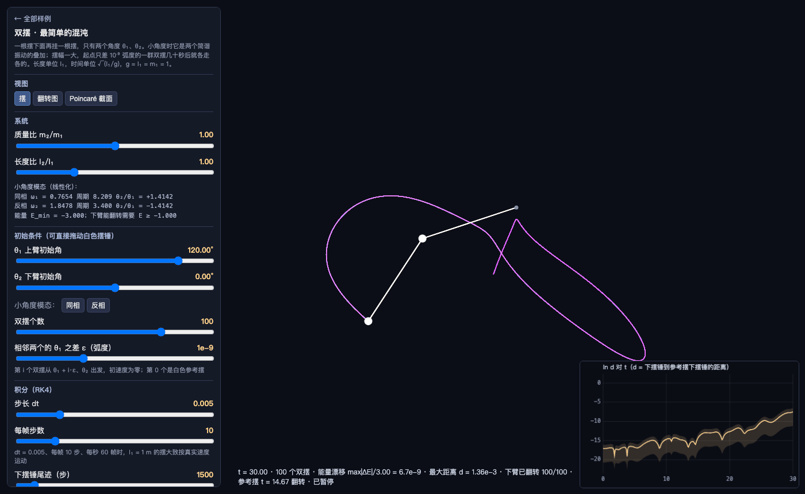
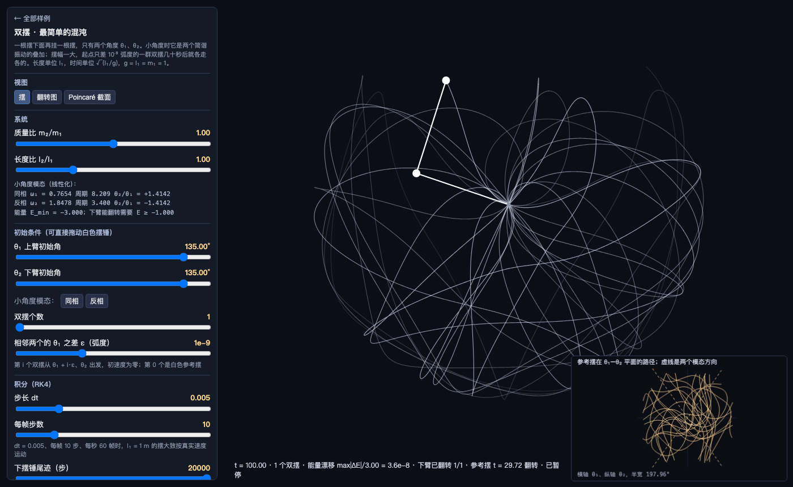
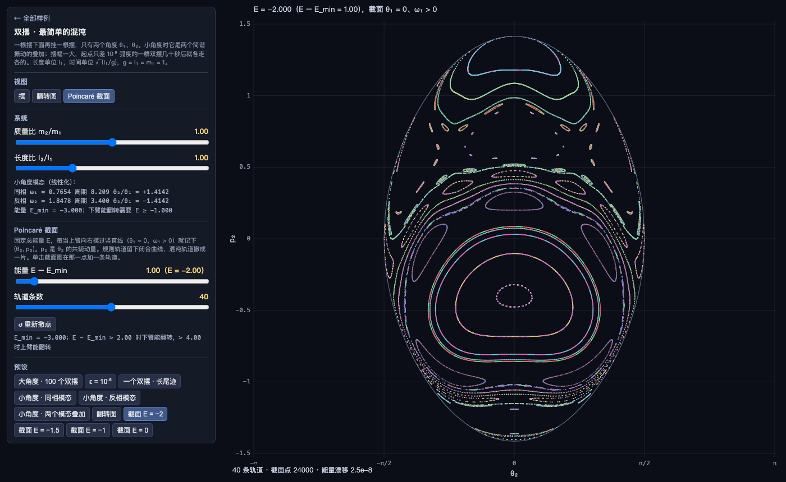
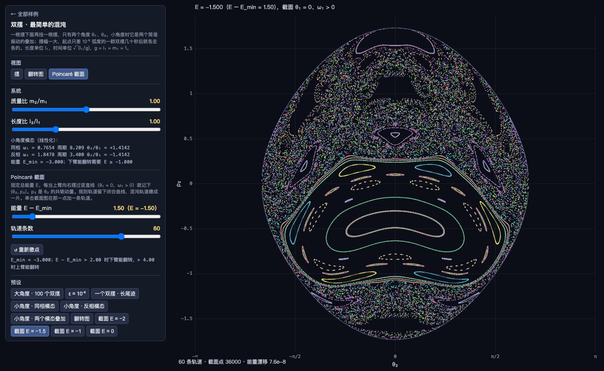
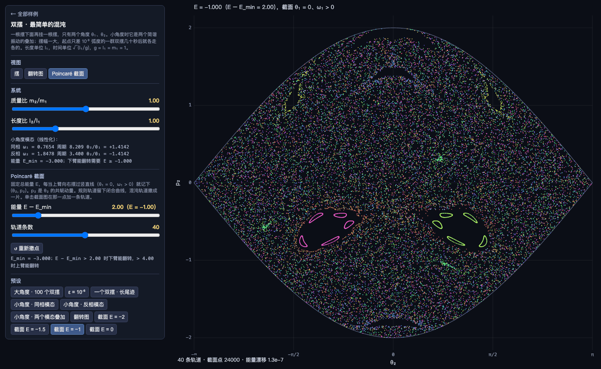
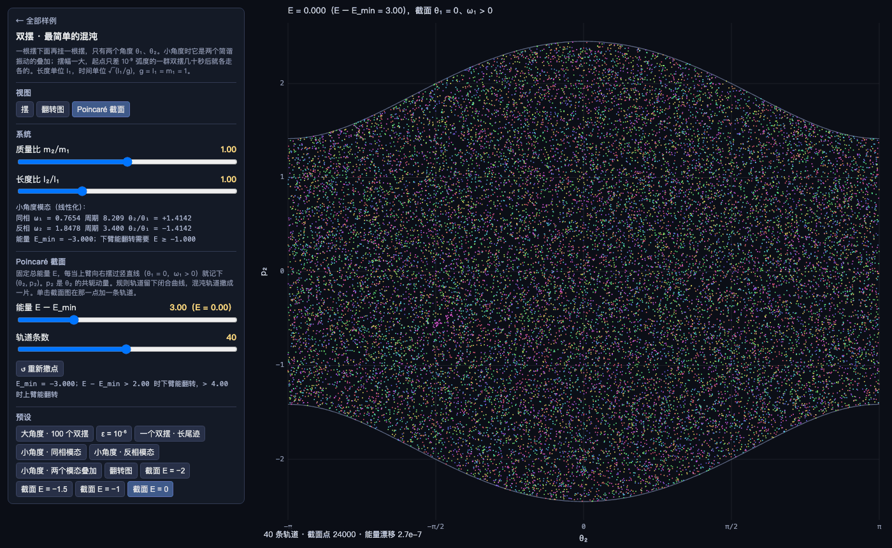
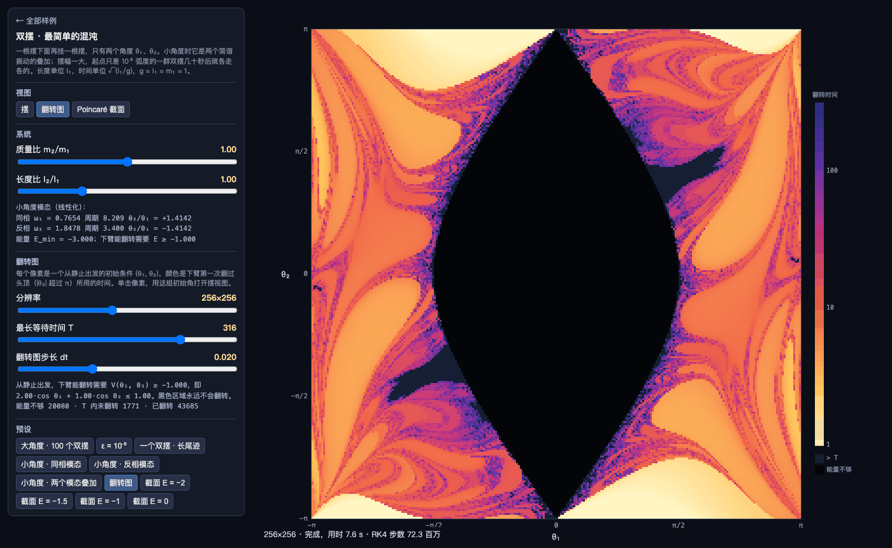

# 双摆 · 最简单的混沌



一根摆下面再挂一根摆，就是双摆。它只有两个自由度：上臂的角度 θ₁ 和下臂的角度 θ₂。没有摩擦，没有外力，方程也只有两行。可是把它从高处放开，它会时而摆动、时而翻过头顶，路线完全不重复。

上图是页面里的 100 个双摆。它们都从 θ₁ = 120°、θ₂ = 0 静止放开，第 i 个的 θ₁ 比第 0 个多 i × 10⁻⁹ 弧度，最大的差别也不到 10⁻⁷ 弧度。前 40 个时间单位里它们叠在一起，看上去只有一个双摆；到 t = 55，下摆锤的尾迹已经散成一条彩带。几个时间单位后，100 个双摆就各走各的了。

把摆幅减到几度，同样 50 个双摆跑 400 个时间单位，彼此的距离始终停在 10⁻⁸ 量级。运动是两个简谐振动的叠加，频率可以用纸笔算出来，页面实测和理论对到小数点后第 4 位。

打开方式：用浏览器直接打开 [index.html](index.html)。页面只用 Canvas 2D，不依赖外部库，离线也能用。

## 数学原理

全文取 g = l₁ = m₁ = 1。长度以 l₁ 为单位，时间以 √(l₁/g) 为单位。l₁ = 1 m 时，一个时间单位是 0.319 秒。

### 1. 从 Lagrange 量到运动方程

角度从竖直向下量起，逆时针为正。两个摆锤的位置是

```
x₁ = l₁ sin θ₁,            y₁ = −l₁ cos θ₁
x₂ = x₁ + l₂ sin θ₂,       y₂ = y₁ − l₂ cos θ₂
```

对时间求导，记 ω = θ̇，Δ = θ₁ − θ₂：

```
v₁² = l₁² ω₁²
v₂² = l₁² ω₁² + l₂² ω₂² + 2 l₁ l₂ ω₁ ω₂ cos Δ
```

动能 T = ½m₁v₁² + ½m₂v₂²，势能 V = m₁g y₁ + m₂g y₂。记 M = m₁ + m₂：

```
T = ½ M l₁² ω₁² + ½ m₂ l₂² ω₂² + m₂ l₁ l₂ ω₁ ω₂ cos Δ
V = −M g l₁ cos θ₁ − m₂ g l₂ cos θ₂
```

Lagrange 量 L = T − V。对每个角度写 Euler–Lagrange 方程 d/dt(∂L/∂ω) = ∂L/∂θ。以 θ₁ 为例：

```
∂L/∂ω₁ = M l₁² ω₁ + m₂ l₁ l₂ ω₂ cos Δ
d/dt(∂L/∂ω₁) = M l₁² θ̈₁ + m₂ l₁ l₂ θ̈₂ cos Δ − m₂ l₁ l₂ ω₂ (ω₁ − ω₂) sin Δ
∂L/∂θ₁ = −m₂ l₁ l₂ ω₁ ω₂ sin Δ − M g l₁ sin θ₁
```

两边相减，含 ω₁ω₂ 的项正好抵消。θ₂ 的方程也照此推导。两条方程是：

```
M l₁ θ̈₁ + m₂ l₂ cos Δ · θ̈₂ = −m₂ l₂ ω₂² sin Δ − M g sin θ₁
l₁ cos Δ · θ̈₁ + l₂ θ̈₂     =  l₁ ω₁² sin Δ − g sin θ₂
```

这是关于 θ̈₁、θ̈₂ 的 2×2 线性方程组。系数行列式是 l₁l₂(M − m₂cos²Δ) = l₁l₂(m₁ + m₂ sin²Δ)，它总大于 0，所以方程组总能解出唯一的加速度。页面每一步就解这个方程组，代码里的 `acc()` 和上面两行一一对应。

总能量 E = T + V 守恒，所以它可以用来检查积分器。页面用四阶 Runge–Kutta（RK4），默认步长 dt = 0.005，并在状态栏实时显示所有双摆里最大的 |E − E₀|，除以势阱深度 M l₁ + m₂ l₂（等质量等长时是 3）。实测值如下：

| 情形 | 时长 | 最大 \|ΔE\|/3 |
|---|---|---|
| 大角度 100 个双摆，dt = 0.005 | 55 | 6.7 × 10⁻⁹ |
| 同上 | 400 | 3.9 × 10⁻⁸ |
| 同上，dt = 0.002 | 400 | 4.5 × 10⁻¹⁰ |
| 小角度同相模态，dt = 0.005 | 400 | 6.5 × 10⁻¹⁵ |

RK4 不是辛积分器，能量会慢慢漂。但在 dt = 0.005 时，漂移比 10⁻⁹ 的初值差别引起的分离小得多，也小于屏幕上能看出的任何差别。

### 2. 小角度：两个简正模态

摆幅很小时，令 sin θ ≈ θ、cos Δ ≈ 1，并丢掉 ω² 这样的二阶小量。方程变成线性的：

```
𝐌 θ̈ + 𝐊 θ = 0,    𝐌 = | M l₁²     m₂ l₁ l₂ |,   𝐊 = | M g l₁    0      |
                         | m₂ l₁ l₂  m₂ l₂²   |         | 0         m₂ g l₂ |
```

找形如 θ(t) = v cos(ωt) 的解，得 (𝐊 − ω²𝐌) v = 0。要有非零解，需要 det(𝐊 − ω²𝐌) = 0。等质量等长（M = 2，其余都是 1）时：

```
det | 2 − 2λ   −λ   | = (2 − 2λ)(1 − λ) − λ² = λ² − 4λ + 2 = 0,   λ = ω²
    | −λ      1 − λ |
```

解出 λ = 2 ∓ √2，对应的振动方向由第一行 (2 − 2λ) v₁ = λ v₂ 给出：

| 模态 | ω = √λ | 周期 2π/ω | θ₂ / θ₁ | l₁ = 1 m 时的周期 |
|---|---|---|---|---|
| 同相（两臂同向摆） | √(2 − √2) = 0.7654 | 8.209 | +√2 = +1.4142 | 2.62 s |
| 反相（两臂反向摆） | √(2 + √2) = 1.8478 | 3.400 | −√2 = −1.4142 | 1.09 s |

一般的小角度运动是这两个模态的叠加，各自按自己的频率振动，互不交换能量。面板“系统”一栏对任意 m₂/m₁、l₂/l₁ 实时列出 ω₁、ω₂ 和振动方向，公式同上。

**和实测比较。** 按“小角度 · 同相模态”或“反相模态”预设，页面让 θ₂ = ±1.4142·θ₁ 静止放开。它记录参考摆的 θ₁(t)、θ₂(t)，每 0.1 个时间单位一个点，最多 4096 个点，然后加 Hann 窗做傅里叶变换，再在最高的频率格点附近用黄金分割搜索定位峰顶。下面是跑满 409.6 个时间单位后的峰值频率：

| θ₁ 摆幅 | 同相实测 ω | 相对偏差 | 反相实测 ω | 相对偏差 |
|---|---|---|---|---|
| 0.5° | 0.765362 | −6.5 × 10⁻⁶ | 1.847497 | −1.4 × 10⁻⁴ |
| 1° | 0.765347 | −2.6 × 10⁻⁵ | 1.846720 | −5.6 × 10⁻⁴ |
| 3° | 0.765189 | −2.3 × 10⁻⁴ | 1.838466 | −5.0 × 10⁻³ |
| 10° | 0.763400 | −2.6 × 10⁻³ | 1.753028 | −5.1 × 10⁻² |
| 理论（线性） | 0.765367 | | 1.847759 | |

摆幅越小，实测越接近线性理论。偏差与摆幅的平方成正比：摆幅从 0.5° 到 1°，两个模态的偏差都变成 4 倍（4.0 和 3.96）；从 3° 到 10°，同相偏差变成 11 倍，和 (10/3)² = 11.1 一致。这是 sin θ ≈ θ − θ³/6 里被丢掉的三次项造成的。单摆也有同样的效应，摆幅 A 时频率约降低 A²/16。反相模态的偏差大得多：同样的 θ₁ 摆幅下，反相模态里两臂之间的夹角更大，非线性更强。



上图是同相模态（θ₁ = 3°）的频谱，只有一个峰，落在左边那条理论虚线上。

“小角度 · 两个模态叠加”预设从 θ₁ = 5°、θ₂ = 0 放开。这个起点在两个模态方向上各占一半，频谱有两个峰：0.7653 和 1.8415。右下角改成“θ₁–θ₂”插图，参考摆在 (θ₁, θ₂) 平面上的路径是一个菱形里的 Lissajous 曲线，菱形的边平行于两条模态方向的虚线：



小角度运动是**规则的**。50 个双摆的 θ₁ 依次差 10⁻⁹，跑 400 个时间单位后，下摆锤之间的最大距离从 4.9 × 10⁻⁸ 只长到 6.3 × 10⁻⁸。分离只来自频率随摆幅的微小变化，所以随时间线性增长，不是指数增长。

### 3. 大角度：起点只差 10⁻⁹ 也会分开

默认预设从 θ₁ = 120°、θ₂ = 0 放开 100 个双摆。参考摆的下臂在 t = 14.67 第一次翻过头顶，其余 99 个在同一时刻翻过去，此时它们还看不出差别。t = 30 时最大距离是 1.4 × 10⁻³，画面上仍然只有一个双摆：



右下角是 ln d 对 t 的曲线，d 是下摆锤到参考摆下摆锤的距离。黄线是平均值，阴影是最小到最大的范围。它沿一条斜线上升，斜线说明 d 按 e^{λt} 指数增长。改变初值差 ε，测量最大距离第一次超过 0.1 和 1 的时刻：

| ε（相邻两个双摆的 θ₁ 之差） | d > 0.1 的时刻 | d > 1 的时刻 |
|---|---|---|
| 10⁻¹² | 73.8 | 80.2 |
| 10⁻⁹ | 49.0 | 52.9 |
| 10⁻⁶ | 25.0 | 28.8 |

ε 每缩小 1000 倍，散开只推迟约 24 个时间单位。按 d ≈ ε·e^{λt} 粗略估计（这是推算，不是拟合），λ ≈ ln 1000 / 24.4 ≈ 0.28。这就是混沌的“可预测时间”：初值精度每提高 3 位，只能多预测约 24 个时间单位，在 l₁ = 1 m 时约 8 秒。

和 [Lorenz 吸引子](../lorenz-attractor/README.md) 不同，双摆没有摩擦，相空间体积守恒（Liouville 定理），所以没有吸引子。轨道不会落到一个分形集合上，而是在能量面上一块“混沌区域”里游荡。

“一个双摆 · 长尾迹”预设从 θ₁ = θ₂ = 135° 放开，画出 100 个时间单位里下摆锤的完整路线。右下角 θ₁–θ₂ 插图上，路径乱成一团，不再是菱形：



### 4. 为什么两个自由度就够产生混沌

用自由度来数：

- **一个自由度**（单摆）：相空间是 (θ, ω) 二维平面。能量守恒把轨道限制在一条等能量曲线上，轨道只能沿着它走，要么周期摆动，要么周期转圈，不可能混沌。
- **连续的流至少要三维才可能混沌。** Poincaré–Bendixson 定理说，平面上的流，有界轨道最终只能趋向不动点或周期轨道。轨道不能自己相交，在平面上它没地方“折叠”。Lorenz 系统是三维的，刚好够。
- **双摆**：相空间是 (θ₁, θ₂, ω₁, ω₂) 四维。能量守恒把轨道限制在一个三维的能量面上，三维正好够折叠。

光有三维还不够。可以完全解出来的系统（**可积系统**）要有和自由度一样多的独立守恒量。两个自由度需要两个：能量，再加一个。有两个守恒量时，轨道被限制在两者的交集上。这个交集是一个二维环面，轨道在上面做两个频率的准周期运动，永远不会混沌。

小角度的双摆近似可积：两个模态的能量各自守恒，这就是第二个守恒量。摆幅大了，cos Δ、sin θ 里的非线性项把两个模态耦合起来，第二个守恒量就不存在了。一般的双摆只剩能量一个守恒量，轨道不必待在环面上，可以在三维能量面里铺开一片。

### 5. Poincaré 截面与 KAM 定理

三维能量面上的轨道很难直接看。Poincaré 的办法是切一刀：固定总能量 E，每当上臂向右摆过竖直线（θ₁ = 0 且 ω₁ > 0），就在平面上记一个点 (θ₂, p₂)。p₂ = ∂L/∂ω₂ = m₂l₂²ω₂ + m₂l₁l₂ω₁cos Δ 是 θ₂ 的共轭动量。用 p₂ 而不用 ω₂，是因为在正则坐标下，截面映射保持面积（Liouville 定理在截面上的版本）。“面积守恒”正是 KAM 定理适用的前提。

截面上给定 (θ₂, p₂) 和 E，ω₁ 有闭式解。在 θ₁ = 0 处，把 ω₂ = (p₂ − m₂l₁l₂ω₁cos θ₂)/(m₂l₂²) 代入能量，交叉项正好消掉：

```
E = ½ (M − m₂ cos² θ₂) ω₁² + p₂² / (2 m₂ l₂²) + V(0, θ₂)
```

所以页面能直接在截面上任意一点放一条轨道，取 ω₁ > 0 的根即可。p₂² ≤ 2m₂l₂²(E − V(0, θ₂)) 是允许区域，图上的灰色曲线就是它的边界。

在截面上，规则轨道和混沌轨道一眼就能分开：

- **规则轨道**待在一个二维环面上。环面被截面切出一条闭合曲线，所以截面点连成曲线。
- **混沌轨道**没有第二个守恒量，截面点撒成一片。

**KAM 定理**（Kolmogorov 1954，Arnold 1963，Moser 1962）回答的是：可积系统加上一点小扰动以后，环面还在不在？答案是大部分还在。频率比“足够无理”的环面只会轻微变形，不会破。频率比是简单有理数（或者很接近）的环面，对应共振，会破碎成一串小岛，岛与岛之间夹着薄薄的混沌层。扰动越大，破掉的环面越多，混沌层连成一片，变成“混沌海”。

双摆的扰动大小由能量控制。能量越高，摆幅越大，非线性越强。等质量等长时 E_min = −3，下面 4 张截面图各撒 40–60 条轨道，每条记 600 个截面点：

| E = −2：几乎全是闭合曲线 | E = −1.5：岛链与混沌海共存 |
|---|---|
|  |  |

| E = −1：混沌海里剩两组小岛 | E = 0：整片混沌 |
|---|---|
|  |  |

- E = −2 时，截面几乎全是闭合曲线，外圈有几串小岛（共振破出的岛链）；
- E = −1.5 时，中间一大块规则区域被岛链围着，外面是一片混沌海；
- E = −1 刚好是下臂能翻过头顶的最低能量。规则区域主要剩左下、右下两组岛，上方还有几个很小的岛；
- E = 0 时，在 40 条轨道里没看到任何闭合曲线。

截面对 θ₂ → −θ₂ 左右对称。原因是方程在 (θ, ω, t) → (−θ, ω, −t) 下不变，这个变换保持截面条件 θ₁ = 0、ω₁ > 0，也保持 p₂。页面撒点时成对地放在 (θ₂, p₂) 和 (−θ₂, p₂)，所以岛总是成对出现。

截面的积分步长是 0.005，4 张图里最大的能量漂移分别是 2.5 × 10⁻⁸、7.6 × 10⁻⁸、1.3 × 10⁻⁷、2.7 × 10⁻⁷（除以 3）。

### 6. 翻转图

最后一张图是一个初始条件网格。横轴是 θ₁，纵轴是 θ₂，都从 −π 到 π。每个像素代表一个从静止放开的双摆，颜色是它的下臂**第一次翻过头顶**（|θ₂| 超过 π）用的时间：浅黄最快，越往红、紫、深蓝越慢。



**中间的黑色区域可以严格算出来。** 从静止出发，E = V(θ₁, θ₂)。下臂竖直朝上的位形里，势能最低的是上臂朝下、θ₁ = 0、θ₂ = π，V = −M l₁ + m₂ l₂ = −1。能量不够 −1 就永远翻不过去，所以

```
2 cos θ₁ + cos θ₂ > 1   ⇒   永远不会翻转
```

这块区域是中间的“透镜”，占网格的 30.6%（65536 个像素里有 20080 个）。它的边界就是能量等于 −1 的等势线。

透镜外面的结构就复杂了。上下边缘（θ₂ 接近 ±π，下臂一开始就差不多朝上）有大片浅黄区域，下臂往外一倒就翻过去了：|θ₂| > 0.9π 的像素里，48% 在 2 个时间单位内翻转。中间有几片颜色平滑变化的区域，相邻的起点翻转时间相近，运动是规则的。它们的边缘是一圈越来越细的条纹，再往外是颜色逐像素乱跳的噪点区，相邻两个像素的翻转时间可以差几十倍，这就是混沌。深蓝灰的小块是在 T = 316 之内都没翻转的规则岛。最大的两片在 (θ₁, θ₂) ≈ (0.45π, 0.47π) 和它的中心对称点附近，各约 640 个像素。

页面实测（256×256，T = 316，dt = 0.02）：

| 量 | 值 |
|---|---|
| 能量不够 / T 内未翻转 / 已翻转 | 20080 / 1771 / 43685 |
| 翻转时间的 10%、50%、90% 分位数 | 1.78、9.28、43.1 |
| 计算用时（每帧最多 14 ms） | 7.6 s，7230 万个 RK4 步 |

图对 (θ₁, θ₂) → (−θ₁, −θ₂) 中心对称，因为镜像的双摆做镜像的运动。实测 99.71% 的像素和它的对称像素完全相等。剩下 0.29% 落在混沌区，那里两个对称起点的浮点表示差一个舍入误差（约 10⁻¹⁶），被混沌放大后，翻转时间就不同了。

**步长会不会改变这张图？** 分别用 dt = 0.02、0.01、0.005 算同一张图，以 dt = 0.005 为准。翻转时间相差不超过 1%（或 0.05，取较大者）的像素比例：

| 翻转时间 | 像素数 | dt = 0.02 一致 | dt = 0.01 一致 |
|---|---|---|---|
| < 10 | 23766 | 100% | 100% |
| 10–100 | 18256 | 95.5% | 98.4% |
| > 100 | 1649 | 27.1% | 40.8% |

翻得快的区域，不同步长给出同一个答案。翻得慢的像素在混沌区里，具体数值取决于步长，但图的整体结构不变：三种步长的翻转时间中位数都是 9.27–9.28。这和第 3 节是同一件事：越晚的事件，越依赖初值和计算误差里的末位数字。

计算是渐进的。先算每 16 个像素里的一个，画成 16×16 的色块，再依次补 8、4、2、1 的间隔，所以几秒内就能看到整体轮廓。每帧最多算 14 毫秒或 40 万步，实测帧间隔中位数 16.6 ms，页面在计算时仍然流畅。单击任意像素，会用这组初始角打开摆视图。

## 操作

- 视图：摆、翻转图、Poincaré 截面；
- 系统：质量比 m₂/m₁（0.1–10）、长度比 l₂/l₁（0.2–3），下方实时给出两个小角度模态的 ω、周期和振动方向；
- 摆视图：
  - θ₁、θ₂ 滑条，或直接拖动白色参考摆的两个摆锤；
  - “同相 / 反相”按钮按当前系统的模态方向设定 θ₂；
  - 双摆个数（1–500）、相邻两个的 θ₁ 之差 ε（10⁻¹²–10⁻³）；
  - 步长、每帧步数、尾迹长度，暂停 / 重新开始；
  - 右下角插图：ln d 对 t、频谱、θ₁–θ₂ 路径、关闭；
- 翻转图：分辨率（64–512）、最长等待时间 T（10–1000）、步长；鼠标悬停显示该像素的初始角和翻转时间，单击用它打开摆视图；
- Poincaré 截面：能量 E − E_min（0.05–12）、轨道条数（1–80）、重新撒点；单击截面在那一点加一条轨道；
- 预设：大角度 100 个双摆、ε = 10⁻⁶、一个双摆长尾迹、小角度同相 / 反相 / 两个模态叠加、翻转图、截面 E = −2 / −1.5 / −1 / 0。

所有循环都有上限：摆视图每帧 RK4 总步数不超过 20 万；其余双摆的尾迹总点数不超过 15 万；距离和频谱最多记录 4096 个样本；翻转图每帧最多 14 毫秒、40 万步；截面每帧 15 万步，每条轨道最多 600 个点。

## 网址参数

| 键 | 含义 |
|---|---|
| p | 预设名：chaos, e6, single, inphase, anti, beat, flip, pcLow, pcMid, pcFlip, pcHigh |
| v | 视图：pend, flip, poinc |
| mr, lr | m₂/m₁（0.1–10）、l₂/l₁（0.2–3） |
| a1, a2 | 初始角 θ₁、θ₂（度，−180 到 180） |
| n | 双摆个数（1–500） |
| e | log₁₀ ε（−12 到 −3） |
| dt | 步长（0.001–0.02） |
| sp | 每帧步数（1–50） |
| L | 尾迹长度（0–20000 步） |
| ins | 插图：sep, spec, cfg, none |
| t | 打开时先快进到这个时刻（0–400） |
| res, T, mdt | 翻转图分辨率（64–512）、log₁₀ T（1–3）、翻转图步长（0.005–0.05） |
| h, k | 截面能量 E − E_min（0.05–12）、轨道条数（1–80） |
| run | 0 = 打开时暂停 |
| ui | 0 = 隐藏面板、状态栏和插图，只留画布 |

所有数值参数必须是有限数，超出范围的会被截到滑条范围；不认识的预设名、视图名和插图名会被忽略。

例如直接看 100 个双摆散开的时刻：`index.html?p=chaos&t=55&run=0`；看质量比 3 的翻转图：`index.html?p=flip&mr=3`；看 E = −1.5 的截面：`index.html?p=pcMid`。

## 参考

- H. Goldstein, C. Poole, J. Safko, *Classical Mechanics*, 第 3 版，Addison-Wesley, 2002. Lagrange 方程与小振动（第 2、6 章）。
- T. Shinbrot, C. Grebogi, J. Wisdom, J. A. Yorke, *Chaos in a double pendulum*, American Journal of Physics 60, 1992.
- A. N. Kolmogorov (1954), V. I. Arnold (1963), J. Moser (1962)：KAM 定理的三篇原始论文。入门可读 M. Tabor, *Chaos and Integrability in Nonlinear Dynamics*, Wiley, 1989，第 3 章。
- J. S. Heyl, *The double pendulum fractal*, 2008. 按翻转时间给初始条件网格着色的做法来自这里。
- S. H. Strogatz, *Nonlinear Dynamics and Chaos*, Westview Press, 1994. Poincaré–Bendixson 定理（第 7 章）。
