# 一维元胞自动机 · 规则 30 与规则 110

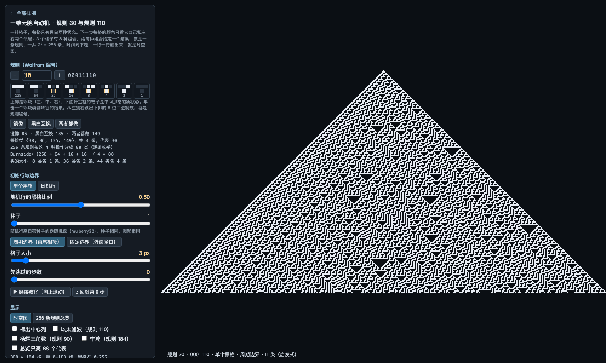

一排格子，每格只有黑、白两种状态。每一步，所有格子同时更新，每格的新颜色只取决于它自己和左右两个邻居的旧颜色。规则只有一张 8 行的小表，却能画出上面这样的图：左边是整齐的斜纹，右边像抛硬币一样杂乱。这就是 Stephen Wolfram 在 1983 年系统研究的**初等元胞自动机**（elementary cellular automaton）。上图是规则 30。规则 90 会画出 Sierpinski 三角，规则 184 是一个最简单的交通模型，规则 110 能够模拟任何计算机程序。

打开方式：用浏览器直接打开 [index.html](index.html)。页面只用 Canvas 2D，不依赖外部库，离线也能用。随机行来自带种子的伪随机数发生器，种子和参数相同，画面和测量结果就完全相同，下面每张图都可以用网址参数重现。截图里的数字都是页面在 1280×720（或标出的）窗口里实际测出来的。

## 数学原理

### 1. 256 条规则和 Wolfram 编号

把左、中、右三格记成三位二进制数 (l, c, r)，一共 8 种：111, 110, 101, 100, 011, 010, 001, 000。一条规则就是给每一种指定中间格的新颜色。按上面的顺序把 8 个结果写成一个 8 位二进制数，它的值就是规则编号。例如规则 30：

| 邻域 | 111 | 110 | 101 | 100 | 011 | 010 | 001 | 000 |
|---|---|---|---|---|---|---|---|---|
| 新的中间格 | 0 | 0 | 0 | 1 | 1 | 1 | 1 | 0 |
| 位权 | 128 | 64 | 32 | 16 | 8 | 4 | 2 | 1 |

00011110₂ = 16 + 8 + 4 + 2 = 30。换句话说，邻域 (l, c, r) 对应的是编号的第 4l + 2c + r 位。每一位都可以独立地取 0 或 1，所以一共有 2⁸ = 256 条规则。

页面左上角是规则选择器：输入 0–255 之间的数，或者直接单击 8 个邻域小图里的任意一个，翻转它的结果，编号随之改变。规则 30 写成公式是 `新 = l XOR (c OR r)`：右边的两格只要有一格是黑的，就取左格的反色。

时空图里第 t 行是第 t 步的整排格子，时间向下走。边界有两种：**周期边界**把行首尾接成一个环；**固定边界**假定行外面全是白格。从单个黑格出发时，图案每一步最多向两侧各长一格（“光速”是每步一格），所以页面只画到两侧边缘相遇之前的那一行。

### 2. 镜像和黑白互换：256 条规则只有 88 类

有两种操作不改变规则的“本质”：

- **镜像** M：把左右对调。新规则在 (l, c, r) 上的输出等于原规则在 (r, c, l) 上的输出。时空图左右翻转。
- **黑白互换** C：把所有颜色反过来。新规则在 x 上的输出等于 1 减去原规则在 x̄ 上的输出，x̄ 是三格全部取反。时空图黑白反转。

两种操作都做一次是 MC。{恒等, M, C, MC} 组成一个 4 元群，一条规则在群作用下的轨道就是它的**等价类**。规则 30 的等价类是 {30, 86, 135, 149}，规则 110 的是 {110, 124, 137, 193}，规则 90 和 184 各自只有 2 个成员：{90, 165}、{184, 226}。

页面把 256 条规则逐条做这三种操作，得到 **88 个等价类**，其中 8 类只有 1 条规则、36 类有 2 条、44 类有 4 条（8 + 72 + 176 = 256）。这个数也可以用 **Burnside 引理**算：等价类的个数等于群里每个元素的不动点个数的平均值。

| 操作 | 不动的规则需要满足 | 不动的规则个数（页面枚举） |
|---|---|---|
| 恒等 | 无 | 256 |
| M | f(l,c,r) = f(r,c,l)。8 个邻域按左右对调分成 6 组：000、010、101、111 各自一组，{001, 100}、{011, 110} 各一组 | 2⁶ = 64 |
| C | f(x̄) = 1 − f(x)。8 个邻域按取反配成 4 对，每对只能自由选一个 | 2⁴ = 16 |
| MC | f(r̄,c̄,l̄) = 1 − f(l,c,r)。这个变换没有不动的邻域，8 个邻域配成 4 对 | 2⁴ = 16 |

(256 + 64 + 16 + 16) / 4 = 352 / 4 = 88，和逐条枚举的结果一致。页面面板里“镜像 / 黑白互换 / 两者都做”三个按钮直接跳到对应的规则。勾选“总览只亮 88 个代表”，总览里只有每类编号最小的那一条保持亮色：

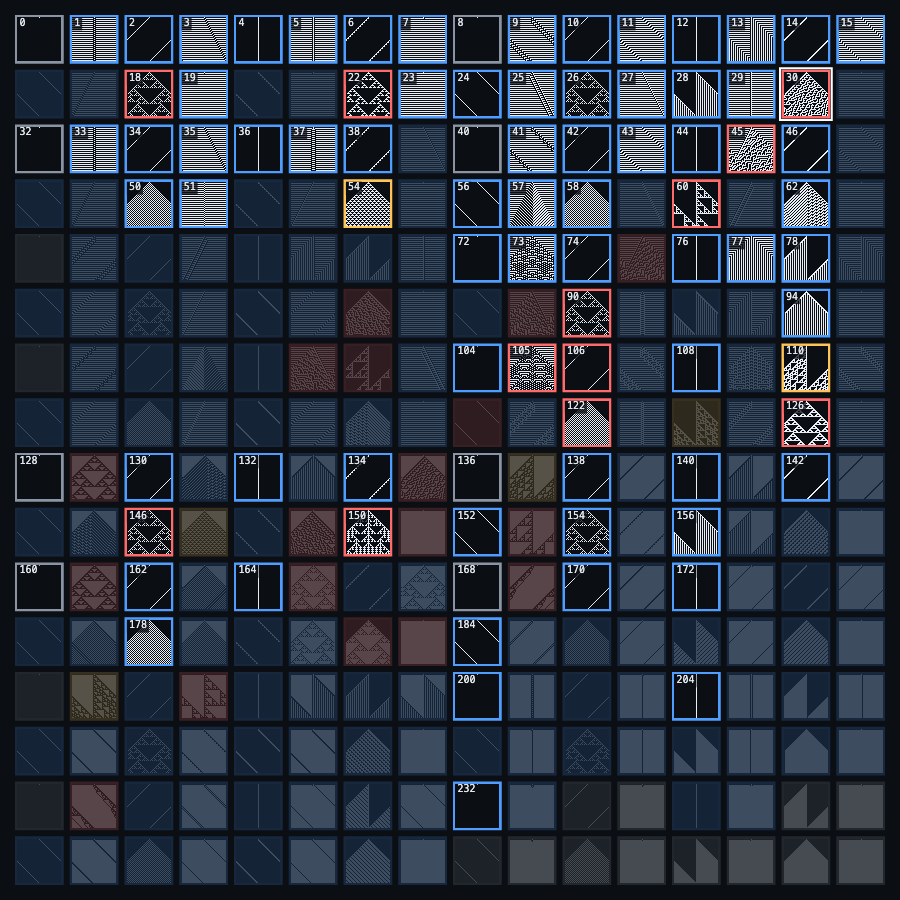

### 3. Wolfram 的四类，以及页面怎么分类

Wolfram 把元胞自动机从随机初始行出发的长期行为分成四类：

| 类 | 行为 | 例子 |
|---|---|---|
| I | 很快变成全白或全黑 | 0、8、32、128 |
| II | 变成静止的或周期的结构，各管各的 | 4、108、184 |
| III | 看起来随机的混沌，一处的扰动会扩散开 | 18、30、45、90 |
| IV | 规整的背景上有局部结构移动、碰撞，长时间都不稳定下来 | 54、110 |

这个分类**没有严格的数学定义**，不同作者对边界上的几条规则意见并不一致。页面用的是一套经验判别，属于启发式，下面写清楚它的每一步：

1. 等价的规则行为完全一样（只差一次镜像或黑白反转），所以每个等价类只算编号最小的代表，再把结果分给全类。
2. 在 401 格的环上，从种子 1 的随机行（黑格概率 ½）出发演化 300 步。
3. 最后一行全同 → **I 类**。
4. 最后一行等于 p 步之前的某一行再平移 s 格（p ≤ 100，|s| ≤ p）→ **II 类**。环上的规则和平移可交换，所以只要这一行对上了，以后就永远以周期 p 重复。
5. 剩下的规则看两个量：
   - **压缩率**：把最后 32 行（12 832 格）连成一串，算 Lempel–Ziv（1976）复杂度，除以 n / log₂ n。抛硬币序列约等于 1，有大片规则背景的序列小得多。
   - **扰动扩散宽度**：在 8 个均匀分布的位置各翻转一格，两份拷贝再各演化 100 步，量差异向左、向右各传到多远，除以最大可能值 200，再取平均。
   - 压缩率 > 0.75 或扩散宽度 > 0.55 → **III 类**；扩散宽度 ≥ 0.08 → **IV 类**；否则 → **II 类**（例如规则 73：静止的“墙”把行隔成许多小区域，各区域的周期不同，整体周期太长，第 4 步没测出来；但扰动传不出墙，扩散宽度只有 0.057）。

页面测得的几条代表规则：

| 规则 | 第 4 步 | LZ 压缩率 | 扩散宽度 | 页面分类 | 文献（Martínez 2013） |
|---|---|---|---|---|---|
| 0 | 全白 | — | — | I | I |
| 184 | 周期 1，平移 1 格 | — | — | II | II |
| 73 | 不周期 | 0.474 | 0.057 | II | II |
| 30 | 不周期 | 1.030 | 0.617 | III | III |
| 90 | 不周期 | 1.026 | 1.000 | III | III |
| 18 | 不周期 | 0.630 | 0.852 | III | III |
| 54 | 不周期 | 0.558 | 0.508 | IV | IV |
| 110 | 不周期 | 0.538 | 0.204 | IV | IV |
| 106 | 不周期 | 0.995 | 0.501 | III | IV |
| 41 | 周期 8，平移 8 格 | — | — | II | IV |

结果：256 条规则里 I 类 24 条、II 类 196 条、III 类 30 条、IV 类 6 条；按 88 类算是 8、66、12、2。和 Martínez（2013）给出的分类比，88 类里有 **86 类一致**。不一致的两类：规则 106 看起来就像一条向一侧移动的混沌带，按压缩率被判成 III；规则 41 在 401 格的环上 300 步内已经进入周期，被判成 II。在 Chromium 里分类全部 88 类用时约 530–560 毫秒，只在打开页面时算一次。

下面是 256 条规则的总览，从单个黑格出发，边框颜色就是上面的分类：灰色 I、蓝色 II、红色 III、金色 IV。单击任意一格就打开它的时空图：

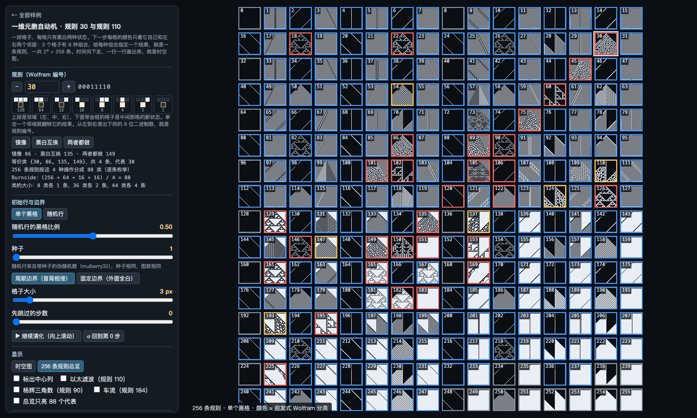

从单个黑格出发时很多规则只画出一条斜线或什么也没有，看不出混沌。换成随机行（预设“总览 · 随机行”），各类的差别更明显：

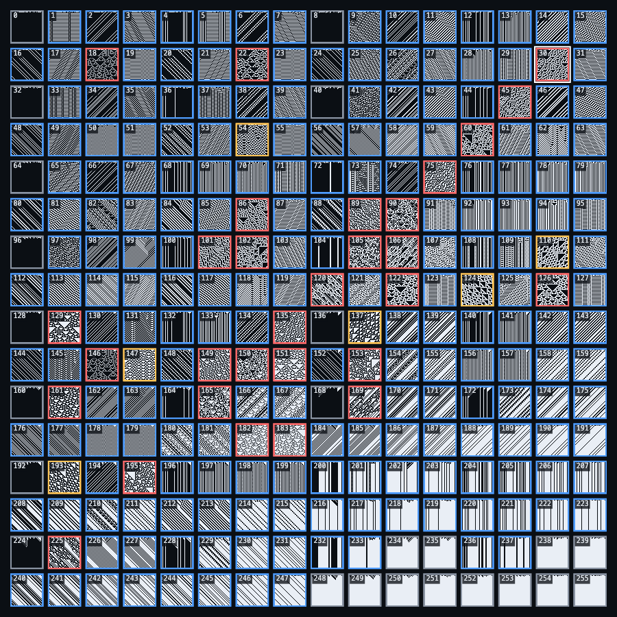

### 4. 规则 30：中心列当随机数

从一个黑格出发，规则 30 的图案左侧有规律，右侧杂乱。最引人注意的是**正中那一列**：把它每一步的颜色依次记下来，得到

```
11011100110001011001001110101110 01110101011000011001010110101011 …
```

Wolfram 用这一列做随机数发生器，Mathematica 早期版本生成随机整数用的就是它。2019 年 Wolfram 还悬赏过三个至今未解决的问题：中心列是否永远不进入周期；0 和 1 的比例是否趋于 ½；能否不把前面的步数都算一遍就直接求出第 n 位。

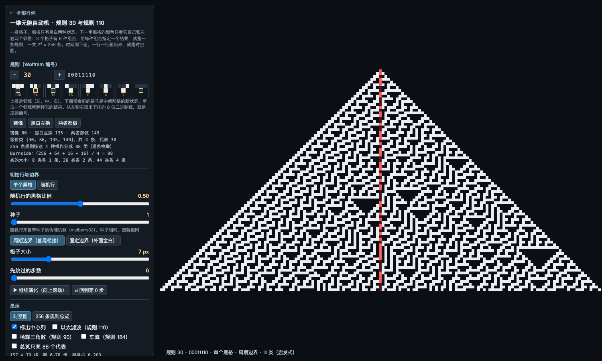

页面怎么算这一列：要求“无限长的行”，但第 n 步的中心格只受第 t 步离中心不超过 min(t, n − t) 的格子影响（往外的格子还没被图案碰到，或者影响传不回中心）。所以每一步只更新这一段，总工作量约 n²/2，16 384 位约 330 毫秒。我用一个最直接的 Python 实现（每步把整行都算一遍）核对过页面算出的前 1024 位，规则 30、45、73、1 全部一致。

页面对中心列做三个简单的检验，并把同样位数的 mulberry32 输出当对照组：

1. **频数检验**：n 位里 1 的个数 k，z = (k − n/2) / √(n/4)。真随机时 z 近似标准正态，|z| > 2.58 的概率只有 1%。
2. **游程检验**（Wald–Wolfowitz）：连续相同的一段叫一个游程。给定 0 和 1 的个数 n₀、n₁，游程数的期望是 μ = 1 + 2n₀n₁/n，方差 (μ − 1)(μ − 2)/(n − 1)。游程太少说明有成片的相同位，太多说明 0、1 交替得太规整。
3. **4 位块 χ² 检验**：把序列切成 n/4 个不重叠的 4 位块，统计 16 种块各出现多少次，和期望 n/64 比。χ² 有 15 个自由度，均值 15，超过 30.6 的概率只有 1%。

页面测得的规则 30 中心列：

| 位数 n | 1 的个数 | 频数 z | 游程数（期望） | 游程 z | 4 位块 χ² | χ² 的 p |
|---|---|---|---|---|---|---|
| 1 024 | 490 | −1.375 | 482（512.1） | −1.883 | 17.38 | 0.297 |
| 2 048 | 1 002 | −0.972 | 977（1 024.5） | −2.102 | 10.81 | 0.766 |
| 4 096 | 2 028 | −0.625 | 2 011（2 048.8） | −1.182 | 13.12 | 0.593 |
| 8 192 | 4 104 | 0.177 | 4 073（4 097.0） | −0.530 | 16.94 | 0.323 |
| 16 384 | 8 277 | 1.328 | 8 258（8 192.1） | 1.030 | 15.83 | 0.394 |

对照组 mulberry32 在同样位数下的频数 z 是 −0.312、1.989、1.250、1.016、−0.469，χ² 是 20.00、14.19、15.34、13.45、19.86，和规则 30 在同一个量级。规则 30 的每个 |z| 都小于 2.58，χ² 都远小于 30.6，三项检验在 1% 水平上都没有拒绝。当然，通过几个简单检验不等于密码学意义上的随机。

换成别的规则，中心列一点也不随机：规则 90 的中心列是 1 后面跟着全 0（16 384 位里只有 1 个 1，频数 z = −127.98）；规则 110 和 150 的中心列全是 1（z = 128.00）。规则 45 是另一条通过检验的规则（16 384 位，z = 0.188，χ² = 17.41）。

### 5. 规则 90：Sierpinski 三角，也是杨辉三角 mod 2

规则 90 = 01011010₂，写成公式是

```
新 = l XOR r
```

中间格自己不起作用，新颜色是左右两格的异或。从一个黑格出发，它画出 Sierpinski 三角：

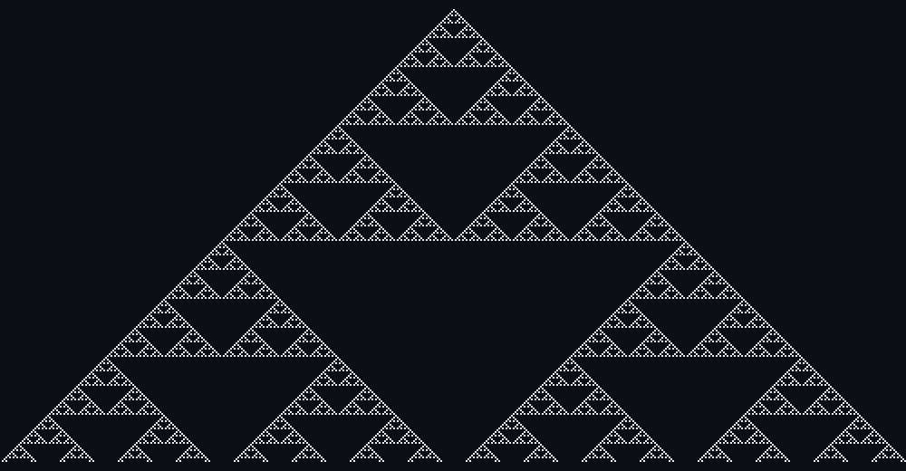

为什么？把黑记成 1、白记成 0，XOR 就是模 2 加法。设第 t 行第 k 个可能的位置（从左数，位置每隔一格）上的值是 a(t, k)，那么

```
a(t, k) = a(t−1, k−1) + a(t−1, k)   (mod 2)
```

这正是杨辉三角的构造规则：每个数等于它左上和右上两个数之和。在 [Galton 板](../galton-board/README.md) 里，小球走到某颗钉子的路线数也满足这个递推，所以那里的路线数就是杨辉三角。这里只是把每个数都换成了它除以 2 的余数：

```
第 t 行第 k 格是黑的  ⇔  C(t, k) 是奇数
```

预设“规则 90 · 杨辉三角 mod 2”把格子放大，在每个格子里写出 C(t, k)。黑格里的数全是奇数，白格里的全是偶数：

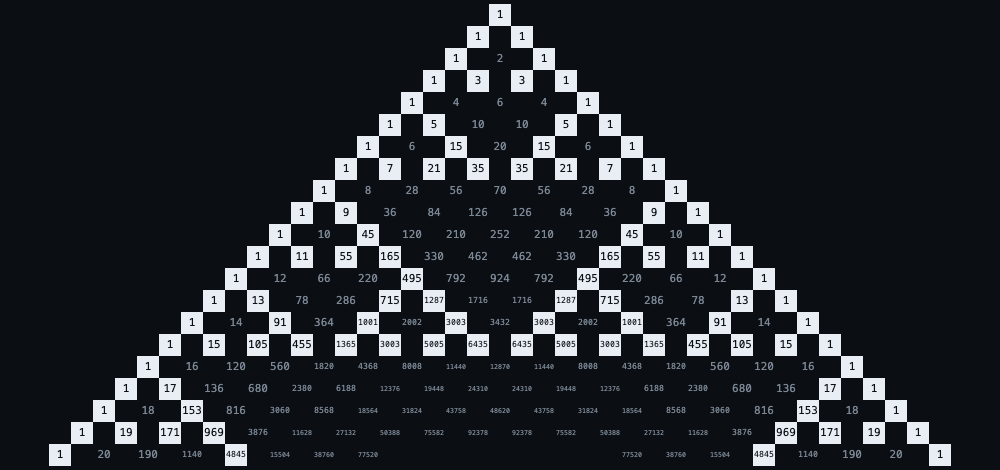

杨辉三角 mod 2 为什么是 Sierpinski 三角？**Lucas 定理**：C(t, k) 是奇数，当且仅当 k 的二进制每一位都不超过 t 的对应位，也就是 k 的二进制 1 都落在 t 的二进制 1 的位置上。由此可以直接算出每一行有几个黑格：t 的二进制里有几个 1，k 就有 2 的那么多次方种选法，

```
第 t 行黑格数 = 2^(t 的二进制里 1 的个数)
```

（Glaisher 1899）。例如第 7 = 111₂ 行有 2³ = 8 个黑格，所有可能的位置都是黑的；第 8 = 1000₂ 行只有 2 个，两端各一个，中间是一个巨大的白色倒三角。页面每次重画都逐行核对这个公式，上图那张 500 格宽的规则 90 时空图 250 行全部成立。前 2ᵐ 行的总黑格数是 3ᵐ，而面积是 4ᵐ 量级，所以 Sierpinski 三角的维数是 log 3 / log 2 ≈ 1.585。这和 [IFS 蕨叶](../ifs-fern/README.md) 里用三个“缩小一半”的变换画出的是同一个集合。

规则 150 = `l XOR c XOR r` 是三格异或，同样是线性的。它从单个黑格出发，第 t 行第 j 格的值是 (1 + x + x²)ᵗ 展开后 xʲ 系数的奇偶，图案是另一种自相似：

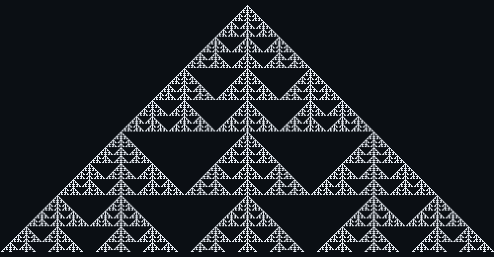

### 6. 规则 110：以太、滑翔机和图灵完备

规则 110 = 01101110₂。从一个黑格出发，它只向左长，右边界一直是一条直线，左边是一片三角形交错的花纹：

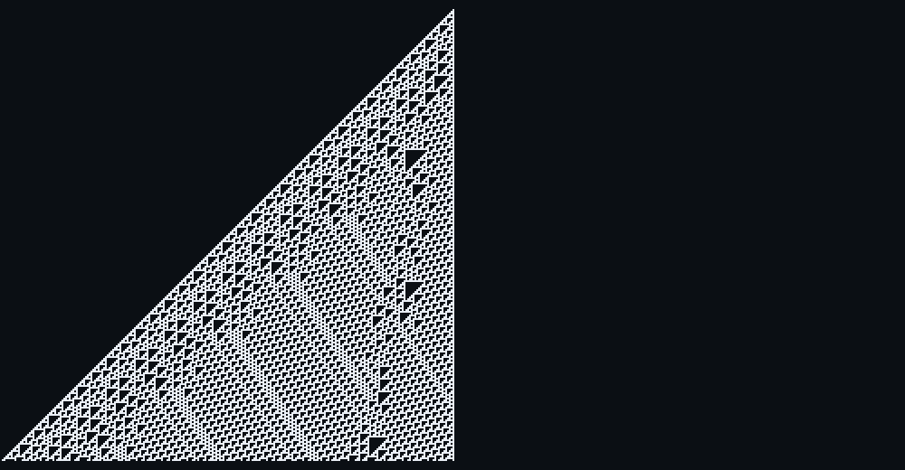

从随机行出发更能看出它的特点。几百步以后，大部分地方变成一种规整的背景纹理，上面有一些斜着走的“粒子”，它们相遇时会合并、湮灭或者生出新的粒子：

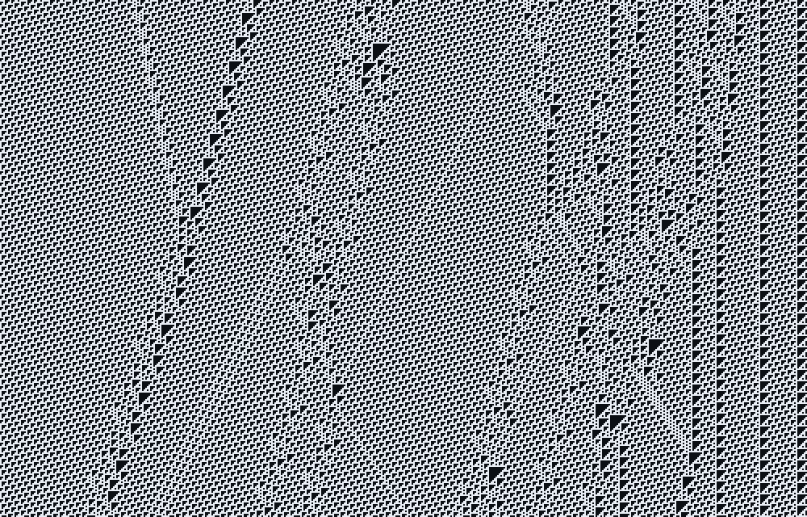

这种背景叫**以太**（ether）。它是一个空间周期为 14 的行模式：

```
… 11111000100110 11111000100110 …
```

在 14 格的环上演化一下就能验证：规则 110 每一步把这一行整体平移 4 格（模 14），所以 7 步之后回到原样。**以太滤波**的做法是：在每一行上滑一个 14 格的窗口，窗口里的 14 位只要是这个模式的 14 种循环移位之一，窗口覆盖的格子就算以太，画成暗色；其余的格子画成橙色。上一张图滤波以后，在背景上移动的结构清楚多了：

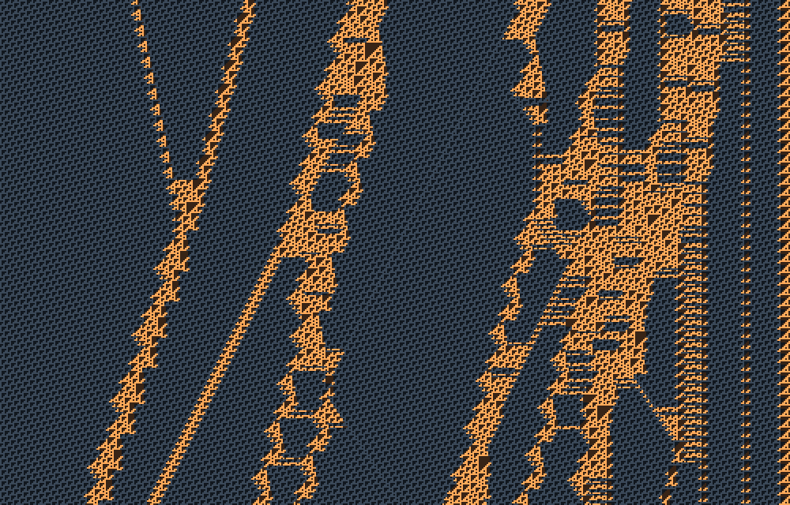

这张图 500 × 320 格里有 76.6% 的格子属于以太。在 1280×720 的窗口里（442 × 360 格），以太的比例随时间增加：从第 0 步开始画是 59.1%，先跳过 300 步是 76.3%，跳过 1000 步是 82.5%。粒子在碰撞中不断湮灭，剩下的越来越少。

这些在以太上移动的局部结构叫**滑翔机**（glider）。规则 110 有十几种不同速度的滑翔机，它们碰撞的结果完全由相对位置决定。Matthew Cook 在 20 世纪 90 年代证明了规则 110 **图灵完备**（2004 年发表），思路可以粗略地这样理解：

1. 先选一个已知图灵完备的简单系统：**循环标签系统**（cyclic tag system）。它有一串 0/1 数据和一张循环使用的“产生式”表：每一步读掉数据最前面的一位，如果是 1，就把当前产生式接到数据末尾，如果是 0 就什么都不加，然后换下一条产生式。
2. 用滑翔机来编码：一组滑翔机代表数据里的一位，另一组从右边周期性地飞来，代表产生式表，再有一组在中间负责“读一位、决定是否复制”。
3. 精心安排每个滑翔机的相对位置，让它们每次碰撞都恰好完成循环标签系统的一步。

只要以太背景的左右两侧按固定的周期模式铺开（初始行不是有限的，但是是“周期背景 + 中间一段有限数据”），规则 110 就能模拟任意程序。后来 Neary 和 Woods（2006）证明这种模拟只需多项式时间。一张 8 位的规则表，就和任何一台计算机一样强。

规则 54 是另一条通常被归为 IV 类的规则。它也有周期背景和在上面移动的粒子：

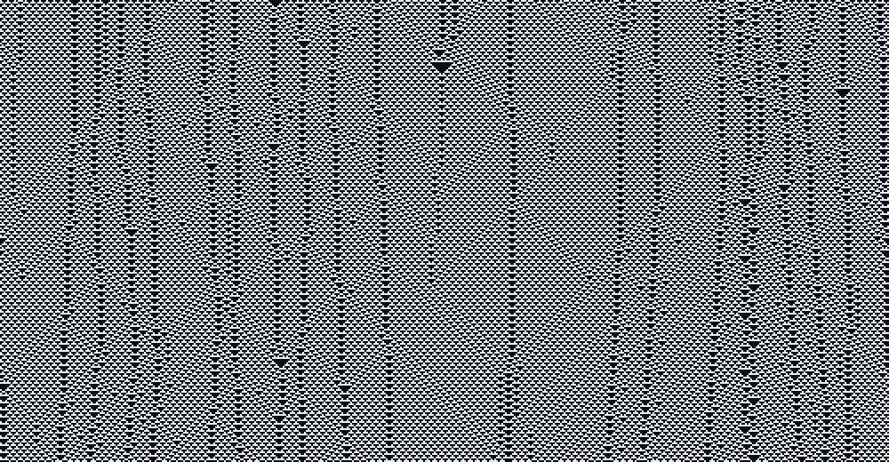

### 7. 规则 184：交通流

规则 184 = 10111000₂。把黑格看成车，白格看成空位：

> 每一步，每辆车看前方（右边）一格：空就前进一格，有车就停着不动。

逐条核对：111 → 1（中间的车被挡住，原地不动）；110 → 0（中间的车开走了，左边的车看到的是旧状态里“前面有车”，不能跟进）；101 → 1、100 → 1（左边的车开进来）；011 → 1（被挡住）；010 → 0（开走）；001、000 → 0。

规则 184 守恒车的数量：每辆车要么留在原地，要么挪到右边一格的空位上。勾选“车流”以后，这一步能前进的车画成绿色，被前车挡住的画成红色。预设“规则 184 · 车流”按概率 0.35 放车，这一行实际放了 ρ = 0.404。开头的几个小堵点很快散开，以后所有车都以速度 1 前进：

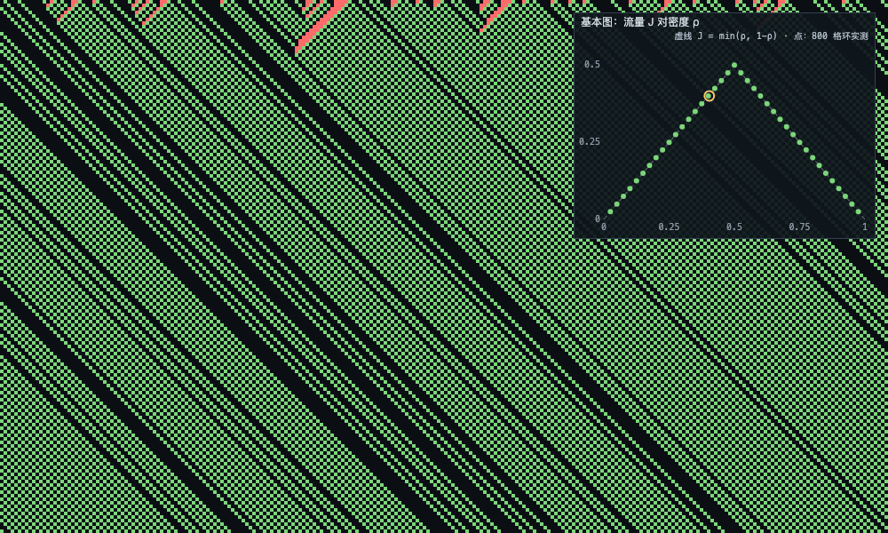

密度超过 ½ 时，空位比车少，堵车永远不会消失。这时反过来看空位：空位每一步向左挪一格（和一辆车交换位置），所以红色的堵车带以速度 1 向后（左）传播：

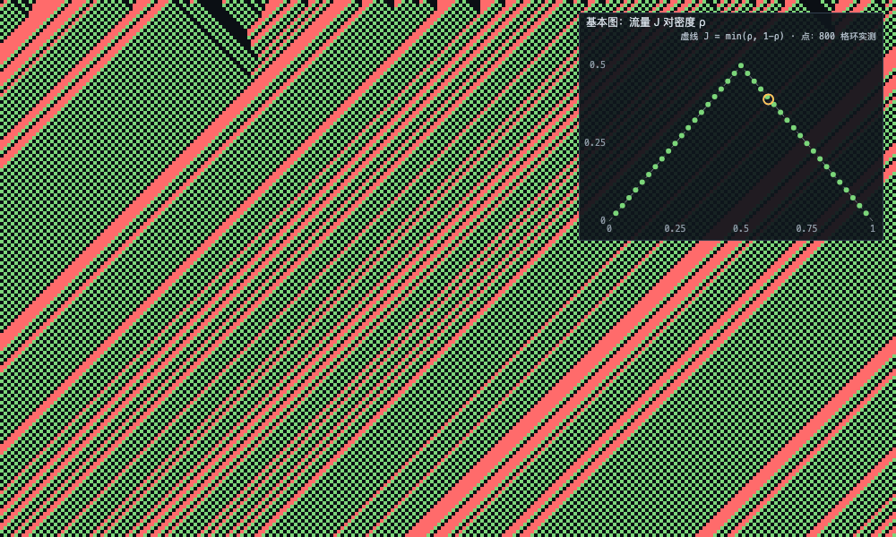

**流量** J 定义为每步每格前进的车数，也就是“车后面紧跟空位”这种相邻对的个数除以格数。长时间以后：

- ρ ≤ ½：每辆车后面都会有空位，所有车都在动，J = ρ；
- ρ ≥ ½：每个空位都会被车填上，前进的车数等于空位数，J = 1 − ρ。

所以 **J = min(ρ, 1 − ρ)**，这叫交通流的**基本图**，在 ρ = ½ 处有一个尖峰。页面在 800 格的环上对 ρ = 1/40, 2/40, …, 39/40 各放 ρ·800 辆车，取第 400–799 步的平均流量，39 个点和 min(ρ, 1 − ρ) 在 4 位小数上全部相同（例如 ρ = 0.4 时 J = 0.4000，ρ = 0.6 时 J = 0.4000，ρ = 0.5 时 J = 0.5000）。右上角的小图把这 39 个点画出来，金色圆圈是当前时空图的 (ρ, J)。上面两张图（250 × 150 格，包括开头的暂态）测得 ρ = 0.404 时 J = 0.4005，ρ = 0.604 时 J = 0.3918，而 1 − 0.604 = 0.396，差别来自开头还没散开的堵点。

### 8. 其他值得看的规则

规则 18 从随机行出发，是带着大大小小三角形的混沌，属于 III 类。它的三角形之间有一些“缺陷”在随机游走，碰到一起就湮灭：

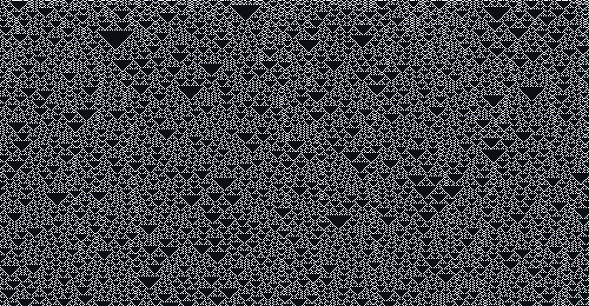

面板左侧的种子、密度、边界、格子大小都可以改；“继续演化”让时空图一行一行往上滚动，可以一直看下去。

## 操作

- 规则：输入 0–255，或 − / ＋ 逐个切换；单击 8 个邻域小图中的任意一个翻转它的结果；“镜像”“黑白互换”“两者都做”跳到等价的规则，下方列出整个等价类和 88 类的计算；
- 初始行：单个黑格或随机行；随机行的黑格比例（0.01–0.99）、种子（1–999）；
- 边界：周期边界（首尾相接）或固定边界（外面全白）；
- 格子大小 1–24 像素，行数和列数按窗口大小自动决定；先跳过的步数（0–2000）；
- “继续演化”让时空图向上滚动；“回到第 0 步”重新开始；
- 显示：时空图或 256 条规则总览（单击一格打开该规则，鼠标停在上面显示编号、分类和等价类）；开关：标出中心列、以太滤波、杨辉三角数（规则 90，单个黑格，格子够大时显示）、车流着色和基本图、总览只亮 88 个代表；
- 中心列随机性：位数 1 024–16 384，显示前 64 位和三项检验，对照 mulberry32；
- 预设：规则 30 单个黑格、规则 30 中心列、规则 90 Sierpinski 三角、规则 90 杨辉三角、规则 110 以太与滑翔机、规则 110 单个黑格、规则 184 车流与堵车、规则 150、规则 18、规则 54、256 条规则总览（单个黑格 / 随机行）、88 个等价类代表。

## 网址参数

| 键 | 含义 |
|---|---|
| p | 预设名：r30, r30c, r90, r90p, r110, r110one, r184, r184j, r150, r18, r54, gal, galr, gal88 |
| r | 规则编号（0–255） |
| init | one = 单个黑格，rand = 随机行 |
| d | 随机行的黑格比例（0.01–0.99） |
| seed | 种子（1–999） |
| b | ring = 周期边界，fixed = 固定边界 |
| cs | 格子大小（1–24 像素） |
| skip | 先跳过的步数（0–2000） |
| view | st = 时空图，gal = 总览 |
| nb | 中心列位数的以 2 为底的对数（10–14） |
| center, ether, pascal, flow, reps | 1 打开、0 关闭对应的开关 |
| run | 1 = 打开后就开始滚动 |
| ui | 0 = 隐藏面板，只显示画布 |

所有数字参数都必须是有限数，并夹到滑块的范围里；字符串参数只接受上表列出的值。例如规则 110 的以太滤波：`index.html?r=110&init=rand&cs=2&skip=300&ether=1`；规则 184 的堵车：`index.html?r=184&init=rand&d=0.6&cs=4&flow=1`。

## 参考

- S. Wolfram, *Statistical mechanics of cellular automata*, Reviews of Modern Physics 55, 1983. 编号方法和 256 条规则的系统研究。
- S. Wolfram, *Universality and complexity in cellular automata*, Physica D 10, 1984. 四类划分。
- S. Wolfram, *Random sequence generation by cellular automata*, Advances in Applied Mathematics 7, 1986. 规则 30 的中心列。
- M. Cook, *Universality in elementary cellular automata*, Complex Systems 15, 2004. 规则 110 图灵完备。
- T. Neary, D. Woods, *P-completeness of cellular automaton Rule 110*, ICALP 2006.
- G. J. Martínez, *A note on elementary cellular automata classification*, Journal of Cellular Automata 8, 2013. 页面用来对照的分类。
- A. Lempel, J. Ziv, *On the complexity of finite sequences*, IEEE Transactions on Information Theory 22, 1976；F. Kaspar, H. G. Schuster, *Easily calculable measure for the complexity of spatiotemporal patterns*, Physical Review A 36, 1987（LZ76 的计算方法）。
- J. W. L. Glaisher, *On the residue of a binomial-theorem coefficient with respect to a prime modulus*, Quarterly Journal of Mathematics 30, 1899.
- [Elementary cellular automaton](https://en.wikipedia.org/wiki/Elementary_cellular_automaton)、[Rule 30](https://en.wikipedia.org/wiki/Rule_30)、[Rule 110](https://en.wikipedia.org/wiki/Rule_110)、[Rule 184](https://en.wikipedia.org/wiki/Rule_184)（Wikipedia）。
