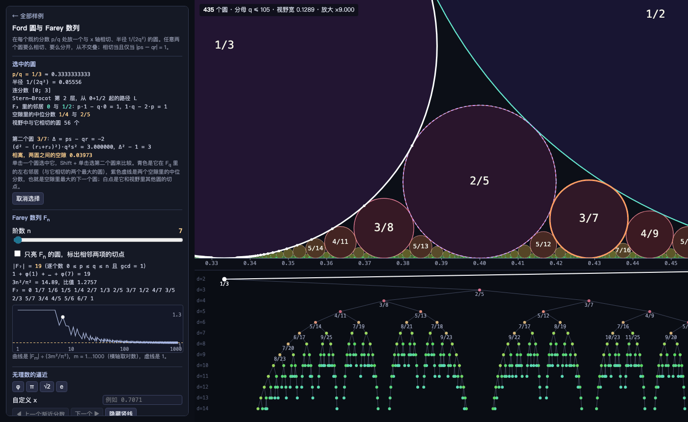
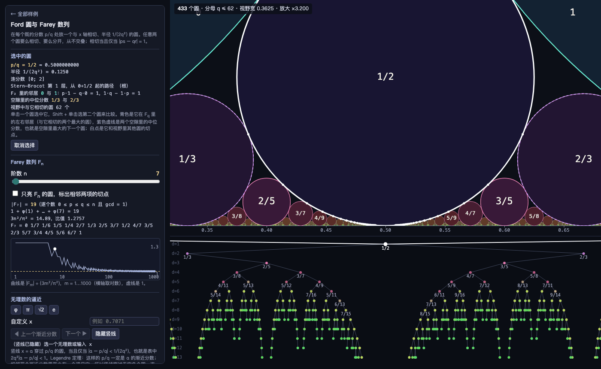
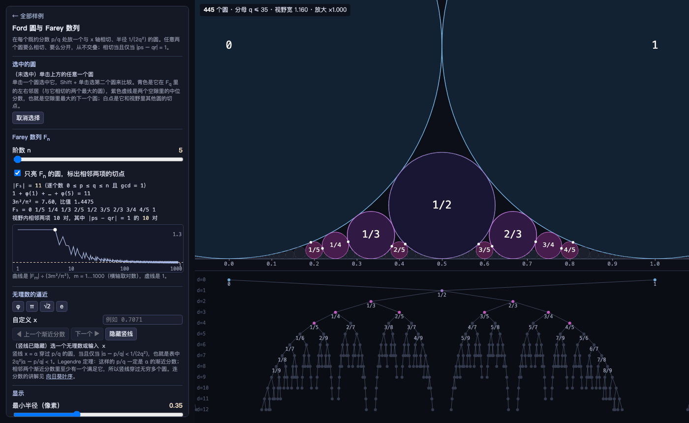
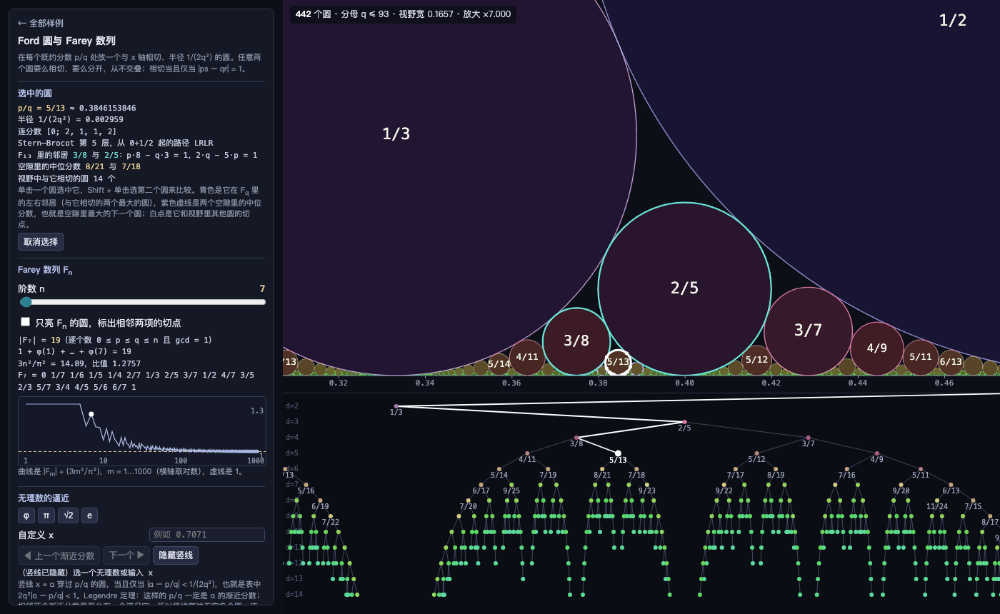
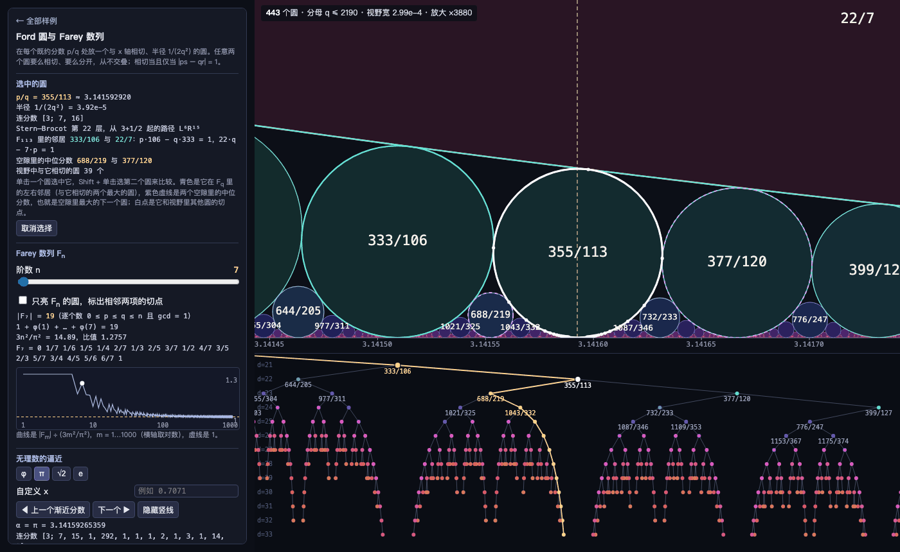
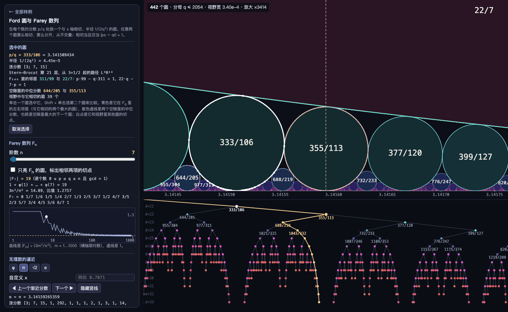
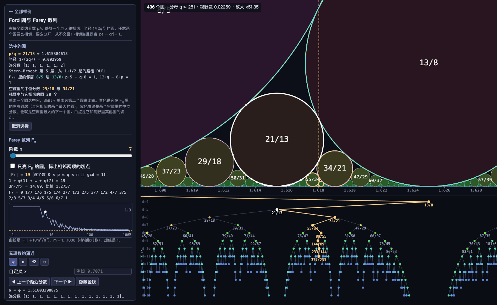
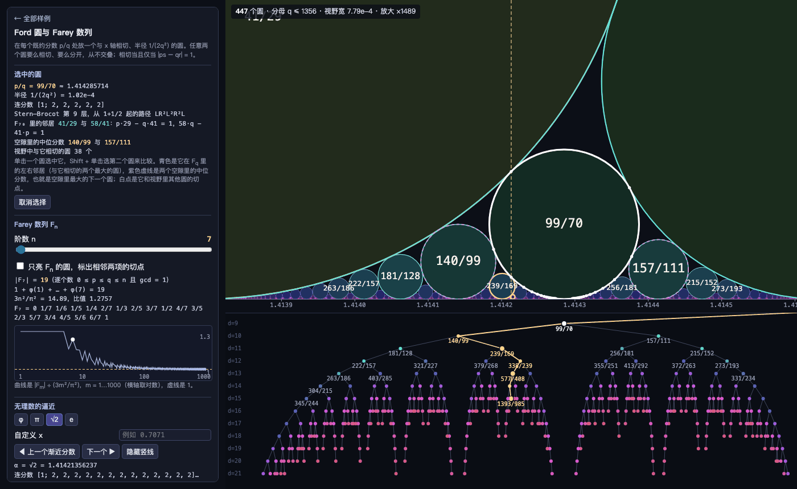
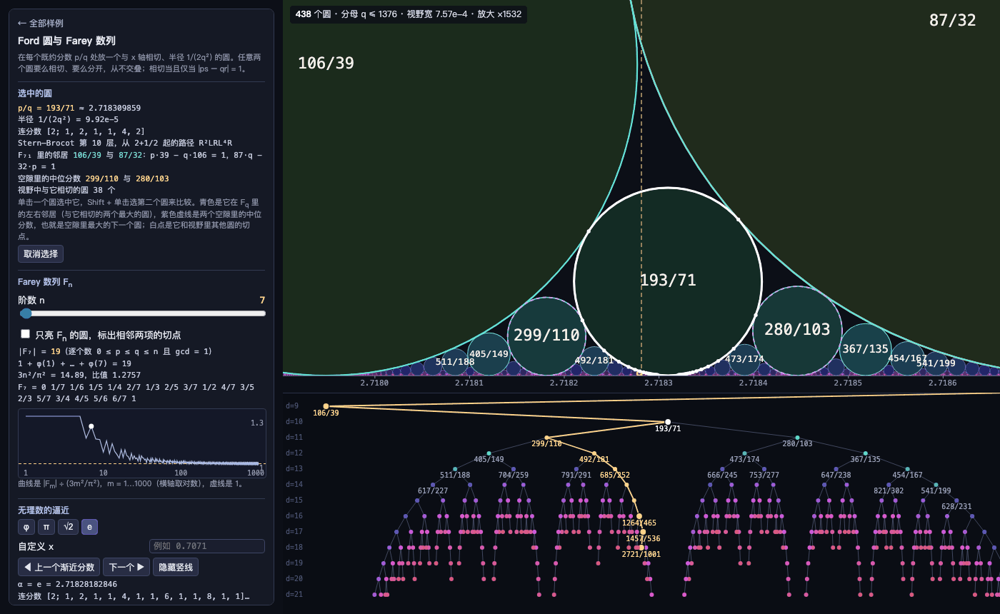

# Ford 圆与 Farey 数列 · 分数之间的相切

![[0, 1] 上的 Ford 圆，下方是同一横轴上的 Stern–Brocot 树](images/overview.png)

在数轴上每个既约分数 p/q 的位置放一个圆，让它和 x 轴相切，半径取 1/(2q²)。0 和 1 的圆半径 1/2，1/2 的圆半径 1/8，1/3 和 2/3 的圆半径 1/18，分母越大圆越小。画出来以后会发现一件意想不到的事：这无穷多个圆**没有任何两个交叠**，它们要么恰好相切，要么彼此分开，像一串串挤在一起却从不压到对方的肥皂泡。这是 L. R. Ford 在 1938 年发现的，这些圆叫 **Ford 圆**。

这一页把这张图拆开：先证明两个圆为什么不交叠，以及什么时候相切；再看相切的圆之间的空隙里下一个圆是谁（中位分数），由此得到 Farey 数列和 Stern–Brocot 树；最后在图上画一条竖线 x = α，它穿过的圆正好是 α 的连分数渐近分数，也就是 α 最好的有理逼近。

打开方式：用浏览器直接打开 [index.html](index.html)。页面只用 Canvas 2D，不依赖外部库，离线也能用。

## 数学原理

### 1. 两个 Ford 圆的距离

记 C(p/q) 为 p/q 处的 Ford 圆：圆心 (p/q, 1/(2q²))，半径 r = 1/(2q²)。取两个不同的既约分数 p/q 和 r/s，令

```
Δ = ps − qr        （一个非零整数）
```

两圆心的距离 d 满足

```
d² = (p/q − r/s)² + (1/(2q²) − 1/(2s²))²
(r₁ + r₂)² = (1/(2q²) + 1/(2s²))²
```

两式相减，第二项展开后只剩交叉项 −4 · 1/(2q²) · 1/(2s²) = −1/(q²s²)，第一项 (p/q − r/s)² = Δ²/(q²s²)，所以

```
d² − (r₁ + r₂)² = (Δ² − 1) / (q²s²)
```

右边的符号只由整数 Δ 决定：

| Δ | d 与 r₁ + r₂ | 两个圆 |
|---|---|---|
| \|Δ\| = 1 | 相等 | 相切 |
| \|Δ\| ≥ 2 | d 更大 | 分开 |
| Δ = 0 | | 不可能（两个既约分数相等） |

“交叠”需要 d < r₁ + r₂，也就是 Δ² < 1，而 Δ 是非零整数，所以永远不会发生。

页面上“显示”一栏会把视野里最大的那些圆两两检验一遍：不用 Δ，直接按圆心坐标算 (d² − (r₁+r₂)²)·q²s²，看它是 0（相切）、正数（分开）还是负数（交叠）。打开页面的默认视野里有 445 个圆、98,790 对，测得相切 885 对，分开 97,905 对，交叠 0 对；相切的 885 对全部满足 |ps − qr| = 1。

单击一个圆，再 Shift + 单击另一个，面板会给出这两个圆的 Δ 和上式两边的数值。下图是 1/3 和 3/7：Δ = 1·7 − 3·3 = −2，页面算出 (d² − (r₁+r₂)²)·q²s² = 3.000000 = Δ² − 1，两圆之间留着 0.03973 的空隙，2/5 的圆正好塞在中间：



### 2. 相切的圆之间：中位分数

如果 a/b < c/d 两个圆相切（bc − ad = 1），它们和 x 轴围出一块弯边三角形。这块空隙里最大的圆是谁？答案是**中位分数**（mediant）

```
(a + c) / (b + d)
```

它和两边都相切：b(a + c) − a(b + d) = bc − ad = 1，(a + c)d − c(b + d) = ad − bc 的绝对值也是 1。

它也是空隙里分母最小的分数。设 u/v 严格在 a/b 和 c/d 之间，因为 cv − du 和 ub − va 都是正整数，

```
c/d − u/v ≥ 1/(dv),   u/v − a/b ≥ 1/(bv)
相加：1/(bd) = c/d − a/b ≥ (b + d)/(bdv)  ⇒  v ≥ b + d
```

分母最小就是半径最大。中位分数的圆把空隙一分为二，每个小空隙又由两个相切的圆围成，于是可以一直分下去：空隙里永远有下一个圆，每个既约分数都恰好在某一步出现一次。

单击一个圆，页面用青色标出它在 F_q（见下一节）里的左右邻居，也就是和它相切的两个最大的圆；用紫色虚线标出两个空隙里的中位分数；白点是它和视野里其他圆的切点。下图选中 1/2：邻居是 0 和 1（1·1 − 2·0 = 1），两个空隙里的中位分数是 1/3 和 2/3，视野里一共有 62 个圆和它相切：



和 p/q 相切的圆有无穷多个：所有满足 |ps − qr| = 1 的 r/s，它们沿着 p/q 的圆一圈排下去，越来越小，向切点 p/q 聚拢。

### 3. Farey 数列

把 [0, 1] 里分母不超过 n 的既约分数从小到大排好，叫 n 阶 **Farey 数列** F_n：

```
F₅ = 0/1 1/5 1/4 1/3 2/5 1/2 3/5 2/3 3/4 4/5 1/1
```

它有一个漂亮的性质：**相邻两项 a/b < c/d 一定满足 bc − ad = 1**，所以它们的 Ford 圆相切。原因就是上一节：从 F_{n−1} 到 F_n，新加进来的分数都是某两个相邻项的中位分数（分母恰为 n 的那些），插进去以后新的相邻两项仍然是“中位分数和它的一个父亲”，行列式还是 1。另外，相邻两项之间没有分母更小的分数，中位分数的分母 b + d 一定大于 n。

勾选“只亮 F_n 的圆”，分母大于 n 的圆变灰，相邻两项的切点画成白点。F₅ 的 11 项连成一条相切的链，页面测得视野里相邻 10 对，|ps − qr| = 1 的也是 10 对：



**F_n 有多少项？** 分母为 q 的既约分数 p/q（1 ≤ p ≤ q）有 φ(q) 个（Euler 函数），所以

```
|F_n| = 1 + φ(1) + φ(2) + … + φ(n)
```

另一种数法：在 0 ≤ p ≤ q ≤ n 的大约 n²/2 对整数里，数互素的。两个“随机”整数互素的概率是 6/π²（它们不同时被 2 整除、不同时被 3 整除、……，概率是 ∏(1 − 1/p²) = 1/ζ(2) = 6/π²），所以

```
|F_n| ≈ (n²/2) · (6/π²) = 3n²/π² ≈ 0.304 n²
```

页面逐个数出 0 ≤ p ≤ q ≤ n 中 gcd(p, q) = 1 的对数，并用筛法算 1 + Σφ(k) 核对，两者完全一致：

| n | 数出来的 \|F_n\| | 3n²/π² | 比值 |
|---|---|---|---|
| 5 | 11 | 7.60 | 1.4475 |
| 7 | 19 | 14.89 | 1.2757 |
| 10 | 33 | 30.40 | 1.0857 |
| 100 | 3,045 | 3,039.64 | 1.0018 |
| 1000 | 304,193 | 303,963.55 | 1.0008 |

面板下方的小图画了 m = 1…1000 时的比值 |F_m| ÷ (3m²/π²)，它一边抖动一边落向 1。|F_n| − 3n²/π² 的误差项是 O(n log n)，相对误差趋于 0，但沿途有起伏：n = 100 时比值差 1 是 0.0018，n = 1000 时是 0.0008。

### 4. Stern–Brocot 树

第 2 节的“不断取中位分数”本身就是一棵二叉树。从 [0, 1] 开始：根是 1/2（0/1 和 1/1 的中位分数）；每个节点 m 是区间 (a/b, c/d) 的中位分数，它的左孩子是 (a/b, m) 的中位分数，右孩子是 (m, c/d) 的中位分数。这就是 **Stern–Brocot 树**（Stern 1858，Brocot 1861），每个 (0, 1) 里的既约分数都在树上恰好出现一次。其他单位区间 [n, n+1] 是同一棵树平移 n。

页面下半部分画的就是这棵树，而且**和上面的 Ford 圆共用同一条横轴**：每个节点画在它的圆正下方，第 d 行是树的第 d 层。平移、缩放、单击选中在两边联动。树上一个节点的两个邻居（青色圆）就是它的区间端点，其中分母较大的那个是它在树上的父节点。

从根走到 p/q 的路径由连分数决定。若 p/q = [a₀; a₁, a₂, …, a_k]，从 a₀ + 1/2 出发，路径是

```
L^(a₁−1) R^(a₂) L^(a₃) … （最后一段少走一步）
```

下图选中 5/13 = [0; 2, 1, 1, 2]，白色路径 1/2 → 1/3 → 2/5 → 3/8 → 5/13，面板显示路径 LRLR、第 5 层：



### 5. 竖线 x = α：最好的有理逼近

现在在图上画一条竖线 x = α，α 是无理数。竖线穿过 p/q 的圆，当且仅当竖线到切点的水平距离小于半径：

```
|α − p/q| < 1/(2q²)      即  2q²|α − p/q| < 1
```

两个经典定理把这件事和连分数连起来（连分数的基础见 [向日葵叶序](../phyllotaxis/README.md)）：

- **Legendre 定理**：如果 |α − p/q| < 1/(2q²)，那么 p/q 一定是 α 的连分数渐近分数 p_k/q_k。所以竖线穿过的每一个圆都是渐近分数。
- **Vahlen 定理（1895）**：相邻两个渐近分数里至少有一个满足 |α − p/q| < 1/(2q²)。所以竖线穿过无穷多个圆，一直穿到 x 轴。

还有一个联系：相邻两个渐近分数满足 |p_k q_{k−1} − p_{k−1} q_k| = 1，所以**它们的圆总是相切**。竖线往下走，就是沿着一串相切的圆往下滑。

面板的“无理数的逼近”给出 α 的渐近分数表，最后一列按 2q²|α − p/q| < 1 判断竖线是否穿过。π 的表（页面读数）：

| k | a_k | p_k/q_k | 2q²\|π − p/q\| | 竖线 |
|---|---|---|---|---|
| 0 | 3 | 3 | 0.2832 | 穿过 |
| 1 | 7 | 22/7 | 0.1239 | 穿过 |
| 2 | 15 | 333/106 | 1.8701 | **不穿过** |
| 3 | 1 | 355/113 | 0.0068 | 穿过 |
| 4 | 292 | 103993/33102 | 1.2664 | **不穿过** |
| 5 | 1 | 104348/33215 | 0.7317 | 穿过 |
| 6 | 1 | 208341/66317 | 1.0762 | **不穿过** |
| 7 | 1 | 312689/99532 | 0.5774 | 穿过 |
| 8 | 2 | 833719/265381 | 1.2276 | **不穿过** |
| 9 | 1 | 1146408/364913 | 0.4291 | 穿过 |

不穿过的从不连续出现两次，正是 Vahlen 定理。355/113 那一行的 0.0068 特别小，是因为下一项 a₄ = 292 特别大：渐近分数的误差约为 1/(a_{k+1} q_k²)，a_{k+1} 越大逼近越好。所以 355/113 的圆被竖线几乎从正中穿过；而它左边相切的 333/106 的圆，竖线差一点碰到：

| π 与 355/113（选中，白圈） | 333/106（选中）：竖线从它旁边经过 |
|---|---|
|  |  |

面板选中 355/113 时显示它在 F₁₁₃ 里的两个邻居正是前两个渐近分数 333/106 和 22/7（355·106 − 113·333 = 1）。下方的树里，金色的是 π 的路径：路径每次拐弯的节点正是渐近分数。用页面的生成代码沿 π 的路径走到分母 40,000，拐弯处依次是 22/7、333/106、355/113、103993/33102，和渐近分数表一致；a₄ = 292 就是 355/113 之后那段将近 300 步、几乎笔直向下的长链。

**φ 是最难逼近的数。** φ = [1; 1, 1, 1, …]，所有 a_k 都是 1，路径每一步都拐弯，每个节点都是渐近分数（相邻 Fibonacci 数之比），竖线穿过除第一个以外的全部渐近分数的圆，但每次都只穿过圆的边缘：页面测得 2q²|φ − p/q| 从 k = 9 到 k = 27 一直是 0.8944，也就是 2/√5。Hurwitz 定理说任何无理数都有无穷多个 p/q 满足 |α − p/q| < 1/(√5 q²)，常数 √5 不能再改大，φ 就是让它取不到更好的那个数。



√2 = [1; 2, 2, 2, …] 和 e = [2; 1, 2, 1, 1, 4, 1, 1, 6, …]：

| √2：选中 99/70 | e：选中 193/71 |
|---|---|
|  |  |

页面读数：√2 的每个渐近分数都被穿过，2q²|√2 − p/q| 稳定在 0.7071 = 1/√2；e 的部分商按 2m, 1, 1 三个一组，每组第一个 1 对应的渐近分数 11/4、106/39、1457/536 都不被穿过（1.0150、1.0133、1.0076，只比 1 大一点），第二个 1 对应的 19/7、193/71、2721/1001 被穿过得越来越深（0.3916、0.2826、0.2208），因为它后面紧跟着越来越大的部分商 4、6、8。

## 操作

- 单击一个圆选中它，Shift + 单击选第二个圆比较 Δ 和空隙；在下方的树上单击节点同样选中；
- Farey 阶数 n（1–1000），可只亮 F_n 的圆并标出相邻两项的切点；
- 无理数 φ、π、√2、e，或在“自定义 x”里输入一个数（−1 到 5），回车后画竖线；“上一个 / 下一个渐近分数”放大到对应的圆并选中它；
- 最小半径（0.05–10 像素）：只画半径不小于它的圆，分母上限 q ≤ √(缩放 / 2r)，再加上 q ≤ 4×10⁶、每帧最多 4 万个圆两道硬上限；
- 开关：分数标签、Stern–Brocot 树；
- 预设：全景、F₅ 的相切链、1/2 的邻居与中位数、相离的 1/3 与 3/7、φ、π 与 355/113、π 的 333/106、√2 与 99/70、e 与 193/71；
- 拖动平移，滚轮以鼠标位置为中心缩放（受双精度限制，最大约 10¹¹ 倍），双击复位，按 h 隐藏面板。

## 网址参数

| 键 | 含义 |
|---|---|
| p | 预设名：overview, f5, half, pair, phi, pi, pi333, sqrt2, e |
| x | 竖线的无理数：phi, pi, sqrt2, e |
| xv | 竖线的自定义位置（−1 到 5） |
| k | 放大到第 k 个渐近分数并选中它 |
| n | Farey 阶数（1–1000） |
| fn | 1 = 只亮 F_n 的圆 |
| r | 最小半径，像素（0.05–10） |
| ap, aq | 选中 ap/aq（自动约分） |
| bp, bq | 第二个圆 bp/bq |
| z, cx | 缩放倍数、视野中心 |
| lab | 0 = 不画分数标签 |
| tree | 0 = 不画 Stern–Brocot 树 |
| ui | 0 = 隐藏面板，只留画布 |

例如：`index.html?x=pi&k=4` 放大到 103993/33102；`index.html?ap=1&aq=3&bp=3&bq=7&cx=0.39&z=9` 比较 1/3 与 3/7；`index.html?n=8&fn=1` 看 F₈。所有数值参数都会被限制在滑块范围内，非法值被忽略。

## 参考

- L. R. Ford, *Fractions*, The American Mathematical Monthly 45 (9), 1938.
- G. H. Hardy, E. M. Wright, *An Introduction to the Theory of Numbers*，第 3 章（Farey 数列）、第 10–11 章（连分数、Hurwitz 定理）。
- R. L. Graham, D. E. Knuth, O. Patashnik, *Concrete Mathematics*，4.5 节（Stern–Brocot 树）。
- K. T. Vahlen, *Über Näherungswerte und Kettenbrüche*, Journal für die reine und angewandte Mathematik 115, 1895.
- [Ford circle](https://en.wikipedia.org/wiki/Ford_circle)、[Farey sequence](https://en.wikipedia.org/wiki/Farey_sequence)（Wikipedia）。
