# 傅里叶本轮 · 圆叠圆画出任意曲线

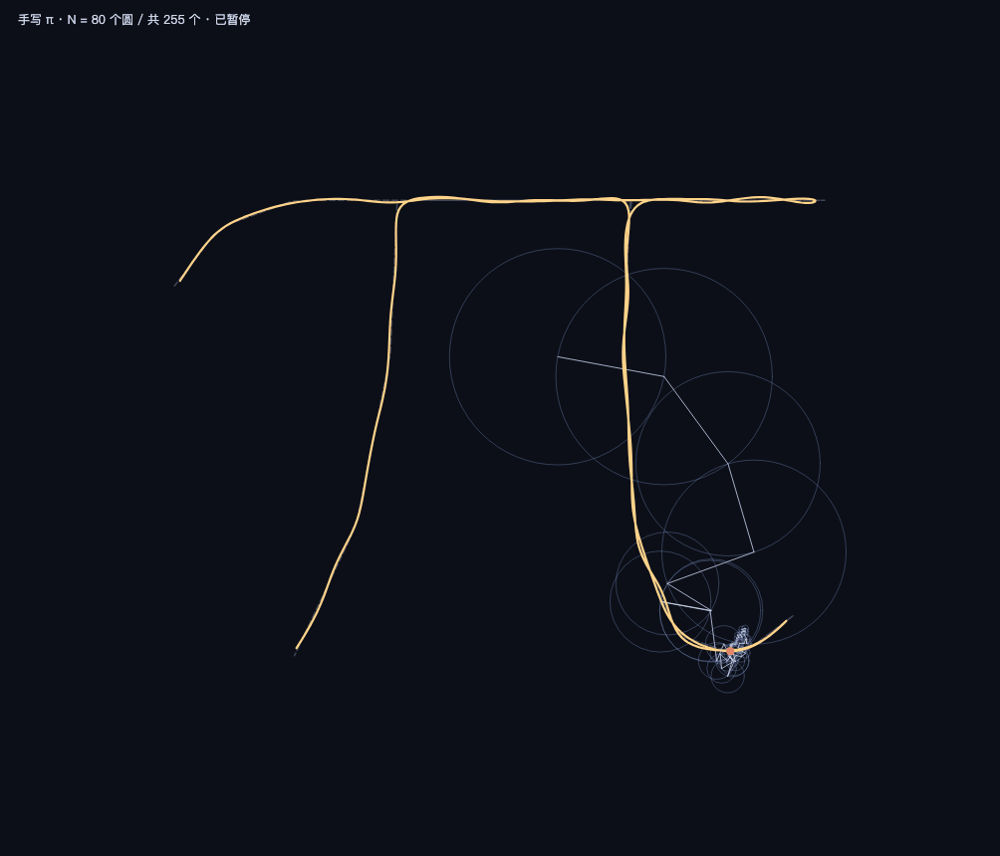

古希腊天文学家用“本轮”解释行星的逆行：行星绕一个小圆转，小圆的圆心又绕一个大圆转。托勒密的体系里圆套圆可以叠好几层。两千年后回头看，这套办法其实没有错，只是太万能了：只要圆够多，圆叠圆能画出**任何**一条闭合曲线，连上面这个手写的 π 也行。背后的数学就是傅里叶级数：把一条曲线拆成一组匀速旋转的圆，半径和初始角度由傅里叶系数给出。

打开方式：用浏览器直接打开 [index.html](index.html)。页面只用 Canvas 2D，不依赖外部库，离线也能用。你也可以直接在画布上用鼠标画一条曲线，页面会算出画它需要的圆。

## 数学原理

### 1. 把曲线看成复数函数

平面上的点 (x, y) 可以写成一个复数 z = x + iy。一支笔沿闭合曲线匀速走一圈，用时间 t ∈ [0, 2π) 表示走到哪里，笔的位置就是一个复数值函数 z(t)，而且是周期的：z(t + 2π) = z(t)。

最简单的周期函数是匀速转圈：

```
c · e^{ikt} = c · (cos kt + i sin kt)
```

它是一个半径 |c|、初始角度 arg c 的圆，t 走一圈它转 k 圈。k > 0 逆时针转，k < 0 顺时针转，k = 0 不动（一个固定的平移）。

### 2. 傅里叶级数：任何闭合曲线都是一串圆的和

傅里叶级数说，满足很弱条件的周期函数都能写成

```
z(t) = Σ_k c_k e^{ikt},   k = …, −2, −1, 0, 1, 2, …
```

其中 c_k = (1/2π) ∫ z(t) e^{−ikt} dt。几何上，这就是把无穷多个圆**首尾相接**：第一个圆的圆心在 c₀，它的笔尖是第二个圆的圆心，以此类推。每个圆以自己的速度 k 匀速转，最后一个笔尖走过的轨迹就是 z(t)。

系数为什么这样算：不同频率的圆互相“正交”。∫ e^{ijt} e^{−ikt} dt 在 j ≠ k 时等于 0（转整数圈，正负抵消），j = k 时等于 2π。所以把 z(t) 乘上 e^{−ikt} 再积分，其他圆全部消掉，只剩 c_k。

### 3. 离散傅里叶变换：M 个点 → M 个圆

页面把曲线采成 M 个点 z₀ … z_{M−1}，对应 t_j = 2πj/M，用离散傅里叶变换（DFT）代替积分：

```
c_k = (1/M) Σ_{j=0}^{M−1} z_j e^{−2πi·kj/M},   k = −M/2 … M/2 − 1
```

M 个点得到 M 个系数，用全部 M 个圆时，笔尖恰好穿过每一个采样点（这是 DFT 的逆变换）。页面里的“采样点数 M”可以取 64 到 1024，频率 k 取 −M/2 到 M/2 − 1 这一段，这样两个采样点之间的曲线摆动最小。

**采样要匀速。** 鼠标画线时手有快有慢，点距不均匀。页面先按弧长把笔画重采样成 M 个等距点，相当于让笔匀速走。折线类预设（正方形、星、π、∑）也这样处理。

### 4. 按半径排序，只用最大的 N 个

c_k 的大小 |c_k| 就是第 k 个圆的半径。页面把圆按半径从大到小排好，只用前 N 个（另加不转的 c₀）。这是有道理的：由 Parseval 等式，

```
(1/M) Σ_j |z_j|² = Σ_k |c_k|²
```

近似曲线在采样点上的平均平方误差，正好等于没用上的那些圆的半径平方和。所以在只许用 N 个圆的条件下，挑最大的 N 个，平均误差最小。面板里的“前 N 项能量”就是 Σ_用上的 |c_k|² / Σ_全部 |c_k|²（不含 c₀），“采样点最大偏差”是近似曲线在采样点上离原曲线最远的距离，相对曲线的尺寸。

正方形，N = 1、3、10、40：

| N = 1 | N = 3 |
|---|---|
| 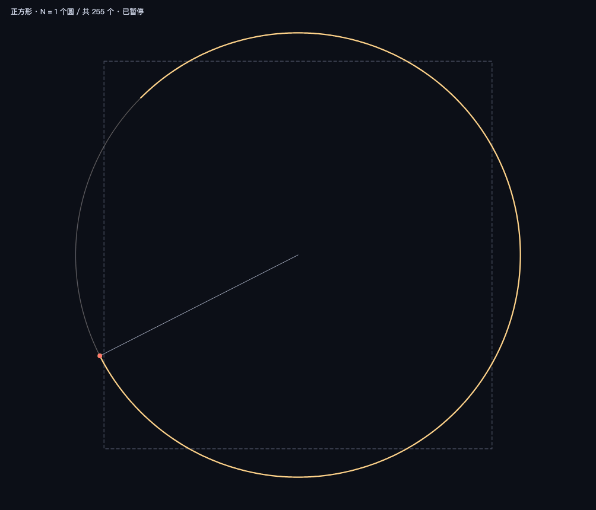 | 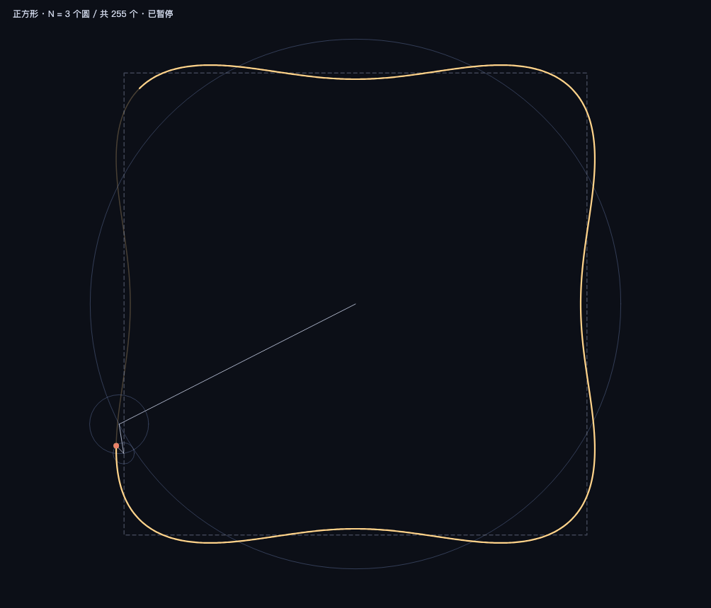 |
| **N = 10** | **N = 40** |
| 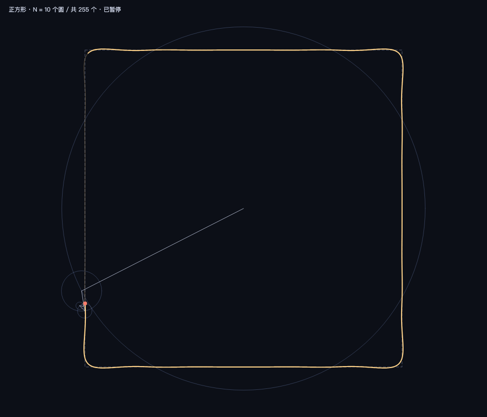 | 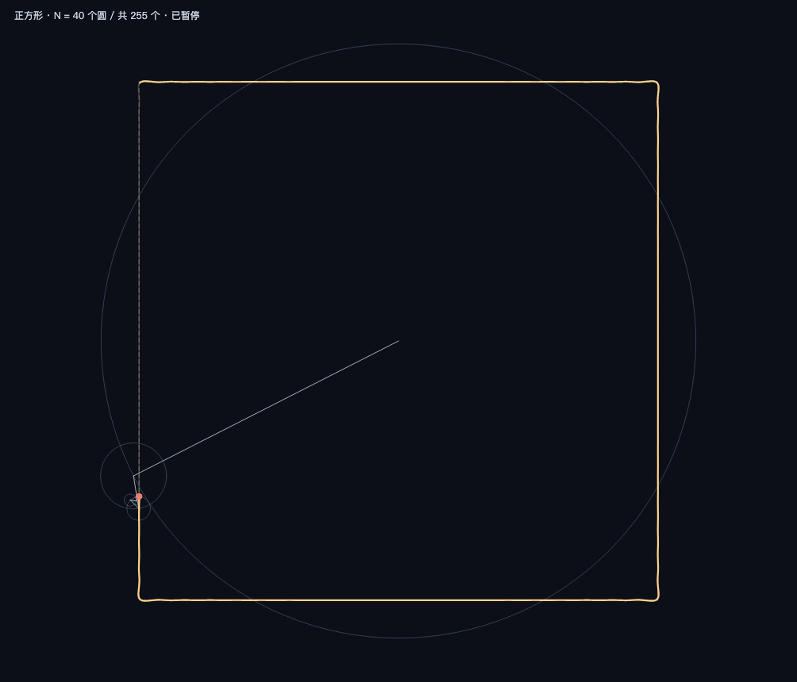 |

一个圆只能画圆。3 个圆已经是圆角方形，10 个圆的边已经很直，40 个圆只剩角上一点点圆。数字（M = 256）：

| N | 前 N 项能量 | 最大偏差 |
|---|---|---|
| 1 | 98.55% | 13.4% |
| 3 | 99.93% | 4.7% |
| 10 | 99.998% | 1.4% |
| 40 | ≈ 100% | 0.23% |

### 5. 对称性决定哪些圆出现

正方形的系数很有规律：

| k | −1 | 3 | −5 | 7 | −9 | 11 |
|---|---|---|---|---|---|---|
| 半径 \|c_k\| | 1.146 | 0.127 | 0.046 | 0.024 | 0.014 | 0.0095 |

只有 k ≡ −1 (mod 4) 的频率（−1, 3, −5, 7, …）不为零。原因是对称：正方形转 90° 和自己重合。预设里的笔顺时针走，把出发时间推迟 1/4 圈，等于把整个图形顺时针转 90°：z(t + π/2) = −i·z(t)。代入级数逐项比较，得 c_k·i^k = −i·c_k，所以只有 i^k = −i 的那些 k 能有非零系数。同理，五角星（逆时针走）转 72° 重合，只剩 k ≡ 1 (mod 5)：1, −4, 6, −9, …M = 256 的正方形只有 64 个非零系数，所以 N = 64 时就精确穿过所有采样点。

半径的衰减也有规律：0.127 ≈ 1.146 / 9，0.046 ≈ 1.146 / 25，即 |c_k| ∝ 1/k²。

### 6. 光滑度决定衰减速度

傅里叶系数衰减得多快，取决于曲线有多光滑。对 c_k 的积分分部积分一次，c_k = (1/ik)·(z′ 的系数)。

- **曲线连续、但有尖角**（正方形、星、π）：z 连续，速度 z′ 在角上跳变。z′ 的系数 ∝ 1/k，所以 c_k ∝ 1/k²。圆的半径下降得快，误差集中在角附近。
- **曲线本身有跳变**：c_k ∝ 1/k，下降得慢得多。
- **曲线由有限个三角函数组成**：只有有限个非零系数，有限个圆就能精确画出。

“三叶线”预设就是最后一种：x = sin t + 2 sin 2t，y = cos t − 2 cos 2t，即 z(t) = i·e^{−it} − 2i·e^{2it}，**两个圆**就是精确答案，第 3 个以后的圆半径都是 0：

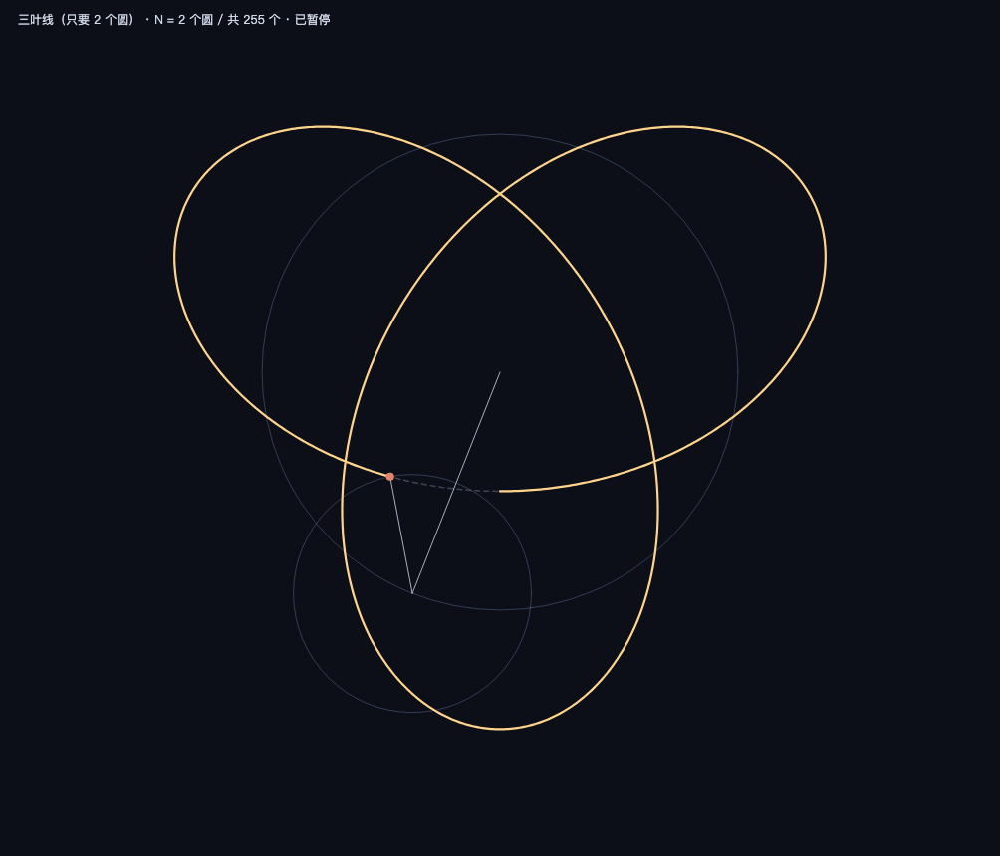

心形 x = 16 sin³t，y = 13 cos t − 5 cos 2t − 2 cos 3t − cos 4t 也是三角多项式（sin³t = (3 sin t − sin 3t)/4），最高频率 4，**8 个圆**精确画出。注意这两个预设按参数 t 等间隔采样，不按弧长重采样，否则换了参数化，系数就不再是有限个了。

### 7. Gibbs 现象：只在跳变处出现

正方形的角虽然尖，但 z(t) 是连续的，所以近似曲线只是把角磨圆，不会冲出去。要看到 Gibbs 现象，需要 z(t) **跳变**。“笔画首尾怎么接”选“跳回起点”，正方形就变成只画上、右、下三条边，最后从左下角一下跳回左上角：

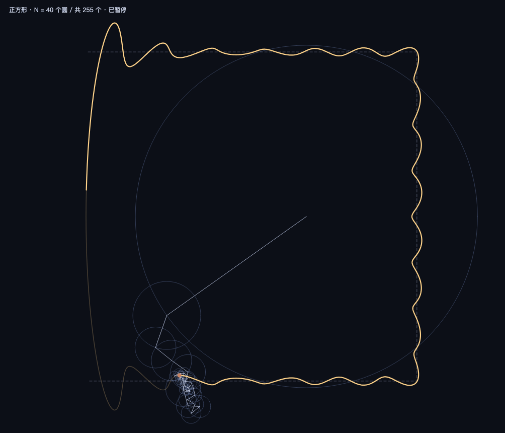

左边那条“边”是跳变，近似曲线在跳变两端各冲出头，冲出的长度大约是跳变长度的 9%。圆再多，冲出的地方会越来越窄，但高度不变。对比两种接法的系数（面板下方的柱状图，对数坐标）：

| 直线连回起点：c_k ∝ 1/k² | 跳回起点：c_k ∝ 1/k |
|---|---|
| 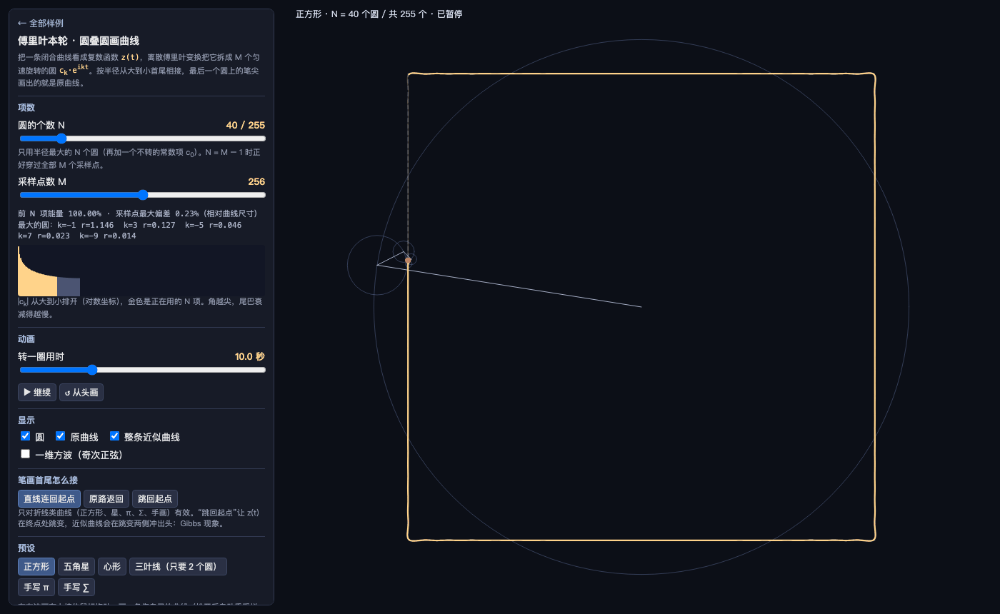 | 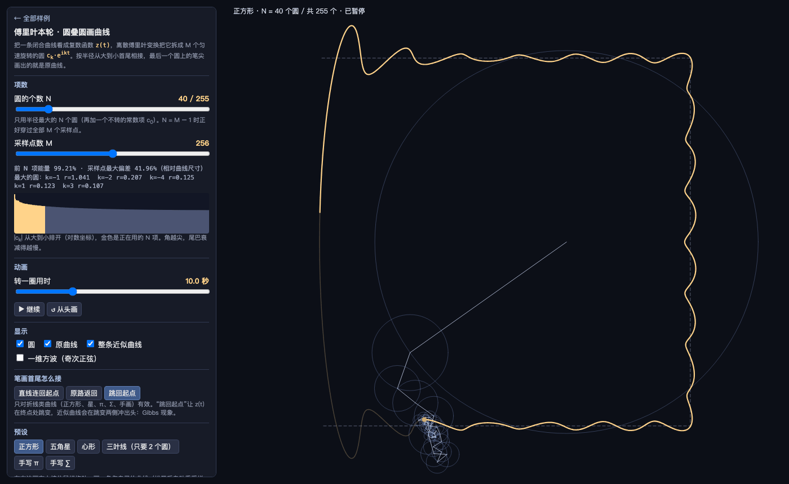 |

右边的尾巴平得多，N = 40 时能量才到 99.2%，采样点最大偏差还有 42%（跳变旁边的那几个点总也追不上）。

### 8. 一维的例子：用奇次正弦叠出方波

勾选“一维方波”，画布下方会显示最经典的 Gibbs 现象。周期为 2π、在 ±1 之间跳的方波，傅里叶级数只有奇次正弦：

```
f(x) = (4/π) · [ sin x + sin 3x / 3 + sin 5x / 5 + … ]
```

左边是这些圆：半径 (4/π)/(2j − 1)，转速 2j − 1；笔尖的高度就是部分和，拉到右边画成函数图像。系数 ∝ 1/k，正是第 6 节说的“有跳变”的情形。

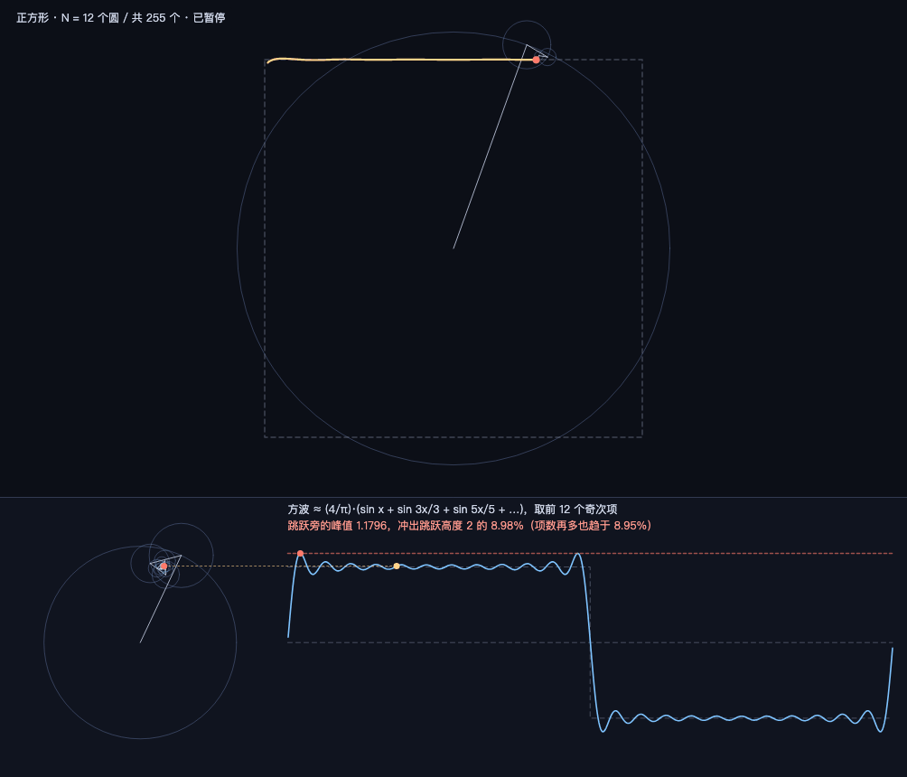

取前 K 项，跳跃旁边第一个峰在 x = π/(2K)，峰值是

| K | 1 | 3 | 10 | 100 | 1000 |
|---|---|---|---|---|---|
| 峰值 | 1.2732 | 1.1884 | 1.1798 | 1.17899 | 1.17898 |

K → ∞ 时峰值趋于 (2/π)·Si(π) ≈ 1.17898，其中 Si(x) = ∫₀ˣ sin u / u du。冲出的部分 0.179 是跳跃高度 2 的 8.95%。这就是 Gibbs 现象：项数越多，过冲越窄，但高度不会减小。所以部分和在跳变处不是一致收敛的，不过平方误差仍然趋于 0。

### 9. 自己画一条

在画布上按住鼠标拖动，画一条曲线。松开后，笔画按弧长重采样成 M 个点（首尾默认用直线连起来），立刻算出 DFT。下面是手画的一条鱼，6 个圆和 40 个圆：

| N = 6 | N = 40 |
|---|---|
| 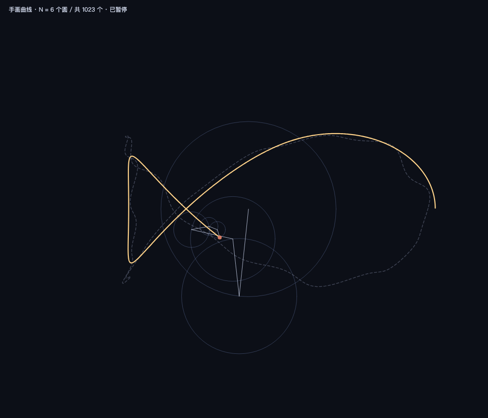 | 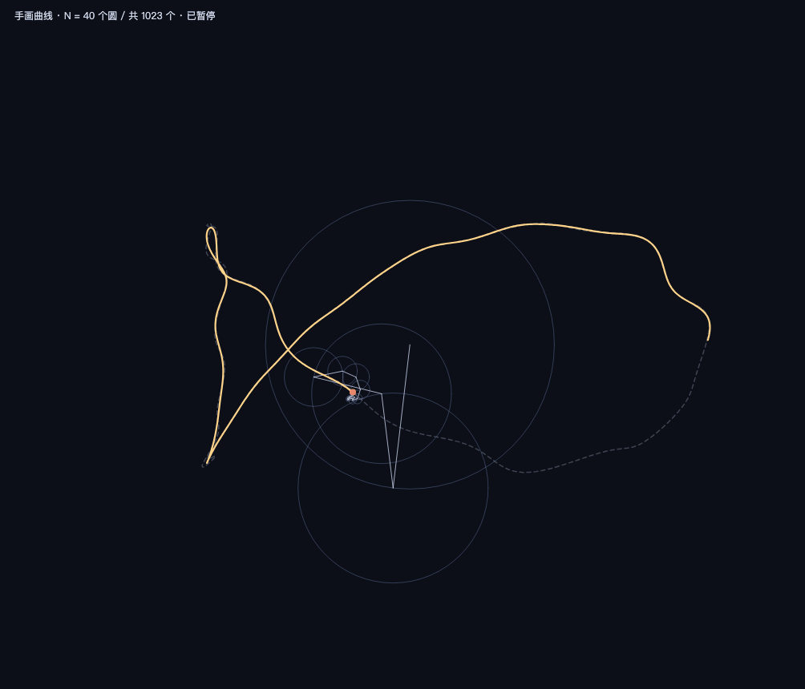 |

6 个圆画出了鱼的大致样子，40 个圆连手抖都画出来了。

其他预设：

| 五角星（30 个圆） | 心形（8 个圆，精确） | 手写 ∑（60 个圆） |
|---|---|---|
| 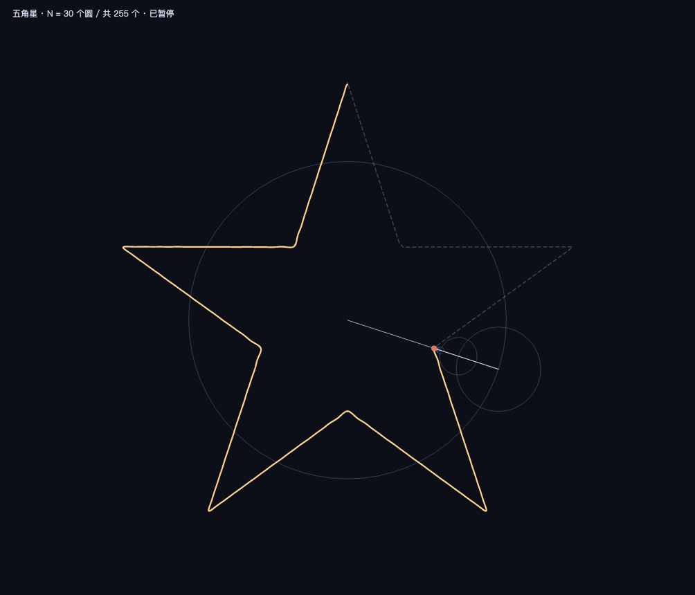 | 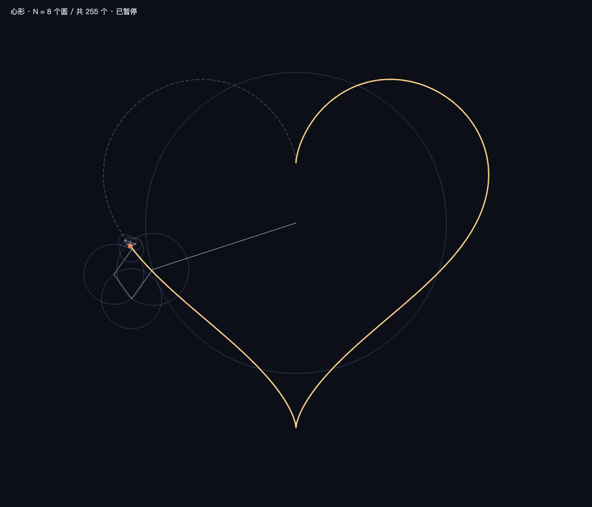 | 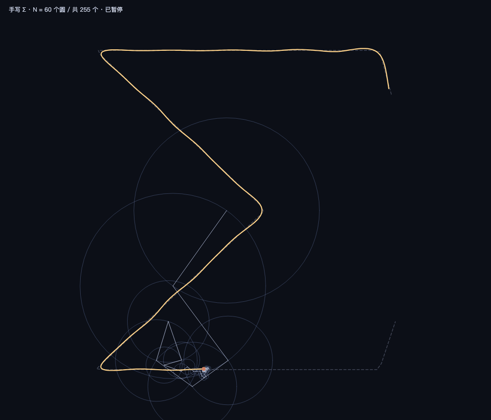 |

π 和 ∑ 是一笔写成的折线。默认“原路返回”：写到头再沿原路倒着走回起点，得到一条闭合的路线，看起来还是那个字。

## 操作

- 圆的个数 N（1 到 M − 1）：只用半径最大的 N 个圆；
- 采样点数 M：64、128、256、512、1024；
- 转一圈用时（2–30 秒）、暂停 / 继续、从头画；
- 开关：圆、原曲线（虚线）、整条近似曲线、一维方波；
- 笔画首尾怎么接：直线连回起点、原路返回、跳回起点（只对折线类曲线有效）；
- 预设：正方形、五角星、心形、三叶线、手写 π、手写 ∑；
- 在画布上按住鼠标拖动画自己的曲线，最多记录 4000 个鼠标点。

## 网址参数

每个数字参数都会被限制在对应滑块的范围内，非数字会被忽略。

| 键 | 含义 |
|---|---|
| p | 预设名：square, star, heart, trefoil, pi, sigma |
| n | 圆的个数（1 到 M − 1） |
| m | 采样点数（64–1024，取最近的 2 的幂） |
| s | 转一圈用时，秒（2–30） |
| t | 起始位置，一圈的比例（0–1） |
| close | 0 = 直线连回起点，1 = 原路返回，2 = 跳回起点 |
| c, tgt, full, sq | 1 / 0 = 显示 / 隐藏：圆、原曲线、整条近似曲线、一维方波 |
| run | 0 = 打开时暂停 |

例如看正方形的 Gibbs 现象：`index.html?p=square&close=2&n=40&full=1`；看方波：`index.html?p=square&sq=1&n=12`。

## 参考

- J. Fourier, *Théorie analytique de la chaleur*, 1822.
- J. W. Gibbs, *Fourier's series*, Nature 59, 1899。H. Wilbraham 在 1848 年已经发现了同一现象。
- E. Hewitt, R. E. Hewitt, *The Gibbs-Wilbraham phenomenon: An episode in Fourier analysis*, Archive for History of Exact Sciences 21, 1979.
- [Fourier series](https://en.wikipedia.org/wiki/Fourier_series)、[Gibbs phenomenon](https://en.wikipedia.org/wiki/Gibbs_phenomenon)、[Deferent and epicycle](https://en.wikipedia.org/wiki/Deferent_and_epicycle)（Wikipedia）。
- 3Blue1Brown, *But what is a Fourier series? From heat flow to drawing with circles*, 2019，用圆画曲线的这个可视化因此广为人知。
