# Galton 板 · 中心极限定理

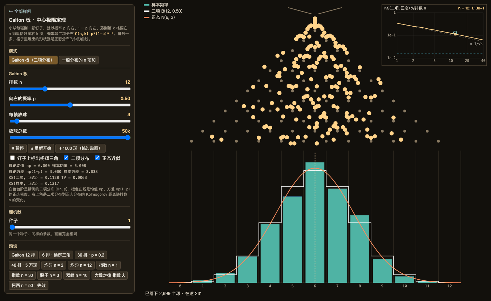

1873 年前后，Francis Galton 做了一块木板：上面钉着一排排错开的钉子，小球从顶上漏斗落下，每碰到一颗钉子就随机往左或往右弹一格，最后落进底部的格子里。每个球的路线都没法预测，可几千个球堆出来的形状每次都一样：中间高、两边低的钟形。这块板把概率论里最重要的一个定理变成了看得见的东西：**很多个独立的小随机量加起来，总和近似服从正态分布。**这就是中心极限定理。

页面有两个模式。“Galton 板”模式模拟上面那块板，柱状图旁边画出精确的二项分布和正态近似。“一般分布的 n 项和”模式换成任意一种分布（均匀、指数、偏斜双峰、骰子、柯西），把 n 个独立抽样加起来，看它的直方图怎样随 n 变成钟形，再看在柯西分布上怎样失效。

打开方式：用浏览器直接打开 [index.html](index.html)。页面只用 Canvas 2D，不依赖外部库，离线也能用。所有随机数来自一个带种子的伪随机数发生器（mulberry32），种子和参数相同，画面就完全相同，下面每张图都可以用网址参数重现。

## 数学原理

### 1. 一个球的路线：n 次伯努利试验

设板上有 n 排钉子。球每碰到一颗钉子，就以概率 p 向右、以概率 1 − p 向左，各次之间互相独立。记第 i 次向右为 Xᵢ = 1，向左为 Xᵢ = 0，那么球最后落进的格子编号就是向右的次数

```
K = X₁ + X₂ + … + Xₙ ∈ {0, 1, …, n}
```

落进第 k 格，要在 n 次里恰好向右 k 次。向右 k 次、向左 n − k 次的任何一条具体路线，概率都是 pᵏ(1 − p)ⁿ⁻ᵏ；这样的路线一共有 C(n, k) 条（在 n 次里挑出哪 k 次向右）。所以

```
P(K = k) = C(n, k) · pᵏ (1 − p)ⁿ⁻ᵏ
```

这就是**二项分布** B(n, p)。

C(n, k) 恰好是杨辉三角（Pascal 三角）第 n 行的第 k 个数。原因很直接：到达第 r 排第 j 颗钉子的路线，要么来自上一排的第 j − 1 颗（然后向右），要么来自第 j 颗（然后向左），所以路线数等于上面两个数之和，这正是杨辉三角的构造规则。勾选“钉子上标出杨辉三角”，每颗钉子上方会标出到达它的路线数：

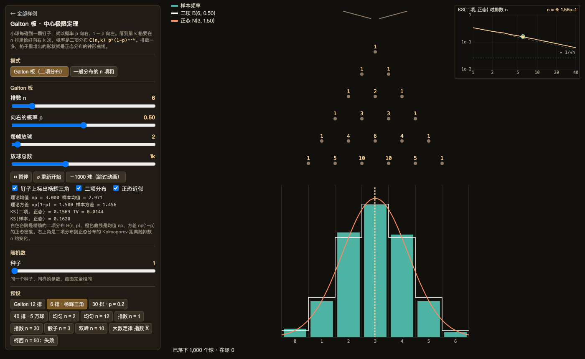

p = 0.5 时每条路线的概率都是 1/2ⁿ，所以格子里的球数正比于杨辉三角最后一行。上图 6 排、1000 个球，最后一行是 1 6 15 20 15 6 1（总和 64），期望球数和实际球数：

| 格子 k | 0 | 1 | 2 | 3 | 4 | 5 | 6 |
|---|---|---|---|---|---|---|---|
| C(6, k) | 1 | 6 | 15 | 20 | 15 | 6 | 1 |
| 期望 1000·C(6,k)/64 | 15.6 | 93.8 | 234.4 | 312.5 | 234.4 | 93.8 | 15.6 |
| 实际 | 20 | 85 | 246 | 311 | 241 | 85 | 12 |

### 2. 均值 np，方差 np(1 − p)

每个 Xᵢ 的均值是 E Xᵢ = p，方差是 E Xᵢ² − p² = p − p² = p(1 − p)。均值总是可加的；独立随机变量的方差也可加（交叉项 E[(Xᵢ − p)(Xⱼ − p)] 在独立时为 0）。所以

```
E K = np,    Var K = np(1 − p)
```

面板实时给出样本均值和样本方差，柱状图里白色虚线是 np，金色虚线是样本均值。测量结果（种子 1）：

| 板 | 球数 | np | 样本均值 | np(1 − p) | 样本方差 |
|---|---|---|---|---|---|
| 6 排，p = 0.5 | 1 000 | 3 | 2.971 | 1.5 | 1.456 |
| 12 排，p = 0.5 | 3 000 | 6 | 6.013 | 3 | 2.898 |
| 30 排，p = 0.2 | 20 000 | 6 | 5.991 | 4.8 | 4.783 |
| 40 排，p = 0.5 | 50 000 | 20 | 19.999 | 10 | 9.993 |

样本均值和 np 的差距按 1/√(球数) 缩小：5 万个球时差 0.0007。这是下面第 8 节大数定律的一个例子。

p ≠ 0.5 时板向一边倾斜，分布也不再对称。30 排、p = 0.2 时，球大多落在第 6 格附近，右边拖着一条长尾巴：

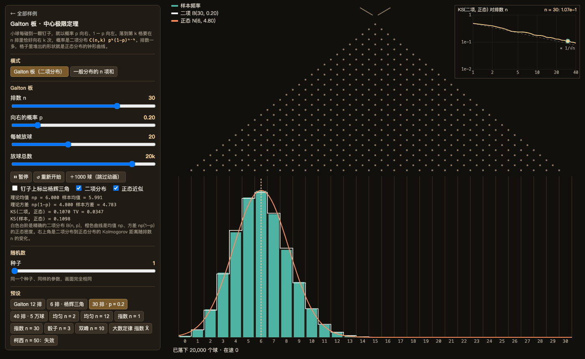

### 3. de Moivre–Laplace 定理：二项分布趋向正态分布

1733 年 de Moivre 发现（p = 1/2 的情形，后来 Laplace 推广到任意 p）：n 很大时，二项分布的形状趋向于均值 np、方差 np(1 − p) 的正态分布的钟形曲线：

```
P(K = k) ≈ 1/√(2π·npq) · exp(−(k − np)² / (2npq)),   q = 1 − p
```

更准确的说法是标准化以后的 CDF 收敛：对任意 a < b，

```
P( a ≤ (K − np)/√(npq) ≤ b )  →  Φ(b) − Φ(a)    （n → ∞）
```

Φ 是标准正态分布的分布函数。证明的核心是用 Stirling 公式 n! ≈ √(2πn)(n/e)ⁿ 展开 C(n, k)，在 k = np + x√(npq) 处把 log P(K = k) 展到二阶，一阶项抵消，二阶项正好是 −x²/2。

页面里白色台阶是精确的 B(n, p)，橙色曲线是正态密度。40 排时两者几乎重合：

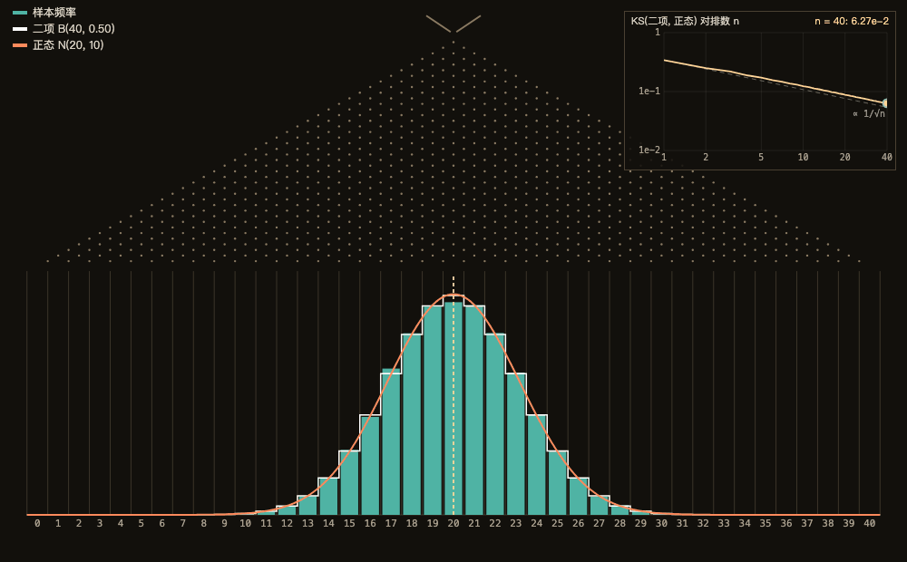

### 4. 有多接近：Kolmogorov 距离和全变差距离

“趋向”要用一个数来量。页面用两种距离：

- **Kolmogorov 距离** KS = sup_x |F(x) − Φ(x)|：两个分布函数之间最大的竖直差距。这是中心极限定理“依分布收敛”最直接的度量。
- **全变差距离** TV = ½ Σ_k |P(K = k) − q_k|，其中 q_k = Φ((k + ½ − np)/σ) − Φ((k − ½ − np)/σ) 是正态分布落在 [k − ½, k + ½] 里的概率（“连续性校正”）。TV 是任何一个事件的概率最多能差多少。

右上角小图是 KS(B(n, p), 正态) 随排数 n 的变化（对数坐标），虚线是 ∝ 1/√n 的参考斜率。实测：

| n | 1 | 2 | 5 | 10 | 20 | 40 |
|---|---|---|---|---|---|---|
| KS，p = 0.5 | 0.3413 | 0.2500 | 0.1726 | 0.1230 | 0.0881 | 0.0627 |
| TV，p = 0.5 | 0.0455 | 0.0544 | 0.0150 | 0.0074 | 0.0039 | 0.0019 |
| KS，p = 0.2 | 0.4915 | 0.4002 | 0.2373 | 0.1778 | 0.1296 | 0.0931 |
| TV，p = 0.2 | 0.0667 | 0.1398 | 0.0975 | 0.0623 | 0.0421 | 0.0303 |

几个规律可以从表里直接读出来：

- **KS 按 1/√n 下降**：n 从 10 到 40 翻两番，KS 从 0.1230 降到 0.0627，正好约减半。原因是 K 只取整数：分布函数在每个整数处跳一下，而 Φ 是连续的，所以 KS 至少是最大一跳的一半。最大的一跳在中间，约为 1/(σ√(2π))，σ = √(npq)。p = 0.5、n = 40 时 φ(0)/(2·0.5·√40) = 0.0631，实测 0.0627。
- **p = 0.5 时 TV 按 1/n 下降**（n = 10、20、40 时是 0.0074、0.0039、0.0019）。连续性校正消掉了“跳跃”带来的误差，对称又消掉了 1/√n 阶的偏度误差，只剩 1/n 阶。
- **p = 0.2 时 TV 只按 1/√n 下降**（0.0623、0.0421、0.0303，n 每翻一倍除以约 √2）。偏度 (1 − 2p)/√(npq) 不为 0，这一项是 1/√n 阶，连续性校正去不掉它。

小图里青色空心圆是当前样本的 KS（样本经验分布函数到正态分布的距离），绿色点线是采样噪声的量级 0.83/√M（M 是样本数；0.83 是 Kolmogorov 分布的中位数）。样本 KS 不会低于这条线太多：40 排、5 万个球时样本 KS = 0.0635，精确值 0.0627。

### 5. 中心极限定理

Galton 板里每一步只有“左 / 右”两种结果。把它换成任意分布，结论仍然成立：

> **中心极限定理（Lindeberg–Lévy）**：设 X₁, X₂, … 独立同分布，均值 μ = E X 有限，方差 σ² = Var X 有限且大于 0。记 Sₙ = X₁ + … + Xₙ，那么对任意实数 z，
>
> ```
> P( (Sₙ − nμ) / (σ√n) ≤ z )  →  Φ(z)     （n → ∞）
> ```

需要的条件：

1. **独立**：各项之间没有关联。有正相关时方差会比 nσ² 大，结论要改；
2. **同分布**（Lindeberg–Lévy 版本）。不同分布时，只要没有哪一项单独占总方差的可观比例，结论照样成立，这就是 Lindeberg 条件；
3. **方差有限**。这是最容易被忽略、也最要紧的一条，第 7 节的柯西分布就违反它。

分布本来是什么形状并不重要：Sₙ 标准化以后的极限永远是同一条钟形曲线，只有 μ 和 σ 两个数记得原来的分布。直观理解：标准化后的和是 n 个独立小量 (Xᵢ − μ)/(σ√n) 之和，它的特征函数是 φ_X(t/(σ√n))ⁿ ≈ (1 − t²/(2n))ⁿ → e^(−t²/2)。展开到二阶时只用到了均值和方差，更高阶的矩都被 n 的幂次压到 0，这正是正态分布“忘掉细节”的原因。

切到“一般分布的 n 项和”模式。左上角是一次抽样 X 的分布，下面的刻度是最新一个样本的 n 个数，白条是它们的平均值。主图是 M 个 Z = (Sₙ − nμ)/(σ√n) 的直方图（青色）、Sₙ 的精确分布（白色台阶）和标准正态密度（橙色）。

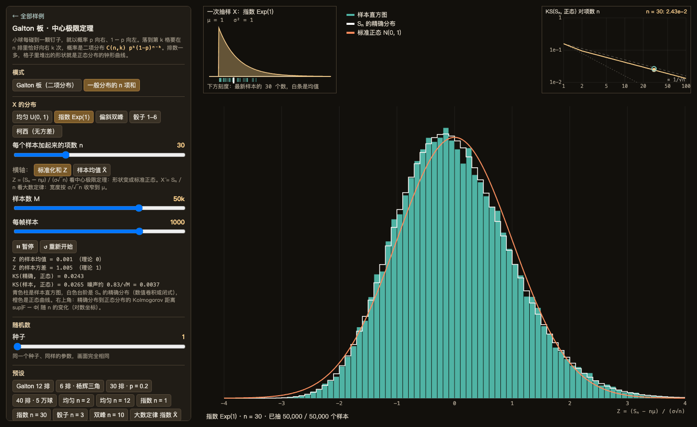

指数分布 Exp(1) 一边截断、一边长尾，看它一步一步变成钟形（每张 5 万个样本）：

| n = 1 | n = 2 |
|---|---|
|  | 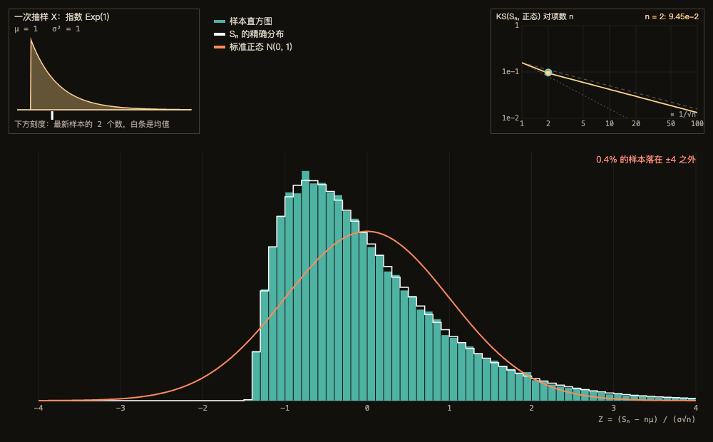 |
| **n = 5** | **n = 30** |
| 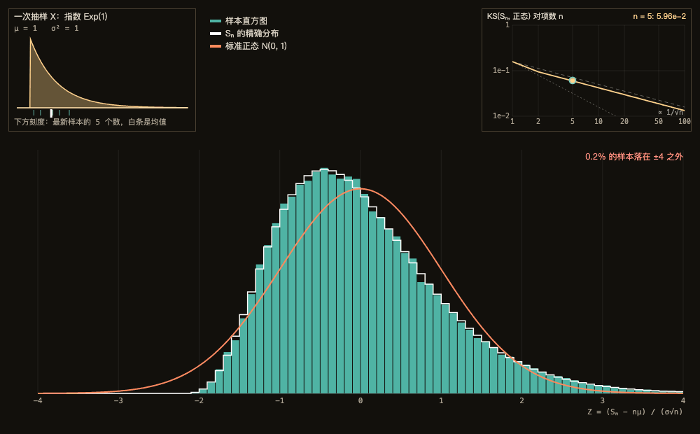 | 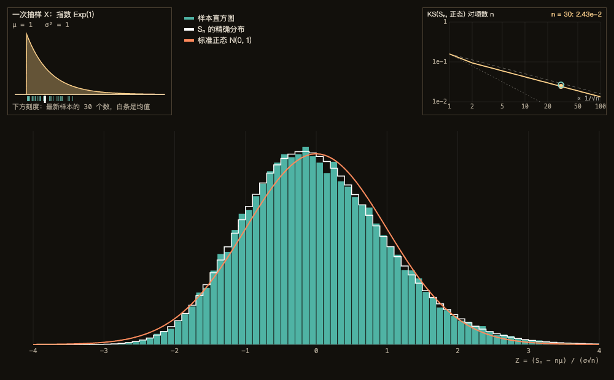 |

n = 1 时 Z = X − 1 ≥ −1，左边一块正态分布的质量根本没有对应，KS 正好等于 Φ(−1) = 0.1587。n = 30 时直方图仍然偏右（峰在 0 的左边一点，右尾更长），KS 降到 0.0243。

均匀分布本身就是对称的，收敛快得多：n = 2 已经是一个三角形，n = 12 几乎看不出和正态的差别。（以前没有好的正态随机数算法时，人们就用 12 个均匀随机数之和减 6 来近似一个标准正态数，因为 12 × 1/12 = 1 正好是单位方差。）

| 均匀 n = 1 | 均匀 n = 2 | 均匀 n = 12 |
|---|---|---|
| 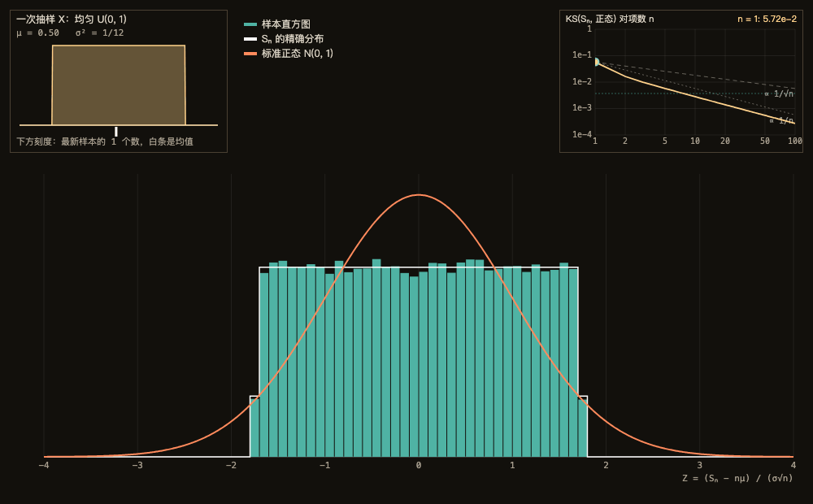 | 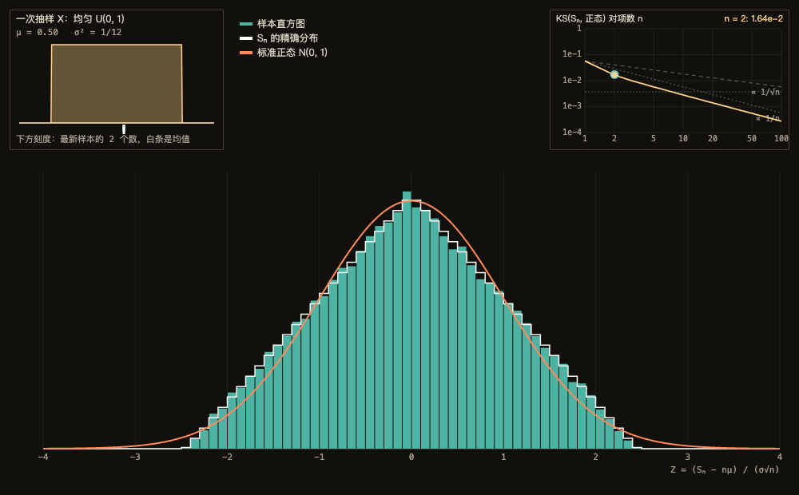 |  |

偏斜双峰分布 0.75·N(0, 0.5²) + 0.25·N(3, 0.5²)：两个峰、一大一小，n = 10 时两个峰已经融成一个略微右偏的钟：

| 双峰 n = 1 | 双峰 n = 10 |
|---|---|
| 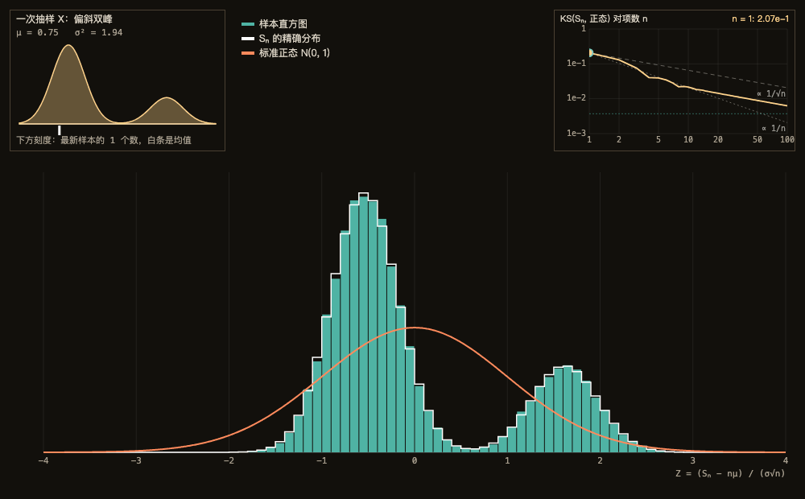 | 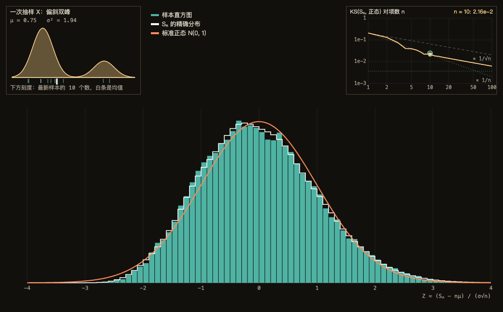 |

骰子是离散的：Sₙ 只能取整数，标准化后落在间距 1/(σ√n) 的格点上。直方图的每一格正好装整数个格点（格点在格子中央），否则多数格子会是空的。n = 1 是 6 根一样高的柱子，n = 3 已经很像钟形：

| 骰子 n = 1 | 骰子 n = 3 | 骰子 n = 30 |
|---|---|---|
| 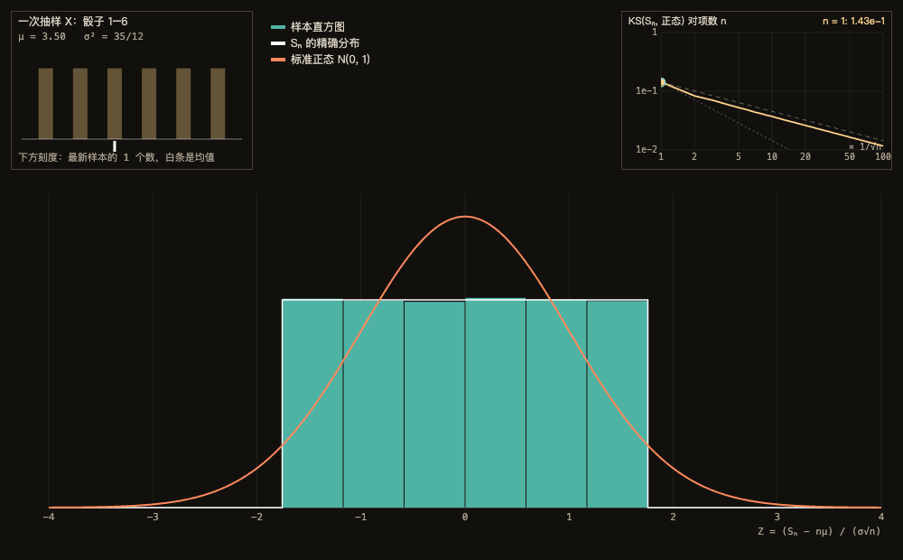 | 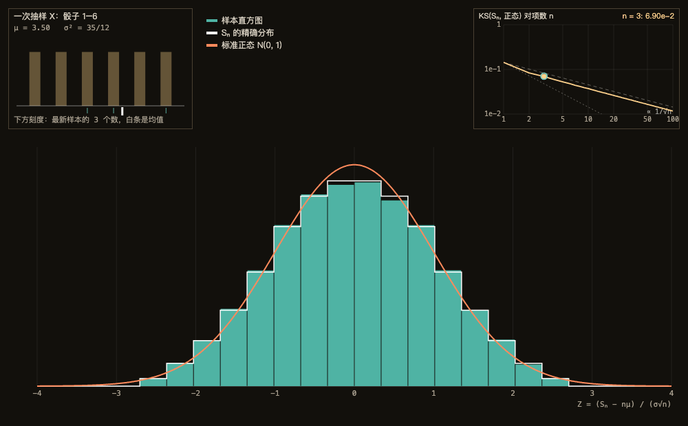 | 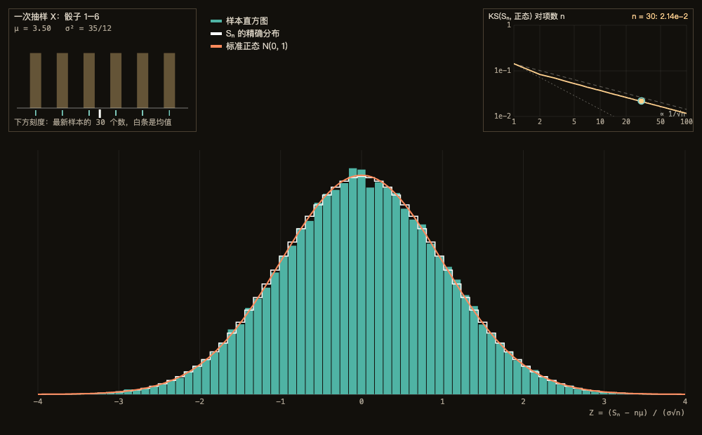 |

所有情形里，标准化以后 Z 的样本均值和样本方差都接近 0 和 1（例如指数 n = 30：0.001 和 1.005；骰子 n = 30：0.002 和 1.000）。这两个数是标准化保证的，与 n 无关；中心极限定理说的是**形状**。

### 6. 收敛有多快：Berry–Esseen 和 Edgeworth

右上角小图画出精确 KS(Sₙ, 正态) 随 n 的变化，n = 1 … 100。精确分布的算法：

| X 的分布 | Sₙ 的精确分布 |
|---|---|
| 均匀 U(0, 1) | 用 200 个等概率格点代替 U(0, 1)，用前缀和做 n − 1 次卷积，格点之间线性插值 |
| 指数 Exp(1) | Sₙ ~ Gamma(n, 1)，P(Sₙ ≤ x) = 1 − e⁻ˣ Σ_{k<n} xᵏ/k! |
| 偏斜双峰 | 按“n 次里有 k 次来自右峰”分类，是 n + 1 个正态分布按 B(n, 0.25) 加权的混合 |
| 骰子 | 6 点均匀分布的 n 次离散卷积 |
| 柯西 | Sₙ/n 仍是标准柯西分布，闭式 |

KS 在 z ∈ [−8, 8] 上每隔 0.01 取最大值，离散分布在每个格点的两侧精确取值。实测：

| n | 1 | 2 | 5 | 10 | 30 | 100 |
|---|---|---|---|---|---|---|
| 均匀 | 0.0572 | 0.0164 | 0.00571 | 0.00281 | 0.000922 | 0.000273 |
| 指数 | 0.159 | 0.0945 | 0.0596 | 0.0421 | 0.0243 | 0.0133 |
| 偏斜双峰 | 0.207 | 0.130 | 0.0393 | 0.0216 | 0.0116 | 0.00627 |
| 骰子 | 0.143 | 0.0833 | 0.0525 | 0.0371 | 0.0214 | 0.0117 |
| 柯西 | 0.126 | 0.176 | 0.249 | 0.299 | 0.366 | 0.417 |

**Berry–Esseen 定理**（1941–1942）给出一般的上界：若 ρ = E|X − μ|³ 有限，

```
sup_z |P(Zₙ ≤ z) − Φ(z)| ≤ C · ρ / (σ³ √n),    C ≤ 0.4748（Shevtsova 2011）
```

所以只要三阶矩有限，KS 至少按 1/√n 下降。对指数分布 ρ = 2.4146，n = 30 时上界是 0.209，实际只有 0.0243：上界保证了速度的阶，常数很保守。

真正的常数来自 **Edgeworth 展开**，它把 F − Φ 按 1/√n 的幂展开：

```
P(Zₙ ≤ z) − Φ(z) ≈ −γ/(6√n) · (z² − 1) φ(z) − κ₄/(24n) · (z³ − 3z) φ(z) + …
```

γ 是偏度，κ₄ 是超额峰度。由此可以预测表里每一行：

- **偏斜分布按 1/√n**：第一项在 z = 0 处最大，KS ≈ γ φ(0)/(6√n)。指数分布 γ = 2，预测 0.1330/√n，n = 30、100 时为 0.0243、0.0133，和实测一样。偏斜双峰 γ = 0.9386，预测 n = 100 时 0.00624，实测 0.00627。
- **对称分布按 1/n**：γ = 0，第一项消失。均匀分布 κ₄ = −1.2，预测 KS ≈ 1.2/24 × 0.5506 / n = 0.0275/n（0.5506 是 |z³ − 3z|φ(z) 的最大值），n = 100 时 0.000275，实测 0.000273。小图里均匀分布的曲线贴着 ∝ 1/n 的点线。
- **离散分布按 1/√n**：骰子是对称的，但它的 Sₙ 只取整数，分布函数在格点处跳跃，和第 4 节的二项分布一样，KS 至少是半个跳跃 φ(0)/(2σ√n) = 0.1168/√n。n = 100 时 0.01168，实测 0.0117。

### 7. 方差无穷时：柯西分布

标准柯西分布的密度是 1/(π(1 + x²))。它看上去也是一个对称的钟形，但尾巴只按 1/x² 衰减，所以 E|X| = ∫|x|/(π(1 + x²)) dx = ∞，均值和方差都不存在，中心极限定理的条件不满足。

它的特征函数是 e^(−|t|)，于是 Sₙ/n 的特征函数是 (e^(−|t|/n))ⁿ = e^(−|t|)：**n 个柯西数的平均值仍然是标准柯西分布**，不管 n 多大。平均并没有让分布收窄。

页面里柯西分布没有 μ、σ，只好“假装” μ = 0、σ = 1 去算 Z = Sₙ/√n。这样的 Z 是尺度为 √n 的柯西分布，n 越大摊得越开：

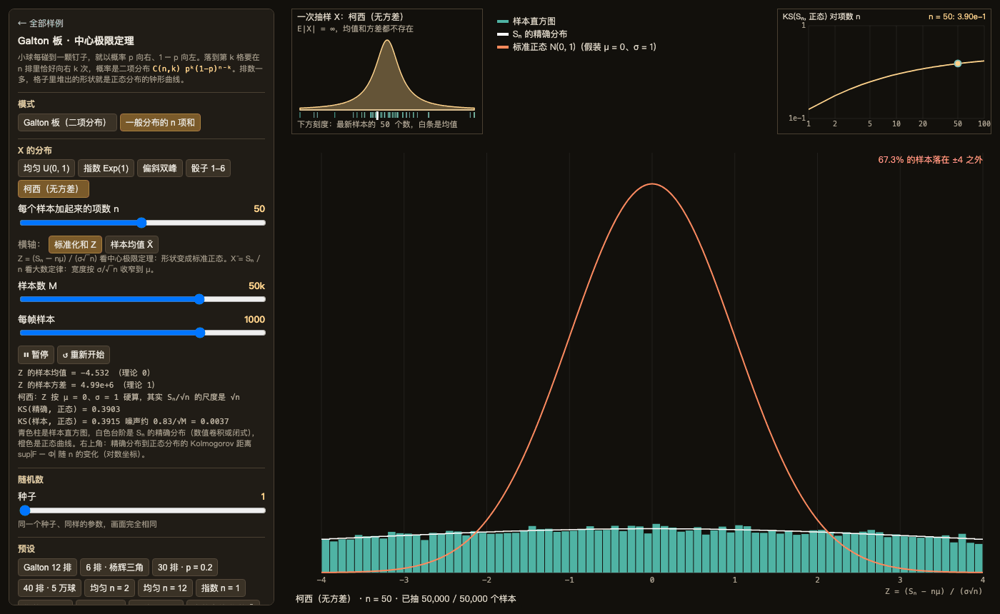

n = 50 时 67.3% 的样本落在 ±4 之外（理论值 1 − (2/π)·arctan(4/√50) = 0.672），Z 的样本方差是 4.99 × 10⁶。KS 距离不降反升，从 n = 1 的 0.126 升到 n = 100 的 0.417，极限是 0.5。小图里这条曲线是上翘的。

不管怎么选标准化常数 aₙ、bₙ，(Sₙ − bₙ)/aₙ 都不会趋向正态分布。正确的尺度是 aₙ = n，极限是柯西分布本身。柯西分布是一个**稳定分布**：独立的柯西数相加还是柯西分布，就像独立的正态数相加还是正态分布一样。正态分布是方差有限时唯一的稳定极限；方差无穷时，极限可以是其他的 α-稳定分布（广义中心极限定理），柯西分布是 α = 1 的那一个。

| 柯西 n = 1，Z | 柯西 n = 50，X̄ |
|---|---|
| 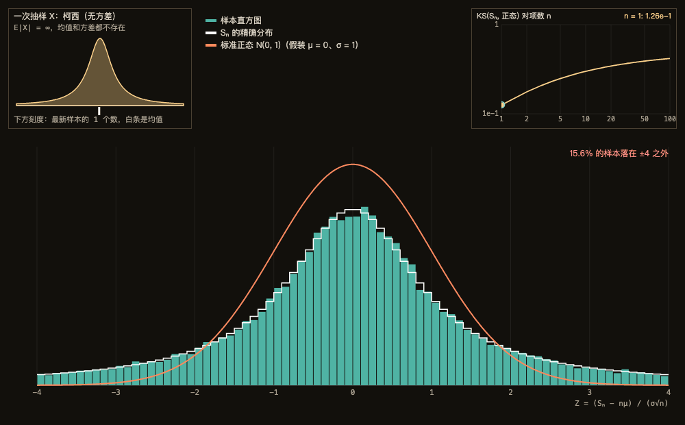 | 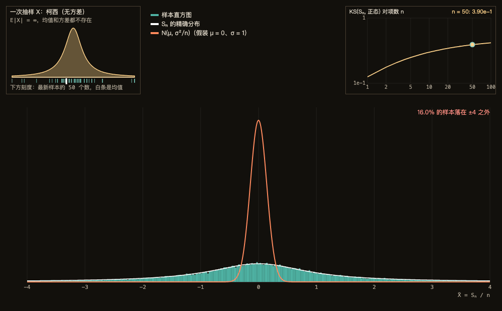 |

右边是 n = 50 个柯西数的平均值 X̄，它和左边单个柯西数的分布一模一样：落在 ±4 之外的比例，左边是 15.6%，右边是 16.0%（理论值都是 1 − (2/π)·arctan 4 = 0.156）。

### 8. 大数定律

把横轴换成“样本均值 X̄”，看的是另一个定理。横轴固定在单次抽样的 μ ± 4σ，不随 n 缩放：

> **大数定律**：若 X₁, X₂, … 独立同分布，E|X| < ∞，则 X̄ₙ = Sₙ/n → μ（弱大数定律：依概率收敛；强大数定律：几乎必然收敛）。

方差有限时，Var X̄ₙ = σ²/n，再用 Chebyshev 不等式 P(|X̄ₙ − μ| ≥ ε) ≤ σ²/(nε²) 就能证明弱大数定律。指数分布 μ = 1、σ² = 1：

| n = 1 | n = 10 | n = 100 |
|---|---|---|
| 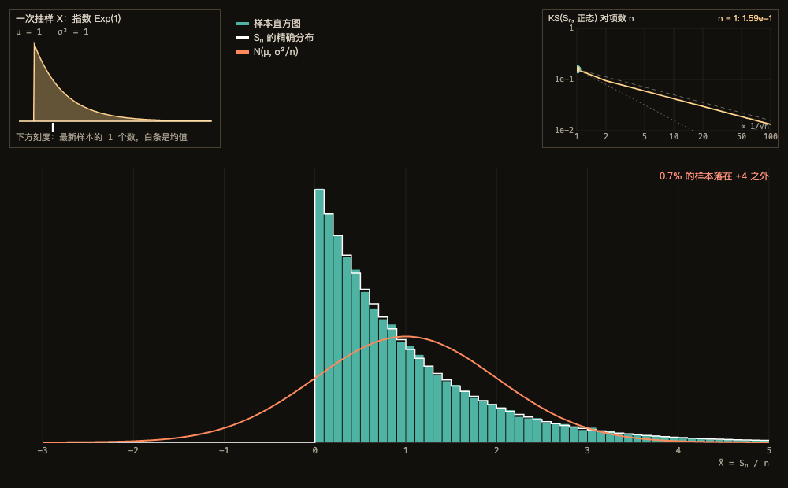 | 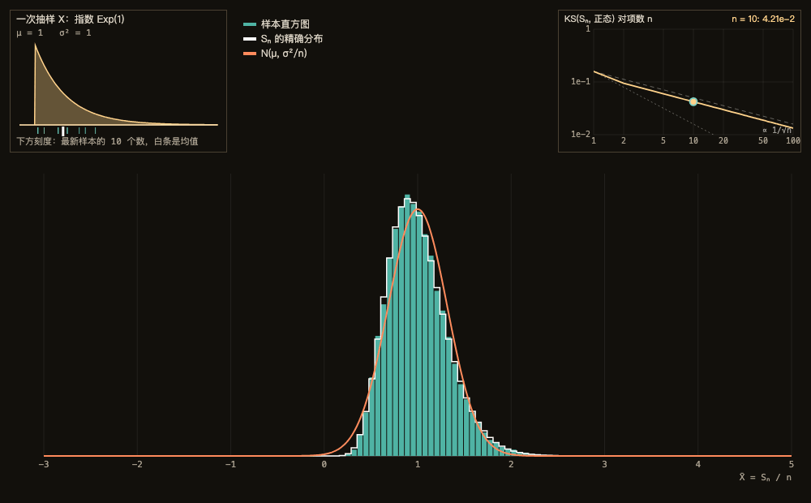 | 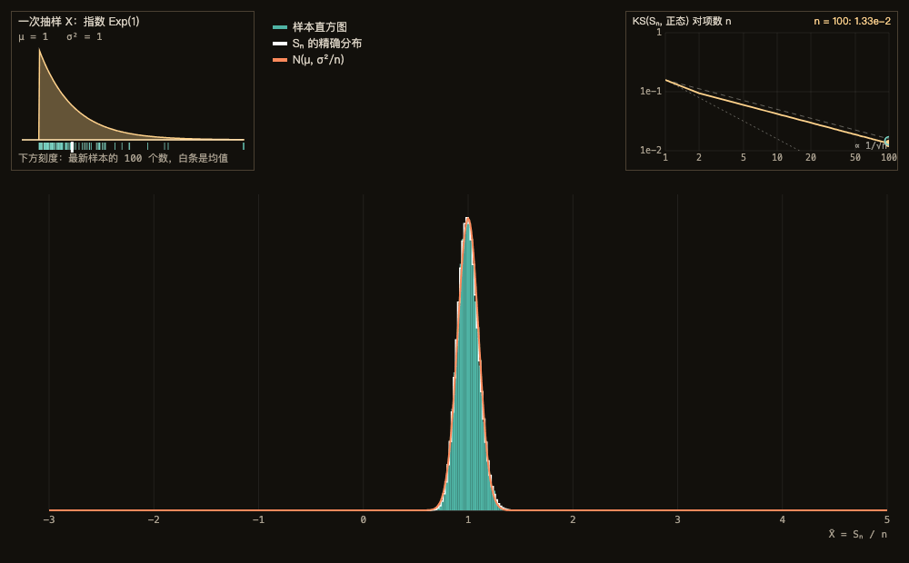 |

X̄ 的样本方差依次是 0.992、0.0994、0.0101，对应 σ²/n = 1、0.1、0.01。

两个定理说的是同一个 Sₙ 在不同尺度下的样子：

| 尺度 | 结果 | 定理 |
|---|---|---|
| Sₙ / n | 收缩到一个点 μ | 大数定律 |
| (Sₙ − nμ) / √n | 保持宽度 σ，形状趋向正态 | 中心极限定理 |

大数定律只需要均值存在；中心极限定理还要方差有限。柯西分布两样都没有，所以 X̄ 既不收缩（上一节右图），标准化后也不变成正态。

## 操作

- 模式：“Galton 板（二项分布）”或“一般分布的 n 项和”；
- Galton 板：排数 n（1–40）、向右的概率 p（0.05–0.95）、每帧放球（1–50）、放球总数（100–5 万）；“＋1000 球”跳过动画直接落下 1000 个；暂停 / 继续、重新开始；开关：杨辉三角（排数不多、钉子间距够大时显示）、二项分布、正态近似；
- 一般分布：X 的分布（均匀、指数、偏斜双峰、骰子、柯西）、项数 n（1–100）、横轴（标准化和 Z 或样本均值 X̄）、样本数 M（1 千–20 万）、每帧样本（10–5000）；
- 随机数种子（1–999）；
- 预设：Galton 12 排、6 排杨辉三角、30 排 p = 0.2、40 排 5 万球、均匀 n = 2 / 12、指数 n = 1 / 30、骰子 n = 3、双峰 n = 10、大数定律（指数 X̄，n = 50）、柯西 n = 50。

同时在途的球最多 4000 个，板上的球最多 15 万个；一般分布模式每帧最多抽 20 万个随机数。

## 网址参数

| 键 | 含义 |
|---|---|
| p | 预设名：g12, pascal, skew, g40, uni2, uni12, exp1, exp30, die3, bim10, lln, cauchy |
| m | 模式：galton, clt |
| r | 排数（1–40） |
| prob | 向右的概率（0.05–0.95） |
| v | 每帧放球（1–50） |
| nb | 放球总数（100–50000），包含 k |
| k | 打开时直接落下的球数（0–50000，跳过动画） |
| pascal, bin, norm | pascal=1 标出杨辉三角；bin=0、norm=0 隐藏二项分布、正态曲线 |
| d | X 的分布：uniform, exp, bimodal, die, cauchy |
| n | 项数（1–100） |
| s | 横轴：z（标准化和），mean（样本均值） |
| M | 样本数（1000–200000） |
| b | 每帧样本（10–5000） |
| seed | 随机数种子（1–999） |
| run | 0 = 打开时暂停 |
| ui | 0 = 隐藏控制面板，只留画布 |

数值参数必须是有限数，超出范围的会被夹到滑块范围内；字符串参数只接受上表列出的值。例如：40 排、直接落下 5 万个球 `index.html?r=40&k=50000&nb=50000`；骰子 30 项的样本均值 `index.html?m=clt&d=die&n=30&s=mean&M=50000`。

## 参考

- F. Galton, *Natural Inheritance*, Macmillan, 1889. 书中描述了这块板（他称为 quincunx）。
- A. de Moivre, *The Doctrine of Chances*, 第 2 版, 1738（1733 年的拉丁文小册子收入其中）。
- P.-S. Laplace, *Théorie analytique des probabilités*, 1812.
- J. W. Lindeberg, *Eine neue Herleitung des Exponentialgesetzes in der Wahrscheinlichkeitsrechnung*, Mathematische Zeitschrift 15, 1922.
- A. C. Berry, *The accuracy of the Gaussian approximation to the sum of independent variates*, Trans. AMS 49, 1941；C.-G. Esseen, Arkiv för Matematik, Astronomi och Fysik 28A, 1942.
- I. G. Shevtsova, *On the absolute constants in the Berry–Esseen type inequalities for identically distributed summands*, 2011（C ≤ 0.4748）.
- W. Feller, *An Introduction to Probability Theory and Its Applications*, Vol. II, Wiley, 1971. 第 16 章讲 Edgeworth 展开；稳定分布与广义中心极限定理也在这一卷里。
