# 生命游戏 · 四条规则的宇宙

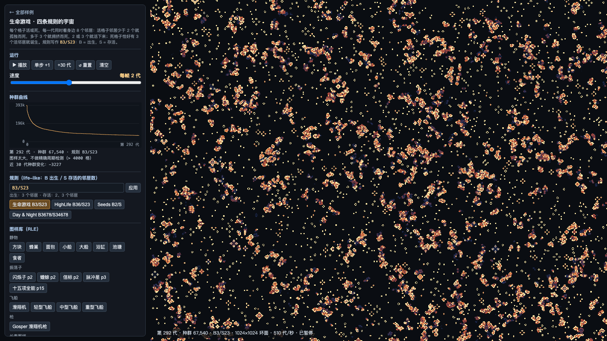

1970 年，剑桥数学家 John Conway 在纸上画格子，想找一套最简单、又不至于“一眼看穿”的规则。他试了很多组，最后留下一套只有四句话的：每个格子活或死，每一代所有格子同时看身边 8 个邻居，按邻居数决定下一代的死活。Martin Gardner 当年 10 月在《科学美国人》的专栏里介绍了它，取名**生命游戏**（Game of Life）。

规则里没有一个随机数，也没有一个参数。可是从一锅随机的“汤”出发，会长出不动的静物、原地闪烁的振荡子、在格子上滑行的飞船、不停发射飞船的枪，还有乱翻上千代才安静下来的长寿图样。后来人们证明，这四句话里藏着一台通用计算机。

打开方式：用浏览器直接打开 [index.html](index.html)。页面只用 Canvas 2D，不依赖外部库，离线也能用。随机汤来自带种子的伪随机数发生器，种子和参数相同，结果就完全相同。下面的每个数字都是在页面里测出来的，每张图都能用网址参数重现。

## 数学原理

### 1. 四条规则

设格子 c 有 n 个活邻居（上下左右和四个斜角，共 8 个）。下一代：

| 现在 | 邻居数 n | 下一代 | 名字 |
|---|---|---|---|
| 活 | n < 2 | 死 | 孤独 |
| 活 | n = 2 或 3 | 活 | 存活 |
| 活 | n > 3 | 死 | 拥挤 |
| 死 | n = 3 | 活 | 诞生 |

其余情况（死格子邻居不是 3）仍然是死的。把“出生要几个邻居”和“存活要几个邻居”写下来，就是规则的标准记号 **B3/S23**：B（birth）后面是出生的邻居数，S（survival）后面是存活的邻居数。

关键是**同时**：下一代的每个格子只看这一代，不看已经算好的下一代邻居。拿最有名的滑翔机来算一遍。它的第 0 代是

```
. o .        (1,0)
. . o        (2,1)
o o o        (0,2) (1,2) (2,2)
```

- (1,0) 只有 1 个活邻居 (2,1)：孤独而死；(0,2) 也只有 1 个：死；
- (2,1)、(1,2) 各有 3 个，(2,2) 有 2 个：都活下来；
- 死格子 (0,1) 的邻居 (1,0)、(0,2)、(1,2) 正好 3 个：诞生；(1,3) 下面那格同理诞生；
- 中心 (1,1) 有 5 个活邻居，太挤，生不出来。

于是第 1 代是 (0,1)、(2,1)、(1,2)、(2,2)、(1,3)，还是 5 个格子，形状变了。再走三代，形状回到原样，整体向右下挪了一格：

| 第 0 代 | 第 1 代 | 第 2 代 | 第 3 代 | 第 4 代 |
|---|---|---|---|---|
| 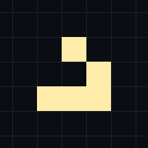 | 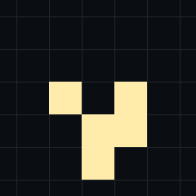 | 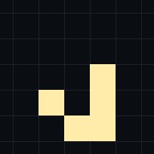 | 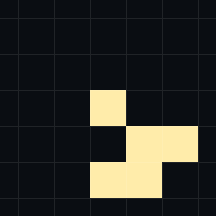 | 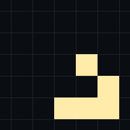 |

页面的“种群曲线”下面会实时报告：放一只滑翔机、走 4 代，显示“飞船：周期 4，每周期位移 (1, 1)，速度 c/4（对角）”。

### 2. 一次算 32 个格子

网格是 N×N 的**环面**：右边出去的从左边回来，上边出去的从下边回来，所以没有边界。N 可选 256、512、1024、2048，默认 1024，也就是一百多万个格子。

每个格子只需要 1 个比特，32 个格子装进一个 32 位整数。算下一代时不逐个数邻居，而是把整数左移、右移一位，得到 32 个格子的“左邻居”和“右邻居”，再和上一行、下一行一起，一共 8 个 32 位整数，每个代表“某个方向上的邻居是否活着”。把 8 个比特加起来需要一个 4 位的计数器 s₃s₂s₁s₀，这可以用加法器的逻辑门一次对 32 个格子做完：

```
三个比特 a + b + c：和 = a ⊕ b ⊕ c，进位 = (a ∧ b) ∨ (c ∧ (a ⊕ b))
```

上一行三个邻居相加得到 0–3，下一行同样，左右两个相加得到 0–2，再把这三个两位数加起来，就得到 0–8 的邻居数，每一位是一个 32 位整数。最后“邻居数恰好是 k”就是 4 个比特各取原值或取反再相与，规则 B3/S23 写成

```
下一代 = (活 ∧ [n=2 ∨ n=3]) ∨ (死 ∧ [n=3])
```

在测试机上（无头 Chromium），1024×1024 每一代约 0.55 毫秒（测 5 组、每组 100 代，0.49–0.58 毫秒），相当于每秒更新约 19 亿个格子；2048×2048 每代 2.1–2.4 毫秒。画一帧（把比特展开成像素并加上余晖）在 1024² 上约 5 毫秒。所以默认每帧走 2 代，速度滑块最高每帧 64 代，每帧的计算时间限在 30 毫秒以内。

### 3. 对象的分类：静物、振荡子、飞船

从汤里活下来的东西，按“过 p 代以后变成什么”可以分成三类：

| 类别 | 定义 | 例子（页面图样库） |
|---|---|---|
| 静物 | 下一代和这一代完全一样（周期 1） | 方块、蜂巢、面包、小船、大船、浴缸、池塘、食者 |
| 振荡子 | 过 p > 1 代回到原样，位置不变 | 闪烁子 p2、蟾蜍 p2、信标 p2、脉冲星 p3、十五项全能 p15 |
| 飞船 | 过 p 代回到原样，但整体平移了 (dx, dy) | 滑翔机、轻型 / 中型 / 重型飞船 |

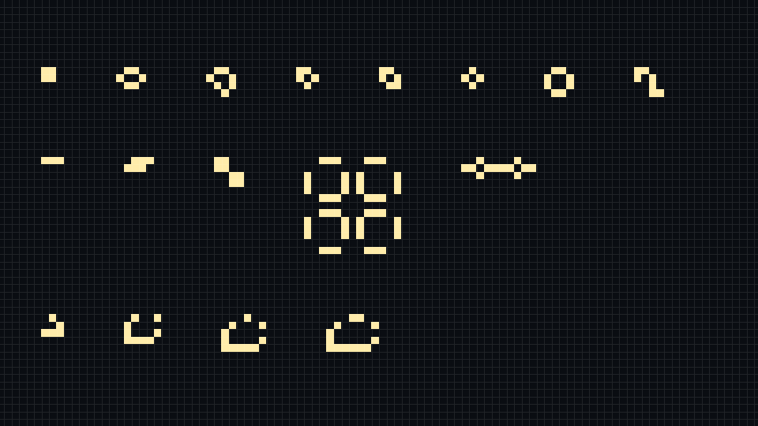

页面怎么判断：图样不超过 4000 个活格子时，每一代算一个**平移不变的签名**，即把所有活格子相对于包围盒左上角的坐标各自散列再求和。如果第 t 代和第 t − p 代的签名、种群都相同，就是周期 p，两个包围盒角点之差就是位移。逐个载入图样库里的对象走 130 代，测得：

| 对象 | 活格子数 | 周期 | 每周期位移 | 速度 |
|---|---|---|---|---|
| 方块、蜂巢、面包、小船、大船、浴缸、池塘、食者 | 4、6、7、5、6、4、8、7 | 1 | — | — |
| 闪烁子、蟾蜍、信标 | 3、6、8 | 2 | (0, 0) | — |
| 脉冲星 | 48 / 56 / 72 轮换 | 3 | (0, 0) | — |
| 十五项全能 | 12, 22, 18, 40, 18, …, 16 轮换 | 15 | (0, 0) | — |
| 滑翔机 | 5 | 4 | (1, 1) | c/4 对角 |
| 轻型、中型、重型飞船 | 9、11、13 | 4 | (−2, 0) | c/2 正交 |

这里 c 是“光速”：每代一格。任何影响一代最多传一格，因为下一代只看紧邻的邻居，所以没有东西能比 c 快。可以证明，在空白背景上移动的有限图样，正交方向最快 c/2，对角方向最快 c/4。滑翔机和这三种飞船正好都顶到了上限。

### 4. Gosper 滑翔机枪：周期 30

Conway 起初猜测：任何有限的初始图样，活格子数都有上界。他悬赏 50 美元求证或求反例。1970 年 11 月，MIT 的 Bill Gosper 找到了反例：一把每 30 代发射一只滑翔机的**枪**，活格子数随时间线性增长、没有上界。

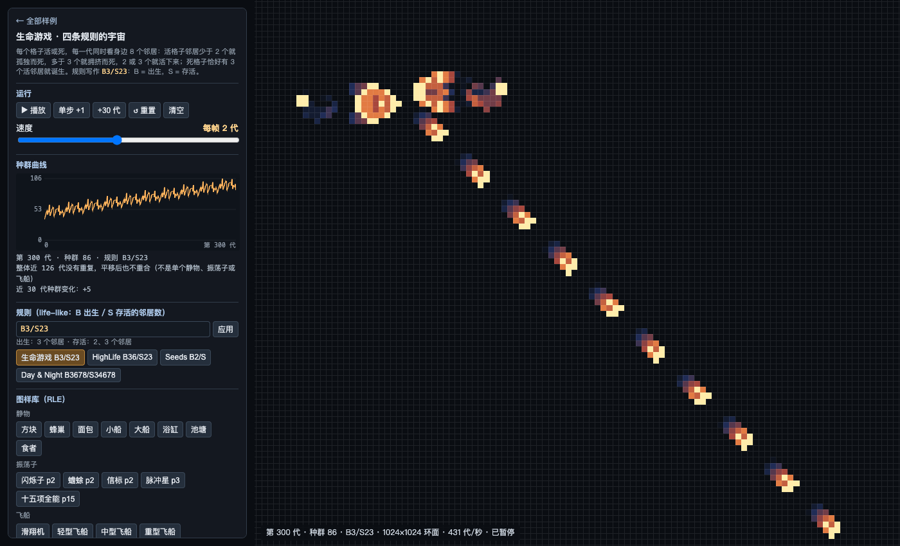

枪的中间是两个“蜂后穿梭”，在两端的方块之间来回撞，每 30 代撞出一只滑翔机。页面测得的种群：

| 代 | 0 | 30 | 60 | 90 | 120 | 150 | 180 | 210 | 240 | 270 | 300 |
|---|---|---|---|---|---|---|---|---|---|---|---|
| 活格子 | 36 | 41 | 46 | 51 | 56 | 61 | 66 | 71 | 76 | 81 | 86 |

对第 60–240 代的每一个 t，都有 pop(t + 30) − pop(t) = 5，正好是一只滑翔机的格子数：枪本身每 30 代回到原样，多出来的就是新发射的那只。曲线上的锯齿是枪内部 30 代一循环的起伏，整体斜率是每代 1/6 个格子。

### 5. 长寿图样：乱翻上千代才安静

有些很小的图样要翻滚很久才稳定，叫 **methuselah**（玛土撒拉，《圣经》里最长寿的人）。

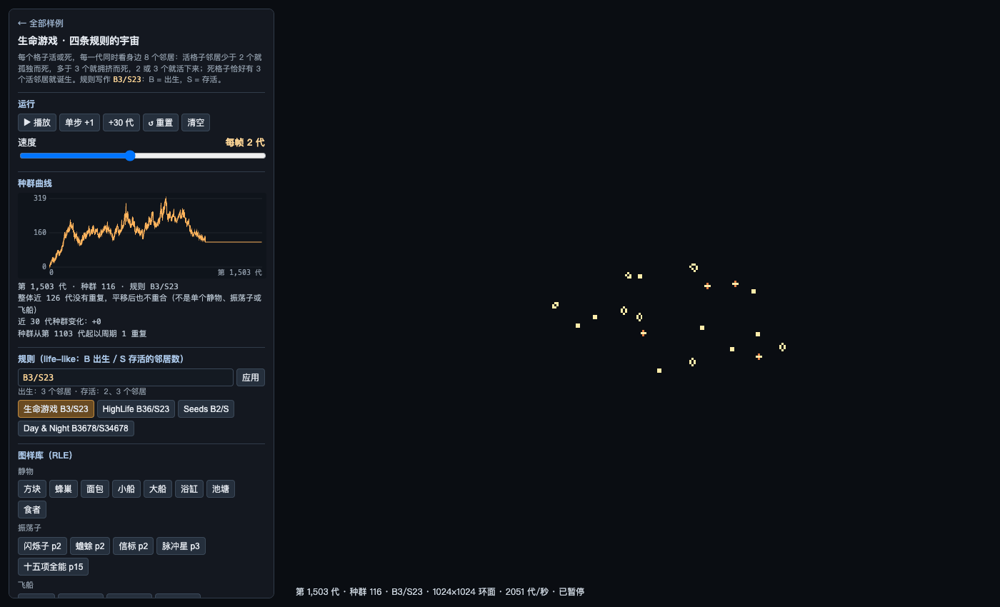

“稳定”怎么测：滑翔机会一直飞走，图样整体永远不会重复，但种群会。页面在 512×512 的环面上单独跑每个图样，最外面 24 格是“吸收带”：每 16 代扫描一次，完全落在带里的连通块被识别、记数、删掉，相当于飞向了无穷远。把删掉的格子加回种群，记作 P(t)。P 连续 300 代按某个周期 p ≤ 60 重复，就算稳定，再从后往前找它开始重复的那一代。按“测量 R-pentomino、橡子、顽固子”测得：

| 图样 | 初始格数 | 稳定于 | 最终格数 | 峰值（代） | 灰烬 |
|---|---|---|---|---|---|
| R-pentomino | 5 | 第 1103 代 | 116 | 319（第 821 代） | 方块 8、滑翔机 6、闪烁子 4、蜂巢 4、面包 1、小船 1、大船 1 |
| 橡子 acorn | 7 | 第 5206 代 | 633 | 1057（第 4408 代） | 闪烁子 41、方块 34、蜂巢 30、滑翔机 13、小船 8、面包 5、大船 3、池塘 2、驳船 2、芒果 1 |
| 顽固子 diehard | 7 | 第 130 代全部死亡 | 0 | 40（第 94 代） | 无 |

对一下账：R-pentomino 的灰烬 8×4 + 6×5 + 4×3 + 4×6 + 7 + 5 + 6 = 116，正好等于最终格数。在主网格（1024×1024 环面，没有吸收带）上直接跑 R-pentomino 到第 1500 代，种群曲线下面同样显示“种群从第 1103 代起以周期 1 重复”。这时飞出去的 6 只滑翔机还没有绕环面一圈撞回来。

### 6. 汤 → 灰：随机初始状态最后剩下什么

“测量 2”按 apgsearch 的办法做统计：16×16 的方块，每个格子以 50% 的概率活着；放在 512×512 的吸收带环面上跑到稳定，再把剩下的灰烬按 8 连通块分类。分类先把连通块在正方形的 8 种对称下化成标准形，和图样库里各对象的每一个相位比对。有些相位本身是几块分开的（蟾蜍的一个相位是两块，脉冲星的相位里有像闪烁子的三格短条），所以相距不超过 2 格的几块先合起来比一次。实在叫不出名字的，单独拿到小网格里跑，按结果记为“其他静物”或“其他振荡子 pN”。两组各 1000 锅（种子 1 和 2）的结果：

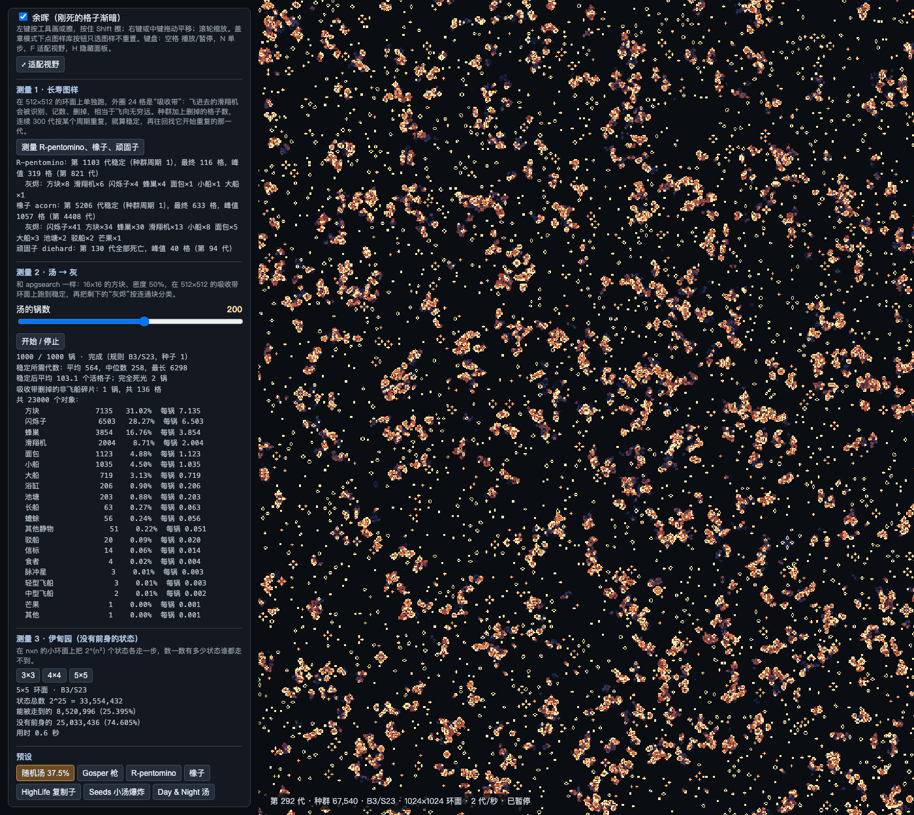

| 对象 | 种子 1 | 种子 2 | 合计 | 占全部对象 | 每锅平均 |
|---|---|---|---|---|---|
| 方块 | 7135 | 6294 | 13429 | 30.72% | 6.715 |
| 闪烁子 | 6503 | 5891 | 12394 | 28.35% | 6.197 |
| 蜂巢 | 3854 | 3521 | 7375 | 16.87% | 3.688 |
| 滑翔机 | 2004 | 1845 | 3849 | 8.81% | 1.925 |
| 面包 | 1123 | 1052 | 2175 | 4.98% | 1.087 |
| 小船 | 1035 | 879 | 1914 | 4.38% | 0.957 |
| 大船 | 719 | 623 | 1342 | 3.07% | 0.671 |
| 浴缸 | 206 | 221 | 427 | 0.98% | 0.213 |
| 池塘 | 203 | 199 | 402 | 0.92% | 0.201 |
| 长船 | 63 | 51 | 114 | 0.26% | 0.057 |
| 蟾蜍 | 56 | 48 | 104 | 0.24% | 0.052 |
| 其他静物 | 51 | 53 | 104 | 0.24% | 0.052 |
| 驳船 | 20 | 13 | 33 | 0.08% | 0.017 |
| 信标 | 14 | 7 | 21 | 0.05% | 0.011 |
| 芒果 | 1 | 8 | 9 | 0.02% | 0.004 |
| 轻型飞船 | 3 | 5 | 8 | 0.02% | 0.004 |
| 食者 | 4 | 1 | 5 | 0.01% | 0.003 |
| 脉冲星 | 3 | 1 | 4 | 0.01% | 0.002 |
| 中型飞船 | 2 | 1 | 3 | 0.01% | 0.002 |
| 其他 | 1 | 0 | 1 | 0.00% | 0.001 |
| 合计 | 23000 | 20713 | 43713 | | 21.857 |

几个读法：

- **最小的东西最多**。前三名方块（4 格）、闪烁子（3 格）、蜂巢（6 格）占了全部对象的 76%。两组种子的占比最多相差 0.64 个百分点（方块：31.02% 对 30.39%），其余八种都在 0.3 个百分点以内，排名前九位完全相同。每锅的对象数相差大一些（23.0 对 20.7），因为少数长寿的汤会留下很多灰烬，比如有一锅到第 8441 代才稳定。
- **每锅汤平均放走 1.9 只滑翔机**，但 2000 锅里只有 8 只轻型飞船、3 只中型飞船，没有重型飞船。
- **稳定所需代数**：种子 1 平均 564、中位数 258、最长 6298；种子 2 平均 523、中位数 246、最长 8441。平均数比中位数大一倍多，长尾很重。两组共有 3 锅完全死光，没有一锅超过 3 万代还不稳定。
- **稳定后**平均剩 103.1（种子 1）和 93.0（种子 2）个活格子，而一锅汤开始时平均有 256 × 50% = 128 个。
- 吸收带也会误删：碎片飘到离中心 232 格以外就会被当成“飞走”删掉。两组里分别只有 1 锅和 2 锅发生了这种事（136 和 161 格）。在 256×256 的格子上做同样的统计，1000 锅里有 45 锅、共 4859 格被误删，所以统计用 512。

整个棋盘都撒汤也一样会冷却成灰。1024×1024、密度 37.5%、种子 7（页面默认），测得活格子密度：

| 代 | 0 | 10 | 100 | 1000 | 3000 | 10000 | 20000 | 40000 |
|---|---|---|---|---|---|---|---|---|
| 密度 | 37.47% | 22.78% | 9.47% | 4.38% | 3.22% | 2.86% | 2.86% | 2.86% |

页面显示种群从第 10103 代起以周期 2 重复，此后一直停在 29938 个活格子。

### 7. 图灵完备：用滑翔机搭电脑

1982 年，Berlekamp、Conway 和 Guy 在《Winning Ways》里给出了生命游戏能做任何计算的构造思路。核心是三样东西：

1. **信号**：一把 Gosper 枪射出的滑翔机流，有滑翔机的位置记 1，空位记 0。枪每 30 代一只，所以信号有固定的节拍。
2. **逻辑门**：两只滑翔机在合适的相位垂直相撞，会互相抵消。让一股“全是 1”的枪流横穿输入流：输入有滑翔机的地方，枪流的那一只被撞掉；没有的地方，枪流的那一只穿过去。输出正好是输入取反，这就是**非门**。再加上**食者**（图样库里有，它能吃掉撞上来的滑翔机而自己复原），用来在需要的地方截断信号，就能拼出与门、或门。
3. **存储**：一个方块可以被特定的滑翔机组合推远一格或拉近一格，它的位置就是一个计数器。

有了门、导线和存储，就能搭出任何电路，于是能模拟任何计算机。2000 年 Paul Rendell 真的在生命游戏里造出了一台图灵机，后来又造了通用图灵机。

这件事有一个直接的推论：**“这个图样最后会不会死光 / 稳定”没有通用的算法**。如果有，就能用它判断任意程序会不会停机，而停机问题是不可判定的。R-pentomino 稳定在第 1103 代，没有捷径可以算出来，只能一代一代跑。

### 8. 伊甸园：没有过去的状态

一个状态如果不是任何状态的下一代，就叫**伊甸园**（Garden of Eden）：它只能作为初始状态出现，永远不会“演化出来”。

为什么一定有：生命游戏会让不同的状态变成同一个状态，比如“只有一个活格子”和“全空”下一代都是全空。把有限的一块区域里所有状态想成一排鸽子、所有可能的下一代想成一排笼子：既然有两只鸽子挤进了同一个笼子，而鸽子和笼子一样多，就一定有笼子空着。Moore（1962）和 Myhill（1963）把这个想法严格化成**伊甸园定理**：在无限平面上，存在伊甸园，当且仅当存在两个不同的有限图样有相同的下一代。生命游戏满足后一条，所以有伊甸园。第一个明确的伊甸园图样是 Roger Banks 等人在 1971 年找到的。

在无限平面上找伊甸园很难，因为图样外面还可以有任意的东西。页面做的是一个小而完整的版本：在 n×n 的环面上，把全部 2^(n²) 个状态各走一步，标出被走到的，数一数剩下多少。下一代的第 r 行只依赖第 r−1、r、r+1 行，所以先做一张 2^(3n) 项的表，每个状态只要查 n 次表。5×5 有 3355 万个状态，用时 0.6 秒。测得：

| 环面 | 状态总数 | B3/S23 能被走到 | B3/S23 没有前身 | B36/S23 没有前身 |
|---|---|---|---|---|
| 3×3 | 512 | 128 | 384（75.0%） | 300（58.6%） |
| 4×4 | 65 536 | 17 879 | 47 657（72.7%） | 42 288（64.5%） |
| 5×5 | 33 554 432 | 8 520 996 | 25 033 436（74.6%） | 21 922 610（65.3%） |

3×3 的结果可以手算验证：3×3 环面上每个格子的 8 个邻居恰好就是其余 8 个格子，所以邻居数 = 活格子总数 − 自己。活格子总数是 3 时，死格子都有 3 个邻居、全部诞生，活格子都有 2 个邻居、全部存活，下一代全满；总数是 4 时，活格子有 3 个邻居存活，死格子有 4 个邻居生不出来，状态不变；其余情况全部死光。能被走到的只有 C(9,4) = 126 个四格状态、全满和全空，共 128 个，和页面一致。4×4 的 17 879 也用一段独立的 Python 暴力枚举核对过。

四分之三的状态没有前身，说明这一步“压缩”得很厉害：汤一开始翻滚得厉害，就是在飞快地丢掉信息。

### 9. 别的规则：HighLife、Seeds、Day & Night

把 B 和 S 后面的数字换掉，就是别的“类生命”规则，一共有 2⁹ × 2⁹ = 262 144 种。页面的规则框接受任何 `B数字/S数字`（数字 0–8，用严格的正则表达式检查），预设了三种：

| HighLife B36/S23：复制子 | Seeds B2/S：8×8 的汤炸开 | Day & Night B3678/S34678 |
|---|---|---|
| 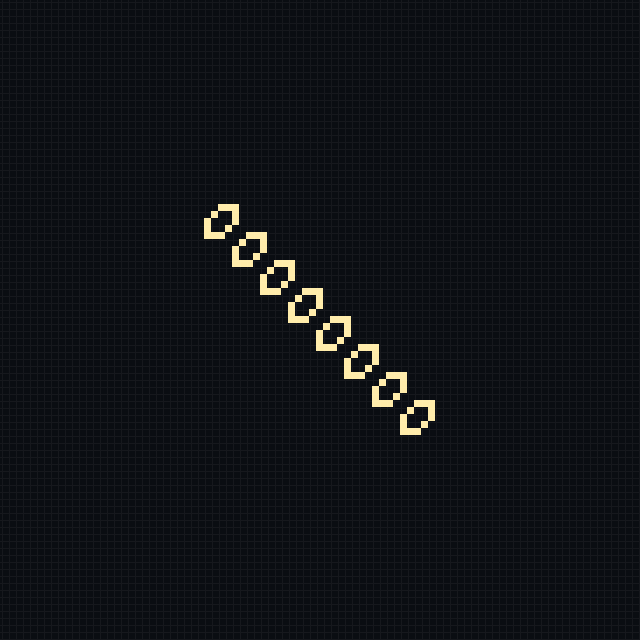 | 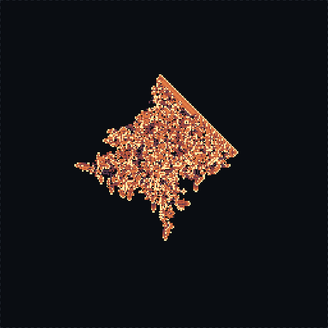 | 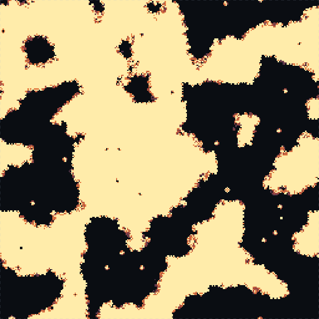 |

- **HighLife** 只比生命游戏多一条“6 个邻居也诞生”，就有了**复制子**：一个 12 格的图样每 12 代复制出自己。复制品挤在一条对角线上，相邻的会互相抵消。测得第 12k 代的种群除以 12（即复制品个数），k = 0…32 依次是 1, 2, 2, 4, 2, 4, 4, 8, 2, …, 32, 2，每一项都恰好是 2^(k 的二进制里 1 的个数)，和 Pascal 三角形第 k 行的奇数个数相同（Lucas 定理）。上图是第 84 代：k = 7 = 111₂，有 2³ = 8 个复制品。
- **Seeds** 没有存活（S 后面是空的），每个格子只活一代，所以几乎所有图样都会爆炸：8×8 的小汤 66 代就长到上图那么大。
- **Day & Night** 的规则对“活”和“死”是对称的。把整个网格取反，演化规律不变，因为对每个 k，k ∈ B 当且仅当 8 − k ∉ S。所以活格子组成的大陆和死格子组成的湖泊行为一样。

## 操作

- 运行：播放 / 暂停、单步 +1、+30 代、重置（回到当前起点的第 0 代）、清空；速度从“每 8 帧 1 代”到“每帧 64 代”；
- 种群曲线：每代记一个点，超过 32 768 个点后两两合并；下面实时显示代数、种群、周期检测（静物 / 振荡子 / 飞船及速度）、近 30 代种群变化、种群从第几代起周期重复；
- 规则：输入 `B…/S…` 回车或点“应用”，格式不对会标红并提示；四个预设按钮；
- 图样库：静物、振荡子、飞船、Gosper 枪、三个长寿图样、HighLife 复制子，全部以 RLE 字符串写在页面里；点击即放在网格中央并适配视野（复制子会顺带切到 B36/S23）；
- 粘贴 RLE：支持 `x = …, y = …, rule = …` 头部和 `#` 注释行；超过 2 万个字符、1024×1024 或 20 万个活格子会拒绝；“导出当前”把网格转成 RLE（不超过 2 万个活格子时）；
- 随机汤：密度、边长、种子；
- 网格：256 / 512 / 1024 / 2048 的环面；工具有画笔、橡皮、平移、盖章（盖章时点图样库按钮只选图样，单击画布盖上去）；余晖开关；
- 鼠标：左键按工具操作，按住 Shift 擦除；右键或中键拖动平移；滚轮以鼠标位置为中心缩放；
- 键盘：空格 播放/暂停，N 单步，F 适配视野，H 隐藏面板；
- 三个测量按钮：长寿图样、汤 → 灰（10–2000 锅）、伊甸园（3×3、4×4、5×5，按当前规则）。测量在后台按帧分片计算，不影响主网格运行。

## 网址参数

| 键 | 含义 |
|---|---|
| p | 预设：soup, gun, rp, acorn0, rep, seeds, dn；或图样库名：block, beehive, loaf, boat, ship, tub, pond, eater, blinker, toad, beacon, pulsar, penta, glider, lwss, mwss, hwss, gosper, rpent, acorn, diehard, replicator |
| rule | 规则，例如 `B36/S23`（必须匹配 `B[0-8]*/S[0-8]*`） |
| n | 网格边长：256–2048，取最近的 2 的幂 |
| d, s, seed | 随机汤的密度（0–1）、边长、种子（1–999） |
| g | 打开时先快进多少代（最多 10 000 代，最多 6 秒） |
| spd | 速度，−3…6，表示每帧 2^spd 代 |
| z, cx, cy | 每格多少像素、视野中心（格子坐标） |
| T | 汤 → 灰统计的锅数（10–2000） |
| tool | draw, erase, pan, stamp |
| trail | 0 = 关闭余晖 |
| run | 0 = 打开时暂停 |
| ui | 0 = 隐藏面板（只显示画布） |

所有数值参数必须是有限数，并夹到滑块的范围里；`p`、`tool` 必须是对应表里自己的键（`__proto__`、`constructor` 之类会被忽略），`rule` 必须完全匹配正则表达式，否则用默认值。

例如：本页的图依次是 `?p=soup&n=1024&g=280&run=0&z=1.6`、`?p=glider&n=256&run=0&z=36&trail=0`、`?p=gun&g=288&run=0`、`?p=rp&g=1491&run=0&z=3`、`?p=rep&n=256&g=84&run=0&z=7&trail=0`、`?p=seeds&n=256&g=60&run=0`、`?p=dn&n=256&g=400&run=0`，截图时再单步 6–12 代让余晖显出来，所以图上的代数比 g 多几代（292、300、1503、66、406）。

## 参考

- M. Gardner, *Mathematical Games: The fantastic combinations of John Conway's new solitaire game "life"*, Scientific American 223, October 1970.
- E. R. Berlekamp, J. H. Conway, R. K. Guy, *Winning Ways for Your Mathematical Plays*, vol. 2, ch. 25, Academic Press, 1982.
- E. F. Moore, *Machine models of self-reproduction*, Proc. Symposia in Applied Mathematics 14, 1962；J. Myhill, *The converse of Moore's Garden-of-Eden theorem*, Proc. AMS 14, 1963.
- P. Rendell, *Turing Universality of the Game of Life*, in *Collision-Based Computing*, Springer, 2002.
- [LifeWiki](https://conwaylife.com/wiki/)：图样的 RLE、R-pentomino 与橡子的稳定代数。
- apgsearch / Catagolue（Adam P. Goucher）：用同样的“汤 → 灰”方法统计了海量随机汤。
