# Hopf 纤维化 · 互相套住的圆

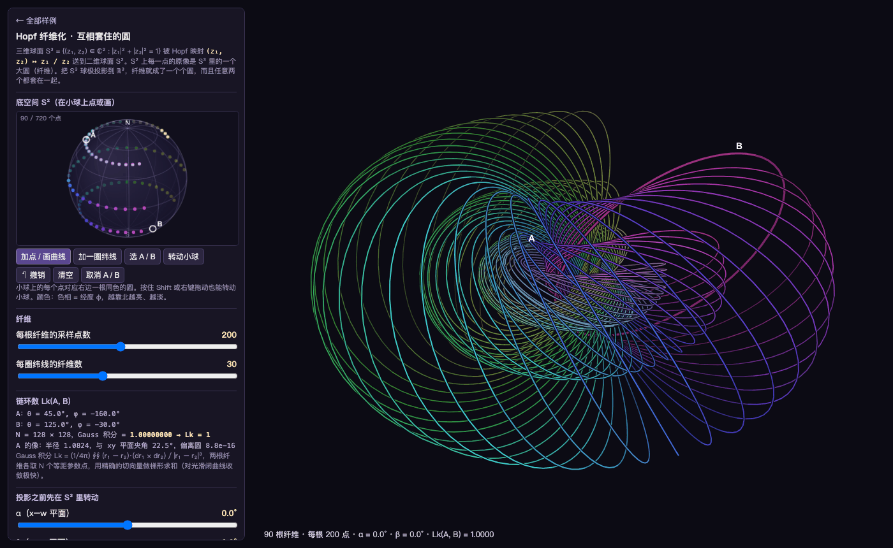

1931 年，Heinz Hopf 找到了一个从三维球面 S³ 到二维球面 S² 的映射。S² 上每一点的原像都是 S³ 里的一个圆，这些圆把 S³ 恰好铺满，互不相交，而且**任意两个都像链环一样套在一起，恰好套一次**。上图是把 S³ 投影到普通三维空间后看到的样子：每个圆是一根“纤维”，左边小球上的每个点对应右边一根同色的圆。小球上三条纬线（各截去四分之一）变成三层嵌套的环面，环面上的圆都斜着绕。

打开方式：用浏览器直接打开 [index.html](index.html)。页面只用 Canvas 2D 和自己写的三维投影，不依赖外部库，离线也能用。

## 数学原理

### 1. S³ 和 Hopf 映射

S³ 是四维空间里到原点距离为 1 的点。把四维的点 (x, y, z, w) 写成两个复数 z₁ = x + iy、z₂ = z + iw，就是

```
S³ = { (z₁, z₂) ∈ ℂ² : |z₁|² + |z₂|² = 1 }
```

Hopf 映射只做一件事，就是取比值：

```
h(z₁, z₂) = z₁ / z₂  ∈ ℂ ∪ {∞}
```

ℂ ∪ {∞} 经球极投影就是球面 S²（z₂ = 0 时比值是 ∞，对应北极）。展开成实坐标，h 把 S³ 上的点送到 ℝ³ 里的单位球面：

```
h(z₁, z₂) = ( 2 Re z₁z̄₂,  2 Im z₁z̄₂,  |z₁|² − |z₂|² )
```

这三个分量的平方和是 (|z₁|² + |z₂|²)² = 1。

**纤维是圆。** 两个点有相同的比值 z₁/z₂，当且仅当它们差一个公共的相位：(z₁, z₂) 和 (e^{it}z₁, e^{it}z₂)。所以 S² 上一点的原像是

```
t ↦ ( cos(θ/2)·e^{i(φ+t)},  sin(θ/2)·e^{it} ),   t ∈ [0, 2π)
```

其中 θ 是这一点到北极的角距离，φ 是经度。这是 S³ 里一个半径为 1 的大圆。页面就用这个式子生成每根纤维。把 90 根纤维上的 11 520 个采样点代回 h，与对应底点的最大误差是 **1.1 × 10⁻¹⁵**，只剩浮点舍入误差。

### 2. 球极投影：把 S³ 画进 ℝ³

S³ 是三维的，但它弯在四维里。和地图把地球面摊平一样，页面从“北极” (0, 0, 0, 1) 把它投影到 ℝ³：

```
(x, y, z, w) ↦ (x, y, z) / (1 − w)
```

球极投影有两个性质，正好够用：

- **把圆变成圆**（经过投影极点的圆变成直线）。所以 S³ 里的大圆纤维在 ℝ³ 里还是圆。页面对选中的纤维 A 取 360 个点，用其中三点定一个圆，再量其余点离这个圆有多远。下面的预设里最大相对偏差都在 **10⁻¹⁵** 量级，见面板上的“偏离圆”。
- **保持拓扑**。它是 S³ 去掉一个点到 ℝ³ 的同胚，所以两根纤维套没套住、套几次，投影前后一样。

两极的纤维最好认。北极 θ = 0 的纤维是 (e^{it}, 0)，投影后是 xy 平面上的单位圆。南极 θ = π 的纤维是 (0, e^{it})，它经过投影极点，投影后是整条 z 轴。南极纤维上取 62 个采样点（避开落在极点上的那个），它们到 z 轴的最大距离是 1.3 × 10⁻¹⁴。直线从圆中间穿过，这就是最简单的 Hopf 链环：

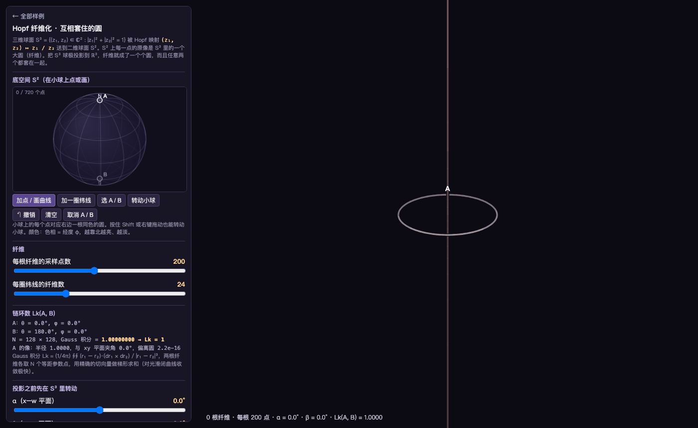

### 3. 纬线 → 环面，纤维 → Villarceau 圆

S² 上的一条纬线 θ = 常数，原像是 S³ 里所有 |z₁| = cos(θ/2)、|z₂| = sin(θ/2) 的点，是一个二维环面（Clifford 环面）。投影到 ℝ³ 后，它是一个绕 z 轴旋转的普通环面。在页面上把每根纤维的点到 z 轴的距离取最大、最小值，就量出了环面的大半径 R 和小半径 r：

| 纬线 θ | 量出的 R | 量出的 r | 1/cos(θ/2) | tan(θ/2) | R² − r² |
|---|---|---|---|---|---|
| 30° | 1.03528 | 0.26795 | 1.03528 | 0.26795 | 1 |
| 45° | 1.08239 | 0.41421 | 1.08239 | 0.41421 | 1 |
| 60° | 1.15470 | 0.57735 | 1.15470 | 0.57735 | 1 |
| 90° | 1.41421 | 1 | 1.41421 | 1 | 1 |
| 120° | 2 | 1.73205 | 2 | 1.73205 | 1 |
| 135° | 2.61313 | 2.41421 | 2.61313 | 2.41421 | 1 |

所以 R = 1/cos(θ/2)，r = tan(θ/2)，而且 R² − r² = 1 对每一层都成立。θ 越小，环面越细，最后缩成北极纤维那个单位圆；θ 越大，环面越胖，最后中间的洞缩成 z 轴。

纤维在环面上既不是经线也不是纬线。它绕环面的“管子”一圈，同时绕 z 轴一圈，是一条斜着的圆。这种圆叫 **Villarceau 圆**：用一个同时和环面在两点相切的平面去切环面，切口是两个这样的圆。页面量出的纤维半径和倾角：

| 纬线 θ | 纤维半径 | 与 xy 平面夹角 |
|---|---|---|
| 15° | 1.008629 | 7.5° |
| 30° | 1.035276 | 15.0° |
| 45° | 1.082392 | 22.5° |
| 60° | 1.154701 | 30.0° |
| 90° | 1.414214 | 45.0° |
| 120° | 2.000000 | 60.0° |
| 150° | 3.863703 | 75.0° |

纤维半径正好等于环面大半径 R = 1/cos(θ/2)，倾角正好是 θ/2，满足 sin(倾角) = r/R。这是 Villarceau 圆的两个经典性质。赤道 θ = 90° 那一层最对称：R = √2，r = 1，每根纤维都倾斜 45°：

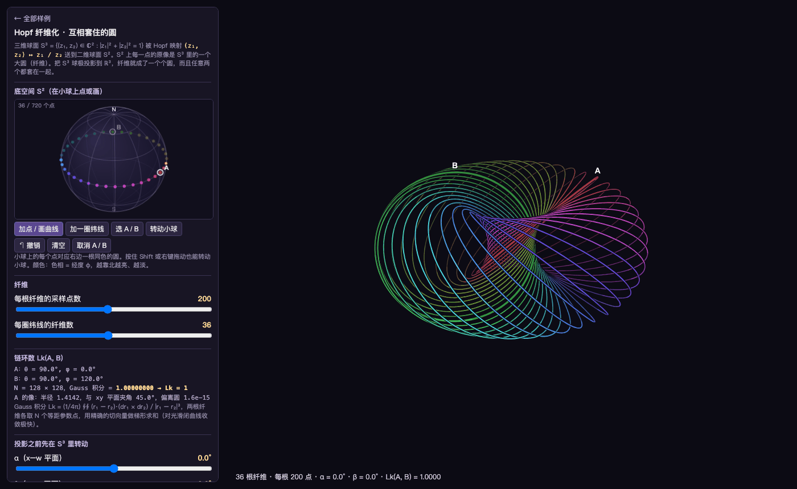

几条纬线一起选，就是一层套一层的环面，所有环面都套在北极纤维（单位圆）外面，被南极纤维（z 轴）穿过。整个 ℝ³ 加上无穷远点就是这样被铺满的：

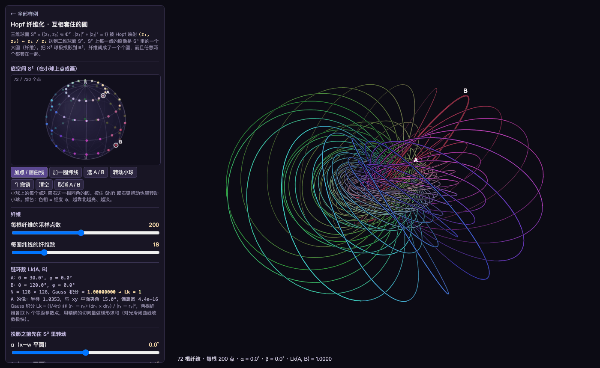

不只纬线。S² 上**任何**一个圆，原像都是一个环面，因为 S³ 的旋转可以把这个圆转成一条纬线，而旋转不改变纤维结构。下图在小球上取一个以赤道上一点为中心、角半径 35° 的小圆，它的 40 根纤维也织成一个环面，只是放倒了：

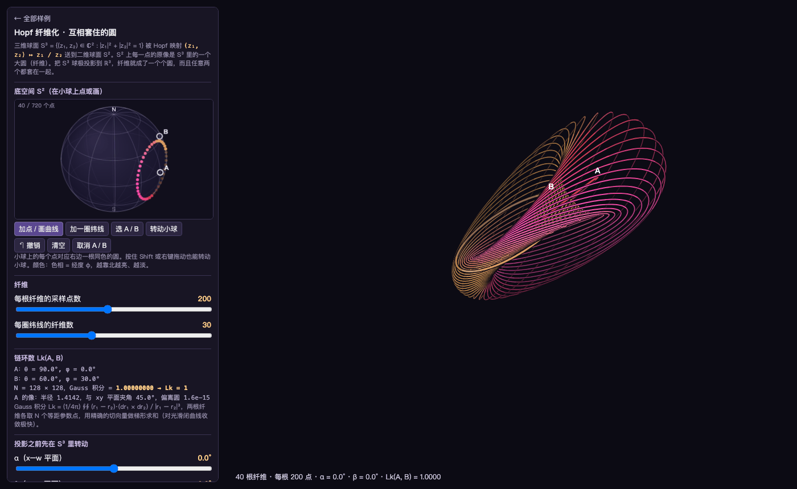

一条经线从北极走到南极，它的纤维从单位圆开始，越变越大，扫出一个曲面，最后变成 z 轴：

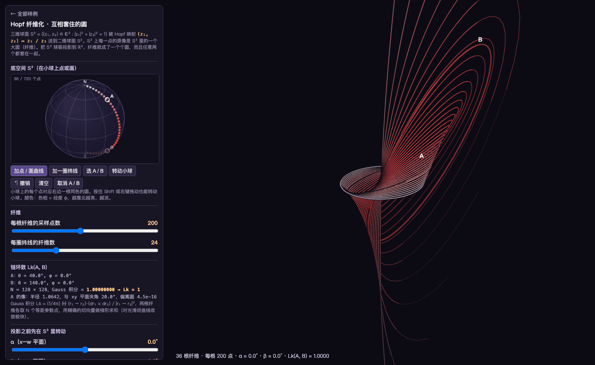

### 4. 任意两根纤维恰好套一次

两条闭曲线的**链环数** Lk 数的是一条绕另一条转了几圈。Gauss 在 1833 年给出一个积分公式：

```
Lk(γ₁, γ₂) = (1/4π) ∮∮ (r₁ − r₂)·(dr₁ × dr₂) / |r₁ − r₂|³
```

它的几何意义是：从 γ₁ 上的点看 γ₂，单位方向向量 (r₁ − r₂)/|r₁ − r₂| 扫过的总面积除以单位球面积 4π。一条曲线绕另一条一圈，方向向量正好扫过整个球面一次。

页面在“选 A / B”模式下点小球两次，选出两根纤维，就数值计算这个积分：两根纤维各取 N 个等距参数点 t，用精确的切向量 dr/dt（不是相邻点的差）做梯形求和。被积函数是两个周期变量的光滑周期函数，梯形法则对它收敛极快。默认预设里的 A、B：

| N | Gauss 积分 |
|---|---|
| 4 | 0.98836 |
| 8 | 0.99889 |
| 16 | 0.9999884 |
| 32 | 0.9999999975 |
| 64 | 1.0000000000000004 |

N 每翻一倍，误差的位数大约翻一倍，到 64 个点就只剩浮点误差。（第一版用的是“相邻点之差 × 中点”的二阶方法，N = 512 时误差还有 6 × 10⁻⁶ 到 3 × 10⁻⁵。）

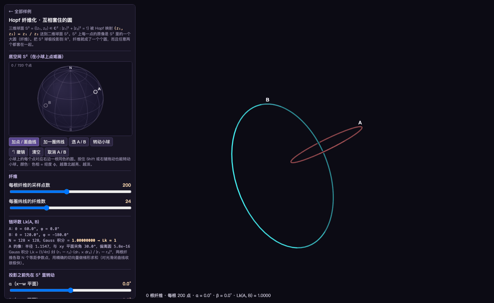

一些量出的结果：

- 在 S² 上随机取 200 对点，Gauss 积分全部落在 [0.99999999999653, 1.000000024] 里；
- 小球上随手画一条曲线，再选两个点，结果还是 1；
- 两个底点靠得越近，两根纤维在 ℝ³ 里贴得越近，需要的 N 也越多。页面按“曲线大小 / 最近距离”自动取 N（128 到 2048）：底点相距 10° 时 N = 515，结果 1 − 10⁻¹⁴；相距 1° 时 N = 2048，结果 1.00000019；相距 0.1° 时 2048 个点不够细，结果是 1.85，面板会写出“这个数值不可靠”，不会给出整数。

积分时页面不一定用屏幕上的投影。Lk 和从哪个极点投影无关，所以页面从 10 个候选的 S³ 旋转里挑一个让两根纤维投影后最小的，避免纤维经过无穷远。

**为什么永远是 1？** 两个不同底点组成的点对可以连续地移动成任何另一对（S² 上的点对空间是连通的），过程中两根纤维始终不相交，链环数是连续变化的整数，所以不会变。北极和南极这一对是单位圆和 z 轴，链环数是 1，于是任意一对都是 1。

### 5. 投影之前先在 S³ 里转

“α（x–w 平面）”和“β（z–w 平面）”在投影之前先把 S³ 转一下。投影极点相对纤维变了位置：原来的单位圆可能变得很大，原来的直线可能弯回成圆，靠近极点的纤维会被放大到画面外面。但每根纤维始终是圆，任意两根始终套一次。

| 默认 Hopf 链环，α = 60° | 赤道环面，α = 70°，β = 20° |
|---|---|
| 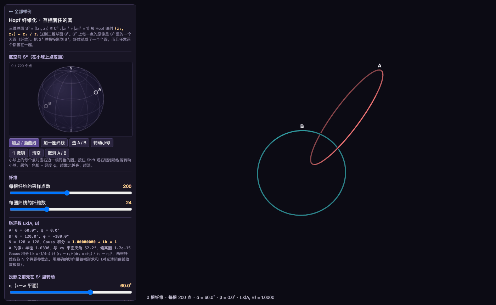 | 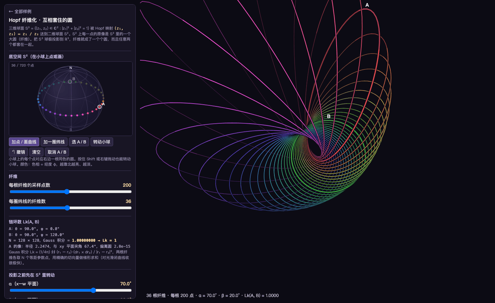 |

左图 A 的半径从 1.1547 变成 1.6330，倾角从 30° 变成 52.2°。右图同一个环面被“翻”了过来，靠近极点的那些纤维变成从画面外绕回来的大圆。用 Gauss 积分在 12 个不同的 (α, β) 下测同一对纤维（N = 512），全部是 1.000000，包括 α = 89°、β = 45° 这种纤维投影后伸到半径 162 的情况。勾选“自动 4D 旋转 α”可以看整个结构连续地翻滚。

### 6. 一个不是乘积的纤维丛

局部来看，S³ 像 S² 的一小块乘以一个圆：在一小块底空间上，可以给每根纤维选一个“起点”，纤维上的点就用（底点，转角）两个坐标描述。整体上却不行：

```
S¹ → S³ → S²,   但 S³ ≠ S² × S¹
```

理由很短：S² × S¹ 上绕 S¹ 一圈的环路收缩不了，而 S³ 上任何环路都能收缩成一点。Hopf 纤维化是第一个这样“局部是乘积、整体拧着”的非平凡纤维丛。拧法就体现在纤维两两套住：如果是乘积 S² × S¹，纤维之间就像一束平行的圆，彼此毫无关系。

在小球上画一条螺旋线，它的纤维一圈圈拧着排开，可以看出这种拧法：

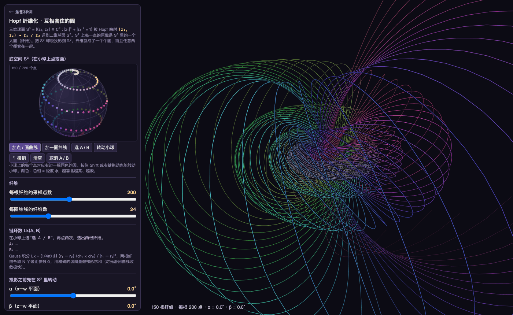

### 7. π₃(S²) = ℤ：高维球面能缠住低维球面

同伦群 πₖ(Sⁿ) 数的是从 Sᵏ 到 Sⁿ 的映射在连续变形下有几类。当 k < n 时，映射总能缩成一个点，πₖ(Sⁿ) = 0。直觉会说 k > n 时也一样：三维球面映到二维球面上，“维数多出来”，应该也能缩掉。

Hopf 映射推翻了这个直觉：它不能连续变形成常值映射。Hopf 为它定义了一个整数不变量，**Hopf 不变量**，就是 S² 上两个点的原像的链环数。常值映射的原像是空集或整个 S³，不变量是 0；Hopf 映射的不变量是 1，就是第 4 节在页面上一直量到的那个数。事实上 π₃(S²) = ℤ，由 Hopf 映射生成，Hopf 不变量就是这个整数。这是第一个被发现的“高维球面到低维球面的非平凡同伦类”，从此开启了球面同伦群这个至今没有完全算清的领域。

### 8. 物理里的 Hopf 纤维化：量子比特与 Bloch 球

一个量子比特的态是 |ψ⟩ = z₁|0⟩ + z₂|1⟩，|z₁|² + |z₂|² = 1，正好是 S³ 上一点。但整体相位 e^{it}|ψ⟩ 测不出来，物理上不同的态只是 S³ 除去这个相位，也就是 Hopf 纤维化的底空间 S²，叫 **Bloch 球**。Hopf 映射就是 Bloch 向量：(⟨σx⟩, ⟨σy⟩, ⟨σz⟩) = (2 Re z̄₁z₂, 2 Im z̄₁z₂, |z₁|² − |z₂|²)。它和页面用的 h 只差 y 分量的符号（取共轭的位置不同），纤维完全一样。北极是 |0⟩，南极是 |1⟩，每根纤维是“同一个物理态的所有相位”。

纤维丛拧着，物理上会留下痕迹。让自旋 1/2 的态沿 Bloch 球上一条闭曲线绕一圈再回到原处，态回到同一根纤维，但不一定回到纤维上的同一点，差出的相位是闭曲线围住的立体角的一半，这就是 **Berry 相位**。同一个纤维丛也是 Dirac 单位磁单极子的数学描述：磁单极子周围的电子波函数无法在整个球面上选一个连续的相位，原因正是 S³ 不是 S² × S¹。

## 操作

- 左上小球是底空间 S²：
  - **加点 / 画曲线**：单击加一根纤维，按住拖动每隔 4° 加一个点，画出一条曲线；
  - **加一圈纬线**：单击一点，加上它所在的整圈纬线（纤维数由“每圈纬线的纤维数”决定）；
  - **选 A / B**：轮流设定 A、B 两根纤维，加粗显示，并计算 Lk(A, B)；
  - **转动小球**：拖动旋转小球。任何模式下按住 Shift 或右键拖动也能转。
  - 撤销、清空、取消 A / B。最多 720 根纤维。
- 颜色：色相 = 经度 φ，越靠北越亮越淡（两极颜色趋于灰白）。小球背面的点画得较淡。
- 每根纤维的采样点数（24–400）。
- 链环数面板：A、B 的底点坐标、Gauss 积分和用的 N、A 的像的半径、倾角和偏离圆的程度。
- α、β：投影之前在 S³ 里的旋转；可勾选自动 4D 旋转。
- 右边：拖动旋转视角，滚轮缩放，双击复位，可勾选自动旋转。按 h 隐藏面板。
- 纤维被切成短段，从远到近画，远处的段颜色暗、线细。纤维不多时每段带一圈深色描边，交叉处能看出谁在前面。
- 预设：嵌套环面、一个环面（Villarceau 圆）、两极：圆和直线、Hopf 链环、一条经线、螺旋线、随机 60 点、整圈纬线。

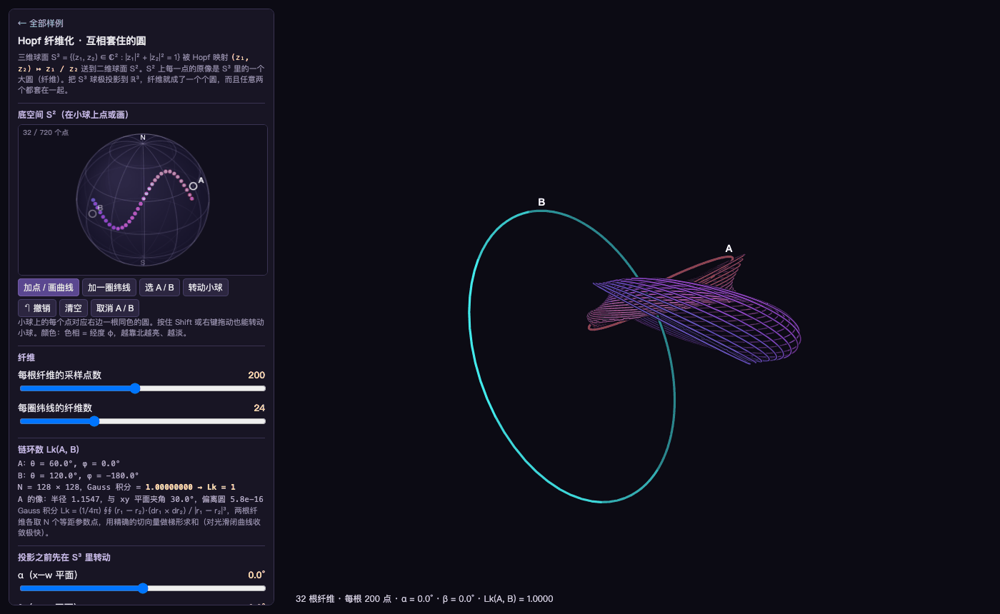

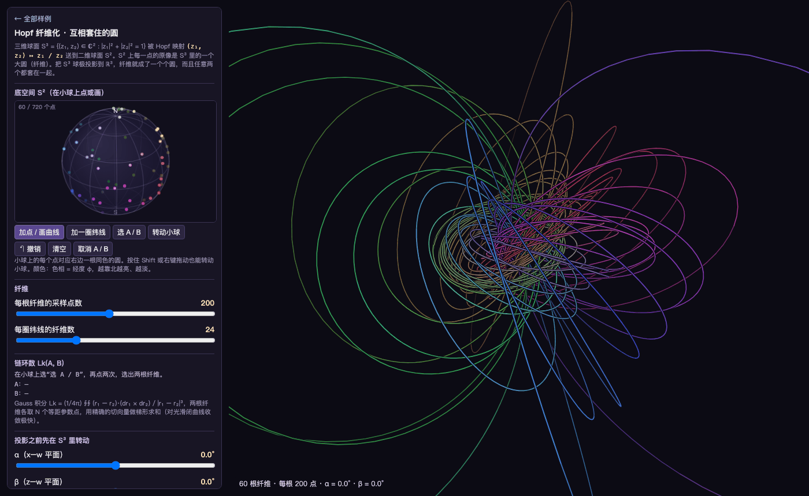

## 网址参数

| 键 | 含义 |
|---|---|
| p | 预设名：tori, torus, poles, link, meridian, spiral, random, lats |
| lat | 纬线列表（度，0–180），逗号分隔，最多 12 条；会替换预设的底点 |
| pts | 底点列表 `θ,φ;θ,φ;…`（度），最多 720 个 |
| A, B | 选中的两根纤维 `θ,φ`（度） |
| n | 每根纤维的采样点数（24–400） |
| m | 每圈纬线的纤维数（4–72） |
| a, b | 4D 旋转 α、β（度，−180–180） |
| yaw, pitch, z | 视角与缩放 |
| rot | 1 = 自动旋转视角 |
| r4 | 1 = 自动 4D 旋转 |
| ui | 0 = 只显示画布 |

所有数值参数都必须是有限数，并夹到滑块范围内；`p` 只接受上表中的名字。例如赤道环面转一下：`index.html?p=torus&a=70&b=20`；三条纬线、指定 A、B：`index.html?lat=45,90,135&A=90,0&B=135,90`。

## 参考

- H. Hopf, *Über die Abbildungen der dreidimensionalen Sphäre auf die Kugelfläche*, Mathematische Annalen 104, 1931.
- C. F. Gauss, 1833 年关于链环数积分的笔记，收于 *Werke* 第 5 卷。
- D. W. Lyons, *An Elementary Introduction to the Hopf Fibration*, Mathematics Magazine 76(2), 2003.
- H. K. Urbantke, *The Hopf fibration — seven times in physics*, Journal of Geometry and Physics 46, 2003.
- N. Johnson, [Hopf fibration video](https://nilesjohnson.net/hopf.html)：用同样的配色和嵌套环面讲解。
- [Hopf fibration](https://en.wikipedia.org/wiki/Hopf_fibration)、[Villarceau circles](https://en.wikipedia.org/wiki/Villarceau_circles)（Wikipedia）。
