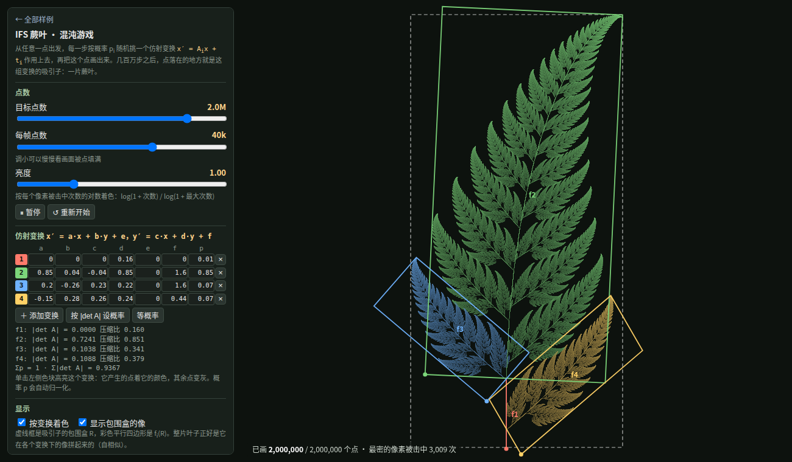
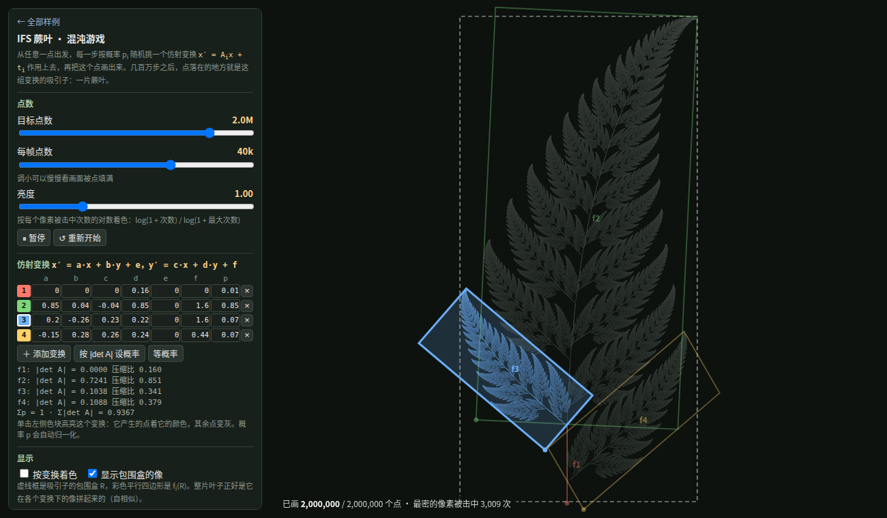
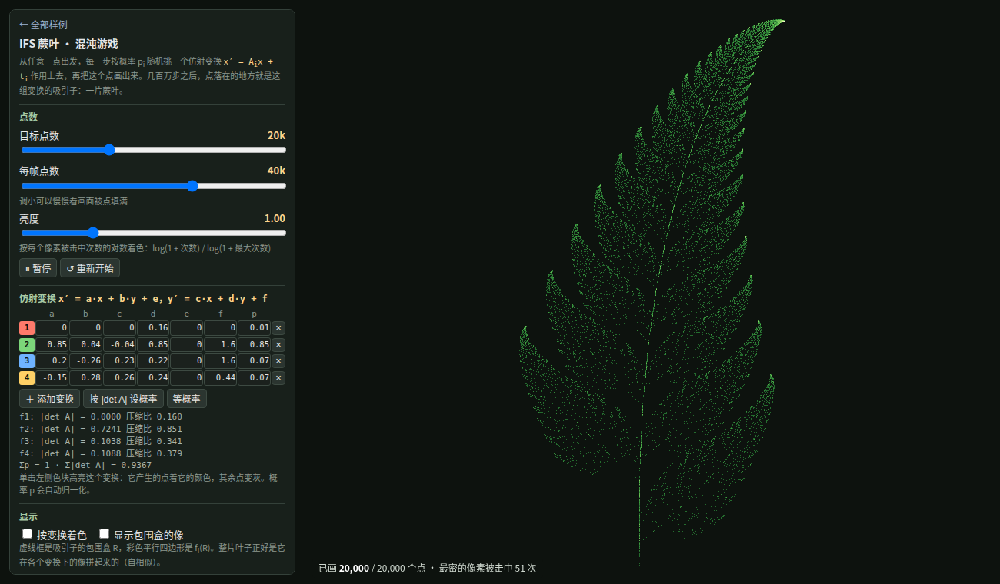
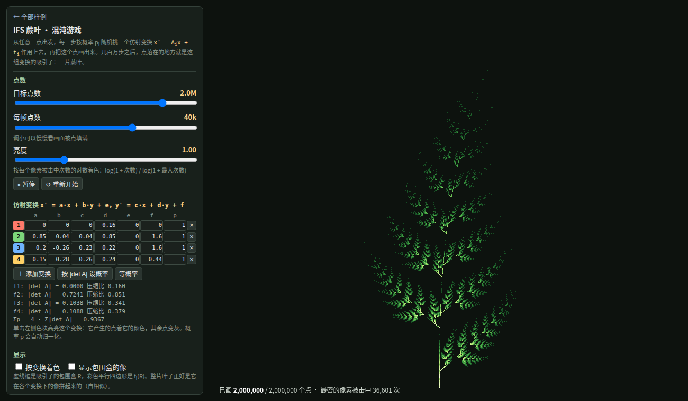
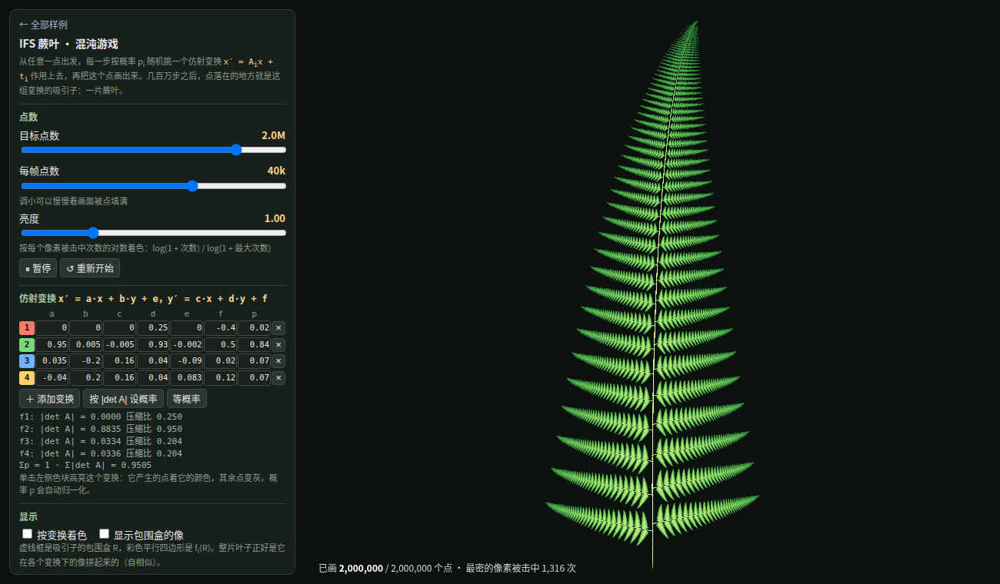
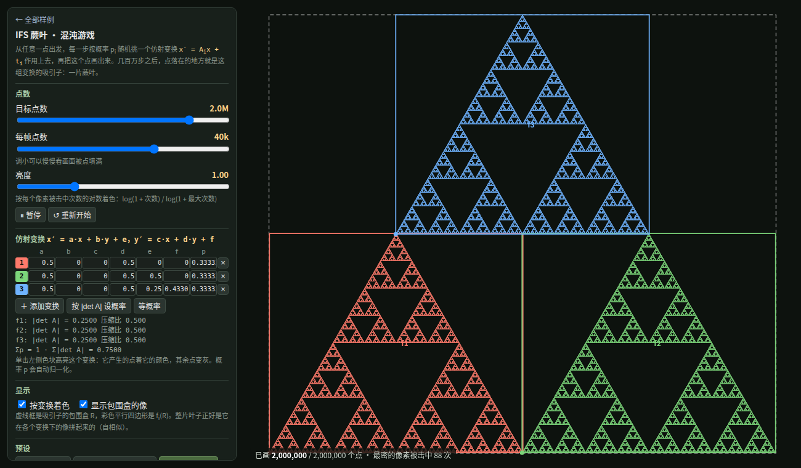
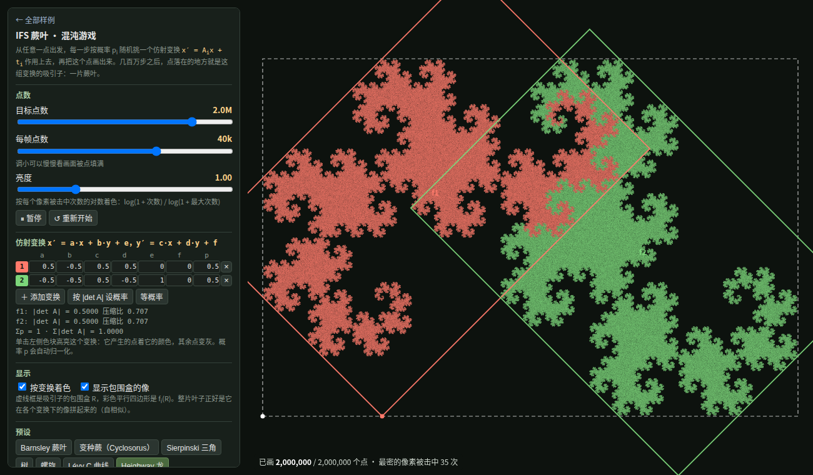
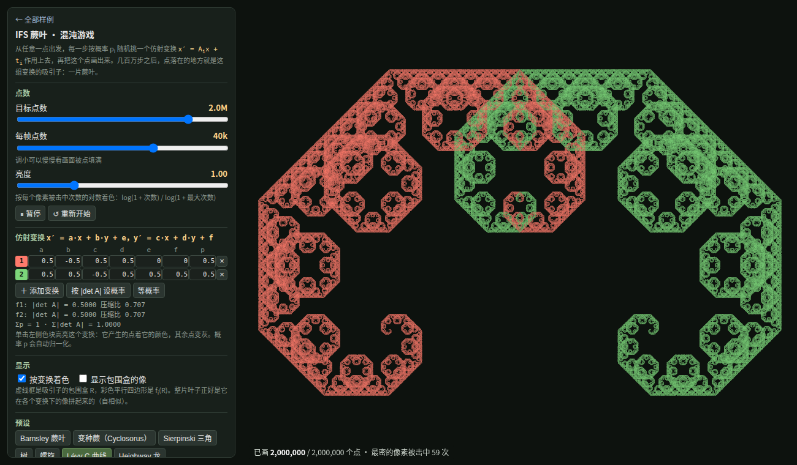
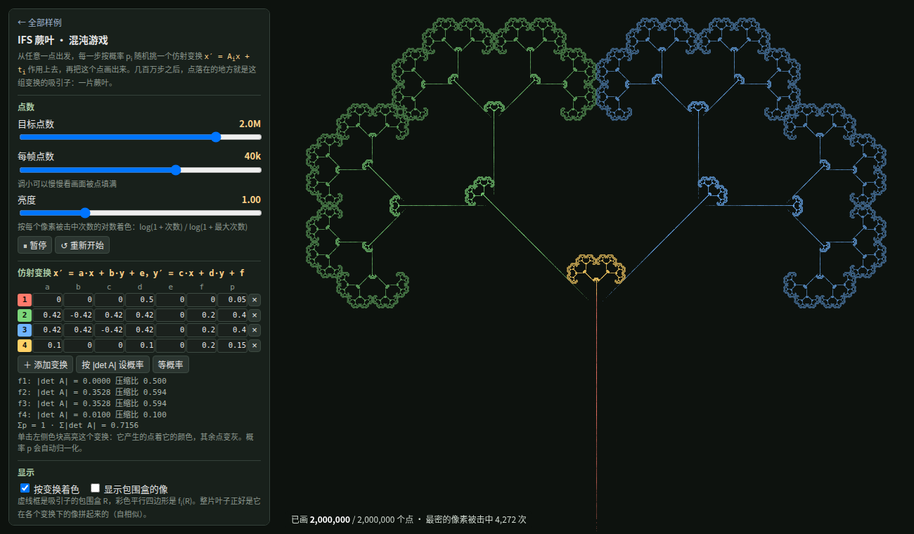

# IFS 蕨叶 · 四个仿射变换画出一片叶子


1988 年，Michael Barnsley 在《Fractals Everywhere》里给出了一张只有 4 行、28 个数字的表，用它就能画出上面这片蕨叶。画法叫“混沌游戏”：从任意一点出发，每一步随机挑一个仿射变换作用到点上，再把点画出来。点的轨迹看起来毫无规律，但重复几百万次以后，点落下的地方就是一片细节逼真的叶子。这组变换叫**迭代函数系统**（Iterated Function System，IFS），叶子是它的**吸引子**。

打开方式：用浏览器直接打开 [index.html](index.html)。页面只用 Canvas 2D，不依赖外部库，离线也能用。

## 数学原理

### 1. 仿射变换

平面上的仿射变换是“线性变换 + 平移”：

```
x′ = A x + t,   A = | a  b |,  t = | e |
                    | c  d |       | f |
```

写成分量就是 `x′ = a·x + b·y + e`，`y′ = c·x + d·y + f`。它把直线变成直线，把矩形变成平行四边形，可以同时做缩放、旋转、剪切和镜像。几个常用的量：

| 量 | 含义 |
|---|---|
| \|det A\| = \|ad − bc\| | 面积缩放倍数：任何图形经过变换后面积乘以 \|det A\| |
| det A < 0 | 变换含一次镜像（翻面） |
| A 的最大奇异值 s | 压缩比：任意两点的距离至多变为原来的 s 倍 |

如果 s < 1，这个变换就是**压缩映射**：它让任意两点靠得更近。页面在变换表下方列出每个变换的 |det A| 和压缩比，压缩比 ≥ 1 时会标红。

### 2. Hutchinson 算子与吸引子

给定 k 个压缩映射 f₁ … f_k，对平面上的任意有界闭集 S 定义

```
H(S) = f₁(S) ∪ f₂(S) ∪ … ∪ f_k(S)
```

也就是把 S 用每个变换各复制一份，再拼在一起。这个 H 叫 **Hutchinson 算子**。

**Hutchinson 定理（1981）**：如果每个 f_i 都是压缩映射，那么存在**唯一**一个非空紧集 F 满足

```
F = f₁(F) ∪ f₂(F) ∪ … ∪ f_k(F)
```

而且不管从哪个集合 S 出发，反复作用 H，H(S)、H(H(S))、… 都会收敛到 F。

原因是 Banach 不动点定理：用 Hausdorff 距离（两个集合之间“最远的点到另一个集合有多远”）来量集合之间的距离，H 本身就是一个压缩映射，压缩比等于各 f_i 压缩比中的最大值。压缩映射在完备空间里恰好有一个不动点，从任何起点迭代都会以几何速度逼近它。这个不动点 F 就是吸引子。

上面那个等式就是**自相似**的精确表述：整片叶子等于它自己在 4 个变换下的像拼起来。勾选“显示包围盒的像”可以直接看到：虚线框是叶子的包围盒 R，四个彩色平行四边形是 f₁(R) … f₄(R)。叶子在 f₂ 框里的部分是一片稍小、稍微右旋的完整叶子；f₃、f₄ 框里是最下面的左右两片小叶，各自也是一整片叶子；f₁ 把整个框压成一条线段，就是叶柄。



单击变换表左侧的色块可以高亮一个变换。下图高亮 f₃：它产生的点是蓝色的，正好是左下角那片小叶，形状和整片叶子一样，只是缩小、逆时针转了约 50°：



自相似在每一级都成立。放大任意一片小叶，看到的是又一片完整的蕨叶，它的小叶又是蕨叶：


### 3. 混沌游戏为什么能画出吸引子

直接迭代 H 要复制整个集合，k 个变换迭代 n 次就有 kⁿ 份。混沌游戏只追踪一个点：

1. 从任意点 x₀ 出发；
2. 按概率 p_i 随机选一个 i，令 x_{n+1} = f_i(x_n)；
3. 画出 x_{n+1}，回到第 2 步。

为什么点会落在 F 上，而且能把 F 画满：

- **靠近**：设 x₀ 到 F 的距离是 d。F 在每个 f_i 下都映回 F 的一部分，所以 f_i(x₀) 到 F 的距离不超过 s·d。每一步距离都至少乘以 s < 1，几十步后点和 F 的距离就小于一个像素。页面先空跑 30 步再开始画。
- **走遍**：F 上的每一点都可以用一串下标 i₁ i₂ i₃ … 来定位：f_{i₁}(F) 是 F 的一小块，f_{i₁}f_{i₂}(F) 是这一小块里更小的一块，以此类推。要让点进入某个直径小于一个像素的小块 f_{i₁}…f_{i_m}(F)，只需要最近 m 次的随机选择恰好是 i_m, …, i₁。只要每个 p_i > 0，任何有限的下标串迟早都会出现，而且出现的频率是确定的，所以每个像素都会被反复访问。

吸引子 F 只由变换决定，和概率无关；概率只决定点**多快、多均匀地**铺满它。下面是只画了 2 万个点时的样子，轮廓已经出来了，细节还很稀疏：



### 4. 概率应约等于 |det A| 的比例

点落进 f_i(F) 这一块的频率就是 p_i。而 f_i(F) 的面积大约是整片叶子面积的 |det A_i| 倍。想让每块的点密度差不多，点数比例应该和面积比例一样：

```
p_i ≈ |det A_i| / Σ_j |det A_j|
```

det A = 0 的变换（例如把整片叶子压成一条线的叶柄 f₁）面积为 0，但仍要给一个很小的正概率，否则这一部分永远画不出来。“按 |det A| 设概率”按钮就是这么做的（零面积的变换给总和的 1%）。对 Barnsley 蕨叶：

| 变换 | \|det A\| | 按面积比例 | Barnsley 原表 |
|---|---|---|---|
| f₁ 叶柄 | 0 | （给一个小值） | 0.01 |
| f₂ 主体 | 0.7241 | 0.77 | 0.85 |
| f₃ 左下小叶 | 0.1038 | 0.11 | 0.07 |
| f₄ 右下小叶 | 0.1088 | 0.12 | 0.07 |

原表的概率和面积比例接近。如果改成四个变换等概率，叶子的形状不变，但叶柄（每 4 步就被选中一次）亮得刺眼，而占面积 77% 的主体只分到 25% 的点，上半部分稀稀落落：



页面按每个像素被击中的次数着色，亮度取 log(1 + 次数) / log(1 + 最大次数)。用对数是因为各处密度可以差上千倍（上图最亮的像素被击中 3 万多次），线性着色会让大部分叶子看不见。

### 5. Barnsley 蕨叶的四个变换

| 变换 | a | b | c | d | e | f | p | 作用 |
|---|---|---|---|---|---|---|---|---|
| f₁ | 0 | 0 | 0 | 0.16 | 0 | 0 | 0.01 | 叶柄：把整片叶子压到 x = 0 上一小段竖线 |
| f₂ | 0.85 | 0.04 | −0.04 | 0.85 | 0 | 1.6 | 0.85 | 主体：缩小到 0.85 倍、顺时针转约 2.7°、上移 1.6，得到“去掉最下面一对小叶的叶子” |
| f₃ | 0.20 | −0.26 | 0.23 | 0.22 | 0 | 1.6 | 0.07 | 左下小叶：缩小到约 0.3 倍、逆时针转约 50° |
| f₄ | −0.15 | 0.28 | 0.26 | 0.24 | 0 | 0.44 | 0.07 | 右下小叶：缩小并镜像（det A < 0），朝右下方伸出 |

f₂ 的压缩比是 0.851，最接近 1，所以叶子的主轴可以向上一级一级地延伸很多层；每多一级，两侧就多一对小叶。改 f₂ 的 b、c（旋转量），叶尖弯曲的程度就会变。

改几个系数就是另一种蕨。下面的变种（Cyclosorus，金星蕨科）让 f₂ 压缩比提高到 0.95、两侧小叶变窄，叶片更长、更规整：



### 6. 和前面样例的联系：Sierpinski 三角与龙曲线

Sierpinski 三角是最简单的 IFS：三个变换都缩小一半，分别平移到三个角。每个变换的 |det A| = 1/4，三个相同，所以等概率最合适。



同一个集合在 [L-system 植物](../lsystem-plants/README.md) 里是用字符串重写 `F=F-G+F+G-F` 画出来的。两种方法对应同一个自相似结构：L-system 把每段线替换成 3 段一半长的线，IFS 把整个图形复制成 3 份一半大的图形。所以分形维数一样，都是 log 3 / log 2 ≈ 1.585。一般地，k 个压缩比都是 r 的相似变换，如果各块之间重叠很少，维数 D 满足 k·r^D = 1。

L-system 里的龙曲线也是一个 IFS：两个压缩比都是 1/√2 的相似变换，第一个转 45°，第二个转 135° 并平移到 (1, 0)。把第二个改成转 −45° 并平移到 (0.5, 0.5)，就得到 Lévy C 曲线。两者都满足 2·(1/√2)² = 1，维数为 2（边界的维数小于 2）：

| Heighway 龙 | Lévy C 曲线 |
|---|---|
|  |  |

Julia 集也是吸引子，只不过变换是非线性的：z → z² + c 的两个逆映射 z → ±√(z − c)。在 [Mandelbrot 集与 Julia 集](../mandelbrot-julia/README.md) 里，Julia 集是用“逃逸时间”画的；对这两个逆映射玩混沌游戏（“逆迭代法”），点同样会落到 Julia 集上。

其他预设：

| 树 | 螺旋 |
|---|---|
|  |  |

树的四个变换是树干（压成竖线）、左右两个各转 45° 的缩小副本（树冠），和一个缩到 0.1 倍的小副本。螺旋的 f₁ 是一个压缩比 0.987 的旋转，非常接近 1，所以绕很多圈才收拢到中心；另外两个小变换各生出一条旋臂，每条旋臂又是一个完整的螺旋。

## 操作

- 变换表：每行一个变换，a b c d e f p 都可以直接改，改完立即重画；最多 8 个变换；
- “＋ 添加变换”、行末 × 删除；“按 |det A| 设概率”“等概率”一键重设 p；p 会自动归一化；
- 单击左侧色块高亮一个变换，再点一次取消；
- 目标点数（1 千–1 千万）、每帧点数（调小可以慢慢看画面被填满）、亮度；
- 暂停 / 继续、重新开始；
- 开关：按变换着色、显示包围盒的像；
- 预设：Barnsley 蕨叶、变种蕨（Cyclosorus）、Sierpinski 三角、树、螺旋、Lévy C 曲线、Heighway 龙；
- 拖动平移，滚轮以鼠标位置为中心缩放，双击复位。平移和缩放后会按新的视野重新累积，所以放大后细节依然清楚。

## 网址参数

| 键 | 含义 |
|---|---|
| p | 预设名：fern, mutant, sier, tree, spiral, levy, dragon |
| m | 自定义变换，每个变换 `a,b,c,d,e,f,p`，多个用 `;` 分隔（p 可省略，默认 1） |
| n | 目标点数 |
| b | 每帧点数 |
| g | 亮度（0.3–3） |
| col | 1 = 按变换着色 |
| box | 1 = 显示包围盒的像 |
| hl | 高亮第几个变换（从 1 开始） |
| z, cx, cy | 缩放倍数、视野中心（吸引子坐标） |
| run | 0 = 打开时暂停 |

例如等概率的蕨叶：`index.html?m=0,0,0,0.16,0,0,1;0.85,0.04,-0.04,0.85,0,1.6,1;0.2,-0.26,0.23,0.22,0,1.6,1;-0.15,0.28,0.26,0.24,0,0.44,1`；放大一片侧叶：`index.html?p=fern&n=4000000&z=6&cx=2&cy=4.6`。

## 参考

- J. E. Hutchinson, *Fractals and self similarity*, Indiana University Mathematics Journal 30, 1981.
- M. F. Barnsley, *Fractals Everywhere*, Academic Press, 1988. 蕨叶系数取自该书。
- M. F. Barnsley, S. Demko, *Iterated function systems and the global construction of fractals*, Proceedings of the Royal Society A 399, 1985.
- [Barnsley fern](https://en.wikipedia.org/wiki/Barnsley_fern)（Wikipedia），变种蕨的系数取自此页。
- 树、螺旋的系数是 Fractint `.ifs` 文件里的经典表。
