# 李萨如图形与谐波图 · 两个振动的合成

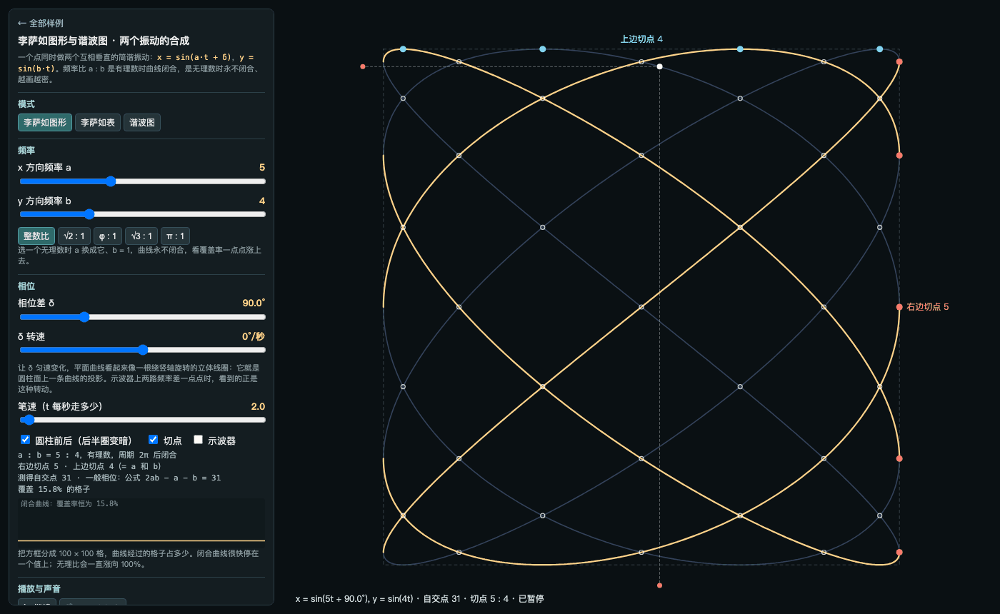

让一个点同时做两个互相垂直的简谐振动，横向按一个频率来回摆，纵向按另一个频率来回摆，它画出的曲线就是**李萨如图形**。1815 年美国数学家 Bowditch 最早研究这类曲线；1857 年法国物理学家 Lissajous 在两个音叉上各粘一面小镜子，让一束光先后被两面镜子反射到墙上，光点就画出了这些图形。频率比是简单整数比时，图形稳定、闭合、对称；频率比稍有偏差，图形就会像一根立体线圈一样慢慢转动。这正是后来示波器测频率的办法。

页面有三个模式：单条李萨如图形（可数自交点和切点、看无理比如何填满方框），经典的李萨如表格，以及 19 世纪流行的**谐波图**（harmonograph）：几个慢慢停下来的摆合成的衰减曲线。

打开方式：用浏览器直接打开 [index.html](index.html)。页面只用 Canvas 2D，不依赖外部库，离线也能用。

## 数学原理

### 1. 两个正弦的合成

页面画的曲线是

```
x(t) = sin(a·t + δ)
y(t) = sin(b·t)
```

a、b 是两个方向的频率，δ 是两路振动的相位差。振幅都取 1，所以曲线总在方框 [−1, 1] × [−1, 1] 里。几个最简单的情形用三角恒等式就能看出来：

| a : b | δ | 曲线 | 理由 |
|---|---|---|---|
| 1 : 1 | 0° | 对角线 y = x | x 和 y 是同一个函数 |
| 1 : 1 | 90° | 圆 x² + y² = 1 | x = cos t，y = sin t |
| 1 : 1 | 其他 | 斜椭圆 | 消去 t：x² − 2xy·cos δ + y² = sin² δ |
| 1 : 2 | 0° | 八字形 | y = sin 2t = 2 sin t cos t = ±2x√(1 − x²) |

a、b 有公因数时，比如 6 : 4，把 t 换成 2t 就变成 3 : 2，画出来是同一条曲线。所以只需要看**互质**的 a、b，页面会自动约分。

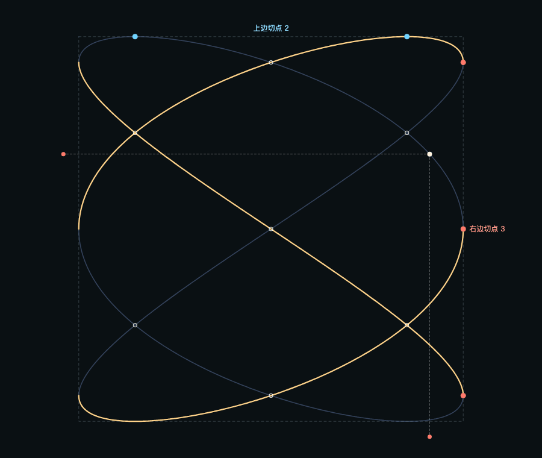

### 2. 闭合当且仅当 a / b 是有理数

**有理数时闭合。** 设 a / b = p / q（既约），取 T = 2πq / b = 2πp / a。那么 bT = 2πq，aT = 2πp 都是 2π 的整数倍，x(t + T) = x(t)，y(t + T) = y(t)：点走完 T 这段时间就回到原处，而且速度方向也一样，从此重复同一条路。页面上 a、b 是互质整数，周期就是 2π。

**闭合就一定是有理数。** 如果曲线以 T > 0 为周期，那么 y 以 T 为周期，要求 bT 是 2π 的整数倍，记作 2πm；x 以 T 为周期，要求 aT = 2πn。两式相除得 a / b = n / m，是有理数。

所以只要 a / b 是无理数（比如 √2 : 1），曲线就**永远不回到起点的状态**。它会怎样，见第 6 节。

### 3. 切点：数一数就知道频率比

x = sin(at + δ) 在一个周期 [0, 2π) 里取到最大值 1 恰好 a 次（at + δ 每走 2π 一次），所以曲线碰到右边框 a 次；同理 y 取到 1 恰好 b 次，曲线碰到上边框 b 次。也就是

```
a : b = 右边（或左边）的切点数 : 上边（或下边）的切点数
```

上图 3 : 2 的右边有 3 个红点，上边有 2 个蓝点。页面上的红点、蓝点不是按公式画上去的，而是从采样曲线上找出 x 或 y 的局部最大值，再用抛物线插值求出位置。我把 a、b 从 1 到 12 的 91 对互质组合都试了一遍（δ = 17.3°），右边和上边的切点数全部等于 a 和 b。

### 4. 自交点：2ab − a − b

数自交点要找两个不同的时刻 t₁ ≠ t₂，让 x 和 y 都相等。sin u = sin v 只有两种可能：u = v + 2kπ（平移），或者 u = π − v + 2kπ（对称）。x、y 各有这两种可能，组合起来有四种情况：

1. **y 平移，x 对称**：t₂ = t₁ + 2πk / b（k = 1 … b − 1），并且 a(t₁ + t₂) + 2δ = π (mod 2π)。对每个 k，后一个条件是关于 t₁ 的方程 2a·t₁ = 常数 (mod 2π)，在 [0, 2π) 里有 2a 个解。每个交点被 (t₁, t₂) 和 (t₂, t₁) 各数了一次，所以这一类交点有 (b − 1)·2a / 2 = a(b − 1) 个。
2. **x 平移，y 对称**：同理有 b(a − 1) 个。
3. **x、y 都平移**：t₂ − t₁ 既是 2π / b 的倍数又是 2π / a 的倍数，a、b 互质时只能是 2π 的倍数，也就是 t₂ = t₁，不算。
4. **x、y 都对称**：要求 b(t₁ + t₂) = π 且 a(t₁ + t₂) + 2δ = π (mod 2π)。一般的 δ 不满足，见下一节。

加起来，一般相位下自交点个数是

```
a(b − 1) + b(a − 1) = 2ab − a − b
```

1 : 1 是 0（椭圆），1 : 2 是 1（八字），3 : 2 是 7，5 : 4 是 31（题图）。页面用分桶网格检查采样折线的每一对线段是否相交，数出的个数显示在面板上。对 a、b ≤ 12 的全部 91 对互质组合，δ = 17.3° 时数出的个数都等于 2ab − a − b，最多的是 12 : 11 的 241 个。

### 5. 退化的相位：曲线折成一段弧

第 4 种情况一旦成立，就不是零星几个交点，而是整条曲线都和自己重合：令 t₀ 满足 b·t₀ = (2k + 1)π，若 δ 恰好让 a·t₀ + 2δ = π (mod 2π)，那么 x(t₀ − t) = x(t)、y(t₀ − t) = y(t)，后半个周期沿原路倒着走回去。这时闭合曲线压扁成一段两端开口的弧。解出来，退化相位是

```
δ ≡ 90° − a(2k + 1)·90° / b   (mod 180°),   k = 0, 1, …, b − 1
```

3 : 2 的退化相位是 45° 和 135°。这段弧的自交点个数是 (a − 1)(b − 1) / 2，3 : 2 时是 1：

| δ = 60°：一般相位，7 个自交点 | δ = 45°：退化，1 个自交点 |
|---|---|
| 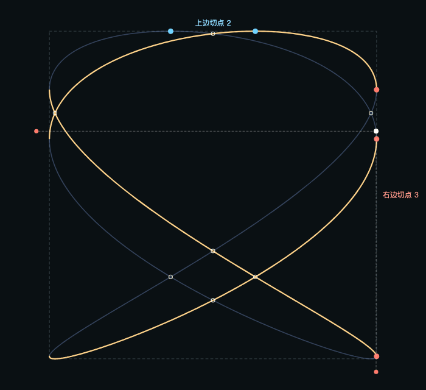 | 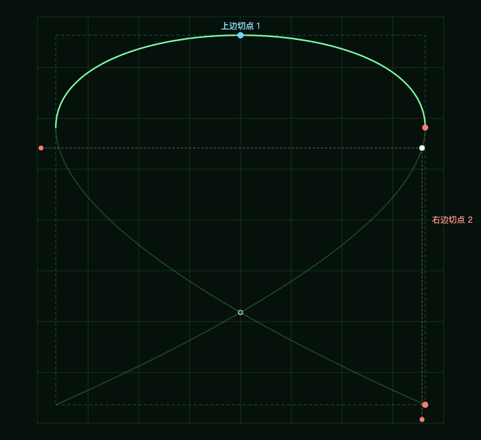 |

右图同时说明了示波器读数的一个陷阱：退化时每个切点被来回经过两次，同一处的两次切点重合，右边只剩 2 个、上边只剩 1 个，读出来是 2 : 1 而不是 3 : 2。只要把相位稍微调开一点（或者等它自己转开），3 个和 2 个切点就会重新分开。δ 落在退化值 0.05° 以内时，页面只采样半个周期，按开口弧来数交点。91 对互质组合在各自的一个退化相位上数出的个数，也全部等于 (a − 1)(b − 1) / 2。

### 6. Chebyshev 多项式：a : b = n : 1

b = 1、a = n 时，取 δ = (1 − n)·90°，曲线恰好是 Chebyshev 多项式的图像 x = T_n(y)。推导：令 y = sin t = cos u（u = t − 90°），则

```
x = sin(n·t + δ) = sin(n·u + n·90° + (1 − n)·90°) = sin(n·u + 90°) = cos(n·u) = T_n(cos u) = T_n(y)
```

最后一步就是 Chebyshev 多项式的定义 T_n(cos u) = cos(nu)。例如 T₃(y) = 4y³ − 3y，对应 sin 3t = 3 sin t − 4 sin³ t，差一个符号由 δ = 180° 补上。这是退化相位的特例（代入第 5 节公式，k = 0 时正是 (1 − n)·90° mod 180°），所以它是一段开口弧，(n − 1)(1 − 1) / 2 = 0：函数图像没有自交点。

| x = T₃(y)，δ = 180° | x = T₅(y)，δ = 0° |
|---|---|
| 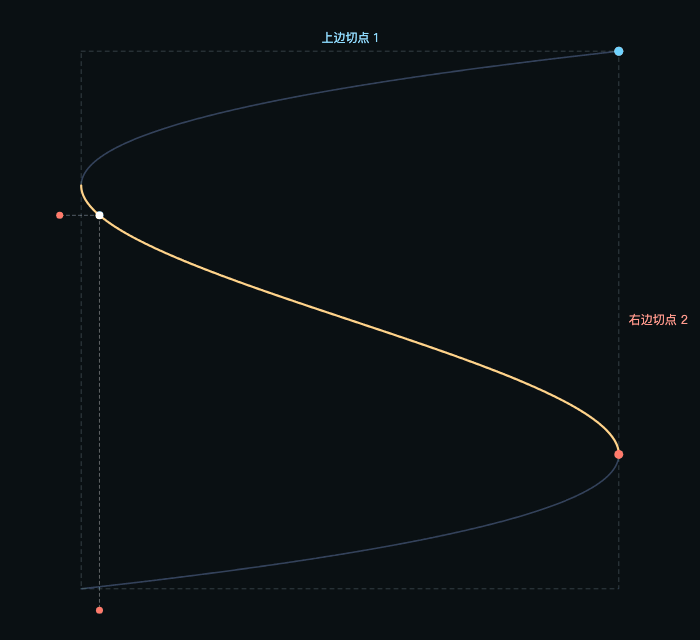 | 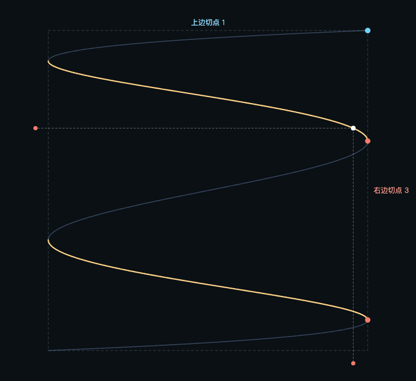 |

T_n 在 [−1, 1] 上在 1 和 −1 之间来回振荡 n 次，所以右边框被碰到的次数是 T_n = 1 的点数：T₃ 是 2 个，T₅ 是 3 个，页面数出的也是 2 和 3。一般的 a : b 在退化相位上，弧满足 T_a(x) = ±T_b(y)，这就是 Koseleff 和 Pecker 研究的 **Chebyshev 曲线**，它的 (a − 1)(b − 1) / 2 个二重点正是第 5 节的公式。

### 7. 旋转的错觉：圆柱面上的曲线

把 δ 匀速增大（“δ 转速”），平面曲线看起来像一根绕竖轴转动的立体线圈。这不是错觉的偶然，而是精确的投影。

在竖直圆柱 X² + Z² = 1 上取一条曲线

```
(X, Y, Z) = (sin a·t, sin b·t, cos a·t)
```

它绕圆柱转 a 圈的同时上下起伏 b 次。把圆柱绕竖轴 Y 转过角度 δ，再从正前方（沿 Z 轴）看过去，看到的横坐标是

```
x = X cos δ + Z sin δ = sin(a·t) cos δ + cos(a·t) sin δ = sin(a·t + δ)
```

纵坐标仍是 y = sin(b·t)。所以李萨如图形就是这条圆柱曲线的正投影，δ 就是圆柱转过的角度。δ 匀速变化，就是圆柱匀速转动。

每一点离观察者的远近是 Z′ = cos(a·t + δ)。勾选“圆柱前后”后，Z′ < 0 的后半圈画成暗蓝色，前半圈画成金色，大脑就能分出前后。下面是 3 : 4 在 δ = 90°、120°、150° 的样子，连起来看就是线圈在转：

| δ = 90° | δ = 120° | δ = 150° |
|---|---|---|
| 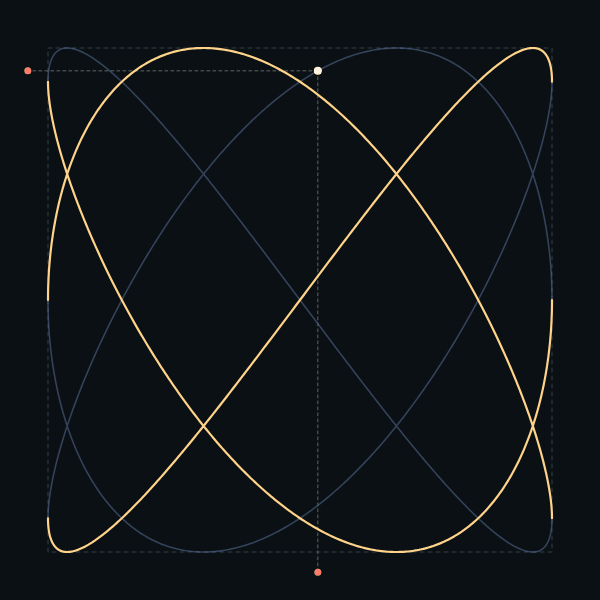 | 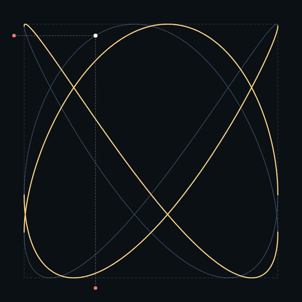 | 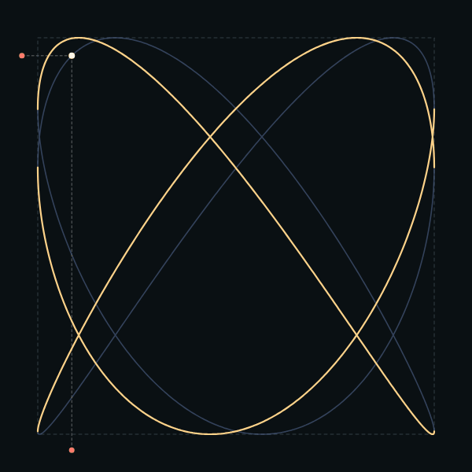 |

前后两半的分界点正好落在左右边框上：Z′ = 0 等价于 x = ±1。退化相位就是圆柱转到前后两半的投影完全重合的那一刻，所以曲线看起来折成了一段弧。

### 8. 示波器：用切点读频率比

把两路信号分别接到示波器的 X 和 Y 输入，屏幕上就是它们的李萨如图形。勾选“示波器”换成绿色荧光屏和 8 × 8 的刻度格。设一路是已知频率，另一路未知，数出右边和上边的切点数，就得到两路的频率比：下图右边 3 个、上边 4 个，f_x : f_y = 3 : 4。

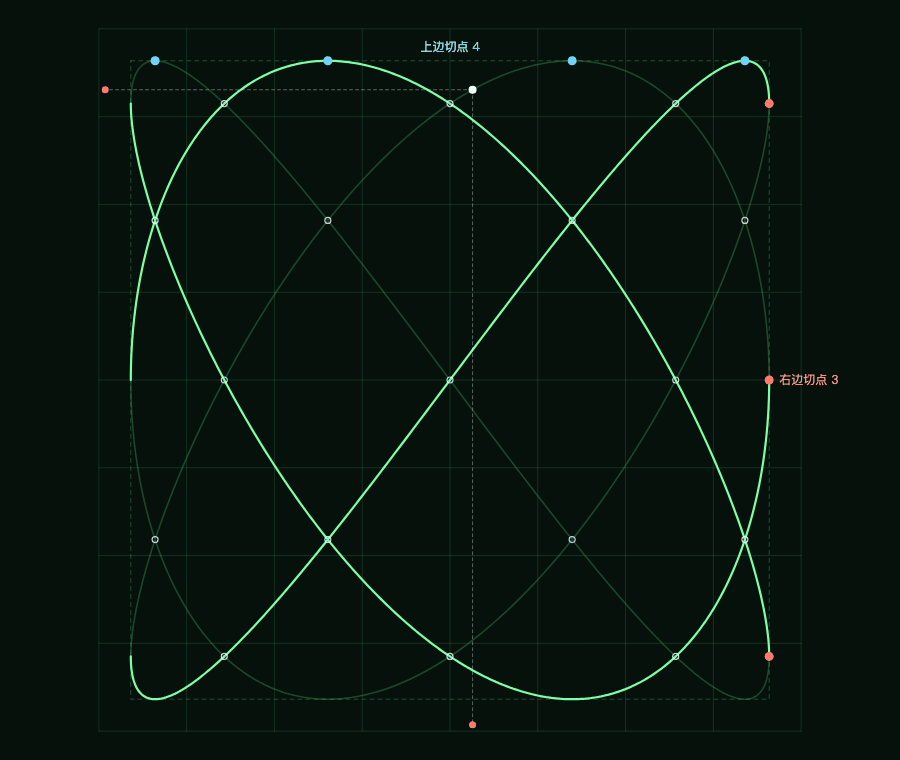

实际的两路信号频率不会恰好成整数比。如果 f_y 比 b / a · f_x 多了一点 Δf，那么 y 的相位每秒比“应有的”多走 2π·Δf。把时间平移一下吸收掉这个相位，它就变成 x 上的相位差 δ 以每秒 (a / b)·2π·Δf 的速度反向漂移，于是图形按第 7 节的方式缓缓转动。Δf 越小转得越慢，图形静止不动时频率比就是精确的 a : b。“3:4 旋转幻觉”预设用 30°/秒 模拟这种漂移。

### 9. 无理比：曲线越画越密

a / b 是无理数时，曲线永不闭合。把 x、y 的相位放到一个环面上看：θ₁ = a·t + δ，θ₂ = b·t（都 mod 2π），点 (θ₁, θ₂) 在正方形 [0, 2π)² 上以斜率 b / a 做直线运动，碰到边就从对边穿回来。

**Kronecker 定理**：斜率是无理数时，这条直线在环面上**稠密**：它会任意接近环面上的每一点。由于 (x, y) = (sin θ₁, sin θ₂) 是连续的满射，李萨如曲线也就稠密地填满整个方框。

**Weyl 等分布定理**更进一步：直线在环面上任何一块区域里停留的时间比例，最终等于那块区域的面积比例。换回 (x, y)，点在方框里的密度就不是均匀的：sin θ 在 ±1 附近变化慢，点在那里停留得久，所以边框附近比中心更密。这在下面几张图里都看得出来。

页面把方框分成 100 × 100 个格子，记录曲线经过的格子所占的比例。√2 : 1、δ = 90° 时测得：

| t | 50 | 100 | 200 | 300 | 500 | 700 | 1000 |
|---|---|---|---|---|---|---|---|
| √2 : 1 覆盖率 | 30.3% | 51.1% | 74.5% | 84.1% | 96.7% | 98.5% | 100% |
| φ : 1 | 31.9% | 55.9% | 75.9% | 85.9% | 99.2% | 100% | 100% |
| π : 1 | 37.2% | 57.5% | 86.0% | 98.9% | 100% | 100% | 100% |
| √3 : 1 | 31.0% | 56.9% | 81.8% | 90.5% | 95.9% | 98.3% | 100% |

| t = 50，30.3% | t = 200，74.5% | t = 1000，100% |
|---|---|---|
| 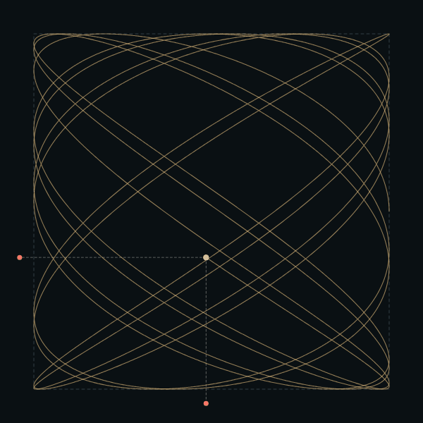 | 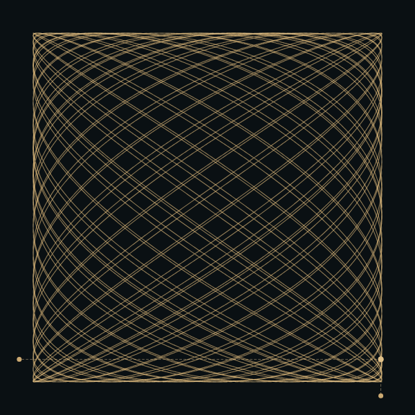 | 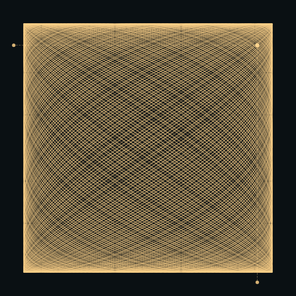 |

对比闭合曲线：它们的覆盖率在一个周期后就不再增长。δ = 17.3° 时，1 : 1 是 3.4%，3 : 2 是 8.9%，5 : 4 是 14.9%，7 : 5 是 20.8%，12 : 11 是 36.0%。a、b 越大，曲线越长，覆盖率越高，但永远停在某个值。面板下方的小图画出覆盖率随 t 的增长：

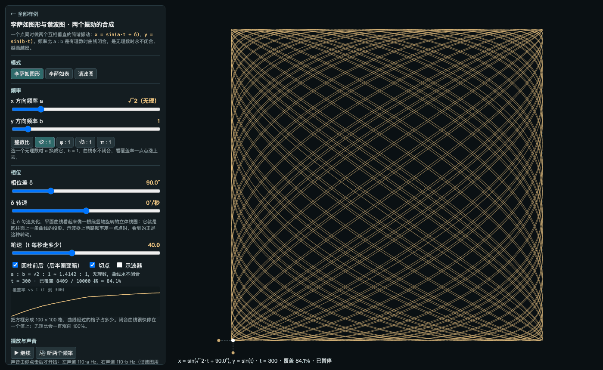

100% 只是“每个 0.02 × 0.02 的格子都被经过了”，不是曲线真的填满了面积：曲线面积始终是 0，只是在任意小的尺度上都没有空隙。

### 10. 李萨如表格

切到“李萨如表”模式，就是那张经典的动画表格：第 j 列顶上的圆以频率 a = j 转，竖线把笔尖的横坐标 sin(j·t + δ) 一路送下去；第 i 行左边的圆以频率 b = i 转，横线送来纵坐标 sin(i·t)。第 i 行、第 j 列的格子里，竖线和横线的交点就是笔尖，它画出 a : b = j : i 的李萨如图形。

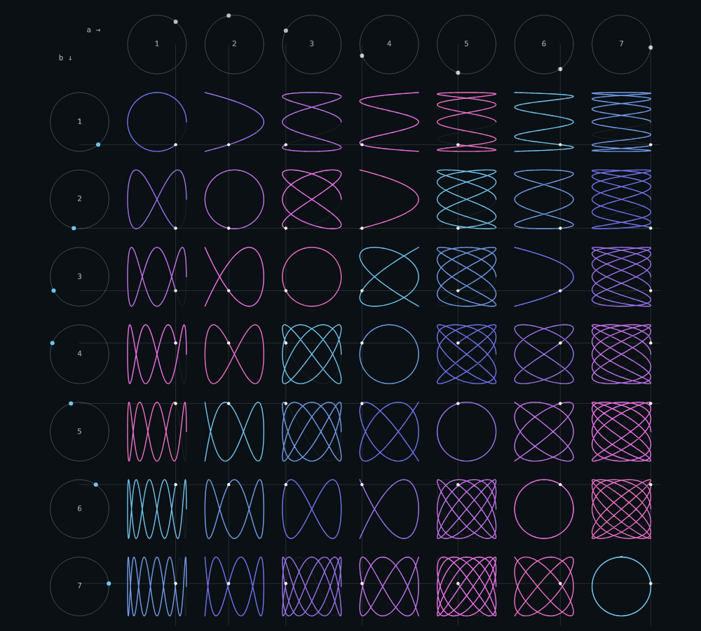

几个规律一眼就能看出：

- 对角线上 a = b，全是同一个圆（δ = 90°），比如 6 : 6 和 1 : 1 一样；
- 第 j 列、第 i 行与第 2j 列、第 2i 行画的是同一条曲线，公因数约掉后一样（例如 2 : 4 和 1 : 2）；
- 第 1 行 b = 1 的格子是 a = 1 … 7 的“侧放的多项式曲线”。δ = 90° 时，a 为奇数的格子 3 : 1、5 : 1、7 : 1 都是闭合回路，而 a 为偶数的 2 : 1、4 : 1、6 : 1 正好落在退化相位上，变成 x = ±T_a(y) 那样的开口弧。

### 11. 谐波图：会停下来的摆

真实的摆会因为摩擦慢慢停下来。19 世纪的**谐波图**（harmonograph）就是用这一点作画的：几个摆分别推动画笔和画纸，每个摆的振幅按指数衰减，于是笔画出一圈套一圈、越来越小的李萨如图形，直到停在中心。页面的公式是

```
x(t) = A₁ sin(f₁t + φ₁) e^{−d₁t} + A₂ sin(f₂t + φ₂) e^{−d₂t}
y(t) = A₃ sin(f₃t + φ₃) e^{−d₃t} + A₄ sin(f₄t + φ₄) e^{−d₄t}
```

x 方向两个摆、y 方向两个摆，各有频率 f、初相 φ、振幅 A、阻尼 d。

**为什么要“失谐”。** 如果频率比是精确的 2 : 1，衰减的曲线只是同一个图形一圈圈缩小，线条重叠在一起。把频率故意调偏一点点，比如 2.006 : 1，那么由第 8 节，相当于相位差以 0.006 弧度每单位时间慢慢转动；同时振幅在衰减。两者叠加，每一圈都比上一圈小一点、转一点，线条就排成了丝带般的曲面。

| 2 : 1 失谐（f = 2.006 : 1，时长 400） | 3 : 2 失谐（f = 3.004 : 2，时长 450） |
|---|---|
| 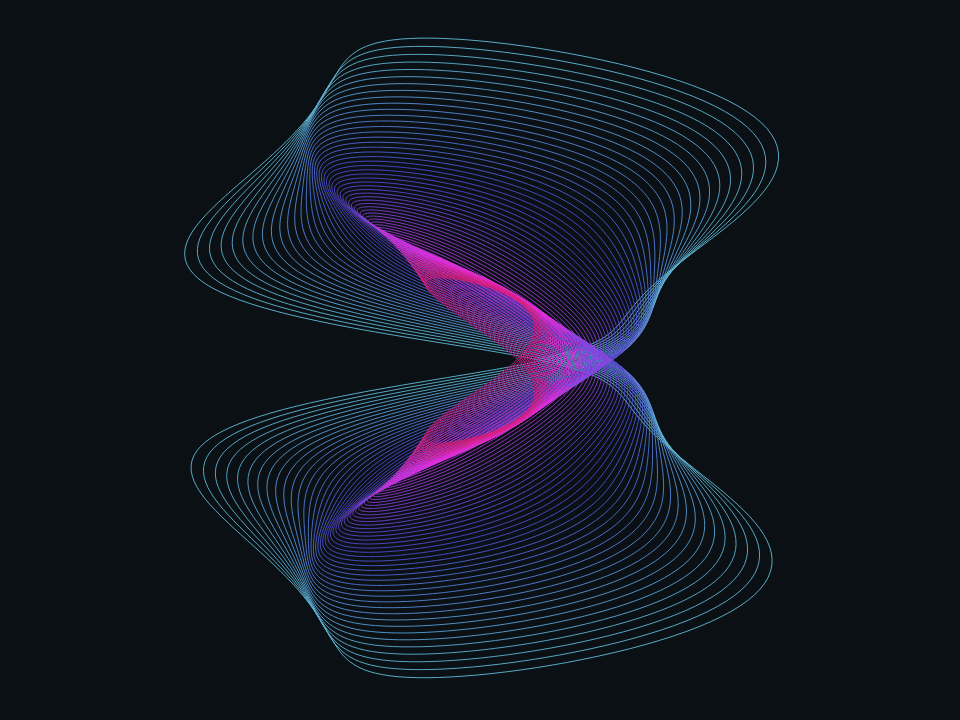 | 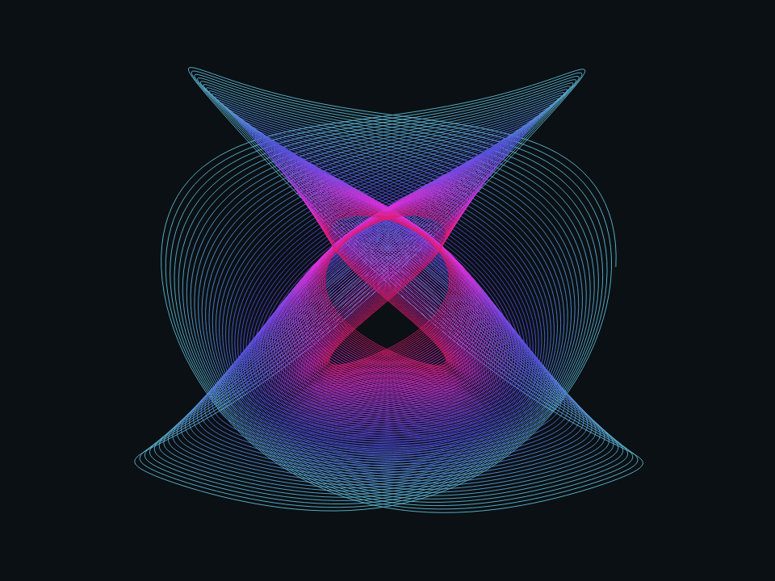 |

2 : 1 失谐预设到 t = 400 时，x₁ 摆的振幅剩下 e^{−0.004·400} = 0.202。颜色从青色渐变到品红，表示时间先后：外圈先画，中心最后画。

**1 : 1 失谐。** 两个方向频率几乎相同（2.000 : 2.006）、相位差 90° 时，开始是一个圆；相位差慢慢漂移，圆压扁成椭圆，再压成一条斜线，然后又张开成反向转的椭圆。振幅同时缩小，画出一只“眼睛”。

**旋转摆。** 很多谐波图的画纸放在一个可以向任意方向摆动的平台上，平台走的是圆或椭圆，相当于给 x 加 sin、给 y 加 cos：

```
x 多一项 A₂ sin(f₂t + φ₂) e^{−d₂t},   y 多一项 A₂ cos(f₂t + φ₂) e^{−d₂t}
```

勾选“旋转摆”后，第二个 x 摆就变成这个转圈的平台，第二个 y 摆不再使用（面板上变灰）。

| 1 : 1 失谐 | 旋转谐波图 |
|---|---|
| 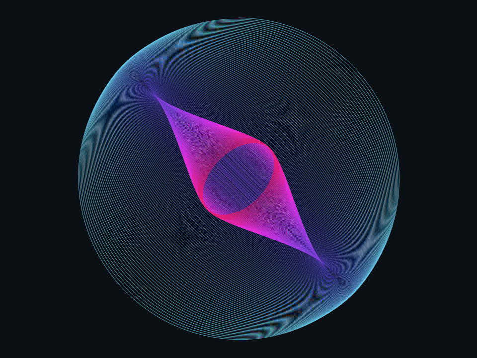 | 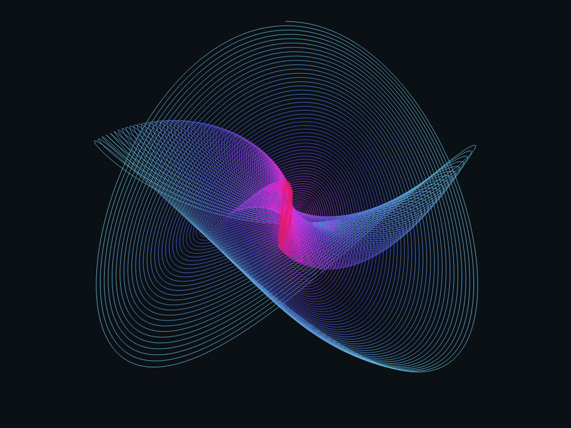 |

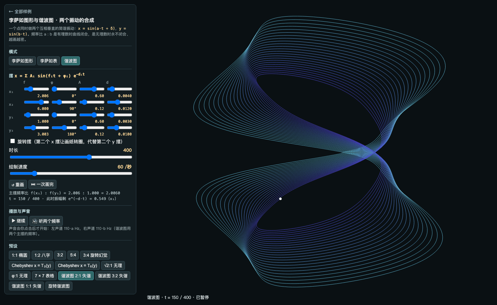

### 12. 谐波图的历史

- **1815 年**，Nathaniel Bowditch 研究复合摆（摆绳在半途分叉成 Y 形，两个方向的摆长不同），得到这类曲线，所以它们也叫 Bowditch 曲线。
- **1844 年**，格拉斯哥的数学家 Hugh Blackburn 做了“Blackburn 摆”：一个漏斗挂在 Y 形绳上，漏下的沙子在地上画出李萨如图形。
- **1857 年**，Jules Antoine Lissajous 用两个带镜子的音叉把图形投到墙上，用来比较音叉的频率。这比用耳朵听准确得多。
- **19 世纪后半叶**，维多利亚时代的英国流行用摆作画的“谐波图”，成为客厅里的科学玩具和讲座演示。有两摆的、三摆的，还有让画纸转圈的旋转式。1909 年出版的《Harmonic Vibrations and Vibration Figures》（H. C. Newton 编，J. Goold、C. E. Benham、R. Kerr、L. R. Wilberforce 撰文）系统整理了各种谐波图的结构和图案。
- **20 世纪**，阴极射线示波器出现后，李萨如图形成了电子工程师测频率、测相位的日常工具：两路信号的频率比用第 8 节的切点数读出，相位差从椭圆的倾斜程度读出（第 1 节表格里的 sin² δ 关系）。

### 13. 听两个频率

点“🔊 听两个频率”后，页面用 Web Audio API 发出两个正弦音：左声道 110·a Hz，右声道 110·b Hz（谐波图模式用 f(x₁) 和 f(y₁)）。3 : 2 是 330 Hz 和 220 Hz，正好是纯五度；2 : 1 是八度；5 : 4 是纯律大三度。频率比越简单，听起来越和谐，图形也越简单。谐波图的 2 : 1 失谐是 220.66 Hz 对 110 Hz，一个略微走调的八度，对应画面上的缓慢转动。声音只在点击后开始，再点一次关掉。

## 操作

- 模式：李萨如图形、李萨如表、谐波图；
- 李萨如图形：频率 a、b（1–12 的整数，自动约分），或者选一个无理比 √2、φ、√3、π；相位差 δ；δ 转速（−90 到 90 °/秒）；笔速；
- 开关：圆柱前后（后半圈变暗）、切点（红点是左右切点，蓝点是上下切点，白圈是自交点）、示波器样式；
- 面板显示：约分后的 a : b、测得的切点数和自交点数、对应的公式（一般相位 2ab − a − b，退化相位 (a − 1)(b − 1)/2）、是否是 Chebyshev 多项式、覆盖率和覆盖率曲线；
- 李萨如表：行列数 3–9，画一圈用时；δ 和 δ 转速同样适用；
- 谐波图：4 个摆的 f、φ、A、d；旋转摆开关；时长；绘制速度；重画；一次画完；
- 暂停 / 继续；声音开关；
- 预设：1:1 椭圆、1:2 八字、3:2、5:4、3:4 旋转幻觉、Chebyshev T₃ 和 T₅、√2:1 和 φ:1 无理、7 × 7 表格，谐波图 2:1 失谐、3:2 失谐、1:1 失谐、旋转谐波图。

## 网址参数

| 键 | 含义 |
|---|---|
| p | 预设：ellipse, eight, r32, r54, spin, cheb3, cheb5, sqrt2, phi, table, near21, near32, unison, rotary |
| m | 模式：liss, table, harm |
| a, b | 频率（1–12） |
| irr | 无理比：sqrt2, phi, sqrt3, pi |
| d | 相位差 δ（度，0–360） |
| w | δ 转速（度/秒，−90 到 90） |
| v | 笔速（0.2–100） |
| t | 笔尖在一个周期里的位置（0–2π） |
| n, ts | 表格的行列数、画一圈用时 |
| f1–f4, ph1–ph4, A1–A4, d1–d4 | 谐波图 x₁、x₂、y₁、y₂ 四个摆的参数 |
| T, hs | 谐波图的时长、绘制速度 |
| rot | 1 = 旋转摆 |
| pre | 打开时先画到这个 t（无理比和谐波图） |
| depth, mk, scope | 0 / 1：圆柱前后、切点、示波器样式 |
| run | 0 = 打开时暂停 |
| ui | 0 = 隐藏面板，只留画布 |

所有数值都会被限制在对应滑块的范围内，非法值被忽略。例如 7 : 5 的自交点：`index.html?a=7&b=5&d=10`（58 个）；√2 : 1 画到 t = 300：`index.html?p=sqrt2&pre=300`；只看旋转谐波图：`index.html?p=rotary&pre=500&ui=0`。

## 参考

- J. A. Lissajous, *Mémoire sur l'étude optique des mouvements vibratoires*, Annales de Chimie et de Physique 51, 1857.
- N. Bowditch, *On the motion of a pendulum suspended from two points*, Memoirs of the American Academy of Arts and Sciences 3, 1815.
- H. C. Newton (ed.), *Harmonic Vibrations and Vibration Figures*, Newton & Co., London, 1909.
- M. G. V. Bogle, J. E. Hearst, V. F. R. Jones, L. Stoilov, *Lissajous knots*, Journal of Knot Theory and Its Ramifications 3, 1994. 李萨如曲线 2ab − a − b 个交点的来源。
- P.-V. Koseleff, D. Pecker, *Chebyshev knots*, Journal of Knot Theory and Its Ramifications 20, 2011. Chebyshev 曲线 T_a(x) = T_b(y) 与它的 (a − 1)(b − 1)/2 个二重点。
- H. Weyl, *Über die Gleichverteilung von Zahlen mod. Eins*, Mathematische Annalen 77, 1916.
- [Lissajous curve](https://en.wikipedia.org/wiki/Lissajous_curve)、[Harmonograph](https://en.wikipedia.org/wiki/Harmonograph)（Wikipedia）。
