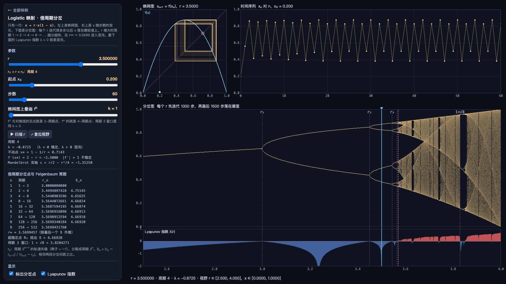
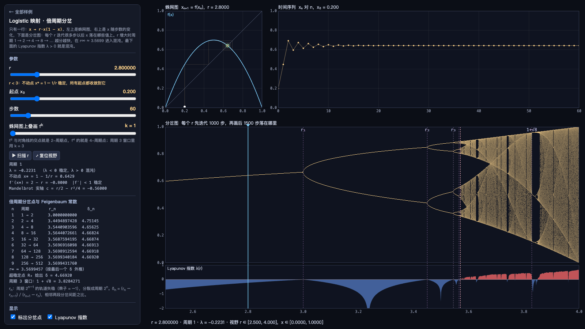
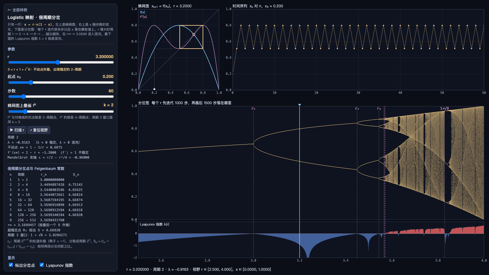
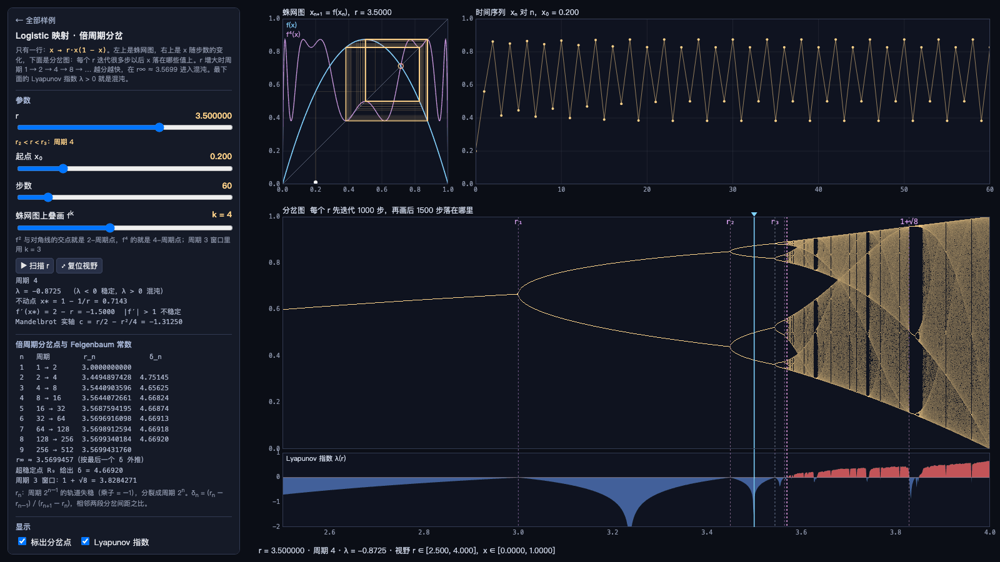
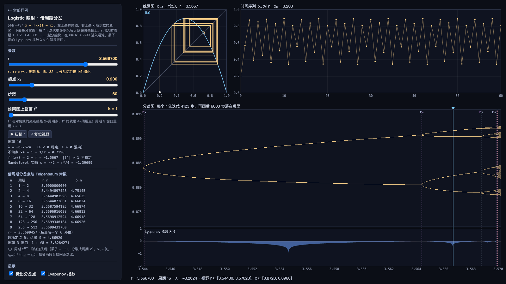
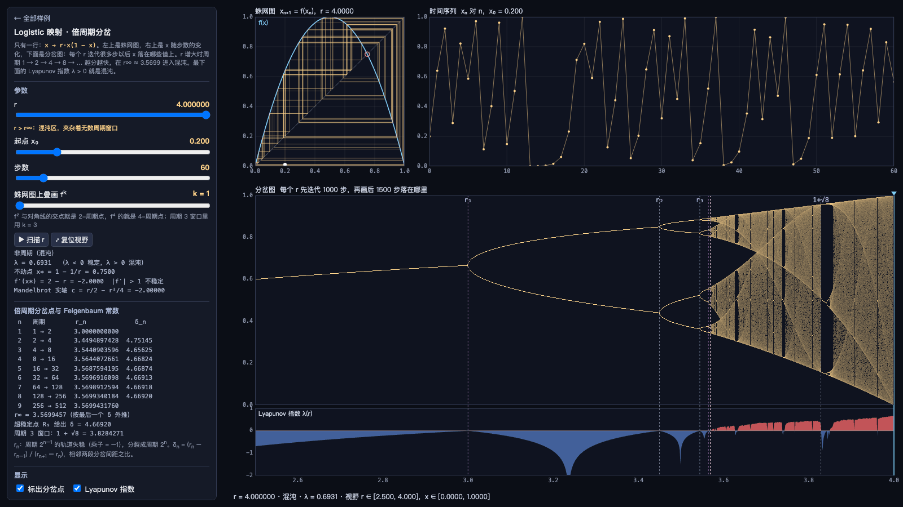
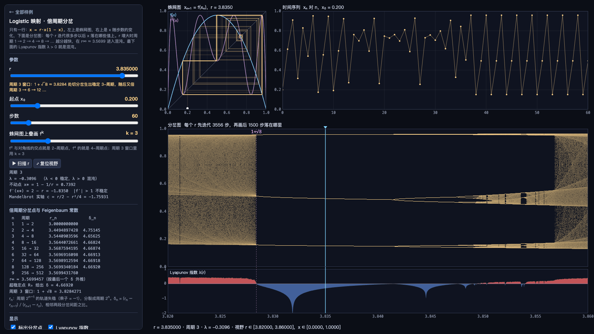
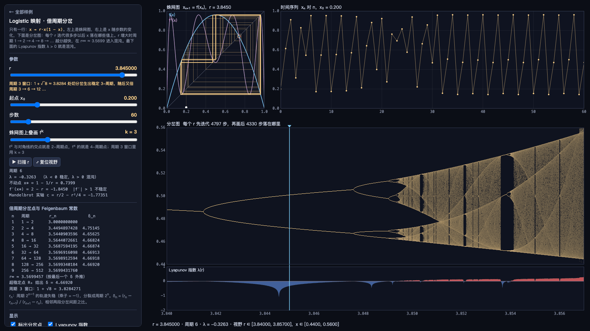
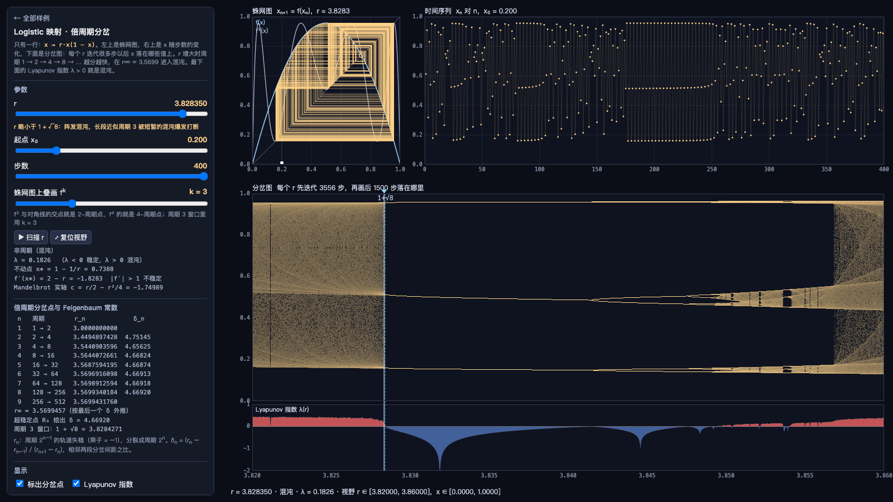
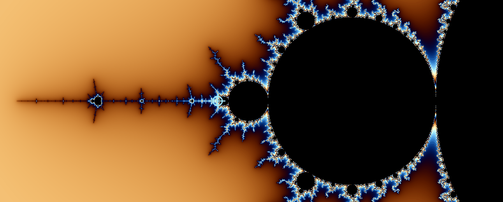

# Logistic 映射 · 倍周期分岔



1976 年，生物学家 Robert May 在《Nature》上发表了一篇短文，标题是《非常简单的数学模型，非常复杂的动力学》。他研究的模型只有一行：

```
x_{n+1} = r · x_n · (1 − x_n)
```

x 是种群数量占环境容量的比例（0 到 1），r 是繁殖率。x 小的时候下一代约为 r·x，按指数增长；x 接近 1 时 (1 − x) 把增长压下来。May 发现，r 从 2.5 调到 4 的过程中，这个二次函数依次给出稳定的平衡、2 年一循环、4 年一循环、8 年一循环……然后是混沌。两年后 Mitchell Feigenbaum 测出相邻两次分岔的间距之比趋向同一个常数 δ ≈ 4.669，而且这个数和具体的函数无关。

页面里左上是**蛛网图**，右上是 **xₙ 随 n 的变化**，下面是**分岔图**：横轴是 r，每个 r 先迭代几千步，把后面的 x 值画成点。最下面一条是 **Lyapunov 指数** λ(r)，蓝色 λ < 0 是稳定的周期，红色 λ > 0 是混沌。

打开方式：用浏览器直接打开 [index.html](index.html)。页面只用 Canvas 2D，不依赖外部库，离线也能用。

## 数学原理

### 1. 蛛网图与不动点

把 f(x) = r·x(1 − x) 的图像（开口向下的抛物线）和对角线 y = x 画在一起。从 x₀ 出发：竖直走到抛物线上，得到 f(x₀)；再水平走到对角线上，这个点的横坐标就是 x₁ = f(x₀)。重复下去，轨迹像一张蛛网。

抛物线和对角线的交点是**不动点** f(x*) = x*。解 r·x(1 − x) = x 得 x = 0 和

```
x* = 1 − 1/r
```

不动点稳不稳定，看那里的斜率。在 x* 附近写 x = x* + e，则 f(x) ≈ x* + f′(x*)·e，误差每步乘以 f′(x*)：

```
f′(x) = r(1 − 2x)，   f′(x*) = r(1 − 2 + 2/r) = 2 − r
```

|2 − r| < 1，也就是 1 < r < 3 时误差缩小，x* 稳定。下图 r = 2.8，f′(x*) = −0.8：斜率为负，所以蛛网是绕着交点转圈收进去的，时间序列上下摆动着收敛到 0.6429。



### 2. r = 3：第一次倍周期分岔

r 超过 3，f′(x*) < −1，误差每步反号并且变大，x* 失稳。轨道没有飞走（抛物线把 [0, 1] 映回 [0, 1]），而是落到两个值之间来回跳：**2-周期**。

看 f²（f 复合两次）就明白为什么。f² 的不动点就是 f 的 2-周期点。在 x* 处 f² 的斜率是 f′(x*)² = (2 − r)²，r 增大到 3 时它从小于 1 变成大于 1，f² 的图像在 x* 附近从“平着穿过对角线”变成“陡着穿过对角线”，两侧各多出一个交点。这两个新交点 x₁、x₂ 就是 2-周期。页面里把“叠画 fᵏ”设为 k = 2，紫色曲线就是 f²：



2-周期可以直接解出来。f²(x) = x 是四次方程，除掉 x = 0 和 x = x* 两个根，剩下

```
r²x² − r(r + 1)x + (r + 1) = 0
```

2-周期的乘子（f² 在周期点的斜率）由链式法则等于 f′(x₁)·f′(x₂)，代入韦达定理化简得

```
f′(x₁)·f′(x₂) = −r² + 2r + 4
```

它等于 −1 时 2-周期失稳：r² − 2r − 5 = 0，r₂ = 1 + √6 = 3.4494897。页面算出的值是 3.4494897428。

### 3. 级联：1 → 2 → 4 → 8 → …

同样的事一再发生：2-周期在 r₂ 处失稳生出 4-周期，4-周期在 r₃ 处生出 8-周期……每次都是 f^(2ⁿ) 的一个不动点斜率穿过 −1。r = 3.5 时是 4-周期，f⁴ 和对角线有 4 个稳定交点：



再往后解析式解不出来了，页面用数值方法找 rₙ。先用牛顿法找**超稳定参数** Rₙ：临界点 1/2 恰好落在 2ⁿ-周期上，f^(2ⁿ)(1/2) = 1/2，此时乘子为 0，Lyapunov 曲线在这里有一个向下的尖。rₙ 夹在 Rₙ₋₁（乘子 0）和 Rₙ（乘子已小于 −1）之间，在这个区间里对“乘子 = −1”二分 70 次。面板里的表就是结果：

| n | 周期 | rₙ | δₙ = (rₙ − rₙ₋₁)/(rₙ₊₁ − rₙ) |
|---|---|---|---|
| 1 | 1 → 2 | 3.0000000000 | |
| 2 | 2 → 4 | 3.4494897428 | 4.75145 |
| 3 | 4 → 8 | 3.5440903596 | 4.65625 |
| 4 | 8 → 16 | 3.5644072661 | 4.66824 |
| 5 | 16 → 32 | 3.5687594195 | 4.66874 |
| 6 | 32 → 64 | 3.5696916098 | 4.66913 |
| 7 | 64 → 128 | 3.5698912594 | 4.66918 |
| 8 | 128 → 256 | 3.5699340184 | 4.66920 |
| 9 | 256 → 512 | 3.5699431760 | |

分岔间距每次缩小约 4.669 倍，比值收敛到 **Feigenbaum 常数**

```
δ = 4.669201609…
```

用超稳定点算出的比值 (Rₙ − Rₙ₋₁)/(Rₙ₊₁ − Rₙ) 也收敛到同一个数，页面里最后一个是 4.66920。间距是等比数列，所以分岔点有一个极限：

```
r∞ ≈ r₉ + (r₉ − r₈)/(δ − 1) = 3.5699457
```

r∞ 之后就是混沌。

**δ 是普适的。** 把 r·x(1 − x) 换成 r·sin(πx)，或者任何一个只有一个光滑二次极大值的函数，测出的 δ 都是 4.6692。Feigenbaum 的解释是“重整化”：f² 在一个周期点附近放大、翻转以后，长得和 f 本身差不多；每倍周期一次，就相当于把函数放大一次。放大倍数和函数细节无关，只取决于极大值是二次的。在实验里也测到过这个数，例如加热的液氦对流和非线性电路。

这种自相似在分岔图里直接看得到。下图把 r ∈ [3.544, 3.5702]、x ∈ [0.872, 0.896] 放大：从 r₃ 开始的这一支，又是一张完整的、上下翻转的分岔图，r₄、r₅、r₆ 依次排开：



### 4. Lyapunov 指数

蛛网图里看稳定性看的是一步的斜率。对一般的轨道，把 n 步的斜率乘起来：起点差 e，n 步后差

```
eₙ ≈ |f′(x₀)| · |f′(x₁)| ⋯ |f′(xₙ₋₁)| · e
```

取对数平均，就是 **Lyapunov 指数**

```
λ = lim (1/N) Σ ln|f′(xₙ)| = lim (1/N) Σ ln|r(1 − 2xₙ)|
```

λ < 0：相邻的起点越走越近，轨道落到稳定周期上；λ > 0：相邻起点按 e^{λn} 分开，这就是混沌。页面在当前 r 上先迭代 2 万步，再平均 10 万步（分岔图下面的曲线每列只平均 1500–6000 步，所以有毛刺）：

| r | 页面测得 λ | 说明 |
|---|---|---|
| 2.8 | −0.2231 | = ln\|2 − r\| = ln 0.8 |
| 3.2 | −0.9163 | 2-周期，= ½ ln\|−r² + 2r + 4\| = ½ ln 0.16 |
| 3.236068 = 1 + √5 | −8.06 | 超稳定点 R₁，理论上是 −∞ |
| 3.5 | −0.8725 | 4-周期 |
| 3.7 | 0.3537 | 混沌 |
| 3.835 | −0.3096 | 周期 3 窗口 |
| 3.9 | 0.4978 | 混沌 |
| 4 | 0.6931 | = ln 2 |

每个分岔点 rₙ 上，λ 正好碰到 0：周期轨道的乘子是 −1，误差既不放大也不缩小。

r = 4 时 λ = ln 2 是精确值。令 x = sin²(πθ/2)，r = 4 的映射就变成 θ → 2θ (mod 1)：每步把二进制小数点右移一位。起点只差 10⁻¹⁰，大约 log₂(10⁹) ≈ 30 步后误差就到了 0.1 这个量级（页面里测得 30 步）。



### 5. 周期 3 窗口：“周期三意味着混沌”

r∞ 之后的混沌区并不是一片混沌，里面有无数白色的竖条，每一条都是一个**周期窗口**。最宽的一条在 r = 1 + √8 ≈ 3.8284271 处打开，里面是稳定的 3-周期：



它的来历和倍周期不一样。r 略小于 1 + √8 时，f³ 的图像有三处“几乎碰到”对角线；r = 1 + √8 时恰好相切，相切点一分为二，一个稳定、一个不稳定。这叫**切分岔**（鞍结分岔），页面测得在 1 + √8 + 10⁻⁹ 处新生 3-周期的乘子是 0.99947，接近 +1。窗口里接着发生自己的倍周期级联：3-周期在 R = 3.8318741 超稳定，在 r = 3.8414990 分岔成 6-周期，再 12、24 ……，最后在窗口右端回到混沌。

放大窗口中间那一支（r ∈ [3.840, 3.857]，x ∈ [0.44, 0.56]），里面又是一张完整的分岔图，连它自己的周期窗口都有。r = 3.845 处页面检测到周期 6：



1975 年，李天岩和 James Yorke 证明：一个连续的区间映射只要有一条周期 3 的轨道，就有所有周期的轨道，还有不可数个永远不重复的轨道。论文标题就是《Period three implies chaos》。后来发现 1964 年 Sharkovskii 已经证明了更强的结论：把正整数按

```
3, 5, 7, 9, … , 2·3, 2·5, … , 4·3, 4·5, … , … , 8, 4, 2, 1
```

排序，有排在前面的周期就一定有排在后面的所有周期。3 排在最前，所以有 3 就有一切。倍周期级联走的是这个序列的末尾 1, 2, 4, 8, …

### 6. 阵发混沌

在窗口左边一点点，r = 1 + √8 − ε，f³ 还没碰到对角线，但已经贴得很近，中间留着一条窄缝。轨道钻进这条缝时，每 3 步只挪一点点，看起来像周期 3（“层流”）；钻出来以后乱跳一阵（“爆发”），又被送回缝口。下图 r = 3.82835，时间序列里 n ≈ 175–265 那一段就是三条平的点列：



穿过窄缝的步数按 ε^{−1/2} 增长（Pomeau–Manneville 阵发）。页面统计了 2 万步里层流段（每 3 步回到 0.01 以内，连续超过 10 步）的平均长度：

| r | ε = 1 + √8 − r | 平均层流长度 | 长度 × √ε |
|---|---|---|---|
| 3.82820 | 2.27 × 10⁻⁴ | 46.2 | 0.70 |
| 3.82835 | 7.71 × 10⁻⁵ | 83.2 | 0.73 |
| 3.82840 | 2.71 × 10⁻⁵ | 133.7 | 0.70 |

最后一列基本是常数，和 ε^{−1/2} 的预测一致。

### 7. 和 Mandelbrot 集的联系

令 z = r(1/2 − x)，即 x = 1/2 − z/r，代进去：

```
r·x(1 − x) = r(1/2 − z/r)(1/2 + z/r) = r/4 − z²/r
z′ = r(1/2 − x′) = r/2 − r/4·r + z² = z² + c，   c = r/2 − r²/4
```

Logistic 映射就是 [Mandelbrot 集与 Julia 集](../mandelbrot-julia/README.md) 里的 z → z² + c，只是换了坐标。临界点 x = 1/2 对应 z = 0，正好是 Mandelbrot 集迭代的起点。r ∈ [2.5, 4] 对应实轴上的 c ∈ [−2, −0.9375]，**分岔图就是 Mandelbrot 集沿实轴切开的那一条**：

| Logistic | r | c = r/2 − r²/4 | Mandelbrot 集实轴上 |
|---|---|---|---|
| 不动点失稳 | 3 | −0.75 | 主心形和 2-周期圆盘的接点 |
| 2 → 4 | 1 + √6 = 3.4495 | −1.25 | 2-周期圆盘和 4-周期圆盘的接点 |
| 混沌开始 r∞ | 3.5699457 | −1.4011552 | Feigenbaum 点：圆盘越来越小、堆积到这里 |
| 周期 3 窗口 | 1 + √8 = 3.8284 | −1.75 | 实轴上那个小 Mandelbrot 集（3-周期）的尖点 |
| 满混沌 | 4 | −2 | 实轴最左端 |

下图截自 Mandelbrot 样例，c 的实部大约从 −2.05 到 −0.55，绿色十字在 c = −1.401155。从右往左：大心形的左端、2-周期圆盘、越来越小的 4、8、16… 圆盘挤到十字处；十字左边那根“天线”就是混沌区，天线上的那个小 Mandelbrot 集在 c = −1.75 附近，就是周期 3 窗口：



圆盘沿实轴的宽度也是每次缩小约 δ 倍，因为它们正好是分岔图里各个周期区间的像。在实轴上，“c 在 Mandelbrot 集内”就等价于“从 x = 1/2 出发的轨道不逃出 [0, 1]”。r ∈ [1, 4] 时它从不逃出，所以 c ∈ [−2, 1/4] 整段实轴都在 Mandelbrot 集里，周期窗口对应其中的“内部”，混沌对应边界。

### 8. 和 Lorenz 吸引子的联系

Lorenz 在 1963 年那篇论文里还做了一件事：把 z 的相邻两个极大值 zₙ、zₙ₊₁ 画成散点，得到一条尖顶的曲线，三维的流就压成了一个一维映射。[Lorenz 吸引子](../lorenz-attractor/README.md) 样例里 ρ ≈ 99.65 和 ρ ≈ 160 的周期窗口，边上也是倍周期分岔，和这里的 rₙ 是同一种结构：δ 的普适性说的就是这件事，很多连续系统在参数变化时，走向混沌的路线和 Logistic 映射一模一样。

## 操作

- r 滑条（2.5–4）；x₀ 滑条；步数（10–400，蛛网图和时间序列共用）；
- “叠画 fᵏ”：在蛛网图上用紫色画出 f 复合 k 次的图像（k = 1–8）；
- 在分岔图或 Lyapunov 曲线上单击设定 r；拖出一个框放大到框内；滚轮以鼠标位置为中心缩放；双击复位视野。在 Lyapunov 曲线上拖框只放大 r 方向；
- 在蛛网图上单击设定 x₀；
- “扫描 r”：r 在当前视野里从左到右慢慢扫过去，到头后回到左端；
- 开关：标出分岔点（rₙ、r∞、1 + √8 的虚线）、Lyapunov 指数；
- 按 h 隐藏面板；
- 预设：r = 2.8 不动点、r = 3.2 周期 2、r = 3.5 周期 4、r = 3.5546 周期 8、自相似放大、r = 3.7 混沌、周期 3 窗口、阵发混沌、r = 4 满混沌。

分岔图放大后，每个 r 的预迭代步数会自动增加（全图 1000 步，放大到 r 方向 10⁻⁴ 宽时为 20000 步），因为分岔点附近轨道收敛得很慢。

## 网址参数

| 键 | 含义 |
|---|---|
| p | 预设名：p1, p2, p4, p8, self, chaos, w3, inter, full |
| r | 参数 r（2.5–4） |
| x | 起点 x₀（0.001–0.999） |
| n | 步数（10–400） |
| k | 蛛网图上叠画 fᵏ（1–8） |
| r0, r1 | 分岔图 r 方向视野（2.5–4） |
| y0, y1 | 分岔图 x 方向视野（0–1） |
| bp | 0 = 不标分岔点 |
| ly | 0 = 不画 Lyapunov 曲线 |
| run | 1 = 打开时开始扫描 r |
| ui | 0 = 隐藏面板，只留画布 |

数值参数必须是有限数，并且会被夹到上面的范围里；视野宽度小于 10⁻⁶（r）或 10⁻⁵（x）时忽略。

例如周期 3 窗口里的倍周期：`index.html?r=3.845&k=3&r0=3.84&r1=3.857&y0=0.44&y1=0.56`；超稳定 8-周期：`index.html?r=3.554641&k=8`。

## 参考

- R. M. May, *Simple mathematical models with very complicated dynamics*, Nature 261, 1976.
- M. J. Feigenbaum, *Quantitative universality for a class of nonlinear transformations*, Journal of Statistical Physics 19, 1978.
- T.-Y. Li, J. A. Yorke, *Period three implies chaos*, American Mathematical Monthly 82, 1975.
- A. N. Sharkovskii, *Coexistence of cycles of a continuous map of the line into itself*, Ukrainian Mathematical Journal 16, 1964.
- Y. Pomeau, P. Manneville, *Intermittent transition to turbulence in dissipative dynamical systems*, Communications in Mathematical Physics 74, 1980.
- E. N. Lorenz, *Deterministic nonperiodic flow*, Journal of the Atmospheric Sciences 20, 1963.
