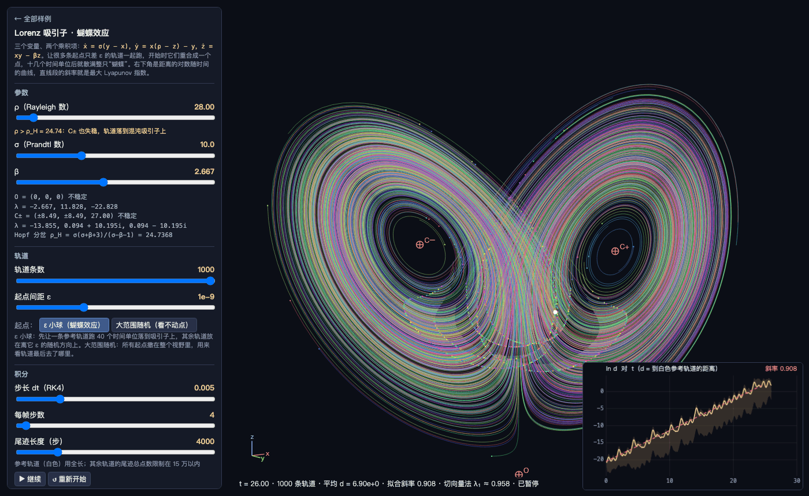
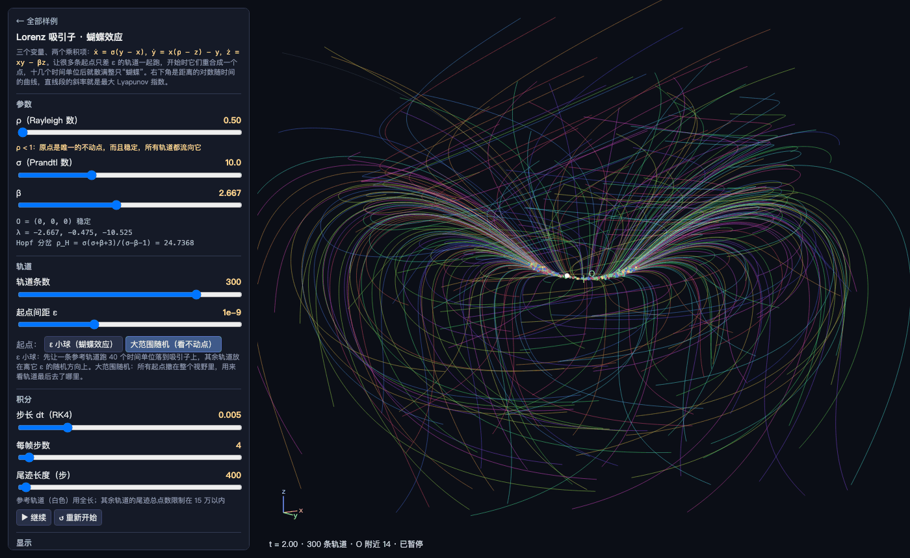
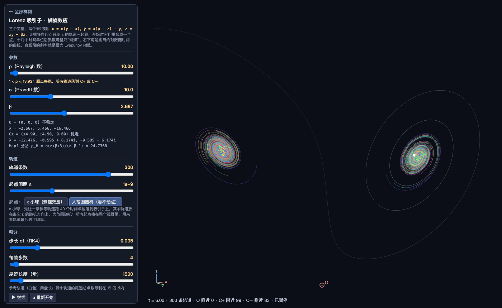
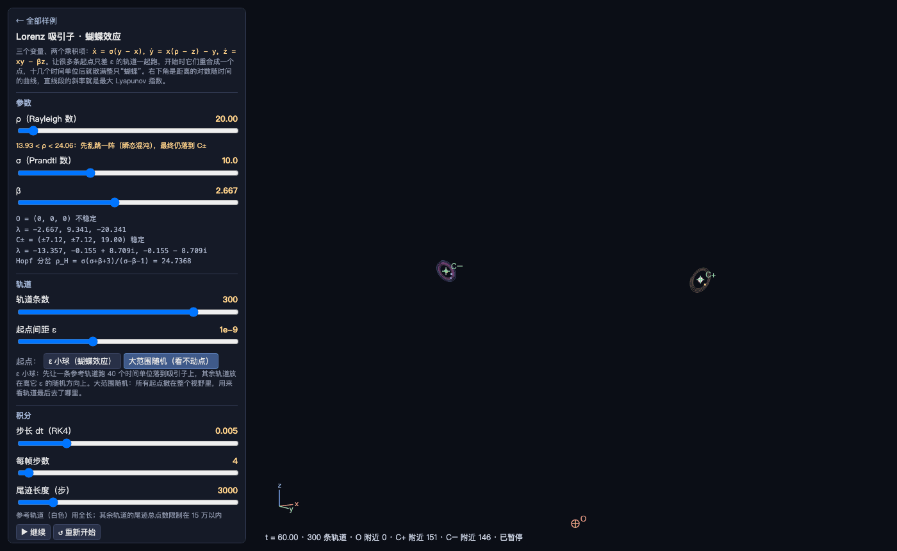
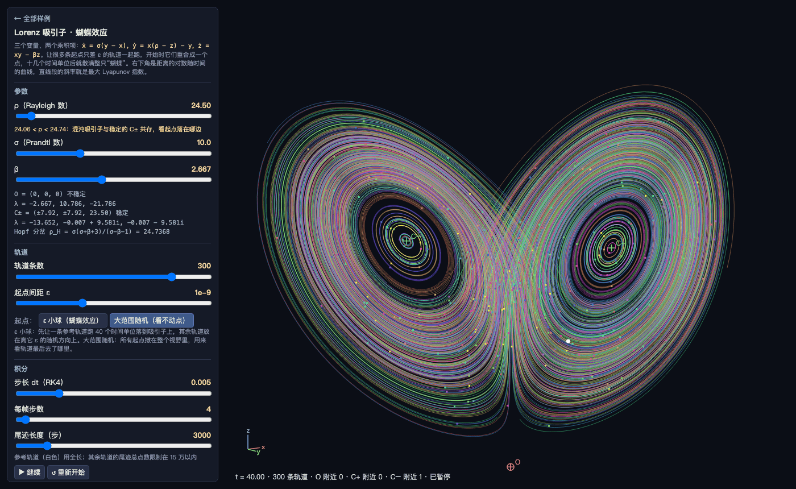
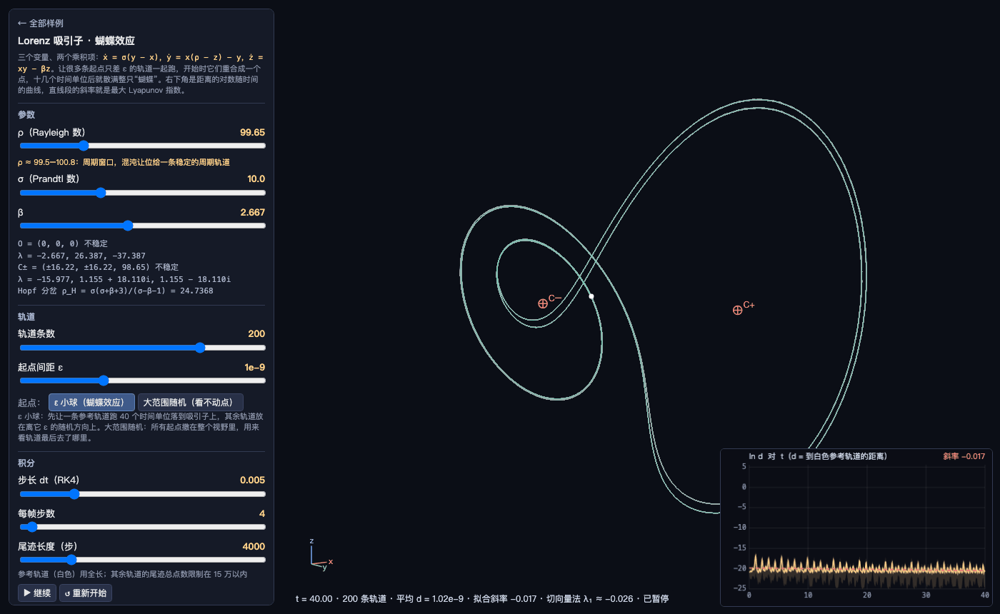
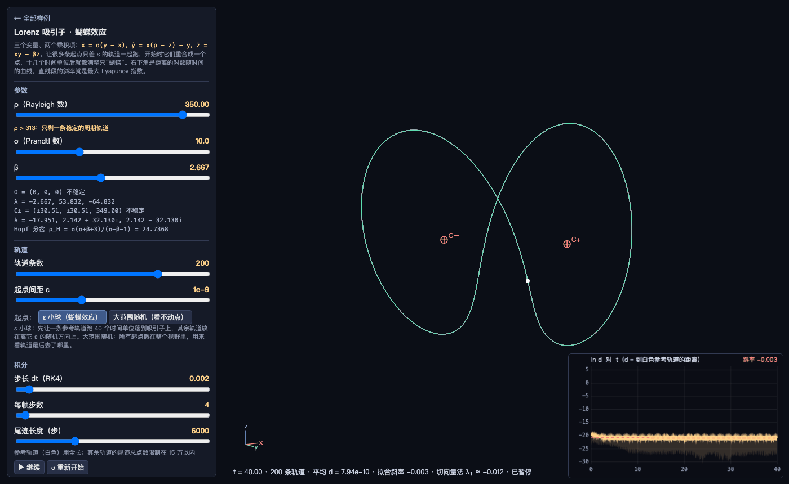
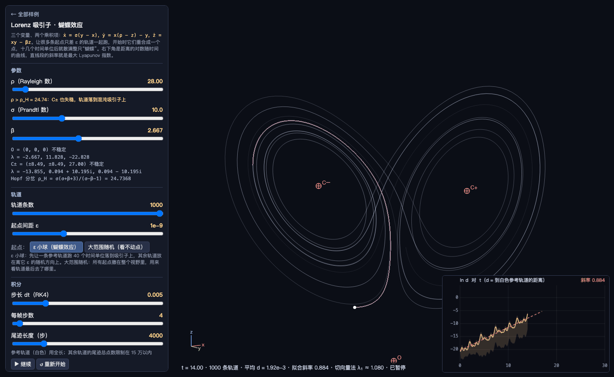
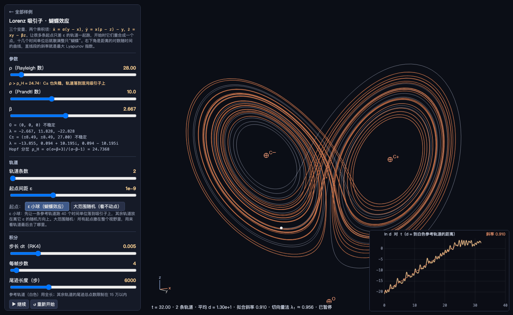

# Lorenz 吸引子 · 蝴蝶效应



1963 年，气象学家 Edward Lorenz 把大气对流的方程删到只剩三个变量，用一台 Royal McBee 计算机做数值积分。有一次他想重看一段结果，就把打印出来的中间值抄回去重新算。打印纸上的数只有 3 位小数，内存里是 6 位，差了不到万分之一。新算出的“天气”开始和原来一模一样，两个月后就完全对不上了。这就是**蝴蝶效应**：确定的方程、几乎相同的起点，长期的结果却不可预测。

上图是页面里的 1000 条轨道。它们的起点彼此只差 10⁻⁹，开始时叠在一起，看起来是一个点；26 个时间单位后已经散满整只“蝴蝶”。右下角是距离的对数随时间的曲线，它的直线段的斜率就是**最大 Lyapunov 指数** λ₁ ≈ 0.9。

打开方式：用浏览器直接打开 [index.html](index.html)。页面只用 Canvas 2D（3D 投影是自己算的），不依赖外部库，离线也能用。

## 数学原理

### 1. Lorenz 方程

```
ẋ = σ (y − x)
ẏ = x (ρ − z) − y
ż = x y − β z
```

x 是对流的强度（流体转圈的速度），y 是上升流和下降流的温差，z 是竖直方向温度分布偏离直线的程度。三个参数：

| 参数 | 含义 | 经典值 |
|---|---|---|
| σ | Prandtl 数：粘性和热扩散之比 | 10 |
| ρ | Rayleigh 数（相对临界值）：底部加热有多猛 | 28 |
| β | 和对流胞的宽高比有关的几何因子 | 8/3 |

方程只有两个非线性项：ẏ 里的 −xz 和 ż 里的 xy。混沌全靠它们。

页面用四阶 Runge–Kutta（RK4）积分，默认步长 dt = 0.005。RK4 的误差是 O(dt⁴)。不过混沌系统会把任何误差按 e^{λt} 放大，所以长期来看，没有哪个积分器能算出“真正的”那条轨道。能信的是统计性质：吸引子的形状、λ₁ 的值。第 5 节会验证 λ₁。

### 2. 体积收缩：为什么会有吸引子

向量场 F = (ẋ, ẏ, ż) 的散度是

```
∇·F = ∂ẋ/∂x + ∂ẏ/∂y + ∂ż/∂z = −σ − 1 − β ≈ −13.67
```

它是常数而且为负，所以相空间里任何一团体积都按 e^{−13.67 t} 收缩：每过一个时间单位只剩百万分之一。另一方面，可以证明所有轨道最终都进入一个有界的椭球，不会跑到无穷远。体积趋于零、轨道又留在有界区域里，最后只能落在一个体积为零的集合上。这个集合就是吸引子。

体积为零，并不意味着它是一个点或一条曲线。ρ = 28 时，它的 Kaplan–Yorke 维数是 2 + λ₁/|λ₃| ≈ 2 + 0.906/14.57 ≈ 2.06：比曲面多一点，是分形。

### 3. 不动点和它们的稳定性

令三个导数都为零：

- **原点 O = (0, 0, 0)**：对所有 ρ 都存在；
- **C± = (±√(β(ρ−1)), ±√(β(ρ−1)), ρ − 1)**：只在 ρ > 1 时存在。它们是两个方向相反的稳定对流胞，流体顺时针转或逆时针转。

判断稳定性要在不动点处把方程线性化：δ̇ = J δ，J 是 Jacobian 矩阵

```
    | −σ      σ    0  |
J = | ρ − z  −1   −x  |
    |  y      x   −β  |
```

小扰动的变化规律是 e^{λt}，λ 是 J 的特征值。所有特征值的实部都小于 0，不动点才稳定。页面在参数滑条下方实时列出两组特征值。

**原点。** J 的一个特征值是 −β，另外两个是 λ² + (σ+1)λ + σ(1−ρ) = 0 的根。ρ < 1 时两个根都是负数，原点稳定。ρ > 1 时其中一个根变正，原点失稳，同时 C± 出现。这叫**叉式分岔**（pitchfork），物理上就是对流开始了：加热不够时热靠传导，流体不动；超过阈值，流体开始转圈。

**C±。** 把 C± 的坐标代进 J，特征多项式是

```
λ³ + (σ + β + 1) λ² + β(σ + ρ) λ + 2σβ(ρ − 1) = 0
```

它总有一个负实根，另外两个是一对共轭复根 a ± bi，表示绕 C± 旋转，旋转同时以 e^{at} 收缩或放大。ρ 刚过 1 时 a < 0，C± 稳定。ρ 增大到

```
ρ_H = σ (σ + β + 3) / (σ − β − 1) = 470/19 ≈ 24.7368   （σ = 10, β = 8/3）
```

时，a 穿过 0，C± 失稳。这就是 **Hopf 分岔**：一对复特征值越过虚轴。推导方法是把 λ = iω 代入特征多项式，令实部、虚部都为零。对 λ³ + a₂λ² + a₁λ + a₀，这个条件就是 a₂a₁ = a₀。代入后解出 ρ，得到上面的式子。ρ = 28 时页面显示 C± 的特征值是 −13.855 和 0.094 ± 10.195i：实部是很小的正数，所以轨道绕 C± 转圈时会慢慢向外盘旋，转出去以后被甩到另一边。

Lorenz 系统的 Hopf 分岔是**亚临界**的。ρ < ρ_H 时，C± 周围各有一个不稳定的周期轨道；ρ 增大，它向 C± 收缩，在 ρ_H 处和 C± 合并，带走了 C± 的稳定性。没有新的稳定周期轨道接替，所以轨道只能落到混沌吸引子上。

### 4. ρ 从 0 到 400：一路看下去

拖动 ρ 滑条，系统会立刻用新参数接着跑；面板里也会显示当前处在哪个区间。要看轨道最终去哪，用“大范围随机”起点：300 条轨道撒满整个视野，状态栏会统计有多少条停在 O、C+、C− 附近。

**ρ < 1：一切流向原点。** 下图是 ρ = 0.5、t = 2 时的情况。原点的三个特征值是 −10.5、−2.67、−0.475，差得很远。轨道先沿快方向迅速压到一条线上，再沿最慢的方向（−0.475）慢慢爬向 O：



**1 < ρ < 13.93：两个稳定不动点。** ρ = 10 时 C± 的特征值是 −12.48 和 −0.595 ± 6.17i：轨道一边转圈一边收拢。t = 6 时 300 条轨道里 99 条已经到了 C+ 附近、83 条到了 C− 附近，剩下的还在途中。最终所有轨道都落到其中一个上，落在哪个取决于起点：



**13.93 < ρ < 24.06：瞬态混沌。** ρ ≈ 13.926 时，原点的不稳定流形恰好绕回原点（同宿轨道），此后相空间里出现一个混沌的不变集。但它不吸引轨道：轨道在它附近乱跳一阵，迟早还是落到 C±。ρ = 20、t = 60 时，297 条已经落定：



**24.06 < ρ < 24.74：共存。** 混沌集在 ρ ≈ 24.06 变成吸引子，而 C± 要到 ρ_H ≈ 24.74 才失稳。在这一小段里两者都吸引轨道，最终去哪取决于起点。ρ = 24.5 时，C± 的复特征值实部只有 −0.007，吸引的范围很小，大多数随机起点都落在混沌吸引子上：



**ρ > 24.74：混沌。** 三个不动点都不稳定，轨道在两个“翅膀”之间不规则地来回跳。绕左边几圈、再绕右边几圈，圈数看起来像随机数。

**周期窗口。** ρ 再增大，混沌并不是一直持续。ρ ≈ 99.524–100.795 和 ρ ≈ 145–166 是两个周期窗口，ρ > 313 以后只剩一条对称的稳定周期轨道。在周期轨道上，两条挨着的轨道只是一前一后地沿同一条闭曲线走，距离不再指数增长，所以 ln d 曲线是平的，拟合斜率约等于 0（页面测得 −0.017 和 −0.003）：

| ρ = 99.65 | ρ = 350 |
|---|---|
|  |  |

ρ = 99.65 的周期轨道不对称：绕 C− 两圈、绕 C+ 一圈。镜像的那一条（x, y → −x, −y）也是周期轨道，起点决定落到哪一条。

### 5. 蝴蝶效应与 Lyapunov 指数

设两条轨道起点相距 ε，t 时刻相距 d(t)。在混沌吸引子上，只要 d 远小于吸引子本身，就有

```
d(t) ≈ ε · e^{λ₁ t}    即    ln d(t) ≈ ln ε + λ₁ t
```

λ₁ 是**最大 Lyapunov 指数**。它是线性化方程 δ̇ = J(x(t)) δ 沿着轨道的平均伸长率：J 随位置变化，有的地方拉伸、有的地方压缩，平均下来，最快的方向每单位时间伸长 e^{λ₁} 倍。σ = 10、ρ = 28、β = 8/3 时 λ₁ ≈ 0.906，三个指数是 (0.906, 0, −14.57)。中间的 0 对应沿着轨道方向的扰动：它只让你提前或落后一点，距离不会增长。三个指数之和等于散度 −13.67。

页面的做法：

1. 白色参考轨道从 (1, 1, 1) 出发，先跑 40 个时间单位，确保已经落在吸引子上；
2. 其余 N − 1 条轨道放在离它恰好 ε 的随机方向上（默认 ε = 10⁻⁹），各自按 golden ratio 间隔取色；
3. 所有轨道一起积分，每 0.05 个时间单位记录一次 ln dᵢ。右下角黄线是 N − 1 条的平均，浅色带是最小值到最大值；
4. 红色虚线是对黄线直线段的最小二乘拟合。前 2 个时间单位不算，因为随机方向的扰动要先转到最不稳定的方向上；d 涨到吸引子尺度的 2%（ρ = 28 时约 0.5）以后也不算，因为这之后距离不能再长，曲线变平。

开始时它们叠在一起，看不出是 1000 条，只看得见白色的参考轨道。t = 14 时距离已经长到约 10⁻³（ln d 从 −20.7 涨到 −6），但在屏幕上仍然不到一个像素：



再过 8 个时间单位，d 就涨到和吸引子一样大。只放两条轨道看得最清楚。下图白色和橙色两条起点差 10⁻⁹，t ≈ 22 以后各走各的：



**可预测的时间。** 把 d(t) = ε e^{λ₁t} 解出 t：要让误差长到 D，需要 t = ln(D/ε) / λ₁。ε = 10⁻⁹、D = 0.5 时 t ≈ 22。把初始误差缩小 10 倍，只多换来 ln 10 / 0.906 ≈ 2.5 个时间单位。测量精度提高一百万倍，预报期也只延长 15 个时间单位。这就是天气预报不可能做到一个月以上的原因：可预报期只随测量精度的对数增长。

**测得的斜率。** 默认参数下，拟合窗口是 t = 2–21.5，斜率为 **0.908**。单次测量是“有限时间”的 Lyapunov 指数，取决于参考轨道这 20 个时间单位刚好走过吸引子的哪一段。我沿吸引子换了 40 个不同的位置重复测量，斜率的中位数是 0.903，均值 0.887，标准差 0.056，最小 0.74，最大 0.97。默认的 40 个时间单位预跑就是按“落在典型值附近”选的。

**独立核对：切向量法。** 状态栏里的“切向量法 λ₁”是另一种算法（Benettin 等，1980）。沿参考轨道同时积分线性化方程 δ̇ = J δ，每 0.05 个时间单位把 δ 的长度记入 ln 累加和，再把 δ 归一化。这样不会撞到吸引子尺度的上限，可以一直平均下去。它在 t = 40 时是 0.958，跑满 200 个时间单位后是 **0.9063**，和文献值 0.9056 只差 0.1%。这说明积分器和步长都没问题。

**数值精度。** ε 最小只能取到 10⁻¹³。x 的量级约为 10，双精度浮点数的相对精度是 10⁻¹⁶，所以 10⁻¹⁵ 以下的差别本身就是舍入误差。

## 操作

- 参数：ρ（0–400）、σ（0.5–30）、β（0.1–6）。改动后立即用新参数接着跑，不会从头开始；ε 小球模式下会在当前参考点重新撒一次 ε 小球，再从 t = 0 测距离；
- 面板实时显示 O、C± 的坐标、特征值、稳定性，以及按当前 σ、β 算出的 ρ_H；
- 轨道条数 2–1000；起点间距 ε（10⁻¹³–10⁻¹）；起点模式“ε 小球”或“大范围随机”；
- 步长 dt（0.001–0.02）、每帧步数（1–100）、尾迹长度（100–20000 步）；
- 暂停 / 继续、重新开始；开关：显示不动点（绿色稳定、红色带圈不稳定）、自动旋转；
- 预设：经典 ρ = 28、两条轨道、1000 条轨道、ρ = 0.5、ρ = 10、ρ = 20、ρ = 24.5、ρ = 99.65、ρ = 160、ρ = 350；
- 拖动旋转，滚轮缩放，双击复位视角。

所有循环都有上限。每帧 RK4 总步数不超过 25 万步（条数 × 每帧步数），其余轨道的尾迹总点数不超过 15 万，距离曲线最多记录 120 个时间单位。如果 dt 对当前 ρ 太大、数值发散，页面会暂停并提示调小 dt。

## 网址参数

| 键 | 含义 |
|---|---|
| p | 预设名：classic, pair, swarm, origin, fixed, transient, coexist, w100, w160, w350 |
| r, s, b | ρ、σ、β |
| n | 轨道条数（2–1000） |
| e | log₁₀ ε（−13 到 −1） |
| m | 起点模式：eps 或 spread |
| dt | 步长（0.001–0.02） |
| v | 每帧步数（1–100） |
| L | 尾迹长度（100–20000） |
| t | 打开时先快进到这个时刻（0–200） |
| yaw, pitch, z | 视角：绕竖直轴转角、俯仰角（弧度）、缩放倍数 |
| fp | 0 = 不显示不动点 |
| rot | 1 = 自动旋转 |
| run | 0 = 打开时暂停 |

所有数值参数必须是有限数，超出范围的会被截到滑条范围；不认识的预设名和起点模式会被忽略。

例如直接看 1000 条轨道散开后的样子：`index.html?p=swarm&t=26&run=0`；看 ρ = 160 的周期轨道：`index.html?p=w160&t=40`。

## 参考

- E. N. Lorenz, *Deterministic nonperiodic flow*, Journal of the Atmospheric Sciences 20, 1963.
- C. Sparrow, *The Lorenz Equations: Bifurcations, Chaos, and Strange Attractors*, Springer, 1982. 13.926、24.06 和各周期窗口的范围取自该书。
- S. H. Strogatz, *Nonlinear Dynamics and Chaos*, 第 9 章，Westview Press, 1994. 不动点、Hopf 分岔与体积收缩的推导。
- G. Benettin, L. Galgani, A. Giorgilli, J.-M. Strelcyn, *Lyapunov characteristic exponents for smooth dynamical systems*, Meccanica 15, 1980. 切向量法。
- J. C. Sprott, *Chaos and Time-Series Analysis*, Oxford University Press, 2003. λ₁ = 0.9056 取自该书的数值表。
