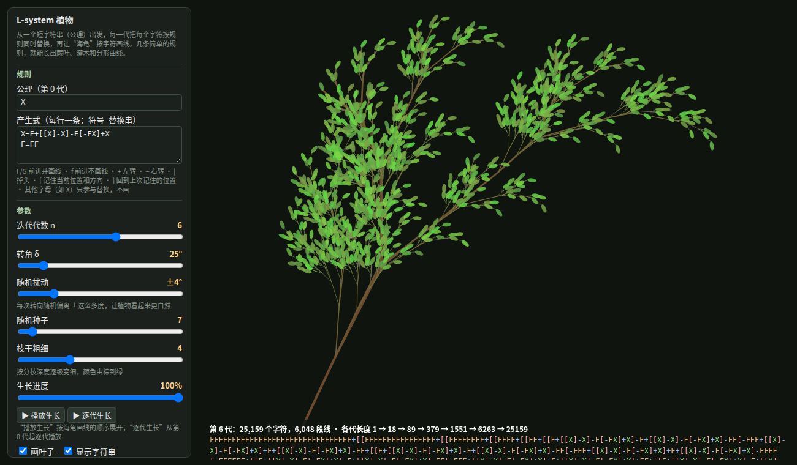
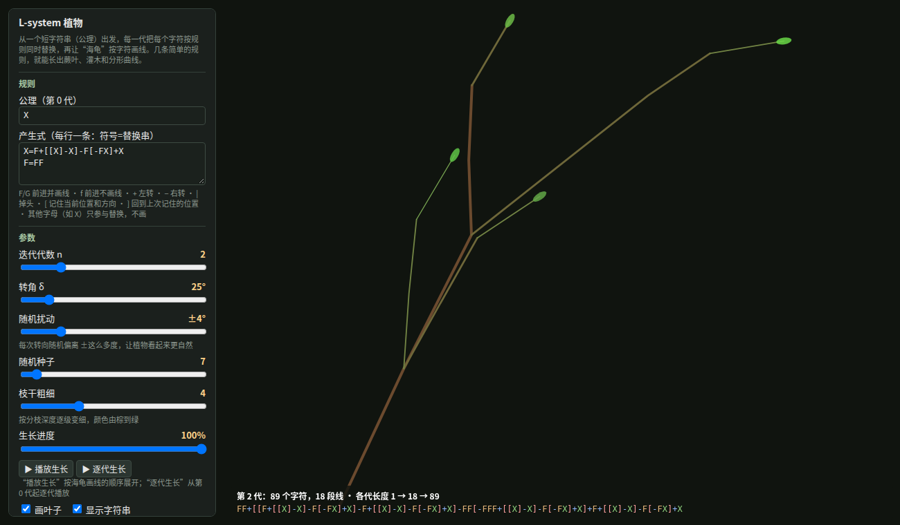
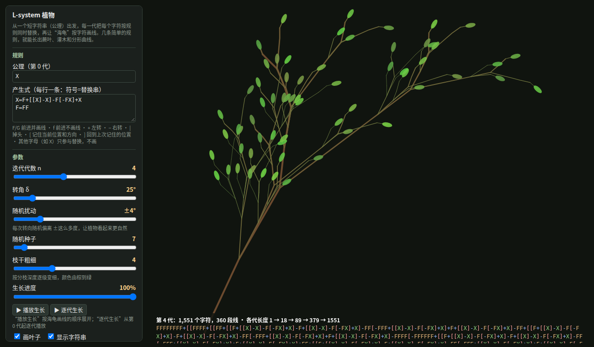
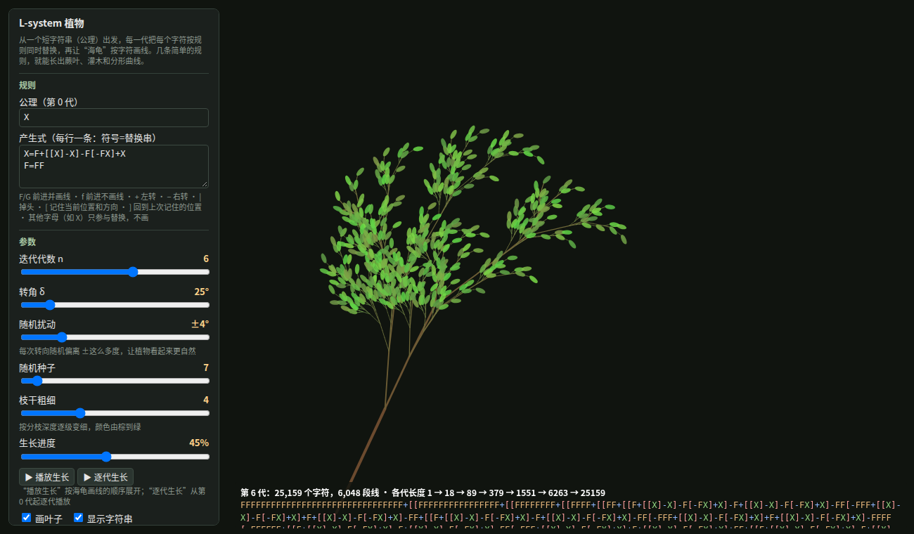
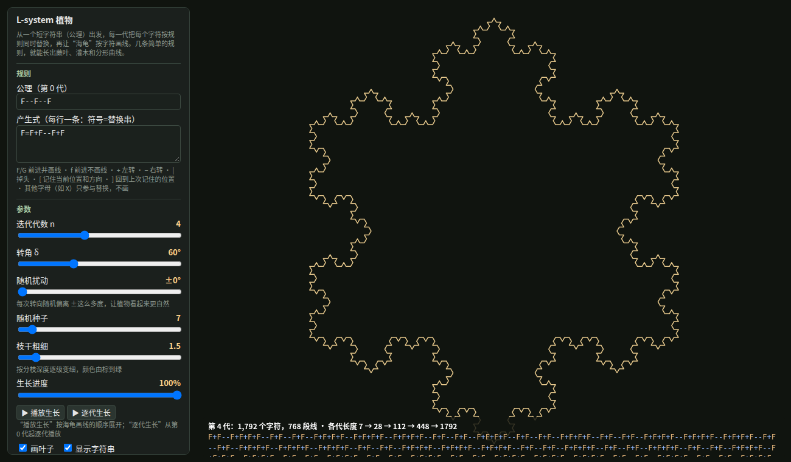
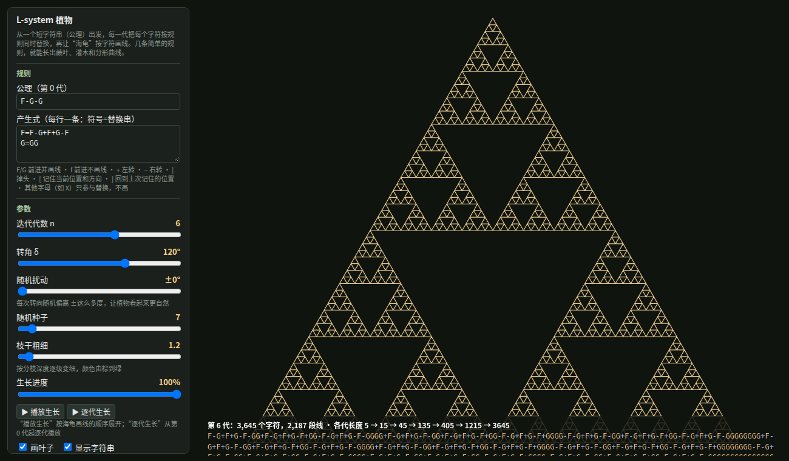
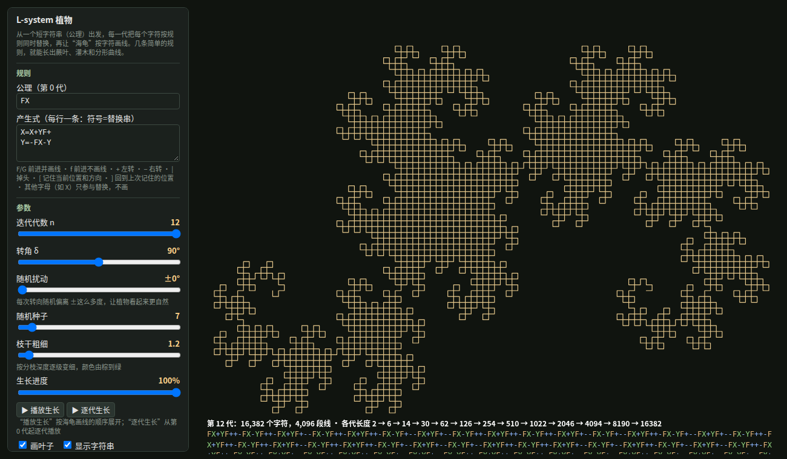
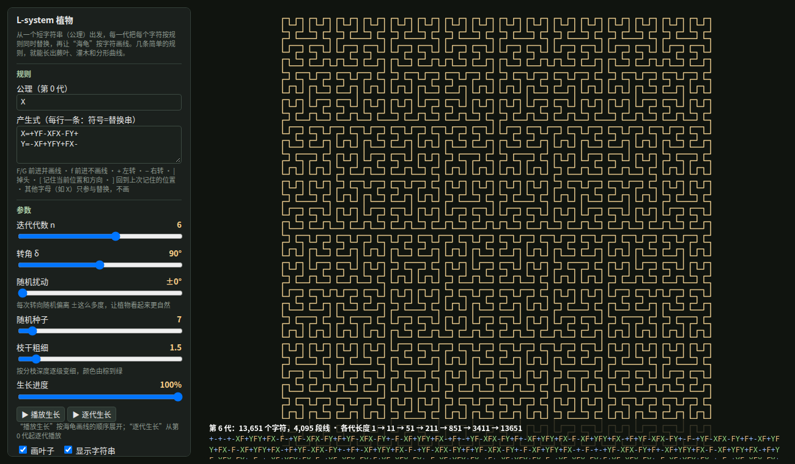
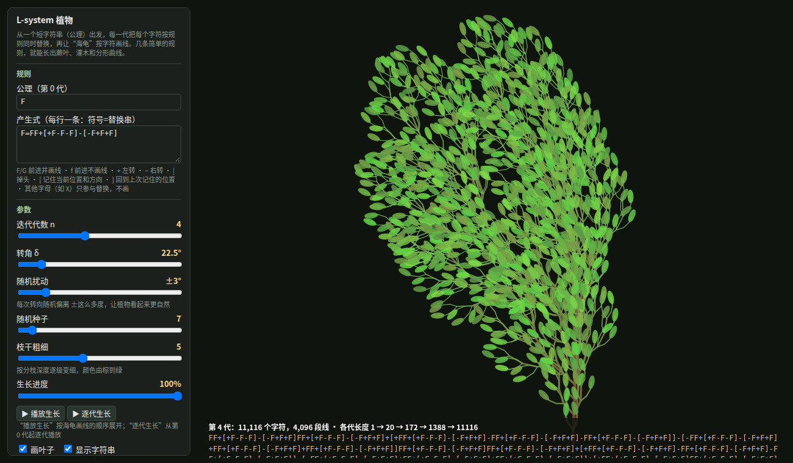

# L-system 植物 · 用重写规则长出一棵树

植物学家 Aristid Lindenmayer 在 1968 年提出了 L-system，用来描述藻类细胞怎样一代代分裂。它的思路很简单：拿一个短字符串，按规则把每个字符同时替换成更长的字符串，重复几次，再把结果当成画图指令。几条规则就能长出蕨叶、灌木，也能画出 Koch 雪花、龙曲线这类分形曲线。

打开方式：用浏览器直接打开 [index.html](index.html)。页面只用 Canvas 2D，不依赖外部库，离线也能用。

## 数学原理

### 1. 并行重写

一个 L-system 由三部分组成：

- **字母表**：可以出现的符号，例如 `F X + - [ ]`；
- **公理**：第 0 代的字符串，例如 `X`；
- **产生式**：每个符号替换成什么，例如 `X=F+[[X]-X]-F[-FX]+X` 和 `F=FF`。没有产生式的符号保持不变。

每一代把字符串里的**所有**符号**同时**替换。这一点和普通的文本替换不同，它模拟的是植物所有细胞同时生长。

以分形植物为例：

| 代 | 字符串长度 |
|---|---|
| 0 | 1（`X`） |
| 1 | 18（`F+[[X]-X]-F[-FX]+X`） |
| 2 | 89 |
| 6 | 25,159 |

长度按指数增长。页面底部会显示当前这一代的字符串、长度，以及各代长度的序列，字符按作用着色：画线、转向、分枝、其他符号。

### 2. 海龟作图

把字符串从左往右读，每个字符是给一只“海龟”的指令：

| 符号 | 动作 |
|---|---|
| `F` `G` | 前进一步并画线 |
| `f` | 前进一步，不画线 |
| `+` / `-` | 左转 / 右转 δ 度 |
| `\|` | 掉头 180° |
| `[` | 把当前位置和方向压入栈，开始一个分枝 |
| `]` | 从栈里弹出位置和方向，回到分枝起点 |
| 其他字母（如 `X`） | 不画，只参与重写 |

`[` 和 `]` 让海龟画完一个分枝后回到分叉点，这就是植物能分叉的原因。栈的深度就是分枝的级数，页面按它决定枝条粗细（每深一级变细为 0.68 倍）和颜色（由树干的棕色到嫩枝的绿色）。叶子画在每个分枝的末端。

### 3. 自相似

`X` 的规则里又包含 `X`，所以每个分枝都是整棵植物的缩小副本。拖动“迭代代数”，可以看到第 n 代的每根枝条都长成了第 n − 1 代的整棵树：

| 第 2 代 | 第 4 代 | 第 6 代 |
|---|---|---|
|  |  |  |

“逐代生长”按钮从第 0 代起逐代播放这个过程；“播放生长”则在当前代内按海龟画线的顺序展开，能看到递归是先深入一个分枝画完、再回到分叉点画下一个：

### 4. 分形曲线与维数

去掉分枝，同一套机制能画出经典分形曲线。每代线段数乘以 N，长度缩为 1/r，分形维数就是 log N / log r：

| 曲线 | 规则 | δ | 每代线段数 | 维数 |
|---|---|---|---|---|
| Koch 雪花 | `F=F+F--F+F` | 60° | ×4，长度 ÷3 | log 4 / log 3 ≈ 1.262 |
| Sierpinski 三角 | `F=F-G+F+G-F`, `G=GG` | 120° | ×3，长度 ÷2 | log 3 / log 2 ≈ 1.585 |
| 龙曲线 | `X=X+YF+`, `Y=-FX-Y` | 90° | ×2，长度 ÷√2 | 2（填满平面区域） |
| Hilbert 曲线 | `X=+YF-XFX-FY+`, `Y=-XF+YFY+FX-` | 90° | ×4，长度 ÷2 | 2（填满正方形） |

| Koch 雪花 | Sierpinski 三角 | 龙曲线 | Hilbert 曲线 |
|---|---|---|---|
|  |  |  |  |

### 5. 随机扰动

真实植物不会完全对称。“随机扰动”让每次转向随机偏离 ±几度，用固定种子的伪随机数（mulberry32），同一个种子总是长出同一棵树，换个种子就是另一棵。

## 操作

- 公理和产生式都可以直接编辑，每行一条，格式是 `符号=替换串`，改完立即重画；
- 参数：迭代代数（0–10）、转角 δ、随机扰动、随机种子、枝干粗细、生长进度；
- 开关：画叶子、显示字符串；
- 预设：分形植物、灌木、水草、对称树、枝条（植物）；Koch 雪花、Sierpinski 三角、Sierpinski 箭头、龙曲线、Hilbert 曲线（分形曲线）；
- 拖动平移，滚轮以鼠标位置为中心缩放，双击重新居中。

字符串超过 300 万个字符时会停在上一代并给出提示，避免浏览器卡死。

## 网址参数

| 键 | 含义 |
|---|---|
| p | 预设名：plant, bush, weed, tree, stick, koch, sier, arrow, dragon, hilbert |
| ax, r | 自定义公理和规则，多条规则用 `;` 分隔 |
| k | 自定义时设为 `curve` 则按分形曲线配色、不画叶子 |
| n, a, h | 代数、转角、初始方向（度，90 = 向上） |
| j, s, w | 随机扰动、种子、枝干粗细 |
| g | 生长进度 0–1 |
| leaf | 0 = 不画叶子 |

例如自定义一棵草：`index.html?ax=F&r=F%3DF[%2BF]F[-F]F&a=25.7&n=5&j=3`（`+` 要写成 `%2B`，直接写 `+` 也能识别）。

![自定义规则 F=F[+F]F[-F]F](images/custom.png)

## 参考

- A. Lindenmayer, *Mathematical models for cellular interactions in development*, Journal of Theoretical Biology 18, 1968.
- P. Prusinkiewicz, A. Lindenmayer, *The Algorithmic Beauty of Plants*, Springer, 1990. 本页的植物预设取自该书第 1 章。
