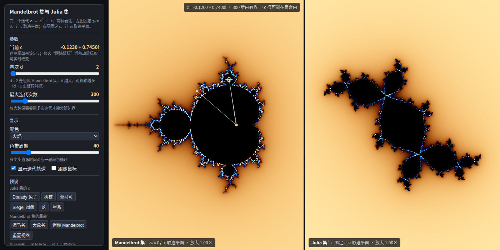
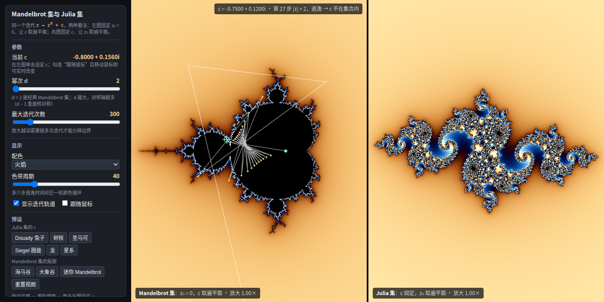
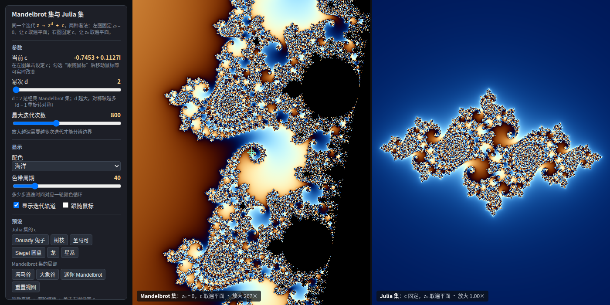
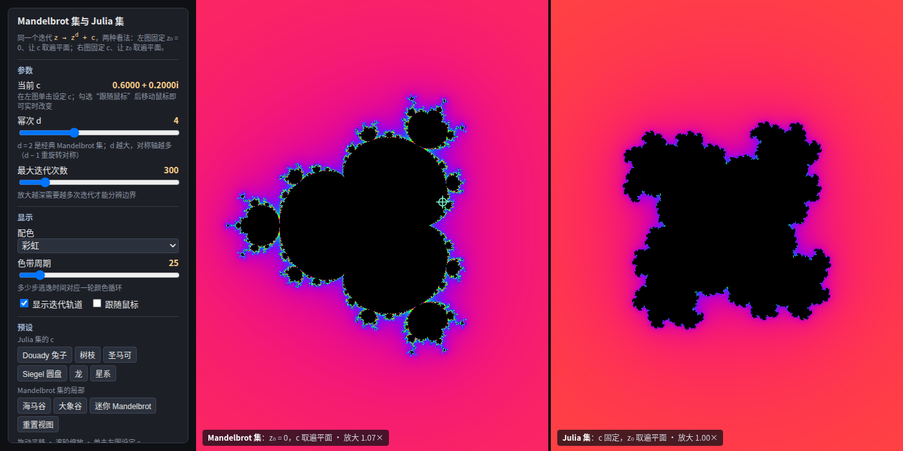

# Mandelbrot 集与 Julia 集 · 分形

一个只有一行的公式 **z → z² + c**，反复迭代，就能生成无限精细、处处自相似的图形。这个页面把同一个迭代的两种看法并排放在一起：左边是 Mandelbrot 集，右边是 Julia 集。在左图单击任何一点，右图立刻显示那个 c 对应的 Julia 集。

打开方式：用浏览器直接打开 [index.html](index.html)。页面只用浏览器自带的 WebGL，不依赖任何外部库，离线也能用。

## 数学原理

### 迭代与逃逸

从 z₀ 出发，反复计算 zn+1 = znd + c（z、c 都是复数）。这串数要么永远留在有限范围内，要么越跑越远趋于无穷。

一个关键定理让计算机能判断“趋于无穷”：对 d = 2，只要某一步 |z| > 2（且 |c| ≤ 2），之后必定逃逸。所以迭代到 |z| > 2 就可以停，记下用了几步，这就是“逃逸时间”，画面颜色就由它决定；迭代到上限仍未逃逸的点涂成黑色。

### 两个集合，同一个公式

| | Mandelbrot 集（左图） | Julia 集（右图） |
|---|---|---|
| 固定 | z₀ = 0 | c |
| 平面上每个像素代表 | c | z₀ |
| 黑色区域 | 使轨道有界的所有 c | 在该 c 下轨道有界的所有 z₀ |

两者之间有一个漂亮的结论：**c 在 Mandelbrot 集内，当且仅当它的 Julia 集是连通的**（一整块）；c 在 Mandelbrot 集外，Julia 集碎成无数个不相连的点（Cantor 尘）。在页面上把 c 从黑色区域内拖到外面，就能看到右图从一整块碎成“尘埃”。

### 迭代轨道

勾选“显示迭代轨道”，鼠标在左图上移动时会画出 z₀ = 0, z₁, z₂, … 的路径，右上角显示这条轨道是第几步逃逸，还是在上限步数内一直有界。

| 有界：轨道收敛到一个循环 | 逃逸：第 27 步 \|z\| > 2 |
|---|---|
|  |  |

左图主心形内的 c，轨道收敛到一个不动点；左边大圆盘内的 c，轨道最终在 2 个点之间来回跳；每个“芽”对应一个周期。

### 平滑着色

只用整数步数着色会出现一圈圈台阶状色带。页面用连续逃逸时间

ν = n + 1 − log(log |zn|) / log d

代替 n，颜色由余弦调色板 `a + b·cos(2π(k·ν/周期 + φ))` 计算，过渡是连续的。

### 自相似

放大 Mandelbrot 集的边界，会不断看到螺旋、海马、触须，以及整个集合的缩小副本（“迷你 Mandelbrot”）。边界附近的 c 对应的 Julia 集，形状和该处 Mandelbrot 集的局部很像。

### 更高幂次（Multibrot）

把幂次 d 调大，Mandelbrot 集变成有 d − 1 重旋转对称的形状，Julia 集有 d 重对称。

## 操作

| 操作 | 效果 |
|------|------|
| 拖动 | 平移 |
| 滚轮 | 以鼠标位置为中心缩放 |
| 单击左图 | 把该点设为 c |
| 勾选“跟随鼠标” | 鼠标在左图移动时 c 实时跟随，右图连续变形 |

参数：幂次 d（2–8）、最大迭代次数（20–2000）、配色（火焰、海洋、彩虹、灰度）、色带周期。

预设：
- Julia 集的 c：Douady 兔子、树枝（c = i）、圣马可（c = −0.75）、Siegel 圆盘、龙、星系；
- Mandelbrot 集的局部：海马谷、大象谷、迷你 Mandelbrot、重置视图。

## 网址参数

| 键 | 含义 |
|----|------|
| cr, ci | c 的实部、虚部 |
| d | 幂次 |
| it | 最大迭代次数 |
| pal, cyc | 配色序号（0–3）、色带周期 |
| mx, my, ms | 左图中心和视野宽度 |
| jx, jy, js | 右图中心和视野宽度 |
| follow | 1 = 跟随鼠标 |

例如：`index.html?cr=-0.7453&ci=0.1127&mx=-0.7453&my=0.1127&ms=0.012&it=800&pal=1`

## 限制

着色器使用单精度浮点（约 7 位有效数字），放大到约 10⁵ 倍后相邻像素算出的坐标相同，画面会变成色块。更深的放大需要双精度模拟或微扰算法。

## 参考

- B. Mandelbrot, *The Fractal Geometry of Nature*, 1982.
- A. Douady, J. H. Hubbard, *Étude dynamique des polynômes complexes*, 1984–85.
