# 极小曲面 · 肥皂膜的几何

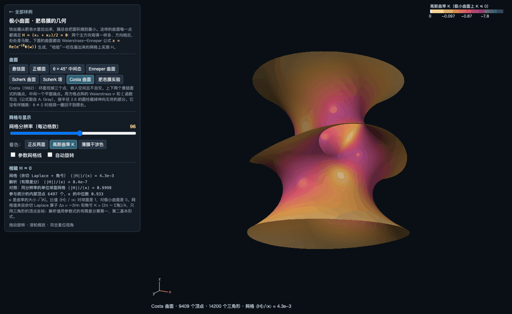

把一个铁丝圈从肥皂水里拉出来，上面会挂着一层膜。膜有表面张力，总想把自己的面积缩到最小，所以静止下来的膜是“在这条边界下面积最小”的曲面。这类曲面叫**极小曲面**。它们有一个很干脆的局部特征：每一点的平均曲率 H = 0，即两个主方向弯得一样多、方向相反，处处是马鞍。

这个页面画了七种经典的极小曲面：悬链面、正螺面和它们之间的伴随曲面、Enneper 曲面、Scherk 曲面、Scherk 塔，以及上图的 Costa 曲面。另有一个两圆环之间的肥皂膜实验。每种曲面都在画出来的三角网格上实测 H，看它是不是真的为 0。

打开方式：用浏览器直接打开 [index.html](index.html)。页面用 WebGL2 和一个很小的着色器自己做投影和光照，不依赖外部库，离线也能用。

## 数学原理

### 1. 面积的一阶变分：H = 0

设曲面 x(u, v) 的单位法向是 n，两个主曲率是 κ₁、κ₂（一个方向上最弯、另一个方向上最不弯）。记

```
平均曲率   H = (κ₁ + κ₂) / 2
高斯曲率   K = κ₁ κ₂
```

把曲面沿法向推一点点：x_ε = x + ε φ n，φ 是一个在边界上等于 0 的函数（边界钉在铁丝上不动）。每一小块面积的变化是

```
dA_ε = (1 − 2ε H φ + O(ε²)) dA
```

直观的理解：在球面上（H > 0）沿外法向推，球变大，面积增加；推的方向不同号，面积就减少。把整张曲面加起来：

```
d/dε A(ε) |_{ε=0} = −2 ∫∫ H φ dA
```

如果曲面面积已经最小，不管 φ 怎么选，这个导数都必须为 0。φ 在内部可以任意取，所以只能是处处 H = 0。这就是面积泛函的 Euler–Lagrange 方程，Lagrange 在 1760 年写下了它的图像形式（曲面 z = f(x, y) 时）：

```
(1 + f_y²) f_xx − 2 f_x f_y f_xy + (1 + f_x²) f_yy = 0
```

H = 0 意味着 κ₂ = −κ₁，于是 K = −κ₁² ≤ 0：极小曲面上没有像球面那样往一个方向凸的点，只有马鞍点和偶尔出现的平点（K = 0）。

物理上，膜两侧的压强差由 Young–Laplace 公式给出：Δp = 4γH（肥皂膜有前后两个表面，每个表面的张力是 γ）。铁丝圈上的膜两边都是大气，Δp = 0，所以 H = 0。肥皂泡里压强稍大，H 是一个正的常数，于是得到球。

### 2. Plateau 问题

比利时物理学家 Plateau 在 1873 年的《液体的实验与理论静力学》里，把各种形状的铁丝框浸进肥皂水做了大量实验。他观察到两条规律：膜总是三片相交，交角都是 120°；交线总是四条交于一点，夹角都约为 109.47°。数学家把他的实验提成一个问题：

> **Plateau 问题**：给定空间里一条闭曲线，是否存在一张以它为边界的极小曲面？

这个问题很难，因为“面积最小”的曲面可能不光滑、可能退化。直到 1930–1931 年，Radó 和 Douglas 才各自独立地给出肯定的回答（对任意一条 Jordan 曲线都存在一张极小曲面），Douglas 因此获得 1936 年第一届 Fields 奖。解一般不唯一，第 7 节的两个圆环就是最简单的例子：同一对边界上同时有两个悬链面和一对圆盘，三个都满足 H = 0。

### 3. Weierstrass 表示：极小曲面 = 全纯函数的实部

在**等温坐标**下（E = G、F = 0，也就是参数网格的小方块映到曲面上仍然是小正方形），曲面的 Laplace 和平均曲率之间有一个简单关系：

```
x_uu + x_vv = 2 E H n
```

所以极小曲面 ⇔ 三个坐标函数 x、y、z 都是**调和函数**。平面上的调和函数恰好是全纯函数的实部：令 w = u + iv，就有

```
x(w) = Re Φ(w),   Φ = (Φ₁, Φ₂, Φ₃) 是三个全纯函数
```

还要保证坐标是等温的。记 φ = Φ′，等温条件 E = G、F = 0 合起来正好是一个复方程：

```
φ₁² + φ₂² + φ₃² = 0
```

满足它的向量都可以用两个函数 f、g 写成（Weierstrass 1866，Enneper 1864）：

```
φ = ( f(1 − g²)/2,  i f(1 + g²)/2,  f g )
```

g 有很具体的几何意义：它是单位法向 n 经过球极投影之后的复数。也就是说，**任挑一对全纯函数 (f, g)，积分一次，就得到一张极小曲面**。页面用的几个 Φ：

| 曲面 | Φ(w) | (f, g) | 参数域 |
|---|---|---|---|
| 悬链面 / 正螺面 | (cosh w, −i sinh w, w) | f = −e^{−w}, g = −e^{w} | w = v + iu，\|v\| ≤ 1.25，\|u\| ≤ π |
| Enneper | (w − w³/3, i(w + w³/3), w²) | f = 2, g = w | \|w\| ≤ 1.9 |
| Scherk | (2 arctan w, 2i artanh w, ln((1 + w²)/(1 − w²))) | f = 4/(1 − w⁴), g = w | \|w\| < 1，按 \|Φ₃\| ≤ 3 截取 |

Costa 曲面要用环面上的椭圆函数（第 6 节）。每个 Φ 都可以手算验证 φ·φ = 0，例如 Enneper：(1 − w²)² − (1 + w²)² + (2w)² = 0。

“检验 H ≈ 0”一栏里的“解析”一行，直接用参数式算第一、第二基本形式（中心差分，步长 2·10⁻⁴）。在默认的 96 × 96 网格上，⟨|H|⟩/⟨κ⟩ 实测为：悬链面 2.0·10⁻⁷，正螺面 4.6·10⁻¹¹，Enneper 3.6·10⁻⁷，Scherk 1.0·10⁻⁶，Costa 8.4·10⁻⁷。这里 κ = √|K| 是曲率的大小，所以这个比值是“平均曲率相对于曲率本身有多大”，对球面是 1。剩下的 10⁻⁷ 量级是差分步长的截断误差（δ² ≈ 4·10⁻⁸），不是公式的误差。

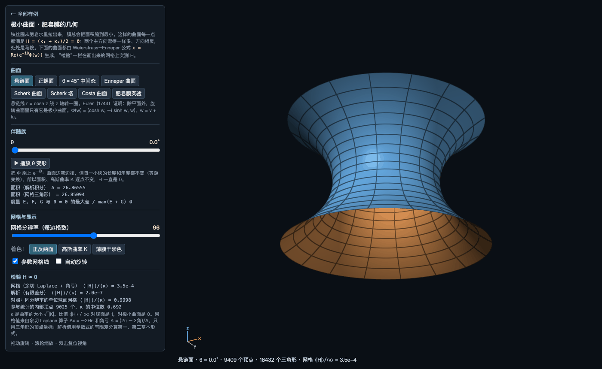

### 4. 伴随族：弯曲而不拉伸

把 Φ 乘上一个模为 1 的复数，得到一族曲面

```
x_θ(w) = Re( e^{−iθ} Φ(w) )
```

e^{−iθ}φ 仍然满足 φ·φ = 0，所以每个 x_θ 都是极小曲面。而且它们的度量完全相同：对满足 φ·φ = 0 的向量，|Re φ|² = |φ|²/2，乘 e^{−iθ} 不改变 |φ|，所以

```
E_θ = G_θ = |φ|² / 2,   F_θ = 0     对所有 θ 都一样
```

这说明从 θ = 0 变到 θ = 90°，曲面上每一条曲线的长度、每两条曲线的夹角都不变，只是在空间里**弯过去**，没有任何拉伸。这族曲面叫**伴随族**，θ = 90° 的那一个叫**共轭曲面**。g 也不变，所以对应点的法向相同。高斯曲率只依赖度量（Gauss 的绝妙定理），因此也逐点不变：

```
K = − ( 4 |g′| / ( |f| (1 + |g|²)² ) )²
```

悬链面的共轭曲面是正螺面。拖动 θ 滑条，或者点“播放 θ 变形”，悬链面就沿着竖直方向剪开、一边拧一边拉成正螺面。下图按高斯曲率着色并画出参数网格，四个 θ 下颜色始终贴在同一批点上，腰部那一圈颜色最深（|K| 最大）：

| θ = 0°（悬链面） | θ = 30° |
|---|---|
| 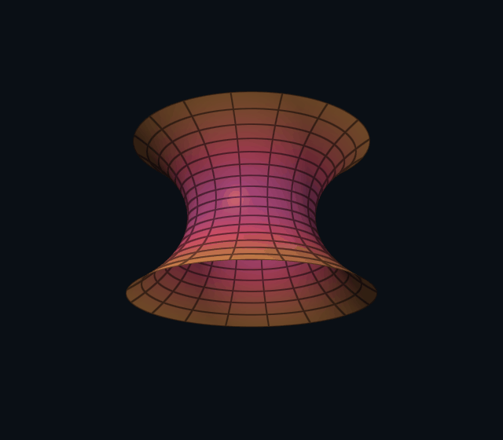 | 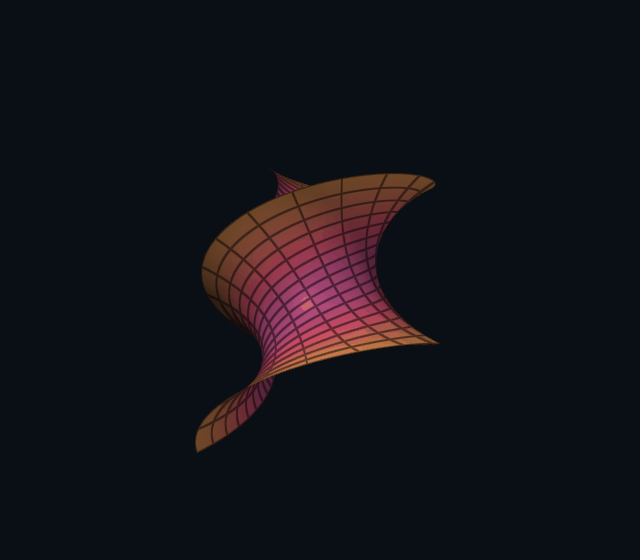 |
| **θ = 60°** | **θ = 90°（正螺面）** |
| 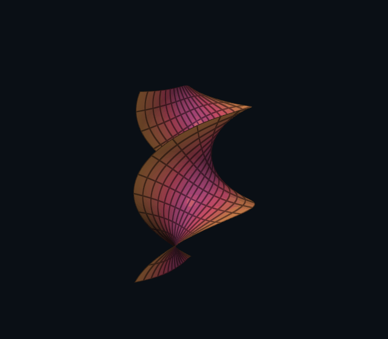 | 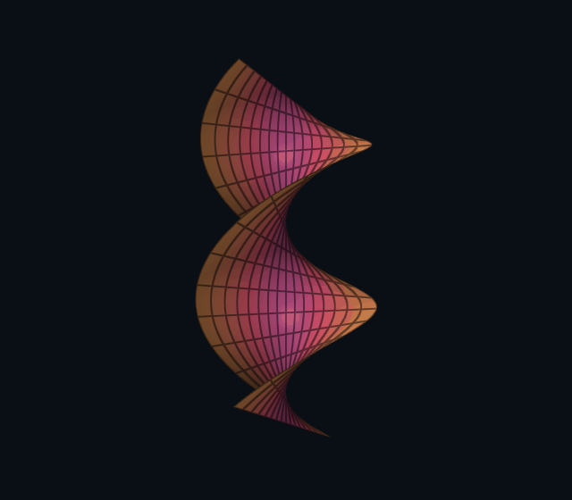 |

页面实测（96 × 96 网格）：

| θ | 面积（度量积分） | 面积（网格三角形之和） | 度量与 θ = 0 的最大差 / max(E + G) | κ 的中位数 |
|---|---|---|---|---|
| 0° | 26.865549 | 26.85094 | 0 | 0.692419 |
| 22.5° | 26.865550 | 26.85142 | 1.9·10⁻⁸ | 0.692419 |
| 45° | 26.865552 | 26.85256 | 6.4·10⁻⁸ | 0.692419 |
| 67.5° | 26.865554 | 26.85371 | 1.1·10⁻⁷ | 0.692419 |
| 90° | 26.865554 | 26.85419 | 1.3·10⁻⁷ | 0.692419 |

度量积分得到的面积在第 7 位小数才变动，那是差分误差。三角形面积之和在第 4 位变动，这并不矛盾：等距变换保持曲面上的长度，不保持两点间的直线距离（弦长），所以每个小三角形的面积有 O(h²) 的变化。

参数网格线也值得看。在悬链面上它们是经线和纬线，是**曲率线**（沿着主方向）。到了正螺面上，同一组线变成了直线和螺旋线，而正螺面上的直线是**渐近线**（法曲率为 0 的方向）。共轭把曲率线变成渐近线，把渐近线变成曲率线。

Enneper 曲面的伴随族比较特别：x_θ(w) = x₀(e^{iθ/2} w) 再转一个角度，所以它和自己的伴随曲面全等，拖 θ 看起来只是在转。用 θ = 60° 和 w ↦ e^{iπ/6}w 对照，六个随机点的两两距离之差是 8.9·10⁻¹⁶。

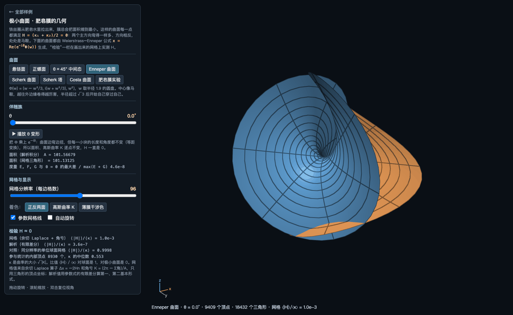

### 5. Scherk 曲面与 Schwarz 反射

Scherk 在 1834 年找到了 z = ln(cos y / cos x)。它定义在正方形 |x|, |y| < π/2 上，在 x = ±π/2 两条边上方升到 +∞，在 y = ±π/2 上方降到 −∞，四个角上各有一条完整的竖直线。

极小曲面有一条 **Schwarz 反射原理**：

- 如果曲面上含有一段**直线**，那么绕这条直线转 180° 得到的曲面和原来的曲面光滑地接在一起，仍然是极小曲面；
- 如果曲面和某个**平面垂直相交**于一条曲线，那么对这个平面做镜面反射，同样能光滑地接上。

Scherk 曲面的四条竖直线正好是这样的轴。绕它们各转 180°，就得到对角方向上的四块邻居。这样一直复制下去，可以铺满整个棋盘格的黑格子，得到一张双周期的曲面：

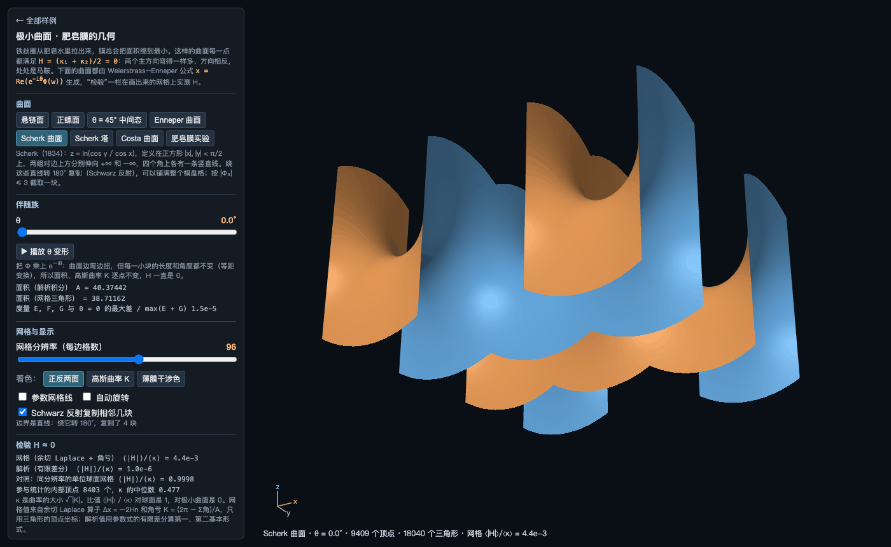

在单位圆盘 |w| < 1 上，Scherk 的 Φ 把四个点 w = ±1, ±i 送到无穷远（四个“端”），把四段圆弧送到四条竖直线。页面在每段圆弧上取五个点，检查它们是否共线。共线就做旋转；不共线但共面，就对那个平面做反射。

把 θ 拖到 90°，同一块膜弯成 **Scherk 塔**（Scherk 第二曲面）。四条竖直线变成了水平面 z = ±π/2 里的四条平面曲线：伴随族把直线变成平面曲线（反过来也一样），因为直线和“与平面垂直相交的曲线”在共轭下互换。这时检测到的是共面而不是共线，于是改做镜面反射，马鞍一层层往上下堆叠：

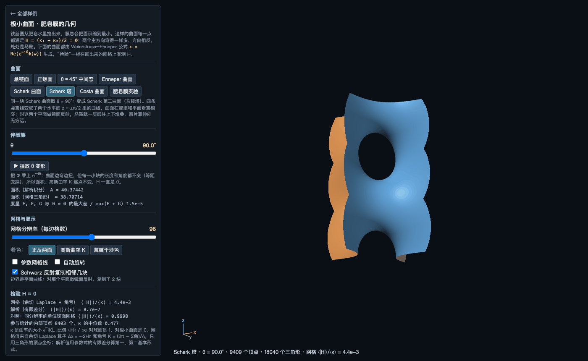

θ 取其他值时，边界弧既不共线也不共面，Schwarz 反射无从做起，页面会提示这一点。截取范围按 |Φ₃(w)| ≤ 3 选取，这个量与 θ 无关，所以所有 θ 下画的都是同一块膜。实测面积在 θ = 0°、45°、90° 时分别是 40.374422、40.374419、40.374415。

### 6. Costa 曲面

19 世纪之后的很长一段时间里，人们只知道三个完备、嵌入（不自交）、拓扑有限的极小曲面：平面、悬链面、正螺面。1982 年，巴西数学家 Celso Costa 在博士论文里写下了一个新例子：一个环面挖掉三个点。Hoffman 和 Meeks 在 1985 年用计算机画出它，并证明了它确实不自交。它在中间有一个渐近于平面的端，上下各有一个渐近于悬链面的端，中间开了两个对称的洞。

Costa 曲面的参数域是方格点阵 ℤ + iℤ 的环面，需要用 Weierstrass 的 ℘ 函数和 ζ 函数。页面用 A. Gray 书里已经积分好的公式（w = u + iv ∈ (0, 1)²，e₁ = ℘(1/2)）：

```
x = ½ Re{ −ζ(w) + πu + π²/(4e₁) + (π/(2e₁)) [ζ(w − ½) − ζ(w − i/2)] }
y = ½ Re{ −iζ(w) + πv + π²/(4e₁) − (π/(2e₁)) [iζ(w − ½) − iζ(w − i/2)] }
z = (√(2π)/4) ln | (℘(w) − e₁) / (℘(w) + e₁) |
```

℘ 和 ζ 都用 Jacobi theta 函数算，nome q = e^{−π}。级数收敛很快，取 8 项就到机器精度：

```
ζ(w) = πw + π θ₁′(πw) / θ₁(πw)
℘(w) = e₁ + ( π θ₃(0) θ₄(0) θ₂(πw) / θ₁(πw) )²,   e₁ = π² (θ₃(0)⁴ + θ₄(0)⁴) / 3 = 6.875185818…
```

三个端分别在 w = 0（℘ = ∞，平面端）、w = ½（℘ = e₁）和 w = i/2（℘ = −e₁）。这些点附近曲面伸向无穷远，页面按半径 2.6 的圆柱把外面裁掉，参数网格在这三处加密了 10 倍。

公式里 ζ 的准周期和 πu、πv 两项相互抵消，所以 x、y 在环面上是单值的。这一点只对 θ = 0 成立：乘上 e^{−iθ} 以后，绕环面的洞走一圈回不到原处，所以 Costa 曲面没有伴随族，页面上也不显示 θ 滑条。

“检验”一栏给出的解析 ⟨|H|⟩/⟨κ⟩ = 8.4·10⁻⁷，网格值 4.3·10⁻³（96 × 96）。后者比前者大，是因为网格值本身带有离散误差，第 8 节会看到它随网格加密按 h² 下降。颜色是高斯曲率：深紫色是马鞍最尖的地方，淡黄色是 K 接近 0 的地方。Costa 曲面上恰有四个平点（K = 0）：Gauss 映射 g = c/℘′ 的导数在 ℘″ = 0、即 ℘ = ±e₁/√3 处为零，℘ 在环面上每个值取两次。

### 7. 两个圆环之间的肥皂膜：一个分岔

把两个半径为 R 的同轴圆环相距 h 放好，从肥皂水里一起拉出来，中间会挂一层腰身细一点的膜。它是一个旋转极小曲面，也就是悬链面：

```
r(z) = a cosh(z / a),   −h/2 ≤ z ≤ h/2
```

腰半径 a 由“膜要碰到圆环”决定：a cosh(h / 2a) = R。令 t = h / 2a，这个条件变成

```
h / R = 2t / cosh t
```

右边从 t = 0 开始增大，在 t tanh t = 1 时（t* = 1.19968）达到最大值，然后减小回 0。因此：

- **h/R < 1.3255**：方程有两个解，小的 t 对应腰身粗的悬链面，大的 t 对应腰身细的悬链面；
- **h/R = 1.3255**：两个解合二为一；
- **h/R > 1.3255**：没有悬链面能同时碰到两个圆环。

页面用二分法求出 h_max = 1.3254868。面积可以直接积分：

```
A = π a² (2t + sinh 2t),   即  A / πR² = (2t + sinh 2t) / cosh² t
```

另一个总是存在的解是两个圆盘，面积 2πR²，叫 Goldschmidt 解（1831）。

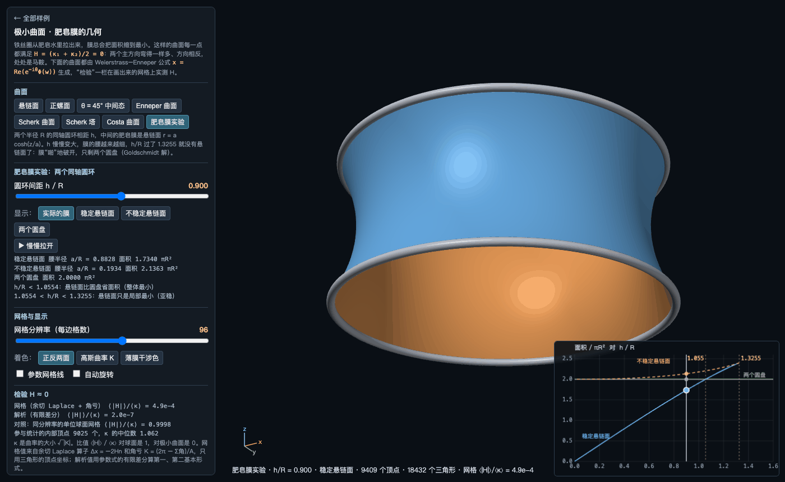

右下角的图把三个解的面积画在一起。蓝色实线是粗腰的悬链面，红色虚线是细腰的悬链面，绿色水平线是两个圆盘。页面实测：

| h/R | 粗腰 a/R | 粗腰面积 / πR² | 细腰 a/R | 细腰面积 / πR² | 圆盘 |
|---|---|---|---|---|---|
| 0.2 | 0.9950 | 0.3993 | 0.0222 | 2.0040 | 2 |
| 0.6 | 0.9524 | 1.1814 | 0.1003 | 2.0501 | 2 |
| 0.9 | 0.8828 | 1.7340 | 0.1934 | 2.1363 | 2 |
| 1.0554 | 0.8257 | 1.9993 | 0.2616 | 2.2063 | 2 |
| 1.2 | 0.7451 | 2.2281 | 0.3519 | 2.2943 | 2 |
| 1.3 | 0.6416 | 2.3682 | 0.4617 | 2.3743 | 2 |
| 1.325 | 0.5649 | 2.3988 | 0.5399 | 2.3988 | 2 |
| 1.326 | — | — | — | — | 2 |

读这张表：

1. **细腰的总是更大**。细腰悬链面的面积始终高于粗腰的，它是面积的一个鞍点：H = 0 成立（一阶导数为 0），但往某个方向推一下面积会减小，所以它不稳定。真实的膜不会停在它上面。粗腰的那个是面积的局部极小，是稳定的。这是二阶变分的经典结论，表里的数只说明了它更大。
2. **h/R = 1.0554 时粗腰悬链面和圆盘一样大**。在此之前悬链面是全局最小；在 1.0554 和 1.3255 之间，它比两个圆盘还大，但仍是局部极小（亚稳），膜可以一直撑着。
3. **h/R = 1.3255 时两支在折点相遇然后一起消失**，这是一个鞍结分岔。h 再大一点，膜就没有可以待的悬链面了，它会在腰部收缩成一根线然后断开，只剩两个圆盘。

点“▶ 慢慢拉开”可以看这个过程：h 每帧增加 0.002，跨过 1.3255 的那一帧，悬链面变成两个圆盘。选“不稳定悬链面”能看到那个细腰的解：

| h/R = 1.2，不稳定的细腰悬链面 | h/R = 1.35，膜已经破成两个圆盘 |
|---|---|
| 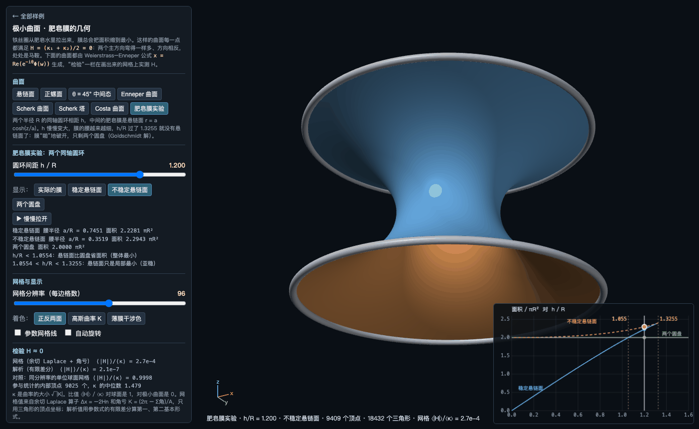 | 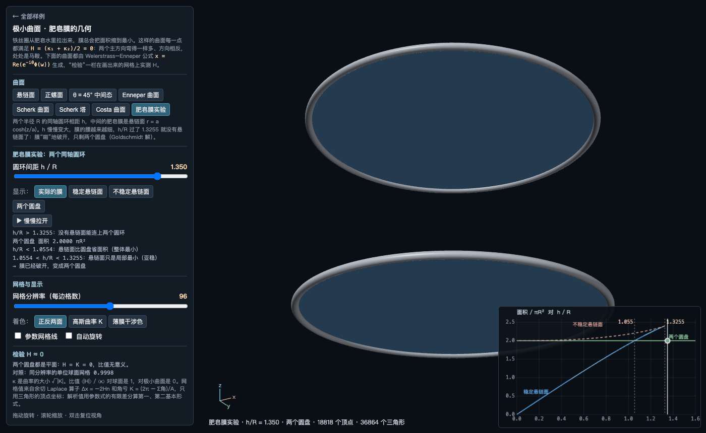 |

h → 0 时细腰的悬链面面积趋于 2πR²，等于两个圆盘：它退化成两个圆盘中间连一根细线。表里 h/R = 0.2 时已经是 2.0040。

### 8. 在网格上验证 H = 0

第 3 节的“解析”值直接用了公式。还有一个更朴素的问题：只看画出来的那些三角形，能不能看出它们拼成的是一张 H = 0 的曲面？离散微分几何给出的答案是**余切 Laplace 算子**（Pinkall–Polthier 1993，Meyer–Desbrun–Schröder–Barr 2003）：

```
Δx_i = (1 / 2A_i) Σ_j (cot α_ij + cot β_ij) (x_j − x_i) = −2 H_i n_i
K_i  = (2π − Σ 顶点 i 处的三角形内角) / A_i
```

α_ij、β_ij 是边 ij 对面的两个角，A_i 是顶点 i 的混合 Voronoi 面积。第一行是连续公式 Δx = −2Hn 的离散版本。第二行是角亏：平面上一圈三角形的内角加起来正好 2π，曲面上凸的地方不到 2π，马鞍处超过 2π。

为了确认这个算法本身没问题，页面还用同一段代码算了一个同分辨率的单位球面网格作对照，它的比值应该是 1。对四种曲面，网格分辨率从 24 加到 160 时：

| 每边格数 | 悬链面 | Enneper | Scherk | Costa | 对照：单位球面 |
|---|---|---|---|---|---|
| 24 | 5.6·10⁻³ | 1.7·10⁻² | 5.6·10⁻² | 5.0·10⁻² | 0.9960 |
| 48 | 1.4·10⁻³ | 4.1·10⁻³ | 1.7·10⁻² | 1.7·10⁻² | 0.9990 |
| 96 | 3.5·10⁻⁴ | 1.0·10⁻³ | 4.4·10⁻³ | 4.3·10⁻³ | 0.9998 |
| 160 | 1.2·10⁻⁴ | 3.7·10⁻⁴ | 1.6·10⁻³ | 1.6·10⁻³ | 0.9999 |

格数每翻一倍，四种曲面的比值都缩小约 4 倍（悬链面依次是 4.04、4.02），球面的比值则逼近 1。这正是一个二阶精度离散算子的表现：网格上量出来的 H 只是离散误差，量级 h²，随网格加密趋于 0，而同一算法在球面上量出的 H 稳定在真值。Scherk 和 Costa 的数大一些，因为它们在截口附近伸得很陡，那里的三角形更扭曲。

## 操作

- 曲面：悬链面、正螺面、θ = 45° 中间态、Enneper 曲面、Scherk 曲面、Scherk 塔、Costa 曲面、肥皂膜实验；
- 伴随族：θ 滑条（0°–180°）、“播放 θ 变形”在 0° 和 90° 之间来回；下方显示面积和度量的变化；
- 肥皂膜实验：圆环间距 h/R（0.05–1.6），显示“实际的膜 / 稳定悬链面 / 不稳定悬链面 / 两个圆盘”，“慢慢拉开”；
- 网格分辨率（每边 16–160 格）；
- 着色：正反两面（蓝色和橙色区分曲面的两侧）、高斯曲率 K、薄膜干涉色；参数网格线；自动旋转；
- Scherk：Schwarz 反射复制相邻几块（θ = 0° 或 90° 时）；
- 拖动旋转，滚轮缩放，双击复位视角。

## 网址参数

| 键 | 含义 |
|---|---|
| p | 预设：catenoid, helicoid, morph, enneper, scherk, tower, costa, film |
| th | 伴随族角度 θ（度，0–180） |
| n | 网格每边格数（16–160） |
| c | 着色：shade, K, film |
| grid | 1 = 显示参数网格线 |
| h | 圆环间距 h/R（0.05–1.6） |
| show | 肥皂膜显示：auto, stable, unstable, discs |
| copies | 0 = 不做 Schwarz 反射复制 |
| yaw, pitch, z | 视角：绕竖直轴转角、俯仰角（弧度）、缩放 |
| rot | 1 = 自动旋转 |
| anim | 1 = 打开时播放 θ 变形 |
| ui | 0 = 隐藏面板，只留画面 |

例如正螺面按高斯曲率着色：`index.html?p=helicoid&c=K&grid=1`；不稳定的细腰悬链面：`index.html?p=film&h=1.2&show=unstable`。

## 参考

- J. L. Lagrange, *Essai d'une nouvelle méthode pour déterminer les maxima et les minima des formules intégrales indéfinies*, 1760.
- J. Plateau, *Statique expérimentale et théorique des liquides soumis aux seules forces moléculaires*, 1873.
- J. Douglas, *Solution of the problem of Plateau*, Transactions of the AMS 33, 1931；T. Radó, *On Plateau's problem*, Annals of Mathematics 31, 1930.
- R. Osserman, *A Survey of Minimal Surfaces*, Dover, 1986. Weierstrass 表示、伴随族、高斯曲率公式。
- C. J. Costa, *Example of a complete minimal immersion in ℝ³ of genus one and three embedded ends*, Boletim da Sociedade Brasileira de Matemática 15, 1984.
- D. Hoffman, W. H. Meeks III, *A complete embedded minimal surface in ℝ³ with genus one and three ends*, Journal of Differential Geometry 21, 1985.
- A. Gray, *Modern Differential Geometry of Curves and Surfaces with Mathematica*, 2nd ed., CRC Press, 1998. Costa 曲面的显式公式取自此书。
- [NIST DLMF](https://dlmf.nist.gov/) 第 20 章（theta 函数）与第 23 章（Weierstrass 椭圆函数）。
- M. Meyer, M. Desbrun, P. Schröder, A. H. Barr, *Discrete differential-geometry operators for triangulated 2-manifolds*, VisMath 2002 / Springer 2003. 余切 Laplace 与混合 Voronoi 面积。
- C. Isenberg, *The Science of Soap Films and Soap Bubbles*, Dover, 1992. 两圆环肥皂膜实验。
