# Möbius 带与 Klein 瓶 · 只有一面的曲面

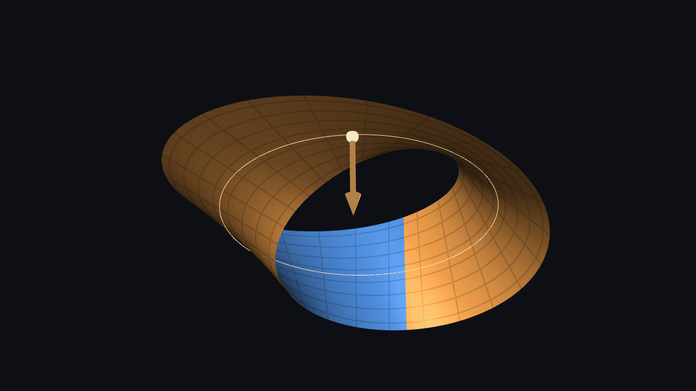

拿一张纸条，一端扭转 180° 再和另一端粘起来，就得到 Möbius 带。在它的中线上放一只蚂蚁，让它一直往前走：走完一圈回到出发点时，它会站在纸的“另一面”，头朝下；不过它一路上从没翻过纸的边缘。这说明 Möbius 带只有一面。页面把这个实验做成了动画，并把同一个问题推到闭曲面上：环面有内外两面，Klein 瓶和射影平面只有一面，而且放进三维空间时必须自己穿过自己。

打开方式：用浏览器直接打开 [index.html](index.html)。页面用 WebGL2 和自己写的一个小着色器渲染，不依赖外部库，离线也能用。

## 数学原理

### 1. 曲面的“两面”用法向量来定义

参数曲面是一个映射 f(u, v)：把平面上的一块长方形（参数域）送进三维空间。在每一点上有两个切向量 ∂f/∂u 和 ∂f/∂v，它们的叉积

```
n(u, v) = ∂f/∂u × ∂f/∂v（再归一化）
```

垂直于曲面，叫**法向量**。一个点有两个单位法向，n 和 −n，各指向曲面的一侧。所谓“曲面有两面”，意思是可以在**整张曲面上**连续地挑出其中一个，叫它“正面”。能这样挑的曲面叫**可定向**的，挑不出来的叫**不可定向**的。

页面就按这个定义上色：每个三角形的顶点顺序和 ∂u × ∂v 一致，GPU 判断三角形朝向你还是背向你（`gl_FrontFacing`），朝向你的画成橙色，背向你的画成蓝色。在一个参数域内部，这个颜色就是“法向 n 指向你这一侧”的标志。所以，只要哪里出现橙色直接接上蓝色、中间没有边缘，就说明在那里正面和反面接到了一起。

### 2. 带：圆柱面和 Möbius 带是同一个公式

取半径为 1 的圆作中线，在每个角度 u 处放一段长 2w 的线段，让线段绕中线转过 k·u/2：

```
f(u, v) = ( (1 + v·sin(ku/2))·cos u,  (1 + v·sin(ku/2))·sin u,  v·cos(ku/2) ),   u ∈ [0, 2π]，v ∈ [−w, w]
```

走完一圈，线段一共转了 k 个 180°（k 个“半扭转”）。k = 0 时线段始终竖直，得到圆柱面；k = 1 时转半圈，得到 Möbius 带。

关键是首尾怎么接。因为 sin(k(u + 2π)/2) = (−1)^k sin(ku/2)，cos 也一样，所以

```
f(u + 2π, v) = f(u, (−1)^k · v)
```

k 为偶数时，参数域的两端原样粘起来；k 为奇数时，粘的时候 v 要反号，也就是把长方形的右边**倒过来**再贴到左边。这一反号让法向也跟着反号：对 u 求导不变，对 v 求导多一个负号，所以 n(2π, v) = −n(0, −v)。在 Möbius 带上，这条接缝就是那条橙色直接接上蓝色的竖线：

| Möbius 带（k = 1） | 圆柱面（k = 0） |
|---|---|
| 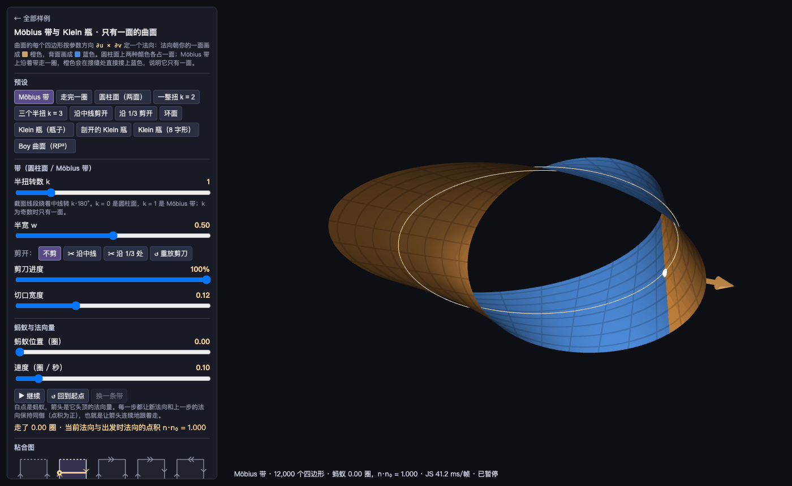 | 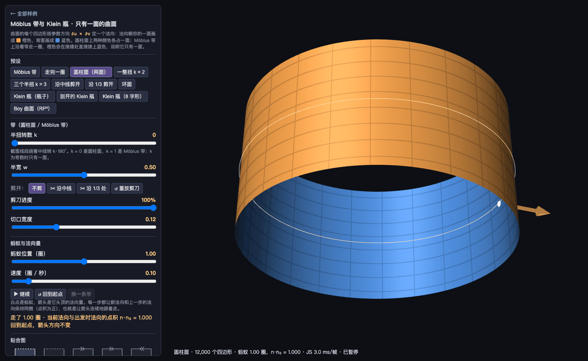 |

圆柱面上，外面整个是橙色，里面整个是蓝色，没有接缝。

### 3. 蚂蚁实验：沿中线把法向量连续地带一圈

蚂蚁沿中线 v = 0 走，u 从 0 走到 2π。每一步都在新位置算出参数法向 n(u, 0)，再挑 n 或 −n 中和上一步的箭头点积为正的那个，也就是让箭头连续地跟着走，不允许它突然翻转。每圈分成 240 步。走完一圈回到出发点时，比较箭头和出发时的法向 n₀：

| 曲面 | 一圈后的 n·n₀ | 两圈后的 n·n₀ |
|---|---|---|
| 圆柱面（k = 0） | 1.000 | 1.000 |
| Möbius 带（k = 1） | **−1.000** | 1.000 |
| 一整扭的带（k = 2） | 1.000 | 1.000 |
| 三个半扭的带（k = 3） | **−1.000** | 1.000 |
| 环面 | 1.000 | 1.000 |
| Klein 瓶（两种） | **−1.000** | 1.000 |
| Boy 曲面（射影平面） | **−1.000** | 1.000 |

n·n₀ = −1 的意思是：蚂蚁回到同一点，箭头指向正好相反的一侧。蚂蚁从没越过边缘，却从“橙色面”走到了“蓝色面”，所以这两面其实是同一面。再走一圈，箭头才转回来。

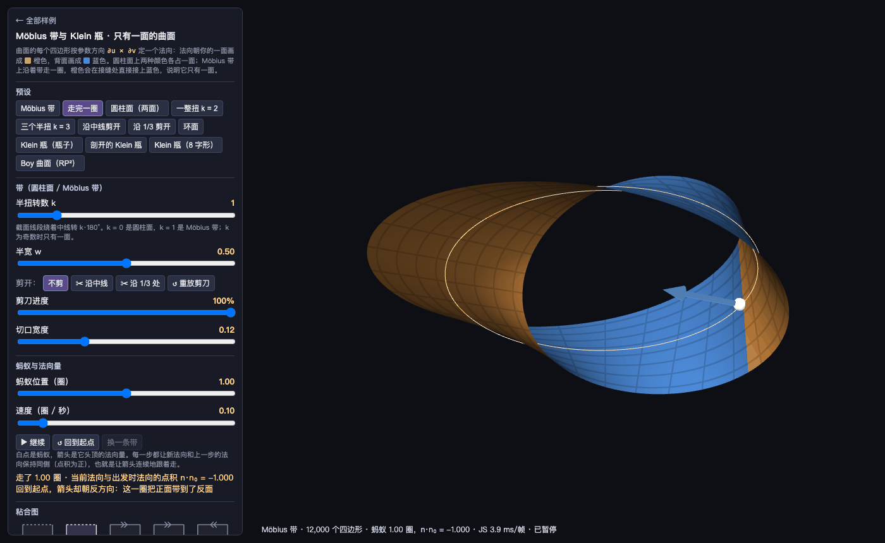

上图和第 2 节的 Möbius 带是同一个视角。出发时（蚂蚁位置 0.00）箭头从橙色面朝外伸出；走完 1.00 圈回到同一点，箭头朝里，是蓝色的，面板显示 n·n₀ = −1.000。

k 为奇数的带都只有一面，k 为偶数的带都有两面。下面是 k = 3：三个半扭转，同样只有一面。

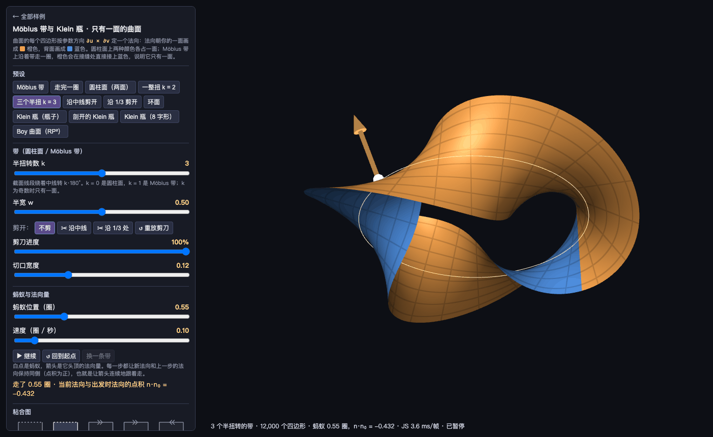

### 4. 粘合图

把曲面沿几条曲线剪开、摊平，都能变成一个正方形；反过来，曲面就是“正方形 + 边怎么粘”。约定同一个字母的两条边粘在一起，箭头方向要对齐：

| 曲面 | 左右两边 a | 上下两边 b | χ |
|---|---|---|---|
| 圆柱面 | 同向 | 不粘（两条边界） | 0 |
| Möbius 带 | **反向** | 不粘（一条边界） | 0 |
| 环面 | 同向 | 同向 | 0 |
| Klein 瓶 | **反向** | 同向 | 0 |
| 射影平面 RP² | **反向** | **反向** | 1 |

面板上画了这 5 张图，当前曲面的图高亮，黄点是蚂蚁在参数域里的位置：⊙ 表示箭头朝纸面外，⊗ 表示朝纸面里。蚂蚁从右边出去、从左边进来时，如果这对边是反向粘的，它的上下就颠倒了，⊙ 也随之变成 ⊗。


只要有一对边是反向粘的，曲面里就藏着一条 Möbius 带（沿着那对边之间走的窄条），曲面就不可定向。Klein 瓶是把圆柱面的两个圆口反向粘起来；也可以看成两条 Möbius 带沿边界粘在一起。射影平面是 Möbius 带的边界上再粘一个圆盘。

### 5. Euler 示性数：直接从网格数出来

把曲面剖分成多边形网格，数顶点数 V、边数 E、面数 F：

```
χ = V − E + F
```

这个数不依赖怎么剖分，是曲面的拓扑不变量。页面不查表，而是按粘合规则把网格上该重合的顶点合并（例如 Möbius 带的 (2π, v) 并到 (0, −v)，Boy 曲面圆盘的中心并成一个点，圆盘边上的对径点并在一起），再数 V、E、F。同时它还数出边界曲线有几条（只属于一个面的边连成几个圈），并尝试给所有四边形统一定向：相邻两个面在公共边上的走向必须相反，能做到就是可定向，做不到就是不可定向。在 200 × 60 的网格上：

| 曲面 | V | E | F | χ | 边界 | 可定向 |
|---|---|---|---|---|---|---|
| 圆柱面 | 12200 | 24200 | 12000 | 0 | 2 | 是 |
| Möbius 带 | 12200 | 24200 | 12000 | 0 | 1 | 否 |
| 环面 | 12000 | 24000 | 12000 | 0 | 0 | 是 |
| Klein 瓶（两种） | 12000 | 24000 | 12000 | 0 | 0 | 否 |
| Boy 曲面 | 11901 | 23900 | 12000 | **1** | 0 | 否 |

换网格，V、E、F 都变，χ 不变：Boy 曲面在 24 × 8 的网格上是 181 − 372 + 192 = 1，在 400 × 120 上是 47801 − 95800 + 48000 = 1；Möbius 带在 24 × 8 上是 216 − 408 + 192 = 0。

**闭曲面分类定理**说，连通的闭曲面由两个数完全决定，一是可不可定向，二是 χ：

- 可定向：χ = 2 − 2g，g 是“洞”数（亏格）。球面 χ = 2，环面 χ = 0；
- 不可定向：χ = 2 − c，c 是“交叉帽”数。RP² 有 c = 1，χ = 1；Klein 瓶有 c = 2，χ = 0。

所以环面和 Klein 瓶的 χ 都是 0，区分它们的只有可定向性。圆柱面和 Möbius 带也一样：χ 都是 0，靠边界条数（2 和 1）或可定向性区分。

### 6. 剪开 Möbius 带

**沿中线剪。** 剪掉 v = 0 这条线以后，v ∈ (0, w] 这半条走到 u = 2π 时，按 f(u + 2π, v) = f(u, −v) 接上的是 v ∈ [−w, 0) 那半条，再走一圈才回来。所以剪完只有**一条**带，长度是原来的两倍，参数是 u ∈ [0, 4π]、v ∈ (0, w]。f(u + 4π, v) = f(u, v)，接缝处不再反号，所以它有两面：

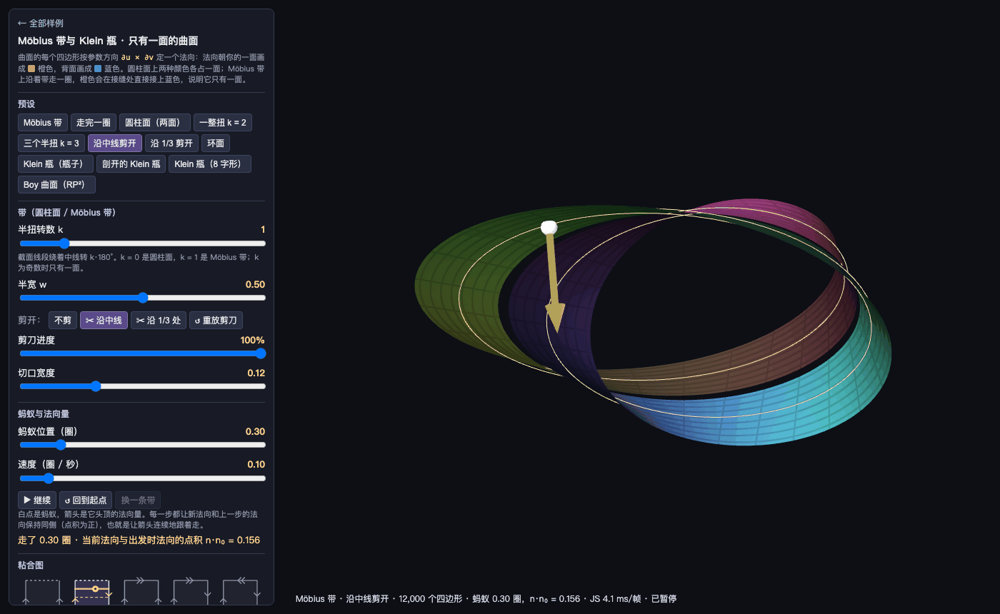

“剪刀”按钮会播放剪开的动画。切口从 u = 0 出发，沿中线绕一圈；切口两侧各让出一点宽度，所以能看见缝隙一路张开：

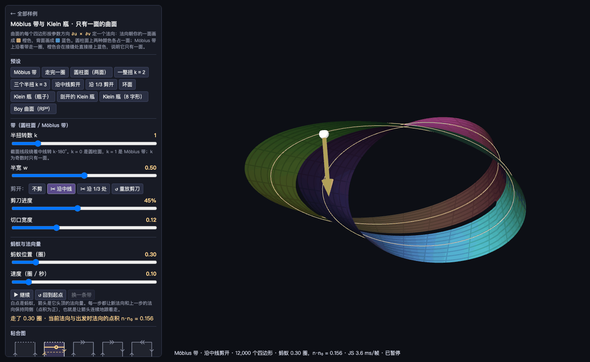

剪出来的带扭了多少？带的两条边是两条闭曲线，可以算它们的**环绕数**（Gauss 积分）：

```
Lk(A, B) = (1 / 4π) ∮∮ (a − b) · (da × db) / |a − b|³
```

它是整数，表示一条曲线绕另一条转了几圈。对两条边各取 300 × 2 个点数值积分，得 |Lk| = 2.000（实测 2.0002）。“两条边互相绕 2 圈”，就是常说的“剪出一条有两个整扭转的带”。作为对照，原来的 Möbius 带：中线和边界的 |Lk| = 1.000；一整扭（k = 2）的带：两条边的 |Lk| = 1.000；圆柱面：0.000。

一般地，k 为奇数的带沿中线剪开，仍得到一条带，两条边的环绕数是 2k：k = 1、3、5 时实测 2.000、6.001、10.003。原因是剪出的每条边都沿着中线绕 2 圈、同时绕中线转 k 圈，两条这样的曲线互相绕 2·k 次。

**在 1/3 处剪。** 在 v = ±w/3 处剪（对 Möbius 带，这两条线其实是同一条闭曲线，剪刀要绕两圈才回到起点）。带被分成三段：中间的 [−w/3, w/3] 和两侧的 [w/3, w]、[−w, −w/3]。中间一段关于 v ↦ −v 对称，自己就是一条更窄的 Möbius 带；两侧两段互相接成一条两倍长的两面带。结果是**两条套在一起的带**：

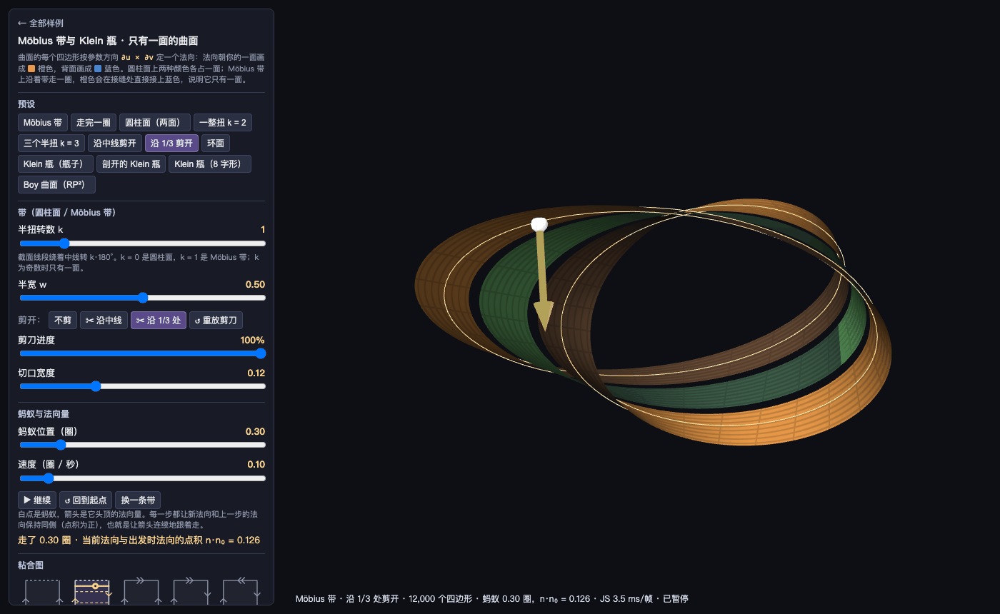

从网格数出的结果：分支 1 是 V − E + F = 8400 − 16400 + 8000 = 0，两条边界，可定向，是环带；分支 2 是 4200 − 8200 + 4000 = 0，一条边界，不可定向，是 Möbius 带。两条中线的 |Lk| = 1.000，套在一起分不开。让蚂蚁走一圈：在长带上 n·n₀ = 1.000，换到 Möbius 带上（“换一条带”按钮）是 −1.000。

### 7. 为什么 Klein 瓶放不进三维空间

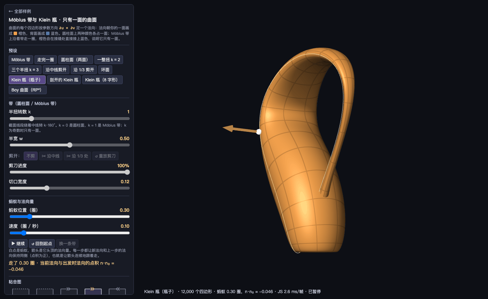

经典的 Klein 瓶图：瓶颈弯下来，从瓶身侧面穿进去，再从底部和瓶身接上。穿过的地方曲面自己和自己相交，这在真正的 Klein 瓶上并不存在，只是放进三维空间的代价。下面说明这个代价为什么躲不开。

**第一步：三维空间里不自交的闭曲面一定把空间分成里外两部分。** 设 S 是 R³ 里一张不自交的闭曲面。从任意一点 p 出发画一条通向无穷远的路径，让它和 S 横截相交，数交点个数。换一条路径，交点数可能变，但奇偶性不变：两条路径拼成一个闭环，闭环和闭曲面的交点总是偶数个（闭环可以连续缩成一个点，缩的过程中交点只能成对出现、成对消失）。于是“交点数为奇数”的点组成里面，“为偶数”的点组成外面。这就是 Jordan–Brouwer 分离定理。

**第二步：分得出里外的曲面一定可定向。** 在 S 的每一点，取指向外面的那个法向。它处处有定义而且连续，这就在整张曲面上挑出了一面，所以 S 可定向。

**第三步：Klein 瓶不可定向**（第 3 节的蚂蚁实验：n·n₀ = −1.000）。如果 Klein 瓶能不自交地放进 R³，蚂蚁出发时箭头指向外面，一路连续地走，箭头不会穿过曲面，所以始终指向外面；可是回到起点时箭头反了过来，指向里面，矛盾。所以 Klein 瓶放进 R³ 一定会自交。射影平面也一样。

自交的地方恰好就是“里外”说不清的地方。勾上“剖开前半”，把靠近你的一半切掉，可以看到瓶颈从侧面穿进瓶身。经典参数式关于一个平面对称，这个预设的视角让切掉的部分大致是对称面靠近你的那一半，蚂蚁走的那条线也在切掉的这一半上，所以它悬在空中：

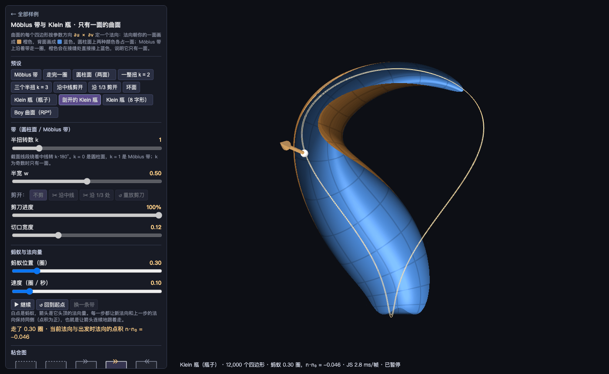

到了四维空间就不必自交：瓶颈穿过瓶壁时，只要在第四个坐标方向上“绕开”就行。例如把 8 字形 Klein 瓶的截面再带上一个随 u 变化的第四坐标，就得到 R⁴ 里的一个嵌入。

### 8. 另一种 Klein 瓶：8 字形

取一个 8 字形截面（v 的函数），一边绕大圆走一圈、一边让截面转半圈：

```
f(u, v) = ( (2.2 + cos(u/2)·sin v − sin(u/2)·sin 2v)·cos u,
            (2.2 + cos(u/2)·sin v − sin(u/2)·sin 2v)·sin u,
             sin(u/2)·sin v + cos(u/2)·sin 2v ),      u, v ∈ [0, 2π]
```

和 Möbius 带一样，f(u + 2π, v) = f(u, −v)，粘合是反向的，所以这也是一个 Klein 瓶。截面 8 字的交叉点 v = 0 和 v = π 落在同一个圆上，这个圆就是它的自交线。在参数域里，从 (0, v₀) 到 (2π, −v₀) 的路径中，v 必须经过 0 或 π，所以每条让蚂蚁翻面的闭路都会穿过这条自交线。下图是蚂蚁走了 1.05 圈的样子：箭头从蓝色面伸出，n·n₀ = −0.912（离 1.00 圈还差 0.05 圈，所以不是整 −1）。

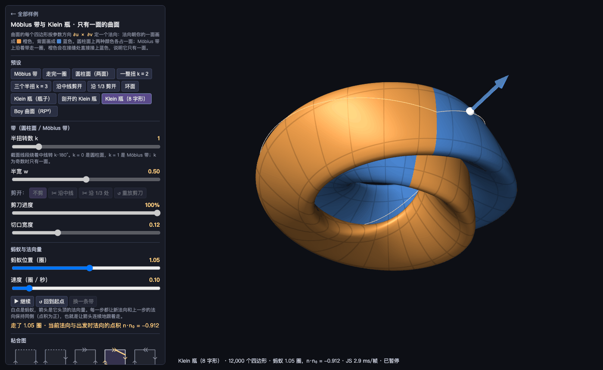

作为对照，环面的参数式几乎一样，只是截面是圆、而且不转。蚂蚁在环面上走一圈，n·n₀ = 1.000：

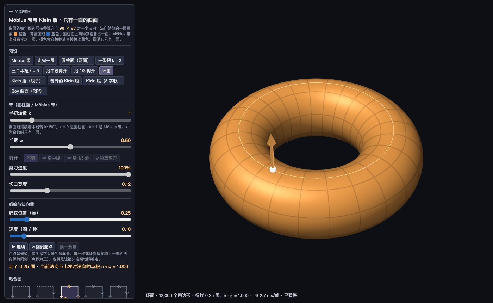

### 9. Boy 曲面：射影平面

射影平面 RP² 是“圆盘 + 边界上的对径点粘在一起”，也就是粘合图里两对边都反向的正方形（把圆盘径向拉伸成正方形，对径点仍对应对径点）。1901 年，Hilbert 的学生 Werner Boy 找到了它在 R³ 里的一个光滑浸入，后来叫 Boy 曲面。页面用 Bryant 和 Kusner 的参数化：对单位圆盘里的复数 w，

```
g₁ = −(3/2)·Im[ w(1 − w⁴) / (w⁶ + √5·w³ − 1) ]
g₂ = −(3/2)·Re[ w(1 + w⁴) / (w⁶ + √5·w³ − 1) ]
g₃ = Im[ (1 + w⁶) / (w⁶ + √5·w³ − 1) ] − 1/2
(x, y, z) = (g₁, g₂, g₃) / (g₁² + g₂² + g₃²)
```

在 |w| = 1 上，w 和 −w 映到同一点，所以这个公式真的在单位圆盘上“对径粘合”。网格用极坐标 (θ, r) 铺；蚂蚁沿一条直径从 −e^{0.3i} 走到 e^{0.3i}，这两点在 RP² 里是同一点。走完 n·n₀ = −1.000，网格数出 χ = 1，和分类定理一致。

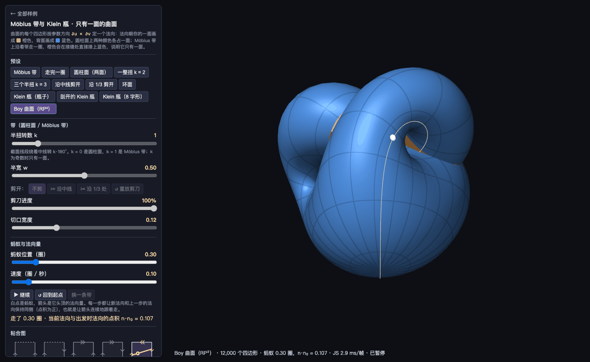

### 10. 渲染

自交曲面不能用“画家算法”（把四边形按深度排序，从远往近画）：两张面互相穿过时，同一个四边形一部分在前、一部分在后，排不出顺序。所以页面用 WebGL2 的深度缓冲：每个像素各自比较深度，自交线自然就画对了。着色器只有几十行，算两盏灯的漫反射和一点高光，背面把法向翻过来再打光，参数网格线用 `fwidth` 画成一像素宽。

200 × 60 = 12000 个四边形时，每帧的 JavaScript（算蚂蚁、拼箭头、上传缓冲、发出绘制）约 0.56 ms；网格只在参数变化时重建，用时 8.1 ms。这些数是在无 GPU 的 Chromium（SwiftShader 软件光栅）里测的，那里帧率约 31.3 fps；把网格降到 24 × 8 = 192 个四边形，帧率是 33.9 fps，相差不到 10%，说明瓶颈是软件光栅本身，不是网格大小。有显卡的浏览器会按显示器刷新率画。

## 操作

- 预设：Möbius 带、走完一圈、圆柱面、一整扭 k = 2、三个半扭 k = 3、沿中线剪开、沿 1/3 剪开、环面、Klein 瓶（瓶子）、剖开的 Klein 瓶、Klein 瓶（8 字形）、Boy 曲面；
- 带：半扭转数 k（0–6）、半宽 w；剪开：不剪 / 沿中线 / 沿 1/3 处，“重放剪刀”重新播放动画，也可以直接拖剪刀进度和切口宽度；
- 蚂蚁：位置（0–2 圈）可拖动，速度可调，暂停 / 继续、回到起点；剪成两条带时，“换一条带”把蚂蚁放到另一条上；
- 着色：正反面（橙 / 蓝）、连通分支（每条带一种颜色，背面变暗）、沿 u 渐变（看剪开后的带有多长）；
- 剖开前半：切掉离你近的部分；网格 u × v 可调（24–400 × 8–120）；参数网格线、自动旋转；
- 拖动旋转，滚轮缩放，双击复位视角，按 h 隐藏面板。

## 网址参数

| 键 | 含义 |
|---|---|
| p | 预设名：mobius, mobius1, cylinder, twist2, trefoil, midcut, thirdcut, torus, klein, kleinCut, klein8, boy |
| s | 曲面：band, torus, klein, klein8, boy |
| k | 半扭转数（0–6，只对 band 有效） |
| w | 半宽（0.1–0.9） |
| cut | none, mid, third |
| cp | 剪刀进度（0–1） |
| gap | 切口宽度（0–0.4，占半宽的比例） |
| anim | 1 = 打开时播放剪开动画 |
| c | 着色：side, comp, len |
| wt | 蚂蚁位置（0–2 圈） |
| ws | 蚂蚁速度（0–1 圈 / 秒） |
| wc | 蚂蚁在第几条带上（0–2） |
| sl | 剖开前半（0–1，0 = 不剖） |
| nu, nv | 网格（24–400，8–120，取偶数） |
| yaw, pitch, z | 视角：水平转角、仰角、缩放 |
| grid | 0 = 不画参数网格线 |
| rot | 1 = 自动旋转 |
| run | 0 = 打开时蚂蚁不动 |
| ui | 0 = 隐藏面板，只留画布 |

数值参数都按滑条范围截断，非有限数忽略；字符串参数只接受上表列出的值。例如 k = 3 的带沿中线剪开并播放动画：`index.html?s=band&k=3&cut=mid&anim=1&c=len`；剖开 70% 的 Klein 瓶：`index.html?p=klein&sl=0.7`。

## 参考

- A. F. Möbius, *Über die Bestimmung des Inhaltes eines Polyëders*, 1865；J. B. Listing 在 1858 年独立发现了同样的带。
- F. Klein, *Über Riemanns Theorie der algebraischen Functionen und ihrer Integrale*, 1882.
- W. Boy, *Über die Curvatura integra und die Topologie geschlossener Flächen*, Mathematische Annalen 57, 1903.
- R. Bryant, *Surfaces in conformal geometry*, Proc. Symp. Pure Math. 48, 1988；R. Kusner, *Conformal geometry and complete minimal surfaces*, Bull. AMS 17, 1987。Boy 曲面的参数化取自这两篇。
- [Klein bottle](https://en.wikipedia.org/wiki/Klein_bottle)（Wikipedia），经典瓶子形状和 8 字形的参数式取自此页。
- G. Călugăreanu, 1959；J. H. White, 1969：带的两条边的环绕数 = 扭转数 + 中线的缠绕数（Lk = Tw + Wr）。
