# Penrose 镶嵌 · 永不重复的铺砖

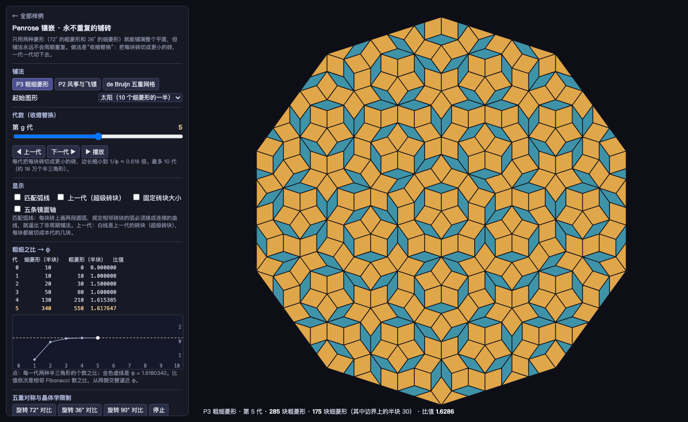

用一种砖铺满地面，最常见的是正方形、正三角形、正六边形，铺出来的图案沿两个方向周期重复。1974 年 Roger Penrose 找到了另一种铺法：只用两种菱形，一种顶角 72°（粗菱形），一种顶角 36°（细菱形），可以铺满整个平面，但无论平移多远，图案都不会和自己重合。上图是这种铺法的一块：粗菱形 285 块、细菱形 175 块，正中心有完美的五重旋转对称，而这是任何周期铺砖都不可能有的对称。

这一页把它拆开：先用“收缩替换”一代一代把砖切小，算出粗细两种砖的个数之比为什么趋向黄金比例 φ；再看匹配弧线、风筝与飞镖、de Bruijn 五重网格三种等价的构造；最后证明周期铺砖为什么不能有五重对称，以及这和 2011 年诺贝尔化学奖的准晶体有什么关系。

打开方式：用浏览器直接打开 [index.html](index.html)。页面只用 Canvas 2D，不依赖外部库，离线也能用。

## 数学原理

### 1. 两种菱形

两种菱形的边长都是 1：

| | 角度 | 面积 = sin（锐角） |
|---|---|---|
| 粗菱形 | 72°、108° | sin 72° ≈ 0.9511 |
| 细菱形 | 36°、144° | sin 36° ≈ 0.5878 |

两个面积之比是 sin 72° / sin 36° = 2 cos 36° = φ ≈ 1.618。这里的 φ = (1 + √5)/2 就是黄金比例，它满足 φ² = φ + 1。这一页里所有的长度比、面积比、个数比最后都落到 φ 上。

光有两种菱形还不够：随便拼，它们也能拼成周期图案（比如粗菱形一排一排平铺）。Penrose 铺法的关键在下面的“收缩替换”和第 4 节的匹配规则。

### 2. 收缩替换：把砖切小

把每块菱形沿一条对角线切成两个等腰三角形，叫 **Robinson 三角形**：

- 细菱形沿短对角线切开，得到顶角 36°、两腰长 1、底边 1/φ 的“锐角黄金三角形”；
- 粗菱形沿长对角线切开，得到顶角 108°、两腰长 1、底边 φ 的“钝角黄金三角形”。

这两种三角形都能切成更小的同类三角形，小三角形的腰长正好是 1/φ：

```
细半块（腰 1）：在一条腰上取离顶点 1/φ 的点 P，  → 1 个细半块 + 1 个粗半块（腰都是 1/φ）
粗半块（腰 1）：在腰上、底边上各取离底角 1/φ 的点 → 2 个粗半块 + 1 个细半块（腰都是 1/φ）
```

切完以后，相邻的两个小半块又沿底边拼回一块完整的小菱形。整个图形大小不变，砖块的边长缩到 1/φ ≈ 0.618 倍。这个操作叫**收缩**（deflation）。从 10 个细半块围成的“太阳”出发，一代一代收缩：

| 第 1 代 | 第 2 代 | 第 3 代 | 第 4 代 |
|---|---|---|---|
| 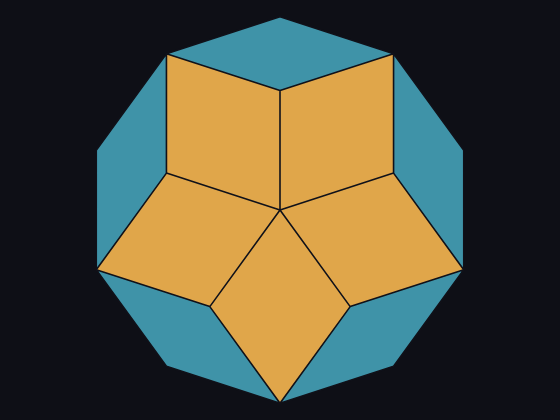 | 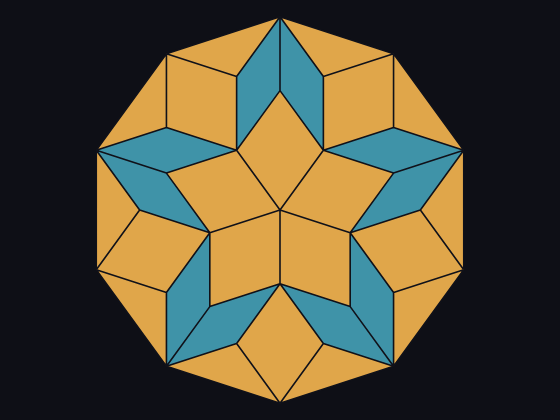 | 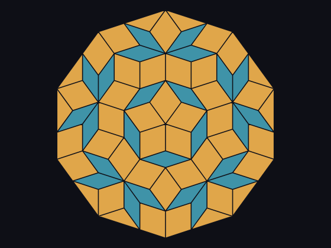 | 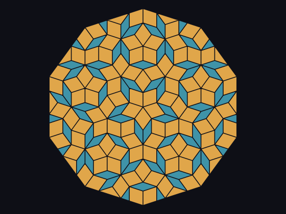 |

页面的“第 g 代”滑块、“上一代 / 下一代”按钮和“▶ 播放”就是做这件事，最多 10 代。第 10 代有 109,460 个半三角形，P2 风筝飞镖第 10 代有 177,110 个；超过 40 万个就不再切，所以计算量有上限。

### 3. 粗细之比为什么趋向 φ

设第 g 代有 tₙ 个细半块、Tₙ 个粗半块。按上面的规则，每个细半块生出 1 细 1 粗，每个粗半块生出 1 细 2 粗：

```
| t′ |   | 1  1 | | t |
| T′ | = | 1  2 | | T |
```

从 (t, T) = (10, 0) 出发，页面面板上实时列出每一代的个数（下表是页面上读到的）：

| 代 | 0 | 1 | 2 | 3 | 4 | 5 | 6 | 7 | 8 | 9 | 10 |
|---|---|---|---|---|---|---|---|---|---|---|---|
| 细半块 | 10 | 10 | 20 | 50 | 130 | 340 | 890 | 2330 | 6100 | 15970 | 41810 |
| 粗半块 | 0 | 10 | 30 | 80 | 210 | 550 | 1440 | 3770 | 9870 | 25840 | 67650 |
| 粗 / 细 | — | 1 | 1.5 | 1.6 | 1.615385 | 1.617647 | 1.617978 | 1.618026 | 1.618033 | 1.618034 | 1.6180340 |

每一行都是 Fibonacci 数的 10 倍：第 g 代细半块 10·F₂g₋₁，粗半块 10·F₂g。比值是隔一项取的相邻 Fibonacci 数之比 1/1、3/2、8/5、21/13、…，第 10 代已经和 φ = 1.6180340 相差不到 3×10⁻⁸。

原因在矩阵上：M = [[1, 1], [1, 2]] 的两个特征值是 φ² ≈ 2.618 和 1/φ² ≈ 0.382，较大的那个对应的特征向量是 (1, φ)。每收缩一次，个数向量在 (1, φ) 方向上放大 φ² 倍，在另一个方向上缩小到 1/φ²，所以比值以每代 φ⁴ ≈ 6.85 倍的速度逼近 φ。总个数也每代乘以约 φ²，正好抵消每块砖的面积缩小到 1/φ²。

两种菱形的个数之比是 φ，面积之比也是 φ，所以粗菱形占总面积的 φ²/(φ² + 1) ≈ 72.4%。

**这直接说明铺法不是周期的。** 周期铺砖由一个基本区域平移复制而成，基本区域里粗、细菱形各有整数块 a、b，整个平面上的比例就是有理数 a/b。而 Penrose 铺砖的比例是无理数 φ，所以它没有任何平移周期。

左下角状态栏显示的是完整砖块的个数（把边界上切了一半的也算一块），例如第 5 代 285 块粗菱形、175 块细菱形，比值 1.6286；第 10 代 33,950 块对 20,950 块，比值 1.6205。比三角形个数之比偏离 φ 多一些，是因为边界上有 30 和 340 个半块。

### 4. 自相似：收缩与膨胀

收缩反过来叫**膨胀**（inflation）：把小砖按唯一的方式拼回大砖。勾选“上一代（超级砖块）”，白线画出上一代的砖块，一块细的超级砖块里是 2 个粗半块和 2 个细半块，一块粗的超级砖块里是 4 个粗半块和 2 个细半块，半块和相邻超级砖块里的另一半拼成完整的砖：

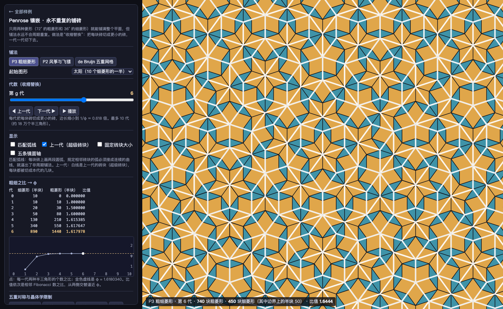

从一块粗菱形出发收缩 4 代，看得更清楚，这块菱形被切成 38 块粗菱形和 23 块细菱形（含边界上的 12 个半块）：

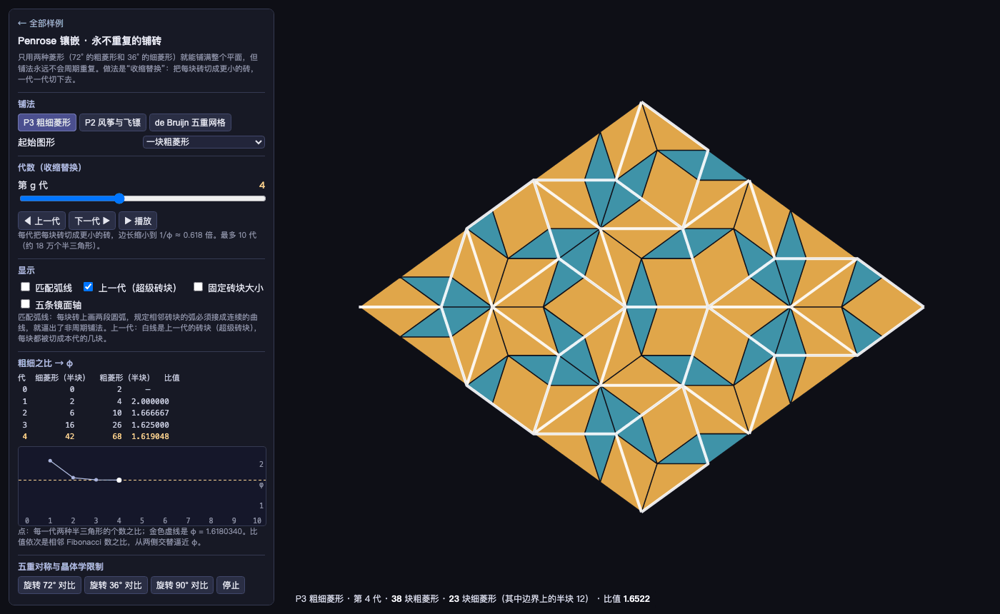

勾选“固定砖块大小”，画面不再缩小砖块，而是按 φ 倍放大整个图形，看到的是图案在向外长。下面是第 4、5、6、7 代，砖块一样大。每一代都可以看成上一代放大 φ 倍、再把每块砖切开：

| 第 4 代 | 第 5 代 |
|---|---|
| 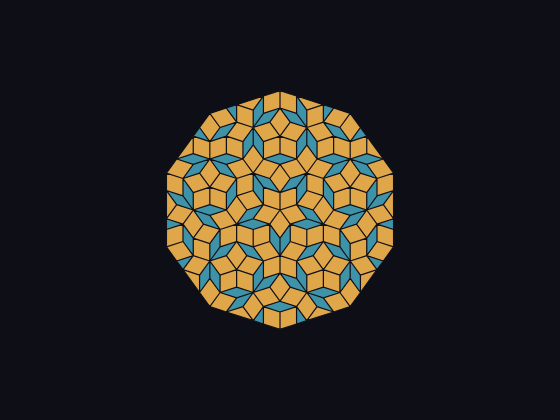 | 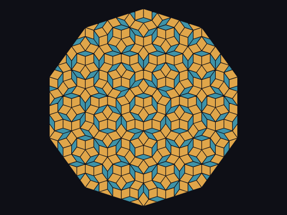 |
| **第 6 代** | **第 7 代** |
| 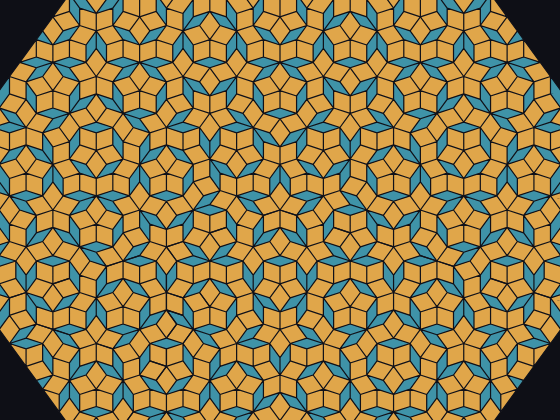 | 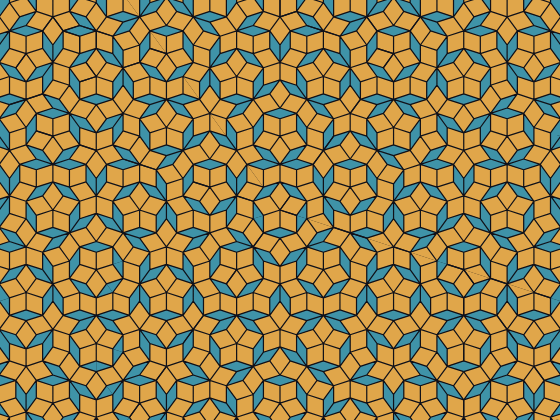 |

膨胀是唯一的：任何一块合法的 Penrose 铺砖都只有一种方式拼成超级砖块，超级砖块又只有一种方式拼成超超级砖块，一直拼上去。如果铺砖有一个平移周期 v，超级砖块的铺法也会以 v 为周期，但超级砖块大了 φ 倍，拼上 k 次以后砖块比 |v| 还大，一块砖平移 v 后要和自己重叠，不可能。这是“没有周期”的另一个证明。

### 5. 匹配规则：弧线

收缩替换造出的是 Penrose 铺砖，但如果手里只有两种菱形，怎样保证工人铺出来的一定不是周期的？Penrose 在砖上加了花纹：每块砖上画两段圆弧，规定相邻的砖弧线必须接成连续的曲线、颜色相同。勾选“匹配弧线”：

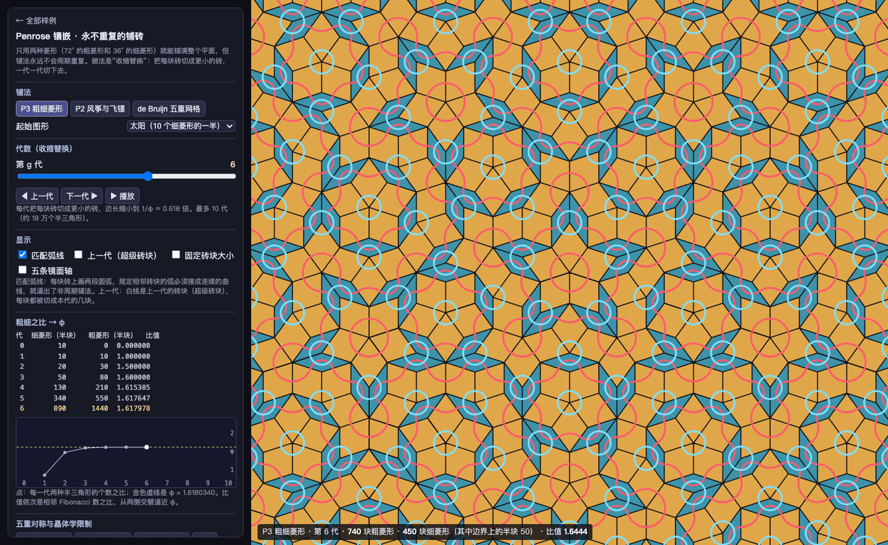

页面上画的弧（以菱形边长 s 为单位）：

| 砖 | 红弧 | 蓝弧 |
|---|---|---|
| 细菱形 | 绕一个 144° 角，半径 s/φ² ≈ 0.382s | 绕另一个 144° 角，半径 s/φ² |
| 粗菱形 | 绕一个 72° 角，半径 s/φ ≈ 0.618s | 绕另一个 72° 角，半径 s/φ² |

每段弧碰到菱形的边，碰点离一端是 s/φ²，离另一端就是 s/φ（因为 1/φ + 1/φ² = 1），相邻砖块上同色的弧就在这里接上。我用页面上的生成代码逐个核对了每个碰点：P3 第 8 代 15,910 个碰点都恰好和一个同色碰点重合，没有一个颜色冲突，剩下 120 个都在图形边界上。

Penrose 证明了：只要遵守这条规则，铺出来的一定是非周期铺砖，而且必定能被唯一地拼成超级砖块。规则本身只看相邻两块砖，却决定了整个平面的结构。

### 6. 风筝与飞镖（P2）

Penrose 最先发表的版本用的是**风筝**和**飞镖**：风筝的四个角是 72°、72°、72°、144°，飞镖是 36°、72°、36°、216°，两者的长边与短边之比都是 φ。它们同样各自切成两个 Robinson 三角形，收缩规则是“半风筝 → 2 个半风筝 + 1 个半飞镖，半飞镖 → 1 个半风筝 + 1 个半飞镖”。从 5 只风筝围成的“太阳”出发：

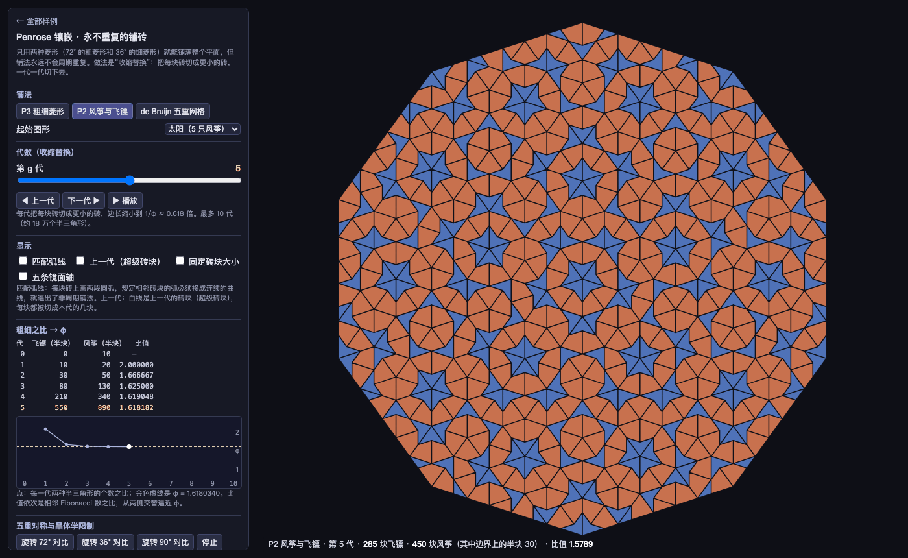

个数矩阵是 [[2, 1], [1, 1]]，特征值同样是 φ² 和 1/φ²，风筝与飞镖的半块数在第 10 代是 109,460 对 67,650，比值 1.61803400。匹配弧线同样能接成连续曲线（P2 第 8 代 25,745 个碰点全部配对，190 个在边界上）：

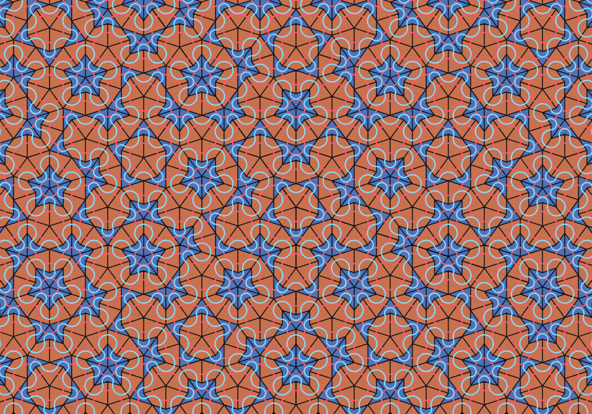

P2 和 P3 是同一种结构的两种画法：把一种铺砖的砖块按固定规则切开、重新拼起来，就能得到另一种。

### 7. 五重对称与晶体学限制

“太阳”起始图形有完美的五重旋转对称和五条镜面轴。勾选“五条镜面轴”，再点“旋转 72° 对比”，页面把整片铺砖转 72°，用白线画出转过去的砖缝，白线正好盖住原来的砖缝。面板上的重合度是：中心区域里转过去以后仍然落在同类砖块上的比例。

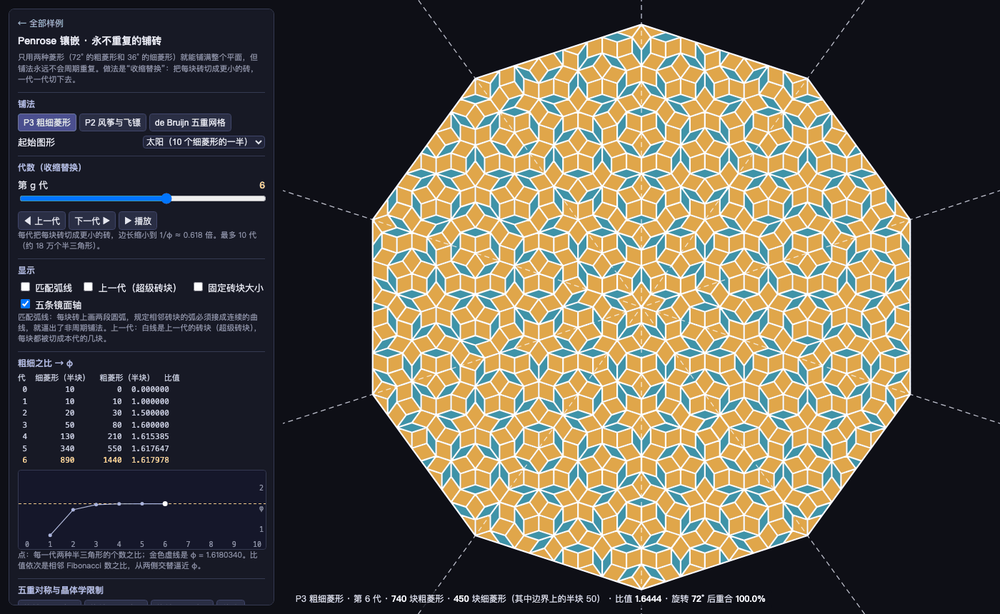

转 36° 就对不上了，白线从砖块中间穿过：


页面上测得的重合度：

| | 72° | 36° | 90° |
|---|---|---|---|
| P3 第 6 代（中心 360 块） | 360 / 360 = 100% | 70 / 360 = 19.4% | |
| P3 第 10 代（中心 17,570 块） | 17,570 / 17,570 = 100% | 4,040 / 17,570 = 23.0% | |
| P3 第 5 代（中心 136 块） | | | 0 / 136 = 0% |
| P2 第 8 代（中心 4,125 块） | 4,125 / 4,125 = 100% | 0 / 4,125 = 0% | |
| 从一块粗菱形出发，第 6 代 | 37 / 211 = 17.5% | | |

**为什么周期铺砖不能有五重对称（晶体学限制）**。设一个周期铺砖在绕某点旋转 θ 后不变。它的全部平移周期组成一个格点 Λ = {m·a + n·b}（m、n 取整数）。旋转把铺砖映成自己，也就把周期映成周期，所以 R·a 和 R·b 仍在 Λ 里，都是 a、b 的整数组合。这意味着在基 (a, b) 下，旋转矩阵 R 的四个元素都是整数，迹也是整数。迹与基的选取无关，在标准正交基下等于 2 cos θ。所以

```
2 cos θ ∈ {−2, −1, 0, 1, 2}   ⟹   θ ∈ {180°, 120°, 90°, 60°, 360°}
```

周期铺砖（和晶体）只能有 1、2、3、4、6 重旋转对称。五重要求 2 cos 72° = (√5 − 1)/2 = 1/φ ≈ 0.618，不是整数。黄金比例又出现了：正是因为 φ 是无理数，五重对称和周期性不能共存。正五边形不能铺满平面也是同一件事的特例：108° 不能整除 360°。

完整的无限 Penrose 铺砖至多只有一个五重对称中心。但它有一种更弱、也更重要的对称：任何一小片图案，都会以 10 种朝向（每隔 36°）、以相同的频率在整个平面上反复出现。所以从“统计”上看，它是十重对称的。

### 8. de Bruijn 五重网格

1981 年 N. G. de Bruijn 给出了一个不用收缩、一步就能画出 Penrose 铺砖的方法。取五个单位向量 eⱼ = (cos 72°j, sin 72°j)，j = 0…4，画五族平行线

```
x · eⱼ + γⱼ = k,   k 取所有整数
```

每两族线（r、s）的每一个交点对应一块菱形，菱形的两条边是 e_r 和 e_s：两个方向夹角 72° 的是粗菱形，夹角 144° 的是细菱形。菱形放在哪里，由交点 x 处的五个整数 Kⱼ = ⌈x · eⱼ + γⱼ⌉ 决定：顶点是 Σ Kⱼ eⱼ。只要五个位移之和 Σγⱼ 是整数、且没有三条线交于一点，拼出来的恰好是 Penrose 菱形铺砖。勾选“叠加五重网格”，彩色线是五族网格（按 5/2 倍画在砖块上，因为 Σⱼ (x · eⱼ) eⱼ = (5/2) x）：

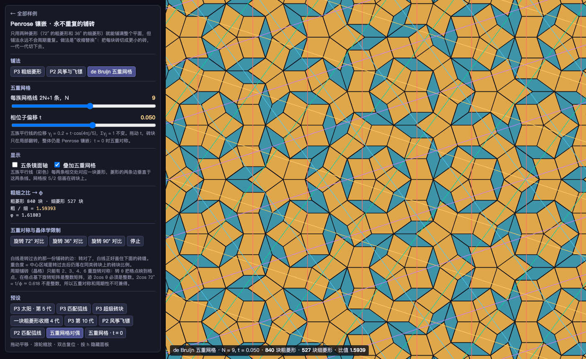

页面取 γⱼ = 0.2 + t · cos(4πj/5)，Σγⱼ = 1。t = 0 时五个位移相等，网格绕原点转 72° 后不变，铺砖也就五重对称；页面测得中心 860 块转 72° 后全部重合，五条镜面轴在 0° + 36°k 方向：

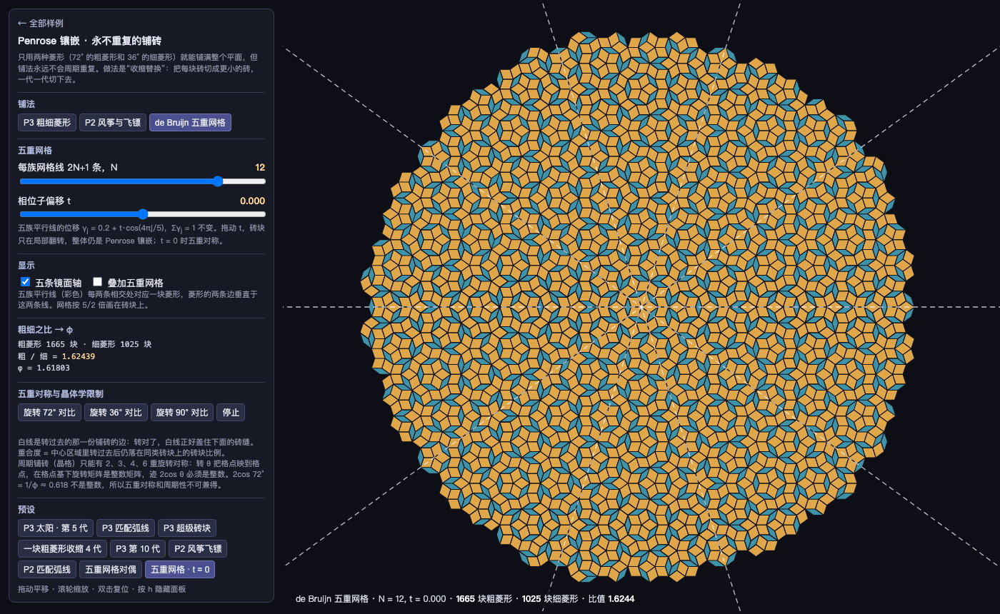

拖动 t（叫**相位子**偏移，phason），γⱼ 的变化不是整体平移，铺砖不会整体移动，而是一小簇一小簇的砖块原地翻转，整体仍然是 Penrose 铺砖。t = 0.05 时转 72° 的重合度降到 82.6%（717 / 868）。页面核对过：N = 12 时所有交点离第三族线的最近距离是 0.0095（t = 0）和 0.0036（t = 0.05），没有三线共点；5,275 条内部边每条恰好被两块砖共用。粗细之比在 N = 12、t = 0 时是 1665 / 1025 = 1.6244，网格越大越接近 φ。

这个构造等价于“切割投影”：五重网格的整数 (K₀, …, K₄) 是 5 维整数格点，Penrose 铺砖的顶点就是把 5 维格点里一条“带子”内的点投影到一个无理斜率的平面上。周期性在高维里存在，投影到平面以后被无理斜率（又是 φ）打散了。

### 9. 准晶体：自然界里的 Penrose 铺砖

1982 年 4 月，Dan Shechtman 用电子衍射观察急冷的铝锰合金，看到了一张十重对称的衍射图：亮点排成十个方向，而且非常锐利。锐利的亮点意味着原子排列有长程秩序，十重对称又违反了第 7 节的晶体学限制。按当时的教科书，这样的晶体不可能存在，他的论文 1984 年才发表，很长时间被同行怀疑。

同年 A. L. Mackay 做了 Penrose 铺砖顶点的光学衍射，得到的正是锐利的十重衍射斑点；1984 年 Levine 和 Steinhardt 把这种“有序但不周期”的结构命名为**准晶体**（quasicrystal）。Penrose 铺砖就是准晶体的二维数学模型：它没有平移周期，但任何局部图案都按确定的频率重复出现，所以衍射图上有锐利的亮点。1992 年国际晶体学联合会把“晶体”的定义改成“衍射图本质上是离散的固体”，不再要求周期性。Shechtman 因此获得 2011 年诺贝尔化学奖。

### 10. 和前面样例的联系：黄金比例

[向日葵叶序](../phyllotaxis/README.md) 里，黄金角 360°/φ² 之所以把种子铺得最匀，是因为 φ 的连分数 [1; 1, 1, …] 全是 1，是“最无理”的数，所以种子在任何尺度上都排不成辐条（周期）。这里 φ 起的作用一样：粗细菱形的个数比是 φ，铺砖就排不成周期；收缩矩阵 M 的特征值是 φ²，所以个数比沿 Fibonacci 数列逼近 φ，和叶序里的螺线条数是同一个数列。

另一个对照是 [IFS 蕨叶](../ifs-fern/README.md)：蕨叶是“整体等于自己几个缩小副本的并”，Penrose 铺砖的收缩替换也是同一种自相似，只是缩放比固定为 1/φ，而且每一块小砖都和其他砖严丝合缝地铺满平面。

一块收缩了 10 代的铺砖，放大 6 倍：

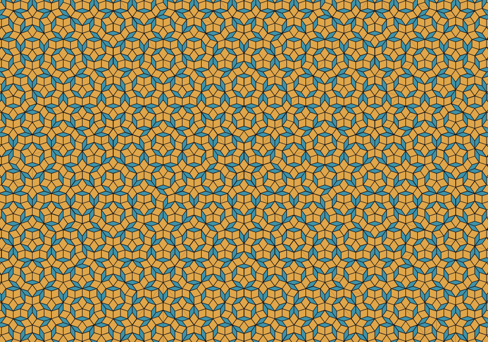

## 操作

- 铺法：P3 粗细菱形、P2 风筝与飞镖、de Bruijn 五重网格；起始图形：太阳、一块粗菱形、一块细菱形（P3），太阳、一只风筝、一只飞镖（P2）；
- 第 g 代（0–10）、上一代 / 下一代、▶ 播放（0–8 代循环）；
- 五重网格：每族网格线数 N（3–14）、相位子偏移 t（−0.4–0.4）、叠加五重网格；
- 显示：匹配弧线、上一代（超级砖块）、固定砖块大小、五条镜面轴；
- 粗细之比：面板列出每一代两种半块的个数和比值，并画出比值曲线；
- 五重对称：旋转 72° / 36° / 90° 对比，面板显示重合度；
- 预设：P3 太阳 · 第 5 代、P3 匹配弧线、P3 超级砖块、一块粗菱形收缩 4 代、P3 第 10 代、P2 风筝飞镖、P2 匹配弧线、五重网格对偶、五重网格 · t = 0；
- 拖动平移，滚轮以鼠标位置为中心缩放，双击复位，按 h 隐藏面板。

## 网址参数

| 键 | 含义 |
|---|---|
| p | 预设名：sun, arcs, super, thick, deep, kite, kitearcs, grid, gridsym |
| sys | 铺法：p3, p2, grid |
| seed | 起始图形：sun, thick, thin（p3）；sun, kite, dart（p2） |
| g | 代数（0–10） |
| N | 五重网格每族线数参数（3–14） |
| t | 相位子偏移（−0.4–0.4） |
| arcs, super, fix, axes, lines | 1 = 打开对应的显示开关 |
| rot | 72、36 或 90 = 打开时播放旋转对比 |
| z, cx, cy | 缩放倍数（0.3–400）、视野中心（−30–30） |
| ui | 0 = 隐藏面板，只显示画布 |

数值参数都会被截到上表的范围内，不是数字的值会被忽略；p、sys、seed 只接受上表里的名字。例如 P2 的匹配弧线：`index.html?sys=p2&g=6&arcs=1&z=2`；五重对称的五重网格：`index.html?sys=grid&t=0&N=12&axes=1&rot=72`。

## 参考

- R. Penrose, *The role of aesthetics in pure and applied mathematical research*, Bulletin of the Institute of Mathematics and its Applications 10, 1974.
- M. Gardner, *Extraordinary nonperiodic tiling that enriches the theory of tiles*, Scientific American 236, 1977 年 1 月. 风筝与飞镖、匹配弧线和 Conway 的研究。
- N. G. de Bruijn, *Algebraic theory of Penrose's non-periodic tilings of the plane, I, II*, Indagationes Mathematicae 43, 1981. 五重网格方法。
- B. Grünbaum, G. C. Shephard, *Tilings and Patterns*, W. H. Freeman, 1987, 第 10 章。Robinson 三角形与收缩替换。
- D. Shechtman, I. Blech, D. Gratias, J. W. Cahn, *Metallic phase with long-range orientational order and no translational symmetry*, Physical Review Letters 53, 1984.
- D. Levine, P. J. Steinhardt, *Quasicrystals: a new class of ordered structures*, Physical Review Letters 53, 1984.
- A. L. Mackay, *Crystallography and the Penrose pattern*, Physica A 114, 1982.
- J. Preshing, [Penrose Tiling Explained](https://preshing.com/20110831/penrose-tiling-explained/)，本页收缩规则的三角形顶点编号取自这里。
- [Penrose tiling](https://en.wikipedia.org/wiki/Penrose_tiling)、[Crystallographic restriction theorem](https://en.wikipedia.org/wiki/Crystallographic_restriction_theorem)（Wikipedia）。
