# 渗流 · 概率的临界点

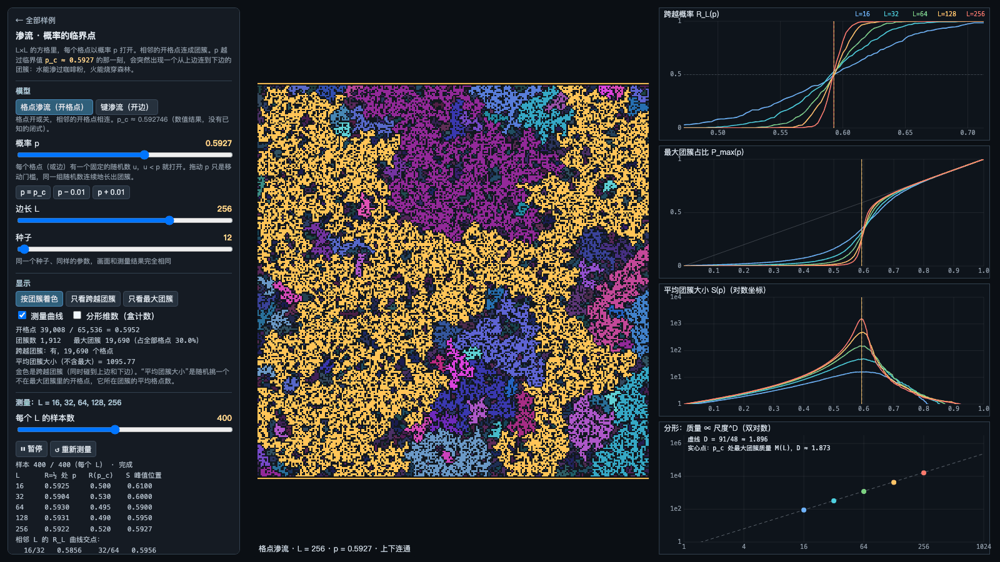

1957 年，Simon Broadbent 和 John Hammersley 想弄明白防毒面具里的活性炭颗粒什么时候会让气体透过去。他们把问题抽象成一张网格：每个格子随机地“通”或“不通”，问从一侧到另一侧有没有一条连通的路。这个模型叫**渗流**（percolation）。它的答案出人意料：“通”的比例 p 慢慢增大时，连通性不是慢慢变好，而是在一个确定的临界值 p_c 附近**突然**出现。在方格上，p_c ≈ 0.5927。p 低于它，开着的格子只能连成孤立的小团；p 高于它，必定有一个团簇横贯整张网格。格子越大，这个转变越陡，无穷大的网格上是一道真正的台阶。

同一张图可以是森林（树 = 开格点，火从上边点燃，能不能烧到下边）、咖啡粉（水能不能从上面渗到下面）、人群中的传染病（感染能不能扩散到整体）。渗流是最简单的**相变**模型：没有能量，也没有温度，只有一个概率和一张图。

打开方式：用浏览器直接打开 [index.html](index.html)。页面只用 Canvas 2D，不依赖外部库，离线也能用。所有随机数都来自带种子的伪随机数发生器，种子和参数相同，画面和测量结果就完全相同，下面每张图都可以用网址参数重现。

## 数学原理

### 1. 模型：每个格点一个固定的随机数

取 L×L 的方格，每个格点 i 抽一个均匀随机数 uᵢ ∈ [0, 1)，规定

```
格点 i 打开  ⇔  uᵢ < p
```

每个格点打开的概率正好是 p，各格点之间相互独立，这就是**格点渗流**（site percolation）。上下左右相邻的两个开格点算作连通，连通的开格点组成一个**团簇**（cluster）。

随机数 u 在拖动 p 时不变，所以 p 变大只会让更多格点打开，已经打开的格点不会关上，团簇只会合并、不会分裂。这叫**单调耦合**：所有 p 共用同一组随机数，画面随 p 连续地生长，不会每动一下就重新洗牌。同一个种子、L = 256 时，页面测得：

| p | 开格点 | 团簇数 | 最大团簇 | 上下连通 |
|---|---|---|---|---|
| 0.30 | 19 644 | 8 378 | 34 | 否 |
| 0.50 | 32 920 | 4 364 | 686（1.0%） | 否 |
| 0.58 | 38 127 | 2 221 | 9 175 | 否 |
| 0.5927（p_c） | 39 008 | 1 912 | 19 690（30.0%） | 是 |
| 0.60 | 39 481 | 1 775 | 25 940 | 是 |
| 0.65 | 42 723 | 948 | 40 170（61.3%） | 是 |

p 从 0.58 走到 0.60，开格点只多了 1 354 个（3.6%），最大团簇却从 9 175 长到 25 940，是原来的 2.8 倍。这些新打开的格点恰好接上了几个大团簇之间的缺口。下面三张图是 p = 0.50、p_c 和 0.65 时的同一组随机数，金色是跨越团簇：

| p = 0.50：只有小团簇 | p = p_c：刚刚连通 | p = 0.65：几乎连成一片 |
|---|---|---|
| 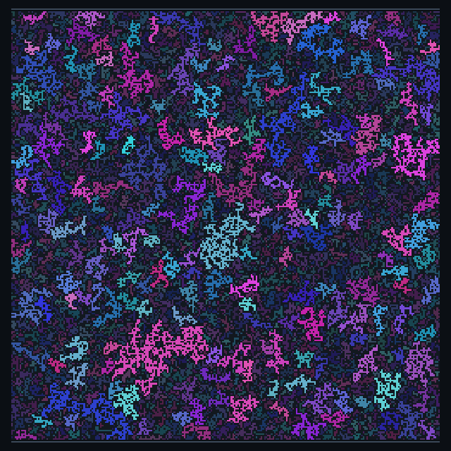 | 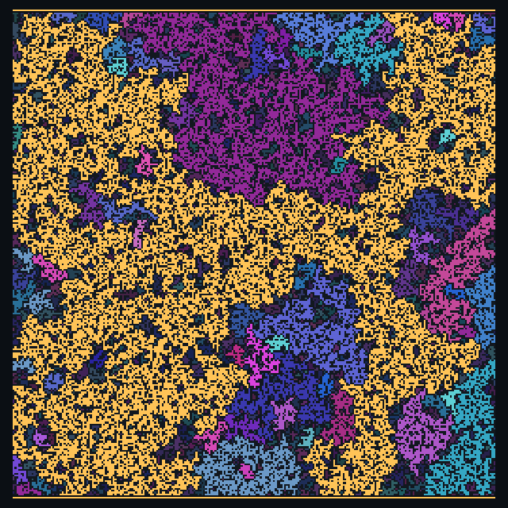 | 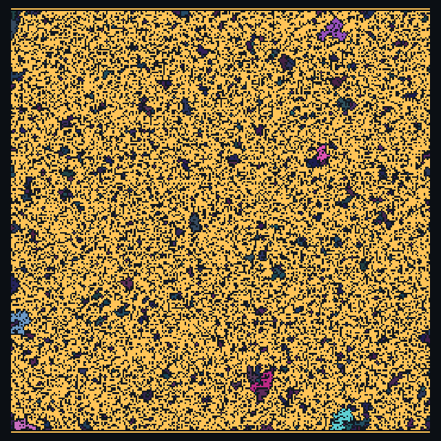 |

### 2. 找团簇：并查集

团簇用**并查集**（union–find）来找，这是 Hoshen 和 Kopelman 在 1976 年做渗流时用的办法。每个格点存一个“父亲”指针，一开始都指向自己。逐个扫过开格点，遇到右边或下边的邻居也开着，就把两个格点所在的树合并：

1. `find(i)`：顺着父亲指针走到根，根就是这个团簇的代表。走的时候把指针改成指向祖父（路径减半），以后再找就更快。
2. `union(a, b)`：找到两个根；如果不同，就把小树的根挂到大树的根下面（按大小合并），大小相加。

按大小合并保证树高不超过 log₂ N，加上路径减半以后，每次操作的平均代价几乎是常数。L = 1024 时有一百多万个格点，重新阈值化、合并、统计一遍约 29 毫秒（测 7 次，28.6–29.1 毫秒），所以拖动 p 时画面能跟上。每个根还记两个标记位：团簇是否碰到上边、是否碰到下边。合并时两个标记取“或”，两个位都为 1 的团簇就是**跨越团簇**。

L 小的时候可以看清每个格点。下图 L = 24、p = 0.6：576 个格点里开了 369 个，分成 22 个团簇，最大的有 212 个格点，它从上边连到了下边：

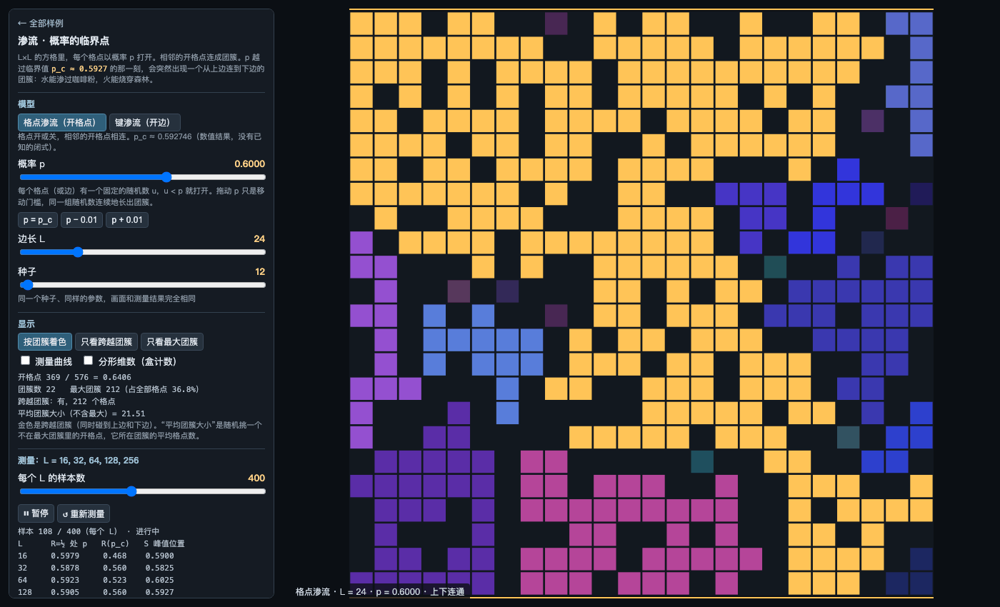

团簇的颜色按根的编号散列，小团簇画暗一些（格点数少于 N/2000，且至少按 4 计），这样大团簇的形状更清楚。鼠标停在任意格点上，左下角会显示它所在团簇的大小。

### 3. 跨越概率：一条越来越陡的台阶

记 R_L(p) 为 L×L 格子上存在上下跨越团簇的概率。它从 0 涨到 1，涨的位置在 p_c 附近。要测出整条曲线，页面用 **Newman–Ziff 算法**（2000）：

1. 随机打乱 N 个格点的次序，再按 u 从小到大逐个打开；
2. 每打开一个格点，用并查集把它和已打开的邻居合并，同时更新最大团簇、平方和、是否已经跨越；
3. u 每越过网格上的一个 p 值（步长 0.0025，外加 p_c 本身），就记下这时的结果。

打开前 k 个格点时，开着的正好是 {u < p} 中的格点，所以一遍扫过就得到所有 p 上的结果，每个样本的代价和测一个 p 一样。排好序的 u 不用真的排序：独立指数随机数 E₀, E₁, … 的部分和除以总和，正好是排好序的均匀随机数。

每个尺寸各测 5000 个样本（种子 12，`?T=5000`），右上图是 R_L(p)：

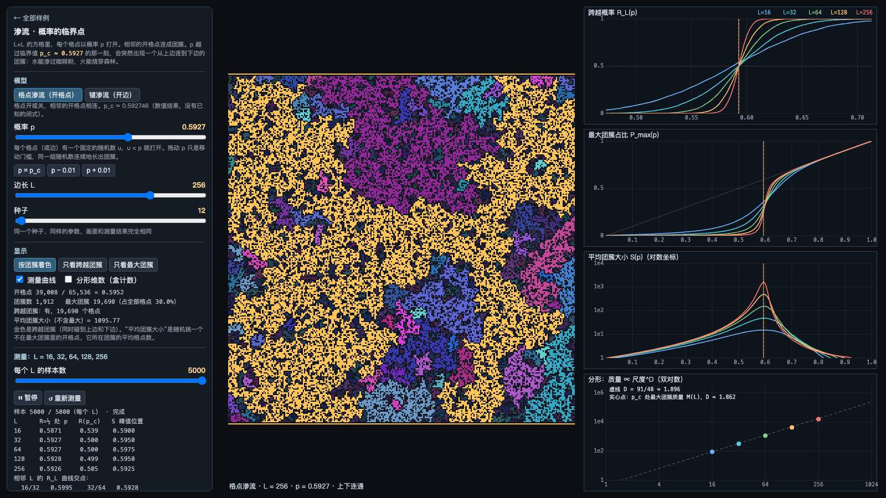

| L | R_L = ½ 的位置 | R_L(p_c) | 宽度 p(R=0.9) − p(R=0.1) |
|---|---|---|---|
| 16 | 0.5871 | 0.539 | 0.1620 |
| 32 | 0.5927 | 0.500 | 0.1006 |
| 64 | 0.5927 | 0.500 | 0.0598 |
| 128 | 0.5928 | 0.499 | 0.0359 |
| 256 | 0.5926 | 0.505 | 0.0212 |

相邻尺寸的两条曲线交于 0.5995（16/32）、0.5928（32/64）、0.5928（64/128）、0.5925（128/256）。5000 个样本时 R 的统计误差是 √(¼/5000) ≈ 0.007，所以从 L = 32 开始，R_L(p_c) 和 ½ 的差都在误差以内。

这几个数说明了三件事：

- **曲线交于一点。** 在 p_c 处跨越概率与 L 无关。p < p_c 时 R_L → 0，p > p_c 时 R_L → 1。曲线交点就是测 p_c 最准的办法之一，数值上的最好结果是 p_c = 0.592746050792…（Jacobsen 2015），没有已知的闭式。
- **交点的高度是 ½。** 这是 Cardy 公式（1992）的结论：在 p_c 处，长宽比为 r 的长方形的跨越概率趋于一个只依赖 r 的普适函数，正方形 r = 1 时恰好是 ½。“普适”指它和格子的形状无关，三角格、方格都一样。
- **台阶的宽度按 L^(−1/ν) 收窄**，ν = 4/3 是关联长度指数。宽度在 p_c 附近的意思是：|p − p_c| 小于这个宽度时，L×L 的格子分不清自己在临界点的哪一边。拟合五个宽度得 1/ν ≈ 0.735，相邻两点的局部斜率依次是 0.688、0.750、0.738、0.756，精确值是 3/4。

**一个关于随机数的教训。** 这组数据第一次是用 mulberry32 测的，L = 256 时 R(p_c) 偏低：13 000 个样本合起来是 0.483 ± 0.004。换成 sfc32 后，同样 8000 个样本得到 0.503 ± 0.006。不同种子之间的离散程度和二项分布的理论值一致，所以问题不在单次的噪声。一次测量要为每个尺寸抽几亿个随机数，32 位状态的发生器在这个量级不可靠。现在测量用 sfc32（128 位状态，由 mulberry32 播种），画格子仍然用 mulberry32。

### 4. 键渗流与自对偶：p_c = 1/2

换一种规则：格点都在，每条**边**以概率 p 打开，被开边连起来的格点属于同一团簇。这叫**键渗流**（bond percolation）。它的临界值是精确的 **p_c = 1/2**。Harris（1960）证明了 p_c ≥ 1/2，Kesten（1980）证明了 p_c ≤ 1/2。核心是方格的**自对偶**：

1. **对偶格。** 在每个小方块的中心放一个对偶格点，相邻两个中心之间连一条对偶边。每条原边恰好和一条对偶边垂直相交。规定：原边关闭时，和它相交的对偶边打开。原边以概率 p 打开，所以对偶边以概率 1 − p 打开，也是相互独立的。方格的对偶格还是方格，所以对偶模型就是参数为 1 − p 的键渗流。
2. **非此即彼。** 在一个长方形里，“开边从上连到下”和“开对偶边从左连到右”恰好发生一个：要从上到下，必须穿过每一条从左到右的对偶路线；而一条从左到右的对偶开路线意味着它穿过的原边全关，正好把上下切断。这和六边形棋 Hex 不可能下成平局是同一个道理。页面在 L = 2…64、60 个种子、5 个 p 值共 2100 种情况上检查过这一点，没有例外。
3. **p = 1/2 时两边对称。** 如果长方形取得恰当（原格有 L 列，要往下走的距离比宽多一步），把对偶格旋转 90°，它的左右跨越问题就和原格的上下跨越问题形状完全相同。p = 1/2 时原边和对偶边打开的概率都是 ½，两个事件概率相等，又恰好发生一个，所以各为 ½，而且对**所有** L 都成立。跨越概率在 p = 1/2 既不趋于 0 也不趋于 1，这正是临界点的标志。剩下的严格证明（说明 p 稍大于 1/2 时就会连通）要用 Russo–Seymour–Welsh 不等式，这是 Kesten 的工作。

勾选“对偶格”可以直接看到这个论证。每条关闭的原边上画一条红色的对偶边，亮红色是从左墙连到右墙的那一条对偶路线。下面左图 L = 32，金色团簇从上到下打通了，红边就连不过去；右图 L = 40，一条亮红色的路线从左走到右，于是没有任何开团簇能从上到下：

| L = 32：上下连通，对偶格左右不通 | L = 40：对偶格左右连通，上下被挡住 |
|---|---|
| 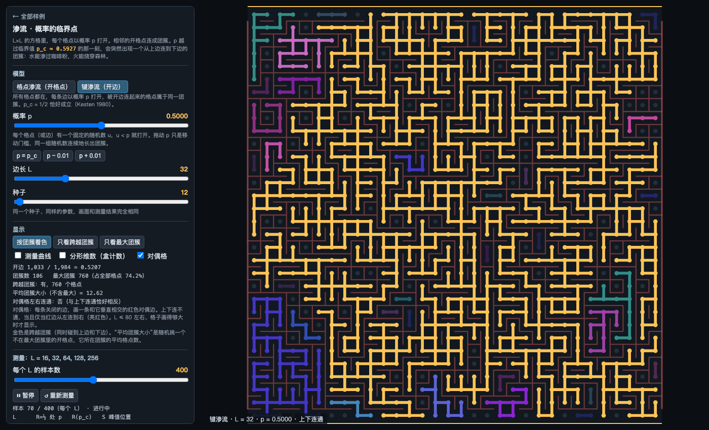 | 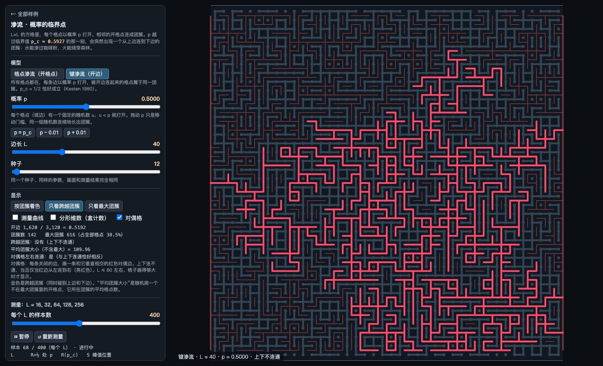 |

页面的格子是 L×L，比恰好对称的形状矮一行，原格稍占便宜，所以 R_L(1/2) 略大于 ½，并随 L 增大趋于 ½。测量结果（5000 个样本）：

| L | 16 | 32 | 64 | 128 | 256 |
|---|---|---|---|---|---|
| R_L(1/2) | 0.532 | 0.528 | 0.507 | 0.508 | 0.502 |
| R_L = ½ 的位置 | 0.4959 | 0.4976 | 0.4997 | 0.4998 | 0.5000 |

相邻曲线的交点是 0.5007、0.5022、0.4999、0.5003，宽度拟合给出 1/ν ≈ 0.748。

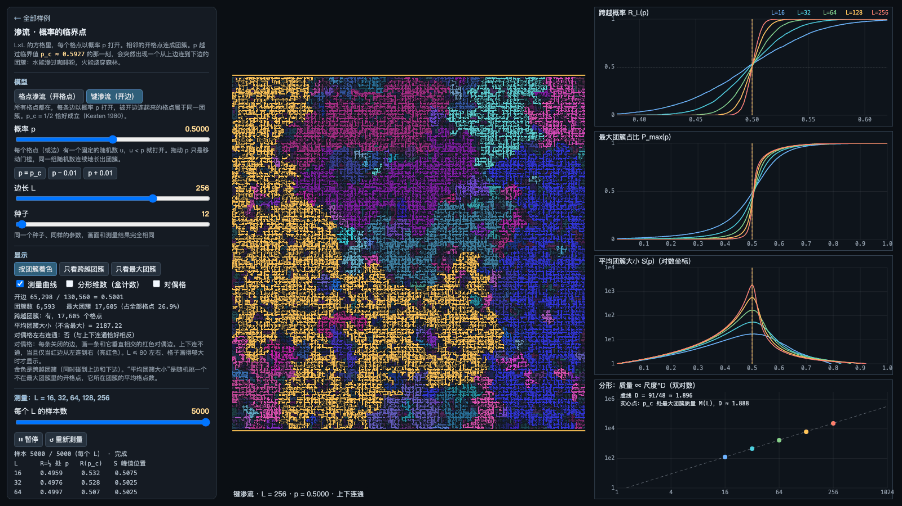

格点渗流没有这样的对称。方格格点渗流的对偶是“带对角线的方格”（每个格点 8 个邻居）上的关闭格点渗流，那是另一张图，所以只能得到 p_c(方格) + p_c(带对角线的方格) = 1，而不能得到 p_c 本身。

### 5. 序参量：最大团簇占比

右侧第二张图是最大团簇占全部格点的比例 P_max(p)。在无穷大的格子上，它的极限 P_∞(p) 是“一个格点属于无穷团簇的概率”：p < p_c 时为 0，p > p_c 时为正，在 p_c 附近按

```
P_∞(p) ∝ (p − p_c)^β,    β = 5/36
```

从 0 长起来。这和磁铁的磁化强度一样：铁在居里温度以上没有磁性，降到居里温度以下，磁化强度从 0 长出来。P_∞ 在相变中的角色叫**序参量**。

β = 5/36 ≈ 0.139 很小，所以曲线在 p_c 右边几乎是竖着冲上去的。图里的灰色斜线是 P_max = p：最大团簇不可能比全部开格点还多，p 接近 1 时两者重合。

有限格子上，P_max 在 p_c 处不为 0，而是按 L^(−β/ν) = L^(−5/48) 慢慢减小。测得 0.3576、0.3146、0.2842、0.2616、0.2428。L 每翻一倍，理论上要乘以 2^(−5/48) ≈ 0.930，实测比值是 0.880、0.903、0.920、0.928，逐渐逼近。

### 6. 平均团簇大小：在 p_c 处发散

第三张图是平均团簇大小 S(p)：随机挑一个**不在最大团簇里**的开格点，它所在团簇的平均格点数。用 n_s 表示大小为 s 的团簇个数，

```
S = Σ' s² n_s / Σ' s n_s      （Σ' 不含最大团簇）
```

分子里多一个 s，是因为挑格点时大团簇被挑中的机会正比于它的大小。在无穷格子上 S 在 p_c 处发散，S ∝ |p − p_c|^(−γ)，γ = 43/18。它对应磁铁的磁化率，表示一个局部扰动能传多远。p < p_c 时团簇随 p 变大。p > p_c 时，大团簇都被最大的那个吞掉了，剩下的只是它的空洞里的小碎片，于是 S 又变小。

有限格子上 S 的峰值高度按 L^(γ/ν) = L^(43/24) 增长。测得峰值 15.2、48.7、155.2、492.6、1615.3，位置都在 0.59–0.60。相邻的局部指数是 1.68、1.67、1.67、1.71，比 43/24 ≈ 1.79 小，正慢慢往上走。S 的有限尺寸修正比 R 和 P_max 大，L = 256 还不够看到极限。

### 7. 临界团簇是分形：D = 91/48

在 p_c 处，跨越团簇有大大小小各种尺度的空洞，没有特征长度：

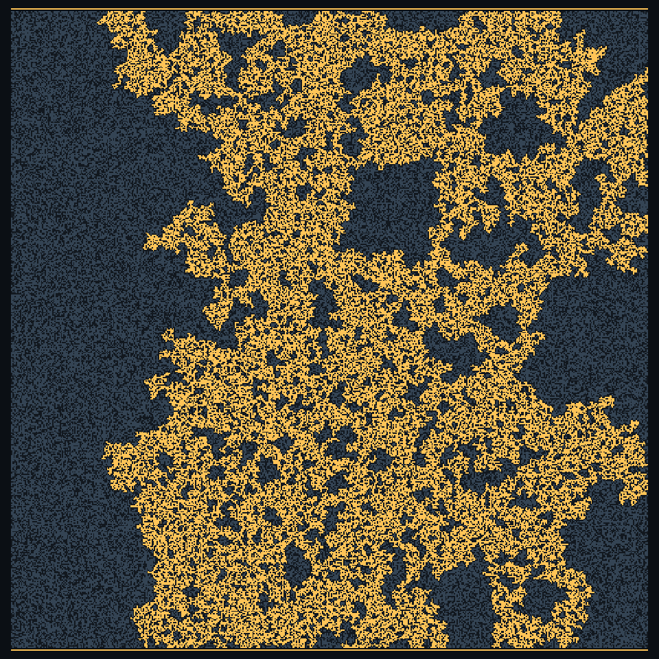

它的质量和尺度的关系是 M ∝ r^D，D = 91/48 ≈ 1.896，比平面的维数 2 小。D 和前面的指数有关系：D = 2 − β/ν = 2 − (5/36)/(4/3) = 91/48。这是因为在 L×L 的格子里，最大团簇的质量等于 L² 乘以占比 P_max ∝ L^(−β/ν)。页面用两种方法测 D，结果画在右下角的双对数图里：

**方法一：最大团簇质量 M(L)。** 测量时顺便记下每个 L 在 p_c 处最大团簇的平均格点数：91.5、322.1、1164.2、4285.4、15 912.3。五个点拟合的斜率是 1.862；相邻两点的局部斜率是 1.815、1.854、1.880、1.893，最后一段已经和 91/48 相差不到 0.003。键渗流在同一个 D 上收敛（局部斜率 1.880、1.896、1.881、1.895）。这是**普适性**：不同的微观规则有相同的临界指数。

**方法二：盒计数。** 用边长 ε 的方格盖住一个团簇，数需要多少个盒子 N(ε)，那么 N(ε) ∝ (L/ε)^D。勾选“分形维数”后，格子上叠一层 ε = L/16 的网格，碰到团簇的格子画亮，右下图的金色圈是各个 ε 的 N(ε)。L = 1024 的分形预设：

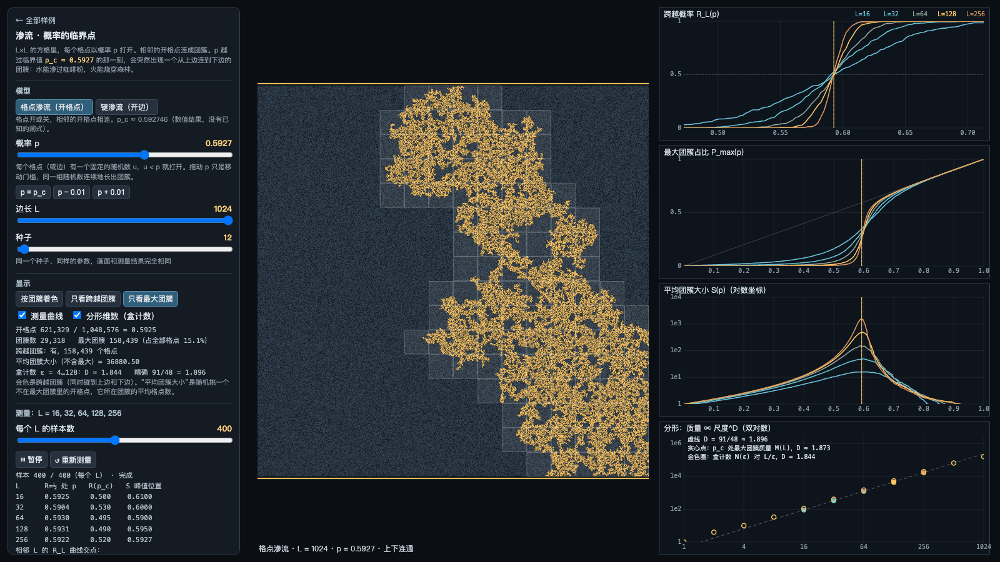

拟合范围很关键。种子 4 的局部斜率随 ε = 1, 2, 4, 8, … 依次是

| ε | 1→2 | 2→4 | 4→8 | 8→16 | 16→32 | 32→64 | 64→128 |
|---|---|---|---|---|---|---|---|
| 局部斜率 | 1.309 | 1.748 | 1.843 | 1.868 | 1.879 | 1.878 | 1.897 |

最小的两个盒子看到的是单个格点，斜率远低于 D。更大的盒子只剩几十个，数字开始乱跳。页面用 4 ≤ ε ≤ L/8 拟合，在 L = 1024 的五个跨越种子（4、7、8、11、12）上得到 1.874、1.851、1.871、1.834、1.844，平均 1.855。单个团簇的盒计数偏低约 0.04，方法一对 5000 个样本取平均，所以更准。

### 8. 相变，以及它在哪里出现

渗流把相变的几个要素拆得最干净：

- **突变**：控制参数 p 连续变化，宏观性质（是否连通、P_∞）在 p_c 处不光滑；
- **临界幂律**：P_∞、S、关联长度在 p_c 附近都按幂律变化，指数 β = 5/36、γ = 43/18、ν = 4/3 是二维渗流的“身份证”（den Nijs 1979、Nienhuis 1982 由库仑气体方法得到；Smirnov 2001 在三角格上严格证明了共形不变性）；
- **普适性**：格点或键、方格或三角格，p_c 各不相同，指数和 D 却完全一样；
- **标度**：在 p_c 处格子没有特征长度，团簇是分形，跨越概率只依赖形状不依赖大小。

同样的数学出现在很多地方：

- **森林火灾**：树木密度为 p，从一边点火，火只能在相邻的树之间蔓延。密度略低于 59% 时火会自己熄灭，略高于它时会烧穿整片森林。
- **咖啡与过滤**：水在咖啡粉或土壤的孔隙里流动，孔隙连通的比例越过阈值，水才能渗过去（这正是 percolate 一词的本义）。
- **传染病**：在 SIR 模型里，如果每个病人的传染期固定，“A 传染了 B”可以看成 A–B 这条边以概率 p 打开，疫情能否大规模爆发就是键渗流问题（Grassberger 1983）。疫苗让一部分人变成关闭的格点，群体免疫就是把 p 压到 p_c 以下。
- **导电复合材料**：在绝缘的塑料里掺入导电颗粒，掺入量越过阈值，电阻会突然降几个数量级。

## 操作

- 模式：格点渗流 / 键渗流；切换时 p 跳到对应的 p_c；
- 概率 p（0–1，连续）；“p = p_c”、“p ± 0.01”按钮；
- 边长 L（8–1024，对数滑块）；种子（1–999）；
- 着色：按团簇着色 / 只看跨越团簇 / 只看最大团簇；
- 开关：测量曲线、分形维数（盒计数）、对偶格（键渗流时显示，格子画得够大时才画出来）；
- 测量：每个 L 的样本数（50–5000），暂停 / 继续、重新测量。改 L 和 p 不会重测，换模式或种子会重测。5000 个样本在笔记本上大约要一分钟；
- 鼠标停在格点上，左下角显示它所在团簇的大小；
- 预设：临界点 p = p_c、p = 0.50、p = 0.65、小格子 L = 24、只看跨越团簇 L = 512、分形 L = 1024、键渗流 p = 1/2、对偶格、键渗流 L = 512。

## 网址参数

| 键 | 含义 |
|---|---|
| p | 预设名：pc, low, high, small, span, fractal, bond, dual, bondBig |
| mode | site 或 bond |
| prob | 概率 p（0–1） |
| L | 边长（8–1024） |
| seed | 种子（1–999） |
| color | all, span, big |
| T | 每个 L 的样本数（50–5000） |
| plots | 0 = 不画测量曲线 |
| box | 1 = 盒计数 |
| dual | 1 = 画对偶格 |
| run | 0 = 打开时暂停测量 |
| ui | 0 = 隐藏面板（用于截图） |

数字参数先检查是有限数，再截到滑块范围内；字符串参数只接受上表列出的值。例如 `index.html?p=fractal`、`index.html?mode=bond&L=24&dual=1&color=span`、`index.html?T=5000`。

## 参考

- S. R. Broadbent, J. M. Hammersley, *Percolation processes I. Crystals and mazes*, Proc. Cambridge Philos. Soc. 53, 1957.
- T. E. Harris, *A lower bound for the critical probability in a certain percolation process*, Proc. Cambridge Philos. Soc. 56, 1960.
- H. Kesten, *The critical probability of bond percolation on the square lattice equals 1/2*, Commun. Math. Phys. 74, 1980.
- J. Hoshen, R. Kopelman, *Percolation and cluster distribution*, Phys. Rev. B 14, 1976.
- J. L. Cardy, *Critical percolation in finite geometries*, J. Phys. A 25, 1992.
- M. E. J. Newman, R. M. Ziff, *Efficient Monte Carlo algorithm and high-precision results for percolation*, Phys. Rev. Lett. 85, 2000.
- J. L. Jacobsen, *Critical points of Potts and O(N) models from eigenvalue identities in periodic Temperley–Lieb algebras*, J. Phys. A 48, 2015（p_c = 0.592746050792）。
- S. Smirnov, *Critical percolation in the plane*, C. R. Acad. Sci. Paris 333, 2001.
- P. Grassberger, *On the critical behavior of the general epidemic process and dynamical percolation*, Math. Biosci. 63, 1983.
- D. Stauffer, A. Aharony, *Introduction to Percolation Theory*, Taylor & Francis, 1994.
