# 向日葵叶序 · 黄金角与 Fibonacci 螺线

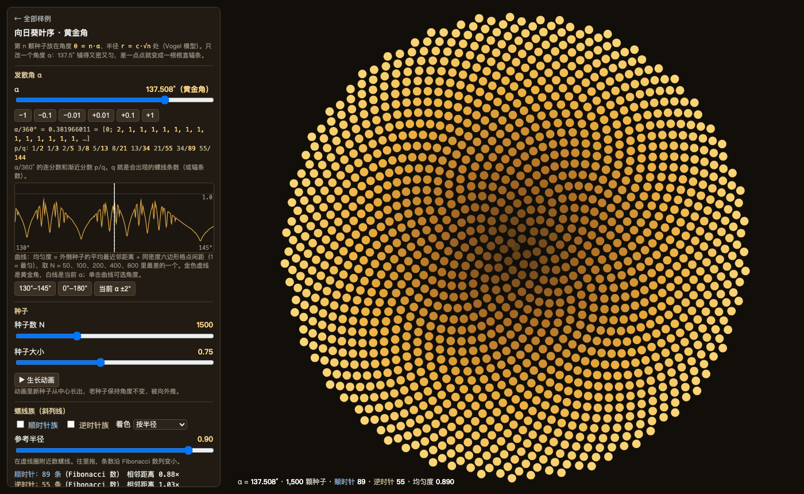

向日葵花盘里的种子排成两组方向相反的螺线，数一数，条数几乎总是相邻的两个 Fibonacci 数：34 和 55，55 和 89，大花盘上还有 89 和 144。这个结构只要一个数就能生成：从中心开始，每长一颗新种子就转一个固定的角度 α。α 取 **黄金角 137.508°** 时，种子铺得又密又匀；α 改成 137.0° 或 137.6°，图案就变成几十条弯曲的长臂；α 取 144° 这样的“整齐”角度，种子会排成 5 根直辐条，中间全是空隙。

这一页把这件事拆开：先看 α 是有理数时为什么出现辐条，再用连分数说明为什么黄金比例 φ 是“最无理”的数，最后解释螺线条数为什么是 Fibonacci 数，而且越往外越大。

打开方式：用浏览器直接打开 [index.html](index.html)。页面只用 Canvas 2D，不依赖外部库，离线也能用。

## 数学原理

### 1. Vogel 模型

1979 年 H. Vogel 给出了一个只有两行的模型。第 n 颗种子（n = 0, 1, 2, …）放在极坐标

```
θₙ = n · α,   rₙ = c · √n
```

角度每颗加 α，半径取 √n。取 √n 的原因是面积：半径 r 的圆面积是 πr²，要让圆里恰好有 n 颗种子、每颗占的面积都是 πc²，就需要 πr² = n·πc²，也就是 r = c√n。这样整个花盘的密度处处相同，图案好不好只取决于 α 能不能把每一圈的空位均匀地填上。

真实花盘的生长顺序正好相反：新种子（原基）在中心长出，老种子被推向外侧。勾选“▶ 生长动画”能看到这个过程：每长一颗，生长点转 α，已有的种子角度不变、只往外移。到第 N 颗时画面和上式完全一样，只是整体转了一个角度。

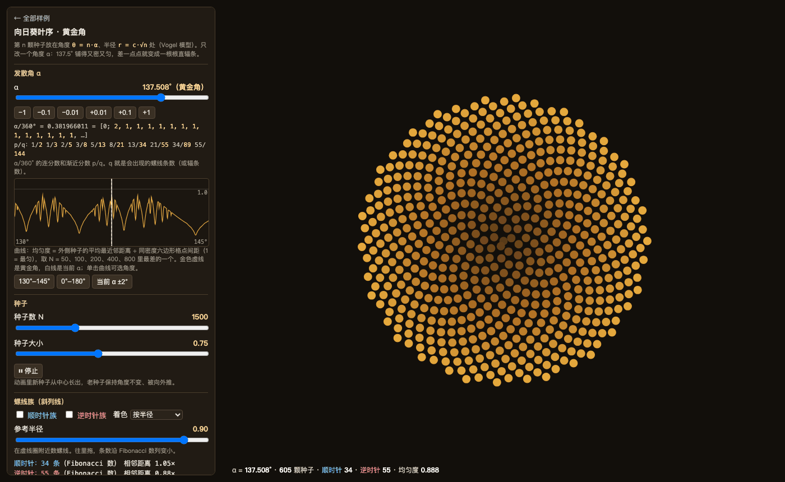

### 2. 有理角：直辐条

设 α/360° = p/q 是一个既约分数。第 n 颗和第 n + q 颗转过的角度差是 q·α = p·360°，正好是整圈，所以它们在同一条射线上。全部种子只用了 q 个方向，排成 q 根直辐条：

| α = 360° × 2/5 = 144°：5 根辐条 | α = 360° × 5/13 ≈ 138.46°：13 根辐条 |
|---|---|
| 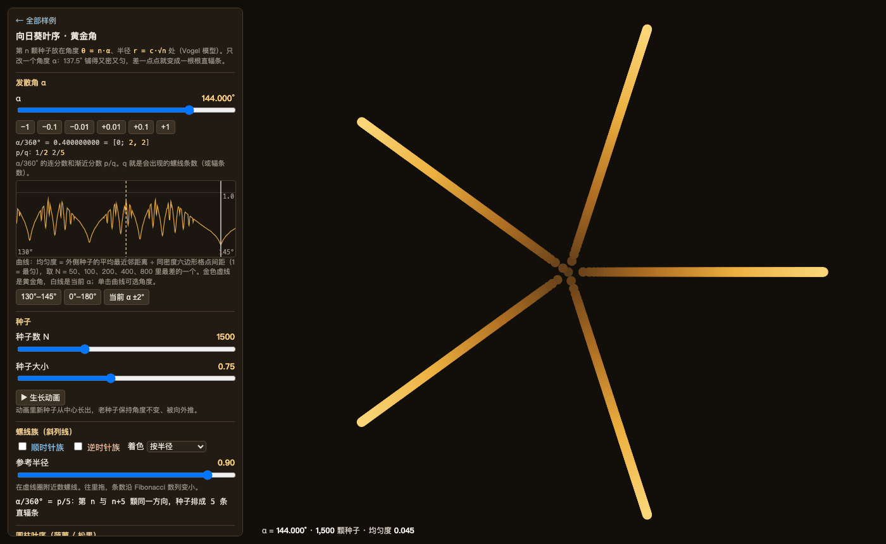 | 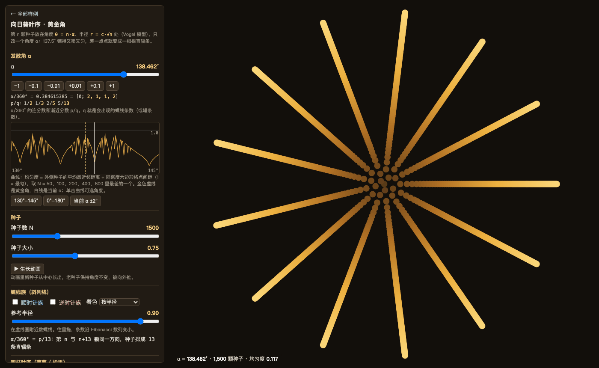 |

辐条之间的空隙随半径线性变宽，外圈大部分面积都浪费了。分母 q 越大，辐条越多、越不显眼，但只要花盘够大，辐条迟早会露出来。所以一个好的发散角必须是无理数，而且要离所有分母不大的分数都尽量远。

### 3. 连分数：“离分数有多远”怎么量

任何实数 x 都可以写成连分数

```
x = a₀ + 1/(a₁ + 1/(a₂ + 1/(a₃ + …)))  记作 [a₀; a₁, a₂, a₃, …]
```

截断到第 k 项得到**渐近分数** p_k/q_k。它们是 x 最好的有理逼近：分母不超过 q_k 的分数里，没有哪个比 p_k/q_k 更接近 x。逼近误差大约是

```
| x − p_k/q_k | ≈ 1 / (a_{k+1} · q_k²)
```

下一项 a_{k+1} 越大，p_k/q_k 就越准，x 在分母为 q_k 的尺度上“看起来就像有理数”。页面在 α 滑块下方实时列出 α/360° 的连分数和渐近分数，对照几个角：

| α | α/360° 的连分数 | 现象 |
|---|---|---|
| 137.0° | [0; 2, 1, 1, 1, 2, **5**, 3] | 8/21 后面跟着 a = 5，所以 8/21 很准，最显眼的是 21 条弯臂；外圈第 n 与 n + 113 颗只差 1°（43/113），连成 113 条近乎笔直的线 |
| 137.6° | [0; 2, 1, 1, 1, 1, 1, 1, **6**, …] | 13/34 后面跟着 a = 6，整盘是 34 条长臂 |
| 360° × (π − 3) ≈ 50.97° | [0; 7, **15**, 1, **292**, …] | 1/7 后面跟着 15：中心 7 条弯臂；16/113 后面跟着 292：外圈 113 根辐条（对应 π ≈ 355/113） |

| 137.0°：21 条臂 + 113 条近直线 | 137.6°：34 条长臂 |
|---|---|
| 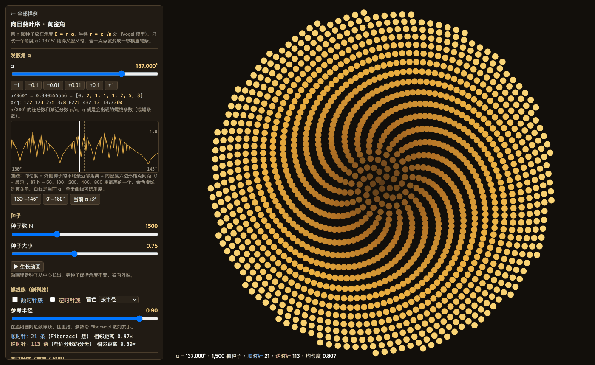 | 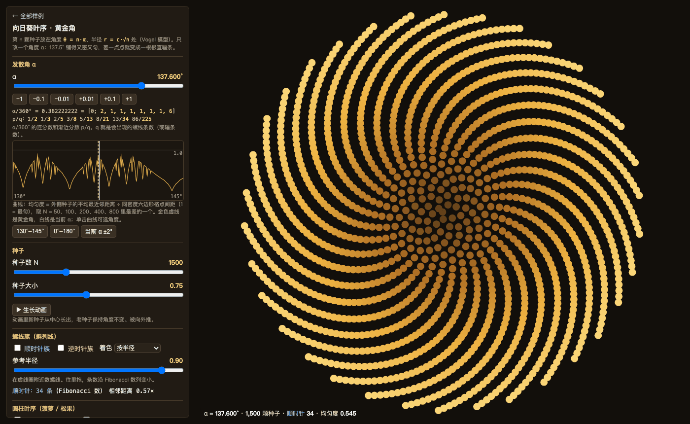 |

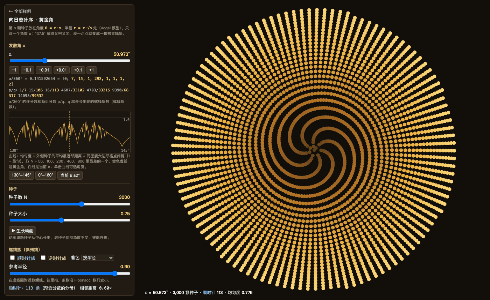

比黄金角只差 0.5° 或 0.1°，图案就完全变了。

### 4. 黄金角：最无理的数

要离所有分数都远，就希望每个 aₖ 都尽量小，最小是 1。全是 1 的连分数就是黄金比例：

```
φ = 1 + 1/(1 + 1/(1 + …)) = [1; 1, 1, 1, …] = (1 + √5)/2 ≈ 1.618
```

它满足 φ = 1 + 1/φ，也就是 φ² = φ + 1。黄金角是把圆周按黄金比例分成两段时较小的那一段：

```
α = 360° × (1 − 1/φ) = 360° / φ² ≈ 137.50776°,   α/360° = [0; 2, 1, 1, 1, …]
```

它的渐近分数是 1/2, 1/3, 2/5, 3/8, 5/13, 8/21, 13/34, 21/55, 34/89, …，分子分母都是 Fibonacci 数（F₁ = F₂ = 1，Fₖ₊₁ = Fₖ + Fₖ₋₁）。

**Hurwitz 定理（1891）**：对任何无理数 x，都有无穷多个分数 p/q 满足 |x − p/q| < 1/(√5·q²)；把 √5 换成任何更大的常数，对 φ 就不再成立。也就是说，φ 是最难用分数逼近的数，这就是“最无理”的确切含义。

具体看第 n 颗和第 n + F 颗（F 是 Fibonacci 数）之间的角度差，扣掉整圈后剩下：

| F | 5 | 8 | 13 | 21 | 34 | 55 | 89 |
|---|---|---|---|---|---|---|---|
| F·α 扣掉整圈 | −32.5° | +20.1° | −12.4° | +7.7° | −4.7° | +2.9° | −1.8° |

每一项都是前一项除以 φ，并且正负交替。这两个性质分别对应：

- 偏差只按 φ 倍缓慢缩小，不会突然变得很小，所以任何尺度上都不会出现辐条；
- 正负交替，所以相邻两个 Fibonacci 数对应的螺线一组顺时针、一组逆时针。

### 5. 螺线族的条数为什么是相邻的 Fibonacci 数

人眼看到的螺线（植物学叫**斜列线**，parastichy）是把每颗种子和离它最近的几颗连起来得到的。如果第 n 颗最近的邻居之一是第 n + m 颗，那么 n, n + m, n + 2m, … 连成一条螺线；按 n 除以 m 的余数分，一共有 **m 条**。

勾选“顺时针族”“逆时针族”，页面会在参考半径（虚线圈）处找出两个方向上最近的邻居偏移 m，并画出这两族螺线。每族里粗线是其中一条，方便顺着数：

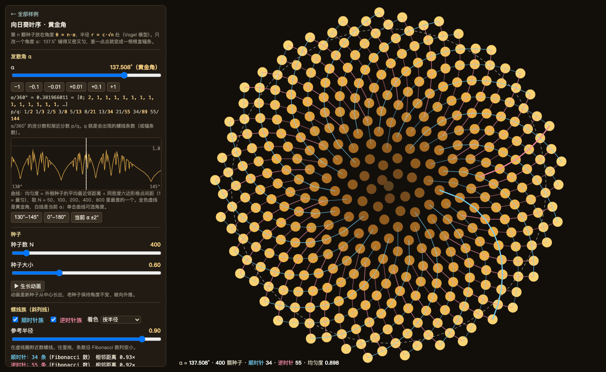

最近邻为什么在 Fibonacci 偏移上：在半径 √n 处，第 n 和第 n + m 颗的距离（以 c 为单位）大约是

```
d² ≈ (m / 2√n)²  +  (2π√n · δₘ)²
      径向差          角向差（δₘ = m·α/360° 到最近整数的偏差，单位是圈）
```

第一项随 m 增大，第二项要求 δₘ 很小。δₘ 最小的那些 m 正是渐近分数的分母，对黄金角就是 Fibonacci 数，而且 |δ_F| ≈ 1/(√5·F)。两项平衡时 F² ≈ (4π/√5)·n，即

```
F ≈ 2.37 · √n
```

半径越大，最近邻的偏移就越大，条数沿 Fibonacci 数列一级一级往上走。拖动“参考半径”可以看到这个变化，下面两张图的 N 都是 1500，种子按顺时针族的螺线编号着色：

| 参考半径 0.95：顺时针 89 条、逆时针 55 条 | 参考半径 0.30：顺时针 34 条、逆时针 21 条 |
|---|---|
| 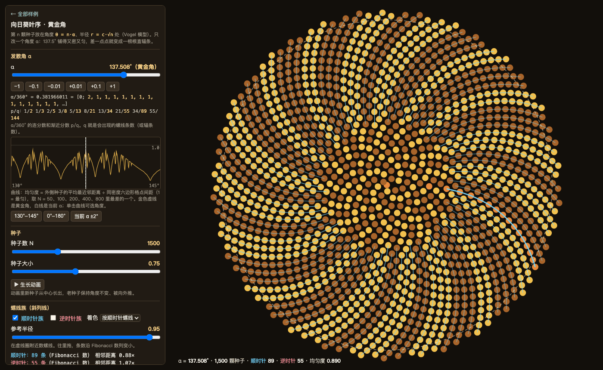 | 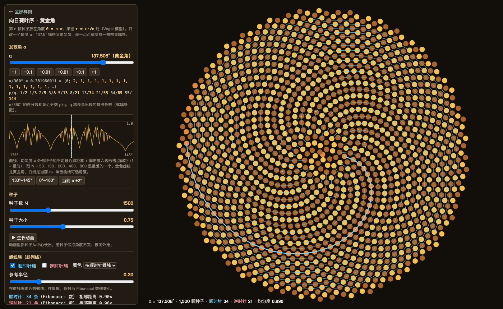 |

条数在两族之间交替变大：89 那一族往里先变成 34，55 那一族往里变成 21。真实向日葵也是这样：花盘外缘 55/89，往里 34/55、21/34。

对别的无理角，条数换成它自己的渐近分数的分母。下面左图是 360° × (√2 − 1) ≈ 149.12°，连分数 [0; 2, 2, 2, …]，看到的是 70 和 99 条（√2 ≈ 99/70）。右图是 360°/(2 + φ) ≈ 99.50°，连分数 [0; 3, 1, 1, 1, …]，看到的是 76 和 123 条（Lucas 数）：

| 360° × (√2 − 1)：70 / 99 | 99.50°：76 / 123 |
|---|---|
| 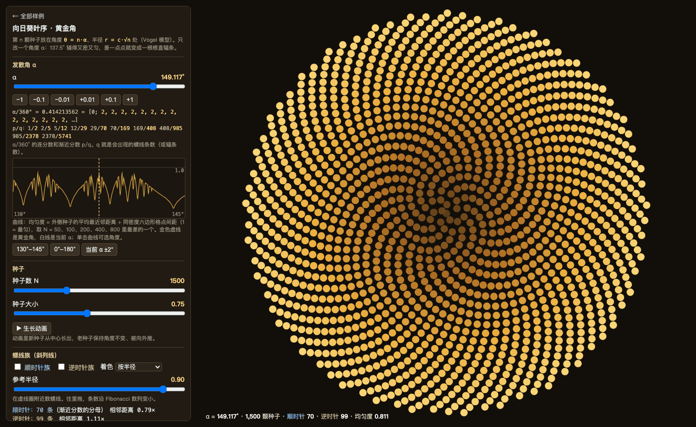 | 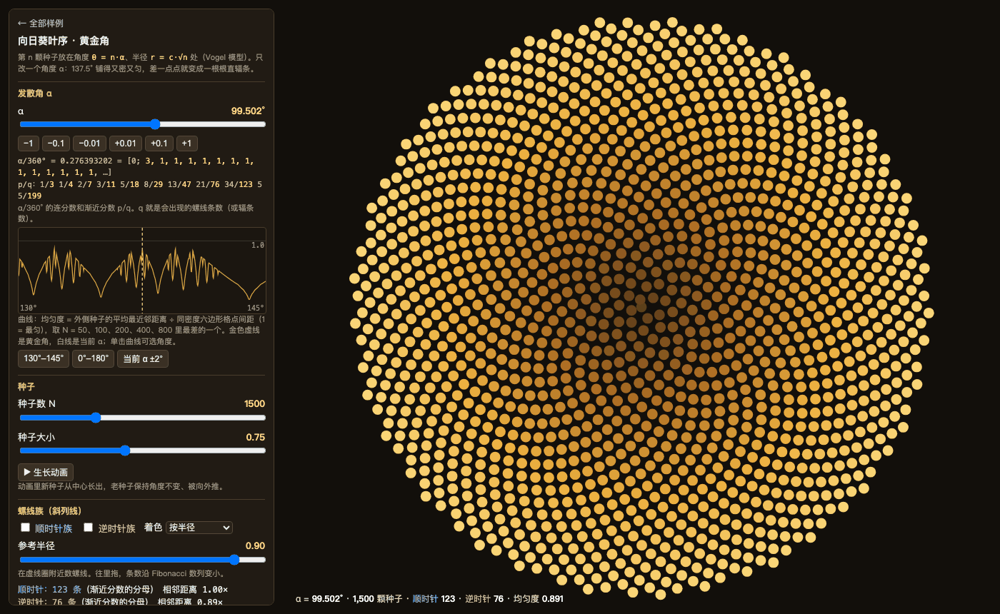 |

### 6. 均匀度曲线

面板里的曲线给每个角度打一个分：取外侧 3/4 的种子，求每颗到最近邻的平均距离，再除以同样密度下正六边形格点的间距 c·√(2π/√3) ≈ 1.905c（平面上最密的排法）。1 表示和六边形格一样匀。花盘在生长，一个好角度必须在每个大小都好，所以对 N = 50、100、200、400、800 各算一次，取最差的一个。单击曲线可以直接选角度，“当前 α ±2°”放大看局部。

| α | 均匀度 | |
|---|---|---|
| 黄金角 137.508° | **0.882** | |
| 137.3° | 0.602 | |
| 137.0° | 0.569 | |
| 137.6° | 0.534 | |
| 360° × 5/13 | 0.160 | 13 根辐条 |
| 360° × 3/8 = 135° | 0.099 | 8 根辐条 |
| 144° | 0.062 | 5 根辐条 |
| 360° × (√2 − 1) | 0.791 | a = 2，略差 |
| 360° × (π − 3) | 0.337 | a = 15、292，外圈辐条 |
| 99.50° | 0.884 | 也是“高贵数” |

曲线在每个分母不大的分数处都有一个深坑，坑越深的分数分母越小。黄金角处是一个又高又窄的尖峰，偏 0.1° 就掉下去一大截。

黄金角并不是唯一的峰。连分数从某一项起全是 1 的数叫**高贵数**（noble number），Hurwitz 定理里的 √5 对它们同样不能再改进，所以它们和黄金角一样均匀，例如 99.50°（[0; 3, 1, 1, …]）和 66.89°（[0; 5, 2, 1, 1, …]）。植物几乎总是选 137.5°，偶尔也会选 99.5°。Douady 和 Couder 在 1992 年用实验解释了这一点：他们在磁场里往油面上一滴一滴地滴磁性液滴，每滴都被前面的液滴推开，落到空间最大的地方，发散角就自动收敛到 137.5°。换一些参数或起始条件，才会落到别的高贵数上，例如 99.5°。

### 7. 圆柱叶序：菠萝和松果

菠萝的果眼、松果的鳞片、仙人掌的刺长在一个近似圆柱的表面上。把圆柱的周长记作 1，第 n 个原基放在

```
(水平位置, 高度) = (n · α/360° 取小数部分,  n · h)
```

h 是每个原基比上一个升高多少。把圆柱剪开铺平，这些点构成一个平面格点，由向量 (α/360°, h) 生成。第 n 和第 n + m 个的距离是 √(δₘ² + (m·h)²)，和 n 无关，所以整根圆柱上的条数处处相同，由 h 决定：h 越小，原基排得越密，最近邻的偏移 m 越大。

勾选“种子排在圆柱面上”，页面画出圆柱的正面（背面的原基不画，侧面的按透视压扁、调暗）。“菠萝”预设 h = 0.004，看到 8 条向右上、13 条向左上的螺线，和真菠萝一样：

| 菠萝：8 / 13 | 剪开铺平：两族螺线是格点上的两组直线 |
|---|---|
| 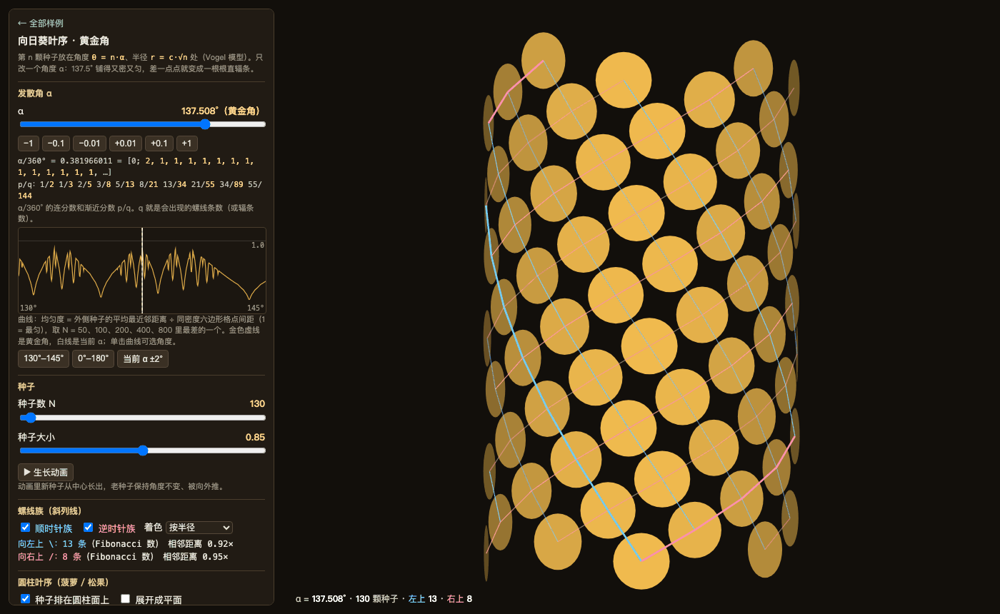 | 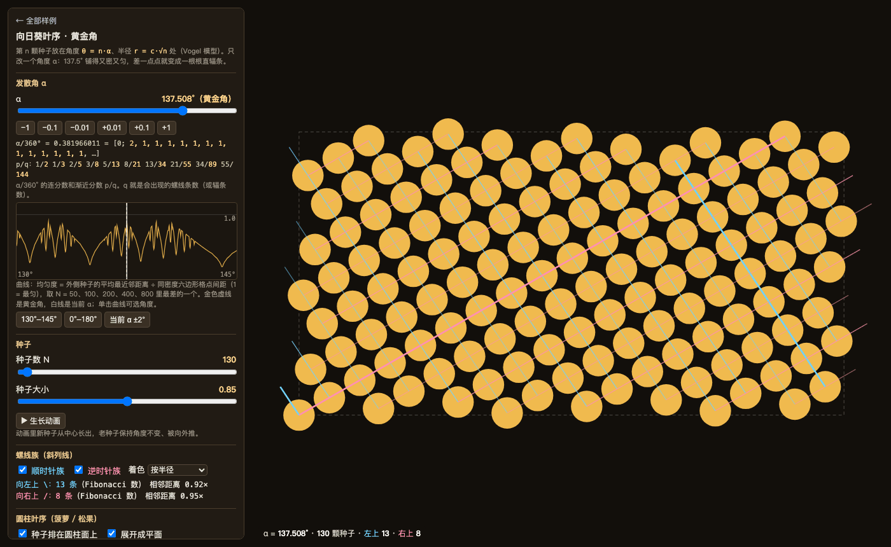 |

“松果 5/8”预设把 h 加大到 0.011，原基更稀，条数降为 5 和 8，许多松果正是这种排法（大松果是 8/13）：

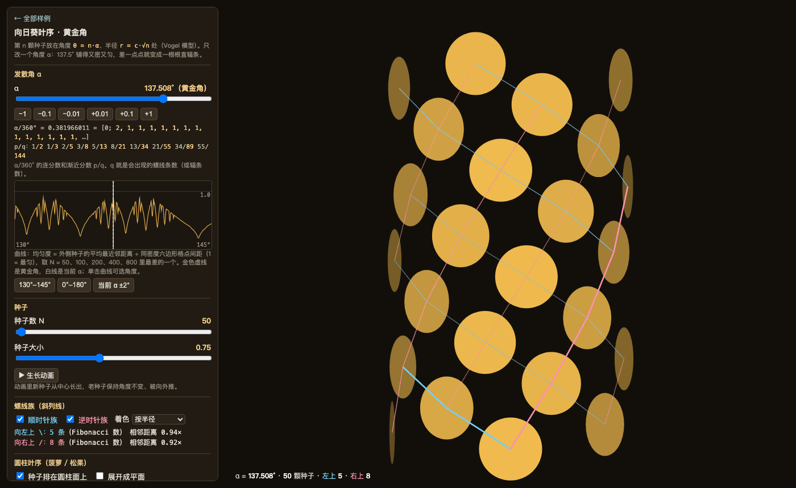

## 操作

- 发散角 α（0°–180°，精度 0.001°），旁边的按钮 ±1、±0.1、±0.01 微调；α 和 360° − α 是镜像，所以不需要 180° 以上；
- 滑块下方实时显示 α/360° 的连分数和渐近分数；
- 均匀度曲线：单击选角度；“130°–145°”“0°–180°”“当前 α ±2°”切换范围；
- 种子数 N（10–5000）、种子大小；
- “▶ 生长动画”：从 1 颗长到 N 颗，再点一次停止；
- 螺线族：顺时针族、逆时针族两个开关，着色可选按半径、按顺时针螺线编号、按逆时针螺线编号；参考半径决定在哪一圈数条数，面板和左下角显示条数，并标出是不是 Fibonacci 数或渐近分数的分母；
- 圆柱叶序：种子排在圆柱面上、展开成平面、每颗上升高度 h（0.001–0.1）；
- 预设：黄金角、137.0°、137.6°、144°、360° × 5/13、360° × (√2 − 1)、360° × (π − 3)、99.502°、松果 5/8、菠萝 8/13。

## 网址参数

| 键 | 含义 |
|---|---|
| p | 预设名：golden, a1370, a1376, a144, a1385, sqrt2, pi, lucas, cone, pine |
| a | 发散角 α（度，0–180） |
| n | 种子数（10–5000） |
| s | 种子大小（0.2–1.5） |
| ref | 参考半径，占花盘半径的比例（0.1–1） |
| cw, ccw | 1 = 画顺时针 / 逆时针螺线族 |
| col | 着色：plain（按半径）、cw、ccw（按螺线编号） |
| mode | disc（花盘）或 cyl（圆柱） |
| h | 圆柱上每颗上升的高度（0.001–0.1） |
| flat | 1 = 圆柱展开成平面 |
| grow | 1 = 打开时播放生长动画 |

数值参数都会被截到上表的范围内，不是数字的值会被忽略。例如 137.3° 的螺线族：`index.html?a=137.3&cw=1&ccw=1`；在内圈数条数：`index.html?n=1500&col=cw&cw=1&ref=0.3`；铺平的菠萝：`index.html?p=pine&flat=1`。

## 参考

- H. Vogel, *A better way to construct the sunflower head*, Mathematical Biosciences 44, 1979. 本页的 θ = n·α、r = c√n 模型。
- S. Douady, Y. Couder, *Phyllotaxis as a physical self-organized growth process*, Physical Review Letters 68, 1992. 磁性液滴实验。
- P. Prusinkiewicz, A. Lindenmayer, *The Algorithmic Beauty of Plants*, Springer, 1990, 第 4 章 Phyllotaxis。
- A. Hurwitz, *Über die angenäherte Darstellung der Irrationalzahlen durch rationale Brüche*, Mathematische Annalen 39, 1891.
- [Phyllotaxis](https://en.wikipedia.org/wiki/Phyllotaxis)、[Golden angle](https://en.wikipedia.org/wiki/Golden_angle)（Wikipedia）。
