# 随机游走 · 布朗运动

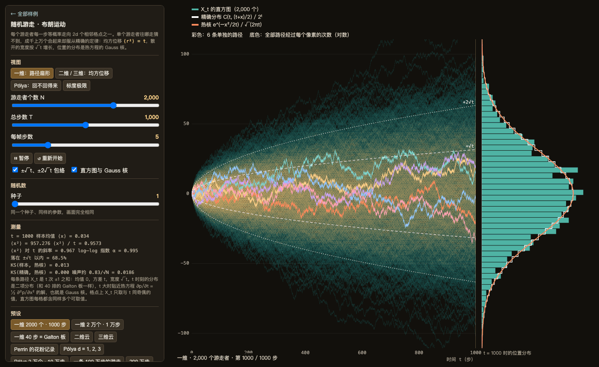

1827 年，植物学家 Robert Brown 在显微镜下看见花粉里放出的微粒在水中不停地乱跳，而且永远停不下来。这种运动后来叫**布朗运动**。1905 年 Einstein 给出解释：微粒被周围的水分子从四面八方撞击，每次撞击都是随机的，所以微粒的位置是大量随机小位移之和。他还算出一个可以测量的结论：微粒离起点的均方距离与时间成正比。1908–1909 年，Jean Perrin 在显微镜下逐个追踪微粒，验证了这个比例，并由此测出 Avogadro 常数，这是分子真实存在的有力证据之一。

数学上最简单的模型是格点上的**随机游走**：每一步等概率走向 2d 个相邻格点之一（一维是左右，二维是上下左右，三维再加前后）。一个游走者往哪走无法预测，但成千上万个合起来服从精确的定律。页面有四个视图：

- **一维：路径扇形**：N 条路径同时走，画出散开的“扇子”、±√t 包络，以及第 t 步的位置直方图与热方程 Gauss 核的对照；
- **二维 / 三维：均方位移**：一团游走者从原点散开，实时画出 ⟨r²⟩ 对 t 的直线并测量斜率；三维的点云可以拖动旋转；
- **Pólya：回不回得来**：一维、二维、三维各放 N 个游走者，统计到时间 t 为止回到过原点的比例，并和精确值对照；
- **标度极限**：一条上百万步的二维游走，按 1/√m 缩放后看起来始终一样，测量它的盒计数维数。

打开方式：用浏览器直接打开 [index.html](index.html)。页面只用 Canvas 2D，不依赖外部库，离线也能用。所有随机数来自一个带种子的伪随机数发生器（mulberry32），种子和参数相同，画面就完全相同。下面的数字都是从页面上读出来的，除非另外说明，种子都是 1。

## 数学原理

### 1. 一维游走：t 个 ±1 之和

设第 i 步的位移 ξᵢ 等概率取 +1 或 −1，各步独立。t 步之后的位置是

```
X_t = ξ₁ + ξ₂ + … + ξ_t
```

每个 ξᵢ 的均值是 0，方差是 E ξᵢ² = 1。独立随机变量的方差可加，所以

```
E X_t = 0,    E X_t² = t
```

均方位移随时间**线性**增长，典型距离 √(E X_t²) = √t 只按时间的平方根增长：走 100 倍的步数，平均只走出 10 倍远。这就是 **√t 定律**。

X_t 的精确分布也能直接写出：t 步里向右 k 步、向左 t − k 步，终点在 x = 2k − t，所以

```
P(X_t = x) = C(t, (t + x)/2) / 2ᵗ,    x ≡ t (mod 2)
```

这正是 [Galton 板](../galton-board/README.md) 的二项分布 B(t, 1/2)，只是把“向右的次数 k”换成了位置 x = 2k − t。注意 x 只能取与 t 同奇偶的值，相邻可取值相差 2。

页面的一维视图里，底色是全部路径经过每个像素的次数（对数着色），6 条彩色曲线是单独的路径，白色虚线是 ±√t 和 ±2√t。右侧是第 t 步的位置直方图（青色），白色台阶是上面的精确分布，橙色曲线是下一节的热核。为了让每个直方图柱包含同样多个可取值，柱子按“与 t 同奇偶的格点”对齐。

预设“一维 40 步 = Galton 板”就是 40 排的 Galton 板，每条路径在时间轴上展开。格点上的路径清楚地连成一张斜网：

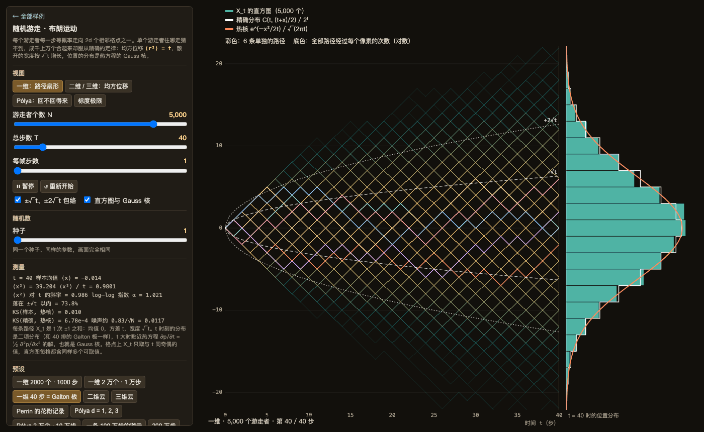

测量（种子 1）：

| 预设 | N | t | ⟨x²⟩ / t | ⟨x²⟩ 对 t 的斜率 | log–log 指数 α | 落在 ±√t 以内 |
|---|---|---|---|---|---|---|
| 40 步 | 5 000 | 40 | 0.9801 | 0.986 | 1.021 | 73.8%（精确 73.2%） |
| 1000 步 | 2 000 | 1 000 | 0.9573 | 0.967 | 0.995 | 68.5%（精确 67.3%） |
| 1 万步 | 20 000 | 10 000 | 1.0083 | 1.007 | 1.005 | 68.45% |

“斜率”是把 ⟨x²⟩ 对 t 做过原点的最小二乘直线；“α”是 log ⟨x²⟩ 对 log t（t ≥ 10）的斜率，α = 1 就是 √t 定律。⟨x²⟩ 本身是 N 个样本的平均，相对误差约 √2/√N：N = 2000 时约 3%，所以 0.957 在误差范围内。“落在 ±√t 以内”的极限是正态分布的 68.27%；t = 40 时只有 7 个可取值落在 ±6.3 之内，离散效应让精确值高出 5 个百分点。

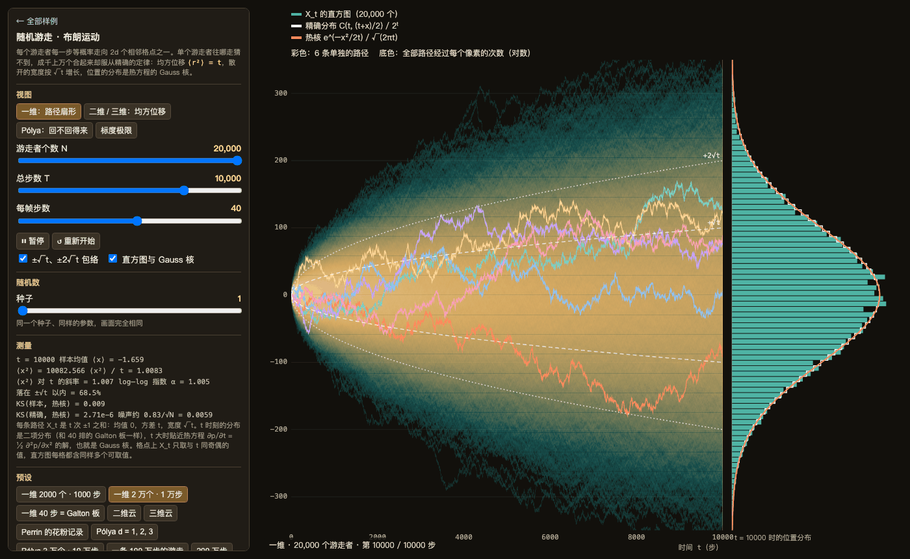

### 2. 热方程与 Gauss 核

设 p(t, x) 是第 t 步在 x 的概率。到达 x 只能从 x − 1 或 x + 1 走一步过来，各占一半：

```
p(t + 1, x) = ½ p(t, x − 1) + ½ p(t, x + 1)
```

两边减去 p(t, x)：

```
p(t + 1, x) − p(t, x) = ½ [ p(t, x + 1) − 2 p(t, x) + p(t, x − 1) ]
```

左边是对 t 的差分，右边方括号是对 x 的二阶差分。把格距和时间步都看成很小，就得到**热方程**（扩散方程）

```
∂p/∂t = ½ ∂²p/∂x²
```

从一点出发的解是 **Gauss 核**（热核）

```
p(t, x) = e^(−x² / 2t) / √(2πt)
```

它是均值 0、方差 t 的正态密度。这和 Galton 板里的 de Moivre–Laplace 定理是同一件事：二项分布趋向正态分布。格点上只有一半的 x 可取，所以每个可取值的概率约为 2·p(t, x)；页面的直方图除以了柱宽，直接和 p(t, x) 比。

页面用 Kolmogorov 距离 KS = sup |F − Φ| 量化“贴得多近”，Φ 取 N(0, t) 的分布函数，在格点之间的中点取值（连续性修正）：

| t | KS(精确分布, 热核) | KS(样本, 热核) | 采样噪声 0.83/√N |
|---|---|---|---|
| 40 | 6.78 × 10⁻⁴ | 0.010（N = 5000） | 0.0117 |
| 1 000 | 2.72 × 10⁻⁵ | 0.013（N = 2000） | 0.0186 |
| 10 000 | 2.71 × 10⁻⁶ | 0.0086（N = 2 万） | 0.0059 |

精确分布到热核的距离按 1/t 缩小：t 增大 25 倍（40 → 1000），距离缩小 24.9 倍；t 增大 10 倍，距离缩小 10.0 倍。比一般的 1/√t 快，是因为分布对称（偏度项为 0），在格点中点取值又消去了格点修正项，样本到热核的距离在采样噪声的量级上，说明样本确实服从这个分布。

### 3. 高维：⟨r²⟩ = t，与维数无关

d 维格点上每一步随机选一个坐标轴（概率各 1/d），再在这个轴上走 ±1。每一步只改变一个坐标，改变量的平方恰好是 1，所以对**每个**游走者，|r|² 每步的期望增量都是

```
E[ |r + e|² − |r|² ] = E[ 2 r·e + |e|² ] = 0 + 1 = 1
```

（e 是这一步的位移，r·e 的期望为 0。）于是

```
⟨r²⟩ = t,    ⟨xᵢ²⟩ = t / d
```

均方位移和维数无关；一般地，步长为 a 时 ⟨r²⟩ = a²·t，这就是 ⟨r²⟩ = d · t · (a²/d)：d 个坐标各分到 a²/d。

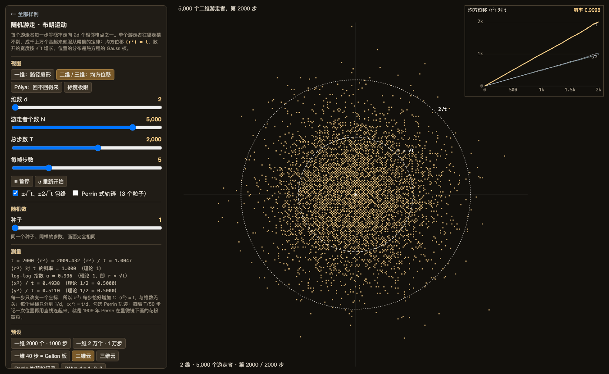

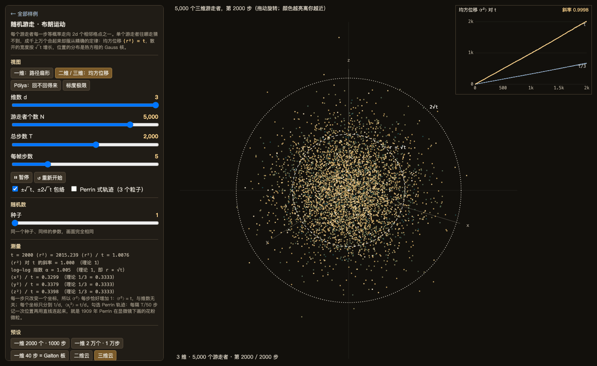

右上角是 ⟨r²⟩（金色）和每个坐标的 ⟨xᵢ²⟩ 对 t 的曲线，虚线是 t 和 t/d。测量（5000 个游走者，2000 步）：

| d | ⟨r²⟩ / t | ⟨r²⟩ 对 t 的斜率 | α | ⟨x²⟩/t | ⟨y²⟩/t | ⟨z²⟩/t |
|---|---|---|---|---|---|---|
| 2 | 1.0047 | 0.9998 | 0.996 | 0.4938 | 0.5110 | — |
| 3 | 1.0076 | 0.9998 | 1.005 | 0.3299 | 0.3379 | 0.3398 |

二维云在格点上是棋盘状的：t 为偶数时 x + y 也只能是偶数，只有一半的格点上有游走者。

### 4. Einstein 与 Perrin

Einstein 1905 年的论证可以简化成上面这一节：微粒每隔很短的时间 τ 被撞出一个随机小位移，位移的均方是 a²，那么

```
⟨x²⟩ = 2 D t   （每个坐标），    D = a² / (2 d τ)
```

D 叫扩散系数。另一方面，D 可以由宏观量算出：半径为 r 的球在黏度 η 的液体里，D = R T / (6π η r N_A)，其中 R 是气体常数，T 是温度，N_A 是 Avogadro 常数。量出 ⟨x²⟩ 随 t 增长的斜率，就能反过来求出 N_A。

Perrin 在显微镜下每隔 30 秒记一次微粒的位置，再用直线把记录点连起来。他指出这些折线只是假象：若把记录间隔缩短，每段直线又会变成一条同样曲折的折线。页面的“Perrin 的显微记录”预设对 3 个游走者每隔 T/50 步记一次位置，画法相同：

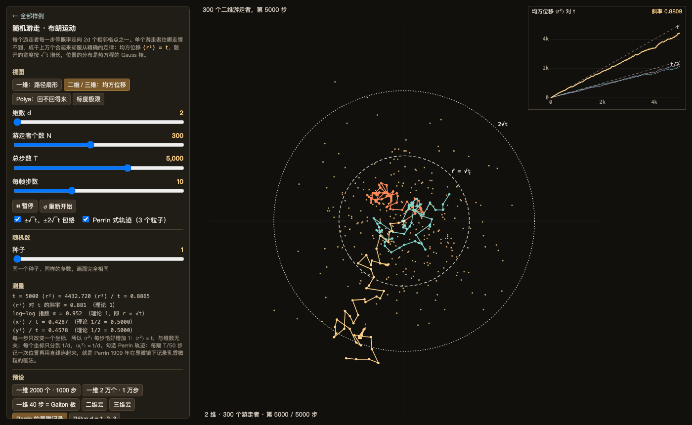

这里只有 300 个游走者，⟨r²⟩ / t = 0.8865。r² 近似服从指数分布，相对标准差为 1，所以 300 个样本的平均有约 1/√300 ≈ 5.8% 的误差，0.887 偏低约 2 个标准差。

### 5. Pólya：回不回得来

游走者从原点出发，会不会回到原点？1921 年 George Pólya 证明：

> 一维、二维的简单随机游走以概率 1 回到原点（**常返**）；三维及以上，回到原点的概率小于 1（**暂态**）。

角谷静夫把它概括成一句话：“喝醉的人总能找到回家的路，喝醉的鸟却可能永远回不了家。”

**证明思路。** 设 u_t 是第 t 步恰好在原点的概率，f_t 是第 t 步**第一次**回到原点的概率，F = Σ f_t 是最终回到原点的概率。第 t 步在原点，要么是第一次回来，要么是在更早的第 k 步第一次回来、之后又用 t − k 步回到原点：

```
u_t = Σ_{k=1}^{t} f_k u_{t−k},   u₀ = 1
```

这叫**更新方程**。两边对 t 求和，得到 U − 1 = F·U，其中 U = Σ_{t≥0} u_t 是在原点的期望次数（含出发那一次）。所以

```
F = 1 − 1/U
```

U = ∞ 时 F = 1（常返），U < ∞ 时 F < 1（暂态）。再看 u_t 的大小：

| d | u_{2n} | n 很大时 | Σ u_{2n} |
|---|---|---|---|
| 1 | C(2n, n) / 4ⁿ | 1 / √(πn) | 发散 |
| 2 | [C(2n, n) / 4ⁿ]² | 1 / (πn) | 发散（像调和级数，按 ln n 增长） |
| 3 | Σₐ C(2n, a) 3⁻ᵃ (2/3)²ⁿ⁻ᵃ · u¹ₐ · (u¹_{2n−a})² | (3 / (4πn))^{3/2} · 2 | 收敛，U = 1.516386… |

二维的公式来自一个旋转技巧：把坐标换成 x + y 和 x − y，二维游走就变成两个独立的一维游走。三维先把 2n 步分成 a 步沿 x 轴（u¹ₐ 是一维 a 步回到 0 的概率）和 2n − a 步在 yz 平面里走，后者又是一个二维游走。一般地 u_{2n} ~ 2 (d / (4πn))^{d/2}，级数 Σ n^{−d/2} 只在 d ≤ 2 时发散。

三维的 U = 1.516386…（Watson 1939 年把它算成椭圆积分），所以

```
F₃ = 1 − 1 / 1.516386 = 0.340537…
```

三维游走者只有约 34% 能回到原点。

**页面怎样算精确值。** 页面用上表的公式算出 t ≤ 10 000 的 u_t，再用更新方程逐项解出 f_t 并累加成 F_d(t)，在图上画成白色虚线。一维还有闭式：到 2n 步为止没回过原点的概率恰好等于 u_{2n} = C(2n, n)/4ⁿ，所以 F₁(t) 在任何 t 都能精确给出。三维的 Σ u 算到 1 万步是 1.5098，还差 0.0066 的尾巴（按 n^{−1/2} 衰减），所以 F₃(10 000) = 0.3377，比极限 0.3405 低一点。

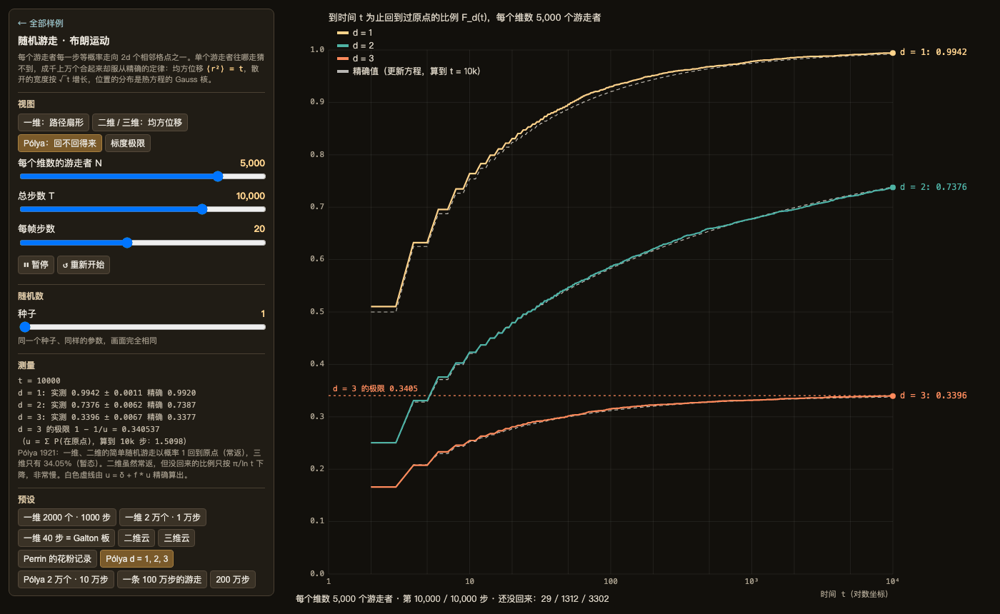

| t | F₁ 精确 | F₂ 精确 | F₃ 精确 |
|---|---|---|---|
| 10 | 0.7539 | 0.4208 | 0.2528 |
| 100 | 0.9204 | 0.5832 | 0.3119 |
| 1 000 | 0.9748 | 0.6782 | 0.3315 |
| 10 000 | 0.9920 | 0.7387 | 0.3377 |
| ∞ | 1 | 1 | 0.3405 |

测量值（± 是二项分布的标准误差 √(F(1 − F)/N)）：

| 预设 | t | d = 1 | d = 2 | d = 3 |
|---|---|---|---|---|
| 每个维数 5000 个 | 10 000 | 0.9942 ± 0.0011 | 0.7376 ± 0.0062 | 0.3396 ± 0.0067 |
| 每个维数 2 万个 | 10 000 | 0.9913 ± 0.0007 | 0.7370 ± 0.0031 | 0.3355 ± 0.0033 |
| 每个维数 2 万个 | 100 000 | 0.9973 ± 0.0004（精确 0.9975） | 0.7800 ± 0.0029 | 0.3374 ± 0.0033 |

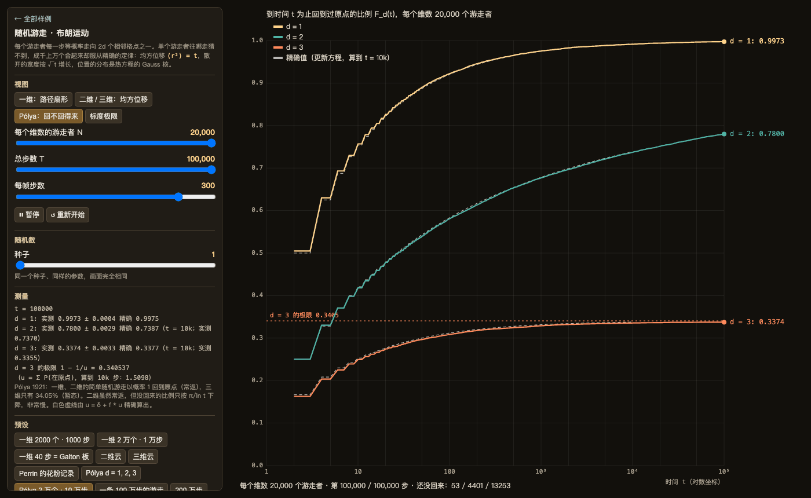

**二维常返得非常慢。** 二维在 t 步内没回过原点的概率按 1/Σ u 下降，而 Σ_{k≤t} u_k 只按 (ln t)/π 增长，所以首项是 π / ln t。走了 10 万步，仍有 22% 的二维游走者没回来过（4401 / 20 000）。只看首项来粗估：要让没回来的比例降到 1%，需要 ln t ≈ 100π ≈ 314，也就是 t ≈ 10¹³⁶ 步。首项本身也收敛得慢：t = 1 万时 π / ln t 给出 0.341，精确值是 0.261。

一维也有“慢”的一面：虽然一定回来，但回来所需的期望时间是无穷大（f_{2n} ~ n^{−3/2}/(2√π)，n·f_{2n} 的级数发散）。

### 6. 标度极限：布朗运动

把一条 m 步的游走在空间上缩小 √m 倍、在时间上缩小 m 倍：

```
B_m(s) = X_{⌊m s⌋} / √m,    0 ≤ s ≤ 1
```

由第 3 节，B_m(s) 的方差是 s·(格距²)，与 m 无关；由中心极限定理，B_m(s) 的分布趋向正态。**Donsker 定理**（1951）说得更强：整条路径 B_m 作为随机曲线收敛到**布朗运动**，这是一条处处连续、处处不可微的随机曲线。所以一条长游走的任何一段，只要按 √ 的比例放大，看起来都和整体一样，这是统计意义上的自相似。

标度极限视图里，大图显示前 m 步，按 1/√m 缩放；右侧三张小图是前 n/16、n/4、n 步，相对 n 分别放大 4、2、1 倍。同一条游走的前 1000、31 623、100 万步（每张左下角的白条都是 √m 个格点）：

| 前 1 000 步 | 前 31 623 步 | 前 100 万步 |
|---|---|---|
| 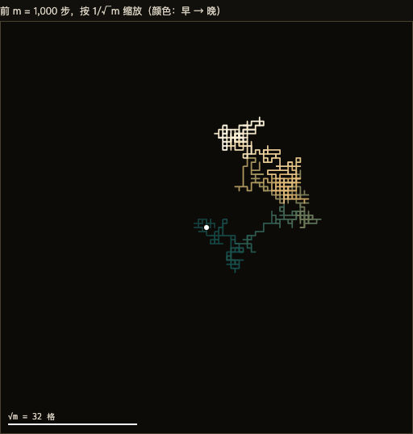 | 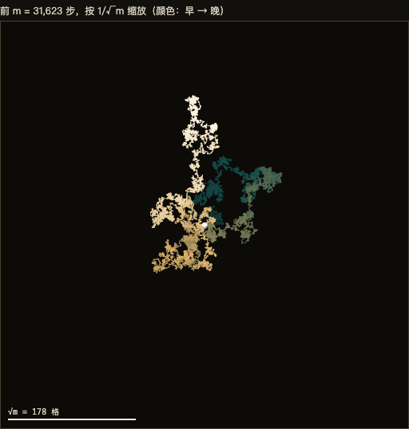 | 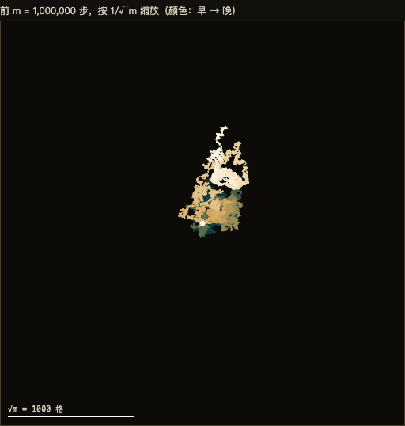 |

1000 步时还能看出一个个格点，3 万步以后格点结构就看不出来了，画面只剩布朗路径的样子。“▶ 从 100 步一路缩到 n 步”按钮把 m 从 100 连续增大到 n，画面一直在缩小，图案的样子却不变。


**分形维数 2。** 平面布朗路径的 Hausdorff 维数是 2（Lévy；Taylor 1953），尽管它的面积是 0。两种量法：

- **时间–半径关系**：走 m 步，范围 R ∝ √m，即 m ∝ R²。用多少“步”填满半径 R 的区域，指数就是维数。页面用前 m = 2⁶, 2⁷, … 步的回转半径 R 拟合 log m 对 log R 的斜率。
- **盒计数**：用边长 s 的方格覆盖路径，数出被经过的格子数 N(s)。若 N(s) ∝ s^{−D}，D 就是盒计数维数。页面右下角画出 log N(s) 对 log s，虚线是斜率 2，拟合取 4 ≤ s ≤ D/8（D 是路径的宽度）。

种子 1、100 万步：回转半径给出 2.319，盒计数斜率 1.799，各尺度的局部斜率（s = 1→2→4→…）是 1.80 1.83 1.84 1.82 1.76 1.79 1.71。单条路径波动很大，用种子 1–12 各算一次取平均：

| n | 盒计数斜率（平均） | 范围 | 回转半径维数（平均） | 访问过的不同格点（平均） | πn / ln 8n |
|---|---|---|---|---|---|
| 1 万 | 1.604 | 1.474 – 1.712 | 1.892 | 2 906 | 2 783 |
| 10 万 | 1.654 | 1.572 – 1.750 | 1.944 | 23 724 | 23 113 |
| 100 万 | 1.718 | 1.634 – 1.821 | 1.980 | 199 164 | 197 647 |
| 2²¹ ≈ 210 万 | 1.735 | 1.649 – 1.771 | 1.999 | 401 310 | 396 044 |

回转半径维数很快接近 2。盒计数斜率却明显小于 2，而且随 n 只缓慢上升。原因是二维游走会大量重复走过同一个格点：n 步只访问约 πn / ln n 个不同格点（Dvoretzky–Erdős 1951），比 n 少一个对数因子。盒计数数的是“不同的格子”，这个对数因子让斜率偏低，偏差只按 1/ln 缩小。上表最后两列说明 πn / ln 8n 是比 πn / ln n 好得多的近似：100 万步时 πn / ln n = 227 396，实测平均 199 164。

## 操作

- 视图：一维路径扇形、二维 / 三维均方位移、Pólya 回不回得来、标度极限；
- 前三个视图：游走者个数 N（10–2 万；Pólya 视图里是每个维数的个数）、总步数 T（10–10 万）、每帧步数（1–1000）、维数 d（2 或 3，仅均方位移视图）；暂停 / 继续、重新开始；开关：±√t 包络、直方图与 Gauss 核、Perrin 式轨迹；
- 三维点云：按住拖动旋转；
- 标度极限：游走总步数 n（1000–2²¹）、大图显示前 m 步、“从 100 步一路缩到 n 步”动画；
- 随机数种子（1–999）；
- 预设：一维 2000 个 · 1000 步、一维 2 万个 · 1 万步、一维 40 步 = Galton 板、二维云、三维云、Perrin 的显微记录、Pólya d = 1, 2, 3、Pólya 2 万个 · 10 万步、一条 100 万步的游走、200 万步。

每帧最多做 300 万次“游走者走一步”（一维视图还要算上画进像素的次数），超出时自动减少每帧步数，所以 2 万个游走者走 10 万步也不会卡住页面，只是要多花一些时间。

## 网址参数

| 键 | 含义 |
|---|---|
| p | 预设名：fan, fanBig, galton, cloud2, cloud3, perrin, polya, polyaBig, scale, scale2M |
| m | 视图：fan, cloud, polya, scale |
| N | 游走者个数（10–20000） |
| T | 总步数（10–100000） |
| v | 每帧步数（1–1000） |
| d | 维数（2–3，均方位移视图） |
| n | 标度极限的游走总步数（1000–2097152） |
| sm | 标度极限大图显示的前 m 步（100–2097152，不超过 n） |
| seed | 随机数种子（1–999） |
| env, hist, trail | 1 / 0：显示或隐藏 ±√t 包络、直方图与 Gauss 核、Perrin 式轨迹 |
| yaw, pitch | 三维视角（弧度） |
| run | 0 = 打开时暂停 |
| ui | 0 = 隐藏控制面板，只留画布 |

数值参数必须是有限数，超出范围的会被夹到滑块范围内；字符串参数只接受上表列出的值。例如：三维云 `index.html?m=cloud&d=3&N=8000&T=5000`；二维游走 200 万步只看前 1 万步 `index.html?m=scale&n=2097152&sm=10000&seed=7`。

## 参考

- R. Brown, *A brief account of microscopical observations made in the months of June, July and August, 1827, on the particles contained in the pollen of plants*, Philosophical Magazine 4, 1828.
- A. Einstein, *Über die von der molekularkinetischen Theorie der Wärme geforderte Bewegung von in ruhenden Flüssigkeiten suspendierten Teilchen*, Annalen der Physik 17, 1905.
- J. Perrin, *Mouvement brownien et réalité moléculaire*, Annales de chimie et de physique 18, 1909；*Les Atomes*, 1913.
- G. Pólya, *Über eine Aufgabe der Wahrscheinlichkeitsrechnung betreffend die Irrfahrt im Straßennetz*, Mathematische Annalen 84, 1921.
- G. N. Watson, *Three triple integrals*, Quarterly Journal of Mathematics 10, 1939.
- A. Dvoretzky, P. Erdős, *Some problems on random walk in space*, Proc. Second Berkeley Symposium, 1951.
- M. D. Donsker, *An invariance principle for certain probability limit theorems*, Memoirs of the AMS 6, 1951.
- S. J. Taylor, *The Hausdorff α-dimensional measure of Brownian paths in n-space*, Proc. Cambridge Philosophical Society 49, 1953.
- W. Feller, *An Introduction to Probability Theory and Its Applications*, Vol. I, 第 3 章与第 13 章（一维游走的回归与首次返回）, Wiley, 1968.
