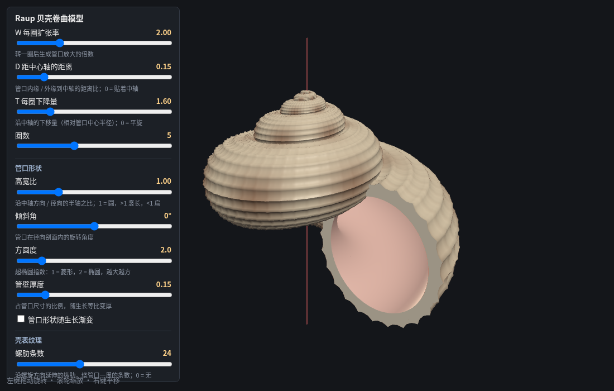
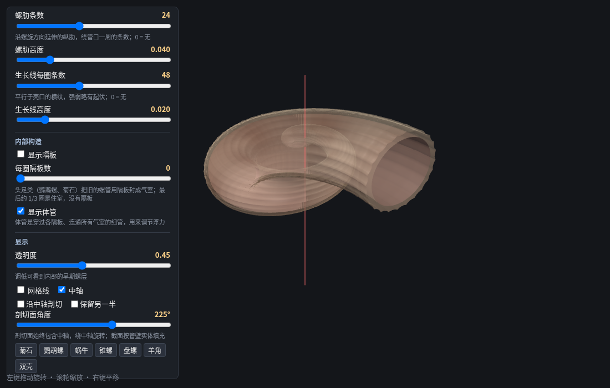
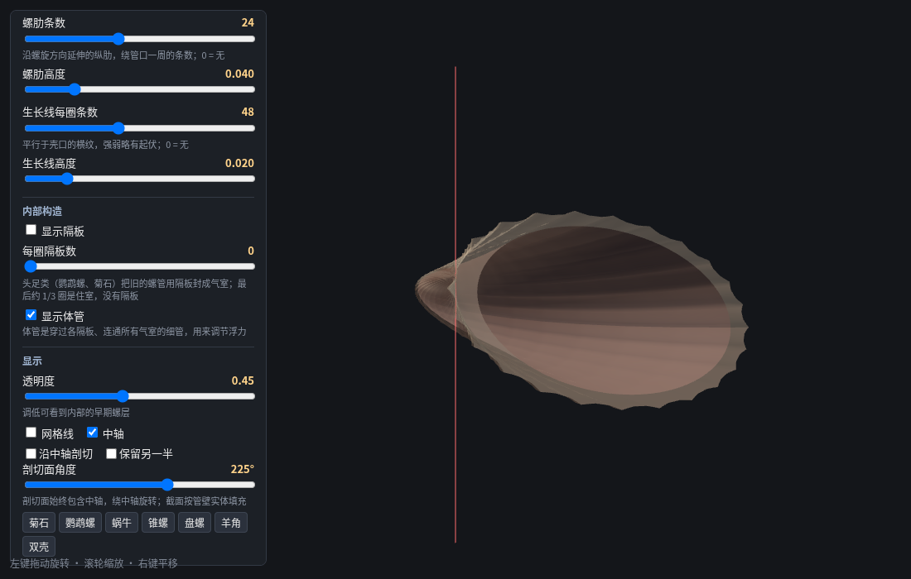
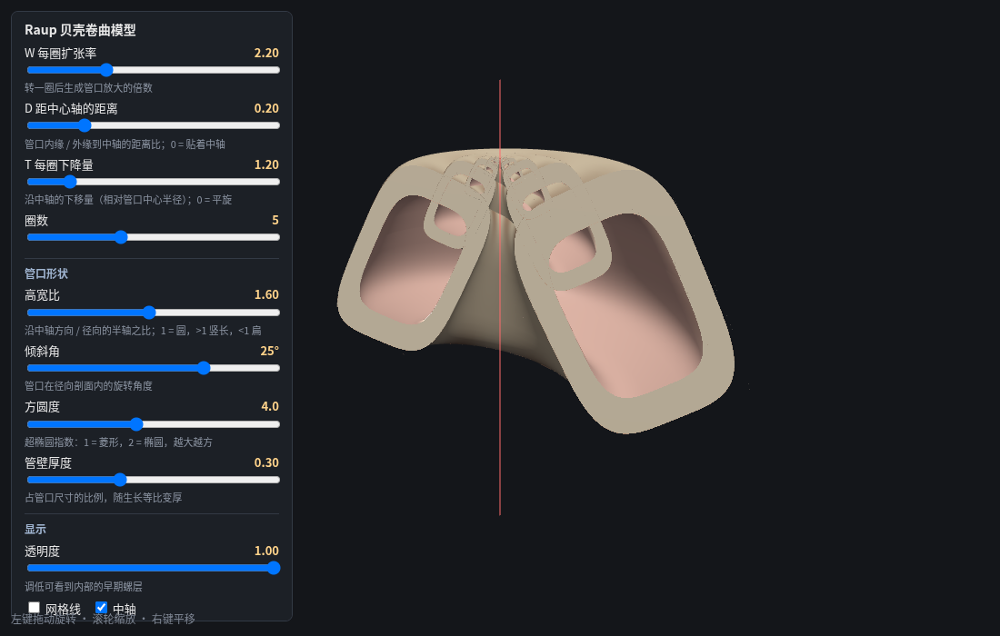
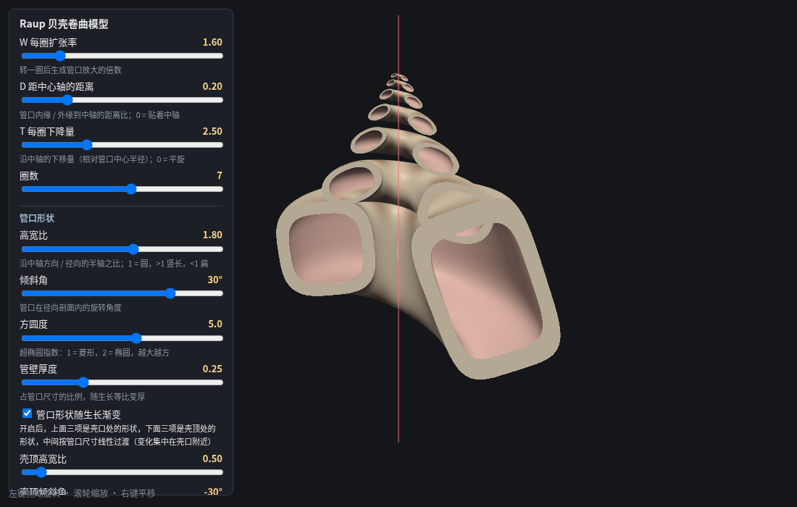
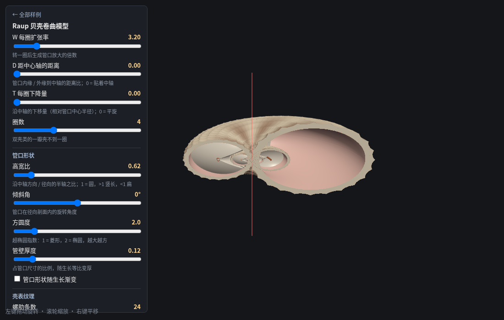
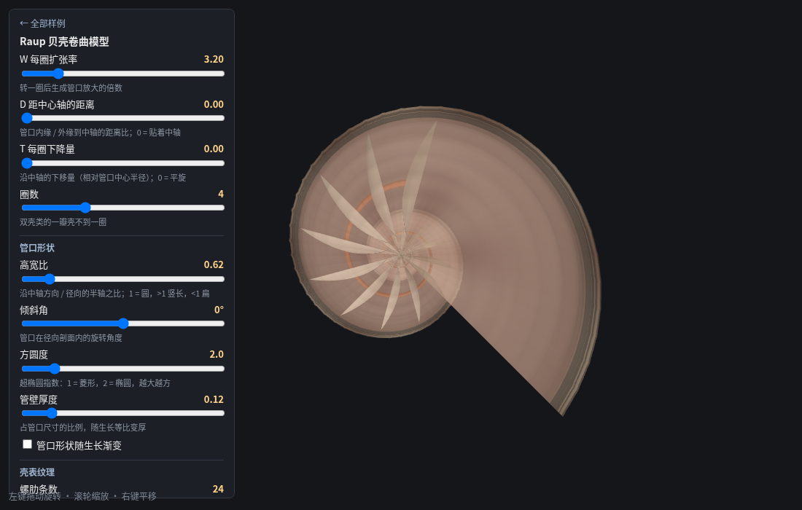
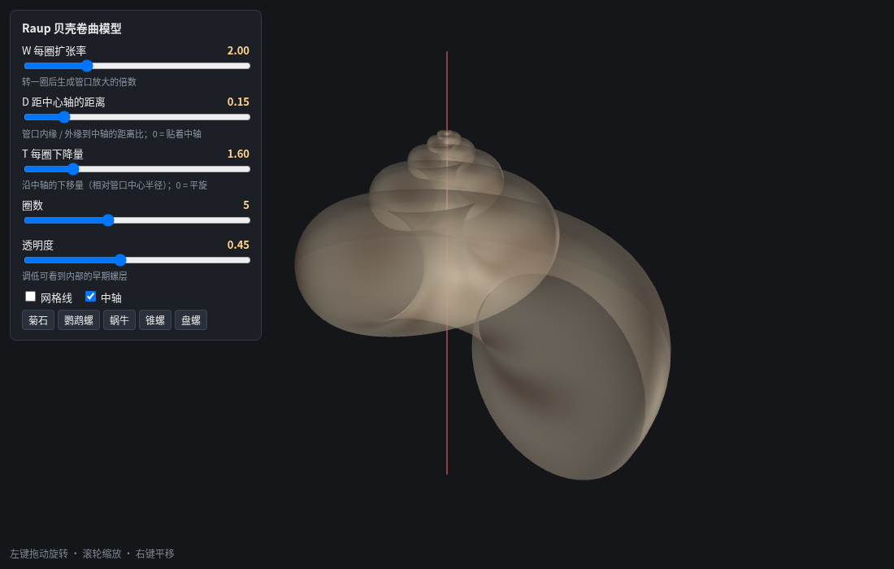
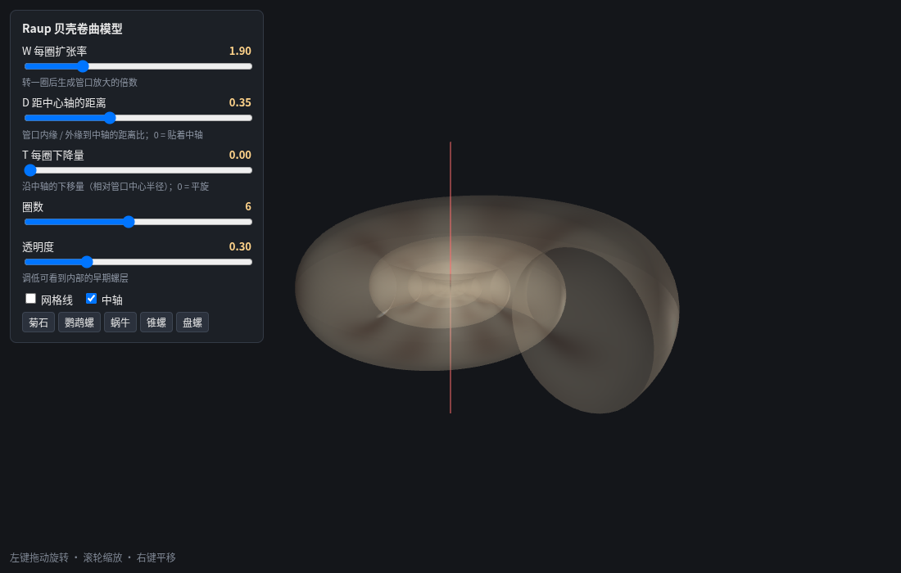

# Raup 贝壳卷曲模型 · 3D



一根管子边绕中轴旋转、边按固定比例放大、边沿中轴下移，就长成了贝壳。古生物学家 David Raup 在 1966 年用三个数字描述了几乎所有螺旋贝壳的形状，这个页面把它做成了可以拖动、剖开、调透明度的 3D 模型。

打开方式：用浏览器直接打开 [index.html](index.html)（Three.js 从 unpkg CDN 加载，需要联网）。

## 数学模型

管口（生成曲线）是一个超椭圆。转过角度 θ 后：

- 所有尺寸按 **W^(θ/2π)** 放大，所以壳是一条对数螺线：自相似，每一圈都是上一圈的等比放大；
- 管口内缘到中轴的距离 / 外缘到中轴的距离恒为 **D**；
- 管口中心沿中轴下移 **T × 管口中心半径**。

| 参数 | 含义 | 范围 |
|------|------|------|
| W 每圈扩张率 | 转一圈后管口放大的倍数 | 1.05–1000（对数刻度） |
| D 距中心轴的距离 | 管口内缘 / 外缘到中轴的距离比，0 = 贴着中轴 | 0–0.95 |
| T 每圈下降量 | 沿中轴的下移量（相对管口中心半径），0 = 平旋 | 0–8 |
| 圈数 | | 0.5–12 |

预设：菊石、鹦鹉螺、蜗牛、锥螺、盘螺、羊角、双壳。预设设置 W、D、T、圈数，并把管口形状（高宽比、倾斜角、方圆度、渐变）和隔板恢复默认；菊石、鹦鹉螺、双壳另外设置高宽比，菊石和鹦鹉螺还会打开隔板。

| 预设 | W | D | T | 圈数 | 其他 |
|------|---|---|---|------|------|
| 菊石 | 1.9 | 0.35 | 0 | 6 | 高宽比 0.75，每圈 14 块隔板 |
| 鹦鹉螺 | 3.2 | 0 | 0 | 4 | 高宽比 0.62，每圈 12 块隔板 |
| 羊角 | 4.5 | 0.45 | 0.7 | 2.5 | 圆形管口，无隔板 |
| 双壳 | 1000 | 0 | 0.05 | 0.65 | 高宽比 0.5，无隔板 |

**羊角**：D 大，螺层彼此不接触，管子疏松地盘成一个略带螺旋的角。**双壳**：双壳类的一瓣壳也能看作 Raup 管子，只是 W 极大、转不到一圈，管口迅速张开成一个扇形的瓣；Raup 的原文就是这样把双壳类放进同一个形态空间的。

| 羊角 | 双壳（一瓣） |
|---|---|
|  |  |

## 管口形状与管壁

| 参数 | 含义 |
|------|------|
| 高宽比 E | 沿中轴方向 / 径向的半轴之比 |
| 倾斜角 R | 管口在径向剖面内的旋转角度 |
| 方圆度 S | 超椭圆指数：1 = 菱形，2 = 椭圆，越大越方 |
| 管壁厚度 H | 占管口尺寸的比例，随生长等比变厚 |

壳是封闭实体：外壁、内壁（管口按 1 − H 缩小）、壳口环面、壳顶环面。



### 管口形状随生长渐变

开启后，E/R/S 是壳口处的形状，另设一组壳顶处的形状，中间按

t = (s^γ − s₀^γ) / (1 − s₀^γ)

插值，s 是当前管口尺寸，s₀ 是壳顶管口尺寸。γ → 0 时退化为按圈数均匀过渡（对数尺寸），γ = 1 为按尺寸线性过渡，γ 越大变化越集中在壳口。

| 渐变关闭 | 渐变开启（γ = 1） |
|---|---|
|  |  |

| γ = 0 | γ = 3 |
|---|---|
|  |  |

## 壳表纹理

- **螺肋**：沿螺旋方向延伸的纵肋，`(½ + ½·cos(n·φ))³` 形状的起伏，n 是绕管口一周的条数；
- **生长线**：平行于壳口的横纹，`(½ + ½·cos(m·θ))⁸` 的尖脊，强弱随 θ 不规则起伏。

纹理是真实几何位移，只作用于外壁，起伏高度和管口尺寸成比例。


## 内部构造

头足类（鹦鹉螺、菊石）的动物只住在壳口附近，长大时不断往前搬，并在身后砌一道**隔板**（septum）把旧的管子封起来，形成一串充气的**气室**。

- **隔板**：每圈 0–24 块，等角度排列。每块是一个浅穹顶，边缘贴着该处的**内壁**截面（同样的超椭圆管口、同样的壁厚 H，管口渐变也一起跟随），中心向壳顶方向凸出约 0.22 × 管口半径，所以凹面朝向壳口，和真的鹦鹉螺一样；
- **住室**：离壳口最近的约 1/3 圈是动物身体所在的住室，不放隔板；
- **体管**（siphuncle）：一根细管（半径约为管口的 8%）沿管子中心线从壳顶穿过所有隔板，一直通到最后一块隔板，动物用它调节气室里的气液比例来控制浮力；
- **隔板停在上一圈的外壁上**：包旋的壳（D 小）里，上一圈螺层会伸进这一圈的截面。真实的隔板不会穿过上一圈，而是砌在它的外壁上。程序对隔板的每条半径方向，求出从截面中心出发、第一次碰到上一圈外壁（包括螺肋、生长线的起伏）的位置，隔板只铺到那里。

隔板和体管是开放的薄面，不参与剖切截面的 stencil 计数（否则会让截面填充出错），而是单独按剖切面裁剪，并在半透明外壳之前绘制，所以调低透明度可以透过外壳看到它们。螺肋、生长线只改变外壁，对隔板没有影响。

| 鹦鹉螺沿中轴剖切，管腔里可见隔板 | 半透明鹦鹉螺俯视，隔板和体管 |
|---|---|
|  |  |

隔板和体管的算法移植自 [shell-morphospace-3d](https://github.com/liangruibupt/shell-morphospace-3d)（`septaThetas`、`buildSeptum`），在这里改成适配超椭圆管口、管壁厚度和管口渐变。

## 显示

- **透明度**：调低可看到被包在里面的早期螺层；
- **沿中轴剖切**：剖切面始终包含中轴，可绕中轴旋转；截面用 stencil capping 填实；
- 网格线、中轴开关。

| 半透明 | 剖切 | 菊石（平旋，T = 0） |
|---|---|---|
|  |  |  |

## 网址参数

所有参数都能写进网址分享一个形状，例如：

```
index.html?W=2&D=0.15&T=1.6&N=5&H=0.25&cut=1
index.html?G=1&E0=0.5&R0=-30&S0=2&E=1.8&R=30&S=5&C=3&cut=1
index.html?W=3.2&D=0&T=0&N=4&E=0.62&SP=12&O=0.3
```

| 键 | 参数 | 键 | 参数 |
|----|------|----|------|
| W, D, T, N | 卷曲模型、圈数 | E, R, S, H | 管口形状、壁厚 |
| G, E0, R0, S0, C | 渐变开关、壳顶形状、过渡曲线 γ | RN, RA, GN, GA | 螺肋条数/高度、生长线条数/高度 |
| O | 透明度 | cut, flip, A | 剖切开关、保留另一半、剖切面角度 |
| SP | 每圈隔板数，0 = 不显示 | SI | 体管开关（1 / 0，默认 1，只在有隔板时显示） |

## 参考

- D. M. Raup, *Geometric analysis of shell coiling: general problems*, Journal of Paleontology 40(5), 1966.
- [shell-morphospace-3d](https://github.com/liangruibupt/shell-morphospace-3d)：隔板、体管和羊角、双壳预设的来源。
