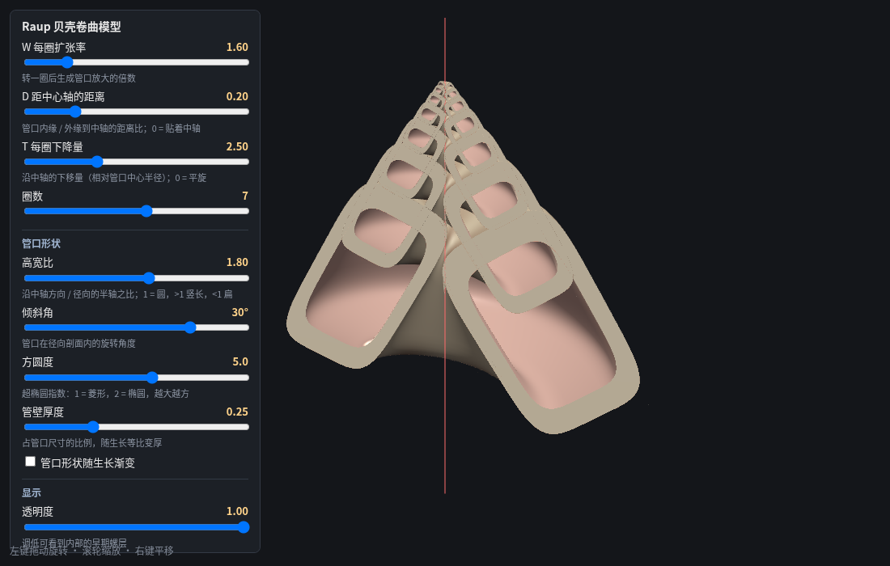
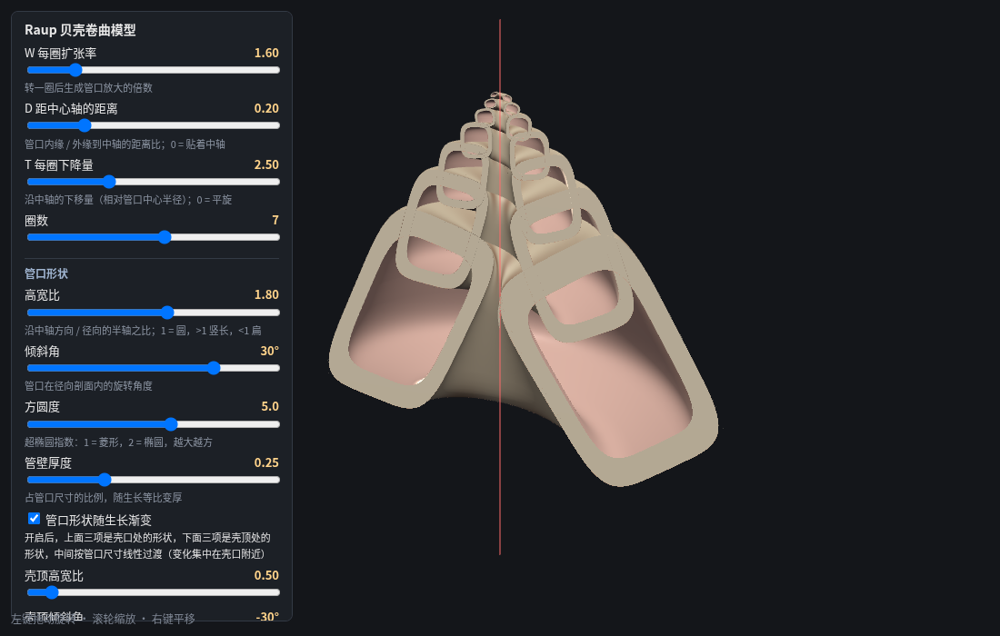
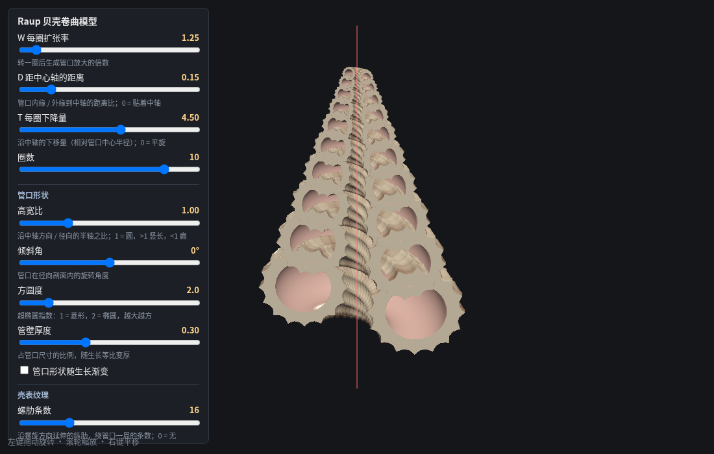
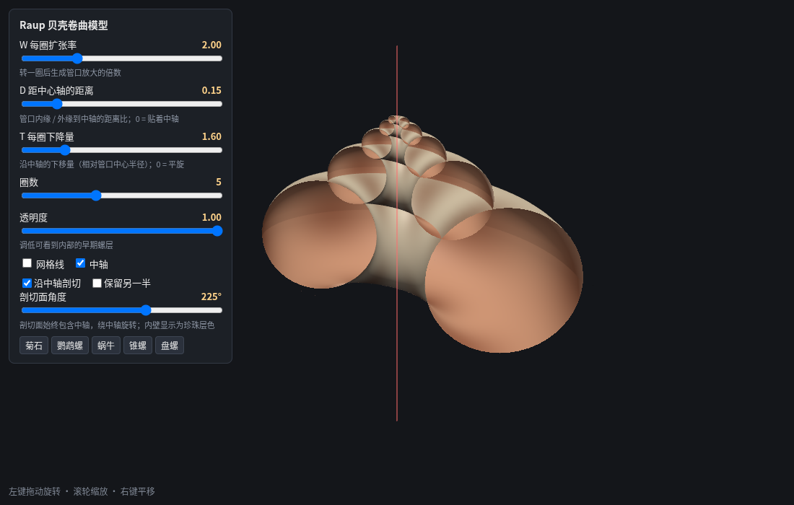

# Raup 贝壳卷曲模型 · 3D


一根管子边绕中轴旋转、边按固定比例放大、边沿中轴下移，就长成了贝壳。古生物学家 David Raup 在 1966 年用三个数字描述了几乎所有螺旋贝壳的形状，这个页面把它做成了可以拖动、剖开、调透明度的 3D 模型。

打开方式：用浏览器直接打开 [index.html](index.html)（Three.js 从 unpkg CDN 加载，需要联网）。

## 数学模型

管口（生成曲线）是一个超椭圆。转过角度 θ 后：

- 所有尺寸按 **W^(θ/2π)** 放大，所以壳是一条对数螺线：自相似，每一圈都是上一圈的等比放大；
- 管口内缘到中轴的距离 / 外缘到中轴的距离恒为 **D**；
- 管口中心沿中轴下移 **T × 管口中心半径**。

| 参数 | 含义 | 范围 |
|------|------|------|
| W 每圈扩张率 | 转一圈后管口放大的倍数 | 1.05–12（对数刻度） |
| D 距中心轴的距离 | 管口内缘 / 外缘到中轴的距离比，0 = 贴着中轴 | 0–0.95 |
| T 每圈下降量 | 沿中轴的下移量（相对管口中心半径），0 = 平旋 | 0–8 |
| 圈数 | | 1–12 |

预设：菊石、鹦鹉螺、蜗牛、锥螺、盘螺。

## 管口形状与管壁

| 参数 | 含义 |
|------|------|
| 高宽比 E | 沿中轴方向 / 径向的半轴之比 |
| 倾斜角 R | 管口在径向剖面内的旋转角度 |
| 方圆度 S | 超椭圆指数：1 = 菱形，2 = 椭圆，越大越方 |
| 管壁厚度 H | 占管口尺寸的比例，随生长等比变厚 |

壳是封闭实体：外壁、内壁（管口按 1 − H 缩小）、壳口环面、壳顶环面。


### 管口形状随生长渐变

开启后，E/R/S 是壳口处的形状，另设一组壳顶处的形状，中间按

t = (s^γ − s₀^γ) / (1 − s₀^γ)

插值，s 是当前管口尺寸，s₀ 是壳顶管口尺寸。γ → 0 时退化为按圈数均匀过渡（对数尺寸），γ = 1 为按尺寸线性过渡，γ 越大变化越集中在壳口。

| 渐变关闭 | 渐变开启（γ = 1） |
|---|---|
|  |  |

| γ = 0 | γ = 3 |
|---|---|
|  |  |

## 壳表纹理

- **螺肋**：沿螺旋方向延伸的纵肋，`(½ + ½·cos(n·φ))³` 形状的起伏，n 是绕管口一周的条数；
- **生长线**：平行于壳口的横纹，`(½ + ½·cos(m·θ))⁸` 的尖脊，强弱随 θ 不规则起伏。

纹理是真实几何位移，只作用于外壁，起伏高度和管口尺寸成比例。



## 显示

- **透明度**：调低可看到被包在里面的早期螺层；
- **沿中轴剖切**：剖切面始终包含中轴，可绕中轴旋转；截面用 stencil capping 填实；
- 网格线、中轴开关。

| 半透明 | 剖切 | 菊石（平旋，T = 0） |
|---|---|---|
|  |  |  |

## 网址参数

所有参数都能写进网址分享一个形状，例如：

```
index.html?W=2&D=0.15&T=1.6&N=5&H=0.25&cut=1
index.html?G=1&E0=0.5&R0=-30&S0=2&E=1.8&R=30&S=5&C=3&cut=1
```

| 键 | 参数 | 键 | 参数 |
|----|------|----|------|
| W, D, T, N | 卷曲模型、圈数 | E, R, S, H | 管口形状、壁厚 |
| G, E0, R0, S0, C | 渐变开关、壳顶形状、过渡曲线 γ | RN, RA, GN, GA | 螺肋条数/高度、生长线条数/高度 |
| O | 透明度 | cut, flip, A | 剖切开关、保留另一半、剖切面角度 |

## 参考

- D. M. Raup, *Geometric analysis of shell coiling: general problems*, Journal of Paleontology 40(5), 1966.
