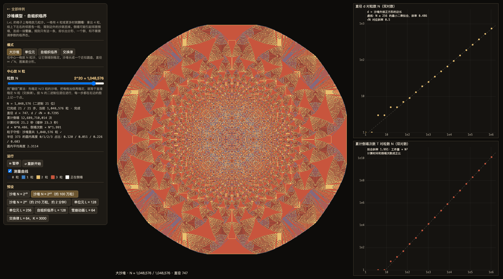
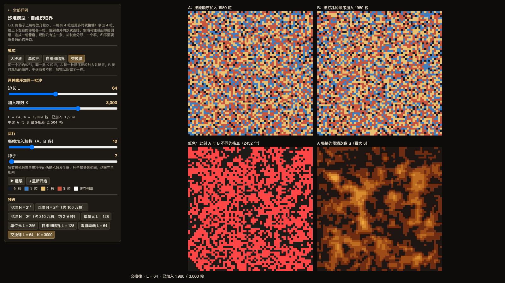
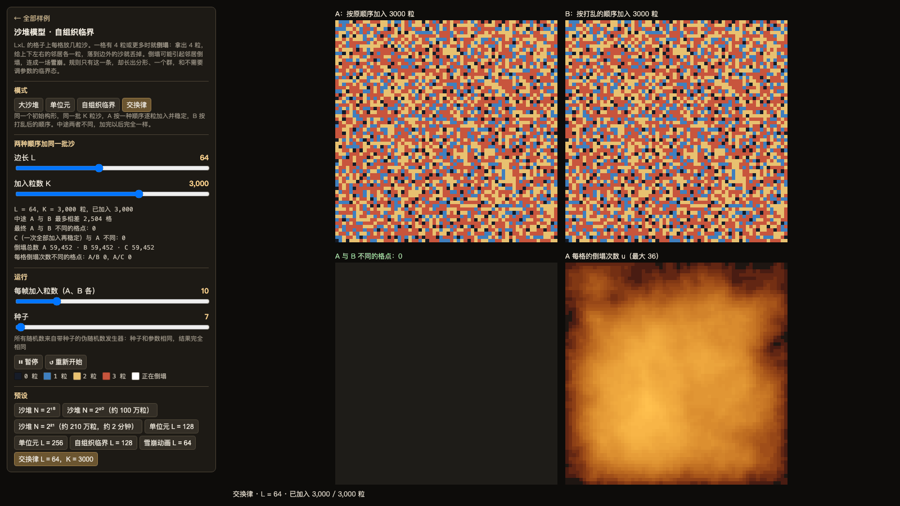
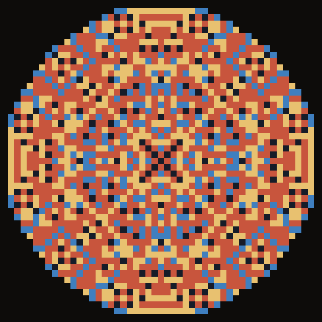
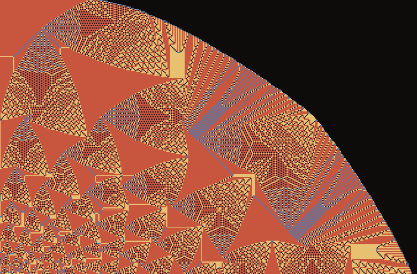
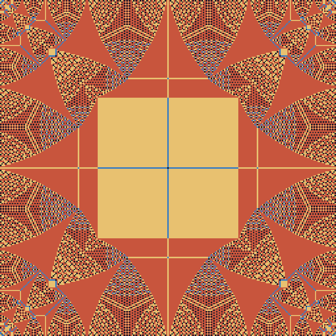
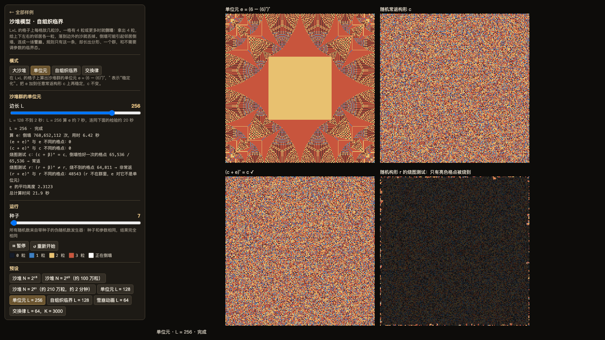
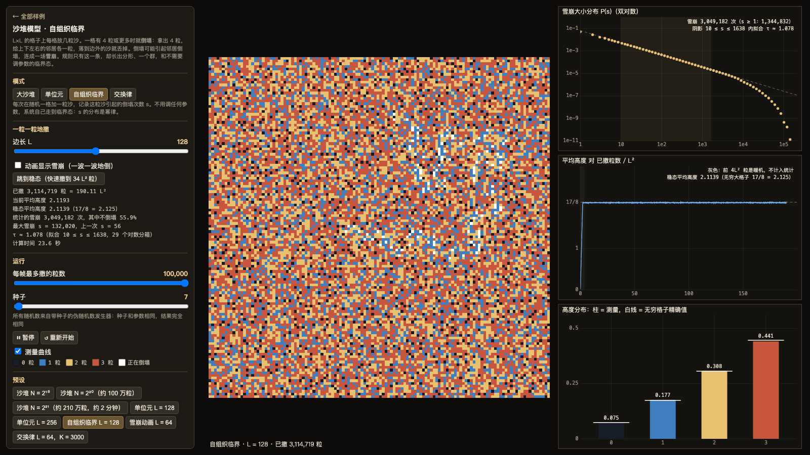
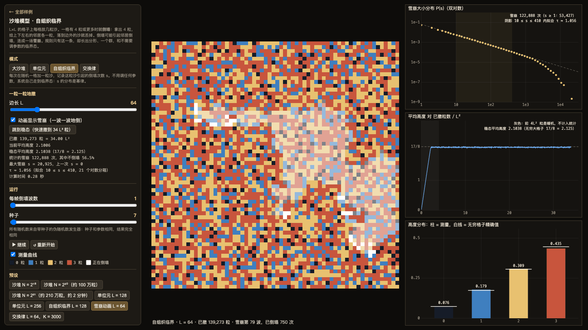

# 沙堆模型 · 自组织临界



1987 年，Per Bak、汤超（Chao Tang）和 Kurt Wiesenfeld 想解释一个到处都能看到的现象：很多系统的涨落没有特征尺度，大事件和小事件服从同一条幂律。他们给出的模型简单得出奇：在格子上一粒一粒地撒沙，一格堆到 4 粒就塌下来，分给四个邻居。没有温度，没有要调的参数，系统却自己走到一个“临界态”：下一粒沙可能什么都不引起，也可能引起横扫整张格子的雪崩，雪崩大小的分布是幂律。他们把这个现象叫**自组织临界**（self-organized criticality，SOC）。

后来人们发现，这条规则背后还藏着别的东西。在中心放一百万粒沙，它会长成一幅带有无穷层细节的分形图案；稳定构形里有一部分构成一个**交换群**，这个群的单位元是一幅出人意料的图。这个页面把这些东西都算出来，每个数都是页面实测的。

打开方式：用浏览器直接打开 [index.html](index.html)。页面只用 Canvas 2D，不依赖外部库，离线也能用。随机数都来自带种子的伪随机数发生器，参数相同，结果就完全相同。

## 数学原理

### 1. 规则：倒塌

取 L×L 的方格，每格放若干粒沙，第 i 格的粒数记作高度 hᵢ。规则只有一条：

```
若 hᵢ ≥ 4：hᵢ ← hᵢ − 4，上下左右四个邻居各 +1
```

这一步叫**倒塌**（toppling）。边上的格子少一两个邻居，分给“不存在的邻居”的沙就落到格子外面丢掉。可以把格子外面想成一个大坑，叫**汇**（sink）。所有格子都小于 4 时，构形是**稳定**的。不稳定的构形反复倒塌，直到稳定，这个过程叫**稳定化**，结果记作 h°。

稳定化一定会停下来。假设它永远不停，总有某一格倒塌了无穷多次。它每次倒塌都给邻居 1 粒，邻居最终也必须倒塌无穷多次，否则沙会在邻居那里无限堆积。这样一路传到边上，边上的格子倒塌无穷多次，就有无穷多粒沙掉进汇里，可格子里总共只有有限粒沙，矛盾。

把“每格倒塌了几次”记成向量 u，叫**倒塌计数**（odometer）。倒塌一次相当于减去离散拉普拉斯算子 Δ 的一列（自己 −4，四个邻居各 +1），所以稳定化的结果可以写成

```
h° = h − Δu
```

### 2. 交换律：顺序无关

如果同时有两格不稳定，先倒哪一格？答案是无所谓。格子 i 倒塌只会让别的格子的沙变多，不会让一个本来不稳定的格子 j 变稳定。所以先倒 i 再倒 j，和先倒 j 再倒 i，结果相同。由此可以推出（Dhar 1990）：

- 不管按什么顺序倒塌，最终的稳定构形 h° 都一样；
- 连每一格倒塌了几次（u）也一样；
- 往构形里加沙时，可以加一粒稳定一次，也可以全部加完再稳定，结果相同：(a + b)° = (a° + b)°。

这就是沙堆模型被称为**阿贝尔沙堆**（abelian sandpile）的原因。页面的“交换律”模式直接演示它：L = 64，同一个随机初始构形，同一批 K = 3000 个随机位置。A 按原来的顺序一粒一粒地加、每加一粒就稳定一次；B 按打乱后的顺序加。加到一半时两者完全不像（下图加到 1980 粒时，4096 格里有 2452 格不同，红色）：



全部加完以后：



| 比较 | 不同的格点 | 倒塌总数 |
|---|---|---|
| A（原顺序逐粒）与 B（打乱逐粒） | 0 | 59 452 与 59 452 |
| A 与 C（3000 粒一次加完再稳定） | 0 | 59 452 与 59 452 |
| 每格的倒塌次数 u，A/B、A/C | 0 | 最大的一格倒塌 36 次 |

中途 A、B 最多相差 2504 格，最后一格不差，连每一格倒塌了几次都一样。

### 3. 中心放 N 粒：分形沙堆

在一张足够大的格子中心放 N 粒沙，让它倒塌到稳定。沙会向外摊开，长成一个近似圆盘：

| N = 2¹²，直径 49 | N = 2¹⁵，直径 135 | N = 2¹⁸，直径 375 |
|---|---|---|
|  |  |  |

颜色表示 0、1、2、3 粒（深蓝、蓝、黄、红）。粒数越多，图案越细，但同样的结构一再出现：红色（3 粒）的大块之间夹着由周期花纹填满的三角形和弯曲的“叶片”，越靠近中心越小、越密。放大 2²⁰ 沙堆的右上边缘：



这种结构并不是偶然的。Levine、Pegden 和 Smart 证明了，把沙堆缩放到固定大小以后，N → ∞ 时图案收敛到一个确定的极限（Pegden–Smart 2013），而那些周期花纹的区域排列成 Apollonius 圆填充的样子（Levine–Pegden–Smart 2016）。极限的外形**不是**圆，从上图可以看到边缘有平直的段落。

**直径 ∝ √N。** 稳定以后每格最多 3 粒，所以 N 粒沙至少要摊开到 N/3 格上，面积 ≥ N/3，直径至少 ∝ √N。另一方面沙堆内部的平均高度是一个常数（下面测得 2.31），所以面积 ≈ N/2.31，直径也至多 ∝ √N。页面记录了每一步的直径 d（沙堆外接正方形的边长）：

| N | d | d / √N | 累计倒塌次数 T | 计算时间 |
|---|---|---|---|---|
| 2¹⁶ = 65 536 | 189 | 0.738 | 51 202 485 | 0.12 秒 |
| 2¹⁸ = 262 144 | 375 | 0.732 | 805 570 334 | 1.4 秒 |
| 2¹⁹ = 524 288 | 531 | 0.733 | 3 211 865 242 | 5.5 秒 |
| 2²⁰ = 1 048 576 | 747 | 0.729 | 12 689 710 014 | 21.8 秒 |
| 2²¹ = 2 097 152 | 1053 | 0.727 | 50 570 277 551 | 86.4 秒 |

（表中的计算时间取自一次 2²¹ 预设的运行，是到这一步为止页面在每帧里实际用来算的时间之和。单独运行 2²⁰ 两次，分别是 21.7 和 21.2 秒；墙钟时间更长一些，是 26.1 和 23.3 秒，因为每帧只算 12 毫秒，剩下的时间留给绘图。）N ≥ 256 的点拟合出 d ∝ N^0.486。d / √N 从 0.738 慢慢降到 0.727，还没有完全稳定，所以拟合斜率略小于 0.5。

2²⁰ 沙堆在半径 373 的圆内，0、1、2、3 粒的格子各占 12.0%、5.1%、22.6%、60.3%，平均高度 2.311。沙子一粒不少：把 1/8 区域按对称性展开后数出来正好是 1 048 576 粒，也没有一粒碰到存储区的边界。

**为什么工作量 ∝ N²。** 倒塌次数 u 满足 Δu = h° − h：在中心是 −N，其他地方是 0 到 3 之间的数。这和电荷 N 放在原点时的电势方程一样，所以 u 像二维的 Green 函数，u(x) ≈ (N/2π)·ln(R/|x|)，R 是沙堆半径。把它在半径 R ∝ √N 的圆盘上求和，得到 ∝ N·R² ∝ N²。表里 N 每翻一倍，T 乘以 3.95–3.99，拟合斜率 1.991。计算时间和 T 成正比：2²⁰ 每次倒塌平均 1.7 纳秒。

页面用了两个办法把这个 N² 压下来：

1. **翻倍**。由交换律，2N 粒放在中心的结果等于“先稳定 N 粒，再把每格的粒数加倍，再稳定”：(2N·δ)° = (N·δ + N·δ)° = (N·δ)° 加倍后的稳定化。按 N 的二进制位从高到低做，每一步加倍，遇到 1 再在中心加 1 粒。加倍后各格只有 0–7 粒，摊开的路程短得多。直接放 2¹⁸ 粒要倒塌 1 214 086 102 次（用同一份代码在整个平面上对照测得），翻倍只要 805 570 334 次，是 0.66 倍，和上面电势估计给出的 2/3 一致。
2. **八分之一**。沙堆关于两条坐标轴和两条对角线对称，只存 0 ≤ y ≤ x 的一块。坐标轴和对角线上的格子，它的一部分邻居是镜像，倒塌时要按镜像的个数加倍发沙。权重表在开始时按“邻居的镜像落在哪一格”自动算出来。这样存储和计算都只要整个平面的 1/8。展开计数后，2²⁰ 的倒塌总数 12 689 710 014 和不用对称性、在整个平面上算的结果完全一致。

每次倒塌时，一格有 h 粒就一次倒 ⌊h/4⌋ 次。中心刚放下沙的时候这能省很多次，但大部分倒塌发生在高度只有 4–7 的格子上，所以主要的节省来自上面两条。

### 4. 沙堆群和它的单位元

从任意稳定构形出发，在随机位置不停地加沙（多余的会从边上掉出去），有些稳定构形以后还会一再出现，有些出现过一次就再也回不来了。前一种叫**常返构形**（recurrent configuration）。例如每格都是 3 的构形是常返的：从任何稳定构形出发都可以加沙加到它。往常返构形里再加沙，稳定以后还是常返的。

Dhar（1990）证明了：在常返构形上定义加法

```
a ⊕ b = (a + b)°
```

得到的是一个交换群，叫**沙堆群**（sandpile group）。结合律和交换律来自上一节的交换律，难的是单位元和逆元的存在。这个群的阶等于约化拉普拉斯矩阵的行列式 det Δ，也就是这张网格（把边界都连到汇上）的生成树个数。L×L 格子上

```
det Δ = ∏_{j,k=1..L} (4 − 2cos(jπ/(L+1)) − 2cos(kπ/(L+1)))
```

按这个公式算出：

| L | 常返构形个数 | 稳定构形 4^(L²) | 常返的比例 |
|---|---|---|---|
| 2 | 192 | 256 | 75% |
| 3 | 100 352 | 262 144 | 38% |
| 4 | 557 568 000 | 4 294 967 296 | 13% |
| 8 | ≈ 8.3 × 10³³ | ≈ 3.4 × 10³⁸ | 2.4 × 10⁻⁵ |
| 16 | ≈ 1.0 × 10¹³³ | ≈ 1.3 × 10¹⁵⁴ | 7.6 × 10⁻²² |

每格平均下来大约只有 3.2 种“常返的选法”，不到 4 种（极限是 e^(4G/π) ≈ 3.21，G 是 Catalan 常数），所以格子大了以后，随便挑一个稳定构形几乎不可能是常返的。

**单位元怎么求。** 记每格都是 6 的构形为 6。令

```
e = (6 − (6)°)°
```

理由如下。(6)° 每格 ≤ 3，所以 6 − (6)° 每格 ≥ 3，它比全 3 构形多，稳定后的 e 是常返的。再算 e ⊕ (6)°：由交换律，(e + (6)°)° = (6 − (6)° + (6)°)° = (6)°。而 (6)° = (3 + 3)° 也是常返的，是群里的一个元素 g。e ⊕ g = g，在群里两边消去 g，就得到 e 是单位元。

下面是 L = 64、128、255 的单位元：

| L = 64 | L = 128 | L = 255 |
|---|---|---|
|  |  |  |

单位元“什么都不做”，图却一点也不简单：中间是一块每格都是 2 粒的黄色正方形，四周伸出红色的尖角，夹缝里是分形花纹，L 越大，花纹的层次越多。为什么会是这个形状，至今只有部分解释（Le Borgne–Rossin 2002，Caracciolo–Paoletti–Sportiello 2008 等）。

页面算出 e 以后做了几项检验。L = 256：



| 检验 | L = 128 | L = 256 |
|---|---|---|
| 算 e 的倒塌次数 | 49 222 748 | 768 652 112 |
| 算 e 的计算时间 | 0.45 秒 | 6.4–6.6 秒 |
| (e + e)° 与 e 不同的格点 | 0 | 0 |
| (c + e)° 与 c 不同的格点 | 0 | 0 |
| 随机构形 r：(r + e)° 与 r 不同的格点 | 12 176 | 48 543 |
| e 的平均高度 | 2.298 | 2.312 |

c 是一个随机常返构形：先在每格放 3 + (0–3 的随机数) 粒，再稳定。因为它比全 3 构形多，所以一定常返，而且它的构造不依赖 e，检验不是循环论证。e 对 c 是单位元；对随便挑的稳定构形 r 却不是，因为 r 不在群里。

### 5. 烧图测试：怎么判断常返

Dhar 给了一个只要稳定一次就能判断的办法。记 β 为“每格到汇的边数”：角上 2，边上 1，内部 0。β 恰好等于“每格都倒塌一次”时从格子里掉出去的那些沙，所以

```
c 常返  ⇔  (c + β)° = c  ⇔  稳定 c + β 时，每一格恰好倒塌一次
```

这可以想成一场火：火从汇里烧进来，一格的沙粒数不少于它还没烧着的邻居数时，它就会被烧着（倒塌一次），再去点它的邻居。c 常返当且仅当火能烧遍所有格子。烧不到的那一块叫**禁止子构形**：其中每一格的粒数都小于它在这一块里的邻居数。最小的例子是相邻的两个 0。

页面对 c 和 r 各做一次：

| | L = 128 | L = 256 |
|---|---|---|
| c：恰好倒塌一次的格子 | 16 384 / 16 384，常返 | 65 536 / 65 536，常返 |
| r（每格 0–3 均匀随机）：烧到的格子 | 463 / 16 384 | 725 / 65 536 |

随机的 r 里到处都是相邻的 0，火刚从边上烧进来一两层就灭了（上图右下，亮色是烧到的格子）。

### 6. 自组织临界

现在回到 Bak、汤、Wiesenfeld 的实验：从空格子开始，每次在随机一格加 1 粒，稳定，记下这一粒引起的倒塌次数 s，叫**雪崩大小**。

一开始沙少，加的沙原地不动，平均高度每加 L² 粒就涨 1。涨到 2.1 左右，沙开始从边上大量掉出去，平均高度停住不动了，下图中间那条曲线就是这样。这时系统进入了**稳态**：所有的常返构形，而且每个常返构形出现的概率相同（Dhar 1990）。没有人调过任何参数，系统自己停在了这里。页面把前 4L² 粒当作暖机，不计入统计。



**平均高度趋于 17/8。** 无穷大格子上稳态的平均高度是 17/8 = 2.125。这个数先是 Grassberger 从数值上猜到的，2006–2011 年间由 Jeng、Piroux、Ruelle，Poghosyan、Priezzhev、Ruelle，以及 Kenyon、Wilson 等人算出并证明。有限格子靠边的格子沙少（沙会掉出去），所以平均高度稍低：

| L | 统计的雪崩 | 稳态平均高度 | 与 2.125 的差 | 差 × L |
|---|---|---|---|---|
| 64 | 3 000 768 | 2.1034 | 0.0216 | 1.38 |
| 128 | 3 000 717 | 2.1138 | 0.0112 | 1.43 |
| 256 | 1 000 439 | 2.1195 | 0.0055 | 1.41 |

L 每翻一倍，差距减半，差 × L 几乎不变，说明差距 ∝ 1/L，来自边界那一圈。用这个规律从两个尺寸外推：2 × 2.1195 − 2.1138 = 2.1252。

**高度分布。** 每一种高度的占比也有精确值（Majumdar–Dhar 1991 算出 P(0)，Priezzhev 1994 算出其余三个）：

| 高度 | 精确值 | L = 64 | L = 128 | L = 256 |
|---|---|---|---|---|
| 0 | 2/π² − 4/π³ ≈ 0.0736 | 0.0763 | 0.0750 | 0.0742 |
| 1 | ≈ 0.1739 | 0.1794 | 0.1767 | 0.1754 |
| 2 | ≈ 0.3063 | 0.3089 | 0.3077 | 0.3071 |
| 3 | ≈ 0.4462 | 0.4354 | 0.4406 | 0.4433 |

同样随 L 增大逐渐靠近精确值。

**雪崩大小的分布。** 不倒塌的情形（s = 0）占 56% 左右。对 s ≥ 1，页面按对数分箱（每个 2 倍分 4 箱），每箱的计数除以箱里整数的个数和雪崩总数，得到概率密度 P(s)，画在双对数坐标上。如果 P(s) ∝ s^(−τ)，点就排成一条斜率 −τ 的直线。图上中间一大段确实接近直线，到 s 接近 L² 量级时向下弯折：雪崩再大就要碰到边界，这叫有限尺寸截断。

在阴影范围（10 ≤ s ≤ L²/10，每箱至少 20 次）里做最小二乘拟合：

| L | 拟合范围 | τ | 只拟合 10–100 | 只拟合 100–1000 | 最大雪崩 |
|---|---|---|---|---|---|
| 64 | 10–409 | 1.055 | 1.036 | 1.103 | 20 925 |
| 128 | 10–1638 | 1.078 | 1.054 | 1.094 | 132 020 |
| 256 | 10–6553 | 1.098 | 1.069 | 1.104 | 792 955 |

这里要老实说几件事：

- 拟合出的 τ 随 L 变大而变大，随拟合范围往大 s 移也变大。在这几个尺寸上它还没收敛。常被引用的值是 τ = 6/5 = 1.2（Priezzhev、Ktitarev、Ivashkevich 1996 的论证），不同的大规模模拟给出 1.1 到 1.3 之间的各种估计。
- 更根本的是，Tebaldi、De Menech、Stella（1999）发现二维 BTW 模型的雪崩分布不满足简单的有限尺寸标度：大小不同的雪崩要用不同的指数来描述（多重分形）。所以“一个 τ”本身就是一种近似。
- 在双对数图上画直线来定指数，误差很大，而且选哪一段来拟合会改变结果。上表把这种敏感性直接列了出来。

**看雪崩。** 勾选“动画显示雪崩”后，每帧只推进一**波**：这一波里所有不稳定的格子同时倒塌一次。白色是这一波正在倒塌的格子，变淡的是这场雪崩里已经倒过的格子。由交换律，一波一波地倒和一格一格地倒，最后的结果和倒塌总数都一样。



### 7. 自然界的幂律，以及要小心的地方

BTW 的论文之所以引起轰动，是因为大自然里有很多类似的幂律：

- **地震**：Gutenberg–Richter 定律说，震级不低于 M 的地震每年的次数 N(≥M) 满足 log₁₀ N = a − bM，b 通常接近 1。震级每加 1，能量大约乘以 10^1.5 ≈ 32，换成能量就是 N(≥E) ∝ E^(−2b/3)，一条幂律。
- **森林火灾**：Malamud、Morein、Turcotte（1998）整理美国和澳大利亚的林火记录，发现过火面积的分布在几个数量级上接近幂律。Drossel 和 Schwabl（1992）的森林火灾模型是 SOC 思想的另一个经典模型。
- 此外还有太阳耀斑、雪崩、神经元放电的“神经雪崩”等等。

但也要小心：

- 真实的沙堆并不总是这样。Held 等人（1990）用真沙做实验，小沙堆的崩落分布像幂律，大沙堆却是周期性的大滑坡。Frette 等人（1996）用米粒做，只有长条形的米粒才表现出幂律。
- 在双对数图上看到一段直线，不等于是幂律。Clauset、Shalizi、Newman（2009）用严格的统计检验重新检查了一批“幂律”数据，发现其中不少用对数正态分布或带截断的分布解释得同样好、甚至更好。上一节拟合 τ 时看到的敏感性就是一个小例子。
- “自组织临界解释了地震”是一个比喻和一种研究纲领，不是定理。BTW 模型说明了“不调参数也能临界”是可能的，至于某一个具体的自然现象是不是这样产生的，要另外去检验。

## 实现说明

- 所有计算都切成小段在每一帧里做，每帧最多算 12 毫秒，剩下的时间画图。最重的 2²⁰ 沙堆、L = 256 和 320 的单位元、L = 256 的快速撒沙，测得的帧间隔中位数都在 16.1–16.6 毫秒，最长 18.7 毫秒，页面在计算中仍然可以拖动、暂停。
- 倒塌用一个栈：一格的粒数从小于 4 变成大于等于 4 时把它压栈，所以“在栈里”和“不稳定”始终是一回事，栈的大小不超过格子数。
- 页面中出现的白色格子是计算进行中暂时不稳定（≥ 4 粒）的格子。

## 操作

- 模式：大沙堆、单位元、自组织临界、交换律；
- 大沙堆：粒数 N（2¹⁰–2²¹，按 2^0.25 一档）；
- 单位元：边长 L（16–320）；
- 自组织临界：边长 L（16–256）、动画开关、“跳到稳态”（快速撒到 34 L² 粒，再接着动画）；
- 交换律：边长 L（16–128）、粒数 K（100–20 000）；
- 速度：自组织临界里是每帧最多撒的粒数（动画时是每帧倒塌的波数），交换律里是每帧给 A、B 各加的粒数；
- 种子、暂停 / 继续、重新开始、测量曲线开关；
- 预设：沙堆 2¹⁸、2²⁰、2²¹，单位元 L = 128、256，自组织临界 L = 128，雪崩动画 L = 64，交换律 L = 64。

## 网址参数

| 键 | 含义 |
|---|---|
| p | 预设：pile18, pile20, pile21, id128, id256, soc128, socAnim, abel |
| mode | pile, identity, soc, abelian |
| logN | 大沙堆的 log₂ N（10–21） |
| L | 当前模式的边长 |
| K | 交换律模式加入的粒数 |
| seed | 种子（1–999） |
| speed | 速度滑块的值（0–5，对应 10^speed） |
| anim | 1 = 动画显示雪崩 |
| warm | 1 = 先快速撒到稳态 |
| plots | 0 = 隐藏测量曲线 |
| run | 0 = 打开时暂停 |
| ui | 0 = 只显示画布 |

数字参数都会被限制在滑块的范围内，非数字会被忽略。例如 L = 200 的单位元：`index.html?mode=identity&L=200`；L = 256 的自组织临界，每帧撒 10 万粒：`index.html?mode=soc&L=256&speed=5`。

## 参考

- P. Bak, C. Tang, K. Wiesenfeld, *Self-organized criticality: An explanation of the 1/f noise*, Physical Review Letters 59, 1987.
- D. Dhar, *Self-organized critical state of sandpile automaton models*, Physical Review Letters 64, 1990. 交换律、沙堆群、常返构形与烧图测试。
- S. N. Majumdar, D. Dhar, *Height correlations in the Abelian sandpile model*, Journal of Physics A 24, 1991. P(0)。
- V. B. Priezzhev, *Structure of two-dimensional sandpile. I. Height probabilities*, Journal of Statistical Physics 74, 1994.
- V. B. Priezzhev, D. V. Ktitarev, E. V. Ivashkevich, *Formation of avalanches and critical exponents in an Abelian sandpile model*, Physical Review Letters 76, 1996.
- C. Tebaldi, M. De Menech, A. L. Stella, *Multifractal scaling in the Bak–Tang–Wiesenfeld sandpile and edge events*, Physical Review Letters 83, 1999.
- M. Creutz, *Abelian sandpiles*, Computers in Physics 5, 1991. 最早画出单位元的图之一。
- Y. Le Borgne, D. Rossin, *On the identity of the sandpile group*, Discrete Mathematics 256, 2002.
- W. Pegden, C. K. Smart, *Convergence of the Abelian sandpile*, Duke Mathematical Journal 162, 2013.
- L. Levine, W. Pegden, C. K. Smart, *Apollonian structure in the Abelian sandpile*, Geometric and Functional Analysis 26, 2016.
- L. Levine, Y. Peres, *Laplacian growth, sandpiles, and scaling limits*, Bulletin of the AMS 54, 2017.
- B. Malamud, G. Morein, D. Turcotte, *Forest fires: an example of self-organized critical behavior*, Science 281, 1998.
- A. Clauset, C. R. Shalizi, M. E. J. Newman, *Power-law distributions in empirical data*, SIAM Review 51, 2009.
