# 四维超立方体 · 旋转的 tesseract

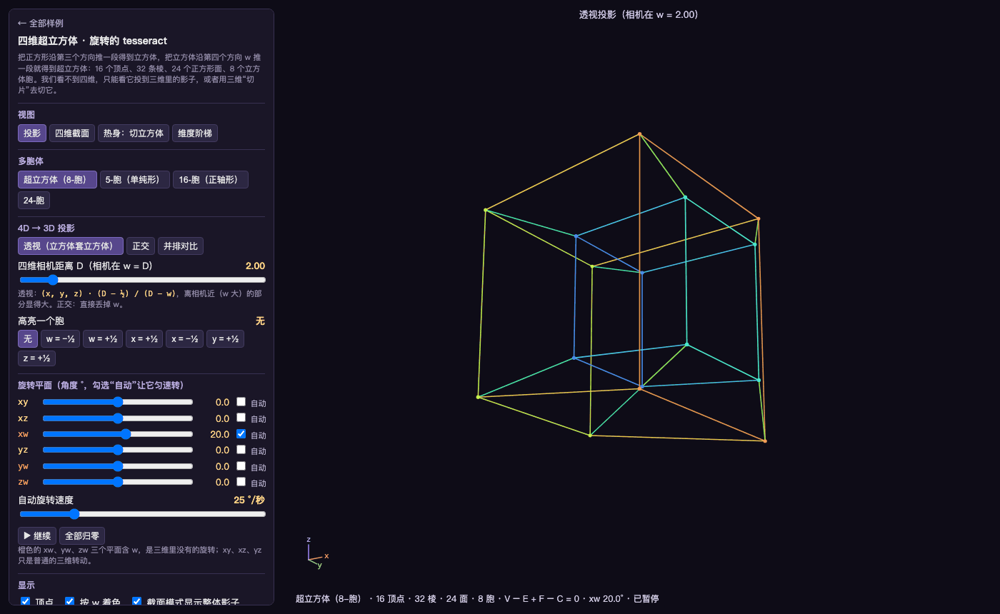

把一个点沿一个方向推出去，扫过的是线段；把线段沿垂直方向推出去，扫过的是正方形；正方形再推一次是立方体。四维空间里还有第四个互相垂直的方向 w，把立方体沿 w 推一段，扫过的就是**超立方体**（tesseract，也叫 8-胞）。它有 16 个顶点、32 条棱、24 个正方形面和 8 个立方体“胞”。

我们看不到四维，只有两种办法看它：一是像看影子一样把它**投影**到三维，再画到屏幕上；二是用一张三维的“超平面”去**切**它，看切口。页面把两种都做了，另外还有切立方体的三维热身、从点到超立方体的维度阶梯，以及另外三个正四维多胞体。

打开方式：用浏览器直接打开 [index.html](index.html)。页面只用 Canvas 2D，投影和截面都是自己算的，不依赖外部库，离线也能用。

## 数学原理

### 1. 坐标：16 个顶点，32 条棱

超立方体的顶点就是 (±1, ±1, ±1, ±1) 的所有组合，共 2⁴ = 16 个。两个顶点之间有一条棱，当且仅当它们**只有一个坐标不同**。每个顶点可以在 4 个坐标里任选一个翻转，所以每个顶点连 4 条棱，总棱数是 16 × 4 / 2 = 32。

页面把所有多胞体都缩放到外接球半径为 1，所以超立方体的顶点是 (±½, ±½, ±½, ±½)，棱长为 1。棱不是手写的：程序找出所有顶点对里距离最小的那些，每种多胞体都这样得到（实测：超立方体 32 条、5-胞 10 条、16-胞 24 条、24-胞 96 条，和理论值一致）。

### 2. 四维里的旋转：绕平面转，而不是绕轴转

三维里的旋转“绕一根轴转”，其实是在和这根轴垂直的那个**平面**里转：绕 z 轴转就是在 xy 平面里转，z 坐标不变。这个说法推广到四维：一次基本旋转选一个坐标平面，在里面转一个角度 θ，另外两个坐标不动。比如 xw 平面里的旋转：

```
x′ = x cos θ − w sin θ
w′ = x sin θ + w cos θ
y′ = y,  z′ = z
```

四个坐标两两配对，有 C(4, 2) = 6 个平面：xy、xz、xw、yz、yw、zw。其中 xy、xz、yz 三个不含 w，只是普通的三维转动，从投影上看就是整个物体在三维里转；含 w 的 xw、yw、zw 才是三维里没有的转法（面板里标成橙色）。页面按固定顺序把六个旋转乘起来：`M = R_xy · R_xz · R_xw · R_yz · R_yw · R_zw`，每个平面一个角度滑条，勾选“自动”就以设定的速度（默认 25°/秒，实测 2 秒内 xw 从 0.2° 转到 50.2°）匀速转下去。

两个互不相交的平面可以同时转，比如 xw 和 yz（预设“xw + yz 双旋转”）。这时 x、y、z、w 四个坐标都在变，只有原点不动。三维里不存在这种旋转：三维里任何旋转都有一根不动的轴。

### 3. 4D → 3D：透视和正交两种投影

**正交投影**最简单：直接丢掉 w，(x, y, z, w) → (x, y, z)。这就像正午的阳光把物体的影子垂直投到地面上。

**透视投影**把一个四维“相机”放在 w 轴上 w = D 处，看向原点。离相机越近（w 越大）的点显得越大：

```
(x, y, z) · (D − ½) / (D − w)
```

乘以 (D − ½) 只是为了让 w = ½ 那一层保持原尺寸，不至于整体缩放。没有旋转时，超立方体的 16 个顶点分成 w = +½ 和 w = −½ 两组，各是一个立方体：w = +½ 那个离相机近，投影边长为 1；w = −½ 那个远，投影边长是 (D − ½)/(D + ½)。对应的 8 条 w 方向的棱把两个立方体的对应顶点连起来。这就是熟悉的“立方体套立方体”图（数学上叫 Schlegel 图）。实测里面那个立方体的投影边长：

| D | 1.2 | 2 | 4 | 8 |
|---|---|---|---|---|
| 内立方体边长（外立方体 = 1） | 0.412 | 0.600 | 0.778 | 0.882 |
| (D − ½)/(D + ½) | 0.412 | 0.600 | 0.778 | 0.882 |

D 越大，相机越远，透视越弱，越接近正交投影。

8 个胞在图里的样子：内外两个立方体各是一个胞，剩下 6 个胞（x = ±½、y = ±½、z = ±½）被透视压成 6 个“四棱台”，填在内外立方体之间。它们在四维里都是一样大的立方体。

“并排对比”模式左边是透视，右边是正交，旋转角度相同：

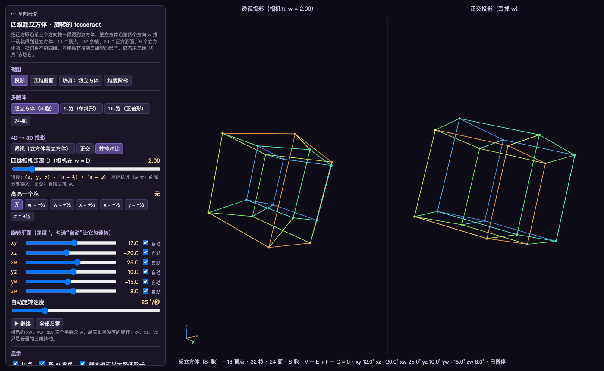

最后一步 3D → 2D 是普通的三维相机：拖动画面绕竖直轴转和俯仰，滚轮缩放。这一步只改变我们看三维影子的角度，不改变四维物体本身。边的颜色按旋转后的 w 坐标着色：蓝色 w 小（离四维相机远），橙色 w 大（近）。

### 4. 内外翻转：xw 旋转时发生了什么

预设“xw 旋转：内外翻转”只开 xw 一个平面。在透视投影里，你会看到里面的小立方体从一侧滑出来、慢慢变大，最后变成外面的大立方体；外面的大立方体同时从另一侧缩进去，变成里面的小立方体。整个东西像在不停地把自己从里往外翻。

下面这组图把 w = −½ 那个胞（开始时是里面的小立方体）高亮成白色，xw 从 0° 转到 180°：

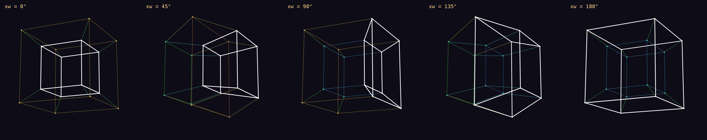

用上面的公式算一下这个胞的 8 个顶点。它们原来都有 w = −½，x = ±½。转过 θ 以后：

```
w′ = x sin θ − ½ cos θ
x′ = x cos θ + ½ sin θ
```

- θ = 0°：w′ = −½，离相机最远，投影最小，是内立方体；
- θ = 90°：w′ = x，一半顶点 w′ = +½、一半 w′ = −½；而 x′ = +½ 对所有顶点都成立，所以它正好占据原来 x = +½ 那个胞的位置，投影是右边的一个四棱台；
- θ = 180°：w′ = +½，离相机最近，投影最大，变成了外立方体。

实测这个胞在透视投影里的平均棱长（D = 2，外立方体棱长 = 1）：

| xw | 0° | 30° | 45° | 60° | 90° | 120° | 135° | 180° |
|---|---|---|---|---|---|---|---|---|
| 平均棱长 | 0.600 | 0.608 | 0.617 | 0.628 | 0.649 | 0.746 | 0.838 | 1.000 |

要点有两个：

1. **它在四维里根本没变形。** 旋转是刚体运动，32 条棱的长度一直是 1（实测六个平面同时转到各种角度，四维棱长的最小值和最大值都是 1.000）。变大变小、变成棱台，全是透视造成的：离四维相机近就显得大。
2. **它也没有“穿过”别的胞。** 小立方体看起来从大立方体的侧面钻出来，那只是影子重叠。在四维里它是沿着 w 方向绕过去的，这个方向三维的影子里看不见。

三维里有一模一样的现象。从正上方用透视看一个立方体，顶面近、显得大，底面远、显得小，画出来是“正方形套正方形”。让立方体在含视线方向的 xz 平面里转 180°，小正方形（底面）会从一侧滑出来，经过一个梯形（侧面），最后变成大正方形（顶面）。超立方体的 xw 旋转就是这件事高一个维度的版本：视线方向是 w，“正方形”换成了立方体。

只转 xy、xz、yz 时就不会翻转，因为这三种旋转不改变任何点的 w，内立方体永远在里面，整个图只是在三维里转。

### 5. 热身：用平面切立方体

想象一个只活在平面里的二维生物（Edwin Abbott 1884 年的小说《平面国》）。一个立方体从它的平面里穿过去时，它看不到立方体，只能看到立方体和平面的交线：一个随时间变化的多边形。

页面的“热身：切立方体”模式里，立方体被平面 z = c 切开，右下角的小窗是平面国居民看到的形状。右边的竖条标出 8 个顶点各自的 z 坐标，红线是当前的 c。立方体怎么摆，切出来的形状就不一样。三种对齐方式把一个面心 (0,0,1)、一条棱的中点 (0,1,1) 或一个顶点 (1,1,1) 的方向转到 z 轴上（顶点先：先在 yz 里转 45°，再在 xz 里转 arctan(1/√2) ≈ 35.26°）：

- **面先**：每一层都是正方形；
- **棱先**：长方形，一边始终是立方体的棱长 1.155，另一边从 0 长到正中间的面对角线 1.633（实测 z = 0.6 时 0.433，z = 0.3 时 1.033），再缩回去；
- **顶点先**：从一个点长成正三角形，过了第一组 3 个顶点后变成六边形，正中间是正六边形，再缩回三角形和一个点。

| 顶点先，z = 0.6：正三角形 | 顶点先，z = 0：正六边形 | 棱先，z = 0.3：长方形 |
|---|---|---|
| 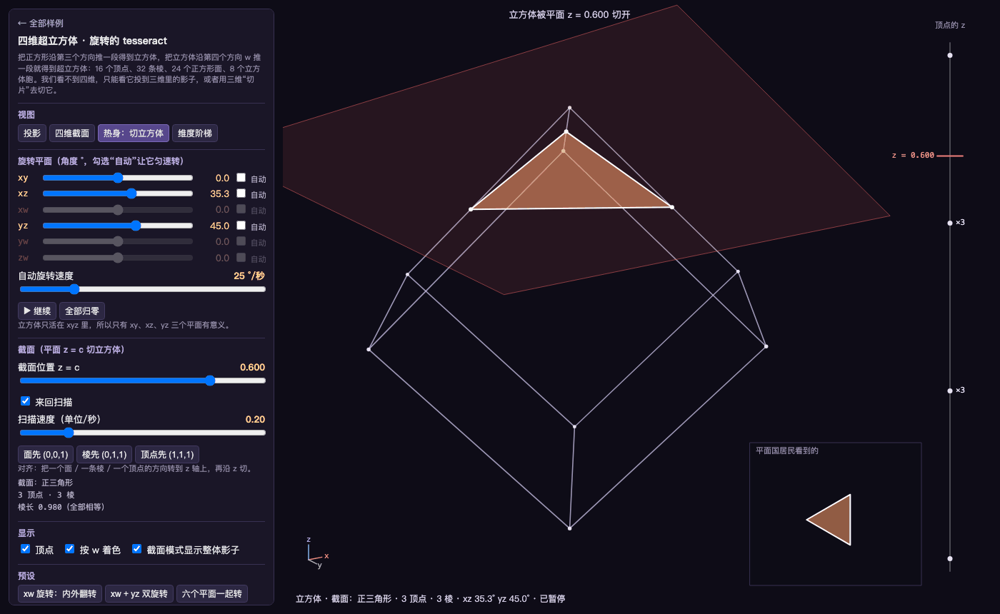 | 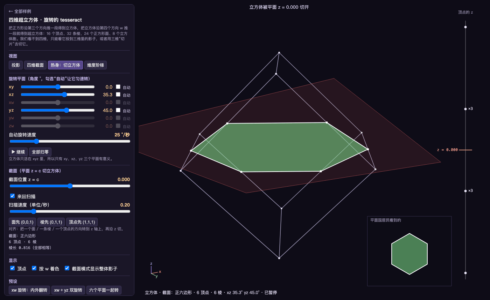 | 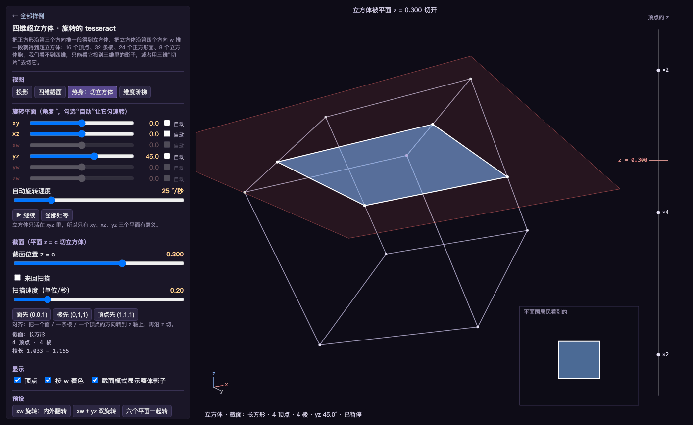 |

外接球半径为 1 时，立方体棱长是 2/√3 ≈ 1.155；实测正中间的正六边形边长为 0.816 = 1.155/√2，z = 0.6 处的正三角形边长为 0.980。顶点先的竖条上，8 个顶点的 z 分成 1、3、3、1 四组，这正是 (1 + 1)³ 的二项式系数。

### 6. 用超平面切超立方体

在四维里换成超平面 w = c 去切超立方体，切口是一个三维多面体。这就是三维生物（我们）看见一个超立方体穿过我们的空间时会看到的东西：一个形状不断变化的立体。

页面这样计算截面：

1. 对每条棱，如果两端点的 w 在 c 的两侧，按比例插值出交点。这些交点就是截面多面体的顶点。
2. 对这些点求三维凸包（逐个检查三点平面，其余点都在同一侧的就是一个面），得到截面的面和棱。

截面一定是凸的，因为凸体和超平面的交还是凸的。每个截面都满足 Euler 公式 V − E + F = 2，面板实时显示这个检验。

半透明灰线是整个超立方体的正交影子（丢掉 w），截面就嵌在里面，因为截面上的点 w 都等于 c，丢掉 w 不改变它们的位置。三角形面涂橙色，四边形蓝色，六边形绿色。

**顶点先**（把 (1,1,1,1) 转到 w 轴上：zw 45°、yw 35.26°、xw 30°）：16 个顶点的 w 分成 1、4、6、4、1 五组，正是 (1 + 1)⁴ 的系数，分别在 w = 1、½、0、−½、−1。截面依次是：

| w = 0.75：正四面体 | w = 0.25：截角四面体 | w = 0：正八面体 |
|---|---|---|
| 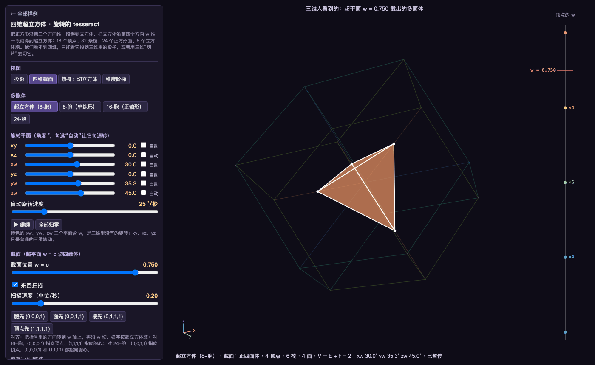 | 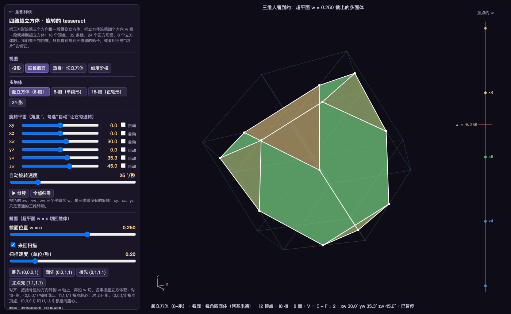 | 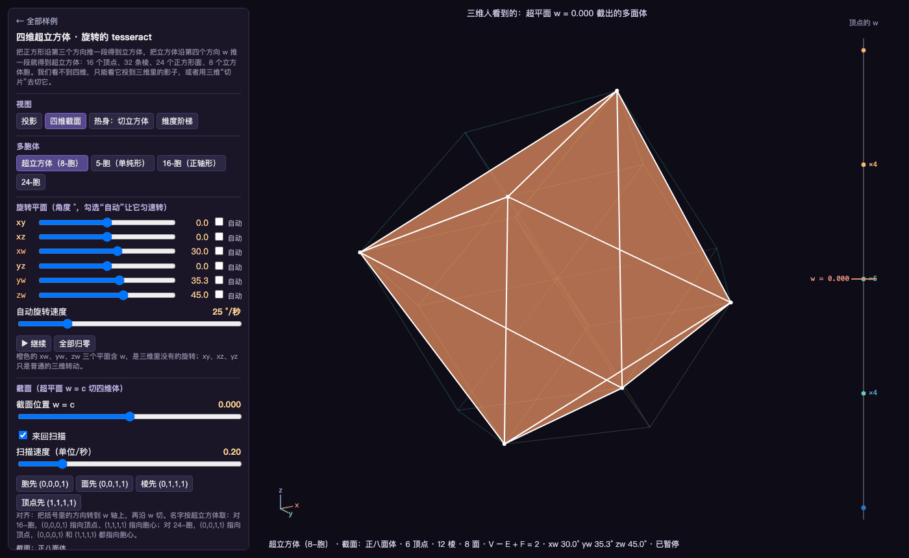 |

- ½ < c < 1：正四面体，从一个点长大，棱长 2√2 (1 − c)（实测 c = 0.75 时 0.707，c = 0.5 时 1.414）；
- 0 < c < ½：四面体的四个角被第二组 4 个顶点“削掉”，成为截角四面体。c = 0.25 时所有棱长都是 0.707，正好是阿基米德截角四面体，有 4 个三角形和 4 个六边形；
- c = 0：正中间是正八面体，6 个顶点、12 条棱、8 个三角形面，棱长 1.414。

这和切立方体时“三角形 → 六边形”完全对应：立方体的顶点先中截面是正六边形，超立方体的是正八面体。

**胞先**（不旋转）：每一层都是一个棱长为 1 的立方体，就像面先切立方体时每层都是正方形。**面先**每层都是长方体，**棱先**先是三棱柱，正中间是六棱柱：

| 胞先，w = 0.2：立方体 | 棱先，w = 0：六棱柱 |
|---|---|
| 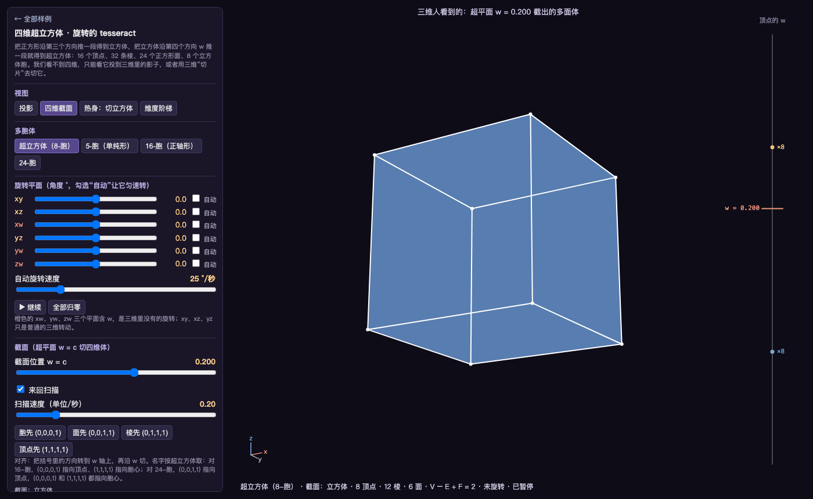 | 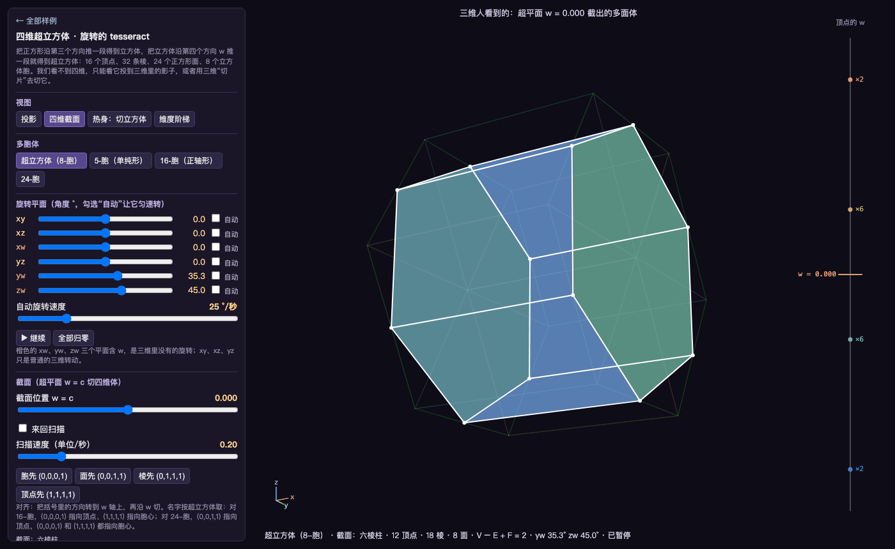 |

勾选“来回扫描”，c 会在 −1.02 和 1.02 之间匀速往返，看着多面体长出来、变形、再消失。也可以在切的同时开自动旋转，这相当于用一张倾斜着转动的超平面去切。

### 7. 维度阶梯：(2 + x)ⁿ

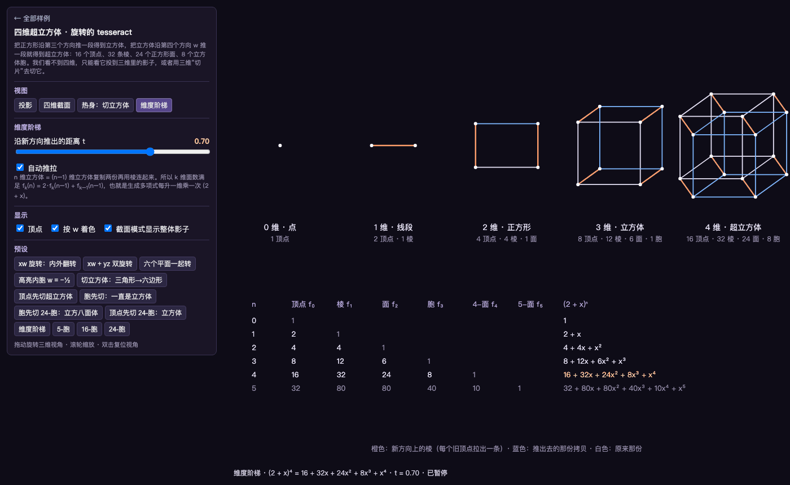

n 维立方体是把 (n−1) 维立方体复制一份，沿新方向推出去，再把每对对应顶点用一条棱连起来。拖动 t 滑条可以看这个“推出去”的过程：白色是原来那份，蓝色是推出去的拷贝，橙色是新方向上的棱。

数一数 k 维面（k = 0 顶点、1 棱、2 面、3 胞……）：新的 n 维立方体里，每个旧的 k 维面变成两份（原来的和拷贝），每个旧的 (k−1) 维面沿新方向扫出一个新的 k 维面。所以

```
f_k(n) = 2 · f_k(n−1) + f_{k−1}(n−1)
```

把 f₀ + f₁x + f₂x² + … 写成多项式，这个递推正好是“乘以 (2 + x)”：2 那一项是两份拷贝，x 那一项是扫出来升了一维的面。从 n = 0 的一个点（多项式 1）出发：

```
(2 + x)⁴ = 16 + 32x + 24x² + 8x³ + x⁴
```

16 个顶点、32 条棱、24 个面、8 个胞、1 个它自己。通项是 f_k(n) = C(n, k) · 2ⁿ⁻ᵏ：选 k 个“自由”的坐标方向，其余 n − k 个坐标各取 ±1。页面的表一直列到 n = 5（32 顶点、80 棱、80 面、40 胞、10 个 4 维面）。

Euler 公式也藏在这里：令 x = −1，(2 − 1)ⁿ = 1，就是 f₀ − f₁ + f₂ − … = 1（把最后一项 ±1 移过去，四维时就是 V − E + F − C = 0，面板也实时显示）。

### 8. 另外三个正四维多胞体

三维里有 5 种正多面体，四维里有 6 种正多胞体。页面画了其中 4 种（只画棱）：

| 5-胞（单纯形，四面体的推广） | 16-胞（正轴形，八面体的推广） | 24-胞（四维独有） |
|---|---|---|
| 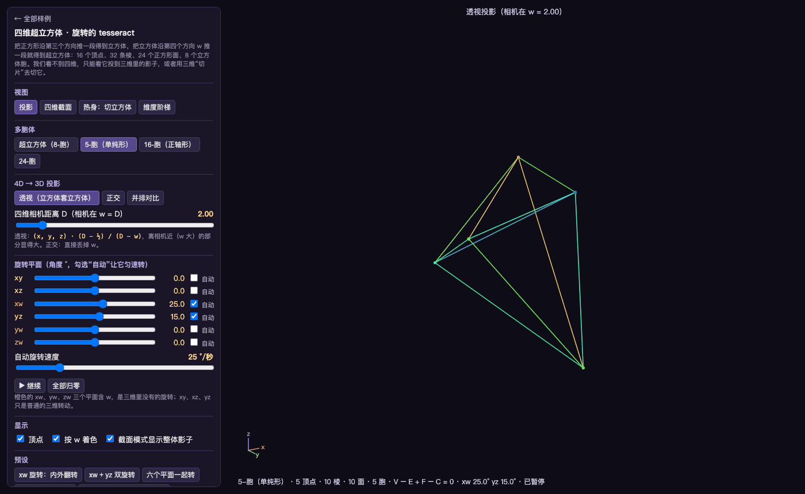 | 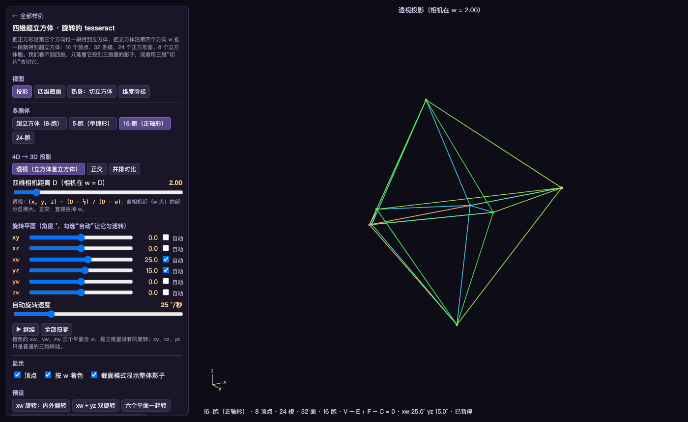 | 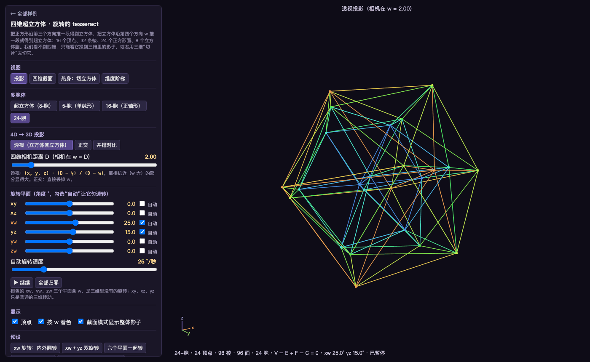 |

| 多胞体 | 顶点 | 棱 | 面 | 胞 | 胞的形状 | 坐标 |
|---|---|---|---|---|---|---|
| 5-胞 | 5 | 10 | 10 | 5 | 四面体 | 正四面体再加一个“四维顶点” |
| 超立方体 8-胞 | 16 | 32 | 24 | 8 | 立方体 | (±1, ±1, ±1, ±1) |
| 16-胞 | 8 | 24 | 32 | 16 | 四面体 | (±1, 0, 0, 0) 及其排列 |
| 24-胞 | 24 | 96 | 96 | 24 | 八面体 | (±1, ±1, 0, 0) 及其排列 |

每一行都满足 V − E + F − C = 0。16-胞和超立方体互为对偶（一个的顶点对应另一个的胞），就像八面体和立方体；24-胞和自己对偶，三维里没有和它对应的东西。剩下两种（120-胞和 600-胞）顶点数是 600 和 120，没有放进页面。

截面模式也能切这几种。对齐按钮的方向是按超立方体命名的，换到别的多胞体时含义会变：对 24-胞，(0,0,0,1) 指向一个八面体胞的中心，(0,0,1,1) 才指向顶点。

| 胞先切 24-胞，w = 0：立方八面体 | 顶点先切 24-胞，w = 0：菱形十二面体 |
|---|---|
| 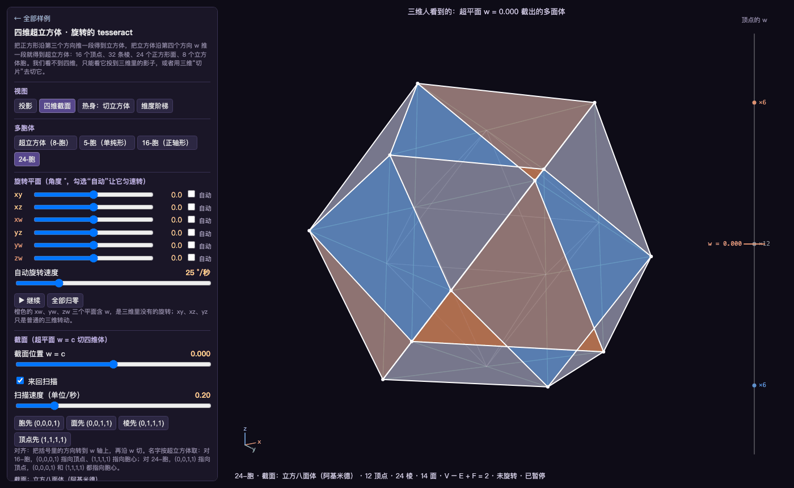 | 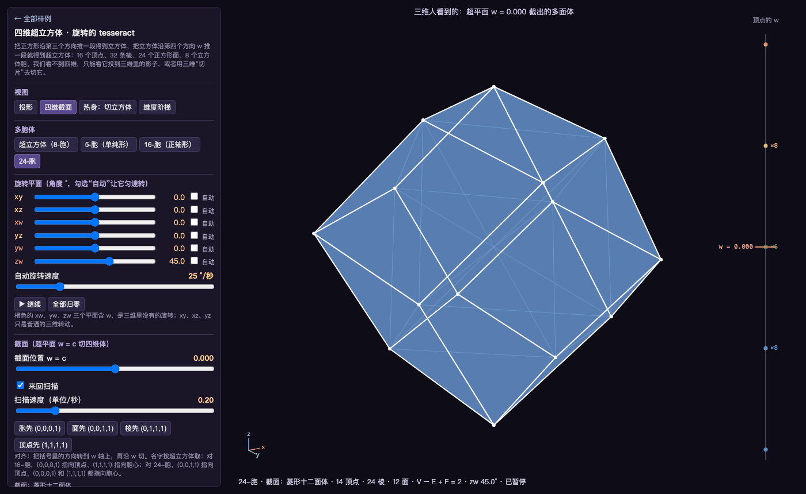 |

- **胞先切 24-胞**：开始是一个八面体胞，经过截角八面体，在 w = 0 处是阿基米德**立方八面体**：12 个顶点、24 条棱、8 个三角形加 6 个正方形，棱长 1（和 24-胞的棱一样长）。16-胞沿 (1,1,1,1) 胞先切时，正中间也是立方八面体（棱长 0.707）。超立方体的截面里没有立方八面体。
- **顶点先切 24-胞**：24-胞的顶点图是立方体，所以开头几层都是立方体（c = 0.5 时棱长 1.000），然后经过倒角立方体（32 个顶点，6 个正方形加 12 个六边形），在 w = 0 处是**菱形十二面体**：14 个顶点、24 条棱、12 个菱形面。

## 操作

- 视图：投影 / 四维截面 / 热身：切立方体 / 维度阶梯；
- 多胞体：超立方体、5-胞、16-胞、24-胞；
- 投影：透视、正交、并排对比；四维相机距离 D（1.2–8）；高亮超立方体的一个胞；
- 六个旋转平面各一个角度滑条（−180°–180°）和“自动”开关；自动旋转速度（0–120°/秒）；暂停 / 继续，全部归零；
- 截面：截面位置 c（−1.05–1.05），来回扫描及其速度，四种对齐方向（切立方体时三种）；面板列出截面的名字、顶点 / 棱 / 面数、Euler 检验、棱长范围和各种面的个数；
- 维度阶梯：推出距离 t（0–1），自动推拉；
- 显示：顶点、按 w 着色、截面模式里显示整体影子；
- 预设：xw 内外翻转、xw + yz 双旋转、六个平面一起转、高亮内胞、切立方体、顶点先切超立方体、胞先切、胞先 / 顶点先切 24-胞、维度阶梯、5-胞、16-胞、24-胞；
- 拖动旋转三维视角，滚轮缩放，双击复位视角。

## 网址参数

| 键 | 含义 |
|---|---|
| p | 预设名：spin, double, six, inner, cube, vslice, cslice, c24, v24, ladder, p5, p16, p24 |
| m | 视图：proj, slice, cube, ladder |
| poly | 多胞体：t8, c5, c16, c24 |
| pj | 投影：persp, ortho, both |
| cell | 高亮的胞：none, wn, wp, xp, xn, yp, zp |
| xy, xz, xw, yz, yw, zw | 六个平面的角度（度，−180–180） |
| au | 自动旋转的平面，逗号分隔，如 `xw,yz` |
| sp | 自动旋转速度（°/秒，0–120） |
| D | 四维相机距离（1.2–8） |
| al | 截面对齐：cell, face, edge, vert（切立方体时 face, edge, vert） |
| c | 截面位置（−1.05–1.05） |
| sw | 1 = 来回扫描 |
| ss | 扫描速度（0.02–1） |
| t | 维度阶梯的推出距离（0–1） |
| anim | 1 = 维度阶梯自动推拉 |
| yaw, pitch, z | 三维视角和缩放 |
| vtx, wc, sh | 0 = 关闭顶点 / 按 w 着色 / 整体影子 |
| run | 0 = 打开时暂停 |
| ui | 0 = 隐藏面板 |

每个数值参数都必须是有限数，并被限制在滑条范围内；字符串参数只接受上表列出的值。例如顶点先切到正中间：`index.html?p=vslice&c=0&sw=0`；24-胞并排投影：`index.html?m=proj&poly=c24&pj=both&au=xw,yz`。

## 参考

- E. A. Abbott, *Flatland: A Romance of Many Dimensions*, 1884.
- H. S. M. Coxeter, *Regular Polytopes*, 3rd ed., Dover, 1973. 正多胞体的坐标、f-向量和截面。
- T. F. Banchoff, *Beyond the Third Dimension*, Scientific American Library, 1990. 超立方体的投影、切片和内外翻转。
- [Tesseract](https://en.wikipedia.org/wiki/Tesseract)、[24-cell](https://en.wikipedia.org/wiki/24-cell)（Wikipedia）。
