# 三体问题 · 8 字形轨道

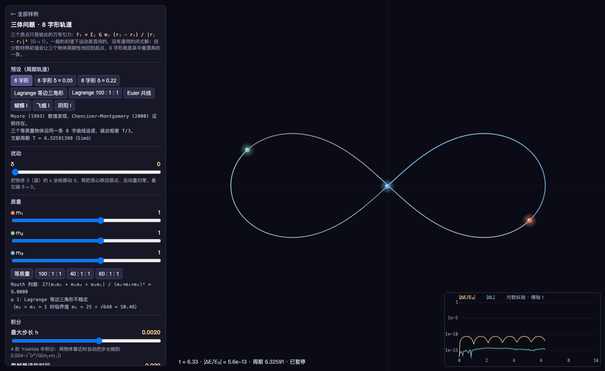

三个质点只受彼此的万有引力，这就是三体问题。两个物体的情形 Newton 已经完全解出：轨道是圆锥曲线。三个物体就没有这样的公式了，一般的初值下运动是混沌的。不过有少数特殊初值会让三个物体周期性地回到起点，上面这条 8 字形是其中最漂亮的一条：三个等质量的物体沿同一条曲线追逐，彼此相差三分之一个周期。它直到 1993 年才被发现。

页面用 4 阶辛积分器实时计算，同时显示能量和角动量的误差，并自动测量物体回到初态的时间（周期）。可以给 8 字形和 Lagrange 等边三角形加一个扰动，看它们是保持住，还是解体、甩出一个物体。也可以直接拖动物体、拖动速度箭头，自己摆初值。

打开方式：用浏览器直接打开 [index.html](index.html)。页面只用 Canvas 2D，不依赖外部库，离线也能用。

## 数学原理

### 1. 运动方程与守恒量

取引力常数 G = 1。物体 i 的质量是 mᵢ，位置是 rᵢ（平面上的向量），Newton 方程是

```
r̈ᵢ = Σ_{j≠i} mⱼ (rⱼ − rᵢ) / |rⱼ − rᵢ|³ ,   i = 1, 2, 3
```

平面上三个物体，每个有 2 个位置坐标和 2 个速度分量，相空间是 12 维的。有几个量在运动中保持不变：

| 守恒量 | 公式 | 来源（Noether 定理） |
|---|---|---|
| 总动量 P | Σ mᵢ vᵢ | 平移对称：引力只依赖相对位置 |
| 质心 | Σ mᵢ rᵢ − P·t | 同上（Galilei 变换） |
| 角动量 L | Σ mᵢ (xᵢ vᵧᵢ − yᵢ vₓᵢ) | 旋转对称 |
| 能量 E | Σ ½ mᵢ \|vᵢ\|² − Σ_{i<j} mᵢ mⱼ / rᵢⱼ | 时间平移对称 |

所有预设都先把质心移到原点、把总动量减成 0，所以 P 和质心不再提供信息。剩下 E 和 L 两个守恒量，面板的“守恒量”一栏实时显示它们的值和相对 t = 0 的误差。8 字形的 E = −1.28714199，L = 0（三个物体的角动量正好抵消）。

### 2. 为什么没有通用的闭式解

两体问题能解，是因为守恒量够用：减掉质心运动后只剩一个相对坐标 r，平面上 4 维相空间，E 和 L 两个守恒量把运动限制在一条曲线（二维环面上的轨道）上，积分一次就得到 Kepler 椭圆。

三体问题减掉质心之后还有 8 维，能用的守恒量还是只有 E 和 L（再利用旋转对称还可以消去一个角度，降到 6 维）。要像两体那样“积出来”，需要更多的守恒量。

- **Bruns（1887）**证明：除了上面这些经典守恒量，三体问题没有别的、关于位置和速度的**代数**守恒量。
- **Poincaré（1890）**在获得瑞典国王奖的论文里把结论推广到**解析**守恒量（针对限制性三体问题）。更重要的是，他在修正论文错误的过程中发现了同宿缠结：某些轨道附近的稳定流形和不稳定流形无穷多次地相交，轨道对初值极度敏感。这是人类第一次看到混沌。
- **Sundman（1912）**其实给出过一个对所有时间都收敛的级数解（展开变量是 t 的某个函数，并先对二体碰撞做正则化），但它要求总角动量不为 0（以排除三个物体同时相撞），而且收敛得极慢，实际计算需要天文数字般的项数，没有用处。

所以“没有闭式解”的确切意思是：没有足够的守恒量把运动化成求积分，一般的轨道只能数值计算。下面这张图就是一般情形的样子（8 字形加了 δ = 0.224 的扰动）：绕了几圈后三个物体乱成一团，t ≈ 32.07 时物体 1 被甩出画面（右上角的箭头指着它），另外两个结成双星。

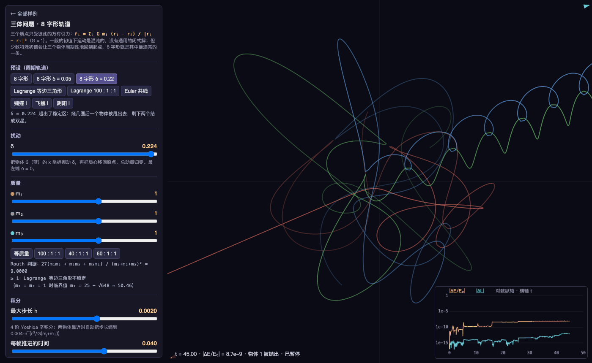

### 3. 数值积分：4 阶 Yoshida 辛积分器

页面用 Yoshida（1990）的 4 阶辛积分器。它的基础是“漂移–踢”交替的 leapfrog：先按速度把位置推进一小段，再按引力把速度推进一小段。Yoshida 把三个步长分别是 w₁h、w₀h、w₁h 的 leapfrog 拼起来，

```
w₁ = 1 / (2 − 2^(1/3)) ≈ 1.3512,   w₀ = −2^(1/3) / (2 − 2^(1/3)) ≈ −1.7024
```

中间那步是**倒着走**的，正好抵消前后两步的 3 阶误差，于是整体是 4 阶精度。

辛积分器每一步都是一个保持相空间体积（更准确地说，保持辛结构）的变换。这样带来两个可以在页面上看到的结果：

- **角动量精确守恒**（到舍入误差）。漂移一步 x → x + c·h·v，x × v 不变；踢一步 v → v + d·h·a，因为两两之间的引力沿连线，Σ mᵢ rᵢ × aᵢ = 0。所以每个子步都不改变 L。8 字形跑到 t = 100，|ΔL| = 5.7 × 10⁻¹⁵。
- **能量误差不累积**。辛积分器精确守恒的是一个和 E 只差 O(h⁴) 的“影子能量”，所以 E 的误差上下振荡而不是一直漂移。下面右下角的守恒误差图里，黄线 |ΔE/E₀| 一直在 10⁻¹¹ 附近起伏，青线 |ΔL| 贴在 10⁻¹⁵。

误差和步长的关系可以直接量。8 字形跑到 t = 100，取整段运行中 |ΔE/E₀| 的最大值：

| 最大步长 h | max \|ΔE/E₀\| | 和上一行之比 |
|---|---|---|
| 0.0005 | 1.4 × 10⁻¹³ | |
| 0.001 | 2.0 × 10⁻¹² | 13.9 |
| 0.002（默认） | 3.2 × 10⁻¹¹ | 16.0 |

步长翻倍误差约乘 16 = 2⁴，正是 4 阶方法。

**近距离交会**。两个物体靠得很近时引力和加速度都很大，固定步长会出错。页面每一步先算 h = min(h_max, 0.004·√(r³/(mᵢ+mⱼ)))，r 是最近两个物体的距离。√(r³/(mᵢ+mⱼ)) 就是这两个物体自由下落的时间尺度，所以步长随距离自动缩小。8 字形里最近距离是 0.69，这条限制给出的步长约 0.0016，比默认的 0.002 还小，所以表里 h 再加大到 0.004、0.008 也不变。这样按状态改步长在严格意义上不再是辛的，但在实际中很好用：δ = 0.224 那次交会到 1.8 × 10⁻⁴，跑到 t = 500 后 |ΔE/E₀| 仍只有 3.2 × 10⁻⁸。最坏的一次（δ = 0.158）在甩出一个物体后形成很扁的双星，反复交会到 3.3 × 10⁻⁵，|ΔE/E₀| 累积到 1.4 × 10⁻³。两个物体距离小于 10⁻⁶ 时，页面按碰撞处理并停止积分；每帧的积分步数也有上限（2 万步，快进时 40 万步），紧密双星会让模拟时间推进变慢，状态栏会提示。

### 4. 测量周期：回到初态

页面每一步都计算当前状态到初态的距离

```
d²(t) = Σᵢ |rᵢ(t) − rᵢ(0)|² + |vᵢ(t) − vᵢ(0)|²
```

当 d² 出现一个低于阈值（初态范数的 3%）的局部最小值时，就是一次“回到初态”。用最小值附近的三个采样点拟合一条抛物线，顶点就是回归时间，精度远高于一个步长。8 字形测得

```
T = 6.325914（页面，h = 0.002）
T = 6.32591398（Simó 的文献值）
```

同一组初值交给 SciPy 的 DOP853（相对误差 10⁻¹³）积分，最近回归在 t = 6.325914032，距离 4.7 × 10⁻⁸。三者在前 7 位一致。Lagrange 和 Euler 预设的周期也可以用公式核对：Lagrange 测得 8.269137，公式 2π√(L³/M) = 8.269137；Euler 测得 5.619852，公式 2π/√(5/4) = 5.619852（见第 6、8 节）。

### 5. 8 字形

**发现**。Cris Moore 1993 年在用计算机搜索“编织”类的周期轨道时数值发现了这条 8 字形。2000 年 Alain Chenciner 和 Richard Montgomery 给出了存在性证明。他们用的是变分法：在满足一定对称性的闭合路径中找作用量 ∫(动能 − 势能) dt 最小的那条。难点是证明最小值不会落在碰撞路径上（碰撞时势能发散，但作用量有限，所以不能自动排除），他们通过比较作用量的下界排除了碰撞。Carles Simó 算出了精确的初值，并把这种“所有物体沿同一条曲线追逐”的解命名为**舞蹈解**（choreography）。

**初值**。t = 0 时三个物体恰好共线，物体 3 在中间：

```
r₁ = −r₂ = (0.97000436, −0.24308753),  r₃ = (0, 0)
v₃ = (−0.93240737, −0.86473146),  v₁ = v₂ = −v₃ / 2
```

勾选“速度箭头”可以看到这个初态：中间的物体以最快的速度穿过原点，两边的两个物体以一半的速度朝同一个方向运动。

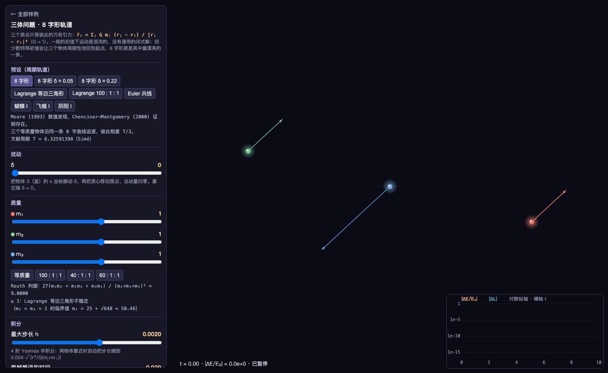

把尾迹长度设成 T/3 ≈ 2.1，每个物体只画出自己最近三分之一个周期走过的路，三段颜色正好拼成一整条 8 字。这是舞蹈解的含义：r₂(t) = r₁(t + T/3)，r₃(t) = r₁(t + 2T/3)。

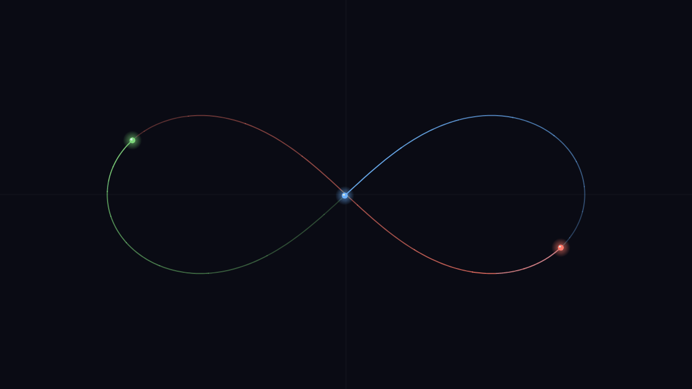

**稳定性**。Simó 发现 8 字形是线性稳定的（它的单值矩阵的特征值都在单位圆上），这在三体周期解里很少见。页面的“扰动”滑条把物体 3 的 x 坐标挪动 δ，再把质心移回原点、总动量归零，然后看会发生什么。在 t = 500（约 79 个周期）以内测得：

| δ | 结果 | 最近距离 |
|---|---|---|
| 0.050 | 保持 | 0.47 |
| 0.063 | 保持 | 0.42 |
| 0.079 | 保持 | 0.35 |
| 0.100 | 保持 | 0.28 |
| 0.126 | 没有甩出，但出现近距离交会 | 1.1 × 10⁻³ |
| 0.141 | 没有甩出，但出现近距离交会 | 2.7 × 10⁻⁶ |
| 0.158 | t ≈ 46.3 物体 3 被甩出 | 3.3 × 10⁻⁵ |
| 0.200 | t ≈ 97.5 物体 1 被甩出 | 4.2 × 10⁻⁴ |
| 0.224 | t ≈ 32.1 物体 1 被甩出 | 1.8 × 10⁻⁴ |
| 0.282 | t ≈ 11.4 物体 2 被甩出 | 4.3 × 10⁻⁴ |

δ ≤ 0.1 时 8 字形一直保持；δ 超过约 0.12 之后会出现近距离交会，大多数最后甩出一个物体。甩出的时间随 δ 并不单调，这正是混沌的表现。

小扰动下的 8 字形也不是原样不动。δ = 0.05 时总角动量从 0 变成 L = −0.0433，8 字整体开始慢慢旋转，跑到 t = 120 画出一朵花，但形状一直是 8 字，三个物体始终缠在一起：

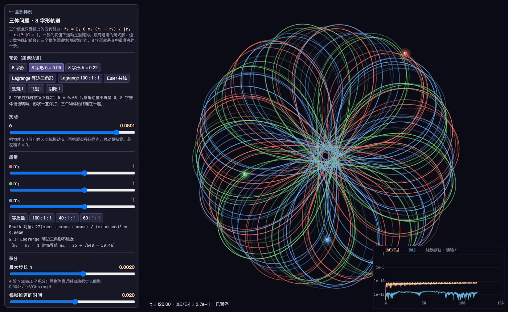

页面判断“甩出”的条件是：从另外两个物体的质心看，这个物体离得远（超过 3 个长度单位，也超过那两个物体间距的 3 倍），正在远离，而且它相对那一对的二体能量为正（双曲轨道，回不来）。这是一个近似判据。

### 6. Lagrange 等边三角形解与 Routh 判据

Lagrange（1772）发现：把**任意**三个质量放在等边三角形的三个顶点上，给每个物体一个绕质心的速度，整个三角形就会像刚体一样匀速旋转。

**为什么是等边三角形**。设边长为 L，物体 i 到质心的向量是 ρᵢ。物体 1 受的引力是

```
a₁ = m₂ (r₂ − r₁)/L³ + m₃ (r₃ − r₁)/L³
   = [m₂ r₂ + m₃ r₃ − (m₂ + m₃) r₁] / L³
   = [M·r_c − M·r₁] / L³ = −(M / L³) ρ₁
```

第二行到第三行用了 m₁r₁ + m₂r₂ + m₃r₃ = M·r_c。三条边一样长，三个分母才能提出同一个 L³，合力才恰好指向质心、大小和到质心的距离成正比。所以三个物体都在做同一个角速度的圆周运动，ω² = M / L³（G = 1）。页面取 L = √3，等质量时 ω = 0.7598，周期 2π/ω = 8.269137，和测量值一致。

**稳定性**。在随三角形旋转的参考系里把方程线性化，小扰动按 e^{λt} 变化，λ 满足

```
λ⁴ + ω² λ² + (27/4) β ω⁴ = 0,   β = (m₁m₂ + m₂m₃ + m₃m₁) / M²
λ² = (ω²/2) · (−1 ± √(1 − 27β))
```

1 − 27β > 0 时 λ² 是两个负实数，λ 是纯虚数，扰动只会振荡：稳定。1 − 27β < 0 时 λ² 是复数，总有一个 λ 实部为正，扰动指数增长：不稳定。稳定条件就是 **Routh 判据**（Gascheau 1843，Routh 1875）：

```
27 (m₁m₂ + m₂m₃ + m₃m₁) < (m₁ + m₂ + m₃)²
```

面板“质量”一栏实时显示 27β。等质量时 27β = 9，远远不满足。

**等质量：不稳定，可以量出增长率**。β = 1/3 时 λ² = (ω²/2)(−1 ± i√8)。√(−1 + i√8) 的模是 √3、辐角是 54.74°，实部正好是 1，所以增长率 Re λ = ω/√2 = 0.537。在页面上量三角形“三条边中最长与最短之比”超过 1.1 的时刻：

| 扰动 δ | 三角形明显变形的时刻 |
|---|---|
| 10⁻³ | t = 10.8 |
| 10⁻⁶ | t = 23.7 |
| 0（只有舞蹈的舍入误差） | t = 60.5 |

扰动缩小 1000 倍，多撑了 12.9 个时间单位，增长率 ln(1000)/12.9 = 0.535，和理论值 0.537 一致。不加任何扰动，双精度的舍入误差（约 10⁻¹⁵）也会被这样放大，大约 7 圈之后三角形就散了：

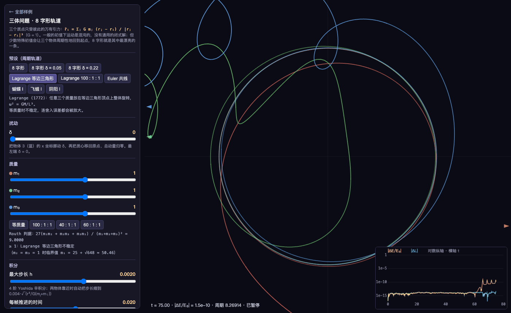

**一个质量占优势：稳定**。m₁ = M，m₂ = m₃ = 1 时 Routh 判据化成 M² − 50M − 23 > 0，即 M > 25 + √648 ≈ 50.46。勾选“随物体 1→2 连线旋转的参考系”后，Lagrange 解在画面上静止不动，偏离一眼就能看出来。100 : 1 : 1（27β = 0.52）加上 δ = 0.05 的扰动，蓝色物体只在原来的顶点附近画一个细长的“蝌蚪”，跑到 t = 300 三角形边长之比仍只有 1.105：

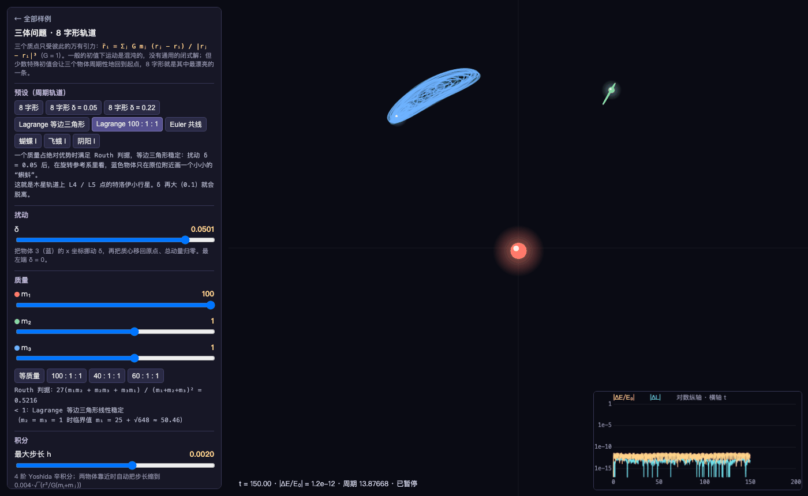

在临界值 50.46 两侧各取一个质量，都加 δ = 0.01，同样用旋转参考系：

| 40 : 1 : 1（27β = 1.24，不稳定），t = 60 | 60 : 1 : 1（27β = 0.85，稳定），t = 150 |
|---|---|
| 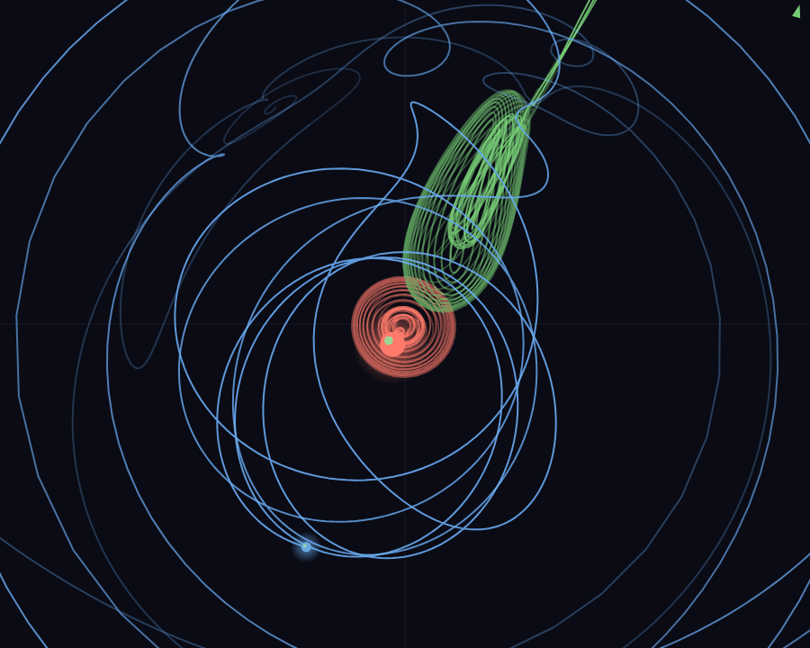 | 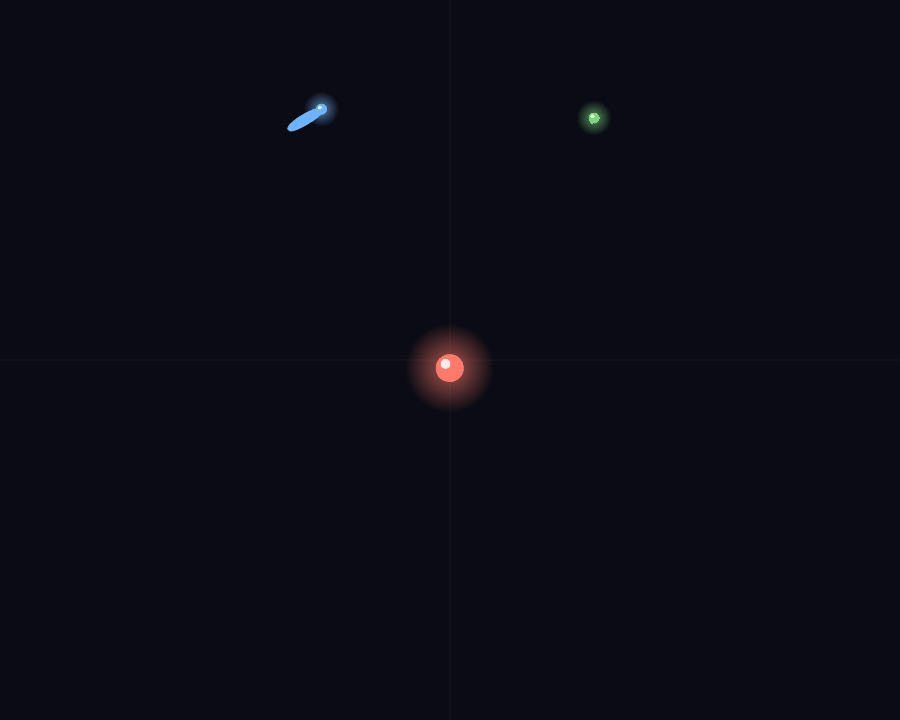 |

40 : 1 : 1 在 t ≈ 157 甩出物体 3，45 : 1 : 1（δ = 0.001）到 t = 300 边长之比已经是 30.9；55 : 1 : 1（δ = 0.001）和 60 : 1 : 1（δ = 0.01）跑到 t = 500 边长之比分别只有 1.004 和 1.012。线性稳定也只管小扰动：100 : 1 : 1 把 δ 加大到 0.1，到 t = 300 边长之比是 13.3，三角形散了。

### 7. 限制性三体问题与 Lagrange 点

如果第三个物体的质量小到可以忽略（小行星、探测器），它不影响两个大天体的圆轨道，问题就变成“两个大天体做圆周运动，小物体在它们的引力场里怎么动”。这叫**圆型限制性三体问题**，Euler 和 Lagrange 都研究过。在随两个大天体旋转的参考系里，小物体有 5 个平衡点：

- **L1、L2、L3** 在两个大天体的连线上，对应上面的 Euler 共线解。它们总是不稳定的。韦布空间望远镜就在日–地 L2 附近，需要定期点火修正轨道；
- **L4、L5** 和两个大天体组成等边三角形，对应 Lagrange 解。第三个质量趋于 0 时 Routh 判据化成 27 m₁m₂ < (m₁ + m₂)²，大致是 m₁/m₂ > 24.96。太阳和木星的质量比约 1047，远远满足，所以木星轨道前后 60° 处聚集着大群**特洛伊小行星**（第一颗是 1906 年 Max Wolf 发现的 588 Achilles）。它们正像上面 100 : 1 : 1 的图：在 L4、L5 附近沿着蝌蚪形的轨迹慢慢摆动。

Poincaré 研究混沌时用的也正是限制性三体问题：维度更低，但该有的复杂性一点不少。

### 8. Euler 共线解

Euler（1767）比 Lagrange 更早找到了另一类解：三个物体排成一条直线整体旋转。中间物体的位置由一个五次方程决定（Euler 五次方程），页面用二分法求：固定两端在 0 和 1，调中间的位置，直到每个物体的加速度都等于 −ω² 乘以它到质心的距离。等质量时中间物体就在正中，外侧物体受力 1/a² + 1/(2a)² = 5/(4a²)，所以 ω² = 5/(4a³)。页面取 a = 1，周期 2π/√1.25 = 5.619852。

共线解对任何质量都不稳定。不加扰动时它能保持很久（t = 500 仍然共线；推测是对称的初值让舍入误差也保持对称），但只要 δ = 10⁻⁶，t = 7.0 时中间物体偏离连线的距离就超过外侧间距的 10%；δ = 10⁻³ 时是 t = 3.5。增长率 ln(1000)/3.5 ≈ 1.95，比等质量 Lagrange 解快得多。

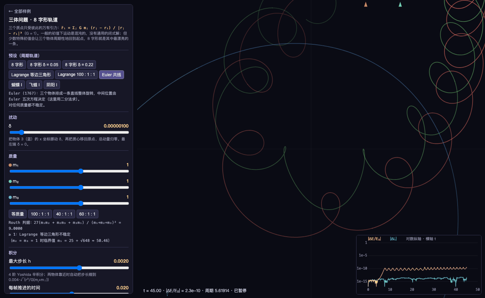

### 9. Šuvakov–Dmitrašinović 的新周期轨道

8 字形之后很长时间，等质量、零角动量的周期轨道只知道少数几族。2013 年 Milovan Šuvakov 和 Veljko Dmitrašinović 在“形状球面”（三角形形状的空间）上做数值搜索，一次找到 13 族新轨道，起了蝴蝶、飞蛾、蜜蜂、蜻蜓、阴阳等名字。他们的初值都是同一种形式：

```
r₁ = (−1, 0),  r₂ = (1, 0),  r₃ = (0, 0)
v₁ = v₂ = (p₁, p₂),  v₃ = −2 (p₁, p₂)
```

只有两个参数 p₁、p₂。页面收录了其中三条：

| 蝴蝶 I | 飞蛾 I | 阴阳 I |
|---|---|---|
| 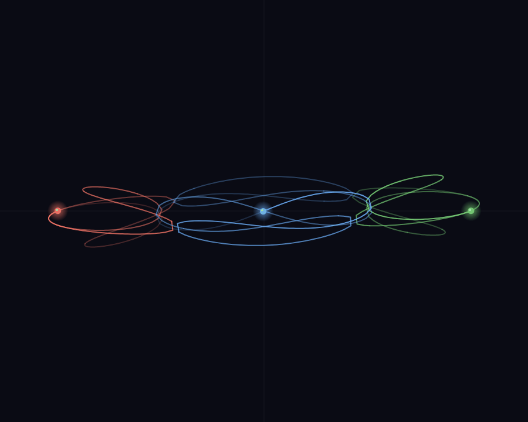 | 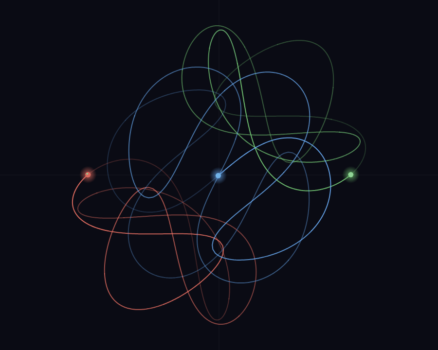 | 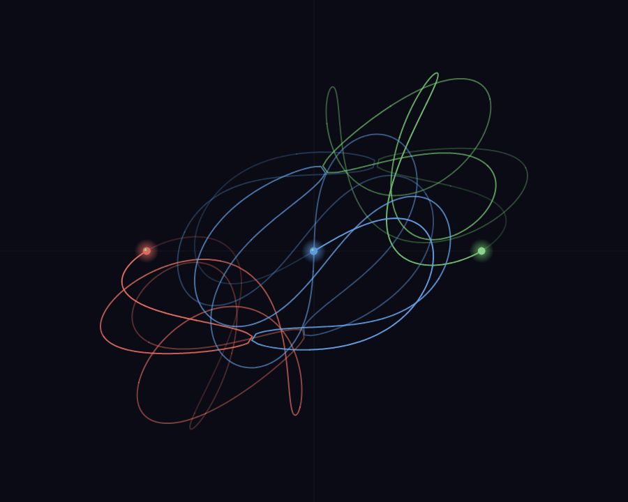 |

| 预设 | 编号 | p₁ | p₂ | 文献表中的 T | 页面测得的回归时间 |
|---|---|---|---|---|---|
| 蝴蝶 I | I.A.1 | 0.306892758965492 | 0.125506782829762 | 6.23564136316479 | 6.234670 |
| 飞蛾 I | I.B.1 | 0.464445237398184 | 0.396059973403921 | 14.8939113169584 | 14.894306 |
| 阴阳 I | II.C.2a | 0.513938054919243 | 0.304736003875733 | 17.3284227296828 | 17.328810 |

测到的回归时间和表中的 T 差约 10⁻³。为了确认不是页面积分器的问题，同样的初值又用 SciPy DOP853（相对误差 10⁻¹³）算了一遍：最近回归分别在 6.234670、14.894306、17.328810，到初态的距离是 5.0 × 10⁻⁷、1.5 × 10⁻⁶、1.4 × 10⁻⁶；而在表中的 T 时刻，距离是 1.9 × 10⁻³、9.2 × 10⁻⁴、8.9 × 10⁻⁴。也就是说，初值确实给出闭合得很好的周期轨道，只是周期比表中的数值短约 10⁻³（蝴蝶 I）或长约 4 × 10⁻⁴（另外两条）。页面信息栏同时列出表中的 T 和实测值，两者都能对照。

这三条的稳定性不一样。让它们跑到 t = 200，看每次回到初态时的距离（“守恒量”一栏）：蝴蝶 I 从第 3 个周期起是 4.2 × 10⁻⁶、5.8 × 10⁻⁶、1.6 × 10⁻⁵、3.3 × 10⁻⁵、6.1 × 10⁻⁵、1.1 × 10⁻⁴，阴阳 I 从第 4 个周期起是 2.6 × 10⁻⁵、5.3 × 10⁻⁵、1.1 × 10⁻⁴、2.0 × 10⁻⁴、3.9 × 10⁻⁴，每个周期大约翻一倍，是不稳定的；飞蛾 I 跑了 8 个周期（t = 119.15），回归距离仍小于 10⁻⁴。

## 操作

- 预设：8 字形，8 字形加 δ = 0.05（保持）和 δ = 0.224（解体），Lagrange 等边三角形（等质量），Lagrange 100 : 1 : 1（旋转参考系），Euler 共线，蝴蝶 I，飞蛾 I，阴阳 I；
- 扰动 δ：对数滑条，最左端是 0；把物体 3 的 x 坐标挪动 δ，再把质心移回原点、总动量归零；
- 质量：三个对数滑条（0.001–100），以及“等质量”“100 : 1 : 1”“40 : 1 : 1”“60 : 1 : 1”四个按钮；下方实时显示 Routh 判据的值。Lagrange 和 Euler 预设会按新的质量重新计算初值，其他预设沿用原来的位置和速度；
- 积分：最大步长 h，每帧推进的模拟时间，尾迹长度；暂停 / 继续、重新开始、质心归零；
- 显示：速度箭头、守恒误差图（|ΔE/E₀| 和 |ΔL| 的对数）、随物体 1→2 连线旋转的参考系；
- 守恒量：E、L、P 及其误差，步数、当前步长、出现过的最近距离、回到初态的时刻与距离，甩出事件；
- 自由摆放：拖动物体改位置（会自动暂停，进入“自定义”）；暂停时拖动箭头尖改速度；按“继续”开始，“重新开始”回到最后一次编辑后的状态。如果总动量不是 0，整个系统会漂走，点“质心归零”把它减掉。拖空白处平移，滚轮以鼠标位置为中心缩放，双击复位视角。旋转参考系下不能拖动物体。

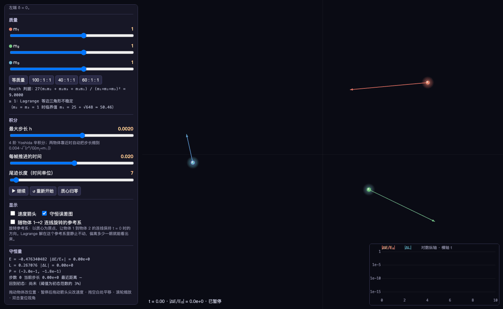

## 网址参数

| 键 | 含义 |
|---|---|
| p | 预设：fig8, fig8b, fig8x, lag, lagH, euler, butterfly, moth, yinyang |
| d | 扰动 δ 的常用对数（−6.5 到 −0.5，−6.45 以下表示 δ = 0） |
| m1, m2, m3 | 三个质量（0.001–100） |
| h | 最大步长（0.0002–0.01） |
| v | 每帧推进的模拟时间（0.001–0.32） |
| tl | 尾迹长度（1–200 个时间单位） |
| t | 打开时先快进到这个时刻（最多 500） |
| z | 缩放倍数 |
| rot | 1 = 旋转参考系，0 = 惯性系 |
| arr | 1 = 显示速度箭头 |
| plot | 0 = 隐藏守恒误差图 |
| run | 0 = 打开时暂停 |
| ui | 0 = 隐藏面板，只留画布 |

所有数值参数都先检查是不是有限数，再限制在滑条范围内；预设名只认上表里的几个。例如 Routh 临界值两侧：`index.html?p=lag&m1=40&d=-2&rot=1&tl=60` 和 `index.html?p=lag&m1=60&d=-2&rot=1&tl=60`；跑完 8 字形一个周期并只显示三分之一周期的尾迹：`index.html?p=fig8&t=6.33&tl=2.2&run=0`。

## 参考

- C. Moore, *Braids in classical dynamics*, Physical Review Letters 70, 3675 (1993).
- A. Chenciner, R. Montgomery, *A remarkable periodic solution of the three-body problem in the case of equal masses*, Annals of Mathematics 152, 881–901 (2000).
- C. Simó, *New families of solutions in N-body problems*, European Congress of Mathematics (2001)。舞蹈解的命名与数值研究。8 字形的初值（Simó 计算）和周期 6.32591398 见 Chenciner–Montgomery 一文及此文。
- M. Šuvakov, V. Dmitrašinović, *Three classes of Newtonian three-body planar periodic orbits*, Physical Review Letters 110, 114301 (2013)。蝴蝶、飞蛾、阴阳的初值取自该文表 I。
- H. Yoshida, *Construction of higher order symplectic integrators*, Physics Letters A 150, 262–268 (1990).
- E. J. Routh, *On Laplace's three particles, with a supplement on the stability of steady motion*, Proceedings of the London Mathematical Society 6, 86–97 (1875).
- H. Poincaré, *Sur le problème des trois corps et les équations de la dynamique*, Acta Mathematica 13, 1–270 (1890).
- J. Barrow-Green, *Poincaré and the Three Body Problem*, AMS (1997)。Poincaré 获奖论文与错误修正的经过。
- C. D. Murray, S. F. Dermott, *Solar System Dynamics*, Cambridge University Press (1999)。限制性三体问题、Lagrange 点与特洛伊小行星。
