# 圆上的乘法表 · 心形线

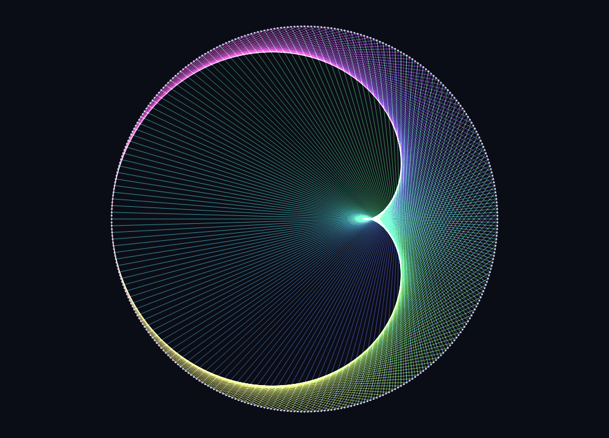

在圆上等距放 N 个点，编号 0, 1, …, N−1。从每个点 i 连一条弦到点 2i（超过 N 就减去 N，也就是 2i mod N）。上面这张图是 N = 360 时画出的 360 条直线，一条曲线也没有画，可是这些直线中间围出了一条清清楚楚的曲线：**心形线**。把 2 换成 3，得到的是肾形线；换成 k，得到的是有 k − 1 个尖点的**外摆线**。

这个页面让乘数 k 连续变化，图形就跟着连续变形。同一张图还藏着另外三样东西：k 为整数时，i → k·i mod N 的**环结构**（初等数论里的乘法阶）；心形线正好是 **Mandelbrot 集主心形**的边界；咖啡杯底那条亮线是光的**反射焦散**，它也是这张乘法表。

打开方式：用浏览器直接打开 [index.html](index.html)。页面只用 Canvas 2D，不依赖外部库，离线也能用。

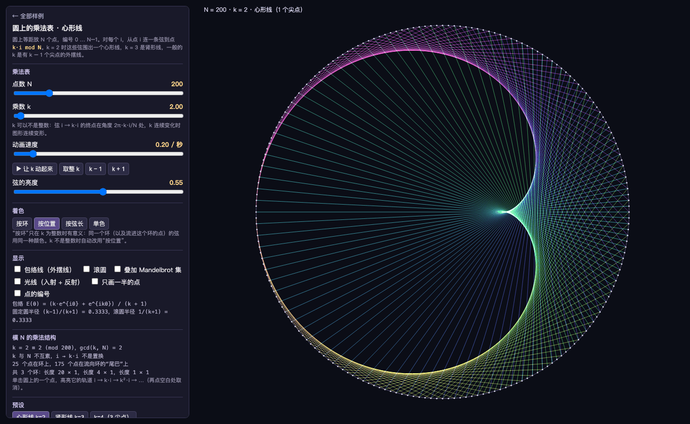

## 数学原理

### 1. 乘法表画在圆上

点 i 在角度 θ_i = 2π·i/N 处。把圆看成复平面上的单位圆，点 i 就是复数 e^{iθ_i}。弦 i → k·i 的终点在角度 k·θ_i 处，也就是 e^{ikθ_i}。k 是整数时，k·θ_i 和点 (k·i mod N) 的角度相差 2π 的整数倍，终点恰好落在圆上的点上；k 不是整数时，终点落在两个点之间，但弦照样画得出来。所以可以让 k 连续地变：

| k = 2，心形线 | k = 3，肾形线 |
|---|---|
|  | 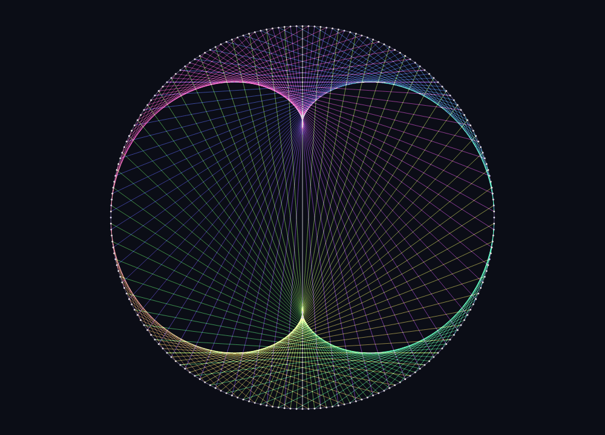 |
| **k = 4，3 个尖点** | **k = 9，8 个尖点** |
| 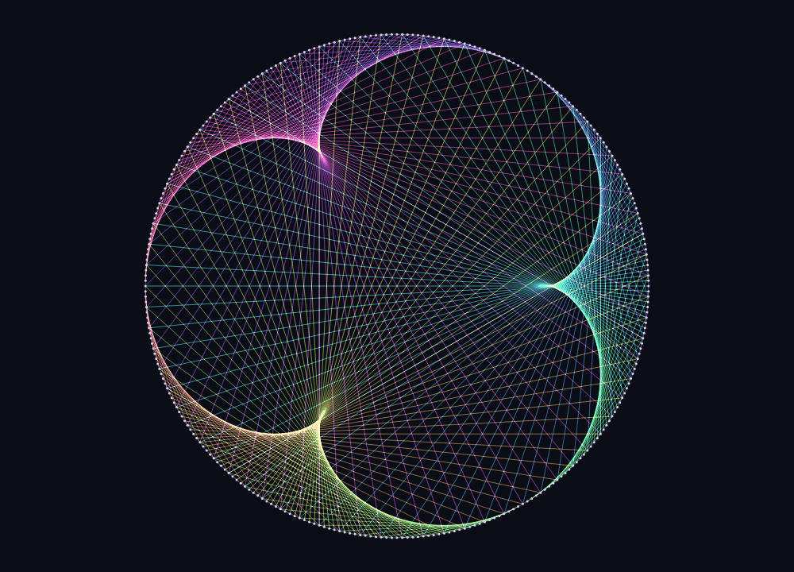 | 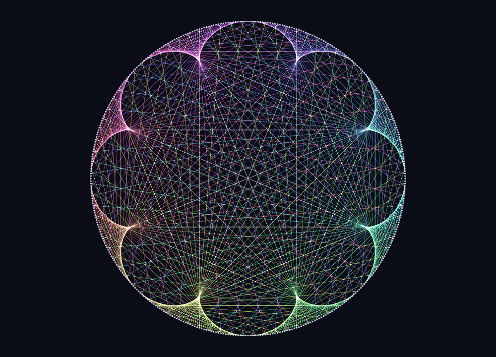 |

k 不是整数时外摆线不闭合。下图 k = 2.5：转一圈回到起点时，弦的终点只转了 2.5 圈，在点 0 附近出现一道断口（红线是下面推出的包络线）。

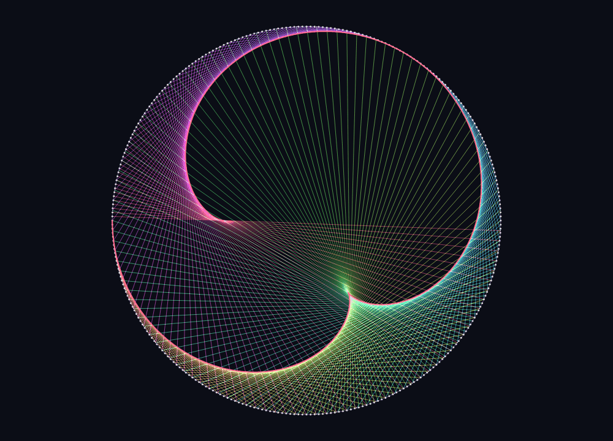

### 2. 为什么是外摆线：弦族的包络

N 很大时，这些弦可以看成一族连续的直线：对 θ ∈ [0, 2π)，从 A(θ) = e^{iθ} 连到 B(θ) = e^{ikθ}。这族直线“围出”的曲线叫它们的**包络**：曲线上每一点都和族中的某一条直线相切。

**第一步：切点在弦上的什么位置。** 让 θ 增加一点点，弦的两个端点都沿圆逆时针走：A 的速度是 1，B 的速度是 k（角度走得快 k 倍）。把两个端点的速度分解到垂直于弦的方向上。圆上的弦和圆在两端的夹角相等，所以两端的垂直分量大小之比就是速度之比 1 : k，而方向相反：一端往弦的一侧走，另一端往另一侧走。于是弦在“转”，弦上有一个点暂时不往两侧动，就是这根杠杆的支点。支点到 A、B 的距离之比是 k : 1，也就是

```
E(θ) = (k·A + B) / (k + 1) = (k·e^{iθ} + e^{ikθ}) / (k + 1)
```

这个暂时不动的点就是弦和包络的切点。相邻两条弦在这里相交，所以 N 很大时，弦在这里挤成一条亮线。页面勾选“包络线”就画出这条 E(θ)。

**第二步：这是一条外摆线。** 把 E(θ) 拆成两项：

```
E(θ) = k/(k+1) · e^{iθ}  +  1/(k+1) · e^{ikθ}
        ─────────────────    ──────────────────
        圆心 C(θ)，绕原点转     绕 C 转的小圆，转速是 k 倍
```

C(θ) 走在半径 k/(k+1) 的圆上。以 C 为圆心、半径 r = 1/(k+1) 的小圆，正好和半径 R = (k−1)/(k+1) 的固定圆外切，因为 R + r = k/(k+1)。小圆上的点转速是 k = (R + r)/r，这正是小圆贴着固定圆**无滑动滚动**时的转速。所以 E 是半径 r 的圆在半径 R 的圆外面滚动时，圆周上一点的轨迹：外摆线。滚一圈尖点的个数是 R/r = k − 1。

| k | 固定圆半径 R | 滚圆半径 r | 尖点数 | 名字 |
|---|---|---|---|---|
| 2 | 1/3 = 0.3333 | 1/3 = 0.3333 | 1 | 心形线 |
| 3 | 1/2 = 0.5000 | 1/4 = 0.2500 | 2 | 肾形线 |
| 4 | 3/5 = 0.6000 | 1/5 = 0.2000 | 3 | |
| k | (k−1)/(k+1) | 1/(k+1) | k − 1 | 外摆线 |

（R、r 的数值就是页面“显示”一栏下方的读数。）

**另一种看法：滚圆的切线。** 勾选“滚圆”，页面画出蓝色的固定圆、绿色的滚圆和一条白色的弦。滚圆在蓝点处贴着固定圆，蓝点是滚圆此刻的转动中心，所以滚圆上红点（描出外摆线的点）的速度垂直于“蓝点 → 红点”。由于蓝点和红点之间的角是直径所对的圆周角，外摆线在红点的切线必过滚圆上与蓝点相对的那一点。这个对径点是 C + r·e^{iθ} = e^{iθ}，正好在单位圆上，就是白点 A(θ)。所以切线就是从 A(θ) 出发、过红点的那条弦，它的另一端就是 B(θ) = e^{ikθ}。

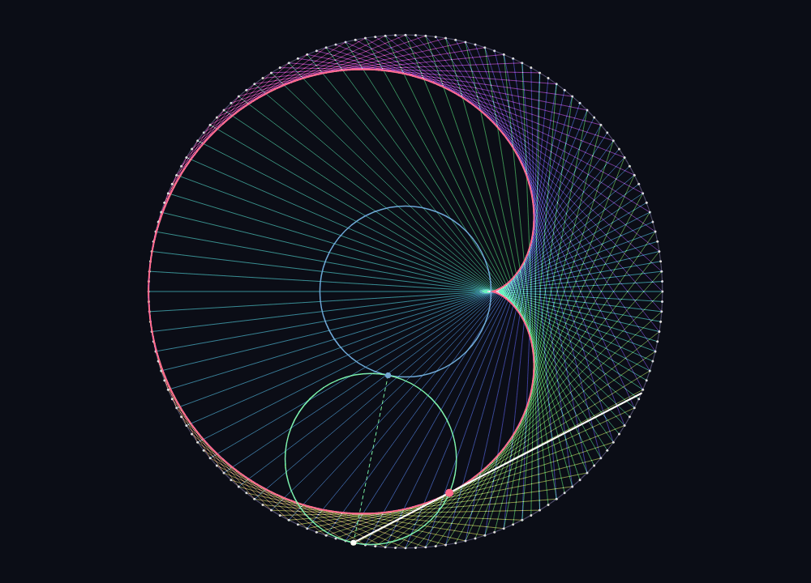

用 numpy 对 k = 0.5、2、3、4.5、9 各取 31 个 θ，检验 E(θ) 在弦 AB 上、E′(θ) 平行于 AB：最大残差 4.5 × 10⁻¹⁵，就是浮点误差。

**N 要远大于 k。** 上面把弦看成连续的一族，前提是相邻两条弦差得很少。相邻两个起点相差 360°/N，终点却相差 k·360°/N。k/N 不小时，终点在圆上大步跳，看到的就不是外摆线，而是混叠出的图案。页面在 k/N ≥ 0.1 时会提示这一点。几个经典的例子：

| N = 100，k = 51 | N = 100，k = 34 | N = 200，k = 99 |
|---|---|---|
| 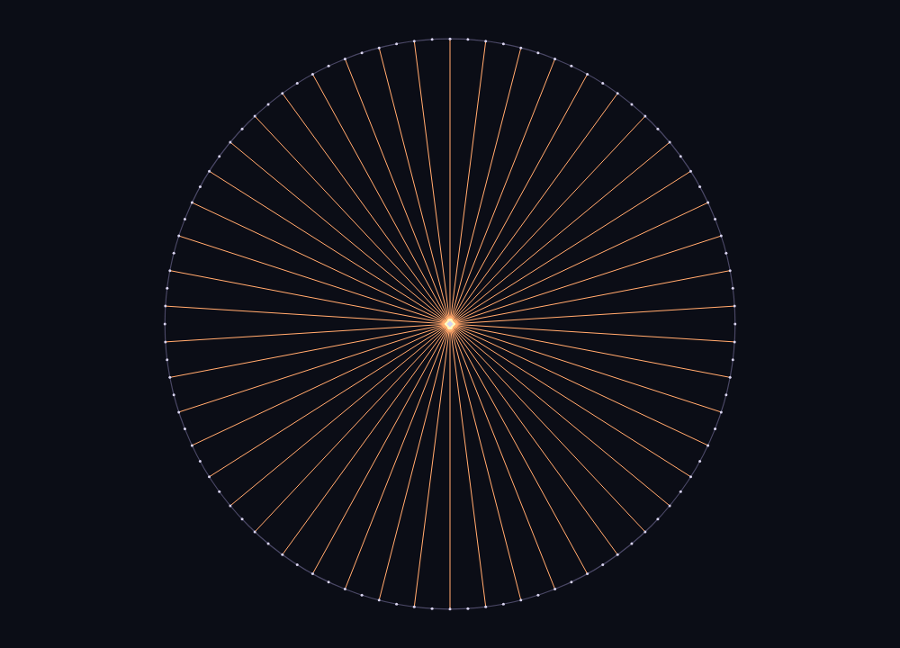 | 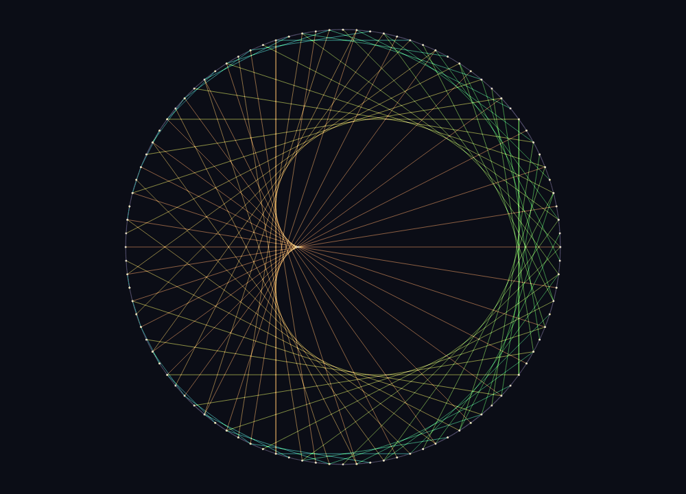 | 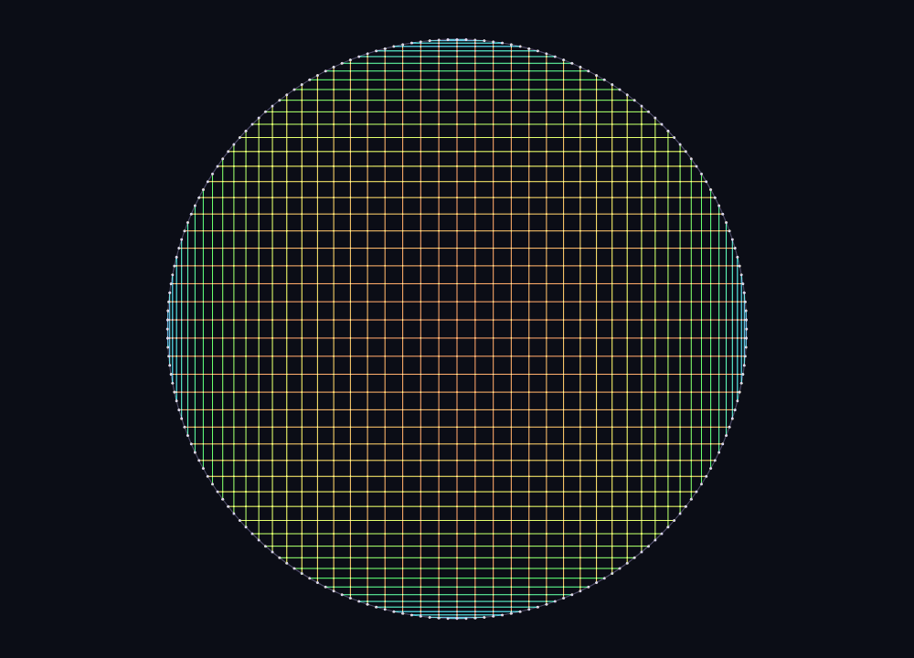 |

- k = 51 = N/2 + 1：偶数 i 时 51·i = 50·i + i ≡ i，弦退化成一点；奇数 i 时 51·i ≡ i + 50，是一条直径。所以只剩 50 条直径。
- k = 99 = 100 − 1：偶数 i 连到 −i（关于水平直径对称），奇数 i 连到 100 − i（关于竖直直径对称），两族平行弦织成网格。
- k = 34：3·34 = 102 ≡ 2 (mod 100)，i 每走 3 步，终点只走 2 步。每隔两个点取一条弦，它们就像一族起点、终点速度比为 3 : 2 的弦，画出来是一个只有 1 个尖点的小心形。

### 3. k 为整数：模 N 的乘法结构

k 是整数时，每条弦都从一个点连到另一个点，i → k·i mod N 是 {0, 1, …, N−1} 到自己的一个映射 f。从任何一点出发反复用 f，迟早会回到走过的点，所以每条路径最后都落进一个**环**。“按环”着色把同一个环、以及最终流进这个环的点的弦涂成同一种颜色。单击圆上一个点，页面高亮它的轨道 i → k·i → k²·i → …，并在面板里列出来。

**gcd(k, N) = 1 时，f 是置换。** k 在模 N 下有逆元，f 是一一对应，没有“尾巴”，每个点都在环上。点 1 的轨道是 1, k, k², …，它回到 1 所需的步数就是 k 模 N 的**乘法阶** ord_N(k)：使 k^m ≡ 1 (mod N) 的最小 m。N = 31、k = 2 时，2⁵ = 32 ≡ 1，ord = 5。除了不动点 0，其余 30 个点分成 6 个长度为 5 的环：

| N = 31，k = 2：6 个 5 环 + 不动点 0 | 单击点 3：3 → 6 → 12 → 24 → 17 → 3 |
|---|---|
| 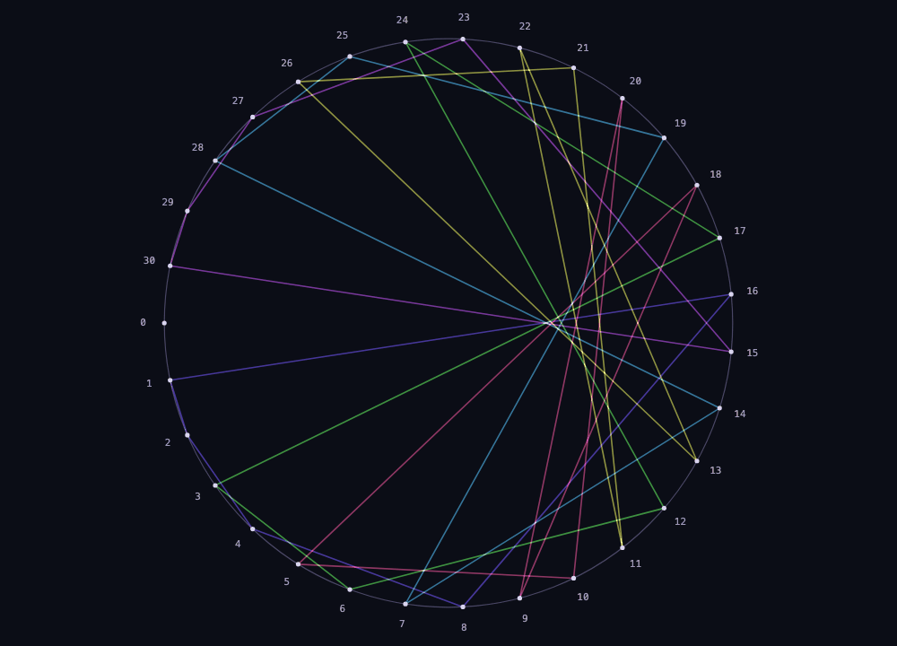 | 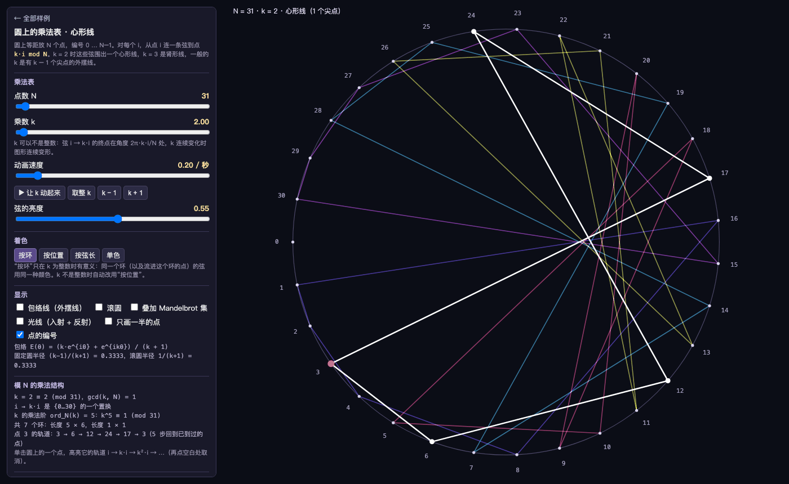 |

一般地，点 i 所在的环长是 k 模 N/gcd(i, N) 的乘法阶，它总是 ord_N(k) 的约数。N 是素数时所有非零点的环一样长，都等于 ord_N(k)，(N − 1)/ord 个环把它们平分。这正是费马小定理背后的群论：乘法群的元素个数 N − 1 是 ord 的倍数。

ord_N(10) 也是 1/N 的小数循环节长度，因为循环节长 m 意味着 10^m·(1/N) 和 1/N 的小数部分相同。N = 97、k = 10 时 ord = 96 = N − 1（10 是模 97 的原根），96 个非零点连成**一个**环，整张图只有一种颜色；对应地，1/97 的循环节有 96 位。同样，N = 31、k = 2 的 ord = 5 说明 1/31 的二进制小数是 0.00001 00001 …。

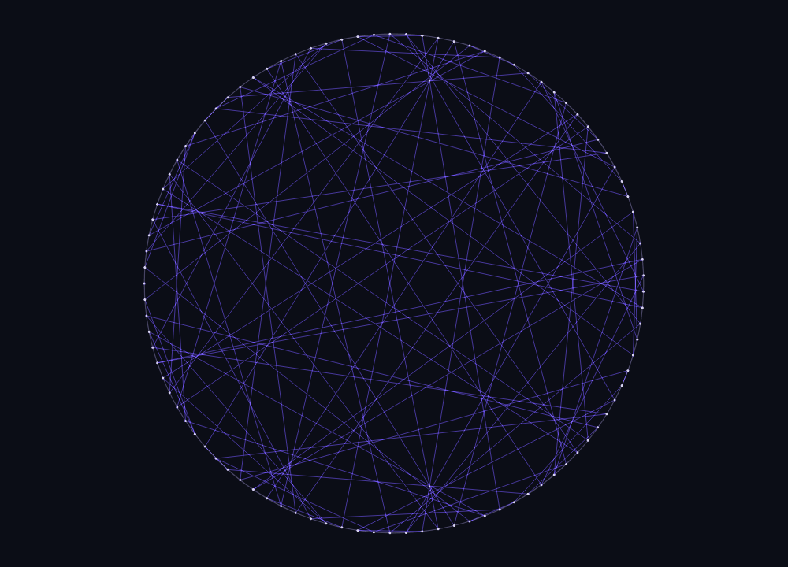

**gcd(k, N) > 1 时，f 不是置换。** 两个不同的点会被送到同一个点上（例如 N = 24、k = 2 时 i 和 i + 12 都去 2i），有的点没有原像，所以图里出现流向环的“尾巴”。N = 24 = 2³·3、k = 2：页面读数是 3 个点在环上（不动点 0 和 2 环 8 ↔ 16），其余 21 个点在尾巴上，任何点至多乘 3 次 2 就进入环（24 里含 3 个因子 2）。默认的 N = 200、k = 2 也是这样：25 个点在环上（长度 20、4、1 各一个环），175 个点在尾巴上。

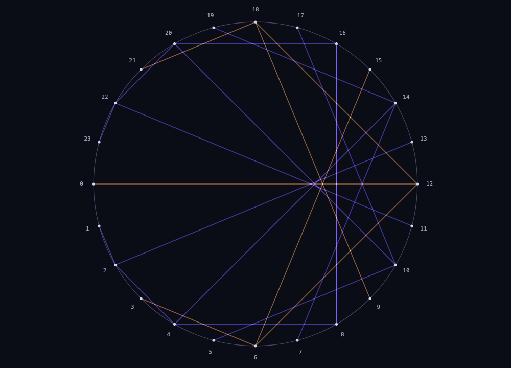

页面算出的环结构和一个独立的 Python 暴力实现逐一对过：(N, k) = (31, 2)、(24, 2)、(97, 10)、(200, 2)、(400, 3)、(100, 51)、(1000, 7)、(360, 0)、(10, 12)，环上的点数、各长度的环的个数和乘法阶全部一致。

### 4. 心形线与 Mandelbrot 集的主心形

Mandelbrot 集是使 z → z² + c 从 z = 0 出发不逃逸的 c 的集合（见 [Mandelbrot 集与 Julia 集](../mandelbrot-julia/README.md)）。它最大的那块“主心形”，是 z² + c 有一个**吸引不动点**的 c：不动点 z* = z*² + c，吸引的意思是导数 λ = 2z* 满足 |λ| < 1。把 c 用 λ 表示：z* = λ/2，c = z* − z*² = λ/2 − λ²/4。边界 |λ| = 1，令 λ = e^{iφ}：

```
c(φ) = e^{iφ}/2 − e^{2iφ}/4
```

把乘法表的包络 k = 2 代入 E(θ) = (2e^{iθ} + e^{2iθ})/3，再令 θ = φ + π：E = −(2e^{iφ} − e^{2iφ})/3。比较两式，

```
c = −(3/4) · E
```

主心形的边界就是乘法表心形线转 180°、缩小到 3/4。勾选“叠加 Mandelbrot 集”，页面在圆内每个点 w 处画出 c = −0.75·w 的 Mandelbrot 集：红色包络线和主心形的边界完全重合，一圈小“芽”（周期 2、3、… 的分量）正长在心形线上。

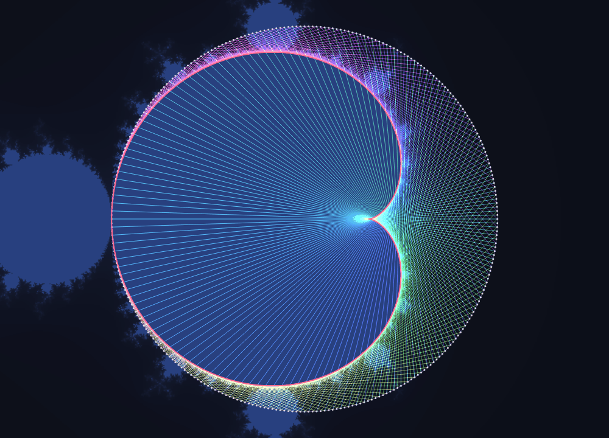

这不是巧合，对 z^k + c 同样成立。不动点导数 λ = k·z*^{k−1}，边界 |λ| = 1 给出 c = z* − z*^k，|z*| = k^{−1/(k−1)}，化简后正是乘法表 k 的外摆线乘一个复数：c = s·e^{iπ/(k−1)}·E，s = (k+1)/k · k^{−1/(k−1)}。所以 z^k + c 的主分量是 k − 1 个尖点的外摆线，和乘法表 k 的包络一模一样。k = 3 时 s·e^{iπ/2} = 0.7698i：

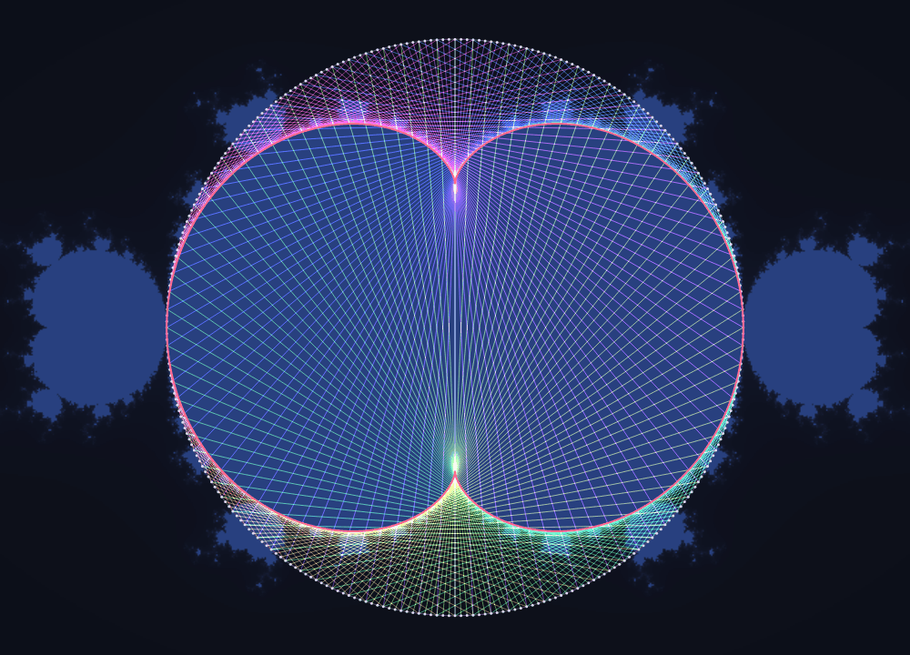

用 numpy 对 k = 2 … 10 各取 50 个 E(θ)，按页面算出的系数映射成 c 后，解 z^k − z + c = 0 求不动点：总有一个不动点的 |λ| 与 1 的偏差不超过 8 × 10⁻⁸（k 为偶数时边界上有重根，数值解只有 √ε 的精度；k 为奇数时偏差是 10⁻¹⁴ 量级）。叠加只在 k 为 2–10 的整数时画。

### 5. 咖啡杯里的焦散

阳光照进杯子，杯底常有一条带尖的亮线。光在杯壁（圆）上反射，反射光线族的包络特别亮，叫**焦散**。它也是一张乘法表。

**圆上的反射。** 一条光线沿弦从角度 α 的点射到角度 β 的点。入射弦、反射弦和半径的夹角相等，而圆心到两条弦的距离也就相等，所以反射弦对的圆心角和入射弦一样大。于是反射弦从 β 连到 2β − α。

- **点光源在杯沿上**（α = 0）：光线射到 β，反射到 2β。反射光线就是弦 β → 2β，焦散是**心形线**，尖点在离圆心 1/3 半径处。
- **平行光**：竖直的平行光线是从 −β 到 β 的弦（α = −β），反射到 3β。反射光线就是弦 β → 3β，焦散是**肾形线**。只有一半的杯壁迎着光，所以杯底看到的是半个肾形线，尖点在离圆心 1/2 半径处，正是外摆线固定圆的半径 (k−1)/(k+1) = 1/2。

勾选“光线”，页面把每条弦 i → k·i 当作反射光线，再用暗蓝色画出把它反射过来的入射光线：从角度 (2 − k)·θ_i 射到 θ_i。k = 2 时入射光全部从点 0 出发，k = 3 时入射光全部平行，这两种情形是真实的光路；其他 k 下入射光没有物理意义。“只画一半的点”只保留 0 < θ < π 的点，对应单侧来光。

| 点光源在杯沿：心形线 | 平行光照半边：半个肾形线 |
|---|---|
| 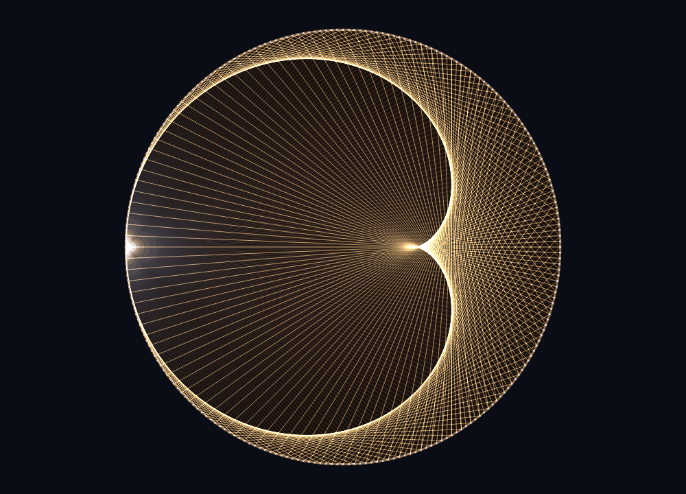 | 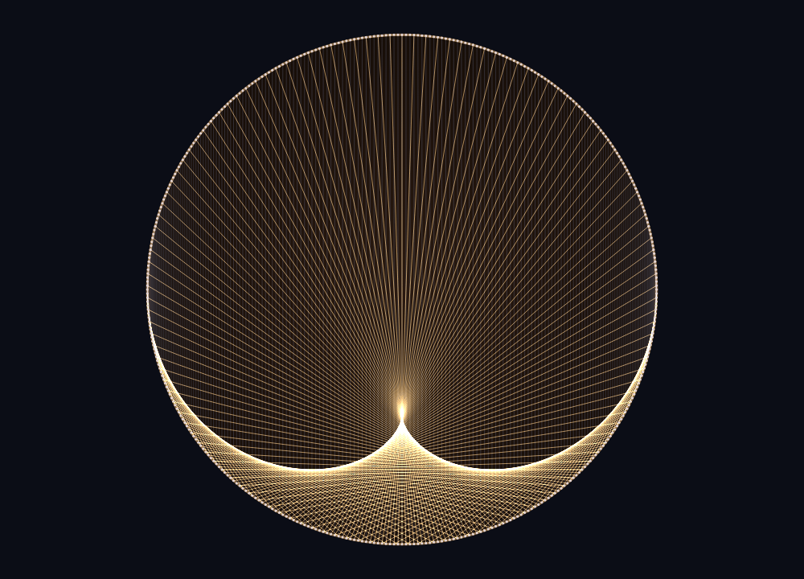 |

## 操作

- 点数 N（2–1000）、乘数 k（0–100，步长 0.01）；
- “让 k 动起来”：k 以设定的速度（0.01–2 每秒）连续增加，到 100 后回到 0；“取整 k”“k − 1”“k + 1”跳到整数；
- 弦的亮度；弦用加色叠加，所以弦挤在一起的包络处最亮；
- 着色：按环（k 为整数时）、按位置、按弦长、单色；
- 开关：包络线、滚圆、叠加 Mandelbrot 集、光线、只画一半的点、点的编号（N ≤ 72 时显示）；
- 单击圆上的点看它的轨道，单击空白处取消；
- 按 h 隐藏 / 显示面板；
- 预设：心形线、肾形线、k = 4、k = 9、三个混叠例子、三个环结构例子、Mandelbrot 主心形、z³ + c 主分量、滚圆与切线、两个咖啡杯。

## 网址参数

每个数字参数都会被限制在对应滑块的范围内，非数字会被忽略；名字参数必须是下表里的值，否则用默认值。

| 键 | 含义 |
|---|---|
| p | 预设名：cardioid, nephroid, k4, k9, k51, k34, k99, cyc31, cyc24, cyc97, mand, mand3, roll, cup, sun |
| n | 点数 N（2–1000） |
| k | 乘数 k（0–100） |
| v | k 的动画速度，每秒（0.01–2） |
| a | 弦的亮度（0.05–1） |
| col | 着色：cycle, hue, len, mono |
| env, roll, mb, light, half, lab | 1 / 0 = 显示 / 隐藏：包络线、滚圆、Mandelbrot、光线、只画一半、编号 |
| sel | 高亮第几个点的轨道（k 为整数时） |
| t | 滚圆的起始位置，一圈的比例（0–1） |
| run | 1 = 打开时 k 就开始变 |
| ui | 0 = 隐藏面板 |

例如看 Mandelbrot 主心形：`index.html?p=mand`；看 1/97 的循环节：`index.html?p=cyc97&sel=1`；从 k = 2 开始慢慢变：`index.html?n=300&k=2&run=1&v=0.1`。

## 参考

- Mathologer, *Times Tables, Mandelbrot and the Heart of Mathematics*, 2015。这个可视化因此广为人知。
- J. W. Bruce, P. J. Giblin, *Curves and Singularities*, Cambridge University Press, 1992，包络与焦散。
- [Cardioid](https://en.wikipedia.org/wiki/Cardioid)、[Nephroid](https://en.wikipedia.org/wiki/Nephroid)、[Epicycloid](https://en.wikipedia.org/wiki/Epicycloid)、[Caustic (optics)](https://en.wikipedia.org/wiki/Caustic_(optics))、[Multiplicative order](https://en.wikipedia.org/wiki/Multiplicative_order)（Wikipedia）。
