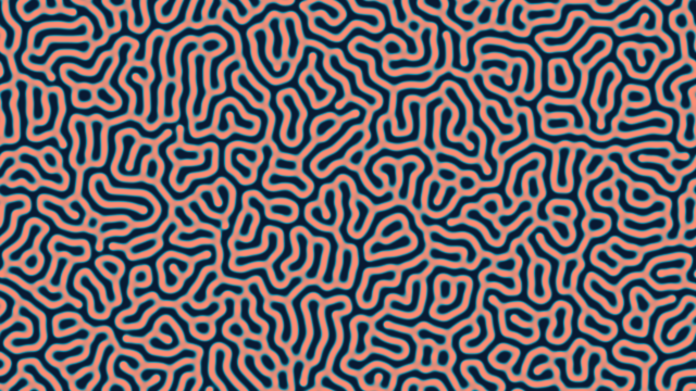
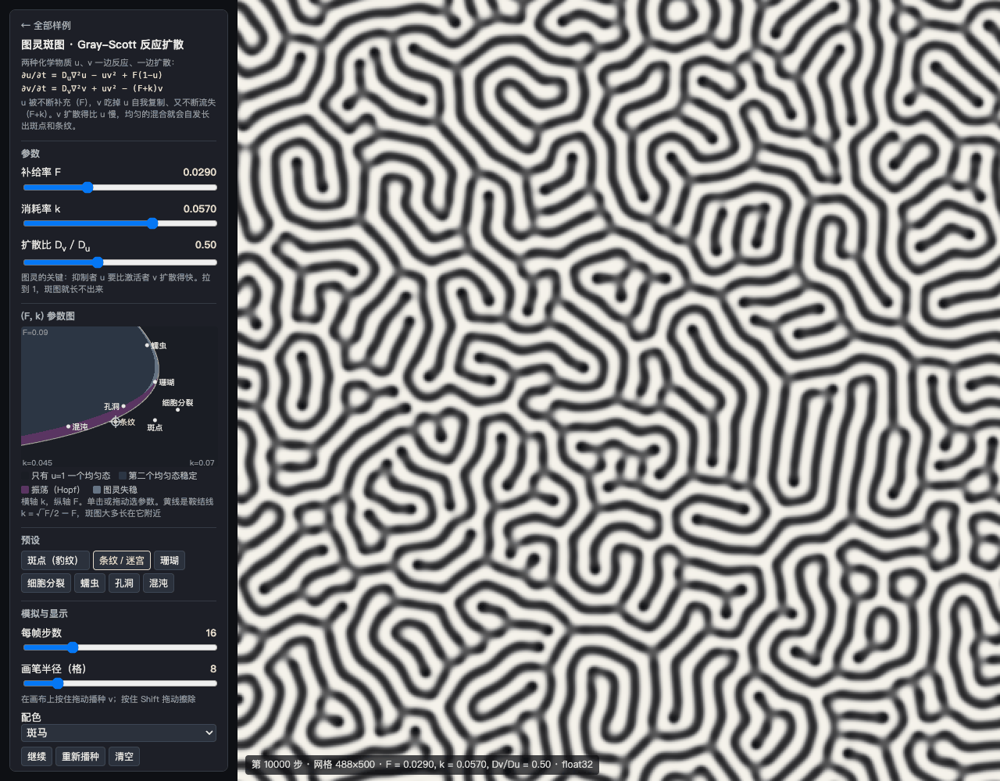
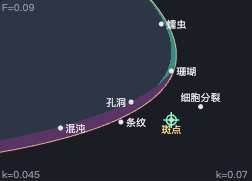
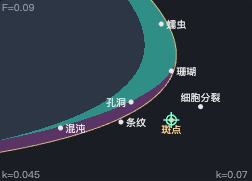
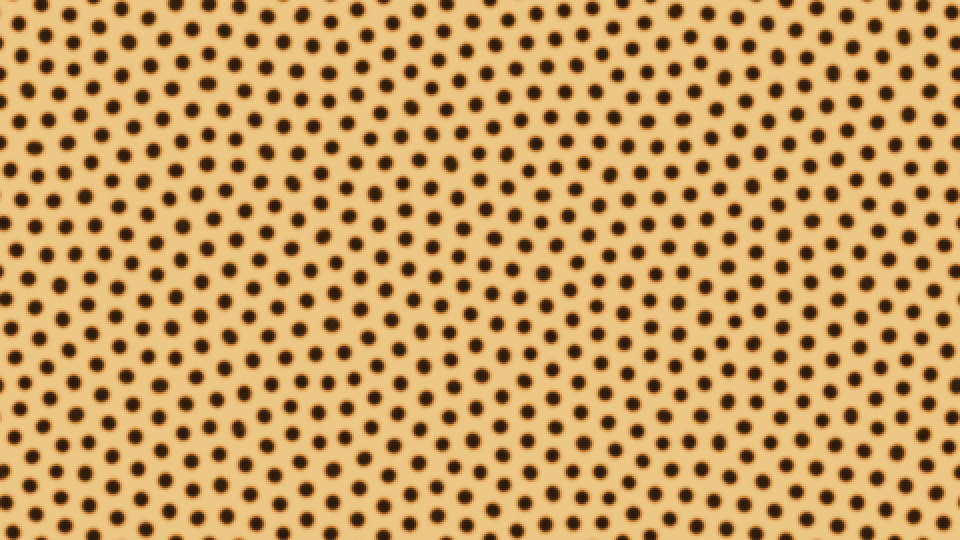
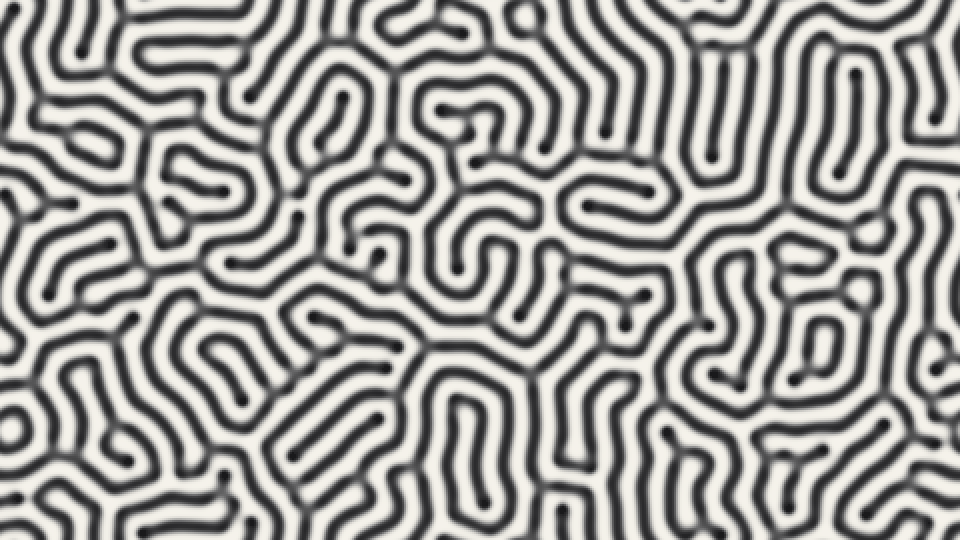
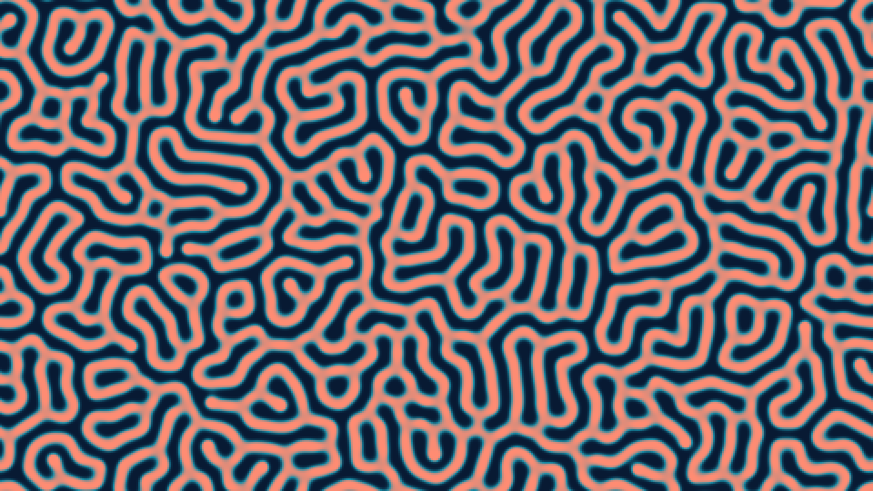
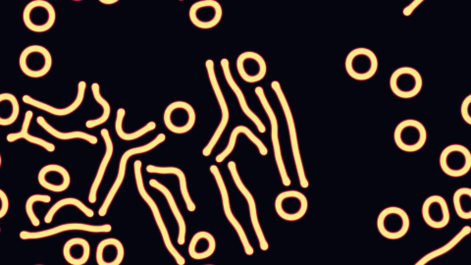
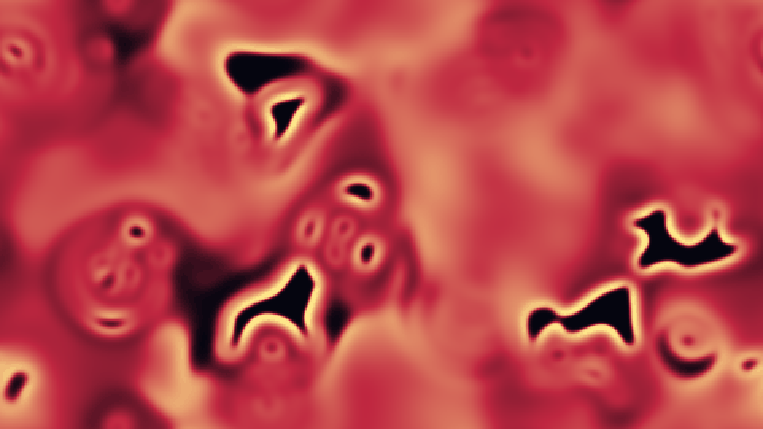

# 图灵斑图 · 两种化学物质画出豹纹和斑马纹



1952 年，Alan Turing 发表了一篇和计算机无关的论文《形态发生的化学基础》。他问了一个问题：胚胎一开始几乎是均匀的，斑点、条纹这些花纹是怎么长出来的？他的回答是：两种互相反应的化学物质，只要扩散得一快一慢，原本均匀的混合就会自己失稳，长出间距固定的斑点或条纹。这种机制叫**反应扩散**，长出来的花纹叫**图灵斑图**。

这个页面模拟其中最有名的一个模型：**Gray-Scott 模型**。只有两个参数 F、k，改一改，画面就能在豹纹、斑马纹、珊瑚、会分裂的“细胞”、蠕虫和混沌之间切换。

打开方式：用浏览器直接打开 [index.html](index.html)。页面只用 WebGL，不依赖外部库，离线也能用。



## 数学原理

### 1. 反应与扩散

平面上每一点有两种物质的浓度 u(x, y, t) 和 v(x, y, t)，取值在 0 到 1 之间。它们按下面两个方程变化：

```
∂u/∂t = Du ∇²u − u v² + F (1 − u)
∂v/∂t = Dv ∇²v + u v² − (F + k) v
```

逐项看：

| 项 | 含义 |
|---|---|
| Du ∇²u、Dv ∇²v | 扩散：浓度从高处流向低处。∇²u 是 u 和周围平均值的差，周围比自己高，u 就上升 |
| u v² | 反应 u + 2v → 3v：一个 u 碰上两个 v，变成三个 v。v 越多，生产 v 越快，所以 v 是**自催化**的，叫**激活者** |
| F (1 − u) | 补给：从外面不断补充 u，补给速度和“离满还差多少”成正比 |
| (F + k) v | 流失：v 被冲走（F）并衰变成惰性物质（k） |

把平面切成网格，每格边长 h，∇²u 近似为上下左右四个邻居之和减去 4 倍自己（五点差分），时间按 Δt = 1 一步一步往前推（显式 Euler 法）。页面取 Du = 0.2097、Dv = 0.105，这是 Pearson（1993）的设定：Du = 2×10⁻⁵，正方形边长 2.5，256 格，换算成格子单位 Du / h² = 2×10⁻⁵ / (2.5/256)² ≈ 0.2097。显式格式要求 4·D·Δt ≤ 1 才不会发散，这里 4 × 0.2097 ≈ 0.84，满足。

每一步要对每个格子做一次计算，几十万个格子每秒几百步，只能交给显卡。页面把 (u, v) 存在一张浮点纹理的红、绿两个通道里，用两张纹理轮流做输入和输出（“乒乓”），一帧推进十几步。

### 2. 均匀态：没有花纹时的样子

先不管扩散，找浓度处处相同、不再变化的状态，也就是令两个方程右边的反应项为 0。

- **平凡态** u = 1，v = 0：没有 v，u 被补满。它永远存在，而且永远稳定：在这一点，u 的小扰动以速率 F 衰减，v 的小扰动以速率 F + k 衰减。
- **非平凡态**：由 v 的方程，u v² = (F + k) v，所以 u v = F + k；代入 u 的方程得到 v 的二次方程

  ```
  (F + k) v² / F − v + (F + k) = 0
  ```

  它有实根当且仅当判别式 ≥ 0，即 F ≥ 4 (F + k)²，整理成

  ```
  k ≤ √F / 2 − F
  ```

  这条曲线叫**鞍结线**，就是参数图上那条黄线。线的左边有两个非平凡态（一个稳定或振荡、一个是鞍点），线的右边只剩平凡态。

参数图的底色就是对 v 较大的那个非平凡态做线性稳定性分析的结果：

| 颜色 | 含义 |
|---|---|
| 黑 | 只有平凡态 u = 1 |
| 深灰蓝 | 非平凡态稳定，加上扩散也稳定 |
| 紫 | 非平凡态自己就会振荡（Hopf 失稳），不需要扩散 |
| 青 | **图灵失稳**：没有扩散时稳定，加上扩散反而不稳定 |

### 3. 图灵的想法：扩散让稳定的状态变得不稳定

扩散通常是“抹平”的力量：墨水滴进水里，最后变成均匀的淡蓝色。图灵发现，两种物质一起扩散时，扩散反而能放大起伏。

在一个均匀态附近，把反应项线性化，得到雅可比矩阵

```
J = | a  b |      a = ∂f/∂u，b = ∂f/∂v，c = ∂g/∂u，d = ∂g/∂v
    | c  d |
```

（f、g 是两个方程的反应项）。没有扩散时稳定，意思是 J 的两个特征值实部都小于 0，等价于

```
tr J = a + d < 0，  det J = ad − bc > 0
```

现在加上扩散，考虑一个波长为 2π/q 的正弦形扰动 e^{iq·x}。∇² 作用在它上面等于乘以 −q²，所以它的增长由矩阵

```
J_q = | a − Du q²     b      |
      |    c       d − Dv q² |
```

决定。迹 tr J_q = tr J − (Du + Dv) q² 只会更负，所以要失稳，只能是行列式变负：

```
det J_q = Du Dv q⁴ − (Du d + Dv a) q² + det J
```

这是 q² 的开口向上的抛物线，最低点在 q² = (Du d + Dv a) / (2 Du Dv)，最低值是 det J − (Du d + Dv a)² / (4 Du Dv)。所以**存在某个波长会被放大**，当且仅当

```
Du d + Dv a > 2 √(Du Dv det J)
```

**为什么两种物质的扩散速度必须不同**：如果 Du = Dv = D，左边是 D (a + d) = D · tr J < 0，而右边是正数，条件永远不成立。扩散一样快时，扩散只会把一切抹平。要让左边为正，必须有一项是正的：在 Gray-Scott 里 d = F + k > 0（v 自我放大），a = −v² − F < 0（u 被消耗）。所以需要 Du d 压过 Dv |a|，也就是**被消耗的 u 扩散得快，自我放大的 v 扩散得慢**。

直观的图景是“近处激活，远处抑制”：某处 v 稍多一点，它就加速吃掉附近的 u、生产更多 v；v 扩散慢，留在原地形成一个斑；u 扩散快，周围的 u 都涌过来被吃掉，于是斑点四周的 u 被抽空，邻近的地方长不出新的 v。斑和斑之间就有了一个由两种扩散速度决定的固定间距。

页面上的“扩散比 Dv / Du”滑块可以直接验证。下面左图是 Dv / Du = 0.5 时的参数图，青色的图灵区只是贴着紫色振荡区的一条细带；右图是 0.3，青色区明显变宽：

| Dv / Du = 0.5 | Dv / Du = 0.3 |
|---|---|
|  |  |

把比值拉到 1，青色区完全消失。用同样的参数和初始种子，斑点预设跑 10000 步后什么都没剩下，全平面回到 u = 1：


### 4. 参数图上的各种斑图

注意参数图上的预设点：没有一个落在青色的图灵区里。斑点、迷宫、细胞分裂在鞍结线右边只有平凡态的黑色区域，其余几个紧贴着鞍结线，在振荡区或双稳区。Pearson（1993）系统地扫过这个平面，发现很多花纹恰好出现在线性理论预言“什么都不会发生”的地方。那里的均匀态 u = 1 是稳定的，小噪声会被抹平，必须先放进一块足够大的 v（页面一开始随机撒下一些小块），让它进入非线性的局面；之后斑图靠同样的“近处激活、远处抑制”维持和扩张。所以页面要用画笔播种，而 Dv / Du = 1 时种子也会消失。

| 预设 | F | k | 所在区域 | 现象 |
|---|---|---|---|---|
| 斑点（豹纹） | 0.030 | 0.062 | 鞍结线右侧 | 种子分裂成大小相同的斑点，铺满后排成近似六边形的点阵 |
| 条纹 / 迷宫 | 0.029 | 0.057 | 鞍结线右侧 | 斑点拉长成条，条纹分叉、弯曲，最后填满成迷宫 |
| 珊瑚 | 0.0545 | 0.062 | 贴着鞍结线 | 条纹不断分叉生长，像珊瑚或指纹 |
| 细胞分裂 | 0.0367 | 0.0649 | 鞍结线右侧 | 单个斑点长大、拉长、一分为二，像细胞有丝分裂 |
| 蠕虫 | 0.078 | 0.061 | 两个均匀态都稳定 | 一段段“蠕虫”和圆环，在两种均匀态之间分隔 |
| 孔洞 | 0.039 | 0.058 | 振荡区边缘 | 和斑点相反：v 铺满全平面，上面是一个个 v 很少的洞 |
| 混沌 | 0.026 | 0.051 | 振荡区 | 不断破裂、重组的斑块，永远不会稳定下来 |

每张图都是从随机种子跑 10000 步：

| 斑点（豹纹） | 条纹 / 迷宫 |
|---|---|
|  |  |
| **珊瑚** | **蠕虫** |
|  |  |
| **孔洞** | **混沌** |
|  |  |

### 5. 会自我复制的斑点

“细胞分裂”预设最能看出斑点间距是怎么来的。先点“清空”，再在画布中央点一下：一个斑点吃掉周围的 u 长大，长到一定大小后，中间的 u 不够用，斑点从中间断开，变成两个；每个新斑点又重复这个过程，直到整个平面铺满、每个斑点周围的 u 刚好够它维持自己：

| 2000 步 | 5000 步 | 12000 步 |
|---|---|---|
|  |  |  |

斑点的大小和间距不由初始种子决定，只由 F、k、Du、Dv 决定，这正是图灵斑图的特征：同一组“化学”，在哪儿长出来的花纹都一样粗细。

### 6. 动物身上的花纹

图灵原文的目标就是生物花纹。后来的工作把这个想法和真实动物联系起来：

- **豹纹和斑马纹**：James Murray 把反应扩散方程放在不同形状的区域上求解。区域很小时长不出花纹（波长放不下）；变大一些出现条纹，再大出现斑点。细长的尾巴上只放得下横向的条纹，所以很多身上是斑点的猫科动物，尾巴末端是一圈圈的环。页面上把“珊瑚”或“迷宫”换成“斑马”配色，就是斑马纹的样子。
- **会移动的条纹**：Kondo 和 Asai（1995）观察到，神仙鱼（*Pomacanthus*）长大时身上的条纹会分叉、移动、增加，变化方式和反应扩散模拟的预言一致。后来在斑马鱼上找到了起这种作用的色素细胞之间的相互作用。

这些例子里真正“反应、扩散”的通常不是两种简单分子，而是细胞和信号分子组成的网络；Gray-Scott 模型只是能产生这类花纹的最简单的数学结构之一。豹子身上的“玫瑰花环”形斑点，用单个 Gray-Scott 方程也画不出来，需要更复杂的模型。

## 操作

- 补给率 F、消耗率 k：拖动滑块，或者在 (F, k) 参数图上单击 / 拖动；改参数不会重置画面，可以看到斑图从一种形态慢慢变成另一种；
- 扩散比 Dv / Du（0.2–1）：同时会重画参数图的颜色；
- 预设：斑点（豹纹）、条纹 / 迷宫、珊瑚、细胞分裂、蠕虫、孔洞、混沌，点一下会重新播种；
- 在画布上按住拖动播种 v（画笔撒下许多 4×4 的小块，大块的平整种子内部会直接衰减回 u = 1）；按住 Shift 拖动擦除；
- 每帧步数（1–64）、画笔半径（2–40 格）、配色（豹纹、斑马、珊瑚海、热力）；
- 暂停 / 继续、重新播种、清空；
- 按 H 隐藏 / 显示面板；
- 网格是周期边界，从一边出去的花纹从对边回来。窗口大小改变时，现有花纹会拉伸到新的网格上。

如果浏览器不支持把画面渲染到浮点纹理（需要 `OES_texture_float` 或 `OES_texture_half_float`），页面会显示一条提示，不会运行。只支持半精度浮点时也能正常长出花纹，右下角的状态栏会显示 `float16`。

## 网址参数

| 键 | 含义 |
|---|---|
| p | 预设名：spots, maze, coral, mitosis, worms, holes, chaos |
| F | 补给率（0–0.1） |
| k | 消耗率（0.03–0.075） |
| r | 扩散比 Dv / Du（0.2–1） |
| spf | 每帧步数（1–64） |
| br | 画笔半径（2–40 格） |
| pal | 配色：0 豹纹，1 斑马，2 珊瑚海，3 热力 |
| seed | 初始种子的随机数（0–1000000） |
| run | 0 = 打开时暂停 |
| ui | 0 = 隐藏面板，只显示画布 |

超出范围的数值会被截到范围内，不是数字的值会被忽略。例如等扩散速度下的斑点（什么都长不出来）：`index.html?p=spots&r=1`；斑马配色的珊瑚：`index.html?p=coral&pal=1`。

## 参考

- A. M. Turing, *The chemical basis of morphogenesis*, Philosophical Transactions of the Royal Society B 237, 1952.
- P. Gray, S. K. Scott, *Autocatalytic reactions in the isothermal, continuous stirred tank reactor: oscillations and instabilities in the system A + 2B → 3B; B → C*, Chemical Engineering Science 39, 1984.
- J. E. Pearson, *Complex patterns in a simple system*, Science 261, 1993. 扩散系数取自该文。
- J. D. Murray, *How the leopard gets its spots*, Scientific American 258, 1988；以及 *Mathematical Biology II*, Springer.
- S. Kondo, R. Asai, *A reaction–diffusion wave on the skin of the marine angelfish Pomacanthus*, Nature 376, 1995.
- Karl Sims, [Reaction-Diffusion Tutorial](https://www.karlsims.com/rd.html)，“珊瑚”“细胞分裂”的参数取自此页；其余预设参数是 Gray-Scott 演示里常用的值。
- Robert Munafo, [Xmorphia](https://mrob.com/pub/comp/xmorphia/)，按 Pearson 的分类整理了 (F, k) 平面上的各种斑图。
