# Ulam 素数螺旋 · 二次多项式的对角线

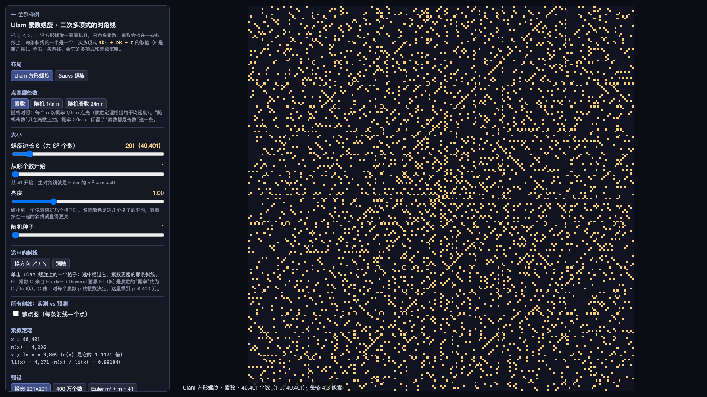

1963 年，Stanisław Ulam 在一次无聊的会议上随手在纸上画格子：中间写 1，往右写 2，然后逆时针一圈圈写下去，再把素数圈出来。他发现素数并不是均匀撒开的，而是挤在一些斜线上。素数的分布看起来毫无规律，可这张图上的斜线一眼就能看到。这些斜线不是错觉：每条斜线的一半都是一个二次多项式 4k² + bk + c 的取值，而不同的二次多项式“产出”素数的能力差得很多。Hardy 和 Littlewood 在 1923 年就给出了一个猜想，能预测每条斜线上素数有多密。

页面用埃拉托斯特尼筛法筛出 400 万以内的素数，排成最大 2001×2001 的螺旋。单击一条斜线，面板给出它的多项式、实测的素数个数和 Hardy–Littlewood 的预测。另有两种对照：Sacks 螺旋把同样的数排成阿基米德螺线，斜线就变成了曲线；随机对照用同样的平均密度 1/ln n 随机点亮整数，斜线就消失了。

打开方式：用浏览器直接打开 [index.html](index.html)。页面只用 Canvas 2D，不依赖外部库，离线也能用。随机对照用带种子的伪随机数发生器（mulberry32），种子相同，画面就完全相同。下面每个数字都是从页面上读出来的，每张图都可以用网址参数重现。

## 数学原理

### 1. 螺旋上的坐标

把 1 放在原点 (0, 0)，2 放在 (1, 0)，然后逆时针转：上 1 格、左 2 格、下 2 格、右 3 格、上 3 格……。第 k 圈是边长 2k + 1 的正方形的边框，装着 (2k − 1)² + 1 到 (2k + 1)² 这 8k 个数，这一圈最后一个数 (2k + 1)² 落在右下角 (k, −k)。

所以格子 (x, y) 上的数可以直接算出来。设 k = max(|x|, |y|)，m = (2k + 1)²：

| 格子在第 k 圈的哪条边 | 数 |
|---|---|
| 下边 y = −k | m − (k − x) |
| 左边 x = −k | m − 2k − (k + y) |
| 上边 y = k | m − 4k − (k + x) |
| 右边 x = k | m − 6k − (k − y) |

页面把 400 万个数逐个“走”一遍螺旋得到坐标，再和这个公式逐格对比，不一致的个数是 0。

放大到每格几十个像素，格子里会写出数字。下图从 41 开始排（第 3 节解释为什么）：

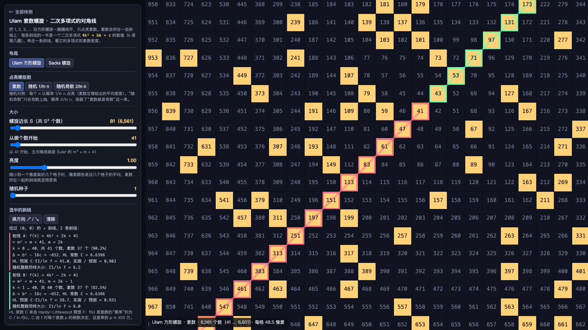

### 2. 斜线为什么是二次多项式

沿一条斜线走一步，x 和 y 各变 1，所以圈数 k 也变 1。在同一条边上，表里每个公式都是 k 的二次式，首项都是 (2k + 1)² 里的 4k²。所以在一条边上，斜线上的数恰好是

```
f(k) = 4k² + bk + c,   k = 圈数
```

一条完整的斜线穿过螺旋，会碰到正方形的两条边，于是分成两条**射线**，各是一个二次多项式。例如主对角线 y = x：右上那一半是 4k² − 2k + 1（3, 13, 31, 57, …），左下那一半是 4k² + 2k + 1（1, 7, 21, 43, …）。

斜线上的格子都同色：沿斜线走一步，x + y 的奇偶不变，而螺旋上 n 的奇偶正好由 x + y 的奇偶决定（棋盘格）。所以 b 总是偶数，f(k) 的奇偶只看 c。c 是偶数的射线上全是偶数，一个素数也没有（除了 2）。在 2001×2001 的螺旋上，长度 ≥ 250 的射线有 11 860 条，其中 c 为偶数的 5891 条上一共只有 1 个素数，就是 2。螺旋上一半的斜线是空的，素数所在的另一半看起来就像一条条斜线。这是斜线最粗浅的来源，第 5 节会把它和真正的结构分开。

b 是偶数，所以总能写成 b = 4u + 2ε（ε 是 0 或 1）。令 m = 2k + u，射线就变成更熟悉的样子：

```
4k² + bk + c = m² + εm + C₀,   C₀ = c − u² − εu
```

面板对每条射线同时给出这两种写法。单击 (5, 5) 选中的 ↗ 斜线，两条射线都是 m² + m + 1：101 个数里有 25 个素数，另一条 100 个数里有 32 个。

### 3. Euler 的 m² + m + 41

1772 年 Euler 注意到，m² + m + 41 在 m = 0, 1, …, 39 时全是素数：41, 43, 47, 53, 61, 71, 83, 97, …, 1601。m = 40 时第一次失败：40² + 40 + 41 = 41²。

把螺旋从 41 开始排（每个数加 40），主对角线的两条射线就是

```
4k² + 2k + 41 = m² + m + 41,  m = 2k
4k² − 2k + 41 = m² + m + 41,  m = 2k − 1
```

两条合起来正好是 Euler 多项式在 m = 0, 1, 2, … 上的全部取值，所以主对角线前 40 个数全是素数：

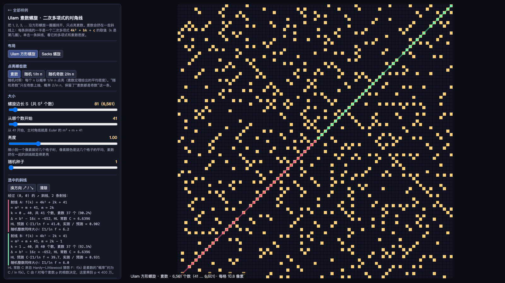

81×81 时两条射线各走到第 40 圈：射线 A 41 个数里 37 个是素数，射线 B 40 个里 37 个。整个螺旋上素数的平均比例只有 853 / 6561 = 13%。

为什么偏偏是 41？m² + m + 41 的判别式是 1 − 4·41 = −163。Rabinowitsch（1913）证明，m² + m + q 在 m = 0 … q − 2 全是素数，当且仅当 Q(√(1 − 4q)) 的类数是 1。类数为 1 的虚二次域只有 9 个，最大的判别式就是 −163（Heegner 数）。它对应的 q = 41 已经最大，不存在更长的这种多项式。

### 4. 素数定理：平均密度 1/ln n

要说一条斜线“密”，先要知道平均有多密。**素数定理**（Hadamard、de la Vallée Poussin，1896）说，不超过 x 的素数个数 π(x) 满足

```
π(x) ~ x / ln x,   更精确地  π(x) ~ li(x) = ∫₂ˣ dt / ln t
```

等价地说，n 附近的一个数是素数的“概率”约为 1/ln n。面板实时给出螺旋上最大的数 x 对应的这几个量：

| x | π(x) | x / ln x | π(x) / (x / ln x) | li(x) | π(x) / li(x) |
|---|---|---|---|---|---|
| 40 401（201²） | 4 236 | 3 809 | 1.1121 | 4 271 | 0.99184 |
| 160 801（401²） | 14 752 | 13 414 | 1.0998 | 14 797 | 0.99698 |
| 641 601（801²） | 52 192 | 47 982 | 1.0877 | 52 292 | 0.99809 |
| 4 004 001（2001²） | 283 413 | 263 373 | 1.0761 | 283 615 | 0.99929 |

x / ln x 偏小 7%–11%，比值收敛得很慢（误差是 1/ln x 量级）；li(x) 在 400 万时只差 0.07%。所以页面里“同样大小的随机数”指的是 Σ 1/ln f(k)：如果 f(k) 是素数的概率就是 1/ln f(k)，这条射线上应该有这么多个素数。

下图是 2001×2001 的全貌。每个像素装着约 2.3 个格子，颜色是平均值，只能看出中心更亮（小的数里素数更多），斜线淹在噪声里。斜线要在每格一个像素以上才看得清，这和 Ulam 当年画在方格纸上是一样的：

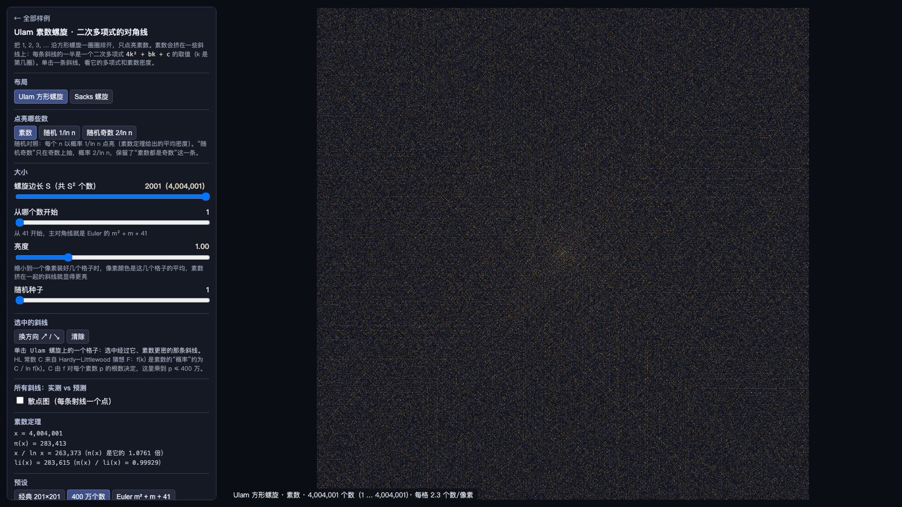

### 5. Hardy–Littlewood 猜想 F：每条斜线该有多密

1/ln n 是对“随便一个数”而言的。多项式的取值不是随便的数：它们对小素数的余数有偏向。

看 f(k) 被素数 p 整除的“概率”。在 k 模 p 的 p 个余数里，有 ω(p) 个让 f(k) ≡ 0 (mod p)，所以 f(k) 被 p 整除的比例是 ω(p)/p，而随便一个数是 1/p。把“不被 p 整除”的比例对所有 p 都修正一遍，就得到 **Hardy–Littlewood 猜想 F**（1923，对一般多项式的推广叫 Bateman–Horn 猜想，1962）：

```
f(k) 是素数的概率 ≈ C / ln f(k),   C = Π_p (1 − ω(p)/p) / (1 − 1/p)
```

对 f(k) = 4k² + bk + c，ω(p) 很好算：

- p = 2：f(k) ≡ c (mod 2)。c 偶数时 ω(2) = 2，C = 0；c 奇数时 ω(2) = 0，因子是 1 / (1/2) = 2。“只取奇数”这一条就让密度翻倍。
- p 奇：二次同余 4k² + bk + c ≡ 0 的根数是 1 + (Δ/p)，Δ = b² − 16c，(Δ/p) 是 Legendre 符号。Δ 是模 p 的平方剩余时有 2 个根，因子是 (p − 2)/(p − 1) < 1；不是平方剩余时没有根，因子是 p/(p − 1) > 1。

所以一条斜线亮不亮，取决于 Δ 在多少个小素数下**不是**平方剩余。Δ 对很多小素数都不是平方剩余的多项式，它的值很少被小素数整除，素数就多。页面用 Euler 判别法 a^((p−1)/2) mod p 求 Legendre 符号，把乘积乘到 p ≤ 400 万（28 万多个素数）。

Euler 多项式的 Δ = −652 = 4·(−163)，C = 6.6396。−163 是模 3, 5, 7, 11, …, 37 的非剩余，所以前 11 个奇素数都给出大于 1 的因子（到 41 才第一次是平方剩余）。常见文献里说 Euler 多项式的常数是 3.3198，那是按 x / ln x 计数的写法：m 走到 x 时 ln f ≈ 2 ln x，两者差一个因子 2。

一个奇数平均的因子就是 2。Δ 是“随便”的数时，平方剩余和非剩余各占一半，奇素数的因子会互相抵消。在 2001×2001 的螺旋上，c 为奇数的 5969 条长射线，C 的平均值是 2.009。

### 6. 预测 vs 实测

单击一条斜线，面板给出“HL 预测 C·Σ 1/ln f”和实测个数。几条有代表性的：

| 射线 | 范围 | 实测素数 | 比例 | C | HL 预测 | 实测 / 预测 | Σ 1/ln f |
|---|---|---|---|---|---|---|---|
| 4k² + 4k − 397 = m² − 398 | k = 199 … 1000 | 418 / 802 | 52.1% | 7.3290 | 421.4 | 0.992 | 57.5 |
| 4k² + 399 = m² + 399 | k = 200 … 1000 | 90 / 801 | 11.2% | 1.4867 | 85.4 | 1.054 | 57.4 |
| 4k² + 2k + 41（螺旋从 41 开始） | k = 0 … 200 | 137 / 201 | 68.2% | 6.6396 | 140.0 | 0.979 | 21.1 |
| 4k² − 2k + 41（螺旋从 41 开始） | k = 1 … 200 | 134 / 200 | 67.0% | 6.6396 | 138.8 | 0.965 | 20.9 |
| 4k² + 1 = (2k)² + 1 | k = 1 … 200 | 57 / 200 | 28.5% | 2.7455 | 58.9 | 0.968 | 21.5 |
| 4k² + 2k + 1 = m² + m + 1 | k = 0 … 100 | 25 / 101 | 24.8% | 2.2415 | 28.0 | 0.894 | 12.5 |

前两行是同一条斜线 x + y = −398 的两半。它们一样长、数一样大，所以 Σ 1/ln f 几乎一样（57.5 和 57.4），可是素数个数差了 4.6 倍，而 HL 常数之比 7.3290 / 1.4867 = 4.9。下图就是这条斜线，用“最密的一条”预设打开。绿色那一半在 2001×2001 的螺旋里素数最密：

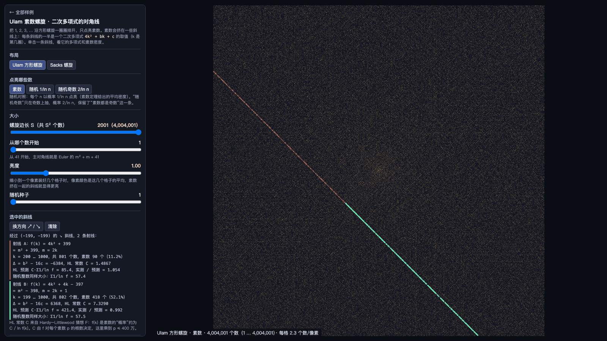

一条一条看还可能是巧合。勾选“散点图”，页面把所有长度 ≥ 250 的射线都算一遍（为了快，这里 C 只乘到 p < 2000），横轴是 HL 常数 C，纵轴是实测的素数个数 ÷ Σ 1/ln f。如果猜想对，点应该落在 y = x 上：

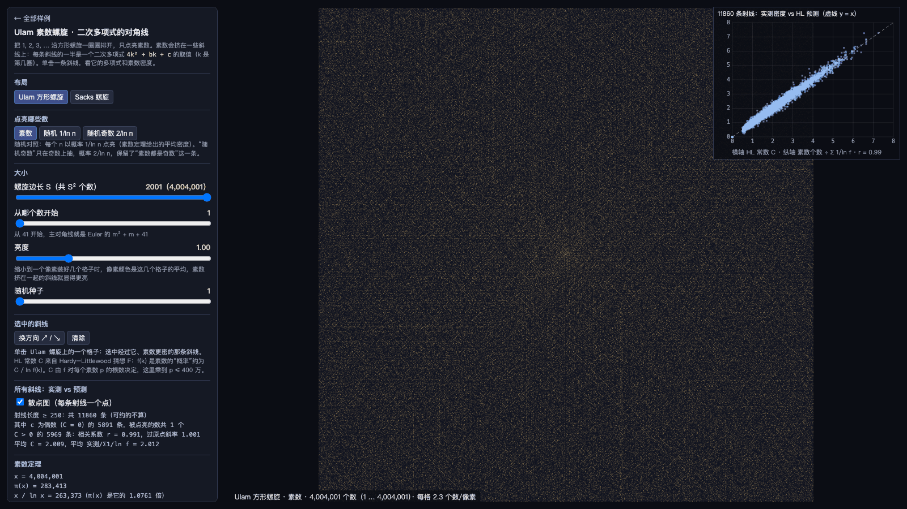

5969 条 c 为奇数的射线，相关系数 r = 0.991，过原点的最小二乘斜率是 1.001。C 从 0.5 到 7 的射线都落在 y = x 附近，偏离主要是统计涨落：一条射线上期望只有几十到几百个素数，相对涨落约 1/√个数。

散点图右上角最密的几条：

| 射线 | C | 实测 / Σ 1/ln f |
|---|---|---|
| 4k² + 4k − 397 = m² − 398 | 7.26 | 7.27 |
| 4k² + 2k + 41 = m² + m + 41 | 6.65 | 6.63 |
| 4k² + 163 = (2k)² + 163 | 6.65 | 6.78 |
| 4k² − 2k + 41 = m² + m + 41 | 6.65 | 6.50 |

第三行 m² + 163 的 Δ = −16·163，和 Euler 多项式的 Legendre 符号完全一样，所以 C 也一样。163 又一次出现了。

### 7. 随机对照：斜线不是错觉

人眼很容易在噪声里看到线条。检验办法是造一个“假素数”：每个 n 独立地以概率 1/ln n 点亮（Cramér 模型，1936）。它和素数的平均密度一样（400 万以内点亮了 284 514 个，模型期望 283 615，真素数 283 413），只是没有任何算术结构。

页面提供两种对照：

- **随机 1/ln n**：所有整数都可能被点亮；
- **随机奇数 2/ln n**：只点亮奇数，概率加倍。它保留了“素数都是奇数”这一条，所以也有第 2 节那种棋盘格效应，用来检验斜线除了奇偶以外还有没有别的东西。

| 素数 | 随机 1/ln n | 随机奇数 2/ln n |
|---|---|---|
| 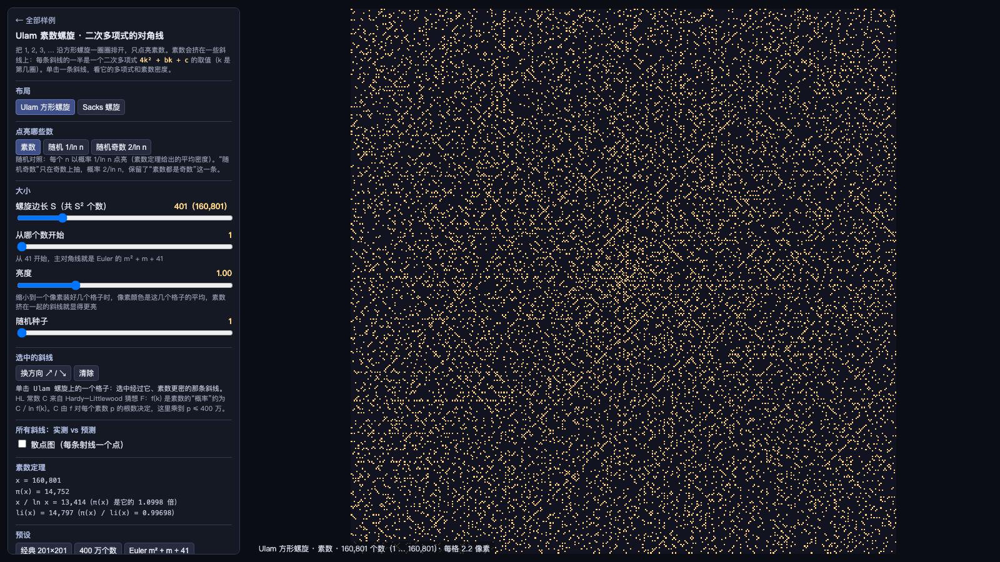 | 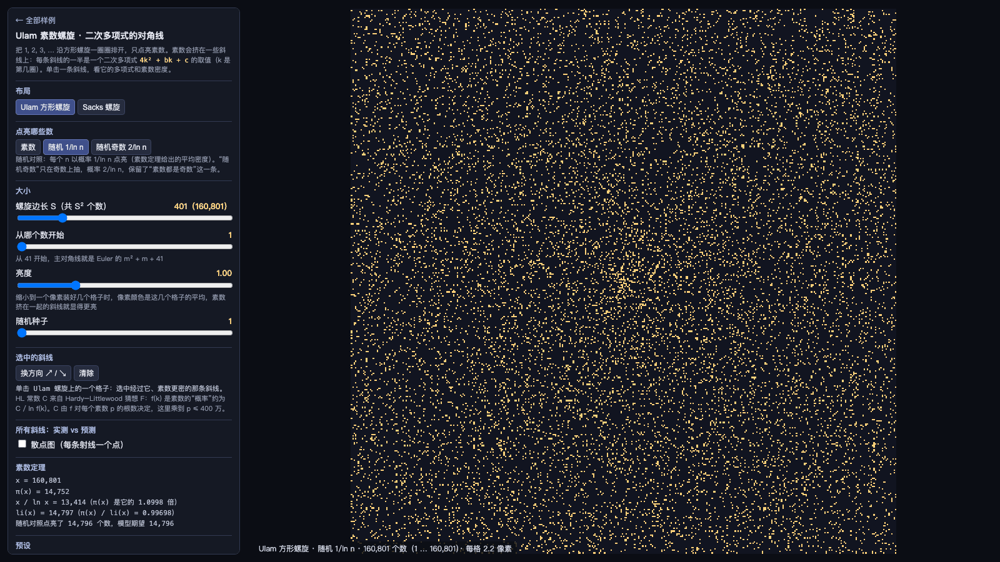 | 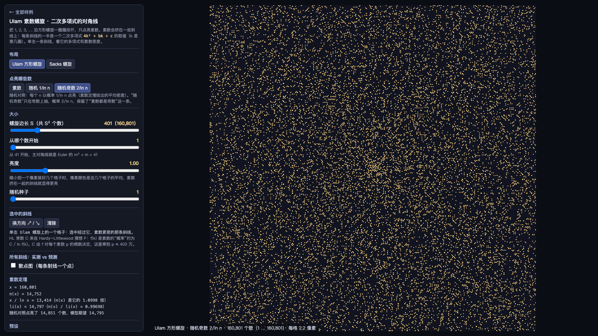 |

（401×401，16 万个数，每格约 2.2 个像素。）左图能看到很多短斜线，右边两张没有。散点图说得更清楚：

| 随机 1/ln n | 随机奇数 2/ln n |
|---|---|
| 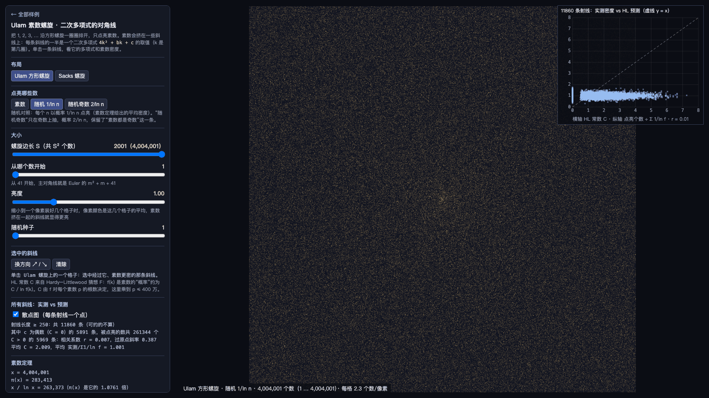 | 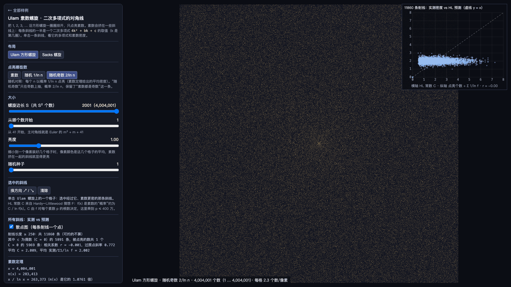 |

| 数集 | C > 0 射线的平均 实测/Σ1/ln f | 与 C 的相关系数 | c 为偶数的射线上点亮的数 |
|---|---|---|---|
| 素数 | 2.012 | 0.991 | 1（就是 2） |
| 随机 1/ln n | 1.001 | 0.007 | 261 344 |
| 随机奇数 2/ln n | 2.002 | −0.001 | 1（就是 2） |

随机对照的点排成一条水平带，高度只取决于模型本身（1 或 2），和 C 毫无关系。随机奇数模型的平均值（2.002）和素数（2.012）几乎一样，可是素数在 C < 0.7 的 303 条射线上平均只有 0.625（这些射线的平均 C 是 0.631），在 C = 7.26 的那条上是 7.27。这些差别只能来自多项式对小素数的余数，也就是 HL 猜想里的那个乘积。

### 8. Sacks 螺旋：多项式变成曲线

1994 年 Robert Sacks 把 n 放在极坐标 (r, θ) = (√n, 2π√n) 上：每转一圈 √n 增加 1，所以完全平方数 1, 4, 9, 16, … 全排在正 x 轴上。这是一条阿基米德螺线，每个数占的面积都是 π。

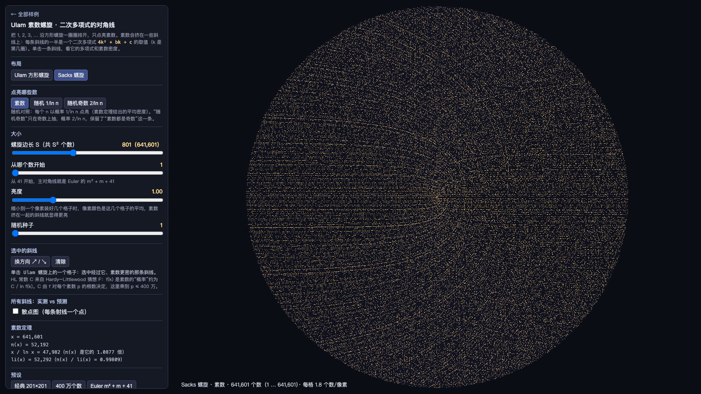

m² + εm + C₀ 的平方根约为 m + ε/2 + (C₀ − ε²/4)/(2m)，角度趋于常数 πε，所以每个二次多项式的取值在 Sacks 螺旋上是一条曲线：ε = 0 时渐近于正 x 轴，ε = 1 时渐近于负 x 轴。Ulam 螺旋里一条斜线上的素数，在这里就是一条亮的曲线。选中 Euler 主对角线以后切到 Sacks 布局，它的两条射线（偶数 m 和奇数 m）落在同一条曲线上，从中心绕出来后贴着负 x 轴向左延伸：

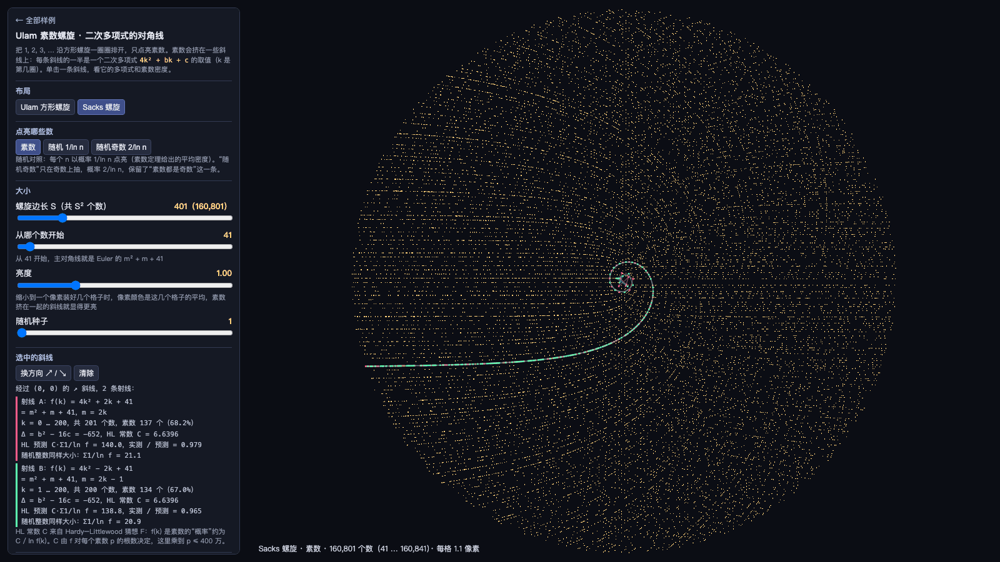

### 9. Bunyakovsky 猜想：还没有一个被证明

HL 猜想给的是渐近密度。更基本的问题是：一个二次多项式会不会取到无穷多个素数？

**Bunyakovsky 猜想**（1857）：整系数多项式 f 如果满足三个条件，就取到无穷多个素数：

1. 首项系数为正；
2. f 在整数上不可约；
3. f 的所有取值没有公共素因子，也就是没有 ω(p) = p 的素数 p。

三个条件都是必要的，页面在选中的射线上标出不满足的情况：

- **可约**：Δ 是完全平方时 f 能分解。例如反对角线 x + y = 0 的右下一半是 4k² + 4k + 1 = (2k + 1)²，全是奇数的平方，201 个数里 0 个素数。另一半是 (2k)² + 1，200 个数里 57 个素数。单击 (5, 5) 再按“换方向”，得到 4k² − 9 = (2k − 3)(2k + 3)，也可约。
- **公共因子**：c 为偶数的射线，所有值都是偶数（ω(2) = 2）。对 4k² + bk + c，只有 p = 2 可能出这个问题。

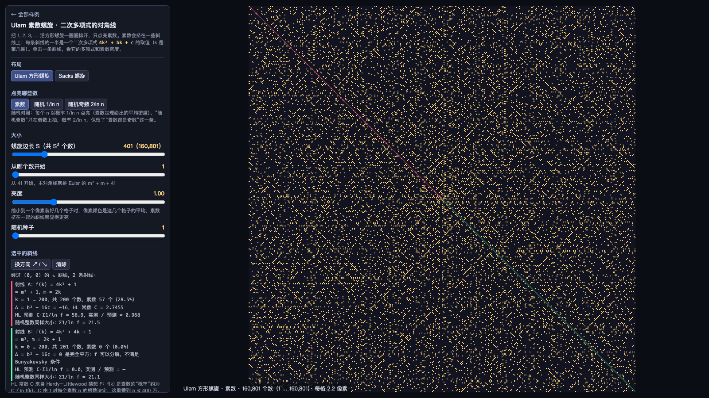

对一次多项式 ak + b，这就是 Dirichlet 定理（1837，已证）。对任何二次以上的多项式，至今一个也没有证明。最简单的 m² + 1 是否有无穷多个素数，是 1912 年 Landau 在国际数学家大会上列出的四个问题之一，到今天仍未解决。已知最好的结果是 Iwaniec（1978）：m² + 1 有无穷多次是至多两个素数的乘积。

所以 Ulam 螺旋上的斜线是一个很好的例子：一眼就能看到，HL 猜想能把每条线的密度预测到几个百分点，可是“这条线会一直亮下去”还没有一条被证明。

## 操作

- 布局：Ulam 方形螺旋 / Sacks 螺旋；
- 点亮哪些数：素数 / 随机 1/ln n / 随机奇数 2/ln n，随机种子 1–999；
- 螺旋边长 S（5–2001，奇数，共 S² 个数），从哪个数开始（1–1000）；
- 亮度：缩小到一个像素装好几个格子时，按平均颜色显示，可以调亮；
- 单击 Ulam 螺旋上的格子：选中经过它、附近素数更密的那条斜线（↗ 或 ↘），面板给出两条射线的多项式、m 的写法、实测个数、Δ、HL 常数、预测值；“换方向”“清除”；
- 散点图：所有长度 ≥ S/8 的射线的实测密度与 HL 常数，选中的射线用彩色圆圈标出；
- 素数定理：π(x)、x / ln x、li(x)；
- 预设：经典 201×201、400 万个数、Euler m² + m + 41、m² + 1 与平方数、最密的一条、Sacks 64 万个数、Sacks · Euler 曲线、随机对照、随机奇数对照、散点：实测 vs HL；
- 鼠标悬停显示格子坐标、数和圈数；拖动平移，滚轮以鼠标位置为中心缩放，双击复位。每格超过 14 个像素时写出数字。

## 网址参数

| 键 | 含义 |
|---|---|
| p | 预设名：classic, big, euler, landau, rich, sacks, sacksEuler, rand, odd, scatter |
| lay | 布局：ulam, sacks |
| set | 数集：prime, rand, odd |
| S | 螺旋边长（5–2001，取奇数） |
| s0 | 从哪个数开始（1–1000） |
| g | 亮度（0.3–3） |
| seed | 随机种子（1–999） |
| x, y, dir | 选中经过格子 (x, y) 的斜线，dir = 1 是 ↗，−1 是 ↘；不给 dir 时自动选更密的方向 |
| sc | 1 = 显示散点图 |
| z, cx, cy | 缩放倍数（0.2–400）、视野中心 |
| ui | 0 = 隐藏控制面板，只留画布 |

数值参数必须是有限数，超出范围的会被夹到滑块范围内；字符串参数只接受上表列出的值。例如：最密的那条斜线 `index.html?S=2001&x=-199&y=-199&dir=-1`；随机奇数对照的散点图 `index.html?S=2001&set=odd&sc=1`；放大看 Euler 多项式的数字 `index.html?p=euler&z=4.5&cx=-3&cy=-3`。

## 参考

- M. L. Stein, S. M. Ulam, M. B. Wells, *A visual display of some properties of the distribution of primes*, American Mathematical Monthly 71, 1964.
- M. Gardner, *Mathematical Games: The remarkable lore of the prime numbers*, Scientific American, 1964 年 3 月（Ulam 螺旋上了封面）。
- G. H. Hardy, J. E. Littlewood, *Some problems of 'Partitio Numerorum' III: On the expression of a number as a sum of primes*, Acta Mathematica 44, 1923. 猜想 F 在这里。
- P. T. Bateman, R. A. Horn, *A heuristic asymptotic formula concerning the distribution of prime numbers*, Mathematics of Computation 16, 1962.
- V. Bouniakowsky, *Sur les diviseurs numériques invariables des fonctions rationnelles entières*, Mém. Acad. Sc. St. Pétersbourg 6, 1857.
- G. Rabinowitsch, *Eindeutigkeit der Zerlegung in Primzahlfaktoren in quadratischen Zahlkörpern*, J. reine angew. Math. 142, 1913.
- H. Cramér, *On the order of magnitude of the difference between consecutive prime numbers*, Acta Arithmetica 2, 1936.
- H. Iwaniec, *Almost-primes represented by quadratic polynomials*, Inventiones Mathematicae 47, 1978.
- R. Sacks, [numberspiral.com](https://www.numberspiral.com/)（Sacks 螺旋）。
