# Voronoi 图 · 长颈鹿的花纹

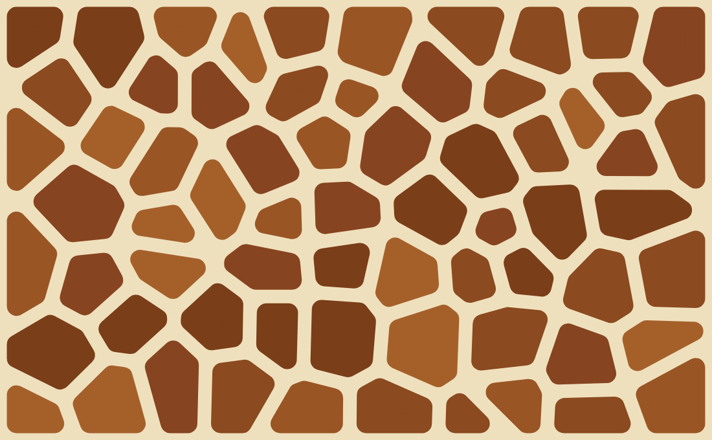

网纹长颈鹿身上是一块块棕色的多边形，中间隔着米色的细网。把每块斑的中心当成一个“站点”，再把平面上每个位置分给离它最近的站点，就得到几乎一样的图案。这种分法叫 **Voronoi 图**。它的对偶是把相邻站点连起来的 **Delaunay 三角剖分**。蜻蜓翅膀上的翅脉、干涸河床的裂纹、玄武岩柱的截面也都像 Voronoi 图。再把每个站点反复挪到自己格子的质心（**Lloyd 松弛**），随机的格子会一步步变成接近正六边形。

打开方式：用浏览器直接打开 [index.html](index.html)。页面只用 Canvas 2D，不依赖外部库，离线也能用。

下文的数字都是从页面上读出来的：每张截图对应的网址参数写在图下，数字取自同一个画面右下角的统计行和面板里的“Delaunay 检查”。截图画布为 1100×680。

## 数学原理

### 1. 最近邻区域与垂直平分线

给定平面上的站点 p₁ … p_n，站点 p_i 的 **Voronoi 胞**是所有离它不比离别的站点远的点：

```
V_i = { x : |x − p_i| ≤ |x − p_j|，对所有 j ≠ i }
```

只看两个站点 p_i、p_j 时，满足 |x − p_i| ≤ |x − p_j| 的点是一个半平面，边界就是线段 p_i p_j 的**垂直平分线**。两边平方后 |x|² 消掉，剩下一个一次不等式：

```
2 (p_j − p_i) · x ≤ |p_j|² − |p_i|²
```

所以 V_i 是 n − 1 个半平面的交集，一定是**凸多边形**（靠边的胞再和画框求交）。页面就这样精确地算出每个胞：从整个画框出发，用每个邻近站点的垂直平分线切一刀，留下靠 p_i 的一侧。站点按格子一圈一圈往外找；当前胞的最远顶点离 p_i 为 R，距离超过 2R 的站点，它的平分线离 p_i 超过 R，碰不到这个胞，于是可以停下。

勾选“选中点的中垂线”和“选中点的外接圆”就能看到这个构造。下图里白点是选中的站点，粉色虚线是它和最近的十几个站点之间的垂直平分线。实线粉色的那几条真的切到了胞，白框围出的就是切完剩下的胞：

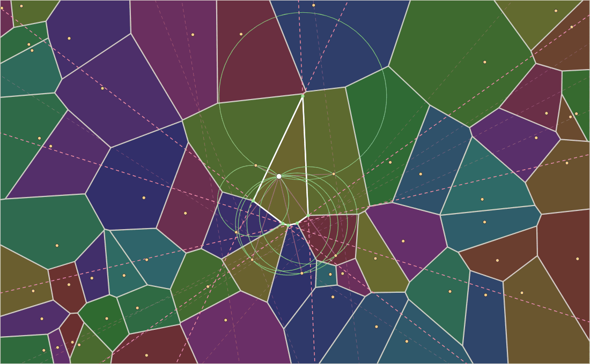

`?p=random&bis=1&cc=1&ui=0`

胞的每个顶点到三个站点的距离相等，所以它是这三个站点的**外接圆圆心**。图中绿色圆就是这些外接圆，绿点（圆心）正好落在白框的顶点上。

### 2. 对偶：Delaunay 三角剖分

两个站点的胞有公共边时，就在它们之间连一条线。连出来的图把站点的凸包剖分成三角形，这就是 **Delaunay 三角剖分**：

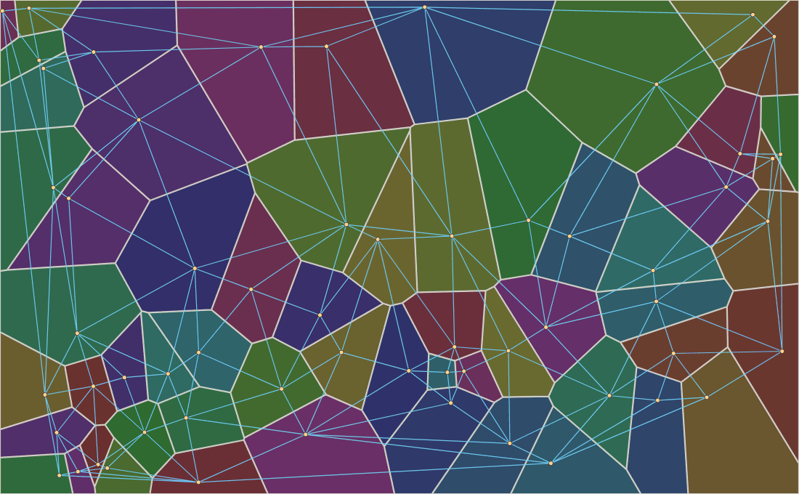

`?p=random&del=1&ui=0`

Voronoi 的每个顶点对应一个 Delaunay 三角形，每条 Voronoi 边对应一条 Delaunay 边（两者互相垂直），每个 Voronoi 胞对应一个站点。

Delaunay 三角剖分有一个等价的刻画，叫**空外接圆性质**：每个三角形的外接圆内部没有任何站点。原因见上一节，外接圆圆心是 Voronoi 顶点，它到这三个站点的距离 R 比到其他站点都近，所以别的站点都在圆外。

页面没有从 Voronoi 图反推三角剖分，而是用 **Bowyer–Watson 算法**独立算一遍：

1. 先用三个不共线的站点组成一个三角形；
2. 每加入一个新点 p，找出外接圆包含 p 的所有三角形，它们连成一个星形的“空腔”；
3. 删掉空腔里的三角形，把 p 和空腔边界上的每条边连成新三角形。

凸包外面的区域用一个“无穷远点”处理。凸包的每条边配一个“幽灵三角形”，它的“外接圆”就是这条边外侧的半平面。新点落在凸包外时，它能看见的那些凸包边会被一起换掉，不需要一个人为放大的“超级三角形”。

然后页面对算出的三角剖分做数值检查（面板里的“Delaunay 检查”）。对上图的 60 个点：

| 检查 | 结果 |
|---|---|
| 三角形个数 | 106 |
| 外接圆内部有其他站点的三角形 | 0 个（对每个三角形检查全部 60 个点，容差 10⁻⁹） |
| 内部三角形外接圆外最近的点 | 在 1.0039 R 处 |
| Voronoi 邻接的站点对 | 149 对，全部是 Delaunay 边 |
| 多出来的 Delaunay 边 | 16 条：它们对偶的 Voronoi 边落在画框外，被裁掉了 |

Lloyd 松弛 300 步以后（第 5 节），站点排成近似六边形格子，四点几乎共圆的情形变多。即使这样，空外接圆检查仍是 0 处违例。

### 3. Euler 公式：为什么平均有 6 个邻居

三角剖分是一个平面图。设它有 V 个顶点（站点）、E 条边、T 个三角形，凸包上有 h 个顶点。**Euler 公式**（算上外面那个无界面）说

```
V − E + (T + 1) = 2
```

再数一遍边：每个三角形有 3 条边，内部的边被两个三角形共用，凸包上的 h 条边只用一次，所以 3T = 2E − h。两式消去 T：

```
E = 3V − 3 − h，   平均度数 2E / V = 6 − (6 + 2h) / V
```

V 很大而 h 相对很小时（随机点的凸包顶点数只按 log V 增长），平均度数趋于 6。一个站点的 Delaunay 度数就是它的 Voronoi 胞的边数，所以 **Voronoi 胞平均是六边形**。这和站点怎么撒无关，只是平面图的拓扑约束。

页面在面板里直接验证这两个等式：

| 预设 | V | E | T + 1 | h | 3V − 3 − h | 2E/V | 内部胞平均边数 |
|---|---|---|---|---|---|---|---|
| 随机 60 点 | 60 | 165 | 107 | 12 | 165 | 5.500 | 5.625（32 个内部胞） |
| 随机 250 点 | 250 | 734 | 486 | 13 | 734 | 5.872 | 5.890（191 个内部胞） |

V − E + F 两行都等于 2。2E/V 比 6 小，是因为凸包附近的站点邻居少；只看不碰画框的内部胞，平均边数更接近 6。注意这里的平均是 6，但单个胞是几边形都有可能。上面的随机 60 点里，内部胞只有 34.4% 是六边形。

### 4. Delaunay 最大化最小角

同一组点有很多种三角剖分。在一个凸四边形 abcd 里，对角线 ac 或 bd 都能把它分成两个三角形。Delaunay 选的那条满足：第四个点在另外三点的外接圆外。用圆周角定理可以证明，这一条对角线给出的 6 个角里**最小的那个更大**。把不满足的边一条条翻过去（Lawson 翻边），最小角只增不减，最后停在 Delaunay 三角剖分上。所以在所有三角剖分里，Delaunay 的最小角最大（Sibson 1978），三角形尽量不细长。这是有限元网格和地形插值爱用它的原因。

页面逐条检查：对每条内部边，如果它两侧的三角形拼成凸四边形，就算一下换成另一条对角线后的最小角。

| 预设 | 内部边 | 翻转后最小角变大的边 |
|---|---|---|
| 随机 60 点 | 153 | 0 |
| 随机 250 点 | 721 | 0 |
| 随机 250 点，Lloyd 300 步 | 731 | 0 |

Lloyd 松弛对角度的改善很明显。随机 250 点的内部三角形最小角只有 1.68°，松弛 300 步后是 41.72°。正六边形格点的对偶是正三角形格子，最小角是 60.00°。

### 5. Lloyd 松弛与重心 Voronoi 剖分

把“每个点离自己的站点有多远”加起来，就是一个能量：

```
E = Σ_i ∫_{V_i} |x − p_i|² dA
```

页面显示的是无量纲的 **G = n · E / 面积²**，它和站点个数、画布大小都无关。**Lloyd 算法**交替做两件事：

1. 站点不动，按最近站点重新分胞。这正是 Voronoi 图，每个点都分给最近的站点，E 不会变大；
2. 胞不动，把每个站点挪到自己胞的**质心** c_i。由平行轴定理 ∫|x − p|² = ∫|x − c|² + A·|p − c|²，站点放在质心时 E 最小。

两步都不会让 E 变大，所以 E 单调下降。不动点是每个站点恰好在自己胞的质心上，叫**重心 Voronoi 剖分**（centroidal Voronoi tessellation，CVT）。平面上 G 的最小值属于正六边形格子（Fejes Tóth；Gersho 猜想在二维的情形），G = 5√3/54 ≈ 0.1604。正方形格子是 1/6 ≈ 0.1667。完全随机的站点（Poisson 点过程）期望是 1/π ≈ 0.3183。

| 松弛前（随机 250 点） | 松弛 300 步后 |
|---|---|
| 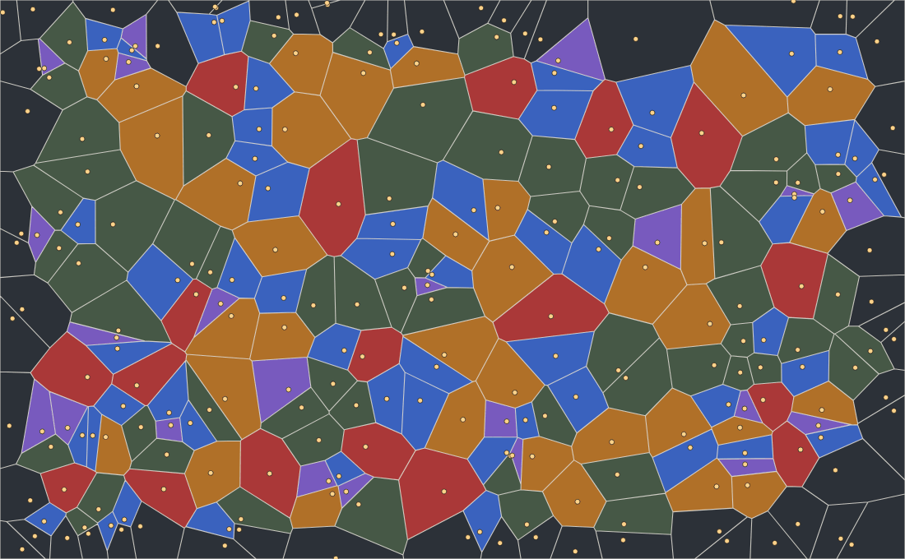 | 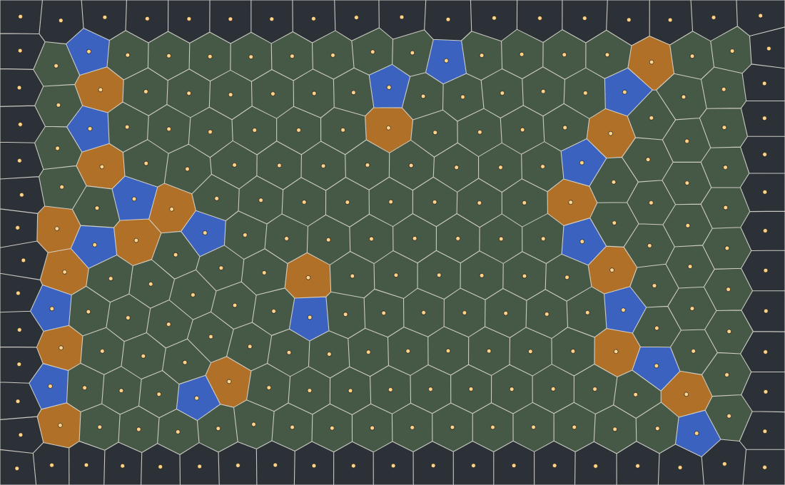 |

`?n=250&nb=1&ui=0` 和 `?n=250&nb=1&lloyd=300&ui=0`。按邻居数着色：蓝 5、绿 6、橙 7、红 8+，碰到画框的胞是灰色

| Lloyd 步数 | 0 | 1 | 2 | 5 | 10 | 20 | 50 | 100 | 200 | 300 |
|---|---|---|---|---|---|---|---|---|---|---|
| G（全部胞） | 0.3422 | 0.2235 | 0.1996 | 0.1827 | 0.1764 | 0.1712 | 0.1663 | 0.1648 | 0.1637 | 0.1634 |
| G（内部胞） | 0.3211 | 0.2147 | 0.1941 | 0.1795 | 0.1740 | 0.1690 | 0.1645 | 0.1632 | 0.1625 | 0.1623 |
| 内部胞中六边形 | 31.9% | 30.2% | 37.0% | 40.0% | 46.8% | 58.9% | 77.4% | 83.1% | 84.1% | 82.0% |

页面记录了每一步的 G。300 步里每一步都不比上一步大，正是上面证明的单调性。G 前几步下降得最快，第 1 步就从 0.342 掉到 0.224，之后越来越慢，内部胞的 G 停在 0.1623，比正六边形的 0.1604 只高 1.2%。六边形的比例从 32% 升到 80% 以上就不再涨。剩下的是一对对相邻的五边形和七边形（右图蓝橙相邻的胞），是六边形格子里的“位错”。Lloyd 只保证走到一个局部最优，消不掉这些拓扑缺陷，晶体里的位错也是这样。1000 个点的情况类似：G 从 0.3191（接近随机点的理论值 1/π = 0.3183）降到 300 步后的 0.1629，六边形比例 82.1%。

面板里的曲线同时画出 G（橙）和六边形比例（蓝），虚线是 0.1604：

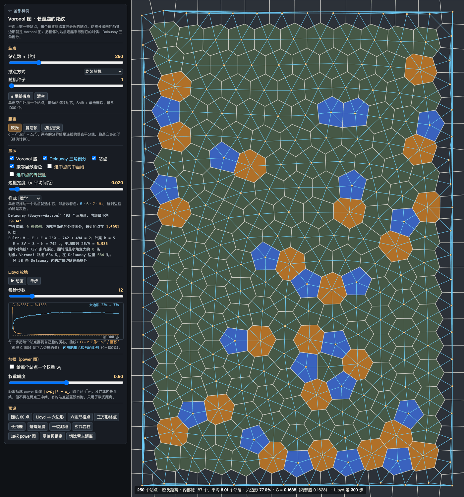

`?n=250&nb=1&del=1&lloyd=300`，画布 1004×1500，所以站点和上面的图不同

作为对照，两种完美格子的内部胞：

| 六边形格点 | 正方形格点 |
|---|---|
| 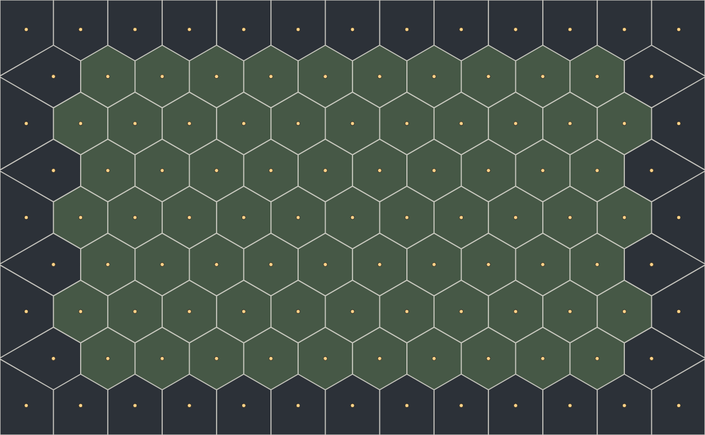 | 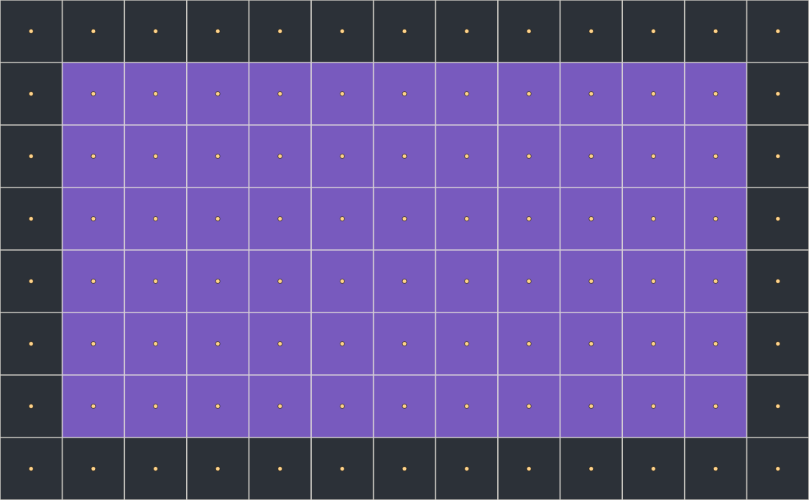 |
| 73 个内部胞全是六边形，G = 0.16038，即 5√3/54；最小角 60.00°；外接圆外最近的点在 2R 处 | 66 个内部胞平均 4.000 条边，G = 0.16667，即 1/6；每四个格点共圆，外接圆外最近的点在 (1 + 5·10⁻⁸) R 处 |

`?p=hexlat&ui=0` 和 `?p=square&nb=1&ui=0`

正方形格子说明了空外接圆性质的边界情况：每个小正方形的四个顶点在同一个圆上，两条对角线都满足“外接圆内没有点”，Delaunay 三角剖分不唯一。页面生成格点时给每个点加了不到 10⁻³ 像素的抖动，打破平局。

### 6. 换一种距离

“最近”取决于怎么量距离。页面提供三种：

| 距离 | 公式 | 单位“圆” |
|---|---|---|
| 欧氏 | √(Δx² + Δy²) | 圆 |
| 曼哈顿 | \|Δx\| + \|Δy\| | 旋转 45° 的正方形 |
| 切比雪夫 | max(\|Δx\|, \|Δy\|) | 正方形 |

同样 40 个站点：

| 欧氏 | 曼哈顿 | 切比雪夫 |
|---|---|---|
| 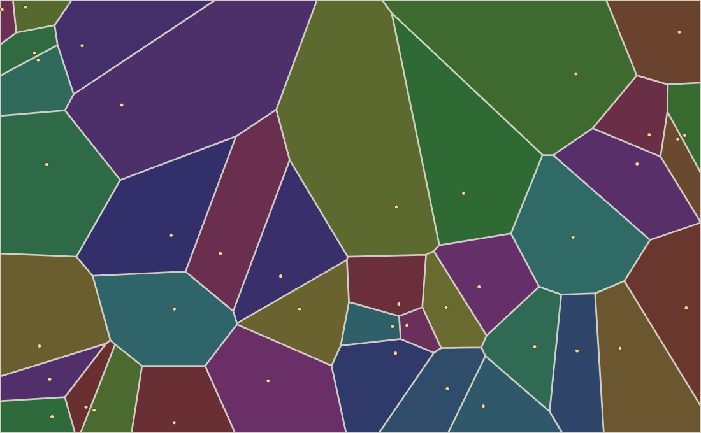 | 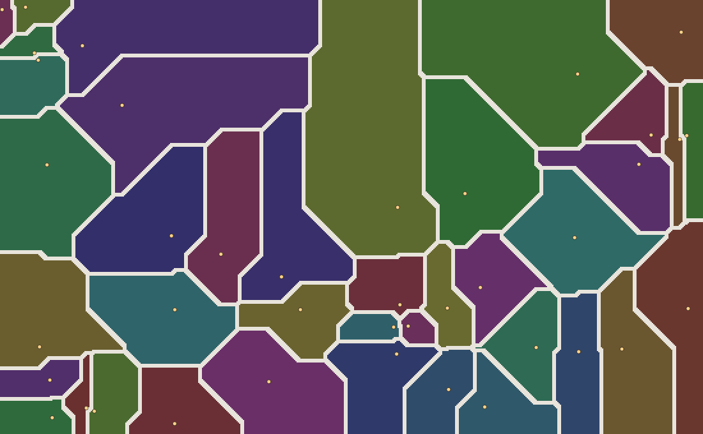 | 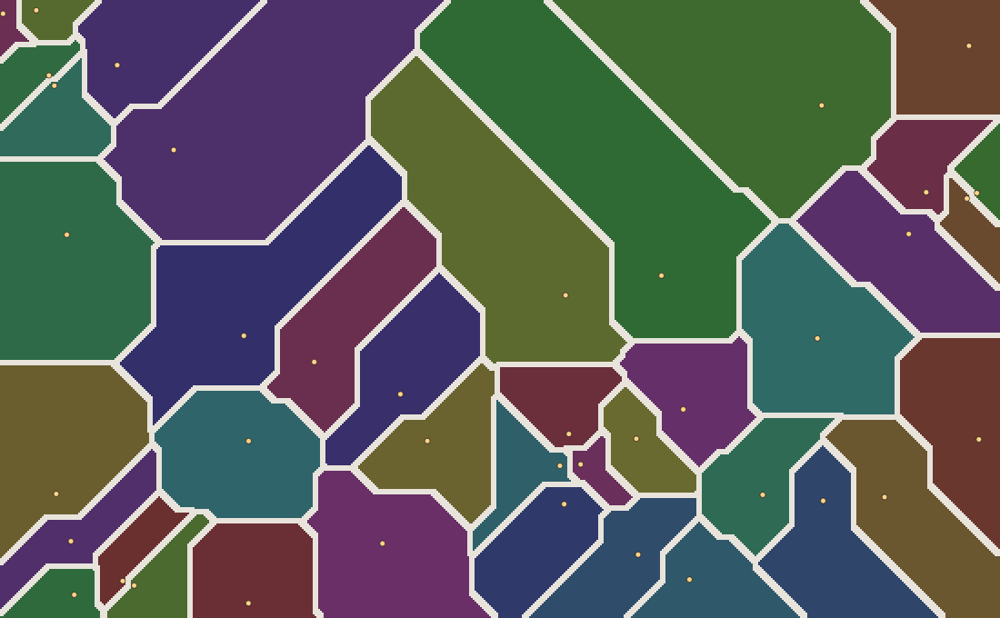 |

`?p=l1&metric=l2&ui=0`、`?p=l1&ui=0`、`?p=linf&ui=0`

后两种距离下，两点的“平分线”不再是直线，而是由水平、竖直和 45° 线段拼成的折线。两点的 Δx = Δy 时，平分线甚至会张成一整块区域（页面把它分给编号小的站点）。胞不一定是凸的，所以页面改为逐像素计算：每个像素在格子里一圈圈地找最近站点，三种距离都不小于切比雪夫距离，用它来判断何时可以停。这两种距离下没有 Delaunay 三角剖分，勾选“Delaunay”时画的是像素相邻的胞之间的连线。

### 7. 加权：power 图

给每个站点一个权重 w_i，把距离换成 **power 距离** |x − p_i|² − w_i。可以把它想成一个半径 √w_i 的圆，x 到它的切线长的平方。两个站点之间的分界仍然是直线，叫**根轴**，但它向权重小的一侧偏：

```
2 (p_j − p_i) · x ≤ |p_j|² − |p_i|² + w_i − w_j
```

所以页面用同一套半平面裁剪来算，只是常数项多了 w_i − w_j。

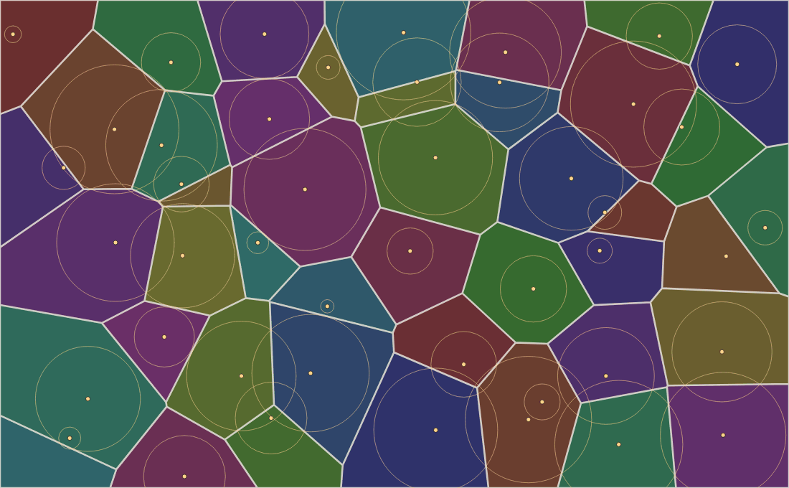

`?p=power&ui=0`

权重大的站点会把胞扩到邻居那边。被大圆包围的小站点甚至可能一个点都分不到，上图的 45 个站点里有 1 个胞是空的。站点也不一定在自己的胞里。power 图的对偶叫**正则三角剖分**，勾选 Delaunay 时页面画的是 power 图里相邻的胞的连线。

### 8. 自然界里的 Voronoi 图

很多“从种子同时长出、长到碰头为止”的过程都会得到 Voronoi 图：从每个站点以同样的速度向外扩张，两块区域在离两站点等远的地方相遇，相遇线就是垂直平分线。

| 干裂泥地 | 蜻蜓翅膀 |
|---|---|
| 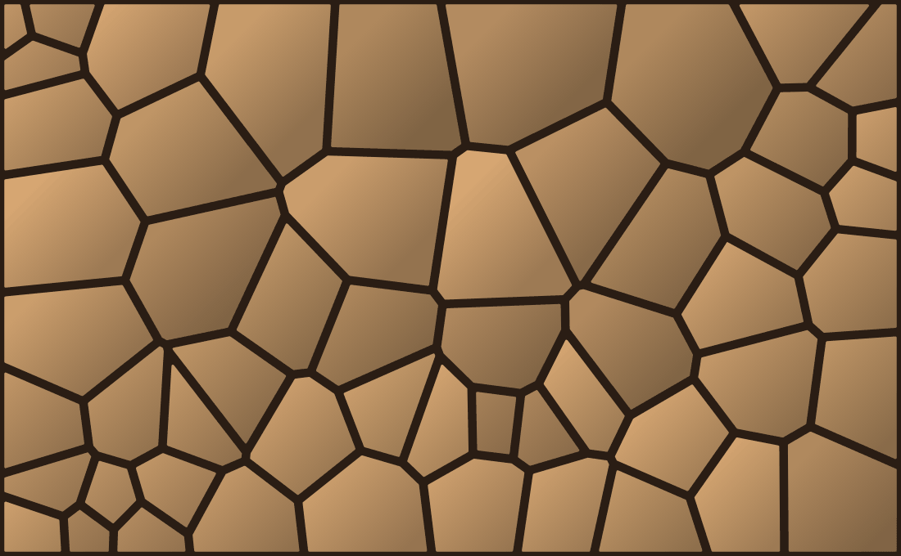 | 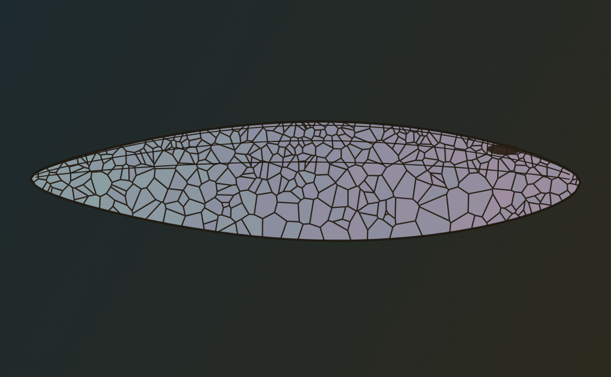 |

`?p=mud&ui=0` 和 `?p=wing&ui=0`

- **长颈鹿**（页首图，`?p=giraffe&ui=0`）：在六边形格点上加 0.75 倍格距的抖动，胞向内缩、加圆角，留出米色的网。67 个站点里内部胞平均 5.925 条边，42.5% 是六边形。斑纹怎么在胚胎里形成还没有定论。“从中心向外长到碰头”是一种模型；另一种是化学物质的反应扩散，见 [图灵斑图 · 反应扩散](../turing-patterns/README.md)，那里的豹纹斑点也是从均匀状态自己长出来的。
- **干裂泥地**：55 个随机站点只松弛 1 步，裂缝画粗。真实的泥裂往往先出现 T 形的直角交叉，反复干湿以后才变成接近 120° 的 Y 形交叉；Voronoi 图里的交叉一律是 Y 形，更像后期的样子。
- **蜻蜓翅膀**：330 个站点只撒在翅膀轮廓里，前缘和翅根更密；再加几条纵向主脉，和翅尖前缘深色的翅痣。Hoffmann 等（2018）用“从随机分布的中心发出、互相抑制的信号”重现了昆虫翅脉的网格，得到的正是这种 Voronoi 式的小格子。

**玄武岩柱**（如爱尔兰的巨人堤）是熔岩冷却收缩时裂开的。裂缝一轮轮向内推进，截面的多边形逐渐变规则。Lloyd 松弛正好模拟了“格子越变越匀”的趋势：

| 玄武岩，松弛前 | 松弛 150 步 |
|---|---|
| 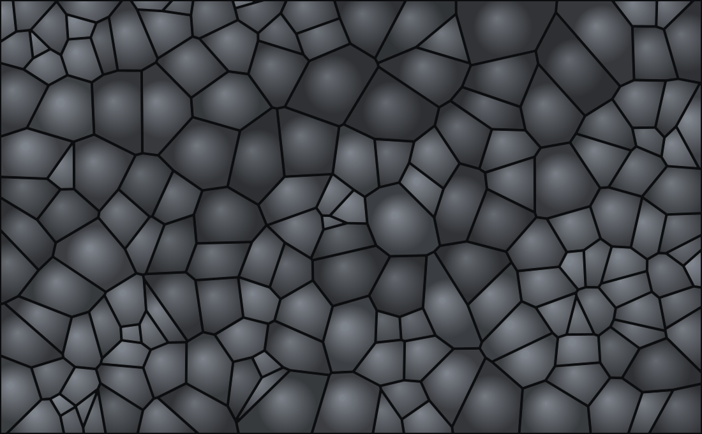 | 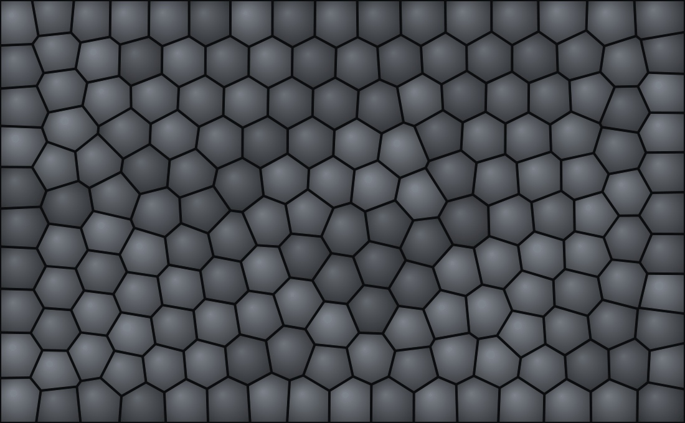 |

`?p=basalt&run=0&ui=0` 和 `?p=basalt&lloyd=150&ui=0`

170 个站点里，内部胞的六边形比例从 36.9% 升到 77.7%，G 从 0.3232 降到 0.1642，内部胞平均 6.008 条边。点“玄武岩柱”预设时页面会自动播放这个松弛过程。

### 9. 现实中的用途

- **John Snow 的霍乱地图（1854）**：伦敦 Soho 暴发霍乱时，John Snow 把死者的位置标在地图上，发现他们集中在 Broad Street 水泵周围。在给调查委员会的版本里，他画了一条边界：边界内的人步行去 Broad Street 水泵比去其他水泵更近。这正是一个 Voronoi 胞，只是距离按街道上的步行路程计算。边界内的死亡远多于边界外，这成了“霍乱经水传播”的有力证据。
- **手机基站**：手机通常连到信号最强、往往也是最近的基站，所以每个基站服务的区域近似它的 Voronoi 胞。规划新基站时可以先看哪些胞太大。发射功率不同时要用加权的版本，本页的 power 图是最简单的一种。
- 其他：最近邻查询（最近的医院、加油站），机器人路径规划（沿 Voronoi 边走离障碍物最远），晶体学里的 Wigner–Seitz 原胞（格点的 Voronoi 胞），以及用 Lloyd 算法做的点画（stippling）和向量量化（k-means 就是离散版的 Lloyd 算法）。

## 操作

- 单击空白处加一个站点，拖动站点移动它，Shift + 单击删除。最多 1000 个站点；单击或拖动的站点会被“选中”；
- 站点数、撒点方式（均匀随机 / 抖动的六边形格点 / 六边形格点 / 正方形格点 / 翅膀形状）、抖动幅度、随机种子（同一个种子得到同样的点）、重新撒点、清空；
- 距离：欧氏、曼哈顿、切比雪夫；
- 显示：Voronoi 胞、Delaunay 三角剖分、站点、按邻居数着色、选中点的中垂线、选中点的外接圆、边框宽度、样式（数学 / 长颈鹿 / 蜻蜓翅膀 / 干裂泥地 / 玄武岩柱）；
- Lloyd 松弛：▶ 动画 / ⏸ 暂停、单步、每秒步数（1–60），站点每步移动不到 0.005 像素时自动停下；
- 加权：开关、权重幅度；
- 预设：随机 60 点、Lloyd → 六边形、六边形格点、正方形格点、长颈鹿、蜻蜓翅膀、干裂泥地、玄武岩柱、加权 power 图、曼哈顿距离、切比雪夫距离。

## 网址参数

| 键 | 含义 |
|---|---|
| p | 预设：random, lloyd, hexlat, square, giraffe, wing, mud, basalt, power, l1, linf |
| n | 站点数（3–1000，格点方式下是近似值） |
| dist | 撒点方式：rand, jitter, hex, square, wing |
| jit | 抖动幅度（0–1，× 格距） |
| seed | 随机种子（1–999） |
| metric | 距离：l2, l1, linf |
| style | 样式：math, giraffe, wing, mud, basalt |
| vor, del, sites, nb, bis, cc, wt | 1 / 0：Voronoi 胞、Delaunay、站点、按邻居数着色、中垂线、外接圆、加权 |
| bw | 边框宽度（0–0.4，× 平均间距） |
| wa | 权重幅度（0–1） |
| sel | 选中第几个站点（从 0 开始） |
| lloyd | 打开时先做几步 Lloyd 松弛（0–300） |
| run | 1 = 打开时播放松弛动画，0 = 不播放 |
| speed | 每秒步数（1–60） |
| ui | 0 = 隐藏面板，只显示画布 |

例如 1000 个点松弛 100 步：`index.html?n=1000&lloyd=100&nb=1`；看切比雪夫距离下的对偶图：`index.html?metric=linf&del=1`。

## 参考

- G. Voronoi, *Nouvelles applications des paramètres continus à la théorie des formes quadratiques*, Journal für die reine und angewandte Mathematik 133, 1908.
- B. Delaunay, *Sur la sphère vide*, Bulletin de l'Académie des Sciences de l'URSS, 1934.
- A. Bowyer, *Computing Dirichlet tessellations*, The Computer Journal 24, 1981；D. F. Watson, *Computing the n-dimensional Delaunay tessellation with application to Voronoi polytopes*, 同刊同期。
- R. Sibson, *Locally equiangular triangulations*, The Computer Journal 21, 1978.
- S. Lloyd, *Least squares quantization in PCM*, IEEE Transactions on Information Theory 28, 1982.
- Q. Du, V. Faber, M. Gunzburger, *Centroidal Voronoi tessellations: applications and algorithms*, SIAM Review 41, 1999.
- F. Aurenhammer, *Power diagrams: properties, algorithms and applications*, SIAM Journal on Computing 16, 1987.
- J. Hoffmann, S. Donoughe, K. Li, M. K. Salcedo, C. H. Rycroft, *A simple developmental model recapitulates complex insect wing venation patterns*, PNAS 115, 2018.
- L. Goehring, *Evolving fracture patterns: columnar joints, mud cracks and polygonal terrain*, Philosophical Transactions of the Royal Society A 371, 2013.
- J. Snow, *On the Mode of Communication of Cholera*, 第 2 版，1855。
